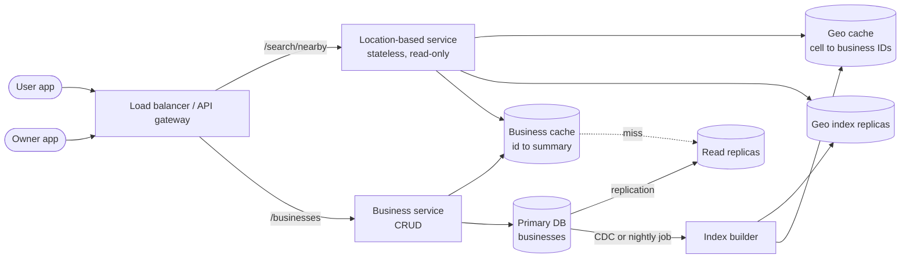

## Definition (interview-ready)

A **proximity service** answers "show me restaurants (or gas stations, or hotels) within 2 km of where I am", and also lets business owners add, edit and remove their listings. The design splits into two services. The **business service** handles CRUD on business details in an ordinary relational database. The **location-based service (LBS)** is stateless, read-only and replicated widely. It answers radius searches from a small **geospatial index** that maps each grid cell to the business IDs inside it.

The key decision is how to index 2D points so a database can find them quickly. The common choices are **geohash** (encode lat/lng into a string prefix and search the cell plus its 8 neighbours), a **quadtree** (an in-memory tree that splits crowded areas), or Google **S2** / Uber **H3** cells. The second decision is that businesses rarely move, so the index can be refreshed in batches and cached heavily. The main trade-off: you accept a few minutes of staleness for new or edited businesses in exchange for cheap, fast, horizontally scaled reads.

**One-liner:** Keep business CRUD in a primary DB, build a read-only geohash (or quadtree) index of business IDs replicated behind a stateless search tier, answer a radius query by scanning the user's cell plus its 8 neighbours, then filter by exact distance, rank and hydrate business details from cache.

## Problem statement

"Design a service like Yelp's 'nearby' search. A user opens the app, and we show businesses near their current location within a radius they choose: 0.5, 1, 2, 5 or 20 km. Users can tap a result to see the business's details. Business owners can add, update or delete their business; those changes do not need to show up in search instantly, the next day is fine."

Scale the interviewer gives:

- 100 million daily active users.
- 200 million businesses worldwide.
- Each user does about 5 searches a day.
- Search results should come back fast (think under 200 ms).

## Requirements

### Functional (in scope)

- **Search nearby:** given a latitude, longitude and radius (plus an optional category like "coffee"), return businesses inside the radius, nearest first, paginated.
- **View a business:** fetch full details for one business by ID.
- **Manage a business:** owners can create, update and delete a business. Changes may take effect in search by the next day.

### Non-functional

- **Low latency** on search (p99 under about 200 ms end to end).
- **High availability**: search must stay up even if the write side is down.
- **Read-heavy**: searches vastly outnumber business edits.
- **Scale** to traffic peaks in dense cities and at meal times.
- **Privacy**: user location is sensitive; don't store it with identity longer than needed.

### Out of scope

- Reviews, photos and ratings pipelines (assume a `rating` field exists).
- Turn-by-turn routing or travel-time (ETA) ranking.
- Moving objects like drivers or friends. Those change position every few seconds and need a different design (see [HLD: Ride-Sharing](/learn/notes/hld-ride-sharing/)).

### Clarifying questions to ask

- Can the user change the radius, and what is the maximum? (Here: up to 20 km.)
- If there are too few results in the radius, should we widen the search automatically?
- How fresh must business edits be in search? (Here: next day is fine; this is the most important answer, because it makes the index nearly read-only.)
- Do we need filters (category, open now, price) and ranking beyond distance?
- Is traffic global or one country? (Affects region placement and the antimeridian edge case.)

## Scale estimation

**Search QPS**

- 100M DAU × 5 searches = 500M searches per day.
- 500M / 86,400 s ≈ **5,800 searches per second** on average.
- Assume a 3× peak (lunch and dinner): about **17,000 QPS**.

**Business writes**

- Say 1% of businesses change something per day: 200M × 1% = 2M writes per day.
- 2M / 86,400 ≈ **23 writes per second**. Tiny next to reads, about 250 times fewer.

**Storage: business details**

- 200M businesses × about 1 KB each (name, address, category, hours, lat/lng) = **200 GB**. Fits in one big relational database; shard or add replicas for read load, not for size.

**Storage: the geo index**

- Each entry is roughly a business ID (8 bytes) plus a geohash or two coordinates (8 to 16 bytes), so about 24 bytes.
- 200M × 24 bytes ≈ **4.8 GB** of raw data. Even with several times overhead (B-tree pages, Redis sorted-set structures), this is tens of GB at most, so **the whole index fits in memory on one machine**. We replicate it for read throughput and availability, not because it is too big.

**Bandwidth**

- A search returns about 20 results × ~200 bytes of summary each ≈ 4 KB.
- 17,000 QPS × 4 KB ≈ **68 MB/s** at peak. Comfortable.

**How to say it in an interview:** "About 6K search QPS on average, 17K at peak, and only about 23 writes per second. The geo index is a few GB, so it fits in memory. This is a read-heavy, nearly static index problem, so I'll optimise for reads and replicate."

See [Back-of-envelope math](/learn/notes/back-of-envelope-math/) for the method.

## Core API

```
GET /v1/search/nearby?lat=12.9716&lng=77.5946&radius=2000&category=cafe&page_token=...
  → 200 {
      "businesses": [ { "id": 81, "name": "...", "distance_m": 340, "rating": 4.4 }, ... ],
      "next_page_token": "..."
    }

GET    /v1/businesses/{id}          → full business details
POST   /v1/businesses               → create (owner only)
PUT    /v1/businesses/{id}          → update (owner only)
DELETE /v1/businesses/{id}          → delete (owner only)
```

Notes:

- `radius` is in metres and validated against the allowed values (or a maximum of 20,000).
- Search returns **summaries** only. The client calls `GET /businesses/{id}` for the full page, which is easy to cache.
- Pagination uses an opaque token rather than offset, so later pages don't redo work. The token can encode the last distance and ID seen.
- Write endpoints need auth (owner role) and an idempotency key on `POST`, so a retried create doesn't make two listings.

## High-level architecture



**Read path (search):**

1. The user app sends `lat`, `lng`, `radius`. The gateway routes it to any LBS instance (they are stateless).
2. LBS picks a geohash precision from the radius, computes the user's cell and its 8 neighbours (9 cells).
3. For each cell, it reads the list of business IDs from the geo cache, falling back to the geo index replicas on a miss.
4. It hydrates candidates (lat/lng, category, rating) from the business cache, computes the **exact** distance, drops anything outside the radius or not matching filters, sorts nearest first and returns a page.

**Write path (business edit):**

1. The owner app calls the business service, which writes to the primary DB and invalidates (or updates) that business's cache entry.
2. The location index is **not** updated in the request. A change-data-capture stream or a nightly batch job (the requirements allow next day) rebuilds the affected cells and pushes them to the geo index replicas and the geo cache.

The important split: **business CRUD and the location index are separate concerns.** CRUD needs strong consistency for one row. The index needs fast reads over many rows and tolerates staleness. Separating them lets each scale on its own and keeps search running when the write side is down.

## Data model

### Business table (source of truth)

```sql
CREATE TABLE business (
  business_id  BIGINT PRIMARY KEY,
  owner_id     BIGINT NOT NULL,
  name         VARCHAR(200) NOT NULL,
  category     VARCHAR(50),
  address      TEXT,
  latitude     DOUBLE PRECISION NOT NULL,
  longitude    DOUBLE PRECISION NOT NULL,
  rating       NUMERIC(2,1),
  is_deleted   BOOLEAN DEFAULT FALSE,
  updated_at   TIMESTAMP NOT NULL
);
```

- Partition (shard) key if needed: `business_id` (hash). Every CRUD call has the ID, so each hits one shard. At 200 GB we may not need sharding at all; read replicas handle read load.
- Soft delete (`is_deleted`) so the index builder can see deletions and remove them.

### Geo index table (option A: geohash rows)

```sql
CREATE TABLE geohash_index (
  geohash      VARCHAR(12) NOT NULL,   -- stored at full precision, e.g. 6 chars
  business_id  BIGINT NOT NULL,
  PRIMARY KEY (geohash, business_id)
);
```

- One row per business. A query for a shorter prefix becomes a range scan: `WHERE geohash LIKE '9q8yy%'`, which a B-tree index on `geohash` serves as a prefix range. (In Postgres this needs the C collation or a `text_pattern_ops` index; writing it as `geohash >= '9q8yy' AND geohash < '9q8yz'` works everywhere.)
- Composite primary key makes add and remove cheap and avoids storing one huge "list of IDs" per cell that would need locking on every update.
- If you shard it, shard by **geohash prefix**, but beware hotspots: dense cities put many rows on one shard. At a few GB, simpler is to **replicate the whole table** to every read node and skip sharding.

### Geo index (option B: Redis GEO)

```
GEOADD geo:businesses <lng> <lat> <business_id>
```

One sorted set holds every business; the score is a 52-bit geohash. Covered in detail below.

### Cache keys

```
geo:cell:<precision>:<geohash>   → list of business IDs in that cell
biz:<business_id>               → business summary (name, lat, lng, category, rating)
```

## Detailed design

### 1. Why radius search is hard, and the naive answer

The naive SQL is:

```sql
SELECT business_id FROM business
WHERE latitude  BETWEEN :lat - :d AND :lat + :d
  AND longitude BETWEEN :lng - :d AND :lng + :d;
```

Even with an index on `latitude` and another on `longitude`, the database can use only one of them well. It finds every business in a thin horizontal strip across the whole planet, then filters by longitude (or intersects two huge sets). A B-tree orders data along **one** dimension, but location is **two** dimensions.

So the core idea of every geo index is: **map 2D space into 1D keys while keeping nearby points close in key order.** Then an ordinary sorted index (B-tree, sorted set) can do the job. Geohash, quadtrees, S2 and H3 are different ways of doing that mapping.

There are two families:

- **Even grids** (geohash, S2, H3): the world is cut into fixed cells regardless of where businesses are.
- **Adaptive trees** (quadtree): crowded areas are split more finely, empty areas stay coarse.

### 2. Geohash: how it works, the precision table, and the boundary problem

**Intuition.** Split the world in half by longitude: left half is bit 0, right is bit 1. Split by latitude: bottom 0, top 1. Keep alternating (longitude first), halving the box each time. Every extra bit halves the cell. Group the bits five at a time and write each group as one base-32 character (`0123456789bcdefghjkmnpqrstuvwxyz`, which skips a, i, l and o). The result is a short string like `tdr1v9`. Points in the same small box share the same prefix.

**Worked precision table.** A geohash of length n has 5n bits. Longitude gets the extra bit when 5n is odd. Cell width at the equator = 360° / 2^(lng bits) × ~111.3 km per degree; height = 180° / 2^(lat bits) × ~111 km per degree. Width shrinks as you move away from the equator (by cos(latitude)), so these are the biggest the cells get. The figures match the cell-size table in the Elasticsearch docs.

| Length | Lng bits | Lat bits | Cell width × height (at equator) |
|---|---|---|---|
| 1 | 3 | 2 | ~5,009 km × 4,993 km |
| 2 | 5 | 5 | ~1,252 km × 624 km |
| 3 | 8 | 7 | ~156.5 km × 156 km |
| 4 | 10 | 10 | ~39.1 km × 19.5 km |
| 5 | 13 | 12 | ~4.9 km × 4.9 km |
| 6 | 15 | 15 | ~1.2 km × 609 m |
| 7 | 18 | 17 | ~153 m × 152 m |
| 8 | 20 | 20 | ~38.2 m × 19 m |
| 9 | 23 | 22 | ~4.8 m × 4.8 m |

Check one row yourself: length 6 → 30 bits → 15 lng, 15 lat. Width = 360 / 32,768 ≈ 0.011° × 111.3 ≈ 1.22 km. Height = 180 / 32,768 ≈ 0.0055° × 111 ≈ 0.61 km.

**Choosing precision from the radius.** We will search the user's cell plus its 8 neighbours, a 3 × 3 block. The user can be anywhere in the centre cell, so the block is guaranteed to cover the whole circle only if the radius is **no bigger than the cell's shorter side**. Pick the longest geohash that satisfies that:

| Radius | Shortest side needed | Precision | Why |
|---|---|---|---|
| 0.5 km | ≥ 0.5 km | 6 | 609 m short side ≥ 500 m |
| 1 km | ≥ 1 km | 5 | length 6 is too small (609 m); length 5 is 4.9 km |
| 2 km | ≥ 2 km | 5 | 4.9 km ≥ 2 km |
| 5 km | ≥ 5 km | 4 | length 5 (4.9 km) is just too small; length 4 short side is 19.5 km |
| 20 km | ≥ 20 km | 3 | length 4 short side is 19.5 km, so drop to 3 (156 km) |

These widths are at the equator. Cell width shrinks with cos(latitude), so far from the equator the short side can drop below the radius: at about 66° latitude a length-5 cell is only about 2 km wide, and the 2 km row stops being safe. Services with users that far north (or south) should compute the short side at the user's latitude, or step down one precision there.

A precision that is too coarse is still **correct** (more candidates, then filtered by exact distance), just slower. Too fine is **wrong** (misses businesses). For large radii many systems instead use a finer precision and more than 9 cells (a ring of cells), trading more lookups for fewer wasted candidates.

**The boundary problem.** Two facts trip people up:

1. **Close points can have no shared prefix.** Two cafés 10 m apart on either side of the prime meridian (or the 180° meridian) differ in the very first bit, which is a longitude bit. Across the equator they differ in the second bit, the first latitude bit. Either way the first character differs, so their geohashes look unrelated. Searching only "everything with my prefix" misses them.
2. **A shared prefix does not mean close in the way you want.** Your point can be at the far eastern edge of its cell, so a business just across the boundary is 5 m away but in a different cell, while one at the far western edge of your own cell is a full cell width away.

**The fix: always query the 8 neighbour cells too.** Neighbour geohashes are computed directly (libraries have a `neighbors()` function), then you take the union of the 9 cells and filter by true distance. This handles boundaries everywhere except near the poles, where cells get very thin and some services simply cap latitude.

**Not enough results?** Widen: drop one character of precision (cells get about 32 times bigger in area) and search again, or grow the radius in steps until you have, say, 20 results or hit the 20 km cap.

### 3. Quadtree: an adaptive in-memory index

**Intuition.** Start with one box for the whole world. If it holds more than K businesses (say 100), split it into 4 equal quadrants. Recurse until every leaf holds at most K. Manhattan ends up with tiny leaves; the Sahara stays as one big leaf.

```
                  world (200M)
          /         |         |        \
       NW          NE         SW        SE
     (split)    (split)    (leaf: 12)  (split)
      / | | \
    ... leaves of ≤ 100 ...
```

**Query.** Walk from the root to the leaf containing the user. If that leaf (plus neighbouring leaves) gives enough candidates, filter by exact distance and return. Otherwise expand to neighbouring leaves.

**Size.** With 200M businesses and up to 100 per leaf, there are at least 2M leaves. Each internal node has 4 children, so internal nodes are about a third of the leaf count, around 0.67M. Storing up to 100 business IDs per leaf at 8 bytes is about 800 bytes per leaf, so 2M × 800 B ≈ 1.6 GB, plus node and coordinate overhead. **A whole quadtree fits in each server's memory.**

**Operational catch.** A quadtree is an in-memory structure, not a database table. Every LBS server builds it at startup by scanning all 200M businesses, which can take minutes. Do rolling restarts so only a small slice of the fleet is warming at once, and apply updates either by rebuilding nightly or by carefully locked in-place inserts and deletes (which can cause a leaf to split or merge).

**Geohash vs quadtree in one line:** geohash is a fixed grid you can store in any database and update with a single row change; a quadtree adapts to density, so "give me the K nearest" works well in both cities and deserts, but it lives in memory and is harder to update.

### 4. Google S2 and Uber H3 compared

Both are libraries that cover the whole sphere with a **hierarchy of cells** and give each cell a 64-bit ID, so they avoid geohash's worst edge cases.

**S2 (Google).** S2 projects the six faces of a cube onto the sphere, then splits each face into four children, recursively, from level 0 (the six faces) to level 30 (leaf cells about 1 cm across). Cells on each face are numbered along a **Hilbert curve**, a space-filling curve that keeps nearby cells mostly close in ID order, and the six face curves link into one loop. Each parent's children are exactly inside it, and a cell's descendants form one contiguous ID range, so "find everything inside this cell" is a single range scan. A **region coverer** turns any shape, such as a circle of radius r, into a small set of cells (8 by default) at mixed levels, and each becomes one range query.

**H3 (Uber).** H3 tiles the globe with **hexagons**, 16 resolutions from 0 to 15. Resolution 0 has 122 base cells: 110 hexagons and 12 pentagons (you can't tile a sphere with hexagons alone, and there are 12 pentagons at every resolution). Each finer resolution has cells about one seventh the area of the coarser one. The point of hexagons: **all six neighbours are the same distance from the centre**, while a square has edge and corner neighbours at two different distances. That makes "everything within k rings" and smoothing values across neighbours simpler. Uber built H3 for city-wide marketplace analysis such as dynamic pricing, measuring supply and demand per hexagon. The cost: seven hexagons don't exactly fill a bigger hexagon, so **children are only approximately contained in their parent**.

| | Geohash | Quadtree | S2 | H3 |
|---|---|---|---|---|
| Cell shape | Rectangle (lat/lng grid) | Rectangle, size adapts to density | Quadrilateral on the sphere | Hexagon (plus 12 pentagons) |
| Levels | 1–12 characters | Depends on data | 31 levels (0–30) | 16 resolutions (0–15) |
| Hierarchy | Exact (prefix) | Exact | Exact | Approximate |
| Neighbours | 8, at two distances | Irregular | Up to 8, at varying distances | 6, all equal distance |
| Storage | Any DB as a string | In-memory tree | 64-bit integer ID ranges | 64-bit integer IDs |
| Strength | Dead simple; Redis uses it | Adapts to density; good for K-nearest | Exact containment; region covering | Uniform neighbours; good for analytics and aggregation |
| Weakness | Boundary and pole/antimeridian edge cases | Hard to update; rebuild at startup | More concepts to learn | Fuzzy parent-child containment |

**What to say:** "For a Yelp-style service where businesses barely move, geohash in a DB or Redis is the simplest correct answer. If I need density-adaptive K-nearest, a quadtree. S2 if I want exact hierarchical covering of arbitrary shapes, and H3 if I'm aggregating values per area, like demand per neighbourhood."

### 5. Redis GEO commands (an off-the-shelf geohash index)

Redis implements a geospatial index on top of a plain **sorted set**. These details are from the Redis command docs:

```
GEOADD key [NX | XX] [CH] longitude latitude member [longitude latitude member ...]
GEOSEARCH key <FROMMEMBER member | FROMLONLAT longitude latitude>
  <BYRADIUS radius <M | KM | FT | MI> | BYBOX width height <M | KM | FT | MI>>
  [ASC | DESC] [COUNT count [ANY]] [WITHCOORD] [WITHDIST] [WITHHASH]
```

```
GEOADD geo:biz 77.5946 12.9716 "biz:81" 77.6010 12.9750 "biz:92"
GEOSEARCH geo:biz FROMLONLAT 77.5950 12.9720 BYRADIUS 2 km ASC COUNT 20 WITHDIST
ZREM geo:biz "biz:81"
```

What to know:

- **Longitude comes first** (x, y order). Getting this backwards is a classic bug.
- Each member's score is a **52-bit interleaved geohash**, which a double can hold exactly. That's why it is "just" a sorted set.
- A search checks the **centre area plus its 8 neighbours** (9 areas), turning each into a score range in the sorted set, then discards points outside the shape. It is the same geohash-plus-neighbours idea from above, built in.
- **Valid latitudes are about −85.05° to +85.05°** (the Web Mercator limits). Points closer to the poles can't be indexed and `GEOADD` returns an error.
- Distance uses the **Haversine formula on a spherical Earth**; Redis notes the error can reach 0.5% in the worst case. Fine for "cafés near me", not for surveying.
- There is no `GEODEL`. Remove with **`ZREM`**, because it's a sorted set.
- `GEOSEARCH` exists **since Redis 6.2** and replaces the deprecated `GEORADIUS` and `GEORADIUSBYMEMBER`. `GEOSEARCHSTORE` writes the results into another key.
- `COUNT n ANY` returns as soon as n matches are found, faster but not necessarily the nearest. Without `ANY`, Redis sorts all matches in the area, so a huge radius with a small `COUNT` can still be slow.
- `GEOSEARCH` complexity is O(N + log(M)), where N is the number of elements in the grid-aligned bounding box around the shape.

**Is it a good fit here?** The whole index (200M members) is one key, which means one Redis shard holds it all: in Redis Cluster a key can't be split across shards. At tens of GB that's possible on one large node, then add read replicas for QPS. To spread it out, split into one key per region or per coarse geohash (for example `geo:biz:tdr`), and query the keys that cover the search area. Category filters can be separate keys per category (`geo:cafe`, `geo:atm`) or done after the search. See [Redis data structures](/learn/notes/redis-data-structures/).

### 6. Postgres with PostGIS as an option

If you'd rather keep everything in one relational database, **PostGIS** (a Postgres extension) gives you real geospatial types and indexes:

```sql
ALTER TABLE business ADD COLUMN geog geography(Point, 4326);
CREATE INDEX business_geog_gix ON business USING GIST (geog);

-- everything within 2 km
SELECT business_id, ST_Distance(geog, :me) AS dist_m
FROM business
WHERE ST_DWithin(geog, :me, 2000)
ORDER BY dist_m
LIMIT 20;

-- the 20 nearest, no radius (index-assisted KNN)
SELECT business_id FROM business
ORDER BY geog <-> :me
LIMIT 20;
```

- **GiST** (Generalized Search Tree) is the index type PostGIS uses; it indexes bounding boxes, similar in spirit to an R-tree.
- For `geography`, `ST_DWithin` takes the distance **in metres** and uses the spheroid by default. It does a bounding-box check first, so it can use the spatial index.
- The `<->` distance operator uses the index **only in `ORDER BY`**, and only when one side is a constant. For geography it measures on a sphere (PostGIS 2.2+ on Postgres 9.5+).

**When to choose it:** our index is a few GB, changes slowly, and 17K QPS spread over a handful of read replicas is very doable. PostGIS gives correct circle queries without hand-rolling neighbour logic, plus filters and joins in the same SQL. The downside: you are tied to scaling Postgres replicas, and for very high QPS an in-memory cache or Redis GEO in front is cheaper per query. See [Postgres internals](/learn/notes/postgres-internals/).

### 7. Read-heavy design and caching

The ratio is about 250 reads per write, and businesses barely move, so caching is the main lever.

- **What to cache:**
  - `geo:cell:<precision>:<geohash>` → list of business IDs. A user's GPS position is almost never repeated exactly, so caching on raw `(lat, lng, radius)` gets a near-zero hit rate. **Cache on the cell**, because thousands of users in the same area share the same 9 cells.
  - `biz:<id>` → business summary used to filter and rank.
- **Sizing:** cache cells at precisions 4, 5 and 6 (the ones our radii use). Each business appears once per precision, so 3 × 200M IDs × 8 bytes ≈ 4.8 GB plus overhead, again comfortably in memory.
- **Freshness:** the index builder overwrites affected cell keys after each batch; business edits invalidate `biz:<id>` immediately. A TTL (say a day) acts as a safety net.
- **Pattern:** cache-aside for business details; for cells, the builder writes them proactively (write-through from the index job), so cold misses are rare. See [Cache patterns](/learn/notes/cache-patterns/).
- **Replicate, don't shard, the index.** At a few GB, every LBS region gets a full copy. Reads never cross regions, and losing one replica only removes capacity.
- **Deploy in multiple regions** near users. It cuts latency and also keeps data in-country where privacy law requires it.

## Bottlenecks & optimizations

- **Dense areas.** A precision-6 cell in central Tokyo might hold thousands of businesses, while one in rural Montana holds none. Fixes: use a finer precision for dense cells, cap candidates per cell (pre-sort each cell's list by rating), or use a quadtree that adapts.
- **Sparse areas.** Few results inside the radius. Expand outward by dropping precision or growing the radius in steps.
- **Hot cells.** Popular areas (a stadium, Times Square) get far more searches. The cell cache handles most of it; add more read replicas or a small in-process cache on each LBS node for the hottest cells.
- **Ranking cost.** Distance alone is cheap. If ranking also uses rating and popularity, precompute a score per business and store it in the summary so ranking doesn't call another service.
- **Pagination.** Store the candidate list for a search briefly (keyed by the page token) or encode the last distance and ID in the token, rather than recomputing 9 cells on every page.
- **Index rebuild cost.** Rebuild only cells touched by changes (from CDC events) rather than all 200M rows nightly.

## Failure handling

| Component fails | What happens | Mitigation |
|---|---|---|
| One LBS instance | Requests to it fail | Stateless; the load balancer health-checks and routes around it |
| Geo cache node | Cell lookups miss | Fall back to index replicas; cache refills; size replicas for a miss storm and use request coalescing (one fetch per cell) |
| Geo index replica | Less read capacity | Other replicas serve; a new one is built from a snapshot |
| Primary business DB | Owners can't edit | Search keeps working from replicas and cache (that's the payoff of separating CRUD from the index); promote a replica |
| Index builder / CDC stream | New edits don't reach search | Search serves slightly stale data, which the requirements allow; alert on lag; the job resumes from its last checkpoint |
| Quadtree server restarting | Slow to warm (builds tree at startup) | Rolling deploys, and keep the server out of the load balancer until the tree is built |
| A whole region | Users there lose search | Route to the next-nearest region via geo DNS; latency rises but results are the same |

## Trade-offs

| Decision | Option A | Option B | What we chose and why |
|---|---|---|---|
| Geo index | Geohash in DB or Redis | Quadtree in memory | Geohash: simplest to store, update and explain; quadtree if density-adaptive K-nearest matters |
| Grid library | S2 (exact hierarchy, region covering) | H3 (hexagons, equal-distance neighbours) | Either beats geohash at edge cases; S2 suits shape covering, H3 suits per-area aggregation |
| Store | Redis GEO | Postgres + PostGIS | Redis for raw speed and simple radius search; PostGIS when you want filters, joins and correct spheroid distances in SQL |
| Index freshness | Update index in the write request | Batch or CDC update | Batch/CDC: requirements allow next-day, and it keeps writes off the read path |
| Index distribution | Shard by geohash | Replicate the whole index | Replicate: only a few GB; sharding by location creates hot shards |
| Cache key | Raw lat/lng/radius | Geohash cell | Cell: shared by many nearby users, so the hit rate is high |
| Result count | Fixed radius | Expand until N results | Expand, capped at 20 km, so sparse areas still show something |

## Practice questions

<Practice>

<QA q="Why can't you just put B-tree indexes on latitude and longitude?" level="easy">

A B-tree sorts on one dimension. The database uses the latitude index to find a thin strip that wraps the whole planet, then filters by longitude (or intersects two big result sets). Either way it reads far more rows than the small circle you want. Geo indexes like geohash, quadtree, S2 and H3 map 2D space into 1D keys that keep nearby points close, so one range scan finds them.

</QA>

<QA q="What is a geohash, in one breath?" level="easy">

Alternately halve the world by longitude and latitude, writing 0 or 1 for which half the point is in, and encode the bits five at a time as base-32 characters. A longer string means a smaller cell, and points in the same cell share a prefix. Length 6 is roughly 1.2 km × 0.6 km at the equator.

</QA>

<QA q="Why does a geohash search look at 9 cells, not 1?" level="easy">

The user can be near the edge of their cell, so a business a few metres away may sit in the neighbouring cell with a different prefix. Near the equator, prime meridian or 180° meridian, close points may share no prefix at all. Querying the user's cell plus its 8 neighbours, then filtering by exact distance, catches them.

</QA>

<QA q="Why separate the business service from the location-based service?" level="easy">

They have opposite needs. CRUD is low volume (about 23 writes per second here) and needs consistency for one row. Search is about 17K QPS at peak, read-only and fine with stale data. Splitting them lets the search tier be stateless and replicated, and keeps search working when the write DB is down.

</QA>

<QA q="How do you pick geohash precision for a 2 km radius?" level="medium">

The 3 × 3 block of cells covers the circle only if the radius is no larger than the cell's shorter side. Length 6 has a 609 m short side, too small. Length 5 is about 4.9 km × 4.9 km, which is enough, so use precision 5. Too coarse is still correct, just more candidates to filter; too fine misses results.

</QA>

<QA q="How do Redis GEO commands work under the hood?" level="medium">

`GEOADD` stores each member in a sorted set with a 52-bit interleaved geohash as its score. `GEOSEARCH` with `BYRADIUS` or `BYBOX` computes the centre area plus 8 neighbours, turns each into a score range, scans those ranges and drops points outside the shape, with distance from the Haversine formula. Remove with `ZREM`, since there is no `GEODEL`. Longitude comes before latitude, and latitudes beyond about ±85.05° can't be indexed.

</QA>

<QA q="Geohash vs quadtree: when would you pick each?" level="medium">

Geohash is a fixed grid you can store as a string column in any DB or in Redis, and adding a business is one row. A quadtree splits crowded areas until each leaf has at most K businesses, so it adapts to density and suits 'give me the 20 nearest' in both cities and deserts. But it lives in memory, must be built at server startup and is harder to update. For a mostly static Yelp index, either works; geohash is simpler to run.

</QA>

<QA q="Compare S2 and H3." level="medium">

S2 projects a cube onto the sphere and splits each face into 4 children, recursively, levels 0 to 30, ordered along a Hilbert curve. Parent-child containment is exact, and a region coverer turns any shape into a few cell ID ranges. H3 uses hexagons at 16 resolutions; all six neighbours are equidistant, which is great for ring searches and per-area aggregation, but children are only approximately inside their parent. Uber built H3 for marketplace analysis like dynamic pricing.

</QA>

<QA q="Why is caching by raw lat/lng a bad idea, and what do you cache instead?" level="medium">

GPS coordinates are effectively unique per request, so the hit rate would be close to zero. Cache by geohash cell: `geo:cell:5:tdr1v` → business IDs. Thousands of users in the same area hit the same 9 cells. Cache business summaries separately by ID.

</QA>

<QA q="Estimate the size of a quadtree for 200M businesses with at most 100 per leaf." level="hard">

At least 200M / 100 = 2M leaves. With 4 children per internal node, internal nodes are about a third of leaves, around 0.67M. Leaves hold up to 100 IDs × 8 bytes = 800 bytes, so about 1.6 GB of IDs plus node overhead, a few GB in total. It fits in each server's memory, which is why every LBS node can hold a full copy.

</QA>

<QA q="When would you use PostGIS instead of Redis GEO or a hand-built geohash table?" level="hard">

When you want correct circle and KNN queries plus filters and joins in plain SQL, and the QPS fits a few read replicas. Use a `geography` column with a GiST index. `ST_DWithin(geog, point, metres)` uses the index via a bounding-box check, and `ORDER BY geog <-> point LIMIT 20` gives index-assisted nearest neighbours. Redis is faster per query and simpler to replicate for huge QPS, but filters are clumsier and Haversine on a sphere can be off by up to 0.5%.

</QA>

<QA q="The interviewer says edits must show in search within 1 minute. What changes?" level="hard">

Drop the nightly batch. Publish business changes through change data capture (or an outbox event) to Kafka. An index updater consumes them: compute old and new geohash, delete from the old cell row and insert into the new one (or `GEOADD`/`ZREM` in Redis), then invalidate the two cell cache keys and the business key. Monitor consumer lag to hold the 1-minute target. A quadtree becomes harder because every node needs the update applied safely under concurrent reads.

</QA>

<QA q="Searches in central Tokyo are slow while rural searches are fast. Why, and what do you do?" level="scenario">

Tokyo's cells hold thousands of businesses, so 9 cells produce a huge candidate list to fetch, filter and sort. Options: use a finer precision in dense areas (choose precision by density, not only radius), pre-sort each cell's ID list by a precomputed score and cap how many you read, cache the hottest cells in process, or switch to a quadtree that splits busy areas automatically.

</QA>

<QA q="A user in a small town gets zero results at 1 km. What should the system do?" level="scenario">

Expand the search: grow the radius in steps (1 → 2 → 5 → 20 km) or drop one geohash character each round, until there are enough results or the cap is hit. Show the actual distance on each result so the user sees they're further away. Stop at the maximum to avoid scanning huge areas.

</QA>

<QA q="Two cafés 20 m apart: one shows up, the other doesn't. How do you debug it?" level="scenario">

First suspect the boundary: compute both geohashes. If they are in different cells, check that neighbour cells are actually queried and that precision was chosen with the radius-versus-short-side rule. Next check the data: swapped lat/lng (Redis expects longitude first), a stale index row from before an edit, or a soft-deleted flag. Finally check the exact-distance filter's units (metres vs km).

</QA>

<QA q="The primary business database is down during dinner peak. What do users see?" level="scenario">

Search keeps working: LBS reads the geo index replicas and caches, and business summaries come from cache and read replicas. Owners can't edit listings until a replica is promoted. That's the reason the location index is kept separate from CRUD, and why the index only needs to be eventually consistent.

</QA>

</Practice>

## Quiz

<Quiz>

<MCQ q="Why does a geohash radius search query the user's cell plus 8 neighbours?" options={["Neighbouring cells overlap the user's cell", "A nearby business can be in an adjacent cell with a different prefix", "Redis requires exactly 9 keys per command", "Neighbour cells store the user's history"]} answer={1}>

Close points can straddle a cell boundary and share little or no prefix, so the neighbours must be scanned and results filtered by exact distance. Cells don't overlap, Redis has no 9-key rule (it checks 9 areas internally for the same reason), and cells store businesses, not history.

</MCQ>

<MCQ q="For a 1 km radius with the 3 x 3 cell search, which geohash precision is the finest that is still correct?" options={["4", "6", "5", "7"]} answer={2}>

The radius must be no bigger than the cell's short side. Length 6 has a 609 m short side, too small for 1 km. Length 5 (about 4.9 km) works. Length 4 is also correct but coarser, giving more candidates. Length 7 is far too small.

</MCQ>

<MCQ q="What does a Redis geospatial index actually store?" options={["A sorted set whose scores are 52-bit geohashes", "An R-tree in a separate module", "A hash of member to lat,lng strings", "A list sorted by insertion time"]} answer={0}>

GEOADD writes into an ordinary sorted set, using an interleaved 52-bit geohash as each member's score. That's why ZREM removes members. There is no R-tree, hash or list involved.

</MCQ>

<MCQ q="Which is true about GEOADD argument order and limits?" options={["Latitude first; any latitude allowed", "Longitude first; latitude limited to about plus or minus 85.05 degrees", "Latitude first; longitude limited to plus or minus 85 degrees", "Longitude first; no limits"]} answer={1}>

Redis takes x, y order, so longitude comes first, and it follows the Web Mercator limits, rejecting latitudes beyond about 85.05 degrees. The other options swap the order or invent limits.

</MCQ>

<MCQ q="What is the main advantage of H3's hexagons over square grid cells?" options={["Exact parent-child containment", "Fewer total cells at every resolution", "No pentagons anywhere on the globe", "All six neighbours are the same distance from the centre"]} answer={3}>

Squares have edge and corner neighbours at two distances, while a hexagon's six neighbours are equidistant, which simplifies rings and smoothing. H3's containment is only approximate, cell counts aren't the point, and there are 12 pentagons at every resolution.

</MCQ>

<MCQ q="Why is caching search results keyed by the exact lat, lng and radius a poor choice?" options={["GPS coordinates almost never repeat, so the hit rate is near zero", "Redis cannot store floating-point keys", "It would make results less accurate", "Cache keys cannot include numbers"]} answer={0}>

Every request has slightly different coordinates, so cache by geohash cell instead, which many nearby users share. Redis keys can hold any string, and the other options are not real constraints.

</MCQ>

<MCQ q="What is the biggest operational downside of a per-server in-memory quadtree?" options={["It cannot handle dense cities", "It needs a GPU", "Each server must build it at startup from all businesses, and updates are tricky", "It only works near the equator"]} answer={2}>

A quadtree is built by scanning the whole dataset, which slows startup, and in-place updates may split or merge leaves under concurrent reads. It actually handles density well, needs no GPU and works at any latitude.

</MCQ>

<MCQ q="In PostGIS, when does the distance operator for nearest neighbour search use the GiST index?" options={["Always, in any clause", "Only in the WHERE clause", "Never; it always does a full scan", "Only in ORDER BY, with one side a constant"]} answer={3}>

The PostGIS docs say the index is used only when the operator appears in ORDER BY and one argument is a constant. For radius filters in WHERE you use ST_DWithin, which uses the index through a bounding-box check.

</MCQ>

<MCQ q="Searches average about 5,800 QPS and business edits about 23 per second. What design follows most directly?" options={["Shard the index by geohash across many write nodes", "Replicate a read-only index widely and update it in batches or by CDC", "Use two-phase commit between the business DB and the index", "Store the index only on the primary DB"]} answer={1}>

A roughly 250-to-1 read-to-write ratio, with an index of only a few GB, favours full replication and cheap asynchronous updates. Sharding by geohash creates hot shards, 2PC is unnecessary given the staleness allowance, and the primary alone would bottleneck reads.

</MCQ>

</Quiz>

## TL;DR cheat sheet

- **Split** business CRUD (primary DB, ~23 writes/s) from the location-based service (stateless, read-only, ~17K QPS peak).
- **The core problem:** map 2D into 1D keys that keep nearby points close.
- **Geohash:** interleave lng/lat bits, base-32. Length 4 ≈ 39 × 19.5 km, 5 ≈ 4.9 × 4.9 km, 6 ≈ 1.2 km × 609 m (at the equator).
- **Precision rule:** radius ≤ cell short side, then search cell + 8 neighbours and filter by exact distance.
- **Boundaries:** close points can share no prefix (equator, prime meridian, 180°); always query neighbours.
- **Quadtree:** split until ≤ K per leaf; adapts to density; a few GB in memory; slow to build, tricky to update.
- **S2:** cube faces + Hilbert curve, levels 0–30, exact hierarchy, region coverer. **H3:** hexagons, resolutions 0–15, equidistant neighbours, approximate hierarchy.
- **Redis GEO:** sorted set + 52-bit geohash score; `GEOADD lng lat member`; `GEOSEARCH ... BYRADIUS ... ASC COUNT n` (6.2+); `ZREM` to delete; lat limit ±85.05°.
- **PostGIS:** `geography` + GiST; `ST_DWithin` (metres) for radius; `ORDER BY geog <-> point` for KNN.
- **Cache by cell**, not by raw coordinates; replicate the few-GB index everywhere; update it nightly or via CDC.

## Go deeper

- [Redis GEOSEARCH command](https://redis.io/docs/latest/commands/geosearch/) and [GEOADD](https://redis.io/docs/latest/commands/geoadd/): syntax, the 52-bit geohash encoding and the 9-area search.
- [Elasticsearch geohash grid aggregation](https://www.elastic.co/docs/reference/aggregations/search-aggregations-bucket-geohashgrid-aggregation): a table of geohash cell sizes by length.
- [S2 cell hierarchy](https://s2geometry.io/devguide/s2cell_hierarchy): how S2 builds cells from cube faces and the Hilbert curve.
- [H3 resolution table](https://h3geo.org/docs/core-library/restable/): cell counts, edge lengths and areas per resolution.
- [Uber Engineering: H3](https://www.uber.com/blog/h3/): why Uber chose hexagons.
- [PostGIS ST_DWithin](https://postgis.net/docs/ST_DWithin.html) and [the KNN distance operator](https://postgis.net/docs/geometry_distance_knn.html).
- Related notes: [Cache patterns](/learn/notes/cache-patterns/), [Sharding strategies](/learn/notes/sharding-strategies/), [Change data capture](/learn/notes/change-data-capture/), [HLD: Ride-Sharing](/learn/notes/hld-ride-sharing/).
