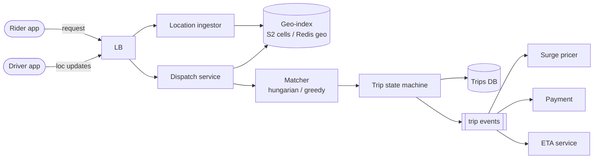

## Definition (interview-ready)

A **ride-sharing platform** matches a rider who wants a trip with a nearby available driver in a few seconds, then tracks the trip and charges for it. Drivers' apps send GPS updates every few seconds (about 250K updates per second for 1M online drivers) to a **location service** sharded by driver ID, which keeps each driver's position in an in-memory **geospatial cell index** (H3 hexagons or S2 cells) and streams updates to Kafka. When a rider requests a ride, the **dispatch service** looks up the pickup cell and its neighbours, filters and scores available drivers by ETA, offers the trip to the best one, and moves to the next on decline or timeout. A persisted **trip state machine** emits events that drive notifications, surge pricing and payment.

Key decisions: cell-based geo indexing in memory rather than database geo queries, because positions change constantly; and stacks isolated per city or region to limit the blast radius. The main trade-off is greedy per-request matching (fast) versus batched matching (better overall assignments, a few seconds slower).

**One-liner:** Drivers stream locations into a sharded, in-memory H3/S2 cell index; dispatch searches nearby cells, scores drivers by ETA and offers the trip, and a persisted trip state machine drives surge, notifications and payment, all isolated per region.

## Problem statement

Design a ride-sharing platform: riders request a trip, the system finds nearby drivers, matches optimally, tracks the ride, and processes payment.



## Requirements

### Functional
- Riders request a ride from origin to destination.
- Drivers update location continuously.
- Find nearest drivers and dispatch.
- Trip lifecycle: requested → matched → en-route → in-trip → completed.
- ETAs, fares, surge pricing.
- Payment.

### Non-functional
- Real-time location updates (≤ 5 s lag).
- p99 dispatch < 5 s.
- Massive concurrency in dense cities.
- Globally distributed (region-isolated).

## Scale estimation

- 10M drivers worldwide; 1M concurrent online.
- Location update every 4 seconds → 250K updates/sec.
- 1M trips/day per region.

## High-level architecture

```
                        ┌──────────────┐
   Rider App ──────────►│ Trip API     │
                        └──────┬───────┘
                               ▼
                    ┌──────────┴──────────┐
   Driver App ────►│ Location Service     │ ── geo index (S2 / Geohash)
                    └─────────┬───────────┘
                              ▼
                   ┌──────────────────┐
                   │   Dispatch       │ ── matching algorithm
                   │   Engine         │
                   └──────────┬───────┘
                              ▼
                       ┌──────────┐
                       │ Trip Svc │ ── state machine
                       └────┬─────┘
                            ▼
                  ┌────────────────────┐
                  │ Payment + Receipts │
                  └────────────────────┘
```

## Detailed design

### Geo indexing

The core problem: "find drivers within 1 km of (lat, lng) in 10ms."

#### Geohash

Encode (lat, lng) into a string. Nearby points share prefixes. Pros: simple, indexable in any DB. Cons: distortion at boundaries.

#### S2 cells (Google)

Hierarchical cells covering the sphere, numbered along a space-filling (Hilbert) curve, so nearby cells usually have nearby IDs. Uber used S2 before building H3, and Tinder has written about sharding by S2 cells.

#### H3 (Uber)

Hexagonal hierarchical index. Hexagons have uniform-distance neighbors (squares don't). Uber's open-source library; production-grade.

#### Quadtree / R-tree

In-memory data structures for range queries. Per-process maps; sharded across services.

**Pick H3 or S2 for geo distribution at planetary scale.**

### Location updates

- Driver app sends GPS every ~4 seconds.
- Updates routed via load balancer (consistent hash by driver_id) to a Location Service.
- Update in-memory + writes to Kafka (durability + downstream consumers).
- Geo index updated.
- For freshness, keep in-memory; persist periodic snapshot.

### Dispatch / matching

When rider requests:
1. Lookup their pickup S2/H3 cell + neighbors (within ~1 km).
2. Get list of available drivers in those cells.
3. Filter: vehicle type, rating, busy status.
4. Score and pick best match (distance, ETA, driver utilization).
5. Send dispatch notification to chosen driver.
6. Wait for accept; on decline/timeout, try next.

Variants:
- **First-accept**: send to N drivers, first to accept wins. Worse for drivers (rejection rate).
- **Batched matching**: in dense areas, collect riders and drivers for a few seconds and assign them jointly for a better overall result (Uber has described batched matching in its marketplace).

### Trip state machine

```
REQUESTED → MATCHED → DRIVER_EN_ROUTE → ARRIVED → IN_TRIP → COMPLETED
                ↓
             CANCELED (by rider or driver)
```

Persistent state in DB; state transitions emit events to Kafka for downstream (notifications, analytics, surge model).

### Surge pricing

- Stream of demand (requests) and supply (online drivers) per cell.
- Real-time model (Flink) computes supply-demand ratio per cell.
- Surge multiplier per cell, updated every 1–2 minutes.
- Applied at fare quote time.

### ETAs

- Routing engine: graph of road network with current traffic.
- OSRM (open source), Google Maps API, or proprietary engine.
- Cache ETAs for common O-D pairs.
- For fast UI, predict ETA before full route compute.

### Payment

- Pre-authorize card on trip start.
- Capture on trip end with final fare.
- Saga ([Distributed Transactions](/learn/notes/distributed-transactions/)) for cancellations / disputes.
- Driver payouts: separate ledger and bank transfer flow.

### Region isolation

Each city / region has its own service stack:
- Pros: blast radius limited, latency local, compliance easier.
- Cons: cross-region trips (rare) need coordination.

## Bottlenecks & optimizations

- **Location write storm**: 250K updates/sec. Sharded by driver_id; in-memory per shard.
- **Geo query at scale**: H3 cells precomputed; per-cell index is a small list.
- **Dispatch latency**: pre-warm rider-side ETAs; in-memory matching.
- **Push to driver app**: WebSocket connections per driver (see [HLD: Chat System](/learn/notes/hld-chat-system/)).
- **Surge calculation**: streaming aggregation; not batch.

## Trade-offs

- **Greedy per-request vs batched matching**: faster dispatch vs better overall assignments.
- **Push vs poll for driver updates**: push (WebSocket) is real-time; poll is simpler but slower.
- **Real-time surge vs smoothed**: real-time reacts faster; smoothed avoids price flapping.

## Practice questions

<Practice>

<QA q="Walk through the trip state machine." level="easy">

Requested → Matched (driver accepted) → Driver en route → Arrived → In trip → Completed. Each transition is persisted and emits events to Kafka (notifications, analytics, surge). Cancellations by rider or driver are handled with appropriate compensation.

</QA>

<QA q="What is a geohash, and what is its main weakness?" level="easy">

A geohash encodes (lat, lng) into a string where nearby points usually share a prefix, so it is easy to index in any DB. The weakness is at cell boundaries: two points a few meters apart can fall in different cells with different prefixes, so queries must also check neighboring cells.

</QA>

<QA q="Why does H3 use hexagons?" level="easy">

All six neighbors of a hexagon are at the same distance from its center, while a square has edge neighbors and nearer-or-farther corner neighbors. That makes ring and radius searches and per-cell aggregation (such as surge per cell) more uniform. H3 is hierarchical and open-sourced by Uber.

</QA>

<QA q="Why H3 or S2 over a SQL geo query?" level="medium">

SQL geo queries (`WHERE distance < r`) can use PostGIS but are slow at scale with constantly moving points; a hierarchical cell index gives O(1) cell lookup + a small per-cell list. Much faster for drivers-within-1-km at 100K+ QPS.

</QA>

<QA q="How does the dispatch engine match riders to drivers?" level="medium">

For each rider request, look up the pickup cell and neighbors, filter available drivers (vehicle type, rating, busy status), score by ETA + utilization, dispatch to the top match. Decline or timeout drives the next attempt. For dense areas, batched optimization (assigns multiple rider-driver pairs jointly) wins.

</QA>

<QA q="How is payment handled for a trip?" level="medium">

Pre-authorize the rider's card when the trip starts, then capture the final fare when it ends. Cancellations and disputes go through a saga with compensations. Driver payouts use a separate ledger and bank transfer flow.

</QA>

<QA q="What do you gain and lose by isolating each city or region?" level="medium">

Each region has its own service stack, so a failure stays local (small blast radius), latency is local and compliance per jurisdiction is easier. The cost is coordination for the rare cross-region trip and running many copies of the stack.

</QA>

<QA q="Compare first-accept dispatch with sending to one driver at a time." level="hard">

First-accept sends the request to N drivers and takes whoever accepts first: faster matches, but many drivers see requests vanish, which hurts their experience. One-at-a-time picks the best-scored driver and waits for accept or timeout before trying the next: better match quality, but each decline adds latency against the p99 dispatch target.

</QA>

<QA q="How do you handle 1M concurrent drivers updating location every 4s?" level="hard">

That's about 250K updates/sec.
- Driver app → WebSocket / HTTP to Location Service.
- Load balancer consistent-hashes by driver ID; each shard handles a slice.
- In-memory geo index per shard, updated on every event; periodic snapshot.
- Written to Kafka for durability and downstream consumers.

</QA>

<QA q="Design surge pricing." level="hard">

- Stream demand (requests/sec/cell) and supply (online drivers/cell) into Flink.
- Compute supply-demand ratio per cell on a sliding window.
- Apply a function (for example piecewise) to get the surge multiplier.
- Update every 1–2 minutes; apply at fare-quote time and push to clients.
- Smooth via EMA to avoid flapping.

</QA>

<QA q="How would you globally optimize dispatch (not greedy per request)?" level="hard">

Batched marketplace optimization: every N seconds, snapshot all pending requests and available drivers; solve as a bipartite matching problem (Hungarian algorithm or LP). Optimizes global utility (less waste). Used by Uber for dense areas. Tradeoff: a small delay (a few seconds) for batching.

</QA>

<QA q="How do you handle a driver going offline mid-trip?" level="scenario">

- Detect via heartbeat loss.
- Try to recover (driver app retries connection).
- If extended: notify rider; offer reassignment if possible.
- Trip state machine has a stuck state that escalates to support.
- Money: trip data captured; partial fare logic applied.

</QA>

<QA q="How to scale to a new city?" level="scenario">

- Spin up a new region: services + DBs + Kafka.
- Pre-load map data (routing graph, for example OSRM-preprocessed OpenStreetMap data; H3 grid).
- Local payment integration if needed.
- Region routing at edge.
- Compliance + legal per jurisdiction.
- Region isolation: a city outage doesn't affect others.

</QA>

</Practice>

## Quiz

<Quiz>

<MCQ q="A rider stands near a geohash cell boundary. Why must the search include neighboring cells?" options={["Geohash cells overlap", "A nearby driver may be in an adjacent cell with a different prefix", "Neighbor cells hold the rider's history", "Geohash only works at the equator"]} answer={1}>

Close points can straddle a boundary and share no prefix, so you search the cell plus its neighbors. Cells don't overlap, they hold locations not history, and geohash works everywhere (with distortion).

</MCQ>

<MCQ q="Why route each driver's location updates to a shard by consistent hashing on driver_id?" options={["So one shard always holds that driver's latest state in memory", "To encrypt location data", "To pick the nearest data center", "To compute surge"]} answer={0}>

Sticky routing by driver_id means one shard owns that driver's state and can update its in-memory index without coordination. It's unrelated to encryption, DC choice or surge.

</MCQ>

<MCQ q="What is the main benefit of batched (marketplace) matching over greedy per-request matching?" options={["Lower latency for every request", "No need for a geo index", "Better global assignments in dense areas at the cost of a few seconds of delay", "Drivers never decline"]} answer={2}>

Solving all pending pairs together reduces total waste, but requests wait for the batch window. It doesn't cut latency, still needs the geo index, and drivers can still decline.

</MCQ>

<MCQ q="Why smooth the surge multiplier with something like an EMA?" options={["To make surge permanent", "To compute it in batch", "To raise prices faster", "To avoid prices flapping between updates"]} answer={3}>

Smoothing damps sudden swings so riders and drivers see stable prices. It doesn't make surge permanent or faster, and the computation stays streaming.

</MCQ>

<MCQ q="When is the rider's card charged the final fare?" options={["At trip end, after a pre-authorization at trip start", "When the rider opens the app", "When a driver is matched, with no pre-authorization", "At the end of the week"]} answer={0}>

The card is pre-authorized at start and captured with the final fare at the end. Charging earlier doesn't know the fare, and weekly batching is for driver payouts if anything.

</MCQ>

<MCQ q="Why can't a PostGIS distance query on a drivers table easily serve 100K+ QPS of nearest-driver lookups?" options={["PostGIS can't do distance queries", "Drivers' locations change every few seconds, so the index churns, and per-query work is far higher than an in-memory cell lookup", "SQL cannot store floats", "PostGIS only supports one city"]} answer={1}>

Constant location writes plus heavy query load make a DB geo index costly, while a cell index gives an O(1) lookup into a small in-memory list. PostGIS does support distance queries, floats and any geography.

</MCQ>

<MCQ q="A region's whole stack fails. With region isolation, what is the impact?" options={["All regions fail together", "Only cross-region trips fail", "Only that city or region is affected", "Payments fail globally"]} answer={2}>

Isolation limits the blast radius to that region. Other cities keep working, and payments elsewhere are separate.

</MCQ>

<MCQ q="1M drivers send a location every 4 seconds. Roughly what update rate must the location service handle?" options={["25K per second", "4M per second", "1M per second", "250K per second"]} answer={3}>

1,000,000 / 4 = 250,000 updates per second. The other numbers misapply the interval.

</MCQ>

</Quiz>

## TL;DR cheat sheet

- Geo index: H3 (Uber) or S2 (Google) cells.
- Driver locations: sharded in-memory + Kafka for downstream.
- Dispatch: lookup nearby cells, filter, score, dispatch.
- Trip state machine: persisted, eventful.
- Surge: streaming aggregation per cell.
- Region-isolated stacks; cross-region rare.
- Payment: pre-authorize + saga capture.
- WebSocket from driver/rider apps for real-time.

## Go deeper

- **Uber Engineering**: [H3](https://www.uber.com/blog/h3/), DISCO (dispatch), Schemaless (KV).
- **Lyft engineering blog**: geo indexing, dispatch.
- **High Scalability**: Uber architecture posts.
- **ByteByteGo**: Uber-style design videos.
- **Alex Xu, *System Design Interview Vol 2***: no ride-sharing chapter, but the Proximity Service and Nearby Friends chapters cover the geo-indexing and location-update halves of this problem.
