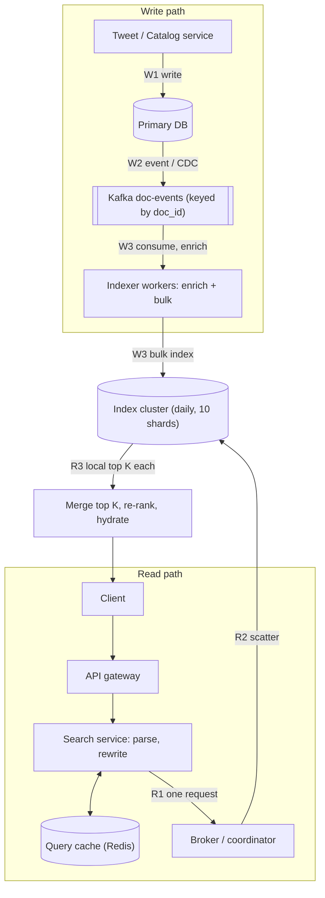
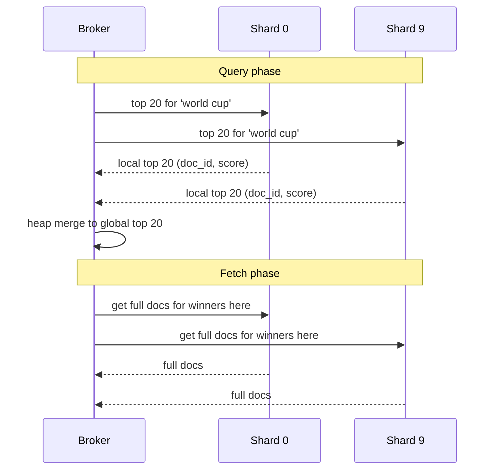
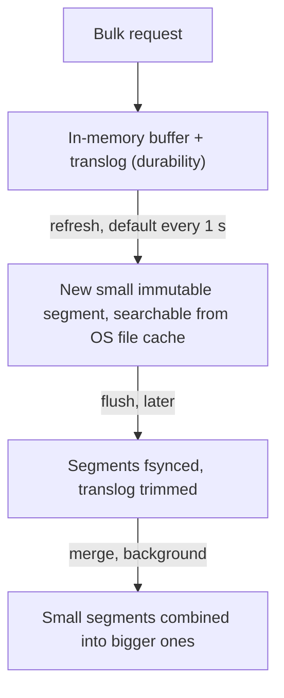

## Definition (interview-ready)

A **search service** takes a free-text query like `cheap running shoes` or `#worldcup final` and returns the best matching documents (tweets or products) in tens of milliseconds, a few seconds after they were created.

The design in one breath: writers publish every new or changed document to **Kafka**. **Indexer** workers run each document through an **analyzer** (split into words, lowercase, stem) and add it to an **inverted index**: a map from each term to the list of documents containing it. The index is **partitioned by document** into shards, each with replicas. A query goes to a **broker** (coordinator) that sends it to every relevant shard (**scatter**), each shard returns its local top K, and the broker merges them into the global top K (**gather**). Ranking starts with text relevance (**BM25**), then blends in freshness, engagement and personalization. In practice you build this on **Elasticsearch/OpenSearch**.

The main trade-off is **freshness vs cost**: making new documents searchable sooner (shorter refresh interval) means more tiny index segments, more merging and more CPU.

**One-liner:** Stream documents through Kafka into analyzers that build a document-partitioned inverted index, answer queries by scatter-gather with a top-K merge, rank by BM25 plus freshness and engagement, and tune the refresh interval to trade freshness for cost.

## Problem statement

"Design search for a Twitter-like product. Users type keywords or hashtags and see matching tweets, most relevant and recent first. New tweets should show up in search within seconds. Assume 400 million new tweets a day and about 1 billion searches a day. Follow-up: how would your design change for product search on an e-commerce site?"

## Requirements

### Functional (in scope)

- Keyword search over tweet text, hashtags and author handle. Multi-word queries (`world cup final`), phrase queries (`"world cup"`), and filters (language, date range, from a user).
- Results ranked by a mix of relevance and recency, paginated.
- New tweets searchable within about 10 seconds; deleted tweets disappear quickly.
- Typo tolerance (`wrold cup` still works) and "did you mean".
- For product search: filters and facets (brand, price range, size) with counts.

### Non-functional

- p99 search latency under about 200 ms, measured at the service.
- High availability for reads; a lost node must not lose data or fail queries.
- Index freshness of seconds, not exactly real time. Search is eventually consistent with the source of truth.
- Scale horizontally with both data volume and query rate.

### Out of scope

- Typeahead suggestions as the user types (that is a separate system: see [HLD: Autocomplete](/learn/notes/hld-autocomplete/)).
- Training the ranking model, ads, spam detection.
- Semantic or vector search (mention as an extension).

### Clarifying questions to ask

- How far back must search go: last 7 days or all history? This decides the hot vs cold tiers.
- Ranked by relevance, or "latest" in reverse time order, or both as two tabs?
- How fresh must results be: 1 second, 10 seconds, a minute?
- Do edits and deletes need to vanish from results immediately (legal takedowns)?
- Is the result personalized (people I follow first)?
- Languages? Tokenizing English is very different from Chinese or Japanese.

## Scale estimation

**Writes (ingest)**

- 400M tweets/day ÷ 86,400 s ≈ **4,600 docs/s** average. Assume 3× at peak ≈ **14,000 docs/s**.

**Reads (search)**

- 1B searches/day ÷ 86,400 s ≈ **11,600 QPS** average, about **35,000 QPS** at a 3× peak.
- Reads are about 2.5× writes in count, but each search touches many shards, so search is the heavier load.

**Storage**

- Assume about 1 KB per tweet in the index (stored text plus metadata plus postings).
- 400M × 1 KB = **400 GB/day** of primary index.
- Hot tier of 7 days: 7 × 400 GB = 2.8 TB primary, **5.6 TB** with one replica.
- One year: 365 × 400 GB ≈ 146 TB primary, **≈ 292 TB** with one replica. This lives on a cheaper warm tier.

**Shards**

- Elastic's guidance is to aim for shards of 10 to 50 GB and fewer than 200M docs each.
- One index per day: 400 GB ÷ 40 GB = **10 primary shards per day**, each about 40M docs. Fine on both limits.

**Bandwidth**

- Ingest: 14,000 docs/s × 1 KB ≈ **14 MB/s** into Kafka at peak (about 42 MB/s of disk writes across brokers with replication factor 3).
- Responses: 35,000 QPS × ~10 KB per results page ≈ **350 MB/s** out at peak.

## Core API

```
GET /v1/search?q=world+cup+final
             &mode=top|latest          // relevance-blended or reverse-chronological
             &lang=en&since=2026-10-01
             &limit=20&cursor=<opaque>
→ 200 { results: [ {tweet_id, author, snippet, score} ], next_cursor }

// Product variant
GET /v1/products/search?q=running+shoes&brand=nike&price_max=5000
             &sort=relevance|price_asc&facets=brand,size&limit=24&cursor=<opaque>
→ 200 { results: [...], facets: { brand: [{value, count}], ... }, next_cursor }

// Internal, not public: the source services emit events instead of calling search
Kafka topic: doc-events   key = doc_id   value = {op: upsert|delete, doc, version}
```

Use a **cursor** (encodes the last sort values) instead of `page=500`. Deep offset paging is expensive in a sharded index, explained below.

## High-level architecture

The write path (steps W1 to W3) and read path (steps R1 to R3) meet at the index cluster:



The index cluster holds one index per day, 10 shards each, with 1+ replicas, and each shard is a small inverted index of its own. The broker does the merge.

**Write path.** (W1) The tweet service saves the tweet in its own database, the source of truth. (W2) It publishes an event to Kafka (or a [change data capture](/learn/notes/change-data-capture/) connector does it from the DB log), keyed by `doc_id` so all changes to one document stay in order on one partition. (W3) Indexer workers consume, enrich (language, author follower count, spam score), and send **bulk** requests to the index cluster. (W4, inside the cluster) Each shard writes the doc to its in-memory buffer; at the next **refresh** it becomes searchable.

**Read path.** The search service parses the query (phrases, filters), applies the same analyzer the index used, checks a short-lived query cache for very hot queries, then (R1) sends one request to a broker. The broker picks the indexes to search (for `mode=latest` maybe just today's), (R2) sends the query to one copy of every relevant shard, (R3) each shard scores its local matches and returns its top K, and the broker merges them. A second-stage ranker re-scores the merged top few hundred, then the service hydrates the final 20 (author info, media) and returns.

## Data model

### The index document

```json
{
  "tweet_id":   "1849230012345",          // also the index _id → idempotent upserts
  "text":       "What a World Cup final!", // analyzed text field
  "hashtags":   ["worldcup"],             // keyword (exact match)
  "author_id":  "u_42",                   // keyword, for filters and personalization
  "lang":       "en",                     // keyword
  "created_at": "2026-10-22T10:15:00Z",   // date, for freshness and range filters
  "likes": 1520, "retweets": 300,         // numbers, ranking signals
  "version":    17                        // source version for ordering updates
}
```

- `text` is a **text** field: run through the analyzer and stored in the inverted index.
- `hashtags`, `author_id`, `lang` are **keyword** fields: indexed as one exact token each, good for filters and facets.
- Products look similar: `title`, `description` (text), `brand`, `category`, `size` (keyword), `price`, `rating`, `sales_30d` (numbers).

### Partitioning

- **Time first:** one index per day (`tweets-2026-10-22`). Old days become read-only, can be force-merged, moved to cheaper nodes and dropped when retention ends. `mode=latest` searches only the newest indexes.
- **Then by document:** inside each day, docs are spread across 10 shards by hashing `tweet_id`. Hashing gives even shards with no hot spots. See [sharding strategies](/learn/notes/sharding-strategies/).
- **Products** do not have a time axis, so use one index partitioned by hash of `product_id`, and grow by reindexing into a new index behind an **alias**.

Why `tweet_id` as the document ID: a retry of the same event overwrites the same document instead of creating a duplicate, so indexing is idempotent.

## Detailed design

### 1. The inverted index from scratch

**Intuition.** The index at the back of a textbook maps each word to the pages where it appears. You do not read every page to find "Kafka"; you look up "Kafka" and jump to pages 12 and 87. A search engine does exactly this for every word of every document.

A normal ("forward") view is document → words. An **inverted** index flips it to word → documents. Each word is a **term**, and its list of documents is a **postings list**. Postings usually also store the **term frequency** (how many times the term appears in that doc) and sometimes positions (to answer phrase queries).

**Worked example.** Three documents:

```
doc 1: "Kafka makes fast streaming easy"
doc 2: "Fast search with an inverted index"
doc 3: "Search tweets fast, search products faster"
```

After the analyzer lowercases, splits on non-letters and drops a few stop words (`a, an, the, with, makes`):

```
doc 1 → kafka fast streaming easy                    (length 4)
doc 2 → fast search inverted index                   (length 4)
doc 3 → search tweets fast search products faster    (length 6)
```

The inverted index (each term maps to doc: term frequency pairs):

```
easy      → {1:1}
fast      → {1:1, 2:1, 3:1}
faster    → {3:1}
index     → {2:1}
inverted  → {2:1}
kafka     → {1:1}
products  → {3:1}
search    → {2:1, 3:2}
streaming → {1:1}
tweets    → {3:1}
```

The query `fast search` is now two lookups and a merge: `fast` gives docs 1, 2, 3 and `search` gives docs 2, 3. An AND query intersects the lists (docs 2, 3); an OR query unions them (1, 2, 3) and lets scoring sort them. Postings are kept sorted by doc ID so the merge is a linear walk, like merging two sorted arrays.

Notice `faster` is a separate term from `fast`. A plain tokenizer does not know they are related. A **stemmer** (below) joins many word forms (`runs`, `running` → `run`), but standard English stemmers such as Porter leave `faster` alone, so a case like this needs a synonym rule or a lemmatizer.

**Scoring with BM25.** Matching is not enough; we need an order. BM25 is the default relevance function in Lucene, Elasticsearch and OpenSearch. For each query term it multiplies two ideas:

- **IDF (inverse document frequency):** rare terms matter more. `the` in every doc tells you nothing; `kafka` in 1 doc of a million tells you a lot. Lucene computes `idf = ln(1 + (N - n + 0.5) / (n + 0.5))` where N is the number of docs and n is the number that contain the term.
- **Saturated, length-normalized term frequency:** a term appearing twice is better than once, but the tenth time adds little (saturation, controlled by `k1`, default 1.2). A match in a short doc counts more than the same match in a long doc (length normalization, controlled by `b`, default 0.75).

Here is the whole thing in about 40 lines of Python. It was run as shown, and the output is pasted below it.

```python
import math, re
from collections import defaultdict, Counter

docs = {
    1: "Kafka makes fast streaming easy",
    2: "Fast search with an inverted index",
    3: "Search tweets fast, search products faster",
}
STOP = {"a", "an", "the", "with", "makes"}

def analyze(text):
    # tokenize, lowercase, drop stop words
    return [t for t in re.findall(r"[a-z0-9]+", text.lower()) if t not in STOP]

index = defaultdict(dict)           # term -> {doc_id: term_freq}
doc_len = {}
for doc_id, text in docs.items():
    toks = analyze(text)
    doc_len[doc_id] = len(toks)
    for term, tf in Counter(toks).items():
        index[term][doc_id] = tf

N = len(docs)
avgdl = sum(doc_len.values()) / N
k1, b = 1.2, 0.75                   # Lucene's defaults

def bm25(query, k=10):
    scores = defaultdict(float)
    for term in analyze(query):
        postings = index.get(term, {})
        n = len(postings)
        idf = math.log(1 + (N - n + 0.5) / (n + 0.5))
        for doc_id, tf in postings.items():
            norm = tf + k1 * (1 - b + b * doc_len[doc_id] / avgdl)
            scores[doc_id] += idf * tf * (k1 + 1) / norm
    return sorted(scores.items(), key=lambda x: -x[1])[:k]

print("search ->", index["search"])
print("fast   ->", index["fast"])
for d, s in bm25("fast search"):
    print(d, round(s, 3))
```

Output:

```
search -> {2: 1, 3: 2}
fast   -> {1: 1, 2: 1, 3: 1}
3 0.718
2 0.641
1 0.142
```

Read the result like an interviewer would:

- `fast` is in all 3 docs, so its IDF is tiny (about 0.14). It barely separates anything.
- `search` is in 2 of 3 docs, so its IDF is bigger (about 0.47) and it drives the order.
- Doc 3 wins: it has `search` twice. But it is also the longest doc, so length normalization keeps the win modest (0.718 vs 0.641) instead of doubling it.
- Doc 1 only matches the common word `fast`, so it is last.

**How to say it in an interview:** "An inverted index maps each term to a sorted postings list of doc IDs with term frequencies. A query is a few lookups plus a merge of sorted lists, and BM25 ranks the matches by rarity of the term and a saturated, length-normalized term frequency."

### 2. Tokenization and analyzers

The **analyzer** turns raw text into terms. The same analyzer (or a compatible one) must run at index time and at query time, or the query terms will not match the indexed terms. An analyzer has three stages:

1. **Character filters:** clean the raw string, like stripping HTML or mapping `&` to `and`.
2. **Tokenizer:** split into tokens. A standard tokenizer splits on word boundaries; a whitespace tokenizer keeps `C++` together; CJK languages need special tokenizers because they do not use spaces.
3. **Token filters:** change tokens. Lowercase; remove stop words; **stem** (`running`, `runs` → `run`); add **synonyms** (`tv` ↔ `television`); fold accents (`café` → `cafe`).

Tweet-specific choices:

- Keep `#worldcup` and `@handle` as single tokens (index them into keyword fields too) so hashtag search is exact.
- Store the language with each tweet and use a per-language analyzer. Stemming English rules on Spanish text hurts.

Product-specific choices: synonyms matter a lot (`sneakers` ↔ `trainers`), model numbers must not be split (`iPhone15` vs `iphone 15`), so you often index the same field twice with two analyzers (a "multi-field") and search both.

Trade-off: aggressive stemming and synonyms raise **recall** (find more) but lower **precision** (even the standard Porter stemmer reduces both `universe` and `university` to `univers`).

### 3. Document-partitioned vs term-partitioned index

Once the index is too big for one machine, there are two ways to split it.

| | Document-partitioned (local index) | Term-partitioned (global index) |
|---|---|---|
| What each node holds | A full mini inverted index for its subset of documents | The complete postings lists for a subset of terms (a–f on node 1, g–m on node 2) |
| Write a doc | Goes to exactly one shard | Must update a node for every distinct term in the doc (many nodes) |
| Query | Sent to **every** shard (scatter-gather) | Sent only to the nodes owning the query's terms |
| Multi-term query | Each shard intersects locally; small top-K results move | Long postings lists must be shipped between nodes to intersect |
| Load balance | Even, by hash of doc ID | Skewed: popular terms (`worldcup` today) make hot nodes |
| Used by | Elasticsearch, OpenSearch, Solr, Twitter's Earlybird | Rare in practice for full-text search |

The Stanford IR book calls these partitioning by documents (local index) and partitioning by terms (global index), and notes document partitioning is the more common choice. DDIA describes the same split for secondary indexes in partitioned databases.

**Pick document partitioning.** Writes are cheap and local, which matters with 14,000 new docs per second, and load is even. The price is that every query fans out to every shard of the indexes being searched. One more subtle cost: each shard only knows its own term statistics, so IDF is computed per shard. With hash partitioning and big shards the numbers are close enough. Elasticsearch's default `query_then_fetch` uses local stats; `dfs_query_then_fetch` first collects global stats, which is more accurate and slower.

### 4. Scatter-gather with a top-K merge

```
             broker: "top 20 for 'world cup'"
           ┌──────────┬──────────┬──────────┐
           ▼          ▼          ▼          ▼
        shard 0    shard 1    shard 2  ... shard 9
        local      local      local        local
        top 20     top 20     top 20       top 20     (doc_id, score) only
           └──────────┴────┬─────┴──────────┘
                           ▼
            merge 10 × 20 = 200 candidates with a heap → global top 20
                           ▼
            fetch phase: get the full docs for just those 20
```

Why each shard returns K and not fewer: the global top 20 might all live on one shard, so every shard must offer its own top 20. The broker keeps a min-heap of size K while merging, so the merge is O(S · K · log K) for S shards. Elasticsearch splits this into a **query phase** (shards return only IDs and scores) and a **fetch phase** (load full documents only for the winners), so you never move 200 full documents.

The two phases as a sequence (two shards shown, the rest behave the same):



**Deep pagination is the trap.** For page 500 with 20 per page, each shard must return its top 10,020, and the broker sorts S × 10,020 entries to throw almost all of them away. Elasticsearch caps `from + size` at 10,000 by default for this reason. Use cursor paging (`search_after`: "give me the next 20 after this last sort value"), which costs the same on page 1 and page 500.

**Tail latency.** The query is as slow as the slowest shard. Mitigations: keep shards similar in size, send each shard request to the least-loaded replica (adaptive replica selection), set a per-shard timeout and return partial results with a flag rather than wait, and search fewer shards when you can (for `mode=latest`, today's index first, and expand only if there are not enough hits).

### 5. Near-real-time indexing

New documents follow this path inside each shard (this is how Lucene, and therefore Elasticsearch and OpenSearch, work):



- **Refresh** is what makes a doc visible. Elasticsearch and OpenSearch refresh every 1 second by default. If you have not set `refresh_interval` explicitly, that periodic refresh only runs on shards that received a search in the last 30 seconds (`index.search.idle.after`). An idle shard skips refreshes until the next search arrives, and that first search waits for a refresh. Setting `refresh_interval` explicitly, even to `1s`, turns this idle skipping off. This is why it is called **near** real time.
- **Ingest via Kafka.** Kafka decouples writers from the index: if the cluster is slow, events wait in Kafka instead of failing tweet creation. Indexers batch events into bulk requests (a few MB each), and commit Kafka offsets only after the bulk call succeeds, so a crash re-sends events rather than losing them. Because the doc ID is the tweet ID, a re-send just overwrites. See [Kafka deep dive](/learn/notes/kafka-deep/).
- **Out-of-order updates.** If an edit's event is processed before an older one, the old version could overwrite the new one. Keying Kafka by `doc_id` keeps one doc's events in order on one partition. For extra safety, index with the source `version` as an external version so the cluster rejects anything older than what it has.
- **Deletes.** Lucene segments are immutable, so a delete marks the doc as deleted and it is filtered from results right after the next refresh. Space is reclaimed when segments merge. For legal takedowns, also filter by a fast "blocked IDs" set at query time, so removal does not even wait for a refresh.

Twitter's own engine, Earlybird (built on top of Lucene and heavily adapted for tweets), reported that tweets are usually searchable within about 10 seconds of creation, with an average query latency of 50 ms. That is a good real anchor for "seconds of freshness" in an interview.

### 6. Freshness vs cost

Each refresh creates a new segment. Refreshing every second at 1,400 docs per shard per second (14,000 ÷ 10) gives many tiny segments, and each query must search all of them until background merges combine them. Merging costs CPU and disk I/O on the same nodes that serve queries.

| Refresh interval | Freshness | Cost |
|---|---|---|
| 1 s (default) | New tweets visible in about 1 s after indexing | Most segments, most merging, lowest indexing throughput |
| 5–30 s | Visible within seconds to half a minute | Fewer, bigger segments; noticeably cheaper indexing |
| `-1` (off) during a bulk backfill | Nothing new visible until you turn it back on | Fastest bulk load |

A practical design: tweet search keeps 1 to 5 seconds on today's index (freshness is the product), product search uses 30 seconds or more (a new product appearing a minute late is fine, but price or stock changes may need a faster path, such as a small "overrides" lookup applied at query time). Old daily indexes take no writes, so they are force-merged down to few segments once and then are cheap to search.

The other freshness lever is the pipeline before the index: Kafka lag and indexer batch size. Measure end-to-end freshness (tweet created → first visible in search) as an SLO, not just the refresh interval.

### 7. Ranking signals

Ranking is done in two stages, the standard pattern in search:

1. **Retrieval (cheap, per shard):** find matching docs and score them with a fast formula: BM25 plus a few boosts. Return top K per shard.
2. **Re-ranking (expensive, on a few hundred):** a learned model re-scores the merged candidates with richer features.

Signals:

- **Text relevance:** BM25 on text, higher weight for matches in hashtags or product title than in description, phrase proximity bonus.
- **Freshness:** a decay on age (Elasticsearch's `function_score` supports gaussian or exponential decay on a date field). For tweets this weight is large; for products it is near zero.
- **Engagement / popularity:** likes, retweets, click-through rate, sales in the last 30 days, rating. Use log scaling so a viral tweet does not crush everything.
- **Author / seller quality:** verified, follower count, spam score, seller rating.
- **Personalization:** boost authors the searcher follows or categories they buy. Twitter's Earlybird paper describes passing the searcher's local social graph to the index servers for exactly this.
- **Business rules (products):** in stock first, hide banned items.

Engagement counts change constantly. Do not reindex the whole tweet for every like. Batch updates (every minute or two) or keep fast-changing signals in a side store that the re-ranker reads.

### 8. Typo tolerance

- **Fuzzy matching:** match terms within a small **edit distance** (Levenshtein: insert, delete or substitute one character; Lucene also counts swapping two adjacent letters as one edit by default). Elasticsearch's `fuzziness: AUTO` allows 0 edits for terms of 1–2 characters, 1 edit for 3–5, and 2 edits for longer terms. Lucene's fuzzy query supports at most 2 edits. Fuzzy is slower than exact matching, so set `prefix_length` (first 1–2 letters must match) and rank exact matches above fuzzy ones.
- **"Did you mean":** a suggester that proposes a corrected query from terms in the index (Elasticsearch term and phrase suggesters). Only show it when the original query returns few results.
- **N-grams:** index character chunks (`wor`, `orl`, `rld`) so partial and misspelled words still share chunks. Big index growth; use for short fields like product titles, not tweet bodies.
- **Query-log corrections:** learn common misspellings from what users retype (`iphnoe` → `iphone`) and rewrite before searching.

### 9. Why Elasticsearch / OpenSearch

You would not build Lucene from scratch in an interview or in real life. Elasticsearch and OpenSearch give you exactly the design above: analyzers, inverted index segments, BM25, document-partitioned shards with replicas, query-then-fetch scatter-gather, refresh-based near-real-time search, fuzzy queries, aggregations for facets and index aliases for zero-downtime reindexing. Your job in the interview is to make the decisions around it: index layout (daily indexes, shard count), the Kafka ingest pipeline, refresh interval, ranking and failure handling. For the engine internals, see [Elasticsearch](/learn/notes/elasticsearch/).

Keep it **out** of the source-of-truth role: it has no multi-document transactions, and recently written docs are not visible until refresh. The database owns the data, the index is a rebuildable projection.

## Bottlenecks & optimizations

- **Fan-out cost.** Every query hits every shard of the indexes searched. Limit the set (time filters, `mode=latest` searches today first), avoid oversharding (many tiny shards = many thread-pool tasks per query), and add **replicas** to scale query throughput: each replica copy can serve a share of the shard requests.
- **Hot queries.** During a big event everyone searches `#worldcup`. Cache the results page for a few seconds in Redis keyed by normalized query plus filters. A few seconds of staleness is invisible; see [cache patterns](/learn/notes/cache-patterns/).
- **Indexing spikes.** Kafka absorbs them; scale indexers with partitions; use bulk requests; raise refresh interval temporarily if indexing falls behind.
- **Deep pagination.** Cursor paging with `search_after`, never large offsets.
- **Expensive queries.** Leading wildcards (`*cup`) and very fuzzy queries scan huge parts of the term dictionary. Block or rewrite them, and set query timeouts.
- **Reindexing** (new analyzer or mapping): build a new index from Kafka replay or a DB snapshot, then switch an **alias** atomically. Reads never see a half-built index.
- **Separate node roles.** Coordinator-only nodes for scatter-gather, hot data nodes on fast SSD for recent indexes, warm nodes for older ones.

## Failure handling

| Component fails | What happens | Mitigation |
|---|---|---|
| A data node | Its primary shards are lost on that node | Replicas on other nodes are promoted to primary; the cluster re-creates missing replicas elsewhere. Queries keep working from surviving copies. |
| A shard is slow or all its copies are down | Query waits on the slowest shard | Per-shard timeout; return partial results with a `partial=true` flag rather than an error |
| Indexer workers crash | Indexing pauses; search still works but goes stale | Events wait in Kafka; on restart, consume from last committed offset. Idempotent upserts by `tweet_id` make re-sends harmless. |
| Index cluster rejects writes (overloaded) | Bulk requests return 429 | Indexers back off and retry; Kafka lag grows; alert on freshness SLO |
| Kafka unavailable | Tweets still save to the DB, but no new events reach search | Producer retries; or CDC re-reads the DB log when Kafka is back. Freshness degrades, nothing is lost. |
| Bad deploy corrupts the index (wrong analyzer) | Results wrong | The index is a projection: rebuild into a new index from Kafka (if retained) or DB snapshot, flip the alias back |
| Coordinator / search service node | Requests to it fail | Stateless; load balancer routes around it |
| Whole region | Search unavailable there | Run a replica cluster in another region fed by the same events (replicated Kafka or cross-cluster replication) and fail over DNS |

## Trade-offs

| Decision | Option A | Option B | Choose |
|---|---|---|---|
| Index partitioning | Document-partitioned: cheap writes, query fans out to all shards | Term-partitioned: query hits few nodes, but writes touch many nodes and hot terms create hot spots | Document-partitioned |
| Index layout for tweets | One big index | One index per day | Per day: retention by dropping indexes, read-only old indexes, `latest` searches fewer shards |
| Refresh interval | 1 s: freshest, most merge cost | 30 s: cheaper indexing, stale by up to 30 s | 1–5 s for tweets, 30 s+ for products |
| Ingest | Service writes to the index directly | Service writes to DB, events via Kafka/CDC | Kafka: decouples, buffers spikes, replayable |
| Global vs local IDF | `dfs_query_then_fetch`: accurate, extra round trip | `query_then_fetch`: per-shard stats, faster | Local stats with large, evenly hashed shards |
| Ranking | Single-stage BM25 + boosts | Two-stage: cheap retrieval, model re-rank of top few hundred | Two-stage once relevance matters |
| Typo tolerance | Fuzzy queries | N-gram indexing | Fuzzy for long text; n-grams only on short fields |
| Build vs buy | Custom engine (Earlybird-style) | Elasticsearch / OpenSearch | Buy, unless you are at Twitter scale with a tweet-only workload |

## Practice questions

<Practice>

<QA q="What is an inverted index and why is it fast?" level="easy">

It maps each term to a postings list: the sorted IDs of the documents that contain the term, usually with term frequency and positions. A query becomes a handful of term lookups plus a merge of sorted lists, instead of scanning every document. Intersecting two sorted lists is a linear walk, and skip pointers make it faster still.

</QA>

<QA q="Why must the same analyzer run at index time and at query time?" level="easy">

Matching happens on terms, not raw text. If the index stored `run` (stemmed, lowercased) and the query sends `Running`, nothing matches. The query must be turned into terms the same way the documents were. Exceptions are deliberate, like adding synonyms only at query time.

</QA>

<QA q="Explain the two ideas behind BM25 in plain English." level="easy">

Rare terms count more (IDF): a match on `kafka` means more than a match on `fast` if `fast` is in every doc. Term frequency helps but saturates, and a match in a short document counts more than one in a long document. `k1` (default 1.2) controls saturation, `b` (default 0.75) controls length normalization.

</QA>

<QA q="Document-partitioned vs term-partitioned index: which do you pick and why?" level="medium">

Document-partitioned. Each shard holds a full mini index for its docs, so writing a doc touches one shard and load is even by hash. A query must hit every shard, but each returns only a small top K. Term-partitioned sends queries to fewer nodes, but every write touches many nodes, multi-term queries ship long postings lists around, and popular terms create hot nodes. That is why Elasticsearch, Solr and Earlybird partition by document.

</QA>

<QA q="Walk through scatter-gather for a top-20 query over 10 shards." level="medium">

The broker sends the query to one copy of each shard. Each shard scores its matches and returns its own top 20 as doc ID plus score only. The broker merges 200 candidates with a size-20 heap to get the global top 20, then fetches full documents just for those 20. Each shard must return 20, not 2, because all winners could live on one shard.

</QA>

<QA q="Why is page 500 expensive, and what do you do instead?" level="medium">

With offset paging, each shard must return its top 10,020 (from + size) so the broker can sort them all and drop the first 10,000. Cost grows with page depth and shard count. Elasticsearch caps from + size at 10,000 by default. Use cursor paging (`search_after`): pass the last sort values, and each shard returns only the next 20 after that point.

</QA>

<QA q="What does near-real-time mean in Elasticsearch and what controls it?" level="medium">

A new doc first sits in an in-memory buffer and is not searchable. A refresh writes the buffer into a new segment and opens it for search; by default this happens every second, but if the interval was not set explicitly, only on shards that received a search in the last 30 seconds. So visibility lags by up to the refresh interval, plus any Kafka and indexer delay before it. Durability is separate: the translog protects un-flushed data.

</QA>

<QA q="How do you make the Kafka-to-index pipeline safe against crashes and duplicates?" level="medium">

Commit Kafka offsets only after the bulk index call succeeds, so a crash replays events (at-least-once). Use the tweet ID as the document ID so a replay overwrites instead of duplicating. Key Kafka by doc ID so one doc's updates stay in order, and index with an external version so an older event can never overwrite a newer one.

</QA>

<QA q="Shorter refresh interval means fresher results. Why not refresh every 100 ms?" level="hard">

Each refresh makes a new small segment. More segments means each query searches more of them, and background merges burn CPU and disk I/O on the same nodes serving queries, which lowers indexing throughput and can hurt query latency. Pick the slowest interval the product accepts: about 1 to 5 seconds for tweets, 30 seconds or more for a product catalog.

</QA>

<QA q="Per-shard IDF can rank results differently than a single global index. When does it matter and what do you do?" level="hard">

It matters when shards are small or unevenly filled, so a term's frequency differs a lot between shards (for example a test index with a few docs, or routing that puts one topic on one shard). With large, hash-distributed shards the stats converge. If needed, use `dfs_query_then_fetch`, which gathers global term stats first at the cost of an extra round trip.

</QA>

<QA q="How do you rank tweets so that both relevance and recency matter?" level="hard">

Two stages. On each shard, score with BM25 multiplied by a time decay on `created_at` (gaussian or exponential), plus log-scaled engagement boosts, and return the top few hundred overall. Then a learned re-ranker scores those candidates with richer features: engagement velocity, author quality, whether the searcher follows the author, spam score. Offer a separate pure reverse-chronological `latest` mode, which can search just the newest daily index.

</QA>

<QA q="How would you add typo tolerance without killing latency?" level="hard">

Use fuzzy matching with `fuzziness: AUTO` (0 edits up to 2 characters, 1 edit for 3 to 5, 2 edits beyond), require the first one or two characters to match exactly (`prefix_length`), and boost exact matches above fuzzy ones. Only try fuzzy or a did-you-mean suggestion when exact search returns few results. Learn frequent misspellings from query logs and rewrite them up front. Reserve n-gram indexing for short fields.

</QA>

<QA q="During a World Cup final, search QPS triples and everyone searches the same hashtag. What do you do?" level="scenario">

Cache the result page for the hot normalized query in Redis for a few seconds; staleness is invisible and it removes most of the duplicate fan-out. Limit `latest` to today's index. Add replicas for today's index ahead of known events so shard requests spread over more copies. If indexing also spikes, let Kafka absorb it and, if needed, raise the refresh interval slightly so indexing does not starve queries.

</QA>

<QA q="Users complain that a deleted tweet still appears in search for a minute. Diagnose and fix." level="scenario">

Check the pipeline in order: was the delete event published, how big is the indexer's Kafka lag, did the bulk delete fail and get retried, and is the index refreshing (a search-idle shard or a long refresh interval delays visibility). Fixes: alert on consumer lag, make delete events high priority, and for takedowns apply a query-time filter from a fast blocked-ID set so removal is immediate regardless of refresh.

</QA>

<QA q="You need to change the analyzer (add synonyms) on a 100M-product index with zero downtime. How?" level="scenario">

Create a new index with the new mapping, backfill it from a database snapshot or by replaying Kafka, and keep it in sync by having indexers write to both indexes until it catches up. Compare result quality on sample queries, then switch the read alias to the new index atomically. Keep the old index for quick rollback and drop it later.

</QA>

<QA q="How does the design change for product search instead of tweet search?" level="scenario">

No time axis, so one index hashed by product ID instead of daily indexes. Freshness can be relaxed (30 s+ refresh) except price and stock, which can be overlaid at query time. Ranking shifts from recency to conversion signals (sales, click-through, rating, in stock). Facets (brand, size counts) via aggregations, structured filters, and much heavier synonym and multi-field analysis matter more.

</QA>

</Practice>

## Quiz

<Quiz>

<MCQ q="In the worked example, why does the query term fast contribute so little to the score?" options={["It is a stop word", "It appears in every document, so its IDF is tiny", "It appears only once per document", "Stemming removed it"]} answer={1}>

IDF falls as more documents contain the term. `fast` is in all 3 docs, so it barely separates them. It was not removed as a stop word or by stemming, and appearing once per doc is about term frequency, not the reason it is weak here.

</MCQ>

<MCQ q="Why do most search engines partition the index by document rather than by term?" options={["Queries then touch only one shard", "Term partitioning cannot support BM25", "Writes stay on one shard and load is even, at the cost of fanning out queries", "Document partitioning needs no replicas"]} answer={2}>

A doc goes to one shard and hashing spreads load evenly. The cost is that queries hit every shard. Queries touching one shard describes neither scheme for multi-shard data, term partitioning can score with BM25, and replicas are still needed.

</MCQ>

<MCQ q="A broker wants the global top 20 from 8 shards. How many candidates should each shard return?" options={["20", "3", "160", "1"]} answer={0}>

All 20 winners might be on one shard, so each shard returns its local top 20 and the broker merges 160 candidates. Returning fewer per shard could miss true winners; 160 per shard is wasteful.

</MCQ>

<MCQ q="What makes a newly indexed document visible to search in Elasticsearch?" options={["A flush to disk", "A segment merge", "Committing the Kafka offset", "A refresh, which opens a new segment for search"]} answer={3}>

Refresh turns the in-memory buffer into a searchable segment. Flush is about durability, merge combines segments later, and Kafka offsets are outside the cluster.

</MCQ>

<MCQ q="An index has received no searches for 5 minutes and refresh_interval is not set. What happens to new documents?" options={["They are refreshed every second as usual", "They are lost", "Refresh is skipped until a search arrives; that search waits for a refresh", "They become visible only after a flush"]} answer={2}>

Default periodic refresh applies only to shards searched in the last 30 seconds. Idle shards skip refreshes, and the next search triggers one and waits. Nothing is lost, and flush does not control visibility.

</MCQ>

<MCQ q="Why is from=10000, size=20 expensive on a 10-shard index?" options={["Each shard must return its top 10,020 and the broker sorts about 100,200 entries", "Elasticsearch reads all documents from disk", "It disables BM25", "The fetch phase loads 10,020 full documents"]} answer={0}>

Every shard must produce from + size hits so the broker can merge and drop the first 10,000. The fetch phase still loads only the final 20 documents; BM25 and disk reads are not the issue.

</MCQ>

<MCQ q="What is the main cost of lowering the refresh interval from 30 s to 1 s?" options={["Data loss on node failure", "More small segments and more merge work, lowering indexing throughput", "Queries can no longer use replicas", "BM25 scores become wrong"]} answer={1}>

Each refresh creates a segment, so more refreshes mean more segments and more merging. Durability comes from the translog and replicas, replicas still serve reads, and scoring is unchanged.

</MCQ>

<MCQ q="With fuzziness AUTO in Elasticsearch, how many edits are allowed for the term shoes?" options={["0", "2", "3", "1"]} answer={3}>

`shoes` has 5 characters, and AUTO allows 1 edit for terms of length 3 to 5, 0 for 1 to 2, and 2 for longer terms. Lucene does not support more than 2 edits at all.

</MCQ>

<MCQ q="Indexers commit Kafka offsets after the bulk call succeeds. What keeps replays from creating duplicate tweets in search?" options={["Exactly-once Kafka consumers", "Using the tweet ID as the document ID so a replay overwrites", "A short refresh interval", "Term-partitioned shards"]} answer={1}>

At-least-once delivery plus idempotent writes by a stable ID means duplicates collapse into one doc. Refresh interval and partitioning scheme do not deduplicate, and exactly-once in Kafka does not extend to the external index write.

</MCQ>

</Quiz>

## TL;DR cheat sheet

- **Inverted index:** term → sorted postings (doc IDs + term frequencies + positions). Query = lookups + sorted-list merge.
- **Analyzer:** char filters → tokenizer → token filters (lowercase, stop words, stem, synonyms). Same analyzer at index and query time.
- **BM25:** rare terms count more (IDF), term frequency saturates (`k1`=1.2), short docs favored (`b`=0.75).
- **Partition by document**, hash by doc ID; for tweets, one index per day on top. Shards 10–50 GB.
- **Scatter-gather:** every shard returns local top K (IDs + scores), broker heap-merges, then fetches only the winners. Cursor paging, not deep offsets.
- **Ingest:** DB → Kafka (keyed by doc ID) → indexers → bulk API. Commit offsets after success; doc ID = tweet ID for idempotency; external version for ordering.
- **Near real time:** refresh (default 1 s; with no explicit interval, shards idle for 30 s skip it) opens a new segment. Freshness vs cost = refresh interval vs segment and merge load.
- **Ranking:** BM25 + freshness decay + engagement + author quality + personalization, then a re-ranker on the top few hundred.
- **Typos:** fuzzy (AUTO: 0/1/2 edits, max 2), did-you-mean suggesters, query-log rewrites, n-grams for short fields.
- **Use Elasticsearch/OpenSearch**, keep the DB as source of truth, rebuild via alias swap.

## Go deeper

- Busch et al., ["Earlybird: Real-Time Search at Twitter"](https://cs.uwaterloo.ca/~jimmylin/publications/Busch_etal_ICDE2012.pdf) (ICDE 2012): document-partitioned real-time tweet search, about 10 s indexing latency and 50 ms queries.
- Manning, Raghavan, Schütze, *Introduction to Information Retrieval*: ["Distributing indexes"](https://nlp.stanford.edu/IR-book/html/htmledition/distributing-indexes-1.html) on term vs document partitioning.
- Elasticsearch docs: [Near real-time search](https://www.elastic.co/guide/en/elasticsearch/reference/current/near-real-time.html), [Similarity (BM25)](https://www.elastic.co/guide/en/elasticsearch/reference/current/index-modules-similarity.html), [Text analysis](https://www.elastic.co/guide/en/elasticsearch/reference/current/analysis.html), [Size your shards](https://www.elastic.co/guide/en/elasticsearch/reference/current/size-your-shards.html), [fuzziness in common options](https://www.elastic.co/guide/en/elasticsearch/reference/current/common-options.html).
- Lucene: [BM25Similarity javadoc](https://lucene.apache.org/core/9_9_0/core/org/apache/lucene/search/similarities/BM25Similarity.html) for the exact IDF formula.
- Elastic blog: [Practical BM25, part 2](https://www.elastic.co/blog/practical-bm25-part-2-the-bm25-algorithm-and-its-variables).
- On this site: [Elasticsearch](/learn/notes/elasticsearch/), [HLD: Autocomplete](/learn/notes/hld-autocomplete/), [Kafka deep dive](/learn/notes/kafka-deep/), [Sharding strategies](/learn/notes/sharding-strategies/).
