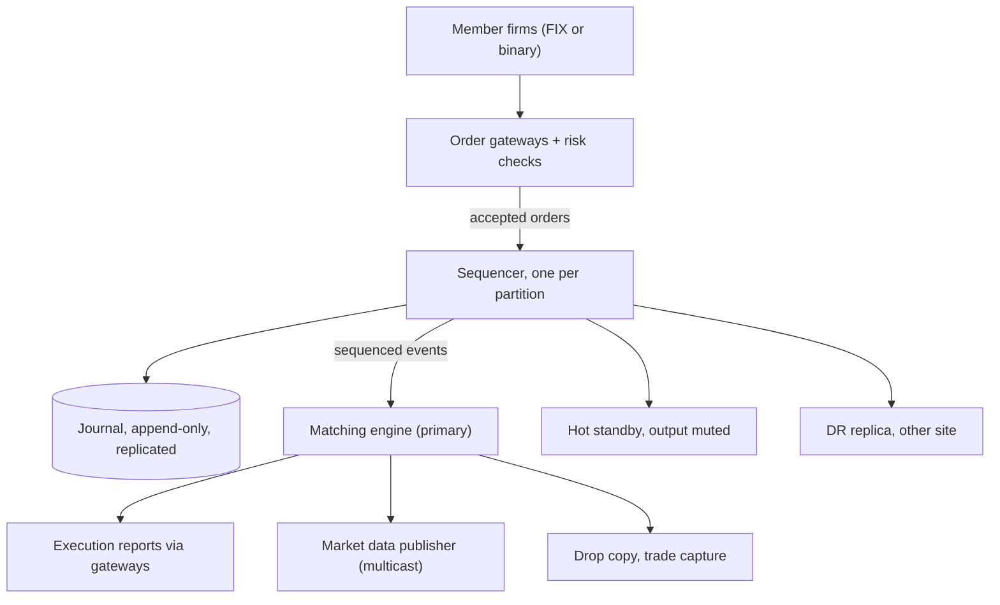
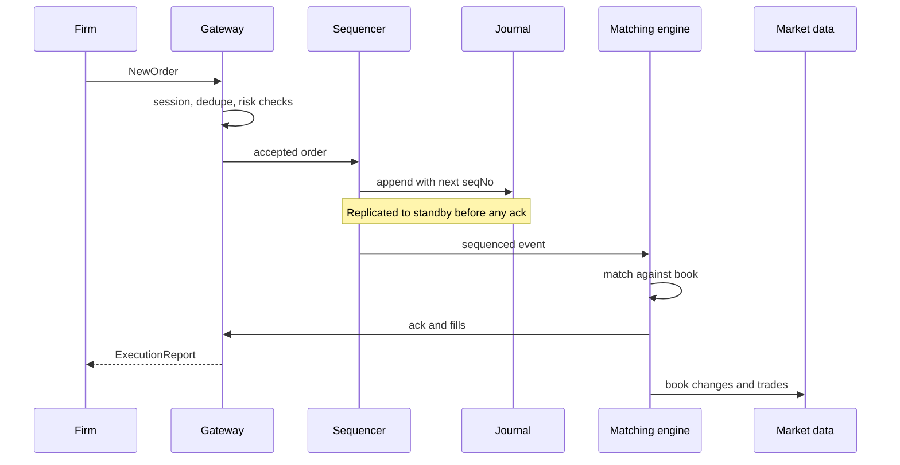
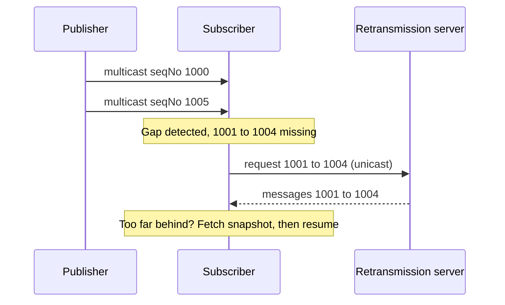

## Definition (interview-ready)

A **stock exchange** matches buy and sell orders from member firms fairly and tells everyone what traded. At its heart is an **order book** per symbol: resting buy orders (bids) and sell orders (asks), matched by **price-time priority** (best price first, then first come, first served).

The design in one breath: firms connect to **gateways**, which check the session and run **pre-trade risk checks**. A **sequencer** stamps every accepted order with a global sequence number and writes it to an append-only **journal**. A **matching engine** that is **single-threaded and deterministic per symbol** applies the sequenced events to an in-memory order book. The journal is the source of truth: a **hot standby** replays the same sequence into the same book, and recovery is snapshot plus replay (**event sourcing**). Fills go back to firms as execution reports, and book changes fan out as **multicast market data**.

The trade-off: no horizontal scaling inside a symbol, in exchange for strict ordering, fairness and microsecond latency.

**One-liner:** Gateways and risk checks in front, one sequencer that totally orders and journals every event, a deterministic single-threaded in-memory matching engine per symbol with a hot standby replaying the same log, and multicast market data out.

## Problem statement

"Design the core of a stock exchange. Member firms send orders to buy and sell shares. The exchange must match buyers with sellers, send each firm confirmations and fills, and publish a real-time market data feed so everyone can see the order book and the trades.

Scale: about 10,000 listed symbols and 1,000 member firms. Around 2 billion order messages per day (new orders, cancels and modifies), with bursts of up to 1 million messages per second at the open and close. The busiest symbol alone can see 100,000 messages per second. About 5,000 subscribers consume market data. Firms expect an order to be acknowledged in well under a millisecond, the exchange must never lose an order it has acknowledged, and matching must be provably fair."

## Requirements

### Functional (in scope)
- Place **limit orders** (buy or sell N shares at a price or better) and **market orders** (buy or sell N shares now at the best available prices).
- **Cancel** and **modify** (cancel/replace) resting orders.
- Match orders using **price-time priority** and produce trades.
- Send each firm an **acknowledgement**, then **execution reports** (partial and full fills, cancels, rejects).
- Publish **market data**: every order book change and every trade, plus top-of-book (best bid and ask).
- **Pre-trade risk checks** on every order: price bands, maximum size, credit limits, duplicate detection, kill switch.
- End-of-day trade file for clearing and settlement.

### Non-functional
- **Latency**: order-to-ack well under 1 ms inside the exchange, with low jitter (p99 and p99.9 matter as much as the median).
- **Fairness and determinism**: the same input sequence must always give the same trades. No firm can jump the queue.
- **Durability**: an acknowledged order or trade is never lost.
- **Availability**: very high during market hours, with failover in seconds or less and no lost state.
- **Auditability**: regulators can replay any moment of the day.

### Out of scope
- Clearing and settlement (moving cash and shares after the trade; see [HLD: Payment System](/learn/notes/hld-payment-system/) for ledger ideas).
- Brokerage apps, user accounts, portfolio views.
- Auctions (opening and closing crosses), complex order types (iceberg, stop, pegged), options and derivatives. Mention them, don't design them.

### Clarifying questions to ask
- Which order types? (Start with limit and market; ask if time-in-force like IOC, immediate-or-cancel, is needed.)
- Is this a real exchange with direct member firms, or a retail broker's internal matching? (Changes who does risk checks.)
- What is the latency target, median and tail? Microseconds or milliseconds?
- Do we need cross-symbol atomicity? (Usually no, which is what lets us partition by symbol.)
- Trading hours only, or 24/7 like crypto? (Affects how maintenance and snapshots happen.)
- What does market data need: full depth (every order) or only top of book?

## Scale estimation

Recompute from the interviewer's numbers.

**Order flow**
- US equity trading day: 6.5 hours = 6.5 × 3,600 = **23,400 s**.
- Average: 2,000,000,000 / 23,400 ≈ **85,000 messages/s**.
- Peak: **1,000,000 messages/s**, about 12× the average, because activity clusters at the open and close.
- Hottest symbol: 100,000 messages/s, which means about **10 µs** per event if one thread handles it. That is our per-event budget for that symbol.

**Journal (the event log)**
- Assume about 100 bytes per sequenced event (binary encoding, with header).
- Per day: 2 × 10^9 × 100 B = **200 GB/day**.
- Per year: 200 GB × 250 trading days = **50 TB/year**; with primary, standby and disaster-recovery copies, about **150 TB/year**.
- Peak write rate: 10^6 × 100 B = **100 MB/s** of sequential appends. Easy for NVMe; the hard part is latency, not bandwidth.

**Order book memory**
- Suppose 20 million resting orders at once × about 100 bytes each = **2 GB**. The whole book fits in RAM on one machine; split across partitions, each engine holds far less.

**Market data**
- Roughly one market-data message per input event, about 40 bytes each.
- Peak: 10^6 × 40 B = 40 MB/s = **320 Mbit/s** per feed.
- With multicast, that is sent once per network segment no matter how many listeners.
- With unicast TCP to 5,000 subscribers: 5,000 × 320 Mbit/s = **1.6 Tbit/s**. This one number is why exchanges use multicast.

**Trades**
- If about 1 in 10 messages produces a trade: 200 million trades/day; at 200 bytes per trade record, **40 GB/day** to the clearing file.

**How to say it in an interview:** "Throughput is modest by web standards, 1M events a second peak. The hard requirement is latency and ordering: 10 µs per event on the hottest symbol, deterministic, and never lose an ack. Data fits in RAM; the journal is 200 GB a day of sequential writes."

## Core API

Firms connect over long-lived TCP sessions, using the **FIX protocol** (Financial Information eXchange, the industry-standard message format) or a faster binary protocol. Not REST: per-request HTTP overhead and connection setup would blow the latency budget.

```
# Order entry (firm -> exchange), FIX message names in brackets
NewOrder        { clOrdId, symbol, side: BUY|SELL, type: LIMIT|MARKET,
                  qty, price (limit only), timeInForce: DAY|IOC }   [NewOrderSingle, 35=D]
CancelOrder     { clOrdId, origClOrdId, symbol }                    [OrderCancelRequest, 35=F]
ReplaceOrder    { clOrdId, origClOrdId, symbol, newQty, newPrice }  [OrderCancelReplaceRequest, 35=G]

# Exchange -> firm
ExecutionReport { clOrdId, exchOrderId, status: NEW|PARTIAL|FILLED|CANCELED|REJECTED,
                  lastQty, lastPrice, leavesQty, seqNo, rejectReason }  [ExecutionReport, 35=8]

# Market data (exchange -> everyone), multicast, sequenced
AddOrder    { seqNo, symbol, orderId, side, qty, price }
OrderExecuted { seqNo, orderId, execQty, matchId }
OrderCancel / OrderDelete / OrderReplace { seqNo, orderId, ... }
Trade       { seqNo, symbol, qty, price, matchId }

# Recovery for market data
GapRequest  { session, fromSeqNo, count }     -> unicast retransmit
Snapshot    { symbol }                        -> current book state
```

Notes:
- `clOrdId` is the firm's own ID for the order, so a retry after a dropped connection is **idempotent**: the gateway rejects a duplicate `clOrdId` within the session.
- Prices are **integers in ticks** (for example price × 10,000), never floats. Nasdaq's ITCH feed does exactly this: prices are integer fields with an implied number of decimal places.

## High-level architecture

```
   Member firms (FIX / binary over TCP)
        │          │          │
        ▼          ▼          ▼
  ┌───────────────────────────────────┐
  │ Order gateways (many)             │  session, parse, validate
  │  + pre-trade risk checks          │  price band, size, credit, dup
  └───────────────┬───────────────────┘
                  │ accepted orders
                  ▼
  ┌───────────────────────────────────┐        ┌──────────────────┐
  │ Sequencer (one per partition)     │──────► │ Journal (append- │
  │  assign seqNo, total order        │        │ only, replicated)│
  └───────────────┬───────────────────┘        └──────────────────┘
                  │ sequenced event stream (multicast / replicated)
        ┌─────────┴──────────────┬─────────────────────┐
        ▼                        ▼                     ▼
  ┌───────────────┐       ┌───────────────┐     ┌───────────────┐
  │ Matching      │       │ Hot standby   │     │ DR replica    │
  │ engine        │       │ (same input,  │     │ (other site)  │
  │ (primary)     │       │ output muted) │     │               │
  │ 1 thread per  │       └───────────────┘     └───────────────┘
  │ symbol group  │
  └──────┬────────┘
         │ output events: acks, fills, book changes
   ┌─────┴──────────────────────┬─────────────────────┐
   ▼                            ▼                     ▼
 Execution reports        Market data publisher   Drop copy / trade
 back via gateways        (UDP multicast + gap    capture -> clearing,
                           fill + snapshots)       surveillance, audit
```

The same components as a flow, from order entry down to the outputs:



**Write path (an order arrives):**
1. Firm sends `NewOrder` over its TCP session to a gateway.
2. Gateway parses, checks the session, rejects duplicates, runs risk checks (in memory, microseconds). Rejected orders get a reject report immediately and never reach the engine.
3. Gateway forwards to the **sequencer** for that symbol's partition. The sequencer gives it the next sequence number and appends it to the journal; the event is replicated to the standby.
4. The **matching engine** takes events strictly in sequence order, matches against the book, and emits output events (ack, fills, book updates).
5. Execution reports go back to the firms through their gateways; market data publishers multicast book changes and trades to all subscribers.

The write path, step by step:



**Read path (market data):** subscribers join multicast groups (one per symbol range), apply each sequenced message to their own copy of the book, and use gap requests or snapshots if they miss packets. Nobody "queries" the matching engine for prices; querying would steal its time.

## Data model

Almost everything lives **in memory**. The durable data is the journal.

### Journal (source of truth)

```
JournalRecord {
  seqNo       uint64   -- strictly increasing per partition, no gaps
  partition   uint16   -- which sequencer / engine
  timestamp   uint64   -- nanoseconds since midnight
  type        uint8    -- NEW, CANCEL, REPLACE, (internal) HALT, ...
  firmId, clOrdId, symbolId, side, ordType, qty, price(ticks), tif
  checksum    uint32
}
```

Partition key: **symbol** (grouped into partitions). Every order for one symbol must go through one sequencer and one engine, because price-time priority is a single total order of that symbol's events. Different symbols are independent, so they scale out across partitions. See [Sharding Strategies](/learn/notes/sharding-strategies/); this is directory-based sharding with a symbol-to-partition map, so a hot symbol can get a partition to itself.

### Order book (in memory, per symbol)

```
OrderBook(symbol) {
  bids: sorted map price -> FIFO queue of orders   (best = highest price)
  asks: sorted map price -> FIFO queue of orders   (best = lowest price)
  orders: hash map orderId -> pointer to order in its queue  (O(1) cancel)
}
Order { orderId, firmId, side, price, openQty, seqNo (time priority) }
```

- A sorted map (or an array indexed by tick, since prices sit in a narrow band) gives the best price in O(1) or O(log P), where P is the number of price levels.
- A FIFO queue (often an intrusive doubly linked list) at each price keeps time priority and allows O(1) removal on cancel.

### Derived stores (off the critical path)
- **Trades table** for clearing, surveillance and reporting: written by a consumer of the output stream, partitioned by trade date and symbol.
- **Snapshots** of each engine's state at a known `seqNo`, to shorten replay.

## Detailed design

### Order types and the order book (price-time priority)

Think of the order book as two queues at a deli counter, sorted by how good your offer is.

- **Limit order**: "buy 100 shares at 50.00 or less." If it can trade now it does; any remainder **rests** in the book at 50.00.
- **Market order**: "buy 100 shares now at whatever the best prices are." It walks the opposite side of the book from the best price outward. It never rests; a remainder that cannot fill is cancelled (or, on some venues, converted to a limit; ask the interviewer).
- **Bid** = best (highest) buy price; **ask** = best (lowest) sell price; **spread** = ask minus bid. If a new buy's price is greater than or equal to the best ask, it **crosses** the spread and trades.

**Price-time priority** (also called FIFO): the best price trades first; among orders at the same price, the earliest one trades first. The trade happens at the **resting** order's price, so an aggressive buyer at 101 that hits a seller resting at 100 pays 100. CME documents FIFO as matching resting orders at a price in timestamp order. Modifying an order can cost you your place: on CME's FIFO algorithm a resting order loses time priority if its price changes, its quantity increases, or its account changes. (Some markets use **pro-rata** matching instead, splitting a fill across all orders at a price by size; CME supports both.)

Here is a small, runnable matching engine for one symbol in Python (tested on Python 3.14). Prices are integer ticks.

```python
import heapq
from collections import deque, namedtuple

Order = namedtuple("Order", "id side qty price")  # price=None means market order

class OrderBook:
    """One symbol. Price-time priority. Prices are integer ticks."""
    def __init__(self):
        self.levels = {"B": {}, "S": {}}    # price -> deque of [id, qty] (FIFO)
        self.prices = {"B": [], "S": []}    # heaps: bids stored negated (max-heap)

    def best(self, side):
        h, lv = self.prices[side], self.levels[side]
        while h:
            p = -h[0] if side == "B" else h[0]
            if lv.get(p):
                return p
            heapq.heappop(h)                # lazy-drop empty levels
            lv.pop(p, None)
        return None

    def submit(self, o):
        trades, left = [], o.qty
        opp = "S" if o.side == "B" else "B"
        while left > 0:
            p = self.best(opp)
            if p is None:
                break
            crosses = o.price is None or (p <= o.price if o.side == "B" else p >= o.price)
            if not crosses:
                break
            q = self.levels[opp][p]
            maker = q[0]                    # oldest order at best price
            fill = min(left, maker[1])
            trades.append((o.id, maker[0], p, fill))   # trade at resting price
            left -= fill
            maker[1] -= fill
            if maker[1] == 0:
                q.popleft()
        if left > 0 and o.price is not None:         # limit remainder rests
            lv = self.levels[o.side]
            if o.price not in lv:
                lv[o.price] = deque()
                heapq.heappush(self.prices[o.side], -o.price if o.side == "B" else o.price)
            lv[o.price].append([o.id, left])
        # market remainder is cancelled (IOC behaviour)
        return trades

book = OrderBook()
for o in [Order(1, "S", 5, 101), Order(2, "S", 5, 100), Order(3, "S", 5, 100),
          Order(4, "B", 3, 99)]:
    book.submit(o)
print("buy 8 @ limit 100 ->", book.submit(Order(5, "B", 8, 100)))
print("market buy 6     ->", book.submit(Order(6, "B", 6, None)))
print("best bid", book.best("B"), "best ask", book.best("S"))
```

Output (trades are `(taker, maker, price, qty)`):

```
buy 8 @ limit 100 -> [(5, 2, 100, 5), (5, 3, 100, 3)]
market buy 6     -> [(6, 3, 100, 2), (6, 1, 101, 4)]
best bid 99 best ask 101
```

Read the output as a check of the rules:
- Orders 2 and 3 both sell at 100, but order 2 arrived first, so it fills completely before order 3 gets anything (**time priority**).
- Order 1 at 101 is untouched by the limit buy at 100 (**price** check), but the market order walks up to it after the 100 level is empty.
- The buyer at 99 never trades: nobody sells at 99 or lower.

A production engine is the same idea with tighter data structures: arrays indexed by tick instead of heaps, pre-allocated order objects (no garbage collection pauses), and an `orderId` index for O(1) cancels.

### The sequencer and deterministic single-threaded matching

**Why one thread per symbol?** Price-time priority needs one agreed order of events for a symbol. If two threads matched the same book, they would need locks, and lock contention plus thread scheduling adds unpredictable microseconds (jitter). Worse, the result could depend on which thread won a race, which breaks fairness and makes replay impossible. (See [OS concurrency](/learn/notes/os-concurrency/) for why locks and context switches are expensive.)

So the design splits concerns:
1. **Sequencer**: the single point that decides order. It assigns a gap-free `seqNo` to every event for its partition and journals it. In distributed-systems terms it is a single leader that produces a total order, the same role a partition leader plays in [Kafka](/learn/notes/kafka-internals/).
2. **Matching engine**: a pure function of the sequence. `state(n) = apply(state(n-1), event(n))`. One thread, pinned to one CPU core, all data in memory, no I/O, no locks, no calls to other services. Given the same events it always produces the same trades.

**Determinism rules** (break any of these and replicas diverge):
- No wall-clock reads inside the engine. Use the timestamp the sequencer stamped on the event.
- No randomness, no iteration over unordered hash maps where order affects output.
- No external calls. Everything the engine needs (symbol halted? price band?) arrives as sequenced events too.

**Real-world precedent, verified:** LMAX, a London retail trading platform (now best known as an FX exchange), published this pattern. Martin Fowler's write-up describes its Business Logic Processor as a single-threaded Java program working entirely in memory, handling about **6 million orders per second on one thread** on 2010-era hardware. Its input stage journals, replicates and unmarshals each event before the processor sees it. The team's own QCon talk lists "run business logic on a single thread" as one of its lessons for doing over 100K transactions per second at under 1 ms latency.

**The Disruptor** is LMAX's open-source inter-thread queue that connects these stages. It is a pre-allocated **ring buffer** where each producer and consumer tracks a sequence number instead of locking a shared queue. With a single producer it needs only memory barriers, no locks or CAS (compare-and-swap). The 2011 technical paper reports a mean of 52 ns per hop through a three-stage pipeline versus about 32,757 ns for Java's `ArrayBlockingQueue`. In an interview: "Between the network threads and the matching thread I'd use a lock-free single-producer ring buffer, like the LMAX Disruptor, so handing off an event costs nanoseconds."

**Scaling out**: partition by symbol. 10,000 symbols across, say, 16 to 32 engines, each a single thread on its own core. A hot symbol gets its own engine. One symbol's ceiling is one core's speed, which is why the engine code must be tight.

### Event sourcing, replay and hot-standby replication

**Event sourcing** means the state (the order book) is never saved directly as the truth; the **sequence of input events** is. The book is whatever you get by replaying the journal from the start of the day. (Compare a database rebuilding from its write-ahead log in [Recovery: WAL and ARIES](/learn/notes/recovery-wal-aries/).)

What this buys:
- **Recovery**: load the latest snapshot (state at `seqNo` S), replay journal events after S. LMAX reports snapshotting nightly and restarting (JVM start, load snapshot, replay a day's journal) in under a minute.
- **Audit**: regulators can rebuild the exact book at any nanosecond.
- **Debugging**: replay production input in a lab and get byte-identical output.
- **Cheap replicas**: you replicate small input events, not big state.

**Durability order (the key correctness rule):** an order is acknowledged to the firm **only after** its journal record is durable, meaning it has reached at least one replica on another machine (many designs also wait for the local disk write). Otherwise a crash after the ack loses an order the firm thinks exists.

**Hot standby**: a second engine on another machine consumes the same sequenced stream and applies it, so its book is identical, but its output is muted. If the primary dies, the standby is already caught up to the last replicated `seqNo`; it un-mutes and continues from the next number. LMAX runs two processors in the main data centre and a third at a DR site, all processing every input event with only the live one's output used, and Fowler reports failover in microseconds.

**Who decides the primary is dead?** Not the standby alone, or you get split brain: two engines both emitting fills. Use a small consensus-backed coordinator (ZooKeeper, etcd, Raft; see [Consensus: Raft and Paxos](/learn/notes/consensus-raft-paxos/)) that holds a lease and an **epoch number**. Every output message carries the epoch; gateways and market-data publishers drop anything from an old epoch. This is fencing.

**Output events are derived, not stored separately as truth.** LMAX does not journal its output events because deterministic logic can recompute them. For external consumers you still keep a durable trade record, but it is a projection of the input log.

### Market data fan-out

Market data is a firehose that thousands of firms want at the same instant, with no favourites.

- **UDP multicast**: the publisher sends each packet once and the network switches copy it to every subscriber. Per the scale estimate, unicast would need about 1.6 Tbit/s versus 320 Mbit/s.
- **Sequenced messages**: each packet carries a sequence number. Nasdaq's MoldUDP64 protocol puts a session ID and the sequence number of the first message in every packet header, and lets listeners detect and re-request missed packets.
- **Gap fill**: a subscriber that sees seqNo jump from 1,000 to 1,005 asks a **retransmission server** (unicast) for 1,001 to 1,004. MoldUDP64 defines exactly this request packet and optional re-request servers.
- **Snapshots**: a subscriber that joins late, or is too far behind, fetches a book snapshot at some seqNo, then applies the live feed from there. Nasdaq offers a separate snapshot service (GLIMPSE) for this alongside its TotalView-ITCH feed.
- **Order-level feed**: Nasdaq's TotalView-ITCH tracks each order's life with messages such as Add Order, Order Executed, Order Cancel, Order Delete and Order Replace; subscribers rebuild the full book from them. Timestamps are nanoseconds since midnight.
- **Tiers**: full depth (every order), top N levels, top of book only. Internet-facing apps get a conflated feed (latest state every few ms) over WebSocket from a separate fan-out tier, never from the core. See [Realtime push: WebSockets and SSE](/learn/notes/realtime-push-websockets-sse/).

How a subscriber recovers from a missed packet:



Fairness note: market data is published from the engine's output stream, after each event is processed, through the same path for everyone. So no subscriber gets the information earlier than any other.

### Risk checks and the latency budget

**Pre-trade risk checks** run in the gateway, before the sequencer, so bad orders never touch the book:
- **Price bands / fat-finger**: reject a buy at 10× the last price.
- **Maximum order size and notional** (quantity × price).
- **Credit and position limits** per firm.
- **Duplicate detection**: same `clOrdId` again in the session.
- **Kill switch**: block a firm or cancel all its orders instantly.
- **Symbol state**: halted symbols reject new orders.

This mirrors regulation. In the US, SEC Rule 15c3-5 (the Market Access Rule) requires broker-dealers with market access to have pre-trade controls that block orders exceeding pre-set credit or capital thresholds and that reject erroneous orders exceeding price or size parameters or that look duplicative. FINRA summarises it as a ban on "unfiltered" access.

Risk state (a firm's open exposure) changes with every fill, so gateways keep it in memory and update it from the engine's output stream. For a hard credit limit that many gateways share, put the authoritative check in a single-threaded **risk engine** on the sequenced path too, just before matching, so it is also deterministic.

**An illustrative latency budget** (inside the exchange, order in to ack out; target p99 under 100 µs):

| Stage | Budget | How |
|---|---|---|
| NIC to gateway thread | 2 to 5 µs | kernel bypass networking, busy-polling thread |
| Parse + session + risk checks | 5 µs | binary protocol, in-memory limits, no allocation |
| Gateway to sequencer hop | 5 to 10 µs | same data centre, dedicated network |
| Sequence + journal + replicate | 20 to 30 µs | batched sequential writes, replica ack over fast LAN |
| Matching | 1 to 5 µs | single thread, in-memory book, pinned core |
| Ack back + market data publish | 5 to 10 µs | pre-built messages, multicast |
| **Total** | **about 40 to 65 µs** | |

These are design targets to reason with, not any specific exchange's numbers. The point: the budget has no room for a database round trip, a garbage collection pause or a service mesh hop.

### Why exchanges avoid the usual microservice chatter

In a normal web backend, an order flow might call an auth service, a risk service, an inventory service and a database, each over HTTP or gRPC (see [Microservices vs Monolith](/learn/notes/microservices-vs-monolith/)). Each hop adds serialization, network latency and, worst, **variance**: one slow call or a retry storm and your p99.9 explodes. For an exchange:
- **Latency**: one synchronous RPC across a data centre costs tens to hundreds of microseconds, already the whole budget.
- **Determinism**: a call whose answer depends on timing or another service's state cannot be replayed exactly.
- **Ordering**: once an event leaves the sequenced stream into side calls, you lose a single total order.
- **Failure modes**: retries and timeouts can duplicate or reorder orders.

So the critical path is a **pipeline of single-purpose stages connected by in-process ring buffers or sequenced multicast**, with everything they need held in memory. Microservices still exist, but **off** the critical path: reference data, member onboarding, reporting, surveillance and clearing consume the output stream asynchronously.

## Bottlenecks & optimizations

- **Hot symbol**: one symbol's ceiling is one core. Give it a dedicated engine, keep the book in contiguous arrays (cache friendly), avoid allocation in the hot loop, pin the thread and isolate the core from the OS scheduler.
- **Journal latency**: fsync per event is too slow. Batch: the sequencer appends many events per write and acks each batch after it is durable on the replicas (group commit). Replication to a standby's memory over a fast LAN is often treated as the durability point, with disk writes asynchronous.
- **Garbage collection** (if on the JVM): pre-allocate everything; the Disruptor pre-allocates its ring buffer entries for this reason. See [Memory and GC](/learn/notes/memory-gc/).
- **Gateway fan-in**: 1,000 firms with many sessions each. Scale gateways horizontally; they are stateless apart from session and risk caches.
- **Cancel storms**: market makers cancel and replace constantly; most messages are cancels. O(1) cancel via the `orderId` index is essential.
- **Market data bursts**: multicast plus batching several messages per packet (MoldUDP64 supports this); conflated feeds for slow consumers.
- **Snapshots**: take them from the hot standby, not the primary, so the primary never pauses.

## Failure handling

| Component fails | What happens | Recovery |
|---|---|---|
| A gateway | Firms on it lose their TCP session | Reconnect to another gateway; resend with same `clOrdId`; gateway dedupes. Firms resync via sequence numbers on their session. |
| Primary matching engine | Output stops | Coordinator fences the old epoch; hot standby (already at the latest seqNo) takes over and resumes output. |
| Sequencer | No new events ordered | Standby sequencer, elected by consensus with a new epoch, continues from the last durable seqNo; gateways resend anything not acked. |
| Journal disk | Local copy lost | Other journal replicas (standby, DR) have it; rebuild. Never ack before replication, so no acked order is lost. |
| Market data packet loss | Subscriber sees a seqNo gap | Gap request to retransmission server, or snapshot plus resume. |
| Whole data centre | Primary site down | DR replica with its own journal copy takes over; this is usually a declared, manual or semi-manual failover (see [Multi-region RPO/RTO](/learn/notes/multi-region-rpo-rto/)). |
| Bug or bad input | Engine crashes on a specific event | Deterministic means the standby crashes too. Halt the symbol, fix, replay. Defence: validate everything in the gateway, test with replayed production journals. |
| Runaway algorithm at a firm | Flood of orders | Per-session rate limits (see [Rate limiting](/learn/notes/rate-limiting/)), risk limits, kill switch. |

The subtle one is the **deterministic bug**: replication protects against hardware failure, not software failure. A poison event that crashes the primary crashes every replica at the same seqNo. Exchanges rely on symbol halts, careful testing and the ability to skip or correct an event via an operator-issued sequenced event.

## Trade-offs

| Decision | Chosen | Alternative | Why |
|---|---|---|---|
| Concurrency in matching | Single thread per symbol | Multi-threaded book with locks | Determinism, no lock contention, predictable latency; ceiling is one core per symbol |
| State storage | In memory + event journal | Database as source of truth | DB round trip blows the budget; journal gives durability and replay |
| Ordering | Central sequencer per partition | Each gateway timestamps | One total order is needed for fairness; clocks across machines disagree |
| Replication | Replicate inputs, replay on standby | Replicate state (book snapshots) | Inputs are tiny and ordered; works only because the engine is deterministic |
| Failover control | Consensus lease + epoch fencing | Standby self-promotes on timeout | Prevents split brain (two engines emitting fills) |
| Market data transport | UDP multicast + gap fill | TCP per subscriber / Kafka | Send once to all, equal arrival; TCP fan-out needs terabits; Kafka adds ms |
| Matching rule | Price-time (FIFO) | Pro-rata | FIFO rewards being early; pro-rata rewards size; venue choice |
| Prices | Integer ticks | Floating point | Exact arithmetic and comparisons |
| Risk checks | In gateway (pre-trade) | Post-trade monitoring only | Regulation and safety; bad orders never reach the book |

## Practice questions

<Practice>

<QA q="What is price-time priority?" level="easy">

The book matches the **best price first**: the highest bid and the lowest ask. Among orders at the same price, the **earliest** one fills first (FIFO). The trade price is the resting order's price, so an aggressive order gets the resting order's better price. It rewards both price improvement and being early.

</QA>

<QA q="Difference between a limit order and a market order?" level="easy">

A **limit order** sets a worst acceptable price: it trades at that price or better, and any unfilled part rests in the book. A **market order** has no price: it trades immediately against the best available prices, working through the opposite side one price level at a time, and does not rest. Market orders get certainty of execution but not of price; limit orders get certainty of price but not of execution.

</QA>

<QA q="Why is the matching engine single-threaded?" level="easy">

Price-time priority needs one total order of events per symbol. Multiple threads on one book would need locks, which add contention and unpredictable latency, and the outcome could depend on thread timing, which breaks fairness and replay. One pinned thread with an in-memory book is both faster and deterministic. LMAX published that a single-threaded in-memory processor handled about 6 million orders per second.

</QA>

<QA q="What does the sequencer do, and why is it separate from the matching engine?" level="medium">

It assigns each accepted event a gap-free sequence number for its partition and journals and replicates it. This creates the one agreed order that every replica and downstream consumer uses. Keeping it separate means durability and replication (I/O work) happen before the engine, so the engine itself does pure in-memory computation, and any number of engines (primary, standby, DR) can consume the same ordered stream.

</QA>

<QA q="How does event sourcing help an exchange recover?" level="medium">

The journal of input events is the source of truth; the order book is derived. To recover, load the last snapshot (book at seqNo S) and replay events after S. Because the engine is deterministic, the rebuilt book is identical to the lost one. The same journal gives regulators a full audit trail and lets engineers replay production in a lab.

</QA>

<QA q="When exactly can the exchange acknowledge an order to a firm?" level="medium">

Only after the order's journal record is durable: written and replicated to at least one standby. If you ack first and then crash, the firm believes it has an order that no longer exists. Group commit (batching many events per durable write) keeps this fast.

</QA>

<QA q="Why use UDP multicast for market data instead of TCP or Kafka?" level="medium">

Multicast sends each packet once and the network copies it to all subscribers, so 5,000 subscribers cost the same as one and everyone receives it at about the same time. TCP per subscriber would need terabits per second at peak and gives unequal delivery. Kafka adds a broker hop and typically milliseconds of latency. Reliability is added on top: sequence numbers, gap-fill requests to a retransmission server, and snapshots, as in Nasdaq's MoldUDP64.

</QA>

<QA q="How do you scale beyond one core if one symbol is single-threaded?" level="medium">

Partition by symbol. Symbols are independent, so 10,000 symbols spread across many engines, each a single thread on its own core. A very hot symbol gets a dedicated engine. You cannot split one symbol's book across threads without losing the total order, so per-symbol speed comes from tight code: arrays instead of trees, no allocation, cache-friendly layouts, pinned cores.

</QA>

<QA q="What breaks determinism, and how do you guard against it?" level="hard">

Reading the wall clock, random numbers, iterating unordered hash maps where order affects output, external calls, and anything thread-timing dependent. Guard: the engine only uses data inside sequenced events (including the sequencer's timestamp), and things like halts or price-band changes arrive as sequenced events too. Test by replaying a day's journal on two machines and diffing outputs byte for byte.

</QA>

<QA q="How do you prevent split brain between the primary and hot standby?" level="hard">

Don't let the standby self-promote on a timeout. A consensus-backed coordinator (ZooKeeper, etcd, Raft) holds a leader lease and an epoch number. On failover it bumps the epoch; every output message carries the epoch, and gateways and publishers drop messages from an old epoch. So even if the old primary is alive but partitioned, its fills are ignored.

</QA>

<QA q="Where do risk checks go and why not in a separate risk microservice called per order?" level="hard">

In the gateway, in memory, before the sequencer, so bad orders never reach the book and the check costs microseconds. A synchronous RPC to a risk service per order adds tens to hundreds of microseconds and variance, and a slow or failed risk service would stall trading. Limits and exposure are pushed to gateways and updated from the engine's output. For a shared hard credit limit, run a deterministic risk stage on the sequenced path just before matching.

</QA>

<QA q="Walk through a market buy for 6 shares when the asks are 2 at 100 and 5 at 101." level="hard">

The market order takes the best ask first: 2 shares at 100, the 100 level empties, then 4 shares at 101 from the oldest order there. That order keeps 1 share resting at 101. Two trades go out (2 at 100, 4 at 101), the buyer gets fills for 6, and market data shows the 100 level deleted and the 101 order reduced. This is exactly what the Python snippet above prints.

</QA>

<QA q="The primary engine crashes on one specific order and the standby crashes on the same order seconds later. What happened and what do you do?" level="scenario">

A deterministic bug: replicas apply the same input the same way, so a poison event crashes all of them. Replication protects against hardware failure, not logic bugs. Halt the affected symbol, keep other partitions trading, find the event in the journal, fix or add validation in the gateway, and restart from a snapshot plus replay with an operator-issued sequenced correction (such as cancel the offending order). Prevent it with gateway validation and nightly replay of production journals against new builds.

</QA>

<QA q="A big market maker says it sees trades in the market data feed before receiving its own fill. Is that a problem and how would you fix it?" level="scenario">

It can be, because it looks unfair and firms reconcile against both. Check whether execution reports and market data leave from the same point in the pipeline. Typically both are produced from the engine's output stream, but the private fill goes over TCP through a gateway while market data goes over multicast, so paths differ. Fixes: publish fills and market data from the same output stage, minimise gateway hops for execution reports, and measure both paths with timestamps at the engine output so you can show order of release.

</QA>

<QA q="At the open, the hottest symbol's queue to the matching engine grows and latency jumps to milliseconds. What do you do?" level="scenario">

Short term: the engine is saturated on one core. Throttle per-session message rates at gateways, and if needed move other symbols off that engine so it has the core to itself. Medium term: profile the hot loop (allocation, cache misses, logging on the hot path), use array-indexed price levels, batch market-data publishing, and make sure journaling and replication happen in the sequencer stage, not in the engine thread. Check with replayed opening-auction journals in a lab.

</QA>

<QA q="A subscriber's market data book is wrong after a network blip. How does the feed design let it recover?" level="scenario">

Every packet carries a sequence number, so the subscriber sees a gap. For a small gap it requests the missing range from a retransmission server over unicast. If too far behind, it drops its book, fetches a snapshot at some seqNo, then applies live messages after that seqNo, buffering live packets while the snapshot loads. Without sequence numbers it could not even tell its book was wrong.

</QA>

</Practice>

## Quiz

<Quiz>

<MCQ q="Two sell orders rest at 100: order A (2 shares, arrived first) and order B (5 shares, arrived second). A buy for 3 at 100 arrives. What fills?" options={["3 from B", "2 from A, then 1 from B", "1.5 from each", "3 from A, since it is first"]} answer={1}>

Same price, so time priority decides: A fills fully (2 shares), then B gives the last 1. Splitting a fill between orders at one price is what pro-rata matching does, not FIFO, and shares trade in whole units. A only has 2 shares, so it cannot give 3.

</MCQ>

<MCQ q="A buy limit at 105 hits a sell resting at 102. At what price is the trade?" options={["105", "103.5", "102", "It does not trade"]} answer={2}>

Trades happen at the resting order's price, so the aggressive buyer gets 102. The midpoint is not used in a continuous book, and the order clearly crosses because 105 is at least 102.

</MCQ>

<MCQ q="Why must the matching engine not read the system clock?" options={["Clock reads are slow", "Replicas reading their own clocks get different values and diverge, breaking deterministic replay", "Clocks are not allowed by regulation", "It would cause lock contention"]} answer={1}>

Determinism requires every input to come from the sequenced stream. The engine uses the sequencer's timestamp in the event. Clock reads are cheap and not banned; the issue is replicas and replays getting different answers.

</MCQ>

<MCQ q="When is it safe to send an acknowledgement for a new order?" options={["As soon as the gateway parses it", "After the risk check passes", "After the matching engine processes it, even if not journaled", "After its journal record is durable and replicated"]} answer={3}>

Acking before durability means a crash can lose an order the firm thinks exists. Parsing and risk checks happen before durability, and engine processing without a journal can be lost on crash.

</MCQ>

<MCQ q="What lets a hot standby take over with an identical order book?" options={["It consumes the same sequenced input stream and the engine is deterministic", "It copies the primary's memory every second", "It reads the trades table from the database", "It asks gateways to resend all orders"]} answer={0}>

Same inputs plus deterministic logic equals same state, so the standby is already caught up. Periodic memory copies lose recent events, the trades table lacks resting orders, and gateways do not hold all orders.

</MCQ>

<MCQ q="Peak market data is 320 Mbit/s and there are 5,000 subscribers. About how much bandwidth would unicast TCP need?" options={["320 Mbit/s", "16 Gbit/s", "1.6 Tbit/s", "160 Tbit/s"]} answer={2}>

5,000 × 320 Mbit/s = 1,600,000 Mbit/s = 1.6 Tbit/s. Multicast needs about 320 Mbit/s since each packet is sent once. The other options are off by factors of 100.

</MCQ>

<MCQ q="A market data subscriber receives seqNo 500 then 504. What should it do first?" options={["Request 501 to 503 from the retransmission server", "Ignore it and continue", "Restart the whole feed from the start of day", "Ask the matching engine directly for its book"]} answer={0}>

A small gap is filled with a unicast re-request, as in MoldUDP64. Ignoring leaves the book wrong, a full restart is overkill, and querying the engine would steal its time; use snapshots only if far behind.

</MCQ>

<MCQ q="What is the main reason the critical path avoids synchronous calls to other services?" options={["Services cannot be written in low-latency languages", "Regulators forbid microservices", "TCP cannot carry order messages", "Each RPC adds latency, jitter and non-deterministic outcomes that break the microsecond budget and replay"]} answer={3}>

Latency, variance and determinism are the reasons. Language and regulation are not, and order entry itself runs over TCP.

</MCQ>

<MCQ q="Which pre-trade check stops a trader typing 1,000,000 shares instead of 1,000?" options={["Maximum order size or notional check", "Duplicate clOrdId check", "Symbol halt check", "Market data gap fill"]} answer={0}>

A size or notional limit rejects an order far above normal size. SEC Rule 15c3-5 explicitly requires rejecting orders exceeding price or size parameters. Duplicate and halt checks catch other errors, and gap fill is a market data mechanism.

</MCQ>

<MCQ q="Primary and standby both crash on the same order. Which statement is true?" options={["The standby had stale data", "The journal must be corrupt", "This is a deterministic software bug: replication protects against hardware failure, not logic bugs", "Multicast caused it"]} answer={2}>

Identical inputs into identical deterministic code reproduce the same crash. The standby was correct and current, the journal faithfully stored the bad input, and market data is downstream of the engine.

</MCQ>

</Quiz>

## TL;DR cheat sheet

- **Order book** per symbol: bids (highest first) and asks (lowest first), FIFO queue at each price, `orderId` index for O(1) cancel.
- **Limit** = price cap, may rest. **Market** = trade now at best prices, never rests.
- **Price-time priority**: best price first, then earliest; trade at the resting price.
- **Partition by symbol**; one **sequencer** per partition gives a gap-free total order and journals it.
- **Matching engine**: single thread, pinned core, in memory, no I/O, no clock, no external calls, so it is **deterministic**.
- **Event sourcing**: journal of inputs is the truth; recover with snapshot + replay. Ack only after the journal is durable and replicated.
- **Hot standby** replays the same stream, muted; failover via consensus lease + **epoch fencing**.
- **Market data**: UDP multicast with sequence numbers, gap-fill retransmission, snapshots; conflated WebSocket feeds off the core.
- **Risk checks** in the gateway: price band, size, credit, duplicates, kill switch (SEC Rule 15c3-5 in the US).
- Latency budget is tens of microseconds, so **no microservice hops, no DB, no GC pauses** on the critical path. LMAX: about 6M orders/s on one thread; Disruptor ring buffer for nanosecond hand-offs.

## Go deeper

- **Martin Fowler**: [The LMAX Architecture](https://martinfowler.com/articles/lmax.html), the single-threaded, in-memory, event-sourced design with replicated input.
- **LMAX paper**: [Disruptor: High performance alternative to bounded queues](https://lmax-exchange.github.io/disruptor/disruptor.html), and the [Disruptor source on GitHub](https://github.com/LMAX-Exchange/disruptor).
- **Talk**: [LMAX - How to Do 100K TPS at Less than 1ms Latency (InfoQ)](https://www.infoq.com/presentations/LMAX/), by Martin Thompson and Michael Barker.
- **Martin Fowler**: [Event Sourcing](https://martinfowler.com/eaaDev/EventSourcing.html).
- **Nasdaq specs**: [TotalView-ITCH 5.0](https://nasdaqtrader.com/content/technicalsupport/specifications/dataproducts/NQTVITCHspecification.pdf) (order-level market data) and [MoldUDP64](https://www.nasdaqtrader.com/content/technicalsupport/specifications/dataproducts/moldudp64.pdf) (sequenced multicast with re-requests).
- **CME Group**: [Supported Matching Algorithms](https://cmegroupclientsite.atlassian.net/wiki/spaces/EPICSANDBOX/pages/457218479/Supported+Matching+Algorithms) and [Matching Algorithm Steps](https://cmegroupclientsite.atlassian.net/wiki/spaces/EPICSANDBOX/pages/457218521/CME+Globex+Matching+Algorithm+Steps).
- **Regulation**: [FINRA on the Market Access Rule (SEC 15c3-5)](https://www.finra.org/rules-guidance/key-topics/market-access).
- **FIX**: [FIX Trading Community standards](https://www.fixtrading.org/standards/).
- Related notes: [Kafka Internals](/learn/notes/kafka-internals/), [Consensus: Raft and Paxos](/learn/notes/consensus-raft-paxos/), [Recovery: WAL and ARIES](/learn/notes/recovery-wal-aries/), [Sharding Strategies](/learn/notes/sharding-strategies/), [HLD: Payment System](/learn/notes/hld-payment-system/).
