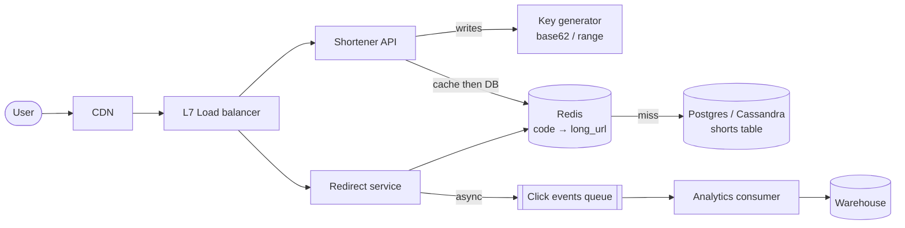

## Problem statement

Build a service that converts long URLs to short ones (`bit.ly/xY3qZ`) and redirects users back to the original URL on access. Track click counts.



## Requirements

### Functional
- POST `/shorten` — long URL in → short URL out.
- GET `/{code}` → 301/302 redirect to long URL.
- Optionally: custom alias, expiration, analytics.

### Non-functional
- Read-heavy (redirects ≫ creations): ~100:1.
- Low-latency redirects (< 50 ms p99).
- Highly available — short URLs in emails / SMS must keep working.
- Codes are unique, short (6–8 chars).

## Scale estimation

- 100M new URLs/month → 100M / 30 / 86400 ≈ **40 writes/sec average, ~120 peak**.
- 10B redirects/month → ~4K reads/sec average, ~12K peak.
- 5 years storage: 100M × 60 = **6B URLs**.
- Per record ~500 bytes → 6B × 500 = **3 TB raw**, ~9 TB with RF=3.

## Core API

```
POST /api/shorten
  body: { "long_url": "...", "custom_alias?": "...", "ttl_days?": 30 }
  → { "short_url": "https://sho.rt/abcdef" }

GET /{code}
  → 302 with Location: <long_url>

GET /api/analytics/{code}  (auth required)
  → { "clicks": N, "by_country": {...} }
```

## Encoding scheme

Short codes need ~6–8 chars from a 62-char alphabet `[a-zA-Z0-9]`.

- 62^6 ≈ 56 billion — enough.
- 62^7 ≈ 3.5 trillion — comfortable for 5+ years.

Two approaches:

### Hash-based (md5/sha256 → base62)
- Hash long URL, take first N base62 chars.
- Collision risk → check DB, increment if collision.
- Pro: stable mapping (same URL → same code if desired).
- Con: collisions, predictability.

### Counter-based (recommended)
- Maintain a global counter (DB sequence or Redis INCR).
- Encode counter in base62.
- Pro: no collisions, simple.
- Con: predictable (security issue if URLs are meant to be unguessable — add salt or use UUID-derived codes).

Multi-region: per-region counters with non-overlapping ranges (region A gets 0–1B, B gets 1–2B). Or generate codes via a snowflake-like ID generator.

## High-level architecture

```
                     ┌──────────┐
Client ──► CDN ──►   │   LB     │
                     └──────┬───┘
                            ↓
                     ┌──────┴───┐
                     │ App tier │ (stateless, autoscaled)
                     │ (FastAPI │
                     │ / Go )   │
                     └─┬────┬───┘
                       │    │
                  ┌────┘    └─────┐
                  ▼                ▼
              ┌────────┐    ┌──────────┐
              │ Redis  │    │  DB      │ (Postgres / Cassandra)
              │ cache  │    │ url_map  │
              └────────┘    └──────────┘
                                  │
                                  ▼
                              ┌─────────┐
                              │ Kafka   │ (click events)
                              └────┬────┘
                                   ▼
                             ┌──────────┐
                             │Analytics │ (ClickHouse / S3+Trino)
                             └──────────┘
```

## Data model

```sql
CREATE TABLE url_map (
  code        VARCHAR(8)  PRIMARY KEY,
  long_url    TEXT        NOT NULL,
  user_id     BIGINT,
  created_at  TIMESTAMP   NOT NULL,
  expires_at  TIMESTAMP,
  custom      BOOLEAN     DEFAULT FALSE
);
CREATE INDEX idx_user ON url_map(user_id);
CREATE INDEX idx_expires ON url_map(expires_at) WHERE expires_at IS NOT NULL;
```

Sharded by `code` (hash) once you outgrow one node.

For analytics (clicks), use a separate store — never the OLTP DB.

## Detailed design

### Write path (POST /shorten)

1. Validate URL (length, scheme).
2. Generate code:
   - Get next counter value (`INCR` in Redis, or a sequence in DB).
   - Encode in base62.
3. Insert into `url_map`.
4. Write-through to Redis cache.
5. Return short URL.

### Read path (GET /\{code\})

1. Check Redis cache.
2. If hit → 302 redirect immediately (~5 ms).
3. If miss → DB lookup → populate cache (with TTL = days for stable URLs) → redirect.
4. Asynchronously emit a click event to Kafka (don't block redirect).

### Click tracking

- Producer: emit `{code, ts, ip, ua, referrer}` to Kafka topic `url.clicks`.
- Consumer: aggregate into ClickHouse / Druid for real-time analytics; raw events to S3 Parquet for long-term.
- DO NOT increment a counter in the OLTP DB on every click — locks and write amplification.

### Caching strategy

- 80/20: a small fraction of codes get most traffic.
- Cache-aside with long TTL (codes are immutable).
- Redis cluster sized for ~20% of total URLs.
- On cache miss: stampede protection via single-flight (rare for distinct codes).

### Custom aliases

- User picks `/my-event`.
- Validate uniqueness; insert with `custom=true`.
- Reserved alias list (blacklist for confusing or branded terms).

### Rate limiting

- Per-API-key for `/shorten`.
- Per-IP for read endpoints to prevent abuse.
- Use Redis-based rate limiter.

## Scale-out

- **App tier**: stateless, behind LB, autoscale.
- **DB**: shard by code prefix or hash once one Postgres can't hold.
- **Redis**: cluster mode.
- **Geo**: CDN at edge for very hot codes (CloudFront / Cloudflare); analytics CDN handles cookie-less hits cheaply.
- **Multi-region active-active**: per-region counter ranges; eventual cross-region read.

## Bottlenecks & optimizations

- **Hot codes** (a viral link): CDN cache absorbs the spike.
- **Counter generation**: single global counter is a SPOF — use per-region ranges or distributed ID generator (Twitter Snowflake).
- **Click event write storm**: use Kafka to absorb burst; never write OLTP per click.
- **Analytics queries**: use OLAP store (ClickHouse, BigQuery), not the OLTP DB.

## Trade-offs

- 301 (permanent) vs 302 (temporary): 301 is browser-cached aggressively — analytics undercount. Default to **302** for accurate clicks.
- Counter-based codes are predictable. If unguessability matters (private links), use a random 8-char code derived from secure random or HMAC.
- Cache TTL: long for stable URLs, short for short-lived (expirable) URLs.

## Practice questions

<Practice>

<QA q="301 or 302 for the redirect, and why?" level="easy">

301 (permanent) is cached aggressively by browsers, so repeat clicks never reach your servers and analytics undercount. 302 (temporary) sends every click through you. Default to 302 when click counts matter.

</QA>

<QA q="How long do codes need to be?" level="easy">

With the 62-character alphabet `[a-zA-Z0-9]`, 6 chars give 62^6 ≈ 56 billion codes and 7 chars give 62^7 ≈ 3.5 trillion. At 100M new URLs per month (6B over 5 years), 6–7 chars is plenty.

</QA>

<QA q="How to avoid DB hit on every redirect?" level="easy">

Cache codes in Redis. Codes are immutable so a long TTL is safe. Traffic is heavily skewed toward a small set of hot codes, so a modest cache (sized for about 20% of URLs) achieves a high hit rate.

</QA>

<QA q="How would you generate short codes uniquely at scale?" level="medium">

Counter-based encoded in base62. For multi-region, partition counter ranges per region. Alternative: Twitter Snowflake-style 64-bit IDs (time + machine + sequence) — every ID unique without coordination.

</QA>

<QA q="Compare hash-based and counter-based code generation." level="medium">

Hash-based (md5/sha256 of the URL → first N base62 chars) gives a stable mapping — the same URL can get the same code — but truncation causes collisions you must detect and resolve, and codes are predictable from the URL. Counter-based has no collisions and is simple, but sequential codes are guessable, and a single global counter is a SPOF unless you use ranges or a distributed ID generator.

</QA>

<QA q="How do you track click analytics without slowing the redirect?" level="medium">

Emit a Kafka event asynchronously; the redirect proceeds without waiting. Aggregations happen in a separate consumer → ClickHouse/Druid for real-time, S3 Parquet for archival. Never increment a counter in the OLTP DB per click — locks and write amplification.

</QA>

<QA q="How to handle URL expiry?" level="medium">

Store `expires_at`; check on read, return 410 Gone if expired. A background job sweeps expired codes from the primary store and purges the CDN. Use a short cache TTL for expirable URLs. Don't rely solely on cache TTL for security-sensitive expiry.

</QA>

<QA q="Links are meant to be private. What's wrong with counter-based codes, and what do you use instead?" level="hard">

Sequential codes are enumerable: anyone can step through neighbouring codes and find other people's links. Use an unguessable random code (for example 8 chars from a secure random source, or derived from an HMAC), and handle the rare collision with a uniqueness check on insert.

</QA>

<QA q="Why is a single global counter a problem, and how do you fix it?" level="hard">

It's a single point of failure and a cross-region bottleneck: every write anywhere must reach it. Give each region (or app server) a non-overlapping range, such as region A 0–1B and region B 1–2B, so they allocate locally. Or use a Snowflake-style generator that needs no coordination.

</QA>

<QA q="Estimate storage for 5 years at 100M new URLs per month." level="hard">

100M × 60 months = 6B URLs. At about 500 bytes per record that's about 3 TB raw, about 9 TB with RF=3. Writes are tiny (about 40/sec average); the system is read-heavy at about 100:1.

</QA>

<QA q="A celebrity tweets a short URL; 1M clicks/sec. How does the system survive?" level="scenario">

- CDN caches the redirect at the edge — most clicks never hit origin (so click counts must then come from CDN logs / edge compute).
- App tier and Redis scale horizontally.
- Click events go to Kafka — high-throughput append-only buffer.
- Origin DB sees about 1 read per cache TTL per region, plus 0 writes (no counter to update).

</QA>

<QA q="A user wants `/my-event` as custom alias but it's taken. Design?" level="scenario">

Check uniqueness against a reserved-aliases blacklist + existing customs. Return an error if taken (optionally suggest alternatives). Insert with `custom=true`. Charge premium for custom aliases (typical product model).

</QA>

<QA q="A shortened malicious URL gets flagged. How do you take it down?" level="scenario">

Add a `disabled` flag in `url_map`. On read, return an error page if disabled. Issue a CDN purge to remove cached redirects. Maintain a blacklist of malicious domains (or use a service like Google Safe Browsing) and reject on shorten if matched.

</QA>

</Practice>

## Quiz

<Quiz>

<MCQ q="Marketing complains that click counts for a short link are far lower than expected. The service returns 301. What is the likely cause?" options={["Kafka is dropping events", "Browsers cache the 301 and skip the service on repeat clicks", "Redis evicted the code", "Base62 encoding loses characters"]} answer={1}>

A 301 is permanent and cached by browsers, so repeat visits never reach you. Use 302. Kafka loss or eviction would show other symptoms, and base62 is lossless.

</MCQ>

<MCQ q="Why is a long cache TTL safe for code to long_url mappings?" options={["Codes are immutable once created", "Redis never evicts", "The CDN refreshes it every second", "DB reads are free"]} answer={0}>

A code always maps to the same URL, so stale data is not a risk (except for expiry or takedown, which need explicit purges). Redis does evict, and the other options are false.

</MCQ>

<MCQ q="What is the main drawback of truncating a hash of the URL to make the code?" options={["It needs a global counter", "It can't be stored in Redis", "Collisions, which must be detected and resolved", "It makes codes longer than 8 chars"]} answer={2}>

Taking the first N chars of a hash means different URLs can collide, so you check and retry. Hashing needs no counter, stores fine and is truncated to the length you choose.

</MCQ>

<MCQ q="Private share links are being discovered by strangers. What is the most likely design flaw?" options={["302 instead of 301", "Long cache TTLs", "Kafka click tracking", "Sequential counter-based codes are guessable"]} answer={3}>

Sequential codes can be enumerated. Private links need unguessable random or HMAC-derived codes. Redirect status, cache TTLs and analytics don't expose links.

</MCQ>

<MCQ q="How should the redirect path record a click?" options={["Emit an event to Kafka asynchronously and redirect immediately", "Increment a counter in Postgres before redirecting", "Write the click to Redis and the DB synchronously", "Skip analytics on cache hits"]} answer={0}>

Async events keep the redirect fast and move aggregation to consumers. A per-click DB update adds latency and lock contention, and skipping cache hits loses most clicks.

</MCQ>

<MCQ q="Two regions each need to issue codes without a cross-region call. What works?" options={["One shared Redis INCR in region A", "Random 3-char codes", "Non-overlapping counter ranges per region", "Let both regions use the same counter and retry on conflict"]} answer={2}>

Disjoint ranges let each region allocate locally with no collisions. A shared counter adds cross-region latency and a SPOF, 3 chars collide quickly, and sharing a counter guarantees conflicts.

</MCQ>

<MCQ q="A short link expired yesterday. What should GET on its code return?" options={["404 Not Found", "410 Gone", "302 to the original URL", "500 Internal Server Error"]} answer={1}>

410 Gone states that the resource existed and was removed deliberately. 404 is less precise, redirecting ignores the expiry, and 500 signals a server bug.

</MCQ>

<MCQ q="A link is flagged as malicious, but users still get redirected after you set disabled=true. Why?" options={["The DB index is stale", "Base62 decoding is cached", "Kafka replays the old event", "The CDN and cache still hold the redirect, so you must purge them"]} answer={3}>

Cached redirects at the edge and in Redis bypass the new flag until purged. Indexes don't hold redirects, decoding isn't cached, and click events don't drive redirects.

</MCQ>

</Quiz>

## TL;DR cheat sheet

- Counter-based codes + base62 encoding.
- Read-heavy: cache aggressively in Redis + CDN.
- Async click events to Kafka → ClickHouse for analytics.
- Multi-region: partition counter ranges per region.
- Use 302 not 301 to keep click analytics accurate.
- Stateless app tier; DB shard when needed.
- Rate-limit creates; not really reads (CDN handles).

## Go deeper

- **ByteByteGo**: ["URL Shortener course"](https://bytebytego.com/courses/system-design-interview/design-a-url-shortener).
- **System Design Primer**: [shortlink](https://github.com/donnemartin/system-design-primer/tree/master/solutions/system_design/pastebin).
- **Alex Xu, *System Design Interview Vol 1*** — Chapter 8.
- **Twitter Snowflake**: [github.com/twitter-archive/snowflake](https://github.com/twitter-archive/snowflake) — distributed ID generation.
- **bit.ly engineering blog** for production stories.
