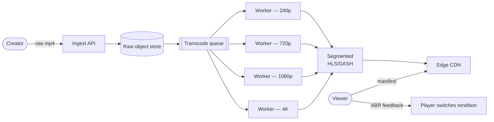

## Problem statement

Design a video streaming platform: users upload videos, the system transcodes to multiple bitrates, stores them, and streams to viewers globally with low buffering and minimal cost.



## Requirements

### Functional
- Upload video (any format).
- Transcode to adaptive bitrate formats (HLS / DASH).
- Stream on demand globally.
- Search / browse.
- Comments, likes, recommendations.

### Non-functional
- Massive scale: petabytes of video, billions of views.
- p99 startup < 2 s.
- Buffer ratio < 1% (rarely stalls).
- Cost-optimized: bandwidth is the main cost.

## Scale estimation

- 500M DAU; each watches 1 hour/day = 500M hours/day of streaming.
- At 5 Mbps average → 500M × 3600 × 5/8 = ~1.1 EB/day total bandwidth.
- 500K new uploads/day, 100 MB avg → 50 TB/day ingress raw.
- Storage: years of video × multiple resolutions × replication = petabytes to exabytes.

## High-level architecture

```
                       ┌─────────────┐
   Uploader ─────►     │ Upload Svc  │ ──► raw video to S3
                       └──────┬──────┘
                              ▼
                       ┌─────────────┐
                       │ Transcoding │ (Spark/distributed jobs)
                       │ Pipeline    │
                       └──────┬──────┘
                              ▼
                       ┌─────────────┐
                       │ Storage     │ (S3 + cold tier)
                       └──────┬──────┘
                              ▼
                       ┌─────────────┐
                       │ CDN (edge)  │ ── geographic delivery
                       └──────┬──────┘
                              ▼
                          Viewer ► adaptive bitrate (HLS/DASH)
                              │
                              ▼
              ┌─────────────┐    ┌───────────────┐
              │ Recommend.  │    │ Analytics     │
              │   Service   │    │ (ClickHouse)  │
              └─────────────┘    └───────────────┘
```

## Detailed design

### Upload

1. Client requests a pre-signed S3 URL (large file → multipart).
2. Client uploads parts directly to S3 (don't proxy through API).
3. On completion, S3 event → transcoding pipeline.
4. Metadata service records video.

### Transcoding

- Single upload → many output renditions (240p, 360p, 480p, 720p, 1080p, 4K).
- Two codecs (H.264 widely compatible, AV1/HEVC modern).
- Per rendition, segmented into ~6–10s chunks for HLS/DASH.
- Heavy CPU/GPU: distributed cluster (Spark, custom orchestrator).
- Per video: 10–60 minutes processing time.

### Storage

- Each output rendition stored as many small chunk files in S3.
- Manifest (`.m3u8` for HLS, `.mpd` for DASH) lists chunks per rendition.
- Cold tier (Glacier) for old, rarely-watched content.

### Adaptive bitrate streaming (HLS/DASH)

```
client requests manifest (.m3u8)
manifest lists available renditions: 240p, 360p, 720p, 1080p
client picks rendition based on bandwidth + screen
client fetches chunk by chunk
client measures throughput per chunk; switches up/down as needed
```

Each chunk is independently cacheable on CDN — huge cache hit rates because all viewers of the same rendition fetch the same chunk.

### CDN (the magic ingredient)

- Most expensive thing about streaming is bandwidth.
- CDN at edge caches popular content close to viewers.
- Major CDNs: CloudFront, Akamai, Cloudflare, Fastly.
- Netflix built **Open Connect**: their own CDN appliances inside ISPs, dramatically reducing transit cost.

### Recommendation system

- Offline: collaborative filtering, content embeddings, sessions.
- Online: feature service feeding a model serving layer.
- Cached top-N per user (refreshed every few hours).

### Live streaming (extension)

- Encoder pushes RTMP/SRT to ingest.
- Server transcodes in real time → segments → CDN.
- Latency target: 5–30s (DVR-like) or sub-second (WebRTC-based) — different architectures.

## Bottlenecks & optimizations

- **Per-byte cost**: CDN dominates. Optimize bitrate ladder; use AV1/HEVC for big savings.
- **Transcoding cost**: GPUs faster than CPU; spot instances reduce cost.
- **Cold start latency**: pre-fetch first chunks on page load; small initial chunk.
- **Recommendation latency**: cache per-user lists; precompute candidates.

## Trade-offs

- **VOD vs live**: VOD is simpler (transcode once, cache forever). Live is real-time, harder.
- **HLS vs DASH**: HLS is the dominant standard (Apple's ecosystem); DASH is more flexible. Often serve both.
- **Push (Netflix Open Connect) vs commercial CDN**: Open Connect has huge upfront cost but huge marginal savings; commercial CDN is pay-as-you-go.

## Practice questions

<Practice>

<QA q="Why adaptive bitrate streaming?" level="easy">

Network conditions vary. ABR lets the client pick the best rendition for current bandwidth and screen, and adjust dynamically — avoids buffering when bandwidth drops, gives best quality when bandwidth is high.

</QA>

<QA q="Why segment video into chunks?" level="easy">

Chunks (~6–10 s) are independently cacheable on the CDN → huge hit rates, since every viewer of a rendition fetches the same chunks. They enable ABR (switch rendition between chunks). Bad chunks can be re-fetched without restarting playback.

</QA>

<QA q="What is a manifest file?" level="easy">

An index the player downloads first: `.m3u8` for HLS, `.mpd` for DASH. It lists the available renditions and the chunk URLs for each. The player uses it to pick a rendition and fetch chunks in order, switching renditions as throughput changes.

</QA>

<QA q="Why upload with a pre-signed URL instead of through your API servers?" level="medium">

Videos are large. A pre-signed (multipart) S3 URL lets the client upload parts directly to object storage, so API servers don't proxy gigabytes of traffic. On completion, an S3 event triggers the transcoding pipeline and the metadata service records the video.

</QA>

<QA q="Estimate bandwidth for 100M concurrent viewers at 4 Mbps avg." level="medium">

100M × 4 Mbps = 400 Tbps. Only practical via massive CDN distribution (many PoPs, ISP-embedded). No single origin could serve this.

</QA>

<QA q="How does Netflix Open Connect reduce cost?" level="medium">

Netflix-owned CDN appliances installed inside ISPs (free for the ISP). Most Netflix traffic never traverses internet transit — it's served from inside the ISP's network. Saves Netflix transit cost, saves ISP transit cost. The trade-off is huge upfront cost versus pay-as-you-go commercial CDNs, which smaller players usually pick.

</QA>

<QA q="Why encode in both H.264 and AV1/HEVC?" level="medium">

H.264 plays almost everywhere, so it's the compatibility baseline. AV1 and HEVC compress much better, cutting the bytes the CDN must deliver for the same quality, which matters because bandwidth is the main cost. Serve the modern codec to devices that support it and H.264 to the rest, at the price of extra transcoding and storage.

</QA>

<QA q="How does live streaming differ from video on demand?" level="hard">

VOD is transcoded once and cached forever. Live must ingest (RTMP/SRT), transcode and segment in real time, then push segments to the CDN as they're produced. Segment-based live delivery typically lands at 5–30 s latency; sub-second latency needs a different, WebRTC-based architecture.

</QA>

<QA q="Design the transcoding pipeline." level="hard">

- Distributed job system (Spark or custom); GPUs and spot instances cut cost.
- Job per video: split into segments, transcode each in parallel to all required renditions/codecs.
- Output to S3.
- Manifest generation post-completion.
- Priority queue: short videos first, long videos in batch.
- Backoff on failures; alert on persistent ones.

</QA>

<QA q="How would you store video metadata for 1B videos?" level="hard">

Sharded SQL (or KV) by video ID hash. Indexes for search-by-uploader, by category, by date. Search via Elasticsearch (separate, fed by CDC). Stats (view count, likes) in a separate counter-friendly store (Redis or counter columns in Cassandra).

</QA>

<QA q="How do you handle a viral video getting 100x normal traffic?" level="scenario">

- CDN absorbs the load (the entire point of a CDN).
- Pre-warm caches if you can predict the spike (premieres).
- Origin shield protects the source.
- For genuinely unpredictable virality: the CDN's elastic capacity is the answer.

</QA>

<QA q="Cold start latency — how to load video in under 1s?" level="scenario">

- Pre-fetch the manifest aggressively (CDN caches it).
- Small initial chunk (1–2 s) requested ASAP.
- Skip rendition selection initially — pick a safe middle rendition immediately, refine after the first chunk completes.
- CDN edge near the user.

</QA>

<QA q="Your CDN bill is the biggest line item. What levers do you pull?" level="scenario">

Bandwidth dominates, so cut bytes delivered: tune the bitrate ladder so you don't over-encode, and serve AV1/HEVC to capable devices. Raise CDN hit rates (cacheable chunks, origin shield). At very large scale, consider ISP-embedded appliances like Open Connect. Move rarely watched content to a cold storage tier to cut storage cost too.

</QA>

</Practice>

## Quiz

<Quiz>

<MCQ q="A viewer's bandwidth drops mid-video. What does an ABR player do?" options={["Pauses until bandwidth recovers", "Switches to a lower-bitrate rendition for upcoming chunks", "Re-downloads the whole video at lower quality", "Asks the server to re-transcode"]} answer={1}>

The player measures throughput per chunk and picks a lower rendition for the next chunks, avoiding stalls. It doesn't re-download everything or trigger transcoding, and pausing is what ABR is meant to avoid.

</MCQ>

<MCQ q="Why do video chunks get very high CDN hit rates?" options={["Every viewer of the same rendition requests the same chunk files", "Chunks are encrypted per user", "CDNs store whole videos only", "Chunks change every few seconds"]} answer={0}>

Identical, immutable chunk files are shared across viewers, so one cached copy serves many. Per-user encryption or changing chunks would destroy cacheability.

</MCQ>

<MCQ q="What file does an HLS player fetch first?" options={["The 1080p chunk", "The raw mp4", "The .m3u8 manifest", "The .mpd manifest"]} answer={2}>

HLS starts from the .m3u8 manifest that lists renditions and chunks. .mpd is DASH's manifest, and players don't fetch raw uploads or a specific chunk first.

</MCQ>

<MCQ q="Why do clients upload directly to S3 using a pre-signed URL?" options={["S3 transcodes on upload", "It is the only way to use HLS", "It encrypts the video", "API servers don't have to proxy huge files"]} answer={3}>

Direct upload keeps gigabytes of traffic off the API tier. S3 doesn't transcode, upload method is unrelated to HLS, and pre-signing is about authorization, not encryption.

</MCQ>

<MCQ q="100M concurrent viewers watch at 4 Mbps on average. What is the total egress?" options={["40 Tbps", "400 Tbps", "4 Pbps", "400 Gbps"]} answer={1}>

100 million × 4 Mbps = 400 million Mbps = 400 Tbps. The other options are off by factors of 10 or 1000.

</MCQ>

<MCQ q="What is the main way Netflix Open Connect saves money?" options={["It serves traffic from appliances inside ISP networks, avoiding internet transit", "It uses a cheaper codec", "It removes the need for transcoding", "It stores fewer renditions"]} answer={0}>

Placing caches inside ISPs means most bytes never cross transit links. Codec choice, transcoding and rendition count are separate decisions.

</MCQ>

<MCQ q="A product needs sub-second live latency for interactive streams. What does that imply?" options={["Use 10-second HLS segments", "Transcode once and cache forever", "Serve only from the cold tier", "A WebRTC-based architecture rather than standard segment-based delivery"]} answer={3}>

Segment-based live delivery typically sits at 5–30 s; sub-second needs WebRTC-style delivery. Long segments add latency, transcode-once is VOD, and cold storage is for old content.

</MCQ>

<MCQ q="Which step most directly cuts startup time to first frame?" options={["Increase segment length to 30 s", "Encode only in 4K", "Request a small initial chunk at a safe middle rendition right away", "Wait for a full bandwidth test before choosing a rendition"]} answer={2}>

A small first chunk at a safe rendition starts playback fast, then ABR refines. Longer segments, 4K-only or waiting on a bandwidth test all delay the first frame.

</MCQ>

</Quiz>

## TL;DR cheat sheet

- Upload via pre-signed S3 URLs (direct, multipart).
- Transcode to multiple renditions + codecs (HLS/DASH chunks of 6-10s).
- Store chunks in S3; manifest lists them.
- CDN at edge serves chunks to viewers (highest hit rate).
- Adaptive bitrate: client picks rendition per chunk.
- Recommendations precomputed.
- Open Connect or similar for big players; commercial CDN for smaller.

## Go deeper

- **Netflix Tech Blog**: [Open Connect](https://openconnect.netflix.com/) and many ABR/encoding posts.
- **YouTube engineering**: ABR + encoding history.
- **Mux blog**: video streaming details.
- **HLS spec**: [datatracker.ietf.org/doc/html/rfc8216](https://datatracker.ietf.org/doc/html/rfc8216).
- **DASH overview**.
- **ByteByteGo**: video streaming videos.
