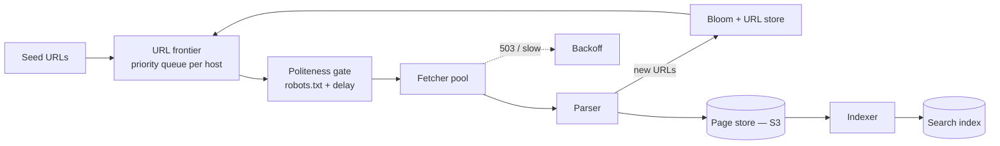

## Definition (interview-ready)

A **web crawler** starts from seed URLs and repeatedly downloads pages, extracts their links and queues the new ones, so it can store and index billions of pages while staying polite to every website. The core is the **URL frontier**: a durable, prioritized queue **sharded by domain**, so one worker owns each domain and can enforce its rate limit (about one request per second, plus robots.txt rules) without coordination. Async **fetchers** with DNS caching download pages; **parsers** extract text and links; new URLs are normalized and checked against a **Bloom filter** before re-entering the frontier, and content fingerprints (exact hashes and SimHash) drop duplicate pages. Raw pages go to object storage and feed the indexer, and a scheduler recrawls pages based on how often they change.

The key decision is that throughput comes from crawling many domains in parallel, never from hitting one domain harder. The main trade-off is freshness versus coverage under a fixed fetch budget.

**One-liner:** A domain-sharded, prioritized URL frontier feeds polite async fetchers; parsers extract links, which are normalized and Bloom-filter-deduped back into the frontier, while pages are content-deduped, stored in object storage and indexed.

## Problem statement

Design a distributed web crawler: fetch billions of pages from the public web, parse and index them, respect robots.txt and politeness, while scaling efficiently.



## Requirements

### Functional
- Fetch URLs at high parallelism.
- Parse HTML, extract links + text.
- Store content for indexing.
- Schedule recrawls.
- Honor robots.txt, crawl-delay.

### Non-functional
- Scale to billions of pages.
- Politeness: limit QPS per domain.
- Avoid duplicates (URL + content).
- Resilient to bad URLs, slow servers, traps.

## Scale estimation

- 10B URLs in the seed/queue.
- 1B fetches/day → ~12K fetches/sec.
- Avg page size 200 KB → 200 TB/day raw → ~73 PB/year. Compression → ~25 PB/year.

## High-level architecture

```
              ┌────────────┐
   Seed URLs ►│ Frontier   │ ── prioritized queue (per-domain shards)
              └──────┬─────┘
                     ▼
              ┌────────────┐
              │ Fetcher    │ ── HTTP client pool, politeness
              │ workers    │
              └──────┬─────┘
                     ▼
              ┌────────────┐
              │ Parser     │ ── extract text, links, metadata
              └──────┬─────┘
                     ▼
        ┌────────────┼─────────────┐
        ▼            ▼             ▼
   Content store   Link extractor  URL filter
   (S3/HBase)      ─ new URLs ─►  ─ dedup + filter ─► back to frontier
```

## Detailed design

### URL frontier (queue)

The priority/queue of URLs to fetch.

- **Sharded by domain** — politeness is per-domain.
- **Priority**: high for important sites, fresh updates; low for tail.
- Persisted (durable) — crawlers crash often.
- Tools: Kafka topic per priority tier, with consumer groups.

### Politeness

Per-domain rate limit (typical: 1 req/sec/domain).

Implementation:
- Per-domain bucket in Redis or in-process token bucket.
- Worker holding a domain's lease must respect crawl-delay.
- robots.txt cached per domain (refetch ~daily; RFC 9309 says not to use a cached copy for more than 24 hours).

### Fetcher

- Async HTTP client (1000s of concurrent requests per worker).
- Timeout aggressive (~10–30s).
- DNS caching (huge speedup).
- HTTP/2 connection pooling per origin.
- Detect and avoid traps (infinite redirects, calendar pages with infinite next-month links).
- Bandwidth shaping per worker (avoid saturating any one upstream).

### Parser

- HTML parsing (lxml, Go html.Parser).
- Strip JS/CSS, extract text + links + meta.
- For SPAs (heavy JS): headless browser (Puppeteer, Playwright) — much more expensive.
- Canonical URL extraction (`<link rel="canonical">`).

### Deduplication

URL dedup:
- Bloom filter per shard: "have we seen this URL?"
- Negative result → definitely new; positive → likely seen, check.
- 10B URLs at ~5 bits/URL ≈ 6 GB per bloom — but that's a ~10% false-positive rate; ~10 bits/URL (~12 GB) gets ~1%.

Content dedup:
- Hash content (SimHash for near-duplicates).
- Compare against seen hashes → skip if seen.

### URL filters

- Reject: bad MIME types, login pages, robots.txt disallows.
- Normalize: drop fragments, sort query params, lowercase host.
- Limit URL length.
- Blocklist for traps and spam.

### Content store

- Raw HTML: S3 (with content hash as key for natural dedup).
- Parsed text + metadata: HBase / Cassandra (large-scale row store).
- For analytics: Parquet in S3, queried via Trino.

### Index pipeline

- Crawl pipeline emits "parsed page" events to Kafka.
- Search index builder (Elasticsearch / custom inverted index) consumes.
- Periodic full rebuild + incremental updates.

### Recrawl scheduling

- Priority sites: every hour or day.
- Long-tail: every week or month.
- Adaptive: pages that change frequently get recrawled more often.

### robots.txt

- Fetch per domain and refresh at least daily (RFC 9309: don't use a cached copy for more than 24 hours).
- Apply rules to candidate URLs.
- Cache the result.
- Set User-Agent string for identification.

## Bottlenecks & optimizations

- **Politeness per domain limits throughput**: only as fast as the slowest popular domain. Solution: many domains in parallel; small domains get full attention.
- **DNS bottleneck**: cache aggressively; use multiple recursors.
- **Massive URL dedup state**: bloom filters + persistent storage for definites.
- **Parser cost on SPAs**: budget per page; skip if cost too high.
- **Network burst**: rate-limit per IP egress; multiple IPs per worker.

## Trade-offs

- **Politeness vs throughput**: must be polite; rate per domain.
- **Headless browser vs HTML-only parsing**: full JS rendering is 100× more expensive but catches SPAs.
- **Storage tier**: keep recent pages hot, older pages cold (Glacier).
- **Fresh vs broad coverage**: budget for both — high-priority sites get fresh; tail gets stale.

## Practice questions

<Practice>

<QA q="What's a crawler trap?" level="easy">

Pages that generate an endless supply of URLs: calendars with an infinite 'next month' link, paginations that never end, query-parameter explosions. Mitigations: depth limits, URL length limits, parameter normalization, and heuristics or blocklists that flag trap and spam sites.

</QA>

<QA q="Why normalize URLs before deduplication?" level="easy">

The same page is reachable under many spellings. Normalizing (drop `#fragments`, sort query params, lowercase the host) and honoring `<link rel='canonical'>` collapses them to one key, so the dedup check and the frontier don't treat each variant as a new page.

</QA>

<QA q="Why is DNS caching a big win for a crawler?" level="easy">

Every fetch needs a host lookup, and the crawler hits the same hosts over and over. Without a cache, DNS becomes a bottleneck and adds latency to every request. Cache aggressively in the fetchers and spread lookups over multiple recursors.

</QA>

<QA q="How to deduplicate URLs at scale?" level="medium">

Bloom filters per shard for a fast 'have we seen it?' check. A Bloom filter is probabilistic: a negative means definitely new; a positive means probably seen. False positives make us skip some new URLs (acceptable); false negatives never happen. Size matters: ~10 bits/URL gives ~1% false positives (~12 GB for 10B URLs). Back it with persistent storage for definitive checks when needed.

</QA>

<QA q="How do you avoid hitting a domain too aggressively?" level="medium">

Per-domain rate limiter (token bucket in Redis or in-process). Honor `Crawl-Delay` in robots.txt where you choose to (it's non-standard and not in RFC 9309; Bing honors it, Google ignores it). Default to ~1 req/sec/domain, configurable. Workers acquire a domain lease before fetching and release it after the delay.

</QA>

<QA q="Why is the URL frontier sharded by domain and persisted?" level="medium">

Politeness is a per-domain rule, so putting all of a domain's URLs in one shard lets one worker enforce its rate limit without cross-worker coordination. Persistence matters because crawlers crash often; a durable frontier (for example Kafka topics per priority tier) means a restart doesn't lose the queue. Priority tiers let important or fast-changing sites jump ahead of the long tail.

</QA>

<QA q="How do you detect duplicate content, not just duplicate URLs?" level="medium">

Hash the content. An exact hash catches byte-identical copies (and using it as the S3 key gives natural dedup). For near-duplicates (same article with different ads or timestamps), use SimHash: similar documents produce fingerprints that differ in only a few bits, so you compare against seen fingerprints and skip pages that are too close.

</QA>

<QA q="How do you schedule recrawls?" level="medium">

- Priority per site: news every hour, blogs daily, static sites weekly or monthly.
- Adaptive: track change frequency per page; pages that change often get recrawled more often.
- Re-evaluate stale entries periodically.
- Burst recrawls on sitemap signals or trending events.

</QA>

<QA q="Storage estimation." level="medium">

1B pages/day × 200 KB = 200 TB/day raw. With ~3× compression, ~70 TB/day. Over 5 years that's ~120 PB compressed. Keep recent pages in a hot tier (HBase/S3) and move old ones to a cold tier (Glacier).

</QA>

<QA q="How do you scale to billions of pages?" level="hard">

- Distributed fetchers (many workers) using async I/O, each holding thousands of in-flight requests.
- Sharded URL frontier (by domain hash).
- Distributed parser/processor pools.
- Sharded storage (S3 with key-prefix sharding).
- Bloom filters per shard so dedup state stays in memory.

</QA>

<QA q="Politeness vs throughput — design." level="hard">

Politeness is a per-domain constraint. Throughput comes from **parallelism across domains**, not within one. With ~387M registered domains (Verisign DNIB, end of Q4 2025) at 1 req/sec each, the theoretical ceiling is hundreds of millions of req/sec. In practice the long tail dominates: be polite to each domain and keep many domains in flight at once.

</QA>

<QA q="How do you handle JavaScript-heavy pages (SPAs)?" level="scenario">

- Detect via content (mostly empty `<body>` plus JS bundles).
- Route to a headless browser pool (Puppeteer/Playwright).
- It's roughly 100× the cost, so set a budget per page.
- Cache rendered content aggressively.
- Most crawlers parse cheap HTML first and escalate to JS rendering only for high-value pages.

</QA>

</Practice>

## Quiz

<Quiz>

<MCQ q="A crawler's Bloom filter says a URL has NOT been seen. What can you conclude?" options={["It was probably seen; check the persistent store", "It is definitely new", "Nothing; Bloom filters give false negatives", "It was seen but has expired"]} answer={1}>

Bloom filters have no false negatives, so a negative is certain. Only a positive is uncertain (possible false positive). They don't track expiry.

</MCQ>

<MCQ q="Each domain is limited to about 1 request per second. How does the crawler still reach high total throughput?" options={["By raising the per-domain rate during off-peak hours", "By using HTTP/2 to send many parallel requests to each domain", "By crawling many domains in parallel", "By ignoring robots.txt for large sites"]} answer={2}>

Politeness is a per-domain cap; throughput comes from parallelism across the huge number of domains. Raising per-domain concurrency or ignoring robots.txt breaks politeness.

</MCQ>

<MCQ q="Why shard the URL frontier by domain?" options={["So one worker can enforce a domain's rate limit without coordination", "Because domains hash more evenly than URLs", "To make Bloom filters smaller", "So pages from a domain are stored together in S3"]} answer={0}>

Politeness is per domain, so keeping a domain's URLs in one shard lets a single worker own its rate limit. The other options are not the reason.

</MCQ>

<MCQ q="What is SimHash used for in a crawler?" options={["Checking whether a URL is in the frontier", "Encrypting stored pages", "Choosing the partition for a URL", "Detecting near-duplicate page content"]} answer={3}>

SimHash makes fingerprints where similar documents differ in few bits, so it catches near-duplicates. URL membership uses Bloom filters; partitioning uses a domain hash.

</MCQ>

<MCQ q="What is the status of the Crawl-delay directive?" options={["Required by RFC 9309", "Non-standard; Bing honors it, Google ignores it", "Deprecated and ignored by all crawlers", "Only valid in sitemaps"]} answer={1}>

Crawl-delay is not part of RFC 9309. Support varies by crawler: Bing honors it, Google does not.

</MCQ>

<MCQ q="Per RFC 9309, how long may a crawler use a cached robots.txt?" options={["No more than 7 days", "Until the site returns a 404", "No more than 24 hours", "Indefinitely if the file is unchanged"]} answer={2}>

RFC 9309 says crawlers should not use a cached copy for more than 24 hours, which is why robots.txt is refetched about daily.

</MCQ>

<MCQ q="Roughly how many fetches per second is 1 billion fetches per day?" options={["About 12,000", "About 1,200", "About 120,000", "About 1.2 million"]} answer={0}>

A day has 86,400 seconds; 1e9 / 86,400 is about 11,600, so roughly 12K/sec.

</MCQ>

<MCQ q="Which is the best mitigation for a calendar page with an endless next-month link?" options={["Increase the fetch timeout", "Render it in a headless browser", "Use SimHash to detect it", "Apply depth and URL-length limits plus trap heuristics"]} answer={3}>

Traps generate endless distinct URLs; depth limits, URL length limits, parameter normalization and blocklists stop them. Timeouts and rendering don't, and SimHash may miss pages whose content differs slightly.

</MCQ>

<MCQ q="What is the usual strategy for JavaScript-heavy pages?" options={["Render every page in a headless browser", "Parse HTML first and render with a headless browser only for high-value pages", "Skip all SPAs", "Ask site owners for an API"]} answer={1}>

Full rendering is about 100× more expensive, so crawlers escalate only when the page is valuable and the HTML is nearly empty.

</MCQ>

</Quiz>

## TL;DR cheat sheet

- Sharded URL frontier per domain.
- Per-domain rate limiter (robots.txt + crawl-delay).
- Async fetchers with DNS cache + HTTP/2 pooling.
- Parser extracts text + links; SimHash for content dedup.
- Bloom filters for URL dedup.
- Content to S3, parsed data to HBase / Cassandra.
- Recrawl scheduling with priority + adaptive frequency.
- Detect crawler traps.

## Go deeper

- **System Design Primer**: web crawler.
- **Alex Xu, *System Design Interview Vol 1*** Chapter 9 (Design a web crawler).
- **Mercator paper** (Heydon & Najork, 1999) — classic crawler design.
- **Common Crawl**: open dataset and engineering writeups.
- **Apache Nutch**: open-source crawler.
- **Google's "How Search organizes information"** docs.
- **ByteByteGo**: web crawler videos.
