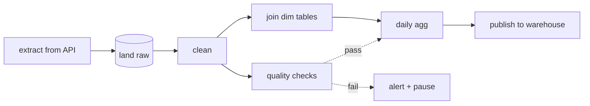

## Definition (interview-ready)

**Apache Airflow** is a workflow orchestrator. You define pipelines in Python as **DAGs** (directed acyclic graphs) of tasks, and Airflow schedules them, runs each task once its upstream tasks finish, retries failures and records every state in a metadata database.

- A **DAG run** is one execution of a DAG, identified by its **logical date**. With the classic data-interval schedule (the Airflow 2 default), that is the *start* of the data window the run processes, not the time it actually runs.
- Tasks must be **idempotent** (rerunning them gives the same result), because retries and backfills rerun them.
- **Deferrable operators** hand long waits to a lightweight **triggerer** service, so a task that is only waiting doesn't occupy a worker slot.

**One-liner:** Airflow is a Python-defined scheduler for DAGs of tasks: each DAG run processes one logical date, tasks must be idempotent so retries and backfills are safe, and deferrable operators let waits run in a triggerer instead of blocking workers.

## Why it matters

Most data teams orchestrate with Airflow. The same patterns (idempotency, backfills, deferrable ops, retries) apply to any modern orchestrator (Prefect, Dagster, Temporal). Knowing these well is what separates data engineers who can ship reliable pipelines from those whose jobs run nightly and break weekly.



## Core concepts

### DAG

A workflow definition (Python file):
```python
with DAG("daily_sales", schedule="@daily", start_date=...) as dag:
    extract = PythonOperator(task_id="extract", python_callable=...)
    transform = PythonOperator(task_id="transform", python_callable=...)
    load = PythonOperator(task_id="load", python_callable=...)
    extract >> transform >> load
```

- Static structure (mostly).
- Tasks have dependencies (`>>`).
- DAG scheduled at intervals (`@daily`, cron expression, or `None` for manual only).

### DAG run

One execution of the DAG for a specific **logical date** (called **execution_date** before Airflow 2.2; removed from the task context in Airflow 3).

For `daily_sales` on 2026-05-29, a DAG run with logical_date=2026-05-29 starts at the next interval (typically 00:00 UTC the next day in classic Airflow semantics).

Version note: in **Airflow 3**, bare cron/preset schedules default to `CronTriggerTimetable` (`[scheduler] create_cron_data_intervals = False`), where the logical date is the *trigger time*, not the start of a data interval. The data-interval semantics below are the Airflow 2 default (still available via `CronDataIntervalTimetable` or by setting that flag to `True`).

Critical: **logical_date is the start of the data window**, not when the DAG actually runs. So `daily_sales` with logical_date=2026-05-29 processes the data for that day, running at end-of-day or whenever scheduled.

### Idempotency: rerunnable tasks

Tasks must be safe to run multiple times. Why:
- Retries on failure.
- Backfills (re-running historical periods).
- Reprocessing after bug fixes.

Patterns:
- Pass `logical_date` (or `run_id`) into the task.
- Idempotent operations: `INSERT ... ON CONFLICT DO NOTHING`, `MERGE INTO`, delete-then-insert, upsert.
- Idempotent file output: write to a path including `logical_date`.

```python
def extract(**ctx):
    date = ctx['logical_date'].date()
    output = f"s3://bucket/extract/{date}/data.parquet"
    # if rerun, overwrite same path
    db.export(f"SELECT * FROM source WHERE date = '{date}'", output)
```

### Scheduler

- DAG files are re-parsed periodically (`min_file_process_interval`, default 30s). In Airflow 3 parsing is done by a separate **DAG processor** service that must be run on its own.
- Parses Python DAG → in-memory representation.
- Decides which DAG runs are due, creates them.
- For each run, evaluates dependencies; enqueues ready tasks.
- Stores state in the metadata DB (Postgres).

### Executor

- **Local**: tasks run in subprocesses on scheduler host.
- **Celery**: distributed workers consume Redis/Rabbit queue.
- **Kubernetes**: each task = a pod.
- **Amazon MWAA / Google Cloud Composer / Astronomer**: managed Airflow services.

### Backfill

Rerun a DAG for a past window:
```bash
airflow dags backfill -s 2026-04-01 -e 2026-04-30 daily_sales   # Airflow 2
airflow backfill create --dag-id daily_sales \
  --from-date 2026-04-01 --to-date 2026-04-30                 # Airflow 3 (scheduler-managed)
```

Creates DAG runs for each missed date. Critical: tasks must be idempotent.

### Catchup

On scheduler startup, if DAG missed intervals during downtime, scheduler creates "catchup" runs. `catchup=False` disables (only run for current/future intervals). Airflow 3 changed the default (`catchup_by_default`) to `False`; in Airflow 2 it was `True`.

### Sensors (and the deferrable pattern)

A **sensor** waits for an external condition: file in S3, partition in Hive, API ready.

Classic sensor: poll in a loop in the worker. Problem: **blocks a worker slot** while waiting. At scale, thousands of sensors → thousands of workers idle.

**Deferrable operators** (Airflow 2.2+): a sensor "yields" to the **triggerer** — a lightweight async event loop. When the condition is met, the triggerer wakes the task up and reattaches a worker.

Result: instead of 1000 idle worker slots, a single triggerer process runs thousands of waits concurrently (up to its `capacity` setting, 1000 triggers by default), and you add triggerers to scale further.

### Task states

```
NONE → SCHEDULED → QUEUED → RUNNING → SUCCESS
                               │
                               ├─ fails, retries left → UP_FOR_RETRY → (after retry_delay) SCHEDULED
                               ├─ fails, no retries   → FAILED
                               └─ waits on a trigger  → DEFERRED → (event fires) SCHEDULED

Downstream tasks of a FAILED task become UPSTREAM_FAILED
(or SKIPPED / still run, depending on their trigger rules).
```

### Trigger rules

Default: a task runs when all upstreams succeed.

Variants:
- `all_done`: run after upstreams finish (success or failure).
- `one_failed`: run if any upstream failed.
- `all_failed`: run only if all upstreams failed.
- Useful for cleanup / notification tasks.

### Pools and concurrency

- **Pool**: named bucket with a fixed slot count. Tasks tagged with a pool wait for a free slot.
- Use: limit concurrent connections to a DB, expensive API calls.
- Per-DAG concurrency: max active tasks per DAG (`max_active_tasks`).
- Per-task concurrency: max active instances of one task across all runs of its DAG (`max_active_tis_per_dag`).

### XCom (cross-task communication)

Tasks pass small values via XCom (stored in metadata DB). Used for: returning a query result, file path, status. Don't push huge payloads.

For big data, write to a known location (S3) and pass the path.

### Smart sensors → Deferrable (history)

Airflow 1 had no async; everything ran in workers. Airflow 2.0 introduced smart sensors (deprecated in 2.2.4, removed in 2.4) and then deferrable operators (2.2) — much more scalable. Modern Airflow 2.7+: deferrable ops cover most async needs.

## Common pitfalls

- **Non-idempotent tasks**: retry on partial failure → duplicates / corruption.
- **Backfill of a non-idempotent DAG**: data integrity disaster.
- **Heavy work in DAG parsing**: scheduler parses Python files often; heavy parse = slow scheduler.
- **Sensors without deferrable**: kills scheduling at scale.
- **Big XCom payloads**: blows up metadata DB.
- **Dynamic task generation in Python loops**: harder to track; use TaskFlow / dynamic task mapping.
- **`catchup=True` on a long-dormant DAG**: huge thundering herd on restart.
- **`schedule_interval` semantics confusion**: DAG run for logical_date X executes AFTER period X ends.
- **DB bottleneck**: scheduler hammers metadata DB. Tune Postgres.

## Practice questions

<Practice>

<QA q="Why must Airflow tasks be idempotent?" level="easy">

Retries, backfills, and reprocessing after bug fixes all mean the same task can run several times for the same interval. Idempotency makes the output identical no matter how many times it ran. Without it, a retry after a partial failure creates duplicates or corrupt data.

</QA>

<QA q="What is XCom and what shouldn't you put in it?" level="easy">

XCom lets tasks pass small values (a file path, a row count, a status) to each other; values are stored in the metadata DB. Don't push large payloads: they bloat the metadata DB and slow the scheduler. For big data, write to a known location such as S3 and pass the path through XCom.

</QA>

<QA q="What is catchup and how did its default change?" level="easy">

When a DAG has missed intervals (paused, scheduler down, `start_date` in the past), the scheduler creates runs for each missed interval. `catchup=False` disables that and only runs current/future intervals. The default (`catchup_by_default`) was `True` in Airflow 2 and became `False` in Airflow 3. Leaving catchup on for a long-dormant DAG causes a thundering herd of runs on restart.

</QA>

<QA q="What are trigger rules? Give a use case." level="easy">

A trigger rule decides when a task runs based on its upstreams' states. The default is all upstreams succeeded. `all_done` runs once upstreams finish whatever the outcome (good for cleanup); `one_failed` runs if any upstream failed (good for alerting); `all_failed` runs only if every upstream failed.

</QA>

<QA q="Explain logical_date vs run timing." level="medium">

`logical_date` is the start of the data window the run covers (for example 2026-05-29 for a daily DAG). The run actually executes *after* that window ends, typically the next day. That's the Airflow 2 default; in Airflow 3 bare cron schedules default to `CronTriggerTimetable`, where `logical_date` is the trigger time. Tasks use `logical_date` to decide which data to process, not to tell the current time.

</QA>

<QA q="How to backfill an Airflow DAG?" level="medium">

`airflow dags backfill -s START -e END dag_id` (Airflow 2) or `airflow backfill create --dag-id dag_id --from-date START --to-date END` (Airflow 3, scheduler-managed). It creates a DAG run for each interval. Tasks must be idempotent. For large backfills, throttle so you don't hammer downstream systems.

</QA>

<QA q="What's a deferrable operator and why does it matter?" level="medium">

A task that yields to the **triggerer** (a lightweight async event loop) during long waits, freeing its worker slot. When the condition is met, the triggerer resumes the task on a worker. It replaces classic poll-in-worker sensors: one triggerer can watch thousands of conditions (default capacity 1,000 triggers per triggerer, and you can run several), whereas classic sensors would need that many busy worker slots.

</QA>

<QA q="Compare Celery vs Kubernetes executor." level="medium">

Celery: long-running workers consume tasks from a queue (Redis/RabbitMQ). Fast task start, less isolation between tasks. Kubernetes: each task is a Pod, so full isolation and elastic scaling, but slower start (~10–30 s pod startup). Pick K8s for isolation and cost elasticity; Celery for sustained high-rate workloads.

</QA>

<QA q="How do pools differ from max_active_tasks and max_active_tis_per_dag?" level="medium">

A **pool** is a named set of slots shared across DAGs; tasks assigned to it wait for a free slot, so it caps total load on a shared resource such as a database or a rate-limited API. `max_active_tasks` caps concurrently running tasks within one DAG. `max_active_tis_per_dag` caps concurrent instances of one task across all runs of its DAG.

</QA>

<QA q="How would you reduce scheduler delays?" level="hard">

- Smaller DAGs (split mega-DAGs).
- Keep DAG files cheap to parse: no DB calls or heavy imports at top level, since files are re-parsed frequently (`min_file_process_interval`, 30 s default).
- Tune `dag_dir_list_interval` and `min_file_process_interval`.
- Tune the metadata Postgres; the scheduler hits it hard.
- Run multiple schedulers (Airflow 2+ supports active-active schedulers).
- Replace classic sensors with deferrable operators.

</QA>

<QA q="A DAG has 100 tasks running daily. Some take 1 second; one takes 4 hours. Improvements?" level="scenario">

- If the long task is mostly waiting, make it deferrable so it doesn't hold a worker.
- Parallelize it internally if possible (a bigger Spark job).
- Make it incremental: process only changed data.
- Use a pool to isolate it from the fast tasks.
- Expect backfills to be dominated by this one task; optimize it first.

</QA>

<QA q="Design idempotent loader from S3 to Postgres for daily partition." level="scenario">

```python
def load(**ctx):
    date = ctx['logical_date'].date()
    # Postgres can't read Parquet from S3 natively, so first download
    # s3://bucket/source/<date>/ and COPY it into a staging table.
    rows = read_parquet_from_s3(f"s3://bucket/source/{date}/")
    # Idempotent: delete existing rows for the date, then insert,
    # both in one transaction.
    with conn.transaction():
        conn.execute("DELETE FROM target WHERE date = %s", (date,))
        copy_into(conn, "target", rows)
```

Or upsert with `MERGE INTO` (Postgres 15+) for partial updates. The task is scoped by `logical_date`, so reruns replace the same partition with no duplicates.

</QA>

</Practice>

## Quiz

<Quiz>

<MCQ q="What problem do deferrable operators solve?" options={["Tasks running in the wrong order", "Classic sensors occupying a worker slot while they wait", "Large XCom payloads", "Slow DAG file parsing"]} answer={1}>

A classic sensor polls inside a worker, so thousands of sensors idle thousands of workers. Deferrable tasks hand the wait to the triggerer and free the slot. The others are separate problems.

</MCQ>

<MCQ q="Under Airflow 2 default data-interval semantics, when does the daily run with logical_date 2026-05-29 execute?" options={["At 00:00 UTC on 2026-05-29", "Whenever the DAG file is next parsed", "After the 2026-05-29 interval ends, typically 00:00 UTC on 2026-05-30", "Only when triggered manually"]} answer={2}>

logical_date marks the start of the data window; the run fires after that window closes. Airflow 3 cron schedules default to CronTriggerTimetable, where logical_date is the trigger time instead.

</MCQ>

<MCQ q="What is the default for catchup in Airflow 3?" options={["False", "True", "True only for daily DAGs", "It is set per run"]} answer={0}>

Airflow 3 changed catchup_by_default to False; in Airflow 2 it was True.

</MCQ>

<MCQ q="A cleanup task must run after its upstreams finish, whether they succeeded or failed. Which trigger rule?" options={["one_failed", "all_failed", "all_success", "all_done"]} answer={3}>

all_done fires when upstreams finish regardless of outcome. all_success is the default and would skip cleanup after a failure; one_failed and all_failed only fire on failures.

</MCQ>

<MCQ q="One task produces a 2 GB dataset needed by the next task. Best approach?" options={["Return it from the task so it lands in XCom", "Write it to S3 and pass the path via XCom", "Store it in an Airflow Variable", "Merge both tasks so no data is passed"]} answer={1}>

XCom lives in the metadata DB and is meant for small values; large payloads bloat it. Write the data to object storage and pass only the path.

</MCQ>

<MCQ q="Several DAGs call a database that allows only 10 concurrent connections. Which Airflow feature limits concurrency across all of them?" options={["A pool with 10 slots", "max_active_tasks on each DAG", "catchup=False", "The all_done trigger rule"]} answer={0}>

A pool is shared across DAGs, so it caps the total. max_active_tasks only limits one DAG at a time; the others are unrelated.

</MCQ>

<MCQ q="Why is a heavy import or DB query at the top level of a DAG file harmful?" options={["It makes tasks non-idempotent", "It breaks XCom", "DAG files are re-parsed frequently, so the cost is paid over and over and slows scheduling", "It forces catchup to run"]} answer={2}>

DAG files are parsed periodically (min_file_process_interval, 30 s by default), so top-level work runs on every parse and slows the scheduler or DAG processor.

</MCQ>

<MCQ q="Which load task is safe to retry or backfill?" options={["INSERT rows filtered by the current wall-clock date", "Append rows to the target table on each run", "INSERT rows and rely on retries being rare", "Delete rows for logical_date, then insert that day's data, in one transaction"]} answer={3}>

Scoping by logical_date and replacing the partition gives the same result on every run. Wall-clock dates break backfills, and plain appends duplicate rows on retry.

</MCQ>

<MCQ q="Which executor gives each task full isolation at the cost of slower task start?" options={["Celery", "Kubernetes", "Local", "Sequential"]} answer={1}>

The Kubernetes executor runs each task in its own Pod (about 10 to 30 s to start). Celery reuses long-running workers, which start tasks quickly with less isolation.

</MCQ>

</Quiz>

## TL;DR cheat sheet

- DAG = workflow definition; DAG run = execution for a logical_date.
- Tasks must be **idempotent** (retries, backfills).
- Use `logical_date` (or `run_id`) to scope work; output to known path per date.
- Scheduler parses DAGs, enqueues ready tasks; executor runs them.
- Sensors → **deferrable operators** for scale.
- Backfill = run for historical period. Catchup = automatic catch-up on startup.
- Pools and per-task concurrency for resource control.
- Don't put big payloads in XCom; use S3.
- Lightweight DAG files (no heavy parsing).

## Go deeper

- **Apache Airflow docs**: [airflow.apache.org/docs](https://airflow.apache.org/docs/apache-airflow/stable/).
- **Astronomer Academy**: free, comprehensive Airflow courses.
- **TaskFlow API** docs: modern Pythonic DAG syntax.
- **Marc Lamberti** YouTube channel: high-quality Airflow content.
- [HLD: Job Scheduler](/learn/notes/hld-job-scheduler/) in this collection.
- **Prefect, Dagster, Temporal docs** for comparison.
