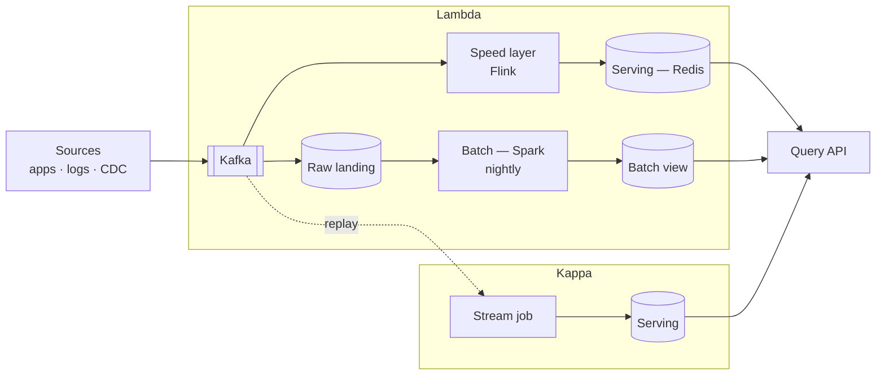

## Definition (interview-ready)

- **Batch processing** treats data as **bounded**: collect a fixed chunk (an hour, a day), then process it all in one scheduled job. Latency is minutes to hours, but jobs are simple to rerun and test.
- **Stream processing** treats data as **unbounded**: process each event (or small window of events) as it arrives, with latency in milliseconds to seconds, keeping running state.
- **Lambda architecture** (Nathan Marz) runs both side by side: a batch layer recomputes accurate results from all data, a speed layer covers the most recent data with low latency, and a serving layer merges them. The cost is the same logic in two codebases.
- **Kappa architecture** (Jay Kreps) uses only a streaming layer over a durable, replayable log such as Kafka. To recompute history, you replay the log through the fixed job.

**One-liner:** Batch processes bounded chunks on a schedule, streaming processes unbounded events continuously; Lambda runs both and merges the results at the cost of two codebases, while Kappa keeps one streaming codebase and reprocesses by replaying the log.

## Why it matters

Almost every data team faces "do we need real-time?" The wrong answer (real-time everywhere) burns money; the wrong answer (batch everything) ships stale data. Knowing the latency/cost/complexity tradeoffs of each architecture is core to data engineering.



## Core concepts

### Batch processing

- Data arrives, accumulates, processed in scheduled jobs.
- Latency: minutes to hours.
- Throughput: enormous (Spark, Hadoop).
- Idempotent, repeatable, easy to test.
- Tools: Spark, Hive, Presto, dbt (over warehouse).

Use when: latency in hours is acceptable, large aggregations, business intelligence, historical reports, ML training.

### Stream processing

- Data continuously processed event-by-event.
- Latency: milliseconds to seconds.
- Throughput: high but at per-event cost.
- Stateful: maintains running aggregates, joins, sessions.
- Tools: Apache Flink, Kafka Streams, Spark Structured Streaming, Beam.

Use when: real-time dashboards, fraud detection, ML inference features, live counters, alerting.

### Lambda architecture (Nathan Marz, 2011)

Three layers:
- **Batch layer**: source of truth; reprocess all data, accurate.
- **Speed layer**: real-time stream; approximate, low-latency.
- **Serving layer**: query both, present unified view.

```
events ──► batch layer (Hadoop / Spark) ──► batch views
       └─► speed layer (Storm / Flink)  ──► realtime views
                                              ↓
                                          serving (combined)
```

Pros: best of both worlds — accuracy and freshness.
Cons: **two codebases** doing the same logic — bugs, drift, ops cost.

### Kappa architecture (Jay Kreps, 2014)

Drop the batch layer. Use only streaming. For reprocessing (after bug fix, schema change): re-consume from the start of the stream.

- One codebase.
- Kafka as the durable log.
- "Reprocess by replay."
- Modern stream processors can do "exactly-once" within the system.

Pros: simpler, no code duplication.
Cons: streaming jobs are harder to write; reprocessing huge volumes is slow.

### Modern reality: Lakehouse + structured streaming

Most modern teams blend:
- **Source of truth**: Parquet/Iceberg in S3 (essentially batch storage).
- **Streaming layer**: Flink/Spark Streaming consuming Kafka, writing to lakehouse.
- **Querying**: same SQL layer (Trino, Spark SQL) on the lakehouse.
- For real-time dashboards: OLAP layer (ClickHouse, Druid) fed by streaming.

This avoids "two systems" while keeping batch-grade analytics and low-latency real-time.

### Event time vs processing time

Critical distinction:
- **Processing time**: when the system observes the event.
- **Event time**: when the event actually happened.

A streaming system aggregating "clicks per minute":
- Processing-time windows: simple, but biased by ingestion lag.
- Event-time windows: accurate, but need watermarks to handle late data.

**Watermark**: "I've seen all events with timestamp ≤ X." Used to close windows. Late events (after watermark) handled via late-arrival policy.

### Stateful streaming

- **Sliding/tumbling/session windows**: aggregate over event-time windows.
- **Joins**: stream-stream (window-bounded), stream-table (key-lookup).
- **State store**: RocksDB-backed local + checkpointed to remote storage.
- **Checkpoints**: snapshot state for fault tolerance (Flink: every N seconds).
- **Exactly-once**: with checkpoints + idempotent sinks.

### Delivery semantics in streams

- Effectively-once: at-least-once delivery + idempotent processing/sinks.
- See [Delivery Semantics](/learn/notes/delivery-semantics/). Same principles apply at the stream-processor level.

## How it works (Kappa-style pipeline)

```
events → Kafka (raw events, infinite retention) →
    Flink job:
      - Read Kafka offset 0 to latest.
      - Window by event time, 1-min tumbling.
      - Aggregate clicks per ad per minute.
      - Write to ClickHouse (idempotent upsert).
    Real-time dashboards query ClickHouse.

Reprocess after bug:
    Stop Flink, fix code, restart from offset 0.
    Idempotent sink ensures result is correct on replay.
```

## Real-world examples

- **LinkedIn**: Jay Kreps proposed Kappa in 2014 based on LinkedIn's experience with Kafka and the Samza stream processor, both built there.
- **Netflix**: Keystone, its Kafka + Flink stream-processing platform, runs alongside a large batch data warehouse.
- **Uber**: massive Kafka + Flink pipelines, plus Apache Hudi (which Uber created) for incremental upserts into its data lake, a lakehouse-style blend.
- **Airbnb**: Airflow (which Airbnb created) orchestrating Spark and Hive batch jobs, with streaming for specific real-time use cases.
- **Payments companies**: batch for reconciliation and reporting, real-time scoring for fraud (Stripe Radar scores each payment as it happens).

## Common pitfalls

- **Real-time for everything**: most use cases don't need it; cost balloons.
- **Mixing event time and processing time** carelessly: results don't match expectations.
- **No watermark policy**: late events handled inconsistently, data silently dropped.
- **Stateful streaming without checkpointing**: any crash = lost state.
- **Lambda with two codebases**: drift inevitable.
- **Reprocessing in Kappa**: huge replays for huge histories — plan accordingly (parallel re-process to a new topic, then cut over).

## Practice questions

<Practice>

<QA q="When would you use batch vs streaming?" level="easy">

Batch: latency-tolerant work (BI dashboards, ML training, historical reports), huge aggregations, simpler development and testing. Streaming: low-latency needs (real-time dashboards, alerting, fraud detection, live counters, ML inference features), session windows, continuous joins. Default to batch; real-time everywhere burns money.

</QA>

<QA q="What's the difference between event time and processing time?" level="easy">

Event time is when the event actually happened (the timestamp on the event). Processing time is when the system observed it. Processing-time windows are simple but skewed by ingestion lag. For accurate windowed aggregation, use event time plus watermarks to handle out-of-order and late data.

</QA>

<QA q="What are tumbling, sliding, and session windows?" level="easy">

- **Tumbling**: fixed size, no overlap (clicks per 5-minute block).
- **Sliding**: fixed size, overlapping, advancing by a slide interval (last 10 minutes, updated every minute), so an event can land in several windows.
- **Session**: no fixed size; a window closes after a gap of inactivity per key (a user's browsing session).

</QA>

<QA q="Explain Lambda vs Kappa." level="medium">

Lambda (Nathan Marz): a batch layer (source of truth, accurate) plus a speed layer (low latency, approximate), with a serving layer merging both. Its cost is **two codebases** for the same logic, which drift. Kappa (Jay Kreps): only a streaming layer over a durable log like Kafka; reprocessing means replaying the stream. One codebase, but stream jobs are harder to write and replaying huge histories is slow.

</QA>

<QA q="What is a watermark?" level="medium">

A logical clock in the stream that says 'I've seen all events with timestamp ≤ X.' It's used to close event-time windows. Events whose timestamp is below the watermark are late and handled by policy: dropped, sent to a side output, or merged specially. A watermark that advances too fast drops data; one too slow delays results.

</QA>

<QA q="How do stream processors keep state safely?" level="medium">

Running aggregates, joins, and sessions live in a **state store**, typically RocksDB-backed on local disk. Periodic **checkpoints** snapshot that state (plus input offsets) to remote storage. After a crash, the job restores the last checkpoint and replays input from the matching offsets. Stateful streaming without checkpointing loses all state on a crash.

</QA>

<QA q="What does effectively-once mean in streaming?" level="medium">

Delivery is at-least-once (events may be replayed after a failure), but processing and sinks are idempotent or transactional, so the end result is as if each event was processed once. Exactly-once state inside the processor isn't enough on its own; the sink must also handle replays.

</QA>

<QA q="What does a modern lakehouse-plus-streaming setup look like?" level="medium">

- Source of truth: Parquet/Iceberg tables in object storage.
- Streaming: Flink or Spark Streaming reads Kafka and writes to the lakehouse.
- Querying: one SQL layer (Trino, Spark SQL) over the lakehouse.
- Real-time dashboards: an OLAP store (ClickHouse, Druid) fed by the stream.

It avoids maintaining two separate pipelines while keeping batch-grade analytics and low-latency views.

</QA>

<QA q="How does Flink achieve exactly-once processing?" level="hard">

Distributed checkpoints (asynchronous barrier snapshotting, a variant of Chandy-Lamport) periodically snapshot operator state together with source positions. On failure, Flink restores the last checkpoint and reprocesses from there. Sinks must be transactional or idempotent so re-emitted output isn't duplicated. Net effect: each event affects state exactly once.

</QA>

<QA q="How would you migrate from Lambda to Kappa?" level="scenario">

- Inventory all batch logic and reimplement it in the streaming job.
- Run both side by side and compare outputs.
- Make topic retention long enough to replay, or fall back to lakehouse data if keeping the full history in Kafka isn't feasible.
- Decommission the batch layer only after streaming has matched it for weeks or months.

</QA>

<QA q="Reprocessing 6 months of data in Kappa — how?" level="scenario">

- Replay the Kafka topic from the offset of 6 months ago.
- Run it as a parallel pipeline writing to a new sink, so production is undisturbed.
- Compare with existing data once caught up.
- Cut over, or keep both during validation.
- If retention is too short, reload from the lakehouse instead.

</QA>

<QA q="A streaming aggregation is showing wrong numbers compared to batch. Diagnose." level="scenario">

- Late events dropped silently (no late-arrival policy).
- Watermark advancing too aggressively, closing windows early.
- Different time zones or time semantics (event vs processing time) between batch and stream.
- Non-idempotent sink double-counting on replay, or a dedup window that's too short.
- Exactly-once disabled or misconfigured.
- Idle or lagging partitions holding back (or, with an idleness timeout, letting the watermark skip past) some events.

</QA>

</Practice>

## Quiz

<Quiz>

<MCQ q="What is the main operational drawback of the Lambda architecture?" options={["It cannot provide low latency", "The same logic lives in two codebases that drift apart", "It cannot reprocess historical data", "It requires Kafka infinite retention"]} answer={1}>

Lambda runs batch and speed layers with duplicated logic, which drifts and doubles ops cost. It does give low latency (speed layer) and reprocessing (batch layer).

</MCQ>

<MCQ q="In Kappa, how do you recompute results after fixing a bug?" options={["Run a nightly Spark job over the raw files", "Patch the serving database by hand", "Replay the stream from the beginning with the fixed job", "Switch to processing-time windows"]} answer={2}>

Kappa has no batch layer; reprocessing is replaying the durable log through the corrected streaming job, ideally into a new sink before cutting over.

</MCQ>

<MCQ q="A mobile app buffers events offline and uploads them hours later. Which windowing gives correct per-minute counts?" options={["Event-time windows with watermarks and a late-data policy", "Processing-time windows", "Session windows on processing time", "No windows; count at the sink"]} answer={0}>

Only event time places the events in the minute they occurred; watermarks and a late policy decide how long to wait. Processing time would count them when they arrive.

</MCQ>

<MCQ q="The watermark advances much faster than events actually arrive. What is the likely symptom?" options={["Higher end-to-end latency", "Duplicate output rows", "Checkpoint failures", "Windows close early and late events are dropped, so counts are too low"]} answer={3}>

An aggressive watermark declares windows complete too soon, so events arriving after it are late. A slow watermark causes latency instead.

</MCQ>

<MCQ q="You need user activity grouped until 30 minutes of inactivity. Which window type?" options={["Tumbling", "Sliding", "Session", "Global"]} answer={2}>

Session windows are defined by an inactivity gap per key. Tumbling and sliding windows have fixed sizes.

</MCQ>

<MCQ q="Flink has exactly-once checkpoints enabled, yet the external sink shows duplicates after a restart. Most likely cause?" options={["The sink is neither idempotent nor transactional", "Watermarks are disabled", "The job uses event time", "RocksDB is the state backend"]} answer={0}>

On recovery Flink replays from the last checkpoint and re-emits output. Without a transactional or idempotent sink, those re-emits duplicate. The other choices don't cause duplicates.

</MCQ>

<MCQ q="What enables a stateful streaming job to recover its running aggregates after a crash?" options={["Kafka consumer group rebalancing", "Periodic checkpoints of state and input offsets to remote storage", "Processing-time windows", "Larger partitions"]} answer={1}>

Checkpoints snapshot the state store with matching source positions; recovery restores both. Without them, state is lost.

</MCQ>

<MCQ q="A team wants real-time dashboards without running two separate pipelines. Which design fits?" options={["Lambda with Storm and Hadoop", "Nightly batch with hourly refresh", "Streaming every query directly from Kafka", "Stream into a lakehouse for analytics and into an OLAP store like ClickHouse for live dashboards"]} answer={3}>

The modern blend uses one streaming path feeding the lakehouse (source of truth, SQL over it) and an OLAP store for low-latency dashboards.

</MCQ>

</Quiz>

## TL;DR cheat sheet

- Batch: bounded data, high throughput, hours of latency.
- Streaming: unbounded, low latency, stateful.
- Lambda: batch + speed layers; two codebases (drift risk).
- Kappa: stream only; reprocess via replay.
- Modern hybrid: lakehouse + streaming + OLAP.
- Event time + watermarks for correctness over time windows.
- Exactly-once = checkpoints + idempotent sinks.
- Reprocessing in Kappa: design retention or fall back to lakehouse.

## Go deeper

- **Tyler Akidau**: ["Streaming 101"](https://www.oreilly.com/radar/the-world-beyond-batch-streaming-101/) and ["Streaming 102"](https://www.oreilly.com/radar/the-world-beyond-batch-streaming-102/) — canonical posts.
- **Book**: *Streaming Systems* (Akidau, Chernyak, Lax) — the bible.
- **Nathan Marz**: ["How to beat the CAP theorem"](http://nathanmarz.com/blog/how-to-beat-the-cap-theorem.html) — Lambda architecture origin.
- **Jay Kreps**: ["Questioning the Lambda Architecture"](https://www.oreilly.com/radar/questioning-the-lambda-architecture/) — origin of Kappa.
- **Apache Flink docs**.
- **DDIA (1st edition) Chapters 10 (Batch Processing), 11 (Stream Processing)**.
