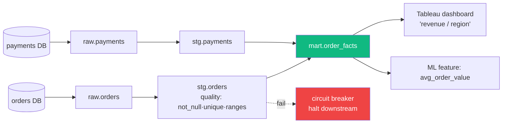

## Definition (interview-ready)

**Data quality** is the practice of checking, automatically and continuously, that data is correct, complete, fresh, valid and free of unintended duplicates. You do it with explicit tests (called expectations or assertions) that run in the pipeline, plus monitoring that flags anomalies such as a sudden drop in row count.

**Lineage** is metadata that records how data flows: which sources and transformations produce each table or column, and which dashboards and ML models consume it. It answers "what breaks if I change this?", "where did this bad number come from?" and "where is this PII used?"

Common tools: **Great Expectations**, **Soda** and **dbt tests** for quality checks; **Monte Carlo** and similar platforms for anomaly-based observability; **DataHub**, **OpenLineage** (with Marquez) and **Atlan** for lineage and cataloguing.

**One-liner:** Data quality means automated tests and monitoring that catch bad data before consumers see it, and lineage is the map of where each dataset comes from and who uses it, which you need for impact analysis, debugging and compliance.

## Why it matters

"Garbage in, garbage out" — every analytics team that scales hits the data quality wall. Bad data leads to bad business decisions and broken trust. Lineage answers "if I change this table, what breaks?" — essential for safe evolution at scale.



## Core concepts

### What is data quality

Dimensions (from the DAMA framework + practical experience):

- **Accuracy**: does it match reality? (e.g., an order's amount matches what the payment processor actually charged)
- **Completeness**: any missing rows or null columns? (e.g., 0 nulls in `order_id`)
- **Consistency**: do related tables agree? (e.g., sum of order lines = order total)
- **Timeliness / Freshness**: is it recent enough? (e.g., last update < 1 hour)
- **Validity**: conforms to schema/constraints? (e.g., `country in ('IN','US',...)`)
- **Uniqueness**: are there unintended duplicates? (e.g., distinct `order_id`)
- **Referential integrity**: foreign keys point somewhere real?

### Expectations / assertions

Declarative checks defined alongside the data:

```yaml
# Great Expectations checks (simplified; real suites are defined in Python or JSON)
expect_column_values_to_not_be_null: order_id
expect_column_values_to_be_unique: order_id
expect_column_values_to_be_in_set: { column: country, values: [IN,US,...] }
expect_column_values_to_be_between: { column: amount, min: 0, max: 1000000 }
expect_table_row_count_to_be_between: { min: 10000, max: 100000000 }
```

These run as part of the pipeline (after each load) or scheduled.

### dbt tests

```yaml
models:
  - name: orders
    columns:
      - name: order_id
        tests: [not_null, unique]
      - name: customer_id
        tests:
          - relationships:
              to: ref('customers')
              field: customer_id
```

Run with `dbt test` (or `dbt build`). Fails build on assertion failure. Since dbt 1.8 the preferred key is `data_tests:`; `tests:` still works.

### Anomaly detection

Beyond static rules:
- **Row count delta**: today's count vs 7-day average — alert if > 30% off.
- **Schema change**: new column appears.
- **Null rate spike**: previously 0% nulls, now 30%.
- **Distribution shift**: ML-driven detection of statistical drift.

Tools: **Monte Carlo**, **Anomalo**, **Bigeye** — commercial "data observability" platforms.

### Quality tiers

- **Bronze**: raw data, minimal validation.
- **Silver**: cleaned, schema-enforced, deduped.
- **Gold**: aggregated, business-ready.

This layering is often called the **medallion architecture** (a term popularized by Databricks). Quality assertions are strictest for gold and lightest for bronze.

### Lineage

Tracks data flow:
- Source table → transformations → destination table.
- Column-level (sometimes): source column → derived column.
- Cross-tool: warehouse → BI dashboard → ML model.

Built from:
- **Static analysis** of SQL / dbt models.
- **Runtime tracing** (OpenLineage).
- **Manual catalog entries**.

### Use cases

- **Impact analysis**: "If I deprecate column X, what downstream breaks?"
- **Root cause**: "Why is dashboard wrong?" → trace upstream tables → find broken pipeline.
- **Compliance**: "Where is PII column X used?" — GDPR/DPDP.
- **Discovery**: "Is there a table for customer LTV?" — searchable catalog.

### Tools

- **DataHub** (LinkedIn open-source): metadata + lineage + discovery.
- **OpenLineage**: open standard for runtime lineage; Marquez is the reference UI.
- **dbt docs**: built-in lineage for dbt models.
- **Apache Atlas, Amundsen** (Lyft): older metadata platforms.
- **Atlan, Monte Carlo, Collibra** — commercial.

### Data contracts

A pact between data producer (e.g., an upstream service emitting events) and consumer (analytics team):
- Schema definition.
- Quality SLAs.
- Change-management process.
- Owner / SLA.

Stronger than informal expectations: built into producer's CI/CD, breaking the contract fails their deploys.

### SLAs for data

- **Freshness SLA**: data must be ≤ N hours old.
- **Completeness SLA**: 99.9% of expected rows.
- **Quality SLA**: 0 NULL in critical columns.
- **Alert + ownership**: on-call rotation; ownership clear.

## How it works (a pipeline with quality)

```
Source (Postgres) ──CDC──► raw_events (bronze) ──dbt──► clean_events (silver)
                                                            │
                                                            ▼ dbt tests
                                                       (fail = block)
                                                            │
                                                            ▼
                                                       gold_metrics
                                                            │
                                                            ▼
                                          DataHub catalog (auto-ingested from dbt manifest)
                                                            │
                                                            ▼
                                          BI dashboards (lineage extends here)
```

## Real-world examples

- **LinkedIn**: built DataHub for thousands of tables.
- **Lyft**: built Amundsen.
- **Airbnb**: built Dataportal.
- **Netflix**: built Metacat (federated metadata service).

## Common pitfalls

- **No tests**: pipeline silently outputs garbage; trust eroded.
- **Tests but no alerting**: failures pile up unnoticed.
- **No ownership**: a broken table sits broken because no one's responsible.
- **Lineage only at the table level**: can't answer column-level questions.
- **Stale lineage**: manually maintained → drift. Use runtime tracing (OpenLineage).
- **No bronze/silver/gold separation**: every consumer hits raw data; bugs propagate.
- **Cosmic-scope quality** in early stages: assert too much, breaks often, team disables tests.

## Practice questions

<Practice>

<QA q="What's the difference between data quality and data observability?" level="easy">

Data quality means explicit assertions (tests/expectations) you write. Data observability means automated, often ML-driven detection of anomalies (row count drops, schema drift, distribution shifts) without explicit rules. You need both: rules catch known failure modes, observability catches the ones you didn't think of.

</QA>

<QA q="What are the main dimensions of data quality?" level="easy">

- **Accuracy**: matches reality.
- **Completeness**: no missing rows or unexpected nulls.
- **Consistency**: related tables agree (order lines sum to the order total).
- **Timeliness/freshness**: recent enough.
- **Validity**: conforms to schema and allowed values.
- **Uniqueness**: no unintended duplicates.
- **Referential integrity**: foreign keys point to real rows.

</QA>

<QA q="What's lineage and why does it matter?" level="easy">

Lineage is metadata showing how data flows from sources through transformations to consumers (dashboards, ML models). It enables impact analysis (what breaks if I change this), root cause (what's wrong upstream when a dashboard is bad), compliance (where is this PII column used), and discovery (does a table for X exist).

</QA>

<QA q="How strict should quality checks be at bronze, silver, and gold?" level="easy">

Bronze is raw data with minimal validation (basic schema, critical not-nulls). Silver is cleaned, schema-enforced, and deduped, so it gets stricter checks (uniqueness, accepted values, referential integrity). Gold is aggregated and business-ready, so it gets the strictest checks, including business rules and reconciliation. Separating tiers stops raw-data bugs from reaching every consumer.

</QA>

<QA q="How do you implement data quality in a dbt project?" level="medium">

Declare generic tests per model: `not_null`, `unique`, `relationships`, `accepted_values` (under `data_tests:` since dbt 1.8; `tests:` still works). Write custom tests as SQL files. Run `dbt test` or `dbt build` in CI/CD so failures block deploys. Run critical tests after every load and the full suite on a schedule.

</QA>

<QA q="What is a data contract?" level="medium">

A formal agreement between a data producer and its consumers: schema, quality SLAs, change-management process, ownership. It's encoded in code and enforced in the producer's CI, so breaking it fails their deploy. It replaces informal promises like 'we'll tell you about schema changes.'

</QA>

<QA q="What kinds of anomalies should automated monitoring catch?" level="medium">

- Row count deltas (today vs the 7-day average, alert if more than ~30% off).
- Schema changes (a new or missing column).
- Null rate spikes (0% to 30%).
- Distribution shifts in values (statistical drift).

Commercial data observability platforms such as Monte Carlo, Anomalo, and Bigeye do this without hand-written rules.

</QA>

<QA q="What SLAs would you define for a critical table?" level="medium">

- **Freshness**: data no more than N hours old.
- **Completeness**: for example 99.9% of expected rows.
- **Quality**: zero nulls in critical columns.
- **Ownership**: a named owner and on-call rotation, so breaches get handled rather than ignored.

</QA>

<QA q="How to track lineage automatically?" level="hard">

- SQL/dbt: parse the SQL or the dbt manifest to get table dependencies.
- Spark and other jobs: instrument with OpenLineage, which emits run events (Marquez is the reference backend/UI).
- BI tools: pull lineage from their APIs (Tableau, Looker).
- Centralize in DataHub, Atlan, or OpenMetadata. Never maintain lineage by hand; it drifts.

</QA>

<QA q="How do you handle a critical data quality SLA breach in production?" level="scenario">

- Page the on-call data engineer.
- Tell consumers (a 'data may be stale' banner on dashboards).
- Trace lineage upstream to find the broken pipeline.
- Fix and reload, or roll back.
- Post-mortem: which assertion would have caught it earlier?

</QA>

<QA q="A team has lineage at the table level but a column rename caused incidents. Improvement?" level="scenario">

Move to **column-level lineage**. DataHub, OpenLineage, and SQL-parser-based tools (SQLGlot, sqllineage) extract column-level dependencies from SQL. Then warn downstream owners about deprecations before a breaking change ships, ideally backed by a data contract.

</QA>

<QA q="Design an end-to-end data quality strategy." level="scenario">

- **Bronze**: basic schema and critical not-null checks on ingestion.
- **Silver**: unique constraints, accepted values, referential integrity.
- **Gold**: business rules and reconciliation with the source of truth (sum of facts equals the ledger).
- **Monitoring**: anomaly detection on row counts and distributions.
- **Lineage**: tracked from raw to dashboard via OpenLineage.
- **Ownership**: a clear owner per table; on-call for critical ones.
- **SLAs**: freshness, completeness, quality per tier.
- **Contracts** with critical upstream producers.

</QA>

</Practice>

## Quiz

<Quiz>

<MCQ q="Row counts dropped 40% overnight but no test failed. Which practice would most likely have caught it?" options={["More not_null tests", "Anomaly detection comparing counts with a trailing average", "Table-level lineage", "A gold tier"]} answer={1}>

A volume drop isn't covered by static column rules; observability-style anomaly detection on row count deltas catches it. Lineage helps diagnose after the fact.

</MCQ>

<MCQ q="The sum of order line amounts no longer equals the order total. Which quality dimension is violated?" options={["Timeliness", "Uniqueness", "Consistency", "Validity"]} answer={2}>

Consistency is about related data agreeing. Validity is conformance to schema and allowed values; timeliness is freshness; uniqueness is about duplicates.

</MCQ>

<MCQ q="A column rename broke several dashboards even though the team has table-level lineage. What would have prevented it?" options={["Column-level lineage plus deprecation warnings to downstream owners", "More bronze-tier checks", "A freshness SLA", "Running dbt test less often"]} answer={0}>

Table-level lineage can't tell which consumers use a specific column. Column-level lineage identifies them so they can be warned before the change.

</MCQ>

<MCQ q="What most distinguishes a data contract from informal expectations?" options={["It is written in a wiki", "It applies only to gold tables", "It replaces lineage", "It is enforced in the producer's CI, so breaking it fails their deploy"]} answer={3}>

Contracts are encoded in code and checked in the producer's pipeline. A wiki page is exactly the informal approach contracts replace.

</MCQ>

<MCQ q="Why is manually maintained lineage a pitfall?" options={["It is too detailed", "It drifts out of date as pipelines change", "It exposes PII", "It cannot show dashboards"]} answer={1}>

Manual entries go stale. Static SQL parsing and runtime tracing like OpenLineage keep lineage current automatically.

</MCQ>

<MCQ q="Which tier should have the strictest quality assertions?" options={["Bronze", "Raw landing", "Gold", "All tiers equally"]} answer={2}>

Gold is business-ready and consumed directly, so it gets business rules and reconciliation. Bronze keeps raw data with minimal validation.

</MCQ>

<MCQ q="A team writes many strict assertions on day one, tests fail constantly, and they disable them. What went wrong?" options={["Too much scope too early, so tests became noise", "They should have used Great Expectations instead of dbt", "They lacked a data contract", "They needed column-level lineage"]} answer={0}>

Asserting too much early creates flaky failures and the team loses trust in tests. Start with critical checks and grow. Tool choice isn't the issue.

</MCQ>

<MCQ q="How is lineage typically captured for Spark jobs without hand-written entries?" options={["Parsing the dbt manifest", "Reading Tableau's API", "Querying the warehouse's information schema", "Instrumenting the job with OpenLineage to emit run events"]} answer={3}>

OpenLineage integrates with Spark and emits lineage at runtime. The dbt manifest covers dbt models, and BI APIs cover dashboards.

</MCQ>

</Quiz>

## TL;DR cheat sheet

- Data quality dimensions: accuracy, completeness, consistency, timeliness, validity, uniqueness.
- Tools: Great Expectations, dbt tests, Soda for quality. Monte Carlo for observability.
- Tier data: bronze/silver/gold with progressively strict tests.
- Lineage = data flow metadata. Automate via SQL parsing or runtime tracing (OpenLineage).
- Column-level lineage > table-level.
- Data contracts: enforce upstream schema/SLAs via producer CI.
- Each critical table needs an owner and an SLA.
- Pair tests with alerting + ownership + runbook.

## Go deeper

- **Great Expectations docs**: [greatexpectations.io](https://greatexpectations.io/).
- **DataHub docs**: [docs.datahub.com](https://docs.datahub.com/).
- **OpenLineage**: [openlineage.io](https://openlineage.io/).
- **dbt docs**: tests, sources, exposures.
- **Monte Carlo blog**: data observability writeups.
- **Chad Sanderson** (data contracts) — Substack and book.
- **Book**: *Fundamentals of Data Engineering* (Reis, Housley) — its "undercurrents" sections on data management cover quality, lineage and governance.
