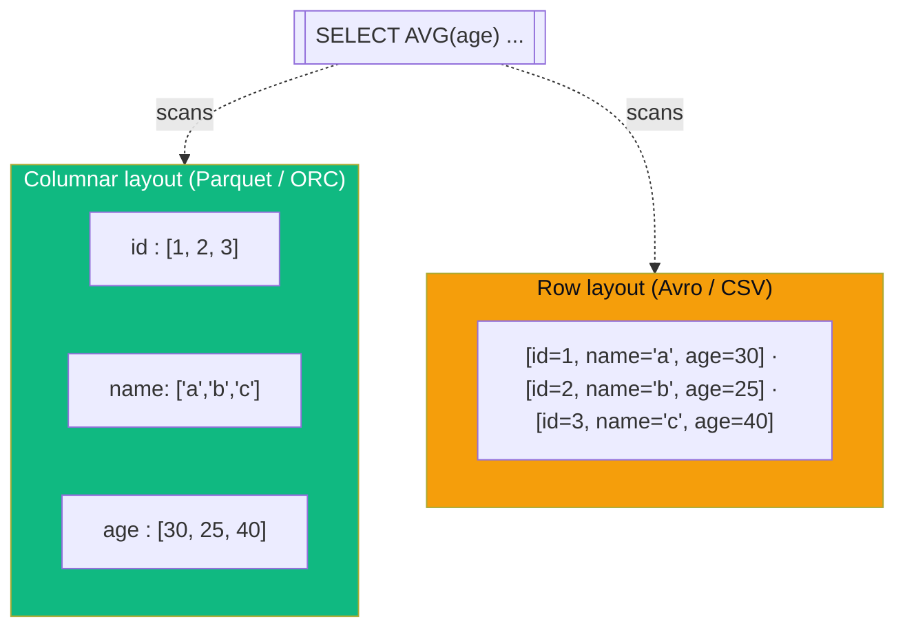

## Definition (interview-ready)

**Parquet** and **ORC** are **columnar** file formats optimized for analytics: store each column separately, enabling column pruning, predicate pushdown, and efficient compression. **Avro** is a **row-based** format with strong schema evolution support, optimized for streaming and serialization (Kafka payloads, RPC).

**One-liner:** Parquet and ORC store data column by column so analytics queries read only the columns and row groups they need; Avro stores data row by row with a schema, which makes it the go-to for Kafka messages and evolving record schemas.

## Why it matters

The file format decision affects every downstream query's performance and cost. Storing analytics data in JSON or CSV instead of Parquet can multiply storage and scan costs several times over (5-50× is common in benchmarks) and make queries an order of magnitude or more slower.



| | Parquet | ORC | Avro |
|---|---|---|---|
| Layout | columnar | columnar | row |
| Best for | analytics (Spark/Trino) | analytics (Hive) | streaming, RPC payloads |
| Compression | strong (per-column) | strong (per-column streams) | good (per block) |
| Schema evolution | yes (loose) | yes | strongest |
| Predicate pushdown | yes (row-group stats, optional page indexes and bloom filters) | yes (file, stripe and row-index stats, optional bloom filters) | no (row format: whole records are read) |

## Core concepts

### Columnar vs row-based

```
Row-based (CSV/JSON/Avro):
  row1: [a1, b1, c1, d1]
  row2: [a2, b2, c2, d2]
  row3: [a3, b3, c3, d3]

Columnar (Parquet/ORC):
  col_a: [a1, a2, a3]
  col_b: [b1, b2, b3]
  col_c: [c1, c2, c3]
  col_d: [d1, d2, d3]
```

For "SELECT col_a, col_b WHERE col_b > 100" on a 50-column table:
- Row-based: read all 50 columns to find the 2 needed.
- Columnar: read only 2 columns.

Big savings for wide tables.

### Parquet

- Apache Parquet, Hadoop ecosystem, ubiquitous.
- Row groups (typically 128 MB): chunks of rows.
- Within row group: column chunks, each stored separately.
- Column chunks: page-aligned for efficient reads.
- Min/max stats per column per row group: enables row-group skipping for predicates.

```
File:
├── Footer: schema + row group metadata
├── Row group 1 (~128MB)
│   ├── Column A chunk
│   ├── Column B chunk
│   └── Column C chunk
├── Row group 2
├── ...
```

Compression: per column. Different codecs (Snappy, GZIP, ZSTD).
Encoding: per column. RLE, dictionary, delta — adapts to data type.

### ORC (Optimized Row Columnar)

- Apache ORC, Hive-native.
- Similar to Parquet: stripes (≈ row groups), columns inside.
- Rich metadata: bloom filters and lightweight row indexes (stats every 10,000 rows) per column. (Parquet also gained bloom filters in parquet-format 2.7 / parquet-mr 1.12, plus page-level column indexes.)
- Strong predicate pushdown.
- Spark and Hive both support ORC; Parquet is more widely supported across non-Hadoop tools.

Parquet vs ORC: 95% similar; choose based on tooling. Spark/Athena: Parquet. Hive-native: ORC.

### Avro

- Row-based, binary encoding.
- **Schema travels with data** (or via schema registry).
- Strong evolution: default values, aliases, schema resolution between writer and reader schemas.
- Used by:
  - Kafka payloads.
  - Hadoop intermediate / RPC.
  - Sometimes long-term storage if you need streaming-friendly format.

### When to use which

| Format | Use case |
|---|---|
| Parquet | Analytics on lake, OLAP, batch processing (Spark/Trino) — **default for analytics** |
| ORC | Hive-native ecosystems, where ORC has better integration |
| Avro | Streaming (Kafka), RPC, schema-evolution-critical row data |
| CSV | Tiny / human-readable; never for production analytics |
| JSON | API interchange, semi-structured; bad for warehouse storage |

### Compression codecs

- **Snappy**: fast compression / decompression. Default for many systems.
- **GZIP**: often 20-30% smaller files than Snappy, but much slower, especially to compress. Use for cold storage.
- **ZSTD**: best ratio, fast decompression, slightly slower compression. **Often the best choice now.**
- **LZ4**: very fast, compression ratio roughly comparable to Snappy.

### File size guidance

- Aim for ~128 MB - 1 GB per Parquet/ORC file. Smaller = small-file overhead; larger = wastes parallelism.
- Spark/Trino can read in parallel within a file (row groups / stripes).
- Compact periodically with `OPTIMIZE` (Delta) or custom jobs.

### Partitioning

- Files organized by partition columns (e.g., `year=2026/month=05/`).
- Enables **partition pruning** (filtering at the directory level): a query for `year=2026` skips other directories entirely.
- Avoid over-partitioning (many small partitions = small file problem).

## How Parquet read works

```
Query: SELECT col_a, col_b FROM t WHERE col_b > 100;
1. Open file footer → schema, row group locations + stats.
2. For each row group:
   - Check col_b min/max — skip if entire group < 100.
3. For surviving row groups:
   - Read only col_a and col_b column chunks (skip others).
   - Apply col_b > 100 predicate to filter rows.
   - Return col_a, col_b for matching rows.
```

## Real-world examples

- **Almost every modern data lake**: Parquet on S3.
- **Iceberg, Delta Lake, Hudi**: lakehouse table formats that store data in Parquet by default. Delta uses Parquet only; Iceberg also supports ORC and Avro; Hudi uses Parquet (or ORC) base files plus Avro log files for merge-on-read.
- **Kafka + Confluent Schema Registry**: Avro is the original and most common payload format (Protobuf and JSON Schema also supported since Confluent Platform 5.5).
- **Cloudera (Hadoop-native)**: heavy ORC usage.

## Common pitfalls

- **CSV / JSON for warehouse**: huge cost; do NOT.
- **Per-row Parquet writes**: tiny files explosion. Buffer to ~128MB before writing.
- **Bad partitioning**: hour partitions for hourly data — fine. Per-user partitions: hundreds of millions of dirs, kills metastore.
- **Unsorted data / stats not written**: row-group min/max stats are written into the file footer at write time; if data isn't sorted/clustered on the filter column, every row group's range overlaps and skipping doesn't fire. Sort or cluster on write (`ANALYZE TABLE` only refreshes optimizer stats, not file stats).
- **Snappy + tiny files**: not amortizing the overhead.
- **No compression at all**: ridiculous.
- **Schema evolution mismatch**: writing a column then renaming → tools may fail to read older files. Use Parquet field IDs (Iceberg helps).
- **`SELECT *` on wide tables**: defeats column pruning.

## Practice questions

<Practice>

<QA q="Why is Parquet faster than CSV for analytics?" level="easy">

- Columnar storage: read only the columns the query needs.
- Per-column compression and encoding suited to each type.
- Predicate pushdown via min/max stats per row group.
- Binary encoding: no text parsing.

Typical result: 5–50× less I/O and 10–100× faster queries.

</QA>

<QA q="When use Avro instead of Parquet?" level="easy">

Avro is row-based with the strongest schema evolution, so use it for row-at-a-time workloads: Kafka payloads, RPC serialization, intermediate Hadoop data. The schema travels with the data or lives in a schema registry. Parquet is for analytics queries over many rows of a few columns.

</QA>

<QA q="Why does SELECT * hurt on a wide Parquet table?" level="easy">

Columnar formats are fast because they read only the requested column chunks. `SELECT *` on a 50-column table reads all 50, throwing away column pruning and most of the I/O savings. Select only the columns you need.

</QA>

<QA q="Parquet vs ORC?" level="medium">

Both are columnar with row groups/stripes, predicate pushdown, and per-column compression; they're about 95% the same. ORC has rich built-in indexes (bloom filters, stats every 10,000 rows); Parquet added bloom filters and page-level column indexes later. Choose by ecosystem: Parquet for Spark/Trino/Athena/Snowflake, ORC for Hive-native stacks.

</QA>

<QA q="How does Parquet do predicate pushdown?" level="medium">

Each row group stores min/max statistics per column in the footer. The engine reads the footer and checks the stats against the predicate; if no row in a group can match, it skips the whole row group without reading its data pages. It works best when data is sorted or clustered on the filter column.

</QA>

<QA q="How does Parquet encode columns besides general compression?" level="medium">

Encoding is chosen per column to fit the data: **dictionary** encoding replaces repeated values with small IDs (great for low-cardinality strings), **RLE** stores runs of the same value once with a count, and **delta** encoding stores differences between consecutive values (good for sorted numbers or timestamps). A codec (Snappy, ZSTD, GZIP) is then applied on top.

</QA>

<QA q="What's the ideal Parquet file size?" level="medium">

About 128 MB to 1 GB per file. Smaller files add per-file overhead (separate tasks, metadata reads, S3 listing). Larger files limit parallelism unless the engine splits within the file by row group. Compact regularly with maintenance jobs.

</QA>

<QA q="Compression: Snappy vs ZSTD vs GZIP?" level="medium">

Snappy: fast, a common default. ZSTD: high ratio with fast decompression and slightly slower compression; **often the best modern choice**. GZIP: often 20–30% smaller than Snappy but much slower, especially to compress; use for cold or archive data. LZ4: very fast, ratio roughly like Snappy.

</QA>

<QA q="How should you partition files, and what's over-partitioning?" level="medium">

Partition directories by columns that queries filter on (`year=2026/month=05/`), so engines skip whole directories. Over-partitioning, such as per-user partitions, creates hundreds of millions of directories full of tiny files: it kills the metastore and brings back the small-file problem. Keep partitions coarse and sort or cluster within them.

</QA>

<QA q="Row-group stats exist, but a filter on col_b still reads every row group. Why?" level="hard">

Min/max stats are written into the footer at write time. If the data isn't sorted or clustered on `col_b`, every row group contains a wide range of values, all ranges overlap the predicate, and nothing can be skipped. Fix it by sorting or clustering on write. Running `ANALYZE TABLE` doesn't help; it only refreshes optimizer stats, not the file stats.

</QA>

<QA q="Schema evolution in Parquet." level="hard">

- Add column: safe; older files return NULL for it.
- Remove column: safe; writers stop including it, and readers just don't request it.
- Rename: not safe when columns are matched by name; engines may fail or read NULLs. Use **field IDs** (as Iceberg does).
- Type change: usually unsafe and can corrupt silently. Test carefully.

</QA>

<QA q="A team writes Parquet files of 5 MB each. What goes wrong?" level="scenario">

- Each file is a separate read task, so planning and open overhead dominate.
- The file count balloons and S3 listing slows down.
- Compression and encoding can't amortize over so little data.
- Fix: buffer writes to ~128 MB–1 GB and compact periodically (`OPTIMIZE` in Delta, the `rewrite_data_files` procedure in Iceberg, or a custom job).

</QA>

</Practice>

## Quiz

<Quiz>

<MCQ q="A query reads 2 of 50 columns. Why does Parquet beat a row format here?" options={["It reads only the 2 needed column chunks", "It caches the whole table in memory", "It stores rows in sorted order", "It uses a schema registry"]} answer={0}>

Columnar layout stores each column separately, so only the needed chunks are read. A row format must read every column to extract two.

</MCQ>

<MCQ q="Which format fits Kafka message payloads with evolving schemas?" options={["Parquet", "ORC", "Avro", "CSV"]} answer={2}>

Avro is row-based, compact, and has the strongest schema evolution, which suits one-message-at-a-time streams. Parquet and ORC are for analytics over many rows.

</MCQ>

<MCQ q="A Parquet table is filtered on event_time, but row-group skipping never fires. Most likely cause?" options={["Compression is disabled", "The files are too large", "The table uses ORC", "Data wasn't sorted or clustered on event_time, so every row group's min/max range overlaps"]} answer={3}>

Skipping depends on min/max ranges being narrow. Unsorted data gives every row group a wide range, so none can be excluded.

</MCQ>

<MCQ q="What file size range should Parquet files target?" options={["1 to 5 MB", "About 128 MB to 1 GB", "10 to 50 GB", "Exactly one row group of 1 MB"]} answer={1}>

Around 128 MB to 1 GB balances per-file overhead against parallelism. Tiny files cause the small-file problem; huge ones limit parallel reads.

</MCQ>

<MCQ q="Which codec is often the best modern choice for a good ratio with fast decompression?" options={["GZIP", "No compression", "Snappy", "ZSTD"]} answer={3}>

ZSTD gives a high ratio and fast decompression. GZIP compresses smaller than Snappy but is much slower; Snappy is fast but compresses less.

</MCQ>

<MCQ q="Which schema change is risky in plain Parquet without field IDs?" options={["Renaming a column", "Adding a nullable column", "Dropping a column no one reads", "Adding a new partition"]} answer={0}>

Engines match columns by name, so a rename makes older files look like they lack the column. Field IDs, as in Iceberg, fix this. Adding a column is safe; old files return NULL.

</MCQ>

<MCQ q="A team partitions a table by user_id across 200 million users. What happens?" options={["Queries become faster for all filters", "Compression improves", "The metastore struggles with huge numbers of directories and tiny files", "Predicate pushdown is disabled"]} answer={2}>

Very high-cardinality partition columns create hundreds of millions of directories and tiny files, which overwhelms metadata systems.

</MCQ>

<MCQ q="Which encoding suits a low-cardinality string column like country?" options={["Delta encoding", "Dictionary encoding", "Plain encoding only", "Bloom filter encoding"]} answer={1}>

Dictionary encoding swaps repeated strings for small IDs. Delta suits sorted numbers; bloom filters are an index, not an encoding.

</MCQ>

</Quiz>

## TL;DR cheat sheet

- **Parquet/ORC**: columnar, perfect for analytics. Column pruning + predicate pushdown.
- **Avro**: row-based, schema-evolution-friendly. Kafka payloads, RPC.
- **CSV/JSON**: never for production warehouse.
- Target file size: 128 MB - 1 GB. Compact small files.
- ZSTD is often the best modern codec (Snappy is still the common default).
- Partition for directory-level pruning, but not too granular.
- Sort or cluster on common filter columns so min/max stats can skip row groups.
- Avoid `SELECT *` to leverage column pruning.

## Go deeper

- **Apache Parquet docs**: [parquet.apache.org](https://parquet.apache.org/docs/).
- **Apache ORC docs**: [orc.apache.org](https://orc.apache.org/docs/).
- **Apache Avro docs**: [avro.apache.org](https://avro.apache.org/docs/).
- **Uber engineering**: ["Cost Efficiency @ Scale in Big Data File Format"](https://www.uber.com/blog/cost-efficiency-big-data/) — Parquet compression tuning at scale.
- **DDIA Chapter 3** (storage formats), 4 (encoding).
- **Compression benchmarks**: ZSTD vs Snappy vs GZIP per workload.
