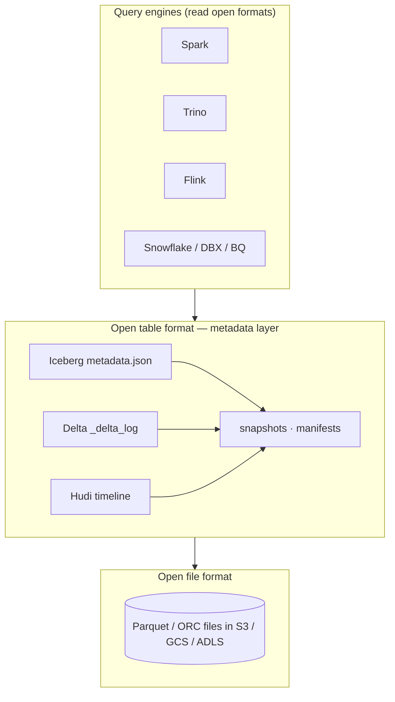
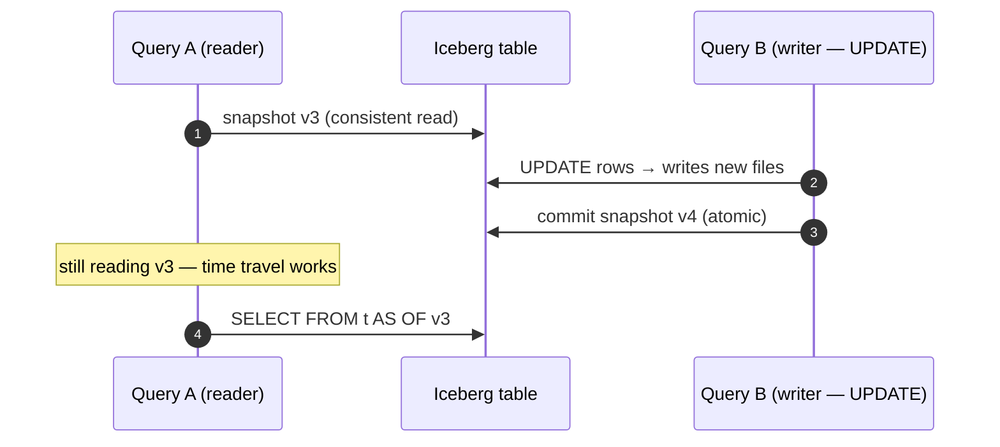

## Definition (interview-ready)

A **lakehouse** is a data architecture that adds warehouse-grade features (ACID transactions, schema enforcement, time travel, upserts) on top of cheap object storage (S3/GCS/ADLS) with open file formats (Parquet/ORC). The three open table formats are **Apache Iceberg**, **Delta Lake**, and **Apache Hudi** — each implements lakehouse semantics with a metadata layer that tracks which data files (usually Parquet) make up each version of a table.

**One-liner:** A lakehouse is a data lake with warehouse features: an open table format such as Iceberg, Delta or Hudi keeps metadata over Parquet files in object storage, giving you ACID commits, upserts, schema evolution and time travel without copying data into a warehouse.

## Why it matters

Lakehouses replace the messy two-tier "data lake + warehouse" architecture. You get warehouse semantics at lake price and open-format flexibility. Large data teams such as Netflix, Apple and Uber have moved to lakehouse table formats, and most modern data stacks are converging on them.





## Core concepts

### The old two-tier problem

- **Data lake**: cheap S3 Parquet. No ACID; bad updates; manual cleanup. Good for ML and ad-hoc.
- **Data warehouse**: Snowflake/Redshift/BigQuery. Great query performance + ACID; expensive; closed format; data duplicated from the lake.

Maintaining both is the data-engineering tax.

### Lakehouse: one tier

ACID transactions on Parquet via a **metadata layer** that tracks which files belong to which version of each table.

Key features added:
- **ACID transactions**: serializable or snapshot isolation on table state.
- **Schema enforcement + evolution**: rejects bad writes; supports add/rename/drop columns.
- **Upserts / deletes / merges**: row-level changes (not just append).
- **Time travel**: query a table as of a past timestamp / version.
- **Hidden partitioning** (Iceberg): no need to manually compute partition columns.
- **Compaction / optimize**: rewrite small files into larger ones.
- **Concurrency control**: multiple writers safely.

### Apache Iceberg

- Originated at Netflix.
- Snapshot-based: each table version is an immutable snapshot.
- Metadata tree: a table metadata file (JSON) points to the current snapshot's manifest list, which points to manifests, each listing data files (Parquet, ORC or Avro) with per-file stats.
- **Hidden partitioning**: query layer derives partition from a function of timestamp; no manual `year=`/`month=` columns.
- **Schema evolution**: by **field ID** (not by name) — safe rename, add, drop.
- Catalogs: REST catalog, Hive metastore, AWS Glue, Snowflake — pluggable.
- Query engine support: Spark, Trino/Presto, Flink, Snowflake (read/write for Snowflake-managed Iceberg tables), Athena, Databricks SQL.

### Delta Lake

- Originated at Databricks.
- Snapshot-based; metadata in `_delta_log` directory: JSON files + Parquet checkpoints.
- Strong Spark integration; works with Trino, Flink, Hive via connectors.
- **MERGE INTO**: upsert / SCD2 friendly.
- **Time travel**: `VERSION AS OF` / `TIMESTAMP AS OF`.
- **OPTIMIZE**: compaction; Z-ORDER for multi-dimensional clustering.
- **Delta Sharing**: open protocol for cross-org data sharing.

### Apache Hudi

- Originated at Uber.
- Strong focus on **incremental data ingestion** and **mutability**.
- Two table types:
  - **Copy-on-write (CoW)**: rewrites Parquet files on updates. Slower writes, fast reads.
  - **Merge-on-read (MoR)**: writes delta logs, merges on read. Fast writes, slower reads (until compaction).
- **Indexes** (bloom, simple, bucket/hash, HBase, record-level) map record keys to files, so upserts don't have to scan the whole table.
- Stronger CDC + streaming use cases (because of MoR).

### Comparison

| | Iceberg | Delta Lake | Hudi |
|---|---|---|---|
| Origin | Netflix | Databricks | Uber |
| Engine support | broadest (Spark, Trino, Flink, Snowflake, Athena, ...) | best in Spark/Databricks | Spark, Flink, Hive, Presto/Trino |
| Schema evolution | by field ID (safest) | by name (column mapping enables safe rename/drop) | by name |
| Updates | snapshot-based | snapshot-based | CoW or MoR with indexes |
| Time travel | yes | yes | yes |
| CDC | limited (incremental reads, Spark changelog views) | yes (Change Data Feed) | yes (built-in incremental queries) |
| Streaming | growing | strong | strong |
| Hidden partitioning | yes (excellent) | no (explicit partition columns; generated columns help) | no (explicit partition path) |

**Usual default for multi-engine stacks today**: Iceberg (broadest engine support, open governance). Delta Lake if you are mostly on Databricks.

### Time travel

Query the table as of a past version:
```sql
SELECT * FROM orders VERSION AS OF 12345;
SELECT * FROM orders TIMESTAMP AS OF '2026-05-01';
```

Useful for: audits, reproducible ML, recovery from accidental writes.

### Compaction (OPTIMIZE)

Small-file problem hits lakehouses too. Periodic compaction rewrites small files into larger ones, updating the metadata atomically.

Delta: `OPTIMIZE table`. Iceberg: the `rewrite_data_files` procedure (the `RewriteDataFiles` action). Hudi: clustering / compaction.

### Vacuum / garbage collection

Old snapshot files accumulate. Vacuum (Delta `VACUUM`; Iceberg `expire_snapshots` + `remove_orphan_files`; Hudi cleaner) cleans them up — but respect retention to preserve time travel.

### Concurrency

- **Optimistic concurrency control**: each write attempts to commit; conflict detection via metadata. Conflict → retry.
- For high concurrency (streaming writes): have concurrent writers touch disjoint partitions, commit in larger batches, and (in Delta) use the default `WriteSerializable` isolation level rather than `Serializable`.

### Streaming ingestion

- Iceberg, Delta, Hudi all support streaming writes (Flink → Iceberg, Spark Structured Streaming → Delta).
- For CDC pipelines: Debezium → Kafka → stream processor → lakehouse upserts.

## How it works (Iceberg write)

```
Writer:
1. Read current snapshot's manifest list.
2. Write new Parquet files to S3.
3. Write a new manifest listing the new files.
4. Write a new manifest list (the new manifest + the unchanged existing manifests) = the new snapshot.
5. Write a new table metadata file that names this snapshot as current.
6. Atomically swap the catalog's pointer to the new metadata file (compare-and-swap; fails if someone else committed first).

Reader:
1. Resolve table → current snapshot.
2. Read manifest list → manifests → data files.
3. Plan query against this immutable set of files.
4. New writer's changes invisible until catalog pointer updates (atomic).
```

## Real-world examples

- **Netflix**: Iceberg birthplace; petabyte-scale.
- **Apple**: heavy Iceberg.
- **Adobe**: Iceberg.
- **Databricks customers**: Delta everywhere.
- **Uber**: Hudi origin; ingestion-heavy use cases.
- **Snowflake**: native Iceberg tables (GA 2024).

## Common pitfalls

- **Small files explosion**: streaming writes produce tiny files. Compact regularly.
- **Vacuum too aggressive**: removes snapshots needed for time travel.
- **Schema rename without field IDs**: silently breaks downstream readers.
- **Cross-engine catalog mismatch**: Spark + Trino + Flink reading the same table need consistent catalog access. Use a shared metastore (Glue, Hive, REST catalog).
- **Concurrent writers without proper locking**: conflicts cause retries; high contention = slow.
- **Querying without partition predicates**: scans whole table — defeats partitioning.

## Practice questions

<Practice>

<QA q="What problem does a lakehouse solve?" level="easy">

The two-tier 'data lake plus warehouse' problem. Lakes (Parquet on S3) are cheap and open but lack ACID, schema enforcement, and upserts. Warehouses have those but are expensive, proprietary, and duplicate data from the lake. A lakehouse adds warehouse semantics (ACID, schema, upserts, time travel) on top of cheap object storage through a metadata layer.

</QA>

<QA q="What is time travel in Delta/Iceberg?" level="easy">

Every table version stays in metadata, along with its underlying files, so you can query the table as of a past version or timestamp (`VERSION AS OF`, `TIMESTAMP AS OF`). It's useful for audits, reproducible ML, and recovering from bad writes. It only reaches back as far as vacuum/snapshot-expiry retention allows.

</QA>

<QA q="How does Iceberg achieve atomic commits?" level="medium">

Each table version is an immutable snapshot. A writer writes new Parquet files, new manifests, a new manifest list and a new table metadata file, then atomically swaps the catalog's pointer to that metadata file (which names the current snapshot). Readers keep seeing the old snapshot until the pointer flips, so no partial state is ever visible.

</QA>

<QA q="What is Iceberg's hidden partitioning?" level="medium">

The table declares partitioning as a transform of a column (for example the day of a timestamp), and Iceberg derives partition values itself. Users filter on the real column and the engine prunes partitions automatically; nobody maintains separate `year=`/`month=` columns or needs to know the layout. Delta has no direct equivalent: partition columns are explicit, though a partition column defined as a generated column (such as `CAST(event_time AS DATE)`) lets Delta add the partition filter for you.

</QA>

<QA q="Why does Iceberg track columns by field ID?" level="medium">

Each column gets a permanent ID, and data files reference IDs, not names. Renames, adds, and drops just update the schema; old files are still read correctly. Formats that match by name can silently break readers on a rename. Delta needs column mapping enabled for safe rename/drop.

</QA>

<QA q="Hudi's Copy-on-Write vs Merge-on-Read." level="medium">

CoW: updates rewrite the affected Parquet files, so writes are slower but reads are fast (plain Parquet). MoR: updates go to delta logs, so writes are fast, but reads must merge logs at query time until compaction. Use MoR for write-heavy, low-latency ingestion such as CDC; CoW for read-heavy tables.

</QA>

<QA q="Iceberg vs Delta — when to pick which?" level="medium">

Iceberg: broadest engine support (Spark, Trino, Flink, Snowflake, Athena), open governance, field-ID schema evolution, hidden partitioning. Pick it when engine variety matters. Delta: best in Databricks/Spark, mature, with `MERGE INTO`, Z-ORDER, and Delta Sharing. Pick it if you're a Databricks shop. Both are excellent.

</QA>

<QA q="How do vacuum and time travel interact?" level="medium">

Old snapshots keep their files around, so storage grows until you clean up: Delta `VACUUM`, Iceberg `expire_snapshots` plus `remove_orphan_files`, the Hudi cleaner. Cleanup deletes files older than the retention window, and time travel to those versions stops working. Too aggressive a vacuum breaks audits and recovery; too lax keeps data, including deleted PII, around too long.

</QA>

<QA q="How would you compact small files in a lakehouse?" level="medium">

Delta: `OPTIMIZE table`, optionally `ZORDER BY (col)`. Iceberg: the `RewriteDataFiles` procedure. Hudi: clustering/compaction. The rewrite commits atomically like any other write. Schedule it hourly or daily, and because it's I/O-heavy, run it in low-traffic windows.

</QA>

<QA q="Concurrent streaming writers to one Iceberg table — what happens?" level="hard">

Optimistic concurrency: each writer tries to commit a new snapshot. If the snapshot it started from is no longer current, the commit conflicts and retries against the new state. Writers touching different partitions rarely conflict. At high write rates, contention causes retries, so tune compaction and funnel commits through a dedicated committer.

</QA>

<QA q="How would you handle GDPR delete on a lakehouse table?" level="scenario">

Run the format's `DELETE` (Delta, Iceberg, and Hudi all support row-level deletes); it either rewrites affected files or writes delete markers (Iceberg delete files, Delta deletion vectors, Hudi log files). With delete markers the row is still physically in the current data file, so first rewrite or compact those files (Iceberg `rewrite_data_files`, Delta `REORG TABLE ... APPLY (PURGE)`, Hudi compaction). Old snapshots also still reference files containing the row, so then run `VACUUM` (Delta), `expire_snapshots` (Iceberg), or the cleaner (Hudi) to physically delete them. Set retention to balance time travel against the compliance deadline.

</QA>

<QA q="Spark writes an Iceberg table, but Trino doesn't see the new data. What do you check?" level="scenario">

Most likely the engines use different catalogs, so Trino is resolving a different (or stale) current-snapshot pointer. All engines reading and writing a table must share one catalog: Glue, Hive metastore, or a REST catalog. Also confirm the Spark commit actually succeeded, since files written without a commit are invisible.

</QA>

</Practice>

## Quiz

<Quiz>

<MCQ q="When does a reader see the files written by an in-progress Iceberg write?" options={["As soon as each Parquet file lands in S3", "After the writer atomically swaps the snapshot pointer in the catalog", "After the next compaction", "After vacuum runs"]} answer={1}>

Readers resolve the current snapshot from the catalog. New files are invisible until the pointer flips, which is what makes commits atomic.

</MCQ>

<MCQ q="A team must ingest high-rate CDC updates with low write latency. Which Hudi table type fits?" options={["Copy-on-Write", "Either; they behave the same", "Merge-on-Read", "Neither; Hudi is append-only"]} answer={2}>

MoR appends updates to delta logs for fast writes and merges at read time or compaction. CoW rewrites files on every update.

</MCQ>

<MCQ q="After a GDPR DELETE on a Delta table, the row can still be read with time travel. What else is needed?" options={["Run VACUUM so old files past retention are physically removed", "Run OPTIMIZE", "Re-run the DELETE", "Nothing; time travel ignores deletes"]} answer={0}>

DELETE creates a new version, but old versions still reference files with the row. VACUUM removes those files once they pass retention. OPTIMIZE only compacts. (If deletion vectors are enabled, also run REORG TABLE ... APPLY (PURGE) first so the current files are rewritten without the row.)

</MCQ>

<MCQ q="Why can Iceberg rename a column safely?" options={["It rewrites all data files on rename", "It disallows renames", "It stores schemas in Parquet footers only", "Columns are tracked by permanent field IDs, not names"]} answer={3}>

Data files reference field IDs, so a rename is a metadata change. No rewrite is needed.

</MCQ>

<MCQ q="What does Iceberg hidden partitioning give users?" options={["Partitions are encrypted", "Partition pruning from filters on the real column, with no manual partition columns", "No need for a catalog", "Automatic compaction"]} answer={1}>

Iceberg derives partitions from transforms like day of a timestamp, so queries on the timestamp prune automatically.

</MCQ>

<MCQ q="A vacuum with very short retention runs nightly. What breaks?" options={["Atomic commits", "Schema evolution", "Time travel to older versions", "Hidden partitioning"]} answer={2}>

Vacuum deletes files from versions older than retention, so those versions can't be queried any more. Commits and schema evolution are unaffected.

</MCQ>

<MCQ q="Two writers commit to the same Iceberg table at once. What happens to the one whose base snapshot is stale?" options={["Its commit conflicts and it retries against the new snapshot", "Both commits are merged automatically with no check", "The table is locked until an admin intervenes", "Its files are discarded silently"]} answer={0}>

Iceberg uses optimistic concurrency: conflicts are detected at commit time and the losing writer retries.

</MCQ>

<MCQ q="A company uses Spark, Trino, Flink and Snowflake on the same tables. Which format is usually the safest pick?" options={["Delta Lake, because of Z-ORDER", "Hudi, because of indexes", "Plain Parquet with Hive partitions", "Iceberg, because of the broadest engine support"]} answer={3}>

Iceberg has the widest multi-engine support and open governance. Delta fits best in Databricks; plain Parquet lacks ACID.

</MCQ>

</Quiz>

## TL;DR cheat sheet

- Lakehouse = warehouse features (ACID, schema, upserts, time travel) on top of Parquet + object store.
- **Iceberg** (Netflix), **Delta** (Databricks), **Hudi** (Uber) — three open formats.
- Each implements snapshot-based metadata + atomic commits.
- Iceberg: broadest engine support; Delta: best in Spark/Databricks; Hudi: best for write-heavy ingestion.
- Time travel = query past versions.
- Compaction (OPTIMIZE) for small-file problem.
- GDPR delete + vacuum carefully.
- Use a shared catalog (Glue, Hive metastore, REST catalog) for multi-engine.

## Go deeper

- **Iceberg docs**: [iceberg.apache.org](https://iceberg.apache.org/docs/).
- **Delta Lake docs**: [docs.delta.io](https://docs.delta.io/).
- **Hudi docs**: [hudi.apache.org/docs](https://hudi.apache.org/docs/overview).
- **Databricks blog**: many Delta and lakehouse posts.
- **Netflix tech blog**: Iceberg origin story.
- **Uber engineering**: Hudi origin and design.
- **Apple Iceberg posts**.
- **DDIA Chapter 10** — for batch context.
