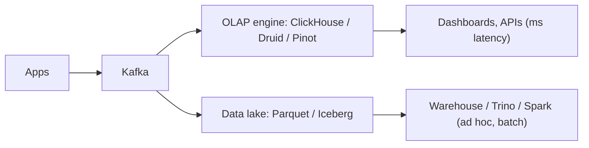
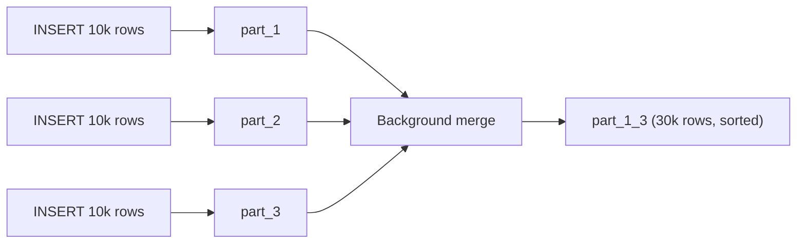
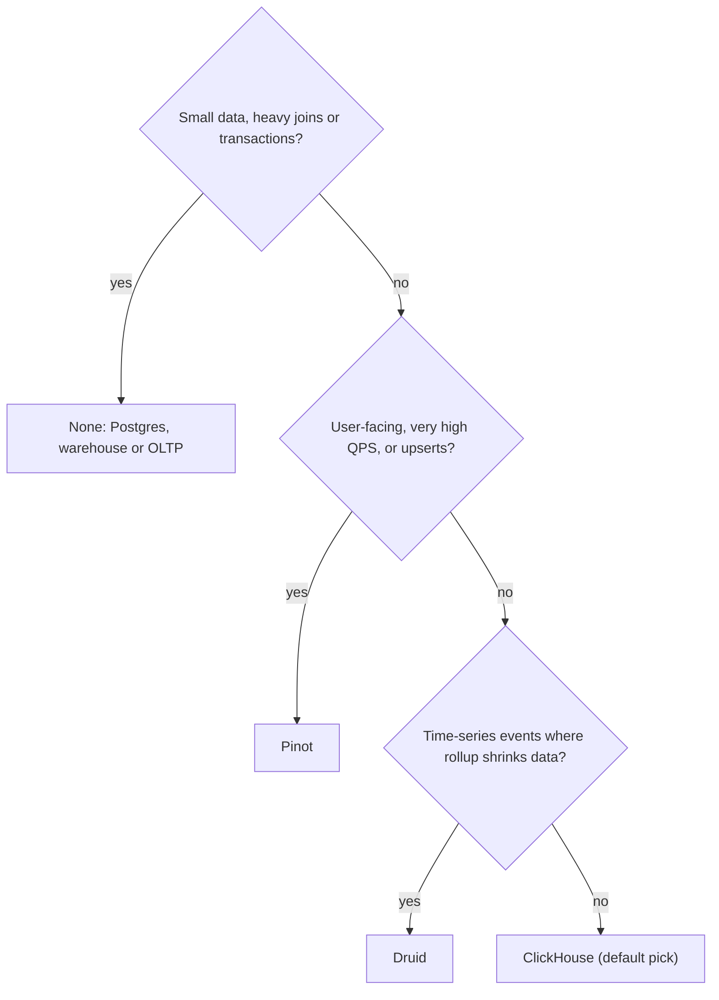

## Definition (interview-ready)

A **real-time OLAP engine** is a database built to answer **analytical queries** (filter, group, aggregate over many rows) on **fresh data** with **sub-second latency**, often for many concurrent users. It does this with three ideas:

1. **Columnar storage**: each column is stored separately and compressed, so a query reads only the columns it touches.
2. **Vectorized execution**: operators process blocks of thousands of values at a time, using CPU caches and SIMD instructions well.
3. **Pre-organised data**: data is sorted, partitioned and indexed (or pre-aggregated) at ingestion so most of it can be skipped at query time.

The three best-known open-source engines:

- **ClickHouse**: a general-purpose columnar SQL database. The MergeTree engine writes sorted, immutable **parts** and merges them in the background.
- **Apache Druid**: time-partitioned **segments**, separate services for ingestion, querying and storage, optional **rollup** at ingest.
- **Apache Pinot**: segments with a rich set of indexes, including the **star-tree** pre-aggregation index, and **upserts** on real-time tables. Built for user-facing analytics at high query rates.

**One-liner:** A real-time OLAP engine like ClickHouse, Druid or Pinot ingests events from streams like Kafka within seconds and answers aggregate queries over billions of rows in milliseconds, by combining columnar storage, vectorized execution and sorting, indexes or pre-aggregation that let it skip most of the data.

## Why it matters

Analytics used to mean "run a batch job overnight, look at the dashboard tomorrow". Products now need analytics **inside the user experience**: "who viewed your profile", seller dashboards, ad-campaign spend updated every few seconds, fraud and ops monitoring. That workload has three properties a normal database or warehouse handles badly together:

- **Fresh**: events from Kafka must be queryable within seconds.
- **Fast**: p99 latency in tens or hundreds of milliseconds, because a user is waiting.
- **Concurrent**: thousands of queries per second, not ten analysts.

A Postgres table scans rows, so aggregating a billion of them takes minutes. A cloud warehouse handles the volume but is tuned for fewer, heavier queries and usually batch-loaded data. Real-time OLAP engines sit in between. In interviews they show up in "design an ad-click dashboard", "design analytics for a marketplace", or "why not just use Postgres / Snowflake for this?". See also [HLD: Ad Click Tracking](/learn/notes/hld-ad-click-tracking/).

Where a real-time OLAP engine sits next to the lake and warehouse:



## Core concepts

### OLAP vs OLTP

| | OLTP (Postgres, MySQL) | OLAP (ClickHouse, Druid, Pinot, warehouses) |
|---|---|---|
| Typical query | Read or update **one row** by key | Aggregate **millions of rows**, few columns |
| Writes | Many small transactional updates | Append-heavy, bulk or streamed inserts |
| Storage layout | Row-oriented (all columns of a row together) | Column-oriented |
| Index | B-tree per row for point lookups | Sparse indexes, min/max stats, bitmaps, pre-aggregations |
| Updates and deletes | Cheap, in place | Expensive or eventually applied |
| Joins | Normalised schema, many joins | Denormalised, wide tables; limited join support |
| Example | "Get order 123" | "Revenue by category by hour for the last 30 days" |

How to say it in an interview: *"OLTP is optimised for touching few rows with many columns; OLAP is optimised for touching few columns of many rows."*

### Columnar storage and compression

Row store vs column store, for a table of page views:

```
row store (one row's fields together):
  [ts1, user7, IN, /home, 120ms] [ts2, user9, US, /cart, 80ms] ...

column store (one column's values together):
  ts:      ts1, ts2, ts3, ...
  user:    user7, user9, user7, ...
  country: IN, US, IN, IN, IN, ...        ← low cardinality: compresses very well
  latency: 120, 80, 95, ...
```

`SELECT country, avg(latency) ... GROUP BY country` reads **2 columns** instead of all 5. And since similar values sit together, columns compress very well:

- **Dictionary encoding**: store each distinct value once and replace values with small integer IDs (`IN` = 0, `US` = 1).
- **Run-length encoding**: `IN, IN, IN, IN` → `(IN, 4)`, especially effective on sorted columns.
- **Delta / Gorilla / bit-packing** for timestamps and numbers, then a general codec like LZ4 or ZSTD.

Less data on disk means less I/O, and less I/O is most of the speed. The same idea underlies Parquet and ORC files ([File Formats](/learn/notes/file-formats-parquet-orc-avro/)).

### Vectorized execution

A traditional engine processes **one row at a time** through each operator, paying function-call and branch overhead per row. A vectorized engine passes **blocks** (batches of column values, thousands at a time) between operators. Tight loops over arrays let the CPU use caches and **SIMD** (one instruction operating on several values). ClickHouse has SIMD variants of many operators and chooses the best one for the CPU it runs on, and it splits query plans into parallel lanes, typically one per core.

### Skipping data: the real trick

The fastest data to process is data you never read. OLAP engines skip with:

- **Partitioning** (usually by time): a query for "last 7 days" ignores older partitions.
- **Sorting + sparse indexes**: if data is sorted by `(tenant_id, ts)`, a query for one tenant reads only its contiguous ranges.
- **Min/max statistics** per block: skip blocks whose range can't match.
- **Bitmap / inverted indexes**: for each value, a bitmap of matching rows (Druid, Pinot).
- **Pre-aggregation**: rollups, materialized views and star-trees answer from summaries instead of raw rows.

### ClickHouse: the MergeTree family

**Parts and merges.** Every `INSERT` into a MergeTree table writes a new, immutable **part**: a directory with one compressed file per column (for "wide" parts), sorted by the table's `ORDER BY` key. Background threads continually **merge** smaller parts into bigger ones (within the same partition), much like an LSM tree's compaction. Inserts never modify shared structures, so they don't block each other or reads.

Each insert becomes its own sorted part, and a background merge combines them:



Because each insert creates a part, ClickHouse wants **big, infrequent inserts**: the docs recommend batches of at least 1,000 rows, ideally 10,000–100,000, and around one insert per second. Thousands of tiny inserts create thousands of parts, merges fall behind, and you hit the **"too many parts"** error. If clients can't batch, use **async inserts** (`async_insert=1`, with `wait_for_async_insert=1` so you don't lose data silently).

**The sparse primary index.** ClickHouse does not index every row:

- Rows are grouped into **granules** of 8,192 rows (`index_granularity`).
- The primary index stores **one entry ("mark") per granule**: the key values of the granule's first row. It's small enough to always stay in memory.
- A query filtering on the leading key column **binary searches the marks** to find candidate granules, then reads only those granules from each needed column.
- `ORDER BY` defines the on-disk sort; `PRIMARY KEY` defaults to it (and if set separately must be a prefix of it). The primary key is **not unique**: duplicates are allowed.

```
ORDER BY (tenant_id, event_date, user_id)

marks:  #0 (t1, 2026-10-01, u3)   #1 (t1, 2026-10-03, u8)   #2 (t2, 2026-10-01, u1) ...
WHERE tenant_id = 't2'  → binary search → read granules #2.. only
WHERE user_id = 'u8'    → key column is 3rd → weak pruning, most granules scanned
```

Key design rule: put the columns you **filter on most** first, and generally order key columns from **lower to higher cardinality**, so filters on later columns can still skip. Filtering only on a later column with high-cardinality columns before it scans almost everything. Data-skipping indexes (`minmax`, `set`, `bloom_filter`) help for secondary filters.

**MergeTree engines** that do work during merges:

| Engine | What merges do | Use for |
|---|---|---|
| `MergeTree` | Just merge sorted parts | Raw events |
| `ReplacingMergeTree` | Keep one row per sorting key (highest `ver`, else latest inserted) | "Latest state" tables, dedup of retried inserts |
| `SummingMergeTree` | Sum numeric columns for rows with the same key | Counters |
| `AggregatingMergeTree` | Combine stored aggregate **states** (`uniqState`, `sumState`...) | Targets of materialized views |
| `CollapsingMergeTree` | Cancel pairs of rows with sign +1 and -1 | Changing state via insert-only writes |
| `Replicated*` variants | Same, plus replication between replicas | Production clusters |

The crucial caveat: these transformations happen **at merge time, which you don't control**. Until parts merge, `ReplacingMergeTree` can return duplicates. Query with **`FINAL`** (merges on the fly, slower) or write queries that tolerate duplicates (for example `argMax(value, ver)` grouped by key).

**Materialized views.** In ClickHouse an incremental materialized view is an **insert trigger**: whenever a block is inserted into the source table, the view's `SELECT` runs over **that block only** and writes the result into a target table (usually `AggregatingMergeTree` or `SummingMergeTree`).

```sql
CREATE TABLE clicks (ts DateTime, campaign_id UInt64, user_id UInt64, cost Float64)
ENGINE = MergeTree ORDER BY (campaign_id, ts);

CREATE TABLE clicks_per_min (minute DateTime, campaign_id UInt64,
                             clicks AggregateFunction(count),
                             users  AggregateFunction(uniq, UInt64),
                             spend  AggregateFunction(sum, Float64))
ENGINE = AggregatingMergeTree ORDER BY (campaign_id, minute);

CREATE MATERIALIZED VIEW clicks_per_min_mv TO clicks_per_min AS
SELECT toStartOfMinute(ts) AS minute, campaign_id,
       countState() AS clicks, uniqState(user_id) AS users, sumState(cost) AS spend
FROM clicks GROUP BY minute, campaign_id;

-- read: finish the partial states with -Merge
SELECT minute, countMerge(clicks), uniqMerge(users), sumMerge(spend)
FROM clicks_per_min WHERE campaign_id = 42 GROUP BY minute ORDER BY minute;
```

Consequences: the view sees **only new inserts**. Updates or deletes to the source, or changes in a joined table, are not reflected. ClickHouse also has **refreshable** materialized views, which periodically re-run a query over the full data (fully supporting joins, but less fresh).

**Updates and deletes.** `ALTER TABLE ... UPDATE/DELETE` are **mutations** that rewrite affected parts in the background, which is expensive. Lightweight `DELETE FROM` marks rows as deleted immediately and cleans up later. For frequently changing data, the docs steer you to insert-only patterns (ReplacingMergeTree, lightweight deletes) rather than mutations.

**Scaling out.** Shard data across nodes (a `Distributed` table fans queries out to shards and merges results) and replicate each shard with `ReplicatedMergeTree`, coordinated by ClickHouse Keeper (a Raft-based ZooKeeper replacement).

### Apache Druid: segments and services

**Segments.** Druid stores each datasource as **segments**, files partitioned **by time**: one or more per time chunk (hour, day...). Inside a segment, data is columnar:

- a **timestamp** column,
- **dimension** columns: dictionary-encoded, with a **Roaring bitmap index** per value (which rows contain `country=IN`),
- **metric** columns: compressed numeric arrays.

Target segment size is roughly **300–700 MB** (about 5 million rows). Segments are versioned: re-ingesting a time range creates new segments with a newer version that replace the old ones (a form of MVCC). Compaction merges small segments.

**Rollup.** Optionally, Druid **pre-aggregates at ingest**: rows with the same truncated timestamp (`queryGranularity`, for example one minute) and the same dimension values are collapsed into one row with summed metrics. This can shrink data dramatically, but **raw rows are gone**: you can't query individual events or filter on a dimension you didn't keep. Streaming ingestion does **best-effort** rollup (some duplicates of a key can end up in different segments).

**Services** (each scales independently):

| Server type | Services | Job |
|---|---|---|
| Master | **Coordinator** (segment placement and balancing), **Overlord** (ingestion task assignment) | Management |
| Query | **Broker** (fans queries out, merges results), **Router** (optional gateway and UI) | Querying |
| Data | **Historical** (serves published segments), **Middle Manager** + **Peons** (run ingestion tasks; Indexer is an alternative) | Storage and ingestion |

External dependencies: **deep storage** (S3, HDFS) holding every segment as the durable copy, a **metadata store** (PostgreSQL or MySQL) listing segments and tasks, and **ZooKeeper** for discovery, coordination and leader election.

**Kafka ingestion.** A **supervisor** manages Kafka indexing tasks. Tasks read partitions and offsets, build segments in memory, and data is **queryable as soon as it's added to an in-progress segment**. After `taskDuration` (default one hour) tasks publish: segments go to deep storage, metadata is committed, and Historicals load and serve them ("handoff"). The docs describe this as **exactly-once ingestion**, based on Kafka partitions and offsets, and Druid reads transactional topics with `read_committed` by default.

### Apache Pinot: segments, star-tree and upserts

**Architecture.**

- **Controller**: manages cluster state through **Apache Helix** (state stored in **ZooKeeper**): table configs, schemas, which server holds which segment.
- **Broker**: receives a query, works out which segments live on which servers, scatters the query, gathers and merges partial results.
- **Server**: hosts segments locally and executes queries. Real-time servers consume from streams (Kafka, Pulsar, Kinesis) into in-memory **consuming segments**, later flushed to completed segments and uploaded to the **deep store**.
- **Minion** (optional): background tasks such as building segments from batch files or purging records.

Tables are **offline** (batch-loaded), **real-time** (stream-fed) or **hybrid** (both, with the broker stitching them together by time).

**Segments and indexes.** A Pinot segment is a columnar shard with dictionary-encoded, bit-packed columns and a **forward index** per column. On top you choose per-column indexes: **inverted**, **sorted**, **range**, **bloom filter**, **JSON**, **text**, **FST** and the **star-tree**. Index choice per column is the main tuning lever, and that's how Pinot keeps p99 latency low at high query rates.

**The star-tree index** is a smart, partial pre-aggregation:

- You list dimensions in a **split order** (`dimensionsSplitOrder`, for example `country, device, browser`) and **aggregations** to pre-compute (`functionColumnPairs`, for example `SUM__impressions`).
- Pinot builds a tree: each level splits by the next dimension, and each node stores **pre-aggregated values** for its rows.
- Each node also gets a **star child** meaning "any value of this dimension", aggregated across all of them.
- A node is split further only if it has more than `maxLeafRecords` rows (default 10,000), which caps both query work and storage.

```
                      root
         ┌─────────────┼─────────────┐
       IN            US             *          ← country (* = all countries)
     ┌──┼──┐       ┌──┼──┐       ┌──┼──┐
   mob web *     mob web *     mob web *       ← device
```

`SELECT sum(impressions) WHERE device='mob'` walks `* → mob` and reads one pre-aggregated record instead of millions of rows. Full pre-aggregation of every combination would explode storage. A plain index still scales with matching rows. The star-tree sits between and gives near-constant latency for the queries it covers. Every filter and group-by column must be in the split order for it to apply.

**Upserts.** Pinot real-time tables can keep only the **latest record per primary key**, which plain append-only OLAP can't do:

- Modes: **FULL** (replace the whole row) or **PARTIAL** (update only some columns, with strategies like overwrite, increment, append, union, max, min).
- Requirements: a `primaryKeyColumns` schema setting, an input stream **partitioned by the primary key** (in Kafka, the message key), and `strictReplicaGroup` routing so all segments of a partition sit on the same server.
- Which record is newest is decided by the time column by default, or a `comparisonColumn`.
- Cost: a primary-key → location map is kept **in heap memory**, so memory grows with the number of keys (and their size). Hundreds of millions of keys need serious memory; a metadata TTL or hashing large keys (`hashFunction`) helps.

Use case: order or delivery status dashboards, where each order emits many state-change events but you want to count orders by **current** status.

### Ingestion from Kafka, compared

| | ClickHouse | Druid | Pinot |
|---|---|---|---|
| Mechanism | `Kafka` table engine + materialized view into MergeTree (or ClickPipes on ClickHouse Cloud, or Kafka Connect) | Supervisor-managed Kafka indexing tasks | Real-time table with stream config; servers consume partitions directly |
| Freshness | After each flushed block (seconds) | Immediately queryable in in-progress segments | Immediately queryable in consuming segments |
| Delivery | Consumer-group offsets; tune flushes; dedup with ReplacingMergeTree if needed | Exactly-once ingestion per docs | Upsert or dedup tables for duplicate keys |
| Watch out for | Small blocks causing too many parts | Task sizing, handoff delays, small segments needing compaction | Partitioning by key for upserts; memory for upsert metadata |

For ClickHouse's Kafka engine, `kafka_num_consumers` should not exceed the topic's partition count (each partition goes to only one consumer). See [Kafka Deep Dive](/learn/notes/kafka-deep/) for partitions and consumer groups.

### Comparison: ClickHouse vs Druid vs Pinot

| | ClickHouse | Druid | Pinot |
|---|---|---|---|
| Shape | Columnar SQL DBMS; can run as a single binary | Many services, each scaled independently | Controller / broker / server / minion |
| Storage unit | Parts sorted by `ORDER BY`, merged in background | Time-partitioned segments, versioned | Segments with per-column indexes |
| Key speed trick | Sort order + sparse index + vectorized scans | Bitmap indexes + time partitioning + rollup | Rich indexes + star-tree pre-aggregation |
| Pre-aggregation | Materialized views into Aggregating/SummingMergeTree | Rollup at ingest | Star-tree index |
| Updates | Insert-only patterns (ReplacingMergeTree), mutations, lightweight deletes | Re-ingest time ranges | Native upserts (full and partial) on real-time tables |
| SQL and joins | Broad SQL, many functions, joins supported (best with a small side) | Druid SQL; joins limited | Multi-stage engine supports joins; single-stage path fastest |
| Sweet spot | General analytics, logs and observability, wide ad hoc queries | Time-series event analytics with rollup | User-facing analytics at very high QPS, upsert use cases |
| Ops | Simplest to start | Most moving parts | Moderate (Helix/ZooKeeper) |

### Versus warehouses (Snowflake, BigQuery) and Trino

| | Real-time OLAP | Cloud warehouse (Snowflake, BigQuery) | Trino / Presto |
|---|---|---|---|
| Data | Its own storage, ingested and indexed | Its own managed storage | **No storage**: queries data where it lives (S3/Iceberg, Postgres...) |
| Freshness | Seconds (streaming) | Minutes to hours typically (batch / micro-batch loads, though streaming options exist) | As fresh as the source |
| Latency | Milliseconds to sub-second | Seconds to minutes | Seconds to minutes |
| Concurrency | Built for very high QPS from applications | Built for fewer, heavier queries; concurrency scaled by adding compute (and cost) | Moderate |
| Query flexibility | Best on known query patterns, denormalised tables | Full SQL, complex joins, huge scans | Full SQL, federation across sources |
| Typical user | An application or customer-facing dashboard | Analysts, BI, data science | Analysts on the lakehouse |

Rule of thumb: **known query shapes + fresh data + many users + tight latency → real-time OLAP.** **Ad hoc exploration, complex joins, data modelling, history → warehouse or lakehouse + Trino.** They usually coexist: Kafka feeds the OLAP engine for the product and the lake for everything else. See [Trino / Presto](/learn/notes/trino-presto/) and [Lakehouse](/learn/notes/lakehouse-iceberg-delta-hudi/).

### When to use which

- **ClickHouse**: you want one fast SQL engine for many analytics needs (product analytics, logs, metrics, ad hoc queries), a small team, and simple operations. Default pick for most new projects.
- **Druid**: event and time-series analytics where **rollup** shrinks data a lot, time-based queries dominate, and you value independently scalable ingestion and query tiers.
- **Pinot**: **user-facing** analytics with very high QPS and strict p99, where star-tree pre-aggregation or **upserts** (latest state per key) are needed.
- **None of them**: small data (Postgres with good indexes is enough), heavy multi-table joins (warehouse), or transactional updates (OLTP).

The same advice as a decision tree:



## How it works (designing an ad-campaign dashboard)

Requirement: advertisers see clicks, unique users and spend per campaign per minute, updated within seconds, for the last 90 days. Expect 200,000 events/s and 2,000 dashboard queries/s.

1. **Ingest**: ad servers produce click events to Kafka, keyed by `campaign_id`.
2. **Raw table** (ClickHouse): `MergeTree`, `PARTITION BY toYYYYMMDD(ts)`, `ORDER BY (campaign_id, ts)`, a TTL of 90 days. Each advertiser query filters by campaign, so the sort key puts it first.
3. **Batched inserts**: a Kafka table engine (or a consumer service) inserts in blocks of tens of thousands of rows, around once per second per table, never row by row.
4. **Pre-aggregation**: a materialized view into an `AggregatingMergeTree` per minute (as in the SQL above). Dashboards read the small rollup table; the raw table remains for drill-downs.
5. **Dedup**: ad servers may retry, so include an event ID. Either dedupe in the consumer, or accept small overcounts in real time and reconcile against the lake in a daily batch job.
6. **Serve**: an API layer queries the rollup with `campaign_id = ?`. Sparse index pruning means each query reads a few granules.
7. **Scale**: shard by `campaign_id` across nodes with a `Distributed` table; 2 replicas per shard.

With Pinot instead: a real-time table consuming the topic, inverted index on `campaign_id`, a star-tree on `(campaign_id, minute, country)` with `SUM__cost` and a distinct-count aggregation. With Druid: rollup at one-minute granularity with a sketch-based unique-users metric.

## Real-world examples

- **ClickHouse** began inside Yandex for its web-analytics product (Yandex.Metrica) and was open-sourced in 2016.
- **Apache Druid** was started in 2011 at Metamarkets to power its advertising-analytics product, and open-sourced in 2012.
- **Apache Pinot** was built at LinkedIn to serve user-facing analytics such as "Who viewed my profile" to its members; Uber engineers later became major contributors.

## Common pitfalls

- **Row-by-row inserts into ClickHouse.** Each insert is a part. Batch, or use async inserts with `wait_for_async_insert=1`.
- **Wrong `ORDER BY` key.** A key that doesn't match common filters means every query scans everything. Lead with the most-filtered column.
- **Assuming ReplacingMergeTree dedups immediately.** Duplicates live until a merge. Use `FINAL` or aggregate queries that tolerate them.
- **Over-partitioning** (for example by user ID). Thousands of tiny partitions and parts. Partition by time, usually month or day.
- **Expecting materialized views to reflect updates or deletes.** They only see new inserts.
- **Rollup that drops a dimension you later need.** In Druid, rolled-up raw rows are gone forever.
- **Star-tree missing a filter column.** If a query filters on a column outside `dimensionsSplitOrder`, the star-tree isn't used.
- **Pinot upserts without key-partitioned input.** Records for one key land on different servers and the "latest" view breaks.
- **Treating an OLAP engine as an OLTP database**: frequent point updates, transactions, many-table joins.
- **Using it as the only copy of data.** Keep raw events in Kafka or the lake so you can rebuild tables after a schema or rollup change.

## Practice questions

<Practice>

<QA q="What is the difference between OLTP and OLAP workloads?" level="easy">

**OLTP** handles many small transactions touching a few rows by key (create order, update balance). It uses row storage and B-tree indexes and needs cheap updates and ACID transactions. **OLAP** runs analytical queries that scan and aggregate many rows but few columns (revenue by region per day). It uses columnar storage, compression, sparse or bitmap indexes and pre-aggregation, with append-heavy writes. One-liner: OLTP touches few rows with many columns; OLAP touches few columns of many rows.

</QA>

<QA q="Why is columnar storage faster for analytics?" level="easy">

1. **Less I/O**: a query reads only the columns it references, not whole rows.
2. **Better compression**: values of one type and similar distribution sit together, so dictionary, run-length and delta encoding work well. Less data means fewer bytes from disk and memory.
3. **Vectorized processing**: contiguous arrays of one type are ideal for tight loops and SIMD.

The trade-off is that writing or updating a single row touches many column files, which is why columnar systems prefer bulk appends.

</QA>

<QA q="What is vectorized query execution?" level="easy">

Instead of pushing one row at a time through each operator (high per-row overhead: function calls, branches, cache misses), the engine passes **blocks** of column values (thousands at a time). Operators run tight loops over arrays, which keeps data in CPU caches and lets the compiler and engine use **SIMD** instructions that process several values per instruction. ClickHouse picks SIMD-optimised operator variants for the CPU it runs on.

</QA>

<QA q="How does ClickHouse's sparse primary index work?" level="medium">

Data in each part is sorted by the `ORDER BY` key and divided into **granules** of 8,192 rows. The primary index stores one **mark** per granule (the key of its first row), so it's small enough to live in memory. A query filtering on the leading key column binary-searches the marks to find candidate granules and reads only those from each needed column. Mark files map each mark to offsets in the column files.

It isn't a unique index and doesn't point at individual rows. Filters on later key columns prune poorly if earlier columns have high cardinality.

</QA>

<QA q="What are parts and merges in ClickHouse, and why do small inserts hurt?" level="medium">

Every insert writes an immutable, sorted **part**. Background threads **merge** parts within a partition into larger ones, like LSM compaction, and engine logic (replacing, summing, aggregating, TTL) runs during merges.

Small, frequent inserts create huge numbers of tiny parts. Merges can't keep up, queries must open many parts, and ClickHouse eventually throws "too many parts". The docs recommend batches of at least 1,000 rows, ideally 10,000–100,000, about once per second, or async inserts if clients can't batch.

</QA>

<QA q="How do ClickHouse materialized views differ from materialized views in Postgres?" level="medium">

In Postgres a materialized view is a stored query result that you **refresh** by recomputing it. A ClickHouse incremental materialized view is an **insert trigger**: each inserted block runs through the view's query and the result is appended to a target table, typically an `AggregatingMergeTree` storing partial aggregate states (`-State`), which are finalised at read time with `-Merge`.

So it's always fresh and cheap, but it only sees **new inserts**: updates, deletes and changes in joined tables are not reflected. ClickHouse's refreshable materialized views are closer to the Postgres model.

</QA>

<QA q="What is rollup in Druid, and what do you give up?" level="medium">

Rollup pre-aggregates at ingestion: timestamps are truncated to `queryGranularity` (for example one minute), and rows with the same truncated timestamp and identical dimension values are merged into one row with aggregated metrics (sum, count, sketches). It can shrink storage and speed queries dramatically.

You give up the **raw rows**: no per-event queries, and no filtering or grouping on columns you didn't keep as dimensions. With streaming ingestion, rollup is best-effort, so a key may appear in several rows across segments (queries still aggregate correctly).

</QA>

<QA q="Explain Pinot's star-tree index." level="medium">

It's a configurable pre-aggregation index. You define an ordered list of dimensions (`dimensionsSplitOrder`) and aggregations (`functionColumnPairs`, such as `SUM__impressions`). Pinot builds a tree where each level splits by the next dimension and each node stores pre-aggregated values; a special **star node** at each level aggregates across all values of that dimension. Nodes split only while they hold more than `maxLeafRecords` rows (default 10,000).

A query whose filters and group-bys are all in the split order walks the tree and reads a handful of pre-aggregated records instead of scanning rows, giving near-constant latency. It's the middle ground between no pre-aggregation (cost grows with rows) and full cube materialisation (storage explodes).

</QA>

<QA q="How do upserts work in Pinot, and what are the requirements?" level="hard">

On a real-time table with upsert enabled, Pinot keeps a map from **primary key** to the location of its latest record, and queries see only that latest record. **FULL** mode replaces the whole row; **PARTIAL** updates selected columns with strategies like overwrite, increment, append or max.

Requirements: `primaryKeyColumns` in the schema, the Kafka topic **partitioned by the primary key** (message key = primary key), and `strictReplicaGroup` routing so all segments for a partition are on one server. Newest is decided by the time column or a `comparisonColumn`. Cost: the key map lives in heap memory and grows with the number of keys, so key cardinality drives server sizing.

</QA>

<QA q="Walk through how Druid ingests from Kafka and makes data queryable." level="hard">

A **supervisor** (run by the Overlord) creates Kafka indexing tasks on Middle Managers (as Peons). Each task reads assigned partitions from tracked offsets and builds segments in memory; rows are **queryable immediately** because the Broker also queries running tasks. After `taskDuration` (default one hour) the task publishes: segment files go to **deep storage**, segment metadata and offsets are committed to the **metadata store**, the Coordinator assigns segments to **Historicals**, which load and serve them, and the task drops them (handoff). The docs describe this as exactly-once ingestion via partition and offset tracking, and Druid reads transactional topics as `read_committed` by default.

</QA>

<QA q="When would you use ClickHouse, Druid or Pinot instead of Snowflake or BigQuery?" level="hard">

When the workload is **fresh + fast + concurrent**: data must be queryable seconds after it happens, queries need sub-second p99, and thousands of queries per second come from an application or customers, not a few analysts. OLAP engines ingest directly from Kafka and are built around known query patterns (sort keys, indexes, pre-aggregation).

Warehouses win for **ad hoc analysis, complex joins, large historical scans and data modelling**, with less tuning. Trino wins when you want SQL over data where it already lives (the lakehouse) or across several sources. The usual architecture runs both: Kafka → OLAP for product features and Kafka → lake → warehouse/Trino for everything else.

</QA>

<QA q="In ClickHouse, a ReplacingMergeTree table of user profiles shows two rows for the same user. Why, and what do you do?" level="hard">

ReplacingMergeTree removes duplicates (same sorting key) **only during background merges**, which happen at an unpredictable time and only within a partition. Until the parts containing both versions merge, both rows exist.

Options: query with `FINAL` (dedup at read time, more CPU), or write queries that pick the latest version explicitly, such as `argMax(col, ver)` with `GROUP BY user_id`. Make sure a `ver` column exists so the right row wins. Don't rely on `OPTIMIZE ... FINAL` as a routine fix, since it rewrites lots of data.

</QA>

<QA q="A ClickHouse cluster starts failing inserts with a too-many-parts error after a new microservice starts writing events. Diagnose." level="scenario">

The new service is almost certainly inserting **row by row** or in tiny batches at high frequency. Each insert creates a part; merges can't keep up, part counts per partition climb, and ClickHouse rejects inserts to protect itself. Over-granular partitioning (for example, partition by user) makes it worse.

Fix: batch on the client (10,000–100,000 rows, about once per second), or route through Kafka with the Kafka engine or a batching consumer, or enable `async_insert=1` with `wait_for_async_insert=1`. Check `PARTITION BY` is coarse (day or month). Monitor active parts per partition.

</QA>

<QA q="Design real-time analytics for a food-delivery app: ops needs counts of orders by current status per city, updated within seconds." level="scenario">

The hard part is **current status**: each order emits many events (placed, accepted, picked up, delivered), and you must count each order once in its latest state.

- **Pinot**: real-time table with **FULL upsert**, primary key `order_id`, Kafka topic keyed (partitioned) by `order_id`, `strictReplicaGroup` routing, comparison column = event time. Inverted indexes on `city` and `status`. `SELECT city, status, count(*) GROUP BY city, status` then counts current states. Size heap for the active order keys, and expire old orders with retention.
- **ClickHouse alternative**: ReplacingMergeTree keyed by `order_id` with `ver = event_time`, queried with `FINAL` or `argMax(status, ver)`, or maintain a status-transition counter table via materialized view (+1 new status, -1 previous status), which requires the previous status in each event.
- Keep raw events in Kafka and the lake for rebuilds and history.

</QA>

<QA q="Product asks for a dashboard over 2 years of events with arbitrary filters on 40 columns, used by 5 analysts. Real-time OLAP or warehouse?" level="scenario">

A **warehouse or lakehouse with Trino**. The workload is ad hoc (arbitrary filters, so no single sort key or star-tree covers it), long history, low concurrency, and no strict freshness or latency requirement. Real-time OLAP engines shine when query shapes are known and concurrency is high. Building and tuning indexes for 40 arbitrary columns would cost more than it saves. If one or two specific views later need second-level freshness for many users, add an OLAP table for just those.

</QA>

</Practice>

## Quiz

<Quiz>

<MCQ q="What does one entry in ClickHouse's primary index point to by default?" options={["One row", "A granule of 8,192 rows", "A whole partition", "A whole data part"]} answer={1}>

The primary index is sparse: one mark per granule, holding the key of the granule's first row. The default `index_granularity` is 8,192. That keeps the index small enough to stay in memory, at the cost of reading whole granules.

</MCQ>

<MCQ q="When does ReplacingMergeTree remove rows with duplicate sorting keys?" options={["Immediately on insert", "When a query runs without FINAL", "During background merges, at an unpredictable time", "Never; it only marks them"]} answer={2}>

Deduplication happens during merges, which you don't schedule, so duplicates can be visible until then. `FINAL` forces dedup at query time.

</MCQ>

<MCQ q="A ClickHouse incremental materialized view reads from table `events`. Which change is reflected in its target table?" options={["An ALTER TABLE events UPDATE", "A lightweight DELETE on events", "An update to a dimension table joined in the view", "A new INSERT into events"]} answer={3}>

Incremental materialized views are insert triggers: they process only newly inserted blocks of the source table. Updates, deletes and changes to joined tables are not propagated. Refreshable materialized views are the option that recomputes over the full data.

</MCQ>

<MCQ q="What is the main trade-off of enabling rollup in Druid?" options={["Queries can no longer use bitmap indexes", "Individual raw events are lost, so you cannot query or filter on dropped detail", "Segments can no longer be stored in deep storage", "Kafka ingestion is disabled"]} answer={1}>

Rollup merges rows with the same truncated timestamp and dimensions into one aggregated row. That saves space and time, but per-event detail and any dimension you didn't keep are gone for good.

</MCQ>

<MCQ q="Which Druid service serves published segments that have been handed off from ingestion tasks?" options={["Historical", "Overlord", "Router", "Coordinator"]} answer={0}>

Historicals load published segments and serve queries on them. The Coordinator decides which Historicals should load which segments, the Overlord assigns ingestion tasks, and the Router is an optional query gateway.

</MCQ>

<MCQ q="For a Pinot star-tree index to answer a query, what must be true?" options={["The query must not have a WHERE clause", "The table must have upserts enabled", "Every filter and group-by column must be in dimensionsSplitOrder", "The query must use the multi-stage engine"]} answer={2}>

The star-tree only keeps dimensions listed in the split order, so a query filtering or grouping on any other column can't use it. Filters are supported, and upserts and the multi-stage engine are unrelated.

</MCQ>

<MCQ q="Which is a requirement for Pinot upserts?" options={["The input stream must be partitioned by the primary key", "The table must be offline-only", "Rollup must be enabled", "Each segment must have a star-tree index"]} answer={0}>

All records for a key must reach the same partition and server, so the Kafka topic must be keyed by the primary key, with `strictReplicaGroup` routing. Upserts (full and partial) are a real-time table feature, not an offline one, and rollup and star-tree are unrelated.

</MCQ>

<MCQ q="A ClickHouse table has ORDER BY (user_id, ts) with millions of distinct users. Queries filter only on ts. What happens?" options={["The sparse index prunes by ts efficiently", "ClickHouse automatically re-sorts by ts", "The query fails without a PRIMARY KEY on ts", "Pruning on ts is poor because the high-cardinality first key column scatters ts values across granules"]} answer={3}>

Binary search over marks works on the leading key column. Filtering only on a later column needs a slower generic search, which skips little when the earlier column has high cardinality. Put commonly filtered, lower-cardinality columns first, or add a projection or skipping index.

</MCQ>

<MCQ q="Which workload is the best fit for a real-time OLAP engine rather than a cloud warehouse?" options={["Quarterly finance reports joining 20 tables", "A customer-facing dashboard with thousands of queries per second on data a few seconds old", "Ad hoc exploration of 5 years of history by a few analysts", "Transactional order updates with ACID guarantees"]} answer={1}>

Real-time OLAP engines are built for fresh data, low latency and high concurrency on known query patterns. Complex joins and ad hoc history suit a warehouse or Trino, and transactions belong in an OLTP database.

</MCQ>

</Quiz>

## TL;DR cheat sheet

- **OLAP** = few columns of many rows. **Columnar + compression + vectorized execution + skipping** (partitions, sort keys, sparse/bitmap indexes, pre-aggregation).
- **ClickHouse**: each insert → immutable sorted **part**; background **merges**. Sparse index: one mark per **8,192-row granule**, `ORDER BY` = sort + primary key (not unique). Batch inserts (10k–100k rows, about 1/s) or async inserts. Replacing/Summing/Aggregating MergeTree act **at merge time** (use `FINAL` or `argMax`). Materialized views = **insert triggers**.
- **Druid**: time-partitioned **segments** (300–700 MB), bitmap indexes, optional **rollup** (loses raw rows). Coordinator/Overlord · Broker/Router · Historical/Middle Manager. Deep storage + metadata DB + ZooKeeper. Kafka supervisor, exactly-once ingestion, queryable immediately.
- **Pinot**: Controller (Helix/ZooKeeper) · Broker · Server · Minion. Per-column indexes; **star-tree** = partial pre-aggregation (split order, `maxLeafRecords` default 10,000). **Upserts** need key-partitioned stream + `strictReplicaGroup`, heap map per key.
- **Pick**: ClickHouse = general default · Druid = time-series with rollup · Pinot = user-facing high QPS, upserts.
- **vs warehouse / Trino**: OLAP for fresh + fast + concurrent known queries; warehouse/Trino for ad hoc, joins, history. Usually both, fed from Kafka.

## Go deeper

- **ClickHouse docs**: [A practical introduction to primary indexes](https://clickhouse.com/docs/guides/best-practices/sparse-primary-indexes).
- **ClickHouse docs**: [MergeTree table engine](https://clickhouse.com/docs/engines/table-engines/mergetree-family/mergetree) and [Incremental materialized views](https://clickhouse.com/docs/materialized-view/incremental-materialized-view).
- **ClickHouse docs**: [Why is ClickHouse so fast?](https://clickhouse.com/docs/concepts/why-clickhouse-is-so-fast) and [Selecting an insert strategy](https://clickhouse.com/docs/best-practices/selecting-an-insert-strategy).
- **Druid docs**: [Architecture](https://druid.apache.org/docs/latest/design/architecture), [Segments](https://druid.apache.org/docs/latest/design/segments) and [Rollup](https://druid.apache.org/docs/latest/ingestion/rollup).
- **Pinot docs**: [Architecture](https://docs.pinot.apache.org/basics/architecture) and [Star-tree index](https://docs.pinot.apache.org/basics/indexing/star-tree-index).
- **Pinot docs**: [Stream ingestion with upsert](https://docs.pinot.apache.org/build-with-pinot/ingestion/upsert-dedup/upsert).
- **Book**: *Designing Data-Intensive Applications* (Kleppmann), Chapter 3 — column-oriented storage and data cubes.
