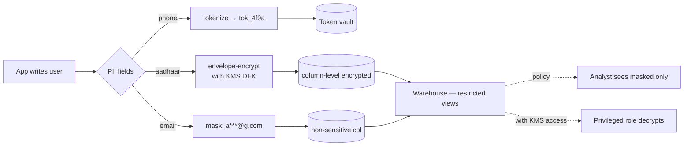

## Definition (interview-ready)

**PII (Personally Identifiable Information)** is data identifying an individual (name, email, phone, address, government ID, IP, device ID). **Masking** hides parts of the value (`****@gmail.com`); **encryption** scrambles it reversibly with a key; **tokenization** replaces it with a random token that can't be mathematically reversed — only looked up back to the original via a vault. **GDPR** (EU), **DPDP** (India), **CCPA** (California) impose legal obligations on collection, processing, retention, and deletion.

**One-liner:** PII is any data that can identify a person, and handling it well means collecting less, protecting what you keep with masking, encryption or tokenization plus role-based access, and being able to find and delete it everywhere when the law or the user asks.

## Why it matters

PII handling is the most common compliance pitfall and a major legal risk. Fines: GDPR up to €20M or 4% of global annual turnover, whichever is higher; DPDP up to ₹250 crore. Beyond legal, it's a trust issue — leaks make front pages. Engineers who can design with privacy in mind are unusually valuable.



## Core concepts

### Categories of personal data

- **Identifiers**: name, email, phone, government ID.
- **Quasi-identifiers**: birth date, ZIP code, gender — alone harmless, combined can re-identify.
- **Sensitive PII**: health, genetic, biometric, racial/ethnic origin, political views, religion, sexual orientation — the "special categories" with higher protection under GDPR Article 9. Financial data isn't an Article 9 category but is treated as sensitive under other regimes (e.g., CCPA/CPRA, PCI DSS).
- **Pseudonyms**: hashed/tokenized identifiers still considered personal under GDPR if reversal possible.

### Data minimization principle

Collect only what's needed for the stated purpose. Don't hoard data "in case it's useful later." Reduces blast radius of any breach and aligns with GDPR.

### Masking

**Static masking** (applied at rest): replace values, e.g., `john.doe@gmail.com` → `j***.d**@gmail.com`. Useful for non-prod environments.

**Dynamic masking** (at query time): based on user's role, the warehouse returns masked values to most users, full values to authorized roles.

Snowflake / BigQuery / Redshift support dynamic data masking via policy tags or column-level masking policies.

### Encryption

- **At rest**: database/object store encrypts data with a key. Standard now (S3 SSE, DB TDE).
- **In transit**: TLS everywhere.
- **Application-level encryption**: app encrypts specific fields before storage. Strongest; defends against DB breach.
- **Key management**: KMS (AWS KMS, GCP KMS, HashiCorp Vault); rotate keys; separation of duty.

### Tokenization

Replace sensitive value with a **token** (random ID); store the mapping in a **vault**.

```
Source:   credit_card = 4111111111111111
Token:    credit_card = tok_8a7b3c2d
Vault:    tok_8a7b3c2d → 4111111111111111  (heavy access controls)
```

- App tier sees only tokens.
- Vault is PCI-scoped, audited, network-isolated.
- This is **vault-based** tokenization. "Vaultless" tokenization instead derives tokens with format-preserving encryption, so there is no lookup table but there is a key to protect.
- Replaces "if you have the encrypted blob, you can decrypt with the key" with "you must call the vault to detokenize," with full audit trail.

Used by: Stripe, payment processors, anyone with PCI scope.

### Hashing

- One-way function: same input → same output.
- Useful for deduplication, joining, lookups without retaining original.
- **Salted hashes** prevent rainbow-table attacks.
- Beware: small input spaces (phone numbers, emails) are brute-forceable from hash + dictionary. Use **HMAC** with a secret key when joining sensitive fields.

### Anonymization vs pseudonymization

- **Anonymization**: irreversibly removes identifiers. The data is no longer personal under GDPR. Hard to achieve in practice (combined quasi-identifiers can re-identify).
- **Pseudonymization**: replace identifiers with pseudonyms (e.g., tokens). Still personal data under GDPR — re-identifiable with the key/vault.

### Right to erasure (GDPR / DPDP)

Users can request deletion. Engineers must:
- Identify all systems holding the user's data (CRM, DB, warehouse, backups, logs, embeddings).
- Delete or anonymize within statutory deadline (GDPR Art. 12(3): without undue delay, within one month, extendable by two more for complex requests).
- Maintain audit trail of the deletion.
- Handle replicated/cached data.

Implementation patterns:
- **Soft delete + retention**: mark deleted, hard-delete after retention.
- **Tombstones in lakehouse**: DELETE in Iceberg/Delta + snapshot expiry (Delta `VACUUM`, Iceberg `expire_snapshots`) after retention.
- **Cascade through CDC**: deletion event propagates to downstream stores.
- **Backups**: usually can't be edited in place. A common, regulator-accepted practice (for example by the UK ICO) is to put the data beyond use, let it age out with normal backup rotation, and re-apply deletions if a backup is ever restored. Rules vary by jurisdiction.

### Right to access / portability

Users can request a copy of their data. Maintain a process (often automated) to export structured data per user.

### Consent management

- Consent is one legal basis for processing. GDPR has six (others include contract and legitimate interests); India's DPDP Act relies mainly on consent plus a short list of "legitimate uses". Sensitive (special category) data under GDPR usually needs explicit consent or another Article 9 exception.
- When you rely on consent: it must be freely given, specific and informed, and consent records are kept for audit.
- Withdrawal must be as easy as granting.
- Purpose limitation: data collected for X can't be reused for an unrelated purpose Y without a compatible purpose or a new legal basis (often fresh consent).

### Data Subject Rights endpoints

Standard tooling for handling rights requests: data export, deletion, access, correction. Modern compliance tools (OneTrust, Transcend) automate.

### Data residency

GDPR: EU data can't leave EU without safeguards (SCCs, adequacy decisions).
DPDP Act 2023 (Section 16): cross-border transfers allowed except to countries the government restricts (negative-list approach); sectoral rules can still mandate localization (e.g., RBI's payment-data rule).
China PIPL: strict. Critical information infrastructure operators and large-volume processors must store data in China, and other exports need a security assessment, certification, or a standard contract.

Architecture: regional data lakes, sharded by user residency, replication strategies bounded by jurisdiction.

### Data warehouse PII practices

- **Tag columns** with sensitivity labels (e.g., `pii.email`, `pii.phone`).
- **Mask policies** apply based on tags + user role.
- **Access logging**: every query on PII-tagged columns logged.
- **Approval workflow** for analyst queries on raw PII.

### Logging and PII

Common bug: PII leaks into logs (e.g., logging the full request body that contains an email).

Mitigations:
- **Structured logging** with explicit fields, no full-payload dumps.
- **Log scrubbing**: regex-based redaction at the log shipper.
- **Audit log access**: who reads logs.

## How it works (a sample architecture)

```
Source (App writes) ──► tokenize PII at API ingest
                                │
                                ▼
                          App DB (only tokens)
                                │
                                ▼
                          CDC to Warehouse
                                │
                                ▼
                      Warehouse: tokens + tags
                                │
                  Dynamic masking by role
                                │
                                ▼
                          BI / analysts (see masked / non-PII)
                                
Authorized roles ──► detokenize via vault (audited)
```

## Real-world examples

- **Stripe**: tokenization for cards; PCI-scoped vault.
- **Apple**: privacy-by-design — differential privacy, on-device processing.
- **Google BigQuery**: column-level encryption + policy tags.
- **Snowflake**: dynamic data masking, row access policies.
- **Meta**: extensive privacy infrastructure post-Cambridge Analytica.

## Common pitfalls

- **Hashing emails for "anonymization"**: trivially reversible via dictionary. Use HMAC with secret + rotate.
- **PII in logs**: easy to leak via full request/response dumps.
- **No deletion in backups**: GDPR considerations.
- **Embedding PII in URLs**: ends up in proxy logs, browser history.
- **Sharing prod data with non-prod**: copies PII into less-protected environments. Use masked replicas.
- **Forgetting about derived data**: aggregations, ML feature stores, embeddings can leak PII.
- **Soft-delete forever**: defeats deletion intent.

## Practice questions

<Practice>

<QA q="What's the difference between masking, encryption, and tokenization?" level="easy">

Masking hides parts of a value (`****@gmail.com`), statically for non-prod or dynamically at query time. Encryption is a reversible scramble with a key; access is controlled through key management. Tokenization replaces the value with a random token whose mapping lives in a separate, audited vault; the token can't be mathematically reversed. Tokenization is best for shrinking how many systems hold real PII.

</QA>

<QA q="What are quasi-identifiers and why do they matter?" level="easy">

Fields like birth date, ZIP code, and gender that are harmless alone but can re-identify a person when combined. Removing names and emails isn't enough to anonymize a dataset if quasi-identifiers remain, which is why true anonymization is hard.

</QA>

<QA q="What is data minimization?" level="easy">

Collect only the data needed for the stated purpose, and keep it only as long as needed. Don't hoard data 'in case it's useful later.' Less data means a smaller blast radius in a breach, fewer systems to cover on deletion requests, and alignment with GDPR and DPDP.

</QA>

<QA q="Anonymization vs pseudonymization under GDPR?" level="medium">

Anonymization irreversibly removes the link to a person, so the data is no longer personal data under GDPR, but it's hard to achieve because quasi-identifiers can re-identify. Pseudonymization replaces identifiers with tokens or keyed hashes; whoever holds the key or vault can re-identify, so it's **still personal data** and still subject to GDPR.

</QA>

<QA q="Why is hashing alone not enough for PII?" level="medium">

Emails and phone numbers have small, predictable input spaces, so an attacker can hash a dictionary of candidates and match. Salting stops precomputed rainbow tables but not a targeted dictionary attack. Use HMAC with a secret key kept in a vault (and rotate it), or full tokenization.

</QA>

<QA q="How does dynamic data masking work?" level="medium">

The warehouse applies a masking policy at query time based on the user's role. Analysts might see `****@gmail.com`, support might see a partial value, and the data owner sees the full email. It's implemented as a column-level policy (Snowflake masking policies, BigQuery policy tags), often driven by sensitivity tags.

</QA>

<QA q="Why use application-level encryption on top of encryption at rest?" level="medium">

At-rest encryption (S3 SSE, DB TDE) protects stolen disks, but anyone who can query the database sees plaintext. Application-level encryption encrypts specific fields before they're stored, with keys in KMS/Vault, so a database breach or over-privileged DB user only gets ciphertext. Pair it with key rotation and separation of duty.

</QA>

<QA q="What is data residency and how to design for it?" level="medium">

A legal requirement that certain users' data stays in, or only moves under conditions out of, a jurisdiction. GDPR requires safeguards (SCCs, adequacy decisions) for transfers out of the EU; China's PIPL is strict; India's DPDP Act allows transfers except to restricted countries, while sectoral rules (like RBI's payment-data rule) can mandate localization. Design: regional data lakes and services, routing by user residency, replication bounded by jurisdiction.

</QA>

<QA q="How would you implement GDPR right to erasure?" level="hard">

- Find every system holding the user's data (data inventory plus lineage): app DB, warehouse, search, caches, ML embeddings, logs.
- Delete or anonymize in all of them within the deadline (without undue delay, within one month, extendable by two months for complex requests).
- In a lakehouse, run DELETE and then snapshot expiry/vacuum so old versions don't keep the row.
- Cascade deletions through CDC.
- Keep an audit trail; handle backups per jurisdiction.
- Avoid soft-delete forever; hard-delete after retention.

</QA>

<QA q="Design PII handling for a new analytics warehouse." level="scenario">

- Tokenize sensitive fields at ingest so the warehouse holds only tokens.
- Tag columns with sensitivity labels.
- Dynamic masking by role; row-level policies for tenant data.
- Audit every query on PII-tagged columns.
- An approval workflow for raw PII access, with detokenization through an audited vault.
- Masked replicas for non-prod, never raw prod copies.

</QA>

<QA q="A team's logs contain user emails. How do you fix and prevent?" level="scenario">

- Immediate: purge or mask the affected logs and restrict access.
- Change logging code: no full request/response bodies; log IDs and explicit structured fields.
- Add regex scrubbing at the log shipper as defense in depth.
- Add linters or pre-commit checks that catch direct PII logging.
- Add it to the code review checklist and train the team.

</QA>

<QA q="A new feature requires collecting user's exact location. Privacy considerations." level="scenario">

- Is exact location needed, or is city/country enough? **Data minimization.**
- Explicit opt-in consent with a clear purpose; withdrawal as easy as granting.
- Minimal retention; store aggregates where possible.
- Tight access control within the company.
- Make sure deletion requests cover it.
- Document the legal basis (GDPR Article 6).

</QA>

</Practice>

## Quiz

<Quiz>

<MCQ q="Under GDPR, is a dataset where emails are replaced by vault-backed tokens still personal data?" options={["No, tokens make it anonymous", "Yes, because it can be re-identified via the vault, so it is pseudonymized", "Only if the tokens are numeric", "Only for EU citizens living outside the EU"]} answer={1}>

Tokenization is pseudonymization: re-identification is possible with the vault, so GDPR still applies. Only irreversible anonymization takes data out of scope.

</MCQ>

<MCQ q="A team stores SHA-256 hashes of phone numbers and calls them anonymized. What is the flaw?" options={["SHA-256 is reversible mathematically", "Hashes are too long to store", "The small input space lets an attacker hash every possible number and match", "Hashes can't be used for joins"]} answer={2}>

Phone numbers are few enough to enumerate. HMAC with a secret key or tokenization is needed. Hashes can be joined; that's why teams use them.

</MCQ>

<MCQ q="Analysts must see masked emails while the data owner sees full values, from the same table. Which technique?" options={["Dynamic data masking by role", "Static masking", "Encryption at rest", "Salted hashing"]} answer={0}>

Dynamic masking applies a policy at query time per role. Static masking changes stored values for everyone; at-rest encryption is transparent to anyone who can query.

</MCQ>

<MCQ q="Which protects field values even if an attacker gets SQL access to the production database?" options={["Disk encryption at rest", "TLS in transit", "Database backups", "Application-level field encryption with keys in KMS"]} answer={3}>

At-rest encryption is transparent to queries and TLS only covers the network; app-level encryption means the DB stores ciphertext.

</MCQ>

<MCQ q="Why can a dataset with names removed but birth date, ZIP code and gender kept still be personal data?" options={["Quasi-identifiers combined can re-identify individuals", "Birth dates are a GDPR special category", "Gender must always be encrypted", "ZIP codes are government IDs"]} answer={0}>

These quasi-identifiers are harmless alone but identifying together. None of the other statements is true.

</MCQ>

<MCQ q="A user's row was deleted from an Iceberg table, but time travel still returns it. What completes the erasure?" options={["Running OPTIMIZE", "Expiring snapshots past retention so old files are removed", "Re-running the DELETE", "Masking the column"]} answer={1}>

Old snapshots still reference files containing the row; expire_snapshots (or VACUUM on Delta) physically removes them.

</MCQ>

<MCQ q="Which practice best reduces the blast radius of a future breach?" options={["Longer log retention", "Copying prod data into staging for realistic tests", "Collecting extra fields in case they are useful later", "Data minimization: collect and keep only what the purpose needs"]} answer={3}>

Less data held means less to leak. The other choices increase exposure.

</MCQ>

<MCQ q="Which architecture fits strict data residency requirements?" options={["One global data lake with encryption", "Regional data stores and services, routing by user residency and bounding replication by jurisdiction", "Tokenizing all fields and storing the vault anywhere", "Replicating everything to all regions for availability"]} answer={1}>

Residency is about where data physically lives; regional stores with bounded replication enforce it. Encryption or tokenization doesn't change location.

</MCQ>

</Quiz>

## TL;DR cheat sheet

- PII = identifies a person (direct or via combination).
- Sensitive PII (health, biometric, religion, etc.; financial data under sectoral rules like PCI DSS) = stricter rules.
- **Data minimization**: collect less, retain less.
- Masking, encryption, tokenization — different roles, often combined.
- Hashing alone is weak for low-entropy data; use HMAC or tokenize.
- GDPR/DPDP: right to access, erasure, portability, consent management.
- Dynamic data masking + column tags + access logging in warehouse.
- Don't log PII; scrub at the source and at log shipper.
- Data residency: regional architecture.
- Tokenization vault (Stripe-style) for PCI scope.

## Go deeper

- **GDPR official text**: [eur-lex.europa.eu](https://eur-lex.europa.eu/eli/reg/2016/679/oj).
- **DPDP** (India): [meity.gov.in/data-protection-framework](https://www.meity.gov.in/data-protection-framework) — official text.
- **AWS Macie**: [aws.amazon.com/macie](https://aws.amazon.com/macie/) — PII discovery.
- **Stripe blog**: tokenization architecture posts.
- **Snowflake docs**: dynamic data masking, row access policies.
- **Apple differential privacy** — academic but illustrative.
- **Book**: *Practical Data Privacy* by Katharine Jarmul (O'Reilly, 2023).
- **OneTrust / Transcend** docs: compliance tooling.
