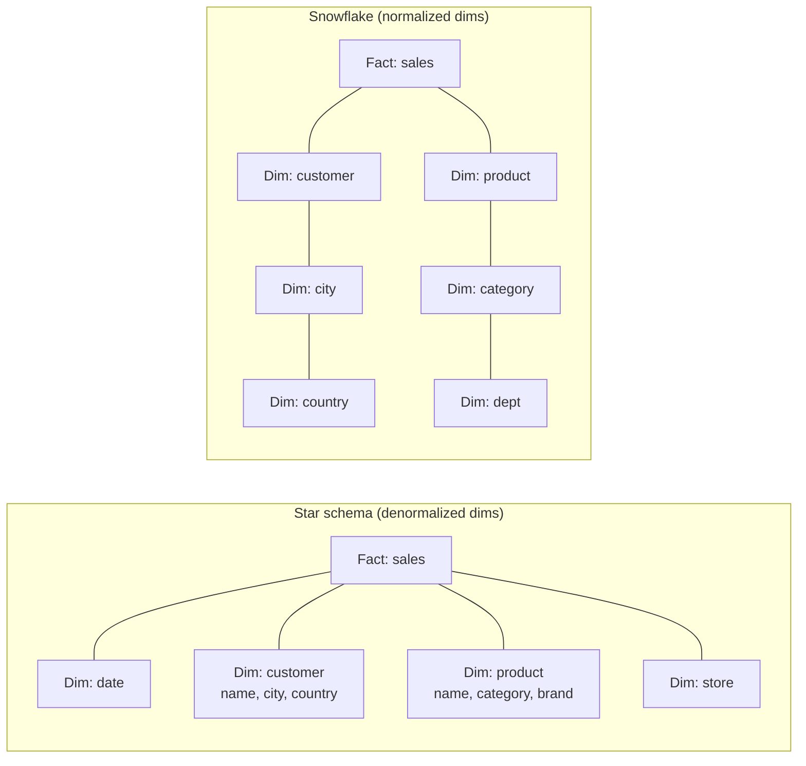
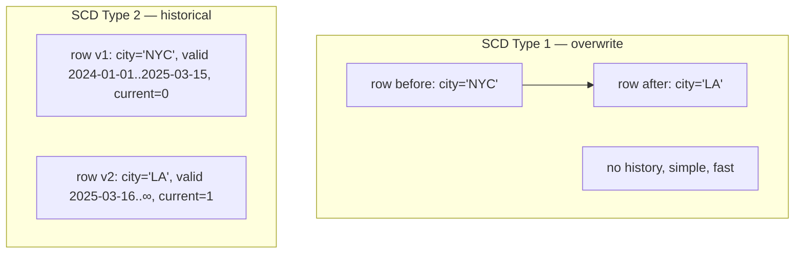

## Definition (interview-ready)

In dimensional modeling, **fact tables** store metrics (sales, clicks, sessions) and **dimension tables** store descriptive attributes (customer, product, store). **Slowly Changing Dimensions (SCDs)** are strategies for tracking changes to dimension attributes over time (Type 1 = overwrite, Type 2 = history with effective dates). **Star schema** denormalizes dimensions; **snowflake schema** normalizes them into sub-dimensions.

**One-liner:** A star schema is a central fact table of events joined to flat dimension tables, and slowly changing dimensions decide how those dimensions record changes: Type 1 overwrites, Type 2 adds a new versioned row so past facts keep the attributes they had at the time.

## Why it matters

Dimensional modeling is the backbone of every analytics warehouse — it's the language analysts use, the schema BI tools assume, and the structure that makes queries simple and fast. Understanding SCDs avoids "historical reports that change every day" type bugs.





## Core concepts

### Fact tables

- Store measurements (numerical) and foreign keys to dimensions.
- Typically very long, narrow (millions to billions of rows).
- Examples: `sales` (one row per transaction), `clicks`, `page_views`.

```
fact_sales(
  sale_id, sale_date,
  customer_key, product_key, store_key,  -- FK to dimensions
  quantity, amount, tax
)
```

### Dimension tables

- Store descriptive attributes.
- Wider (more columns), shorter.
- Used in WHERE clauses and GROUP BY.
- Examples: `customers`, `products`, `dates`, `stores`.

```
dim_customer(
  customer_key, customer_id, name, segment, country, signup_date
)
```

### Star schema

Dimensions directly joined to fact (denormalized).

```
                  dim_customer
                       │
   dim_date ── fact_sales ── dim_product
                       │
                  dim_store
```

Pros: simple joins, fast queries, easy for BI tools.
Cons: redundancy (denormalized dims), bigger storage.

### Snowflake schema

Dimensions normalized into sub-dimensions.

```
   dim_country ── dim_customer ── fact_sales ── dim_product ── dim_category
```

Pros: less redundancy.
Cons: more joins, slower queries, harder for analysts. **Generally avoid** unless storage is critical.

Default to **star schema** in analytics.

### Slowly Changing Dimensions (SCDs)

When dimension data changes (customer moves city, product category renamed), how do you reflect that?

#### Type 0: never change

Keep the original value forever, even if the source changes. Used for attributes that should never change, such as date of birth or original signup date.

#### Type 1: overwrite

```sql
UPDATE dim_customer SET city = 'Bangalore' WHERE customer_key = 42;
```

History lost. Old sales now appear linked to the new city. Easy but destroys audit.

#### Type 2: track history (most common)

Add validity dates + a current flag. Insert a new row on change.

```
dim_customer(
  customer_key,    -- surrogate, unique per version
  customer_id,     -- natural ID, stable
  city,            -- attribute
  effective_from,
  effective_to,
  is_current
)
```

```
customer_id=42, city=Delhi,      effective_from=2023-01-01, effective_to=2025-06-01, is_current=0
customer_id=42, city=Bangalore,  effective_from=2025-06-01, effective_to=9999-12-31, is_current=1
```

Facts reference `customer_key`, not `customer_id` — they're "frozen" to the version at sale time. Past reports stay accurate (the 2024 sales show Delhi, the 2026 sales show Bangalore).

#### Type 3: add a column for prior value

```
dim_customer(customer_id, current_city, previous_city)
```

Only the most recent prior value preserved. Rare.

#### Type 4: history table

Separate table tracks history; main dim is current. (Naming varies: in Kimball's *Data Warehouse Toolkit*, Type 4 means a "mini-dimension" that splits out rapidly changing attributes. Many teams use "Type 4" for a separate history table, as here.)

#### Type 6: hybrid (1+2+3)

Combines overwrites, history rows, and prior-value columns (1 + 2 + 3 = 6): Type 2 history rows plus a "current value" column overwritten on every row of the entity.

**Default**: Type 2 for any dimension where historical accuracy matters; Type 1 for cosmetic changes.

### Surrogate keys

Always use surrogate keys (`customer_key`) in dimensions, not natural keys (`customer_id`):
- Natural IDs can change.
- Surrogate allows multiple versions (Type 2).
- Joins are faster with integer surrogates.

### Date dimension

Always have a `dim_date` table — precomputed rows for every day with attributes (day_of_week, quarter, fiscal_year, holiday_flag).

Makes queries easy:
```sql
SELECT SUM(amount)
FROM fact_sales f JOIN dim_date d ON f.date_key = d.date_key
WHERE d.is_holiday = TRUE;
```

### Conformed dimensions

A dimension used by multiple fact tables (same `dim_customer` in `fact_sales` and `fact_returns`). Keeps reports consistent across subject areas.

## Modern lakehouse take

In Iceberg / Delta tables:
- **MERGE INTO** for Type 2. One `MERGE` row can either update or insert, but a changed customer needs both (close the old row and insert the new version). The standard trick stages each changed row twice, once with a `NULL` merge key so it falls into the insert branch:
  ```sql
  MERGE INTO dim_customer t
  USING (
    SELECT s.customer_id AS merge_key, s.* FROM source s
    UNION ALL
    SELECT NULL AS merge_key, s.* FROM source s           -- second copy: forces an INSERT
      JOIN dim_customer d ON d.customer_id = s.customer_id
     WHERE d.is_current AND d.city <> s.city
  ) u
  ON t.customer_id = u.merge_key AND t.is_current
  WHEN MATCHED AND t.city <> u.city THEN
    UPDATE SET is_current = false, effective_to = current_date
  WHEN NOT MATCHED THEN
    INSERT (customer_id, city, effective_from, effective_to, is_current)
    VALUES (u.customer_id, u.city, current_date, DATE '9999-12-31', true);
  ```
  Changed customers get their old row closed and a new current row; brand-new customers are inserted; unchanged ones are left alone.
- **dbt snapshots** automate Type 2 SCDs declaratively.

### dbt snapshots

```yaml
snapshots:              # dbt 1.9+ YAML syntax
  - name: customers_snapshot
    relation: source('crm', 'customers')
    config:
      schema: snapshots
      unique_key: customer_id
      strategy: timestamp
      updated_at: updated_at
```

dbt manages validity columns automatically: `dbt_valid_from` / `dbt_valid_to`, with the current row having `dbt_valid_to = NULL` (or a sentinel via `dbt_valid_to_current`).

## How it works (Type 2 update)

```
Source has customer_id=42, city=Bangalore (was Delhi).

Update procedure:
BEGIN;
  UPDATE dim_customer
    SET effective_to = current_date, is_current = 0
    WHERE customer_id = 42 AND is_current = 1;
  INSERT INTO dim_customer
    (customer_id, city, effective_from, effective_to, is_current)
    VALUES (42, 'Bangalore', current_date, '9999-12-31', 1);
COMMIT;
```

Future sales link to the new `customer_key`. Past sales stay linked to the old one.

## Real-world examples

- **Kimball Data Warehouse Toolkit** — the canonical methodology.
- **Retail data warehouses** — Kimball's toolkit uses retail sales as its first case study; dimensional modeling is the norm there.
- **dbt + Snowflake/BigQuery** at modern data teams — declarative SCDs.
- **Looker / Tableau / PowerBI** — assume star schemas.

## Common pitfalls

- **Updating attributes in place (Type 1) on critical dimensions** — past reports change retroactively, hard to defend in audits.
- **Forgetting effective_to / is_current logic** — duplicate "current" rows, broken joins.
- **Joining on natural ID instead of surrogate**: Type 2 doesn't work.
- **Over-normalizing into snowflake** — slower queries, harder analyst experience.
- **No date dimension** — every analyst rolls their own.
- **Forgetting late-arriving dimensions** — sale comes in for a customer not yet in dim_customer; need to handle gracefully (insert placeholder, update later).

## Practice questions

<Practice>

<QA q="What's the difference between a fact table and a dimension table?" level="easy">

A fact table stores measurements (quantity, amount) plus foreign keys to dimensions, one row per event at a fixed grain; it's long and narrow (millions to billions of rows). A dimension table stores descriptive attributes (customer name, segment, country) used in `WHERE` and `GROUP BY`; it's wider and much shorter.

</QA>

<QA q="Star vs snowflake — which to use?" level="easy">

Star schema (denormalized dimensions joined directly to the fact) almost always. Snowflake normalizes dimensions into sub-dimensions, saving some storage but adding joins, slower queries, and complexity. Analysts and BI tools (Looker, Tableau, Power BI) are built around star schemas.

</QA>

<QA q="Why use surrogate keys?" level="easy">

- Natural IDs can change (rare but real).
- Type 2 needs multiple versions of the same entity, each with its own key.
- Integer surrogates make joins fast.
- They decouple the warehouse from source systems' ID schemes.

</QA>

<QA q="Explain Type 2 SCD." level="medium">

Track history by inserting a new dimension row whenever a tracked attribute changes, with `effective_from`, `effective_to`, and `is_current`. The old row is closed (`effective_to` set, `is_current = 0`). Facts reference the version-specific surrogate key, so they stay frozen to the attributes at the time of the event: past reports stay accurate and current reports show current values.

</QA>

<QA q="How do Types 1, 3, 4 and 6 differ from Type 2?" level="medium">

- **Type 1**: overwrite in place; no history.
- **Type 3**: add a column for the prior value (`previous_city`); keeps only one previous value.
- **Type 4**: keep the main dimension current and put history in a separate table.
- **Type 6**: hybrid of 1+2+3: Type 2 history rows plus a current-value column overwritten on every row of the entity, so you can report by historical or current attribute.

Default to Type 2 where historical accuracy matters and Type 1 for cosmetic fixes.

</QA>

<QA q="Design a dim_date table." level="medium">

```
date_key (e.g., 20260529), date, year, quarter, month, day, day_of_week,
day_name, is_weekend, is_holiday, fiscal_year, fiscal_quarter, week_of_year
```

Precompute one row per day for many years. Analysts filter and group on these attributes (holidays, fiscal quarters) instead of each writing their own date math.

</QA>

<QA q="What is a conformed dimension?" level="medium">

One dimension shared by several fact tables, such as the same `dim_customer` used by `fact_sales` and `fact_returns`. Because both facts use the same keys and attributes, reports across subject areas line up and can be combined (sales vs returns by segment) without reconciling different customer definitions.

</QA>

<QA q="Implement Type 2 SCD in dbt." level="medium">

Use a snapshot. Legacy (pre-1.9) Jinja block syntax:

```sql

  {{ config(target_schema='snapshots', unique_key='customer_id',
            strategy='check', check_cols=['city','segment']) }}
  SELECT * FROM {{ source('crm', 'customers') }}

```

dbt 1.9+ can declare the same thing in YAML. On each run dbt compares rows, closes changed versions, and inserts new ones, managing `dbt_valid_from`/`dbt_valid_to` (current row has `dbt_valid_to` NULL). Use `strategy: timestamp` with `updated_at` when the source has a reliable update timestamp.

</QA>

<QA q="A Type 2 dimension sometimes has two is_current rows for one customer. What goes wrong and how do you prevent it?" level="hard">

Joins that filter on `is_current = 1` now return two rows, so facts get double-counted. It usually comes from the close-old-row and insert-new-row steps not running atomically, or a rerun inserting again. Run both steps in one transaction (or a single `MERGE`), make the load idempotent, and add a test that each natural key has exactly one current row.

</QA>

<QA q="A report showing 2024 sales now shows new city names. Diagnose." level="scenario">

The dimension was updated Type 1 (overwrite), so past facts now join to current values. To fix retroactively you must rebuild historical versions, which is hard without a history source (audit logs, CDC, backups). Otherwise accept the loss and switch to Type 2 going forward.

</QA>

<QA q="Late-arriving dimension — what is it and how do you handle?" level="scenario">

A fact arrives referencing a dimension member that doesn't exist yet (a sale for a customer not yet loaded into `dim_customer`). Options:

- **Placeholder** dim row (`is_unknown = 1`) that the fact can reference, filled in when the real data arrives. Most warehouses do this.
- Hold the fact in staging until the dimension arrives.

</QA>

<QA q="A team uses surrogate keys but stores 30 attributes in dim_product, updated weekly. They're losing history. Why?" level="scenario">

Surrogate keys alone don't preserve history; the weekly load is overwriting rows (Type 1). Convert the attributes that matter to Type 2 with effective dates, via dbt snapshots or a `MERGE` that closes the old row and inserts the new one. Keep purely cosmetic attributes as Type 1.

</QA>

</Practice>

## Quiz

<Quiz>

<MCQ q="A customer moves from Delhi to Bangalore. With Type 2, which city do their 2024 sales show in reports?" options={["Bangalore, the current value", "Delhi, because 2024 facts reference the old version's surrogate key", "Both, duplicated", "Neither, the old row is deleted"]} answer={1}>

Type 2 keeps the old row and facts point to the version-specific key, so history is preserved. Type 1 would show Bangalore.

</MCQ>

<MCQ q="Why must facts join on the surrogate key rather than the natural customer_id in a Type 2 dimension?" options={["Natural keys are always strings", "Surrogate keys are required by BI tools", "The natural key matches every version, so joins return multiple rows or the wrong version", "Natural keys cannot be indexed"]} answer={2}>

A natural ID appears once per version in Type 2, so joining on it fans out or loses the point-in-time link. The surrogate identifies one version.

</MCQ>

<MCQ q="Which is the usual default schema for an analytics warehouse?" options={["Star schema", "Snowflake schema", "Fully normalized 3NF", "One wide table per report"]} answer={0}>

Star gives simple joins and is what BI tools expect. Snowflake adds joins for modest storage savings.

</MCQ>

<MCQ q="Which SCD type keeps only the immediately previous value in an extra column?" options={["Type 1", "Type 2", "Type 4", "Type 3"]} answer={3}>

Type 3 adds a previous-value column. Type 1 keeps nothing, Type 2 keeps full history rows, and Type 4 uses a separate history table.

</MCQ>

<MCQ q="A sale arrives for a customer not yet loaded into dim_customer. What is the most common handling?" options={["Drop the sale", "Point the fact to a placeholder dimension row and fill it in later", "Store the natural ID in the fact and skip the join", "Reload the entire dimension"]} answer={1}>

The placeholder pattern keeps the fact loadable and joinable, then updates the dimension when real data arrives.

</MCQ>

<MCQ q="fact_sales and fact_returns use the same dim_customer. What is this called and why does it help?" options={["A snowflake dimension; it saves storage", "A junk dimension; it holds flags", "A conformed dimension; reports across both facts stay consistent", "A degenerate dimension; it lives in the fact"]} answer={2}>

A conformed dimension is shared across facts so attributes and keys agree, letting sales and returns be compared directly.

</MCQ>

<MCQ q="A Type 2 load's close-old-row UPDATE succeeds but the INSERT fails, and the job retries. What is the risk if the steps aren't atomic?" options={["None; retries are always safe", "The fact table is truncated", "Surrogate keys are reused", "Customers can end up with no current row, or with two current rows"]} answer={3}>

Non-atomic steps leave inconsistent current flags; joins on is_current then drop or double-count facts. Use one transaction or a MERGE.

</MCQ>

<MCQ q="In dbt snapshots, how is the current version of a row identified by default?" options={["dbt_valid_to is NULL", "is_current equals 1", "dbt_valid_from is NULL", "The row with the highest surrogate key"]} answer={0}>

dbt sets dbt_valid_to to NULL on the current row (or a sentinel if dbt_valid_to_current is configured). It doesn't add an is_current column by default.

</MCQ>

</Quiz>

## TL;DR cheat sheet

- **Star schema** = fact + denormalized dimensions. Default.
- **Snowflake** = normalized dimensions. Avoid unless storage critical.
- **Type 1 SCD**: overwrite. Loses history.
- **Type 2 SCD**: insert new row with effective_from / effective_to / is_current. Preserves history.
- **Surrogate keys** always.
- **dim_date** is mandatory.
- **dbt snapshots** automate Type 2.
- **Late-arriving dims**: use placeholder rows.

## Go deeper

- **Ralph Kimball, *The Data Warehouse Toolkit*** — the canonical book.
- **dbt docs**: [snapshots](https://docs.getdbt.com/docs/build/snapshots).
- **DDIA Chapter 3** for context.
- **Kent Graziano blog** on data warehousing.
- **Snowflake / BigQuery docs**: MERGE syntax for SCDs.
- **AWS, Microsoft documentation** on data warehousing patterns.
