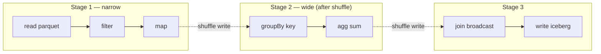

## Definition (interview-ready)

**Apache Spark** is a distributed computation engine that represents jobs as a **DAG** of transformations on resilient distributed datasets (RDDs / DataFrames). It executes lazily, splits into **stages** at **shuffle** boundaries, and parallelizes work across **partitions**. The performance killer is **shuffle** (cross-node data exchange) and its enemy: **data skew** (uneven partition sizes).

**One-liner:** Spark lazily turns your DataFrame code into an optimized DAG, cuts it into stages at every shuffle, and runs one task per partition across the cluster, so tuning Spark mostly means avoiding shuffles and keeping partitions evenly sized.

## Why it matters

Spark powers most modern big-data pipelines (ETL, ML, Kafka-stream-to-warehouse). Understanding shuffle, partitioning, and skew is the difference between "10 min job" and "10 hour job that fails."



## Core concepts

### Lazy evaluation + DAG

Operations are **transformations** (`map`, `filter`, `join`) that build a DAG, not executed. **Actions** (`collect`, `count`, `write`) trigger execution.

What happens when an action runs:
1. The Catalyst optimizer parses SQL or DataFrame ops.
2. Catalyst builds a logical plan.
3. Catalyst optimizes it (predicate pushdown, projection pruning, constant folding; join reordering only when cost-based optimization is enabled).
4. Catalyst generates a physical plan (choosing join strategies, etc.).
5. The DAG scheduler splits the job into stages at shuffle boundaries.
6. The task scheduler sends one task per partition to executors.

### Partitions

- Data split into partitions; one task per partition.
- Partition count = parallelism unit.
- Defaults: 200 shuffle partitions (`spark.sql.shuffle.partitions`).
- Tune: roughly 100-200 MB of shuffle data per partition is a common heuristic (input splits default to 128 MB via `spark.sql.files.maxPartitionBytes`).

### Narrow vs wide transformations

- **Narrow** (`map`, `filter`, `union`): each input partition contributes to one output partition. No network shuffle.
- **Wide** (`groupBy`, `join`, `repartition`): data must be reshuffled across nodes by some key. **Stage boundary**.

### Shuffle (the cost center)

When data must be redistributed by key (group, join, repartition):
1. **Map side**: each map task partitions its records by hash of the key into N reducer buckets and (with the default sort-based shuffle) writes one sorted data file plus an index file.
2. **Reduce side**: each reducer fetches its bucket's segment from every map output across the network.

Costs:
- Network I/O across N×M paths.
- Disk I/O (shuffle files spill to disk).
- Serialization.
- GC pressure.

Reducing shuffle is the biggest performance lever in Spark.

### Skew

A partition with disproportionately more data → that task takes far longer → whole stage slow → cluster idle waiting.

Causes:
- Group/join key has hot values (one customer has 50% of data).
- NULL keys colliding into one partition.
- Bad partitioner.

Mitigations:
- **Salting**: append random suffix to the key before group/join, then aggregate.
- **Broadcast join**: if one side is small, broadcast it to all executors (no shuffle).
- **Adaptive query execution (AQE)** (Spark 3.0+): detects skew at runtime, splits skewed partitions automatically.
- **Bucketing**: pre-bucket data on a key in storage; shuffle skipped for matching joins.
- **Skew hints**: Databricks offers a `SKEW` join hint; open-source Spark relies on AQE skew handling instead.

### Broadcast join

For "small × big" join: broadcast small side as a hash table to every executor; join locally → no shuffle.

Spark auto-broadcasts tables below threshold (`spark.sql.autoBroadcastJoinThreshold`, default 10MB). Manual broadcast via `broadcast(df)`.

### Sort-merge join

For "big × big" join: shuffle both sides on the join key, sort each partition, merge. Standard for large joins. Skew prone.

### Shuffle hash join

For "big × medium" join: shuffle both sides; smaller side built as a hash table per partition. Can be faster than sort-merge because it skips the sort, but each partition's hash table must fit in memory, so Spark prefers sort-merge by default (`spark.sql.join.preferSortMergeJoin=true`).

### Caching / persistence

- `df.cache()` or `df.persist(StorageLevel.MEMORY_AND_DISK)`: keep DataFrame in memory across actions.
- Helps when a DataFrame is reused multiple times — avoid recomputing.
- Be aware of memory cost; OOM if you cache too much.

### Adaptive Query Execution (AQE, Spark 3.0+)

Runtime optimizations:
- Dynamic shuffle partition coalescing (combine small ones).
- Skew handling (split skewed partitions).
- Switch sort-merge to broadcast if a stat indicates it's now safe.

Enable: `spark.sql.adaptive.enabled = true`. Default in Spark 3.2+.

### Predicate pushdown + projection pruning

The optimizer pushes filters and column selection down to the source:
- Parquet: read only the columns needed, skip row groups that don't match the predicate.
- JDBC: push WHERE clauses to the source DB.
- Often the biggest single optimization.

### PySpark internals: Python, the JVM, and why UDFs are slow

Spark itself runs on the **JVM** (it's written in Scala). PySpark is a Python front end on top of it. So whenever you use Python, there are two worlds: the Python process and the JVM process, and the cost is in crossing between them.

**On the driver: Py4J**

- When you start a `SparkSession` in Python, PySpark launches (or connects to) a JVM and talks to it through **Py4J**, a library that lets Python call methods on Java objects over a local socket.
- `df.filter(col("x") > 5).groupBy("y").count()` in Python doesn't process any data in Python. Each call just builds the query plan on the JVM side through Py4J. Catalyst then optimizes it and the JVM executors run it.
- That's why **DataFrame code using built-in functions runs at roughly the same speed in Python and Scala**: the heavy work never touches Python.

```
Python driver --Py4J--> JVM driver (Catalyst, scheduler)
                              |
                      tasks to executors (JVM)
                              |
            only if you used a Python UDF / RDD lambda:
            JVM executor <--socket--> Python worker process
```

**On the executors: Python worker processes**

- If your job has a Python UDF (or an RDD `map` with a Python lambda), the JVM executor can't run that code. It starts (or reuses) separate **Python worker processes** and streams data to them over a local socket.

**Why a plain Python UDF (`@udf`) is slow**

1. **Serialization both ways:** each row is converted from Spark's internal JVM format, serialized with **pickle**, sent to Python, deserialized, processed, then the result is pickled and sent back. That round trip often costs more than the actual work. (From Spark 4.2 a plain `@udf` ships data with Arrow instead of pickle by default, see option 3 below, but points 2 to 4 still apply.)
2. **Row at a time:** the Python function is called once per row, with Python interpreter overhead on every call.
3. **A black box to the optimizer:** Catalyst can't see inside your function, so it can't push filters through it, prune columns based on it, or include it in whole-stage code generation (Spark's trick of compiling a stage into tight JVM bytecode).
4. **Extra memory:** Python workers live outside the JVM heap, so executors need memory for both (a common surprise behind container OOM kills).

**Faster options, in order of preference**

1. **Built-in functions first.** `pyspark.sql.functions` (e.g. `when`, `regexp_extract`, `date_trunc`, `transform` for arrays) and Spark SQL expressions run entirely in the JVM and are fully optimized. Most "I need a UDF" cases are covered.
   ```python
   # Slow: Python UDF
   @udf("string")
   def domain(email): return email.split("@")[1]   # also crashes on a NULL email

   # Fast: built-in, stays in the JVM (NULL in, NULL out)
   df.withColumn("domain", F.split("email", "@").getItem(1))
   ```
2. **Pandas UDFs (vectorized UDFs, Spark 2.3+)** via `@pandas_udf`. Data moves in **Apache Arrow** columnar batches (default up to 10,000 rows per batch, set by `spark.sql.execution.arrow.maxRecordsPerBatch`) and your function gets a whole `pandas.Series` at a time, so you can use vectorized pandas/NumPy operations. Far less serialization and per-row overhead.
   ```python
   import pandas as pd
   from pyspark.sql.functions import pandas_udf

   @pandas_udf("double")
   def to_usd(amount: pd.Series, rate: pd.Series) -> pd.Series:
       return amount * rate          # one vectorized op per batch
   ```
   Related APIs: `groupBy().applyInPandas()`, `mapInPandas()`.
3. **Arrow-optimized Python UDFs (Spark 3.5+):** keep a normal row-wise `@udf` but pass `useArrow=True` (or set `spark.sql.execution.pythonUDF.arrow.enabled`). Transfer uses Arrow instead of pickle, but the function still runs row by row. The config is off by default in 3.5 through 4.1 and on by default from Spark 4.2.
4. **Scala/Java UDF:** runs inside the JVM, no Python crossing at all. Good for very hot logic in mostly-Python pipelines.

Arrow also speeds up `df.toPandas()` and `spark.createDataFrame(pandas_df)` when `spark.sql.execution.arrow.pyspark.enabled` is on (off by default in Spark 3.x through 4.1, on by default from 4.2).

**How to say it in an interview:** "PySpark DataFrame code is just a remote control for the JVM via Py4J, so built-ins are as fast as Scala. A Python UDF forces each row to be pickled to a Python worker and back, row by row, and blinds the optimizer. I use built-in functions first, pandas UDFs with Arrow when I need Python, and a Scala UDF for hot paths."

## How it works (a join with shuffle)

```
df1.join(df2, "user_id"):
  Stage 1: read df1 (map) → write shuffle files keyed by hash(user_id)
  Stage 2: read df2 (map) → write shuffle files keyed by hash(user_id)
  Stage 3 (post-shuffle): each partition reads its matching files from df1 + df2,
           sort-merge, emit join results.
```

## Real-world examples

- **Databricks**: commercial Spark platform, used by a large share of Fortune 500 companies.
- **Netflix Iceberg + Spark**: petabyte-scale ETL.
- **Uber, Pinterest, Lyft**: huge Spark fleets for ETL + ML.
- **dbt over Spark SQL**: SQL-driven ETL on top of Spark.

## Common pitfalls

- **Many small files**: Spark bin-packs small files into partitions (`maxPartitionBytes`, `openCostInBytes`), but per-file listing/open/footer overhead still dominates. Compact via `OPTIMIZE` or coalesce on write.
- **Too few partitions**: parallelism underutilized.
- **Too many partitions**: scheduling overhead, tiny tasks.
- **Wide join with skew**: one task at 99% completion forever.
- **`collect()` on big data**: brings everything to driver → OOM.
- **Caching everything**: memory exhaustion.
- **Inappropriate use of UDFs**: Python UDFs slow due to serialization. Prefer Spark SQL / vectorized UDFs.
- **Bad partition keys for output**: too many partitions per writer → small file explosion.
- **Cluster sizing**: too many tasks per executor → contention; too few → idle resources.

## Practice questions

<Practice>

<QA q="What is a stage in Spark?" level="easy">

A unit of execution bounded by shuffles. All narrow transformations between two shuffles are in one stage and pipelined together. When a shuffle is needed, the stage ends and a new stage starts on the shuffled data.

</QA>

<QA q="Why is shuffle expensive?" level="easy">

Network I/O between every map task and every reduce task, disk I/O for shuffle files, serialization and deserialization, and GC pressure. It's often the largest share of a job's runtime.

</QA>

<QA q="What is Py4J's role in PySpark?" level="easy">

Py4J is the bridge that lets the Python driver call methods on JVM objects. Your Python DataFrame calls build a query plan inside the JVM through Py4J; the JVM optimizes and executes it. No row data flows through Py4J for normal DataFrame operations.

</QA>

<QA q="What is data skew and how do you handle it?" level="medium">

Some partitions hold far more data than others, so a few tasks block the stage. Fixes: salt the key (random suffix, then re-aggregate), broadcast the small side of a join, AQE skew-join handling (Spark 3.0+), bucketing, custom partitioners, or process the hot key separately.

</QA>

<QA q="When does Spark choose broadcast join vs sort-merge join?" level="medium">

Broadcast when one side's estimated size is below `spark.sql.autoBroadcastJoinThreshold` (default 10 MB): it ships the small table to every executor and joins locally with no shuffle. Sort-merge when both sides are big: shuffle both on the key, sort, merge. AQE can switch to broadcast at runtime if real sizes turn out small.

</QA>

<QA q="What does AQE do?" level="medium">

Adaptive Query Execution re-optimizes using real shuffle statistics at runtime: it coalesces small shuffle partitions, splits skewed partitions in joins, and can turn a sort-merge join into a broadcast join. On by default since Spark 3.2.

</QA>

<QA q="Why are Python UDFs slow in PySpark?" level="medium">

Spark runs in the JVM, so a Python UDF forces each row to be serialized (pickle), sent to a separate Python worker process, processed one row at a time, and sent back. The UDF is also a black box to Catalyst, so no filter pushdown through it and no whole-stage code generation. Built-in functions avoid all of this because they run in the JVM.

</QA>

<QA q="How do pandas UDFs improve on regular Python UDFs?" level="medium">

They move data in Apache Arrow columnar batches instead of pickling row by row, and your function receives a whole `pandas.Series` per batch, so you use vectorized pandas or NumPy operations. That removes most per-row serialization and interpreter overhead. Batch size is set by `spark.sql.execution.arrow.maxRecordsPerBatch` (default 10,000).

</QA>

<QA q="What is the difference between a pandas UDF and an Arrow-optimized Python UDF?" level="hard">

Both use Arrow to move data between the JVM and Python. A pandas UDF (Spark 2.3+) also **executes** in batches: your function gets a pandas Series. An Arrow-optimized Python UDF (Spark 3.5+, `useArrow=True` or `spark.sql.execution.pythonUDF.arrow.enabled`) keeps your row-wise function and only swaps pickle for Arrow in transfer. So pandas UDFs are usually faster for vectorizable logic, while Arrow-optimized UDFs are a drop-in speedup for existing row-wise code.

</QA>

<QA q="A Spark job has one task that takes 90 percent of total time. Diagnose." level="scenario">

Classic skew: one partition has far more data. In the Spark UI, the stage's task table shows one task with huge input or shuffle-read size. Find the hot key, then salt the join or groupBy key, handle that key separately, broadcast the small side, or rely on AQE skew-join splitting.

</QA>

<QA q="A PySpark job uses a Python UDF to parse emails and lowercase strings and it is 10x slower than expected. What do you do?" level="scenario">

First replace the UDF with built-ins: `lower`, `split`, `regexp_extract`, `when`. That keeps everything in the JVM and lets Catalyst optimize it. If some logic truly needs Python, rewrite it as a pandas UDF using vectorized string methods, or at least enable Arrow for the UDF. Check the physical plan: a `BatchEvalPython` or `ArrowEvalPython` node marks where data leaves the JVM. Also give executors memory overhead for the Python workers.

</QA>

<QA q="1 million small Parquet files in S3 make a Spark job slow. Why, and how do you fix it?" level="scenario">

DataFrame reads bin-pack small files into partitions, but per-file overhead (listing, opening each object, reading each footer, planning) dominates. Fixes: compact files (Delta `OPTIMIZE` or a compaction job), write bigger files (around 128 MB or more), tune `spark.sql.files.maxPartitionBytes`, and use a table format with manifest-based planning (Iceberg, Delta).

</QA>

<QA q="How would you optimize a join of two 10 TB tables?" level="hard">

- Columnar format (Parquet or ORC) with predicate pushdown and column pruning.
- Bucket both tables on the join key if the join is recurring.
- Size `spark.sql.shuffle.partitions` for roughly 100–200 MB per partition (tens of thousands for 10 TB), or start high and let AQE coalesce.
- Enable AQE and handle skew explicitly.
- Read `EXPLAIN` to confirm the join strategy.
- Give executors enough memory and cores.

</QA>

</Practice>

## Quiz

<Quiz>

<MCQ q="What creates a stage boundary in Spark?" options={["A filter", "A shuffle (wide transformation)", "A map", "Caching"]} answer={1}>

Wide transformations such as `groupBy`, `join` and `repartition` need a shuffle, which ends one stage and starts the next.

</MCQ>

<MCQ q="Default value of spark.sql.autoBroadcastJoinThreshold?" options={["1 MB", "10 MB", "100 MB", "1 GB"]} answer={1}>

10 MB. Tables estimated below it are broadcast automatically.

</MCQ>

<MCQ q="How does the PySpark driver communicate with the JVM?" options={["gRPC", "Py4J", "JNI", "Arrow Flight"]} answer={1}>

Py4J lets Python call JVM objects; the DataFrame plan is built and executed in the JVM.

</MCQ>

<MCQ q="Why does PySpark DataFrame code with built-in functions run about as fast as Scala?" options={["Python is compiled to bytecode", "The work runs in the JVM; Python only builds the plan", "PySpark uses multiprocessing", "Built-ins run in Python workers with Arrow"]} answer={1}>

Built-in functions are Catalyst expressions executed by JVM executors. Data never crosses into Python.

</MCQ>

<MCQ q="Which is NOT a reason a regular Python UDF is slow?" options={["Per-row pickle serialization to a Python worker", "Row-at-a-time execution", "Catalyst cannot optimize through it", "It forces a shuffle on every call"]} answer={3}>

A UDF by itself doesn't add a shuffle. Its cost is serialization, per-row Python calls and being opaque to the optimizer.

</MCQ>

<MCQ q="What does a pandas UDF receive as input?" options={["One Row object", "A pandas Series per Arrow batch", "The whole DataFrame on the driver", "A JVM iterator"]} answer={1}>

Pandas UDFs receive Arrow batches converted to pandas Series, enabling vectorized operations.

</MCQ>

<MCQ q="Arrow-optimized Python UDFs (useArrow=True, Spark 3.5+) change what?" options={["Execution becomes vectorized pandas", "Data transfer uses Arrow instead of pickle; function still runs row by row", "The UDF runs in the JVM", "They remove the need for Python workers"]} answer={1}>

They only replace the serialization format; the function is still called per row.

</MCQ>

<MCQ q="One task in a stage takes far longer than the rest. Most likely cause?" options={["Too much caching", "Data skew", "Predicate pushdown", "Too few executors"]} answer={1}>

A single straggler task with much larger input is the signature of skew.

</MCQ>

<MCQ q="What does AQE NOT do at runtime?" options={["Coalesce small shuffle partitions", "Split skewed join partitions", "Switch sort-merge to broadcast join", "Rewrite Python UDFs into built-ins"]} answer={3}>

AQE uses runtime stats to tune shuffles and joins; it never rewrites user UDF code.

</MCQ>

</Quiz>

## TL;DR cheat sheet

- Spark = lazy DAG → stages bounded by shuffle.
- Narrow transformations: no shuffle. Wide: shuffle (stage boundary).
- Shuffle is the cost center; reduce it.
- Skew: one partition huge → fix with salting, broadcast, AQE.
- Broadcast join for small × big. Sort-merge for big × big.
- AQE (Spark 3.0+) auto-handles shuffle coalescing + skew at runtime.
- Predicate pushdown + projection pruning huge win with columnar files.
- Avoid many small files; compact regularly.
- PySpark: Python driver talks to the JVM via **Py4J**; built-ins run in the JVM (Scala-speed).
- Python UDF = pickle each row to a Python worker and back + opaque to Catalyst. Prefer **built-ins → pandas UDF (Arrow batches) → Arrow-optimized UDF → Scala UDF**.

## Go deeper

- **Sameer Farooqui**: [Advanced Spark Training (YouTube)](https://www.youtube.com/watch?v=7ooZ4S7Ay6Y).
- **Book**: *Learning Spark, 2nd Ed* (Damji, Wenig, Das, Lee — O'Reilly).
- **Spark docs**: [SQL performance tuning](https://spark.apache.org/docs/latest/sql-performance-tuning.html).
- **Databricks blog**: [Adaptive Query Execution](https://www.databricks.com/blog/2020/05/29/adaptive-query-execution-speeding-up-spark-sql-at-runtime.html).
- **Book**: *Spark: The Definitive Guide* (Chambers, Zaharia).
- **Spark docs**: [Apache Arrow in PySpark (pandas UDFs, Arrow UDFs)](https://spark.apache.org/docs/latest/api/python/tutorial/sql/arrow_pandas.html).
- **Databricks blog**: [Arrow-optimized Python UDFs in Spark 3.5](https://www.databricks.com/blog/arrow-optimized-python-udfs-apache-sparktm-35).
- **DDIA Chapter 10** — batch processing.
