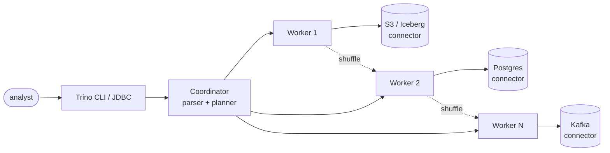

## Definition (interview-ready)

**Trino** (formerly PrestoSQL) and **Presto** (now PrestoDB) are open-source **MPP (Massively Parallel Processing) SQL query engines**. They federate queries across heterogeneous sources (S3, Postgres, MongoDB, Kafka, ...) via connectors, with work pipelined in memory by default (optional fault-tolerant execution spools intermediate data to object storage), leveraging distributed planning and execution for sub-second to minutes-scale queries on huge datasets.

## Why it matters

Trino/Presto fill the niche between "interactive query" (Redshift, BigQuery, Snowflake) and "batch ETL" (Spark): SQL over data lakes (Parquet/ORC in S3), federating multiple sources, no copy required. Used by Facebook (origin), Netflix, Airbnb, Lyft, Pinterest, Slack — anywhere people need fast SQL over warehouses or lakehouses.



## Core concepts

### Architecture

```
   Client SQL ──► Coordinator ──► parse + plan + optimize
                                         │
                                         ▼
                                   distribute to workers
                                         │
   ┌─────────────────────────────────────┴────────────────────────┐
   ▼                                                              ▼
 Worker 1 ──► reads from connector (S3 Parquet)              Worker N
   │
   └── shuffle data with other workers as plan dictates
```

- **Coordinator**: parses, plans, schedules. One per cluster.
- **Workers**: execute tasks in parallel.
- **Connectors**: pluggable adapters per data source (Hive on S3, Postgres, MongoDB, Kafka, Elasticsearch, ...).
- **In-memory**: data flows through workers without spilling (mostly), so it's fast but limited by RAM. Legacy spill-to-disk exists; Trino now recommends **fault-tolerant execution** (`retry-policy=TASK` + an exchange manager spooling to S3/GCS/HDFS) for large batch queries.

### Query lifecycle

1. Client submits SQL → coordinator.
2. **Parse** → AST.
3. **Plan** → logical plan with operators (Scan, Filter, Project, Aggregate, Join, ...).
4. **Optimize** → cost-based (statistics + heuristics), predicate pushdown, projection pruning.
5. **Distribute** → split plan into **stages** (similar to Spark) — each stage parallelized across workers.
6. **Execute** → workers fetch data from connectors, process in pipelines, exchange data over network.
7. **Stream results back** to coordinator → client.

### Connectors

- **Hive** (most common): reads Parquet/ORC on S3/HDFS with Hive metastore for schemas.
- **Iceberg**: native support for the table format.
- **Delta Lake**: connector available.
- **Postgres / MySQL / Oracle**: pushdown predicates and projections.
- **Kafka**: query a topic as a table.
- **Elasticsearch**: query indices via SQL.
- **MongoDB**: pushdown filters.
- **GCS / Azure / S3**: object store.

A query can JOIN across connectors:

```sql
SELECT u.name, o.total
FROM postgres.public.users u
JOIN s3_data.sales.orders o ON o.user_id = u.id
WHERE o.created_at > DATE '2026-05-01';
```

Trino fetches from Postgres + S3, joins in workers.

### Predicate / projection pushdown

For Parquet/ORC: column pruning (only read needed columns) + row-group skipping (use min/max stats). Massive savings — often 100× speedup over column-scan.

For JDBC connectors: WHERE pushed to the source DB.

### Exchange operators

Stages exchange data via **exchange operators**:
- **GATHER**: all → coordinator (final result).
- **HASH** / **REPARTITION**: hash-based redistribution by key (for joins, groupBy).
- **BROADCAST**: small data to all workers (broadcast join).

Each exchange is a network shuffle — minimize.

### Resource management

- **Memory**: each query has a memory budget per worker. Hits limit → query aborts.
- **CPU**: scheduled across workers; concurrent queries share.
- **Resource groups**: tagged hierarchies for tenant quotas.

### Caching

- **Result cache** (some commercial Trino offerings).
- **Worker-side caching** of file metadata; plus optional **file system caching** of object-store data on worker local disk (Hive, Iceberg, Delta Lake connectors, since 2024).
- **Alluxio** as a caching layer for S3 reads.

### vs Spark

- Trino: in-memory, low-latency, no persistence by default (fault-tolerant execution makes it viable for ETL too). Great for ad-hoc analytics.
- Spark: pipeline ETL, persistent execution, can spill to disk.
- Pattern: Spark for nightly ETL → store as Parquet/Iceberg → Trino for interactive queries.

### Differences: Trino vs Presto

- Originally one project; the original creators left Facebook in 2018 over governance and forked it as PrestoSQL (Presto Software Foundation, Jan 2019), renamed **Trino** in Dec 2020.
- **Trino** = active, big OSS community, used by Starburst.
- **PrestoDB** = governed by the Presto Foundation (Linux Foundation) since 2019; Meta, IBM, Uber and others contribute.
- Similar engines, syntax 95% compatible; Trino has more features and community velocity.

## How it works (a query)

```sql
SELECT customer_id, SUM(amount) AS total
FROM s3_data.sales.orders
WHERE created_at >= DATE '2026-01-01'
GROUP BY customer_id
ORDER BY total DESC
LIMIT 100;
```

1. Coordinator plans: Scan → Filter (pushdown) → HashAggregate → SortLimit.
2. Stage 1 (scan + partial aggregate): workers read S3 Parquet, prune columns, skip row groups, aggregate per worker.
3. Stage 2 (final aggregate): hash-shuffle by customer_id, sum per key.
4. Stage 3 (sort + limit): gather to coordinator.
5. Return.

## Real-world examples

- **Facebook**: invented Presto for ad-hoc SQL over Hive.
- **Netflix**: Trino on top of Iceberg for petabyte-scale interactive queries.
- **Meta**: built Presto-on-Spark to run very large batch queries on Spark's execution engine.
- **Pinterest, Lyft, Slack, LinkedIn**: large Trino fleets.

## Common pitfalls

- **OOM on huge aggregation**: Trino keeps state in memory; queries exceeding memory die. Tune `query.max-memory-per-node` or rewrite.
- **Skew in joins/groupBy**: one worker takes all the work → slow stage. Salt or rewrite.
- **Recomputing from raw every time**: materialized views are supported only by some connectors (e.g., Iceberg); otherwise pre-aggregate in ETL rather than computing from raw.
- **Many small files**: Trino lists S3 metadata; many files = slow listing. Compact.
- **Connector mismatch**: a JDBC connector with no pushdown → fetches all rows → slow. Verify pushdown works.
- **Long-running queries on a busy cluster**: starve interactive ones. Use resource groups to isolate.

## Practice questions

<Practice>

<QA q="What is a connector?" level="easy">

A plugin that lets Trino read from (and sometimes write to) a data source: Hive on S3, Iceberg, Delta Lake, Postgres, Kafka, Elasticsearch, MongoDB. Each connector implements scans and, where possible, predicate/projection pushdown to its source. Tables are addressed as `catalog.schema.table`.

</QA>

<QA q="What do the coordinator and workers do in Trino?" level="easy">

The **coordinator** (one per cluster) parses, plans, optimizes, and schedules queries, then returns results to the client. **Workers** execute the tasks in parallel: they read through connectors, run operators in pipelines, and exchange data with each other over the network.

</QA>

<QA q="Trino vs Presto — what's the relationship?" level="easy">

One project originally. Presto's creators left Facebook in 2018 over governance and forked it as PrestoSQL (Jan 2019), renamed **Trino** in Dec 2020; Starburst builds on it. **PrestoDB** continues under the Presto Foundation (Linux Foundation) with Meta, IBM, Uber and others. Syntax is about 95% compatible; Trino has more features and community momentum.

</QA>

<QA q="Why is column pruning so important?" level="easy">

Parquet/ORC are columnar, so pruning means reading only the columns the query needs. On a wide table (100+ columns), a query touching 5 columns reads only about 5% of the data, and I/O usually dominates query time. `SELECT *` throws this away.

</QA>

<QA q="How does Trino differ from Spark?" level="medium">

Trino is an in-memory, low-latency engine for interactive SQL that pipelines data between stages. Spark is general-purpose distributed compute built for ETL, with disk spill and ML/streaming libraries; it's heavier per query. Common pattern: Spark for nightly ETL into Parquet/Iceberg, Trino for interactive queries on the result.

</QA>

<QA q="Difference between Trino and Spark SQL?" level="medium">

Both run distributed SQL. Spark SQL is part of Spark (executor model, disk spill, wider ML/streaming integration). Trino is standalone, in-memory by default (fault-tolerant mode spools to object storage), and focused on low-latency SQL. Trino is usually faster for typical analytics; Spark wins for very long jobs or complex pipelines.

</QA>

<QA q="How does Trino federate queries across sources?" level="medium">

Each table names its catalog (for example a Postgres catalog and an S3/Hive catalog). Trino reads each side through its connector, pushing filters and projections down so the source does as much work as possible, then performs joins and aggregations in its own workers. No data is copied ahead of time.

</QA>

<QA q="What are exchange operators and why minimize them?" level="medium">

Stages pass data through exchanges: **GATHER** (everything to one place for the final result), **HASH/REPARTITION** (redistribute by key for joins and group-bys), and **BROADCAST** (copy a small table to every worker for a broadcast join). Each exchange is a network shuffle, so fewer and smaller exchanges mean faster queries.

</QA>

<QA q="What is fault-tolerant execution and when would you enable it?" level="medium">

By default Trino pipelines data in memory, so a worker failure or memory overrun kills the whole query. Fault-tolerant execution (`retry-policy=TASK` plus an exchange manager spooling to S3/GCS/HDFS) writes intermediate data to storage so failed tasks can retry. Trino recommends it over legacy spill-to-disk for large batch/ETL queries; it adds overhead, so interactive clusters usually leave it off.

</QA>

<QA q="How does Trino handle a join across S3 and Postgres?" level="hard">

It scans Postgres (pushing down predicates) for one side and scans S3 Parquet (pruning columns, skipping row groups) for the other. The cost-based optimizer picks a broadcast join (small side copied to all workers) or a hash-partitioned join (both sides shuffled by key) from its estimates. The join runs in workers, in memory.

</QA>

<QA q="A Trino query OOMs. How do you handle?" level="scenario">

- Find the operator that blew up (usually a join or aggregation).
- Check for key skew; salt or rewrite.
- Increase worker memory or tune `query.max-memory-per-node`.
- Filter earlier so less data reaches the heavy operator.
- Use pre-aggregations or materialized views (where the connector supports them).
- Split it into smaller queries, or run it with fault-tolerant execution.

</QA>

<QA q="How do you manage multi-tenant Trino?" level="scenario">

Resource groups: hierarchical quotas (CPU, memory, concurrent and queued queries) per team. Separate 'interactive' and 'etl' groups so long jobs don't starve ad-hoc queries. Set per-query memory limits. For heavy isolation, run separate clusters per workload.

</QA>

</Practice>

## Quiz

<Quiz>

<MCQ q="What does Trino do with a large intermediate result by default?" options={["Writes it to HDFS after every stage", "Pipelines it through worker memory; the query fails if memory runs out", "Stores it in the coordinator", "Caches it in the source database"]} answer={1}>

Default execution is in-memory pipelining. Spooling to storage only happens with fault-tolerant execution enabled.

</MCQ>

<MCQ q="A query joins a 10-row lookup table to a billion-row fact table. Which distribution is the optimizer likely to pick?" options={["Hash-partition both sides", "Gather both to the coordinator", "Broadcast the small table to all workers", "Run the join inside the source database"]} answer={2}>

Broadcasting a tiny table avoids shuffling the large one. Hash partitioning suits two large inputs.

</MCQ>

<MCQ q="A federated query against Postgres is very slow and the Postgres logs show a full table read. What should you check first?" options={["Whether predicate pushdown is happening for that connector", "The Parquet row-group size", "The number of coordinators", "Whether the Iceberg catalog is configured"]} answer={0}>

Without pushdown, Trino fetches every row and filters itself. Verify the filter reaches Postgres.

</MCQ>

<MCQ q="Long nightly ETL queries are starving analysts' interactive queries on a shared cluster. Best fix?" options={["Add a second coordinator", "Disable pushdown", "Turn off column pruning", "Use resource groups to separate etl and interactive workloads"]} answer={3}>

Resource groups apply quotas per workload or team. A Trino cluster has one coordinator; pushdown and pruning only speed queries up.

</MCQ>

<MCQ q="When is fault-tolerant execution a good fit?" options={["Sub-second dashboards", "Large batch or ETL queries that should survive task failures", "Queries against a single small Postgres table", "Every workload; it has no cost"]} answer={1}>

It spools intermediate data so failed tasks retry, which suits long batch queries but adds overhead for interactive ones.

</MCQ>

<MCQ q="Which role does the Trino coordinator NOT normally play?" options={["Parsing SQL", "Planning and optimizing", "Scanning most of the table data from S3", "Scheduling tasks on workers"]} answer={2}>

Workers do the data scanning and processing; the coordinator plans, schedules, and returns results.

</MCQ>

<MCQ q="Why does each exchange in a Trino plan cost so much?" options={["It is a network shuffle of data between workers", "It forces a write to S3", "It requires a new coordinator", "It disables pushdown"]} answer={0}>

Exchanges move data across the network between stages. Writes to storage only happen in fault-tolerant mode.

</MCQ>

<MCQ q="Which statement about Trino and PrestoDB is correct?" options={["Trino is a commercial closed-source product", "PrestoDB was renamed Trino in 2020", "They have entirely different SQL dialects", "Trino is the renamed PrestoSQL fork created by Presto's original authors"]} answer={3}>

The creators forked Presto as PrestoSQL in 2019 and renamed it Trino in Dec 2020. PrestoDB continues separately under the Presto Foundation; the dialects are largely compatible.

</MCQ>

</Quiz>

## TL;DR cheat sheet

- MPP SQL engine with pluggable connectors.
- In-memory, low-latency; fault-tolerant execution (spooling to object storage) for big batch queries.
- Coordinator plans + distributes; workers execute in parallel.
- Predicate + projection pushdown crucial for performance.
- Joins via hash, broadcast, or merge — same as Spark.
- Best for interactive SQL over lakehouse / federated sources.
- Spark for ETL; Trino for analytics. Pair them up.
- Resource groups for multi-tenancy.

## Go deeper

- **Trino docs**: [trino.io/docs](https://trino.io/docs/current/).
- **Starburst Academy**: free Trino courses.
- **Book**: *Trino: The Definitive Guide* (free from Starburst).
- **Trino blog**: optimizations and feature deep dives.
- **Iceberg + Trino**: a common production pattern; lots of writeups.
- **Netflix engineering**: Iceberg + Trino at petabyte scale.
- **DDIA Chapter 10** for context.
