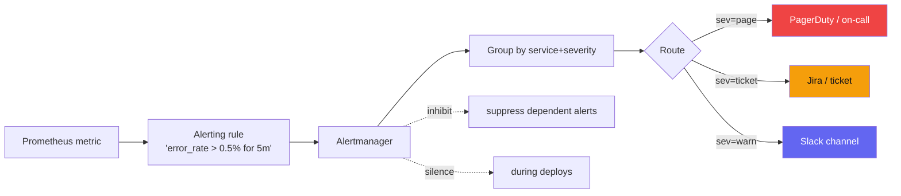

## Definition (interview-ready)

**Symptom-based alerts** fire on user-visible problems (error rate, latency breach, SLO burn). **Cause-based alerts** fire on root-cause signals (CPU high, disk full, queue depth). The Google SRE preference: **alert on symptoms; track causes in dashboards.** This minimizes false positives and aligns alerts with user impact.

**One-liner:** Good alerting pages a human only for user-visible, actionable problems, ideally SLO burn-rate alerts, and sends everything else (causes, early warnings) to tickets or dashboards, with every alert carrying a severity, an owner and a runbook.

## Why it matters

Alert fatigue (too many pages, mostly noise) is one of the biggest threats to on-call quality: people start ignoring pages, and real incidents get missed or answered late. Every senior engineer needs to know how to design alerts that pass the "would I get out of bed at 3 AM for this?" test.



## Core concepts

### Symptom vs cause

- **Symptom**: "/checkout p99 > 2s for 5 min." Users feel this.
- **Cause**: "DB connections at 95%." Useful, but firing on cause when symptom is fine = false alarm.

Why prefer symptom-based:
- Aligns with user impact (SLO).
- Fewer false positives (cause without symptom = self-healed).
- Robust to changing systems (new cause shows up, your symptom alert still catches it).

When to use cause-based:
- **Early warnings** that prevent symptoms (disk full at 80%, escalate at 95%).
- **Operational hygiene** (certs expiring in 7 days).
- **Capacity planning** (saturation > 70%, plan growth).

### Severity tiers

- **P0 / page**: user-visible, needs immediate human response.
- **P1 / ticket**: needs response in business hours.
- **P2 / informational**: track in dashboard, no notification.

Most teams over-page; aim for 1-2 pages/on-call shift on average.

### SLO-based alerts

Best modern practice:
- Define SLO ([SLIs, SLOs & Error Budgets](/learn/notes/sli-slo-sla-error-budgets/)).
- Alert on **burn rate**: how fast the error budget is being consumed.
- Multi-window: each alert checks a long window (is the burn significant?) AND a short window (is it still happening?). Fast burn pages; slow burn tickets.

Standard pattern (Google SRE Workbook, 30-day SLO):
1. **Fast burn high**: 14.4× burn over 1h (confirmed over 5min) → page (2% of budget gone in an hour).
2. **Fast burn medium**: 6× burn over 6h (confirmed over 30min) → page (5% of budget in 6h).
3. **Slow burn**: 1× burn over 3 days (confirmed over 6h) → ticket (creeping issue).
4. Plus, outside the workbook pattern: **SLO breached** (budget = 0) → trigger the error budget policy.

### Alert hygiene

For every alert, ensure:
- **Clear title**: "checkout-svc p99 latency > 2s for 5 min."
- **Severity**: page / ticket / info.
- **Runbook link**: how to investigate and mitigate.
- **Owner**: which team responds.
- **Auto-resolve**: when the condition clears.

### Runbooks

A runbook is what the on-call reads at 3 AM:
1. What's the alert saying?
2. Is the user impact real? (Check dashboard.)
3. What are the first 3 things to check?
4. What's the rollback / mitigation?
5. Who to escalate to.

Without runbooks, every page is an archeology expedition.

### Anti-patterns

- **Per-host alerts**: 100 servers, any spikes → flood. Aggregate.
- **Paging on disk at 80%**: nothing is urgent yet; make it a ticket.
- **Alerts on internal metrics**: CPU% > 90% pages, but service is fine.
- **Cause alerts without symptom check**: noise.
- **Alerts no one acts on**: delete them.
- **No deduplication**: 100 services, same downstream issue → 100 pages.
- **No rate limit on pager**: cascading failure → 1000 pages in a minute.

### Mute / inhibit / silence

- **Silence**: temporary stop (maintenance window, known issue).
- **Inhibit**: an alert suppresses related ones (DB down → don't fire dependent service alerts too).
- **Group by**: cluster related alerts into one notification.

Alertmanager (Prometheus) supports all of these.

### Escalation policies

- First page: primary on-call.
- After 5 min unacknowledged: secondary.
- After 15 min: manager.
- Tools: PagerDuty, Opsgenie (Atlassian is winding it down in favor of Jira Service Management / Compass), Splunk On-Call (ex-VictorOps), incident.io.

### Synthetic monitoring

Active probes from outside your network: hit known endpoints, expect known responses. Catch "user-visible" issues even before real user traffic does.

Tools: Pingdom, Datadog Synthetics, custom canaries.

### Anomaly detection

ML-based alerts: detect deviations from learned baselines.

Pros: catches things you didn't think to alert on.
Cons: false positives during real changes (legitimate spikes); harder to debug; less interpretable.

Use sparingly, alongside threshold-based.

## How it works (typical incident flow)

```
1. SLO burn rate alert fires (symptom).
2. On-call's phone rings.
3. Acknowledges in PagerDuty.
4. Opens runbook from alert.
5. Checks dashboards: which service degraded?
6. Traces to find slowest hop.
7. Decides: rollback, scale, restart, escalate?
8. Mitigates.
9. Alert auto-resolves when SLO recovers.
10. Files incident report; schedules post-mortem.
```

## Real-world examples

- **Google SRE**: pioneered symptom-based alerting + error budget approach.
- **Netflix**: chaos engineering exposes alert gaps regularly.

## Common pitfalls

- **Alert fatigue**: people start ignoring. Audit and prune.
- **No runbooks**: every page = scramble.
- **Severity inflation**: everything is P0 → nothing is.
- **Stale alerts**: thresholds from 2020 in a 2026 system. Periodic review.
- **Alerts without ownership**: orphan pages wake random people.
- **Compound alerts during incidents**: cascading fan-out. Use inhibit/group.
- **Synthetic monitoring from same data center**: blind to network issues outside.

## Practice questions

<Practice>

<QA q="Why prefer symptom-based alerts?" level="easy">

They align with user impact, which is what matters. They're robust to changing causes: you can refactor internals without rewriting alerts, and a new failure mode still trips the symptom. They cut false positives, since a cause without a symptom has often self-healed. Cause alerts still have a place as early warnings, but page-worthy alerts should be symptoms.

</QA>

<QA q="What severity tiers should alerts have?" level="easy">

- **Page (P0)**: user-visible, needs a human now.
- **Ticket (P1)**: needs a response within business hours.
- **Informational (P2)**: dashboard only, no notification.

Most teams over-page; aim for about 1–2 pages per on-call shift. If everything is P0, nothing is.

</QA>

<QA q="Difference between silence, inhibit, and group?" level="easy">

Silence: temporarily stop notifications (maintenance, known issue). Inhibit: one alert suppresses related ones (DB down hides dependent services' alerts). Group: combine related alerts into one notification ('5 endpoints degraded' instead of 5 pages). Alertmanager supports all three.

</QA>

<QA q="What's a runbook and what should it contain?" level="easy">

The document the on-call reads when an alert fires, linked from the alert:

1. What the alert means.
2. How to verify user impact.
3. Diagnostic steps (where to look).
4. Common causes and remediations.
5. Rollback procedure.
6. Escalation contacts.

Without runbooks, every page is solved from scratch.

</QA>

<QA q="When are cause-based alerts useful?" level="medium">

As early warnings before users feel pain: disk filling, certificates expiring, saturation rising, queues piling up. Also for capacity planning. Route them as tickets, not pages, unless they signal imminent failure (escalate disk at 95%, ticket at 80%).

</QA>

<QA q="What does synthetic monitoring add on top of metrics alerts?" level="medium">

Active probes hit known endpoints and check for known responses, so you detect user-visible breakage even when there's little or no real traffic (overnight, a new region, a broken login flow). Run probes from outside your own network or data center; probes from the same DC are blind to external network and DNS problems.

</QA>

<QA q="What are the trade-offs of anomaly-detection alerts?" level="medium">

Pro: they catch deviations you didn't think to write a threshold for. Cons: false positives during legitimate changes (launches, traffic spikes), harder to debug, and less interpretable ('why did this fire?'). Use them sparingly alongside threshold and SLO alerts, usually at ticket severity.

</QA>

<QA q="How do you measure alerting quality?" level="medium">

- **Pages per shift**: aim for 1–2 on average (the Google SRE book suggests at most about 2 incidents per 12-hour shift); consistently more, say 5+, signals fatigue.
- **Share of pages that led to action**: a common rule of thumb is above 50%.
- **MTTD** (mean time to detect) and **MTTM** (mean time to mitigate).
- **Share of incidents users reported before alerts**: should be under 10%.
- Regular on-call retros to surface bad alerts.

</QA>

<QA q="What does a 14.4x burn rate over 1 hour mean for a 30-day SLO?" level="hard">

Burn rate is how fast you're spending error budget relative to spending it evenly over the window. At 1×, the budget lasts exactly 30 days (720 hours). At 14.4× for one hour you spend 14.4/720 = **2% of the monthly budget in that hour**; sustained, the whole budget is gone in about 2 days. That's why it pages. A 6× burn over 6 hours spends 5%.

</QA>

<QA q="How would you design alerts for a service with an SLO of 99.9%?" level="hard">

Multi-window, multi-burn-rate (Google SRE Workbook):

- 14.4× burn over 1h (confirmed over 5 min) → page.
- 6× burn over 6h (confirmed over 30 min) → page.
- 1× burn over 3 days (confirmed over 6h) → ticket.
- A few cause-based early warnings (saturation above 70% → ticket).
- Every alert linked to a runbook.

The short window makes the alert stop soon after the problem stops.

</QA>

<QA q="A team has 200 alerts daily. How do you fix?" level="scenario">

- Audit: which fire, which lead to action, which are ignored?
- Delete unactionable alerts.
- Replace per-host alerts with per-service aggregates.
- Move cause-based pages to tickets unless they prevent imminent symptoms.
- Tier severities so only true P0s page.
- Give every remaining alert a runbook and an owner.

</QA>

<QA q="How do you handle alert storms during a cascading failure?" level="scenario">

- Inhibit rules: if the DB is down, suppress dependent service alerts.
- Grouping: many related alerts become one notification.
- Throttling: cap notifications per minute.
- Alert at cluster level rather than service level for huge outages.
- Status page: tell customers about one issue, not 50.

</QA>

</Practice>

## Quiz

<Quiz>

<MCQ q="Which alert should page the on-call at 3 AM?" options={["CPU above 90% on one host", "Disk at 80% on a database node", "Checkout p99 latency above 2 s for 5 minutes", "A certificate expiring in 7 days"]} answer={2}>

Only the checkout latency is a user-visible symptom needing immediate action. The others are causes or early warnings that belong in tickets.

</MCQ>

<MCQ q="For a 30-day SLO, roughly what fraction of the error budget does a 14.4x burn over one hour consume?" options={["About 2%", "About 14%", "About 0.1%", "About 50%"]} answer={0}>

The budget is spread over 720 hours; 14.4 hours' worth spent in one hour is 14.4/720 = 2%.

</MCQ>

<MCQ q="Why does a burn-rate alert check both a long window and a short window?" options={["To double the number of pages", "The long window shows the burn is significant; the short one confirms it is still happening", "Because Prometheus requires two windows", "To compute the SLO target"]} answer={1}>

The long window avoids paging on brief blips; the short window lets the alert resolve quickly once the problem stops.

</MCQ>

<MCQ q="The database goes down and 40 dependent services start alerting. Which Alertmanager feature suppresses the dependent alerts?" options={["Silence", "Escalation policy", "Grouping by severity", "Inhibition"]} answer={3}>

Inhibit rules let a source alert (DB down) suppress related target alerts. Silences are manual and time-bound; grouping merges notifications but doesn't suppress them.

</MCQ>

<MCQ q="Which is the best use of a cause-based alert?" options={["Paging whenever CPU exceeds 90%", "Replacing SLO alerts entirely", "A ticket when disk usage passes 80% so it is fixed before users are affected", "Paging per host for every spike"]} answer={2}>

Cause alerts are early warnings, usually at ticket severity. Paging on internal metrics without user impact causes fatigue.

</MCQ>

<MCQ q="Synthetic probes run only from inside the same data center as the service. What can they miss?" options={["External network or DNS problems users hit", "High latency inside the service", "5xx errors from the service", "Expired TLS certificates"]} answer={0}>

Probes in the same DC bypass the external path, so they're blind to outside network and DNS issues.

</MCQ>

<MCQ q="Which metric best signals alert fatigue?" options={["Low MTTM", "Few incidents reported by users", "High share of pages leading to action", "Averaging more than 5 pages per on-call shift"]} answer={3}>

More than about 5 pages per shift means fatigue. A high action rate and few user-reported incidents are signs of healthy alerting.

</MCQ>

<MCQ q="What must every paging alert have to pass hygiene review?" options={["An anomaly-detection model", "A runbook link and a clear owning team", "A per-host breakdown", "At least P1 severity"]} answer={1}>

Runbooks and ownership make pages actionable. Per-host alerts and anomaly models are often sources of noise.

</MCQ>

</Quiz>

## TL;DR cheat sheet

- **Symptom > cause** for pages. Cause for early-warning tickets.
- **SLO burn-rate alerts** are the gold standard.
- **Multi-window, multi-burn-rate**: fast burn = page, slow burn = ticket.
- Every alert has: severity, runbook, owner, auto-resolve.
- Inhibit + group + silence to control storms.
- Audit + prune alerts regularly.
- 1-2 pages per shift is the target.
- Runbooks reduce 3 AM scrambling.

## Go deeper

- **Google SRE Book Ch. 6**: ["Monitoring Distributed Systems"](https://sre.google/sre-book/monitoring-distributed-systems/).
- **Google SRE Workbook Ch. 5**: ["Alerting on SLOs"](https://sre.google/workbook/alerting-on-slos/).
- **Alertmanager docs**: silences, inhibitions, grouping.
- **PagerDuty Incident Response docs**: severity tiers, escalation.
- **Rob Ewaschuk** (Google): "My Philosophy on Alerting" — the classic case for symptom-based pages; **Charity Majors / Honeycomb blog** ([honeycomb.io/blog](https://www.honeycomb.io/blog)) for the observability angle.
- [SLIs, SLOs & Error Budgets](/learn/notes/sli-slo-sla-error-budgets/) in this collection.
