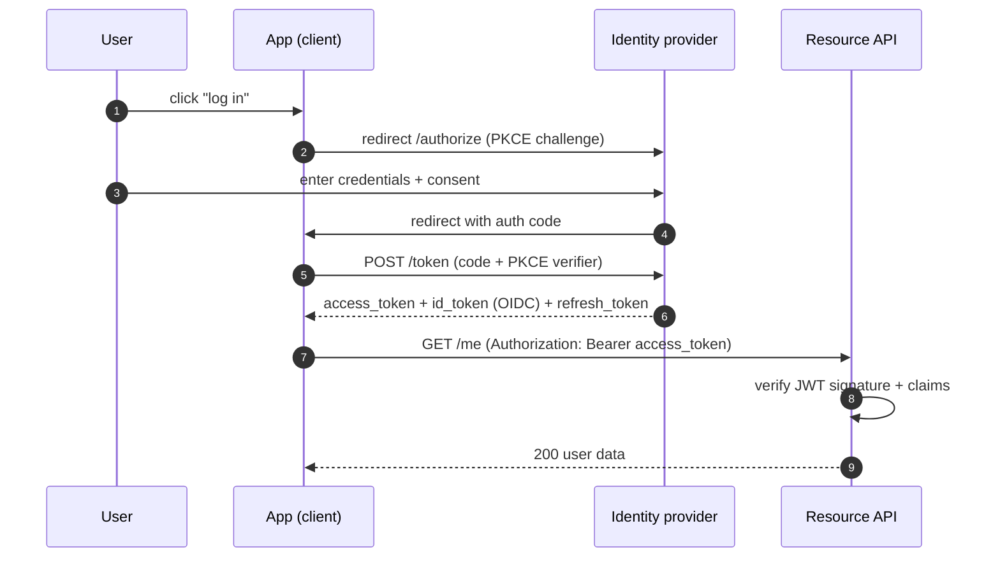

## Definition (interview-ready)

**Authentication (AuthN)**: verifying who you are. **Authorization (AuthZ)**: what you're allowed to do. **OAuth 2.0**: a delegation protocol — "let app X access my resources at provider Y without sharing my password." **OIDC (OpenID Connect)**: an authentication layer on top of OAuth 2.0 — adds an ID token proving who the user is. **JWT (JSON Web Token)**: a compact, signed token format often used to carry identity/claims.

**One-liner:** AuthN proves who you are and AuthZ decides what you may do; OAuth 2.0 lets an app get a scoped access token on a user's behalf, OIDC adds an ID token so the app also learns who logged in, and a JWT is the signed, self-contained token format these flows commonly use.

## Why it matters

Auth is in every system; getting it wrong is a security incident. The patterns here are universal across SaaS, mobile apps, internal systems, microservices. Knowing the difference between OAuth and OIDC, and what JWTs actually guarantee (and don't), is foundational.



## Core concepts

### AuthN vs AuthZ

- **AuthN**: prove identity. Methods: password, SSO, OIDC, certificate, biometric.
- **AuthZ**: enforce access. Methods: role-based (RBAC), attribute-based (ABAC), policy engines (OPA, Cedar).

Auth is the umbrella; AuthN ≠ AuthZ.

### OAuth 2.0 — the delegation protocol

Roles:
- **Resource Owner**: the user.
- **Client**: the app wanting access.
- **Authorization Server**: issues tokens (e.g., accounts.google.com / oauth2.googleapis.com).
- **Resource Server**: hosts the protected resource (e.g., gmail.googleapis.com).

Common flow: **Authorization Code with PKCE** (the modern default for web/mobile).

```
1. User clicks "Sign in with Google" in client app.
2. Client redirects user to Authorization Server with state + code_challenge (PKCE).
3. User logs in at Authorization Server; consents.
4. Auth Server redirects back to client with auth code.
5. Client exchanges code + code_verifier for access token (+ refresh token).
6. Client uses access token to call Resource Server (gmail API).
```

Tokens:
- **Access token**: short-lived (~1h), carries scopes. Used to call APIs.
- **Refresh token**: long-lived; used to get new access tokens without re-auth.
- **ID token** (OIDC): proves who the user is.

### OAuth 2.0 grant types (flows)

- **Authorization Code + PKCE**: web/mobile/SPA. Recommended.
- **Client credentials**: server-to-server, no user. Backend services calling each other.
- **Device code**: TVs / CLI tools without browser.
- **Implicit**: legacy SPA flow. **Deprecated** (RFC 9700, the OAuth 2.0 Security BCP, says SHOULD NOT use; dropped from OAuth 2.1).
- **Resource Owner Password**: legacy. **Deprecated** — RFC 9700 says MUST NOT use (defeats the point of delegation).

### OIDC — auth on top of OAuth

OAuth was for *authorization* (delegation). People used it for *authentication* with a hack ("if Google gives me an access token, the user must have logged in"). OIDC formalized this: adds an **ID token** (JWT) that explicitly proves the user's identity.

Now: OAuth + OIDC together = login flow for most modern apps.

### JWT — what it is

A self-contained, signed token: `header.payload.signature` (base64url).

```
header:   { "alg": "RS256", "typ": "JWT" }
payload:  { "sub": "user42", "iat": ..., "exp": ..., "scope": "read write" }
signature: signed by issuer's private key
```

Verifier:
1. Parse and verify signature with issuer's public key.
2. Check claims: `exp` (not expired), `iss` (expected issuer), `aud` (this service).
3. Trust claims if valid.

Self-contained = no DB lookup needed to validate; just signature verification.

### JWT caveats

- **Stateless = no built-in revocation**: once issued, valid until `exp` unless you add a server-side denylist (which brings back a lookup per request). Use short-lived JWTs + revocable refresh tokens.
- **Signing key compromise = all tokens valid**: rotate keys carefully (JWKS endpoint with multiple keys).
- **Don't store sensitive PII in JWT**: anyone holding a normal signed JWT (JWS) can decode it; the payload is base64url, not encrypted. (An encrypted JWT, JWE, exists but is rarely used for access tokens.)
- **`alg: none` attacks**: never accept; always validate the algorithm matches expected.
- **Asymmetric (RS256/ES256) better than symmetric (HS256)** in distributed systems — public key can be shared widely.

### Session vs JWT

- **Session cookie + server-side store**: revocable, stateful, server lookup per request.
- **JWT**: stateless, no DB hit, no revocation.

For web apps with login: session cookies are often *simpler and more secure*. JWTs shine for service-to-service or stateless mobile auth.

### RBAC vs ABAC

- **RBAC**: role → permissions. "User is admin → can delete." Simple, easy to audit.
- **ABAC**: based on attributes of user, resource, action, context. "Allow if user.department = resource.department." Flexible, complex.
- **Policy engines** (OPA, Cedar): general-purpose AuthZ; declarative policies.

### Common storage of access decisions

- In code: simple, fast, but scattered.
- Sidecar / interceptor: middleware checks per request.
- Central policy service: query for decisions. Higher latency, easier to audit/update.

### mTLS for service-to-service

For internal service auth (no user), use **mTLS** (client cert). Each service proves its identity with its private key during the TLS handshake, so there is no bearer token that could be stolen and replayed; it is often combined with a JWT that carries the end user's identity. See [mTLS & Certificates](/learn/notes/mtls-certificates/).

### Scopes vs roles vs permissions

- **Scope** (OAuth): what an access token is allowed to do at the resource server (e.g., `read:email`).
- **Role**: a label that bundles permissions (admin, editor, viewer).
- **Permission**: a specific allowed action (`delete:document`).

Don't confuse scopes (OAuth-level delegation) with roles (resource-internal AuthZ).

## How it works (a SaaS app with Google login)

```
1. User → MyApp: visits.
2. MyApp redirects to Google with `scope=openid email` + PKCE.
3. User signs in at Google; consents.
4. Google redirects to MyApp with auth code.
5. MyApp exchanges code for { id_token, access_token, refresh_token }.
6. MyApp verifies id_token signature (Google's JWKS) + claims.
7. MyApp creates its own session (cookie) for the user; doesn't store Google's tokens long-term.
8. Subsequent requests: MyApp session cookie. (Or short-lived JWT.)
9. If MyApp needs Gmail data: use access_token. Refresh via refresh_token when expired.
```

## Real-world examples

- **Google, GitHub, Facebook**: SSO providers via OIDC.
- **Auth0, Okta, Cognito**: managed identity providers.
- **Keycloak**: open-source identity provider.
- **AWS IAM**: roles and policies for service AuthZ.
- **Open Policy Agent (OPA)**: declarative AuthZ engine.

## Common pitfalls

- **Storing JWT in localStorage**: XSS can steal it. Use **HttpOnly, Secure cookies** (with `SameSite` and CSRF protection, since cookies are sent automatically).
- **Long-lived access tokens**: hard to revoke. Keep them short (~15 min).
- **Letting the token choose its own keys**: verify only with keys from your pre-configured issuer's JWKS, never from a URL in the token's `jku`/`x5u` header or an unexpected `iss`.
- **No clock skew tolerance**: if server clocks differ slightly, fresh tokens get rejected as expired or not yet valid (`nbf`). Allow about ±60s skew.
- **Mixing auth + authorization**: JWT contains claims about user; service still needs to authorize per request.
- **OAuth without PKCE on public clients**: vulnerable to code interception.
- **No CSRF protection on auth callback**: use the `state` parameter (PKCE and the OIDC `nonce` also help) so an attacker can't inject their own authorization code.
- **Hardcoding secrets**: rotate via secrets manager.

## Practice questions

<Practice>

<QA q="AuthN vs AuthZ?" level="easy">

AuthN = who are you (login). AuthZ = what can you do (permissions). They are different concerns; the same system often handles both, but they are conceptually separate. A valid identity never implies permission for a given action.

</QA>

<QA q="What is the difference between OAuth 2.0 and OIDC?" level="easy">

OAuth is **authorization** (delegation): "let this app access my resources." OIDC is **authentication** on top: it adds an ID token (a JWT) that explicitly proves who the user is. OIDC = OAuth + identity layer. Modern login = OIDC.

</QA>

<QA q="What is a JWT?" level="easy">

A signed, base64url-encoded token with three parts: header, payload (claims), signature. It is self-contained: the verifier checks the signature (with the issuer's public key for RS256/ES256, or a shared secret for HS256) and then trusts the claims, with no DB lookup. Used for stateless auth in distributed systems. Limitations: no revocation, and the payload is not encrypted.

</QA>

<QA q="What are the access token, refresh token and ID token each for?" level="easy">

- **Access token**: short-lived (around an hour or less), carries scopes, sent to resource APIs.
- **Refresh token**: long-lived, used only with the authorization server to get new access tokens without the user logging in again.
- **ID token** (OIDC): a JWT that proves who the user is, meant for the client app, not for calling APIs.

</QA>

<QA q="Where should a browser app keep its tokens, and why?" level="easy">

In **HttpOnly, Secure cookies**, not `localStorage`. Anything in `localStorage` is readable by JavaScript, so a single XSS bug can steal the token. HttpOnly cookies are not readable from JS. For classic web apps with login, a session cookie backed by a server-side store is often simpler and more secure than a JWT.

</QA>

<QA q="When should you NOT use JWT?" level="medium">

- When you need to **revoke** tokens (logout, security incident). Use session cookies with a server-side store.
- When tokens would carry **sensitive data**. They are not encrypted.
- For plain web apps with login. Cookies + a session store is simpler and more secure.
- When key rotation is hard.

</QA>

<QA q="Why use PKCE?" level="medium">

PKCE (Proof Key for Code Exchange) prevents authorization code interception. The client generates a random `code_verifier` and a hashed `code_challenge`. It sends the challenge in the authorization request and the verifier in the token exchange. Even if the auth code is intercepted, an attacker can't exchange it without the verifier. Required for public clients (SPA, mobile); recommended everywhere.

</QA>

<QA q="How should a resource server validate an incoming JWT?" level="medium">

1. Verify the **signature** with the issuer's public key, fetched from its JWKS endpoint (cache it; the JWKS can hold several keys for rotation).
2. Check `alg` matches what you expect. Never accept `alg: none`.
3. Check `exp` (allow about ±60 s clock skew), `iss` (the expected issuer) and `aud` (this service).
4. Only then trust the claims, and still run your own authorization check for the specific action.

</QA>

<QA q="Which OAuth grant type fits each case: SPA, backend-to-backend, smart TV?" level="medium">

- **SPA / web / mobile**: Authorization Code + PKCE.
- **Backend-to-backend, no user**: Client credentials.
- **TV or CLI without a browser**: Device code.

The **Implicit** and **Resource Owner Password** grants are legacy: RFC 9700 says SHOULD NOT and MUST NOT use them respectively, and OAuth 2.1 drops them.

</QA>

<QA q="Scopes vs roles vs permissions?" level="medium">

- **Scope** (OAuth): what an access token may do at the resource server, for example `read:email`. It is delegation: what the user allowed this client to do.
- **Role**: a label that bundles permissions (admin, editor, viewer).
- **Permission**: a specific allowed action (`delete:document`).

A token having a scope does not replace the resource's own role and permission checks.

</QA>

<QA q="Compare RBAC and ABAC." level="medium">

RBAC: role-based. Users are assigned roles, roles have permissions. Simple, easy to audit, but doesn't scale to fine-grained contextual rules. ABAC: attribute-based. Evaluate user attributes, resource attributes, action and context at decision time ("allow if user.department = resource.department"). Flexible but complex. Most systems start with RBAC and add ABAC or a policy engine (OPA, Cedar) for specific rules.

</QA>

<QA q="Design auth for a microservice architecture." level="scenario">

- Edge: OAuth/OIDC for user login; the gateway issues a short-lived JWT for the session.
- Service-to-service: mTLS for workload identity; a JWT carries the forwarded user identity.
- Authorization: per service, with a shared policy engine (OPA) or library.
- Token verification: cache the JWKS; verify on every request.
- Revocation: short-lived access tokens; long-lived but revocable refresh tokens stored server-side.

</QA>

<QA q="A team uses long-lived JWTs (24h) for sessions. What are the risks?" level="scenario">

- Can't revoke after logout: the token stays valid.
- A stolen token gives a 24-hour window.
- No way to push a permission change until expiry.
- Fix: short-lived access token (about 15 min) + refresh token stored server-side (revocable). On logout, invalidate the refresh token.

</QA>

</Practice>

## Quiz

<Quiz>

<MCQ q="What does OIDC add on top of OAuth 2.0?" options={["Encryption of access tokens", "An ID token that proves who the user is", "A replacement for refresh tokens", "Server-to-server client credentials"]} answer={1}>

OIDC is an identity layer: it adds an ID token (a JWT) asserting the user's identity. OAuth alone is about delegated access; it never formally said who the user is. Encryption and client credentials are unrelated.

</MCQ>

<MCQ q="Which statement about a standard signed JWT payload is true?" options={["It is encrypted, so PII is safe inside it", "Only the issuer can read it", "Anyone holding the token can decode and read it", "It is hashed, so the claims can't be recovered"]} answer={2}>

A signed JWT's payload is just base64url. The signature only proves integrity and origin, it does not hide the content. Keep sensitive PII out of it.

</MCQ>

<MCQ q="An attacker intercepts the authorization code returned to a mobile app that used PKCE. Why can't they use it?" options={["Exchanging the code also requires the code_verifier that only the app holds", "The code is encrypted with the user's password", "Codes expire after one second", "The state parameter blocks the exchange"]} answer={0}>

The token endpoint checks that the code_verifier hashes to the code_challenge sent earlier. Without the verifier the code is useless. The state parameter protects against CSRF on the callback, not code theft.

</MCQ>

<MCQ q="A backend batch job needs to call another internal API with no user involved. Which grant fits?" options={["Authorization Code + PKCE", "Implicit", "Device code", "Client credentials"]} answer={3}>

Client credentials is the server-to-server grant with no user. Auth Code + PKCE and Device code involve a user; Implicit is a deprecated SPA flow.

</MCQ>

<MCQ q="Why are asymmetric algorithms such as RS256 usually preferred over HS256 in a microservice fleet?" options={["They produce smaller tokens", "Verifiers only need the public key, so the signing secret isn't spread across every service", "They encrypt the payload", "They never need key rotation"]} answer={1}>

With HS256 every verifier holds the same secret that can also mint tokens. With RS256/ES256 only the issuer has the private key and the public key can be shared widely via JWKS. Neither encrypts the payload, and both need rotation.

</MCQ>

<MCQ q="A user logs out, but their 24-hour JWT keeps working against APIs. What is the root cause?" options={["The JWKS cache is stale", "Clock skew tolerance is too high", "Stateless JWTs have no server-side revocation; they stay valid until exp", "The aud claim is missing"]} answer={2}>

Self-contained tokens are valid until they expire unless you add a denylist. The fix is short-lived access tokens plus revocable, server-side refresh tokens.

</MCQ>

<MCQ q="Why is storing an access token in localStorage risky?" options={["Any XSS on the page can read and steal it", "localStorage is sent to every third-party domain", "Browsers delete it after 1 hour", "It breaks PKCE"]} answer={0}>

JavaScript can read localStorage, so injected script steals the token. HttpOnly cookies are not readable by JS. The other options are false.

</MCQ>

<MCQ q="A JWT has a valid signature from your IdP but its aud claim names a different service. What should your API do?" options={["Accept it, since the signature is valid", "Accept it only for read requests", "Refresh it automatically", "Reject it, because the token was not issued for this service"]} answer={3}>

The signature proves who issued it; `aud` says who it is for. Accepting tokens meant for another service lets one compromised or over-scoped service replay its tokens against you.

</MCQ>

<MCQ q="Which is the best description of an OAuth scope?" options={["A role inside the resource server's database", "What the access token is allowed to do at the resource server, as delegated by the user", "The user's identity claims", "A specific permission like delete:document stored per user"]} answer={1}>

Scopes are OAuth-level delegation on the token. Roles and permissions are the resource's internal authorization model; don't confuse them.

</MCQ>

</Quiz>

## TL;DR cheat sheet

- **AuthN** = who. **AuthZ** = what.
- **OAuth 2.0** = delegation. **OIDC** = login on top of OAuth.
- Modern flow: **Authorization Code + PKCE**.
- **JWT** = signed claims, self-contained, no revocation. Short-lived.
- ID token vs access token vs refresh token — different jobs.
- **Cookies** > JWT in localStorage for web (XSS).
- Use a **JWKS endpoint** for key rotation.
- Validate: signature, exp, iss, aud, alg.
- **mTLS** for service-to-service.
- **RBAC** for simple, **ABAC/OPA** for fine-grained.

## Go deeper

- **ByteByteGo**: ["OAuth 2.0 explained"](https://blog.bytebytego.com/p/ep72-oauth-20-explained-with-simple), ["Session/Cookie/JWT/SSO"](https://blog.bytebytego.com/p/ep34-session-cookie-jwt-token-sso).
- **oauth.net**: [oauth.net/2/](https://oauth.net/2/) — the canonical reference.
- **OpenID Foundation**: [openid.net/connect](https://openid.net/connect/).
- **jwt.io**: tool to inspect JWTs.
- **OWASP JWT cheat sheet**: [cheatsheetseries.owasp.org](https://cheatsheetseries.owasp.org/cheatsheets/JSON_Web_Token_Cheat_Sheet.html).
- **Auth0 blog**: high-quality identity content.
- **Book**: *OAuth 2 in Action* (Manning).
