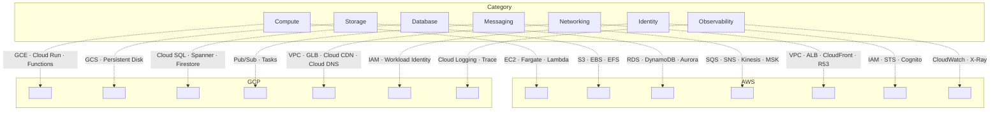

## Definition (interview-ready)

A working mental map of the most-used cloud services from AWS and GCP, grouped by category: compute, storage, networking, databases, messaging, IAM, observability, ML. You don't need every service — knowing the canonical 25-30 is enough for design and operations.

**One-liner:** Both clouds offer the same building blocks under different names: VMs (EC2 / Compute Engine), containers and functions, object storage (S3 / GCS), managed SQL and NoSQL databases, queues and pub/sub, IAM and KMS, so in an interview you pick the managed service per category and justify it by access pattern, scale and cost.

## Why it matters

Cloud is the default deployment target. Knowing what services exist (and their tradeoffs) lets you design correctly without inventing what already exists. Interviews often ask "what AWS service would you use for X?" — you need the map.



## Core mapping (AWS ↔ GCP)

### Compute

| | AWS | GCP |
|---|---|---|
| Virtual machines | EC2 | Compute Engine |
| Container orchestration | EKS (k8s), ECS (proprietary), Fargate (serverless) | GKE, Cloud Run |
| Serverless functions | Lambda | Cloud Run functions (formerly Cloud Functions) |
| Container registry | ECR | Artifact Registry |
| Batch jobs | Batch | Batch / Dataflow |

### Storage

| | AWS | GCP |
|---|---|---|
| Object storage | S3 | Cloud Storage (GCS) |
| Block storage | EBS | Persistent Disk |
| File storage | EFS | Filestore |
| Archive | S3 Glacier | Coldline / Archive |

### Networking

| | AWS | GCP |
|---|---|---|
| VPC | VPC | VPC |
| Load balancer | ALB (L7), NLB (L4), CloudFront (CDN) | Cloud Load Balancing (unified global), Cloud CDN |
| DNS | Route 53 | Cloud DNS |
| Private link | PrivateLink | Private Service Connect |

### Databases

| | AWS | GCP |
|---|---|---|
| Managed SQL | RDS (Postgres/MySQL), Aurora | Cloud SQL, AlloyDB (Postgres) |
| Multi-region database | Aurora Global Database (one writer region, read replicas elsewhere), DynamoDB Global Tables (NoSQL, multi-active) | Spanner (SQL, multi-region strong consistency) |
| KV / wide-column | DynamoDB | Bigtable, Firestore |
| Cache | ElastiCache (Redis/Memcached), MemoryDB | Memorystore |
| Data warehouse | Redshift | BigQuery |
| Search | OpenSearch (managed ES) | (third-party) |

### Messaging / streaming

| | AWS | GCP |
|---|---|---|
| Queue | SQS | Cloud Tasks, Pub/Sub (pull subscriptions) |
| Pub/sub | SNS | Pub/Sub |
| Streaming | Kinesis, MSK (Kafka) | Pub/Sub, Managed Service for Apache Kafka, Confluent |
| Workflow | Step Functions | Workflows |
| ETL streaming | Amazon Data Firehose (formerly Kinesis Data Firehose) | Dataflow |

### IAM / security

| | AWS | GCP |
|---|---|---|
| Identity | IAM | IAM |
| Secrets | Secrets Manager, Systems Manager Parameter Store | Secret Manager |
| KMS | KMS | Cloud KMS |
| Single sign-on | IAM Identity Center | Cloud Identity |
| WAF | WAF | Cloud Armor |

### Observability

| | AWS | GCP |
|---|---|---|
| Metrics / logs / traces | CloudWatch | Cloud Logging / Monitoring / Trace |
| Distributed trace | X-Ray | Cloud Trace |

### Data + ML

| | AWS | GCP |
|---|---|---|
| Data pipeline | Glue, EMR (Spark) | Dataflow, Dataproc |
| Notebook | SageMaker | Vertex AI Workbench |
| ML serving | SageMaker Endpoints | Vertex AI Endpoints |
| AutoML | SageMaker Autopilot (now inside SageMaker Canvas) | Vertex AI AutoML |

### Misc

- **API Gateway**: AWS API Gateway / GCP API Gateway.
- **CDN**: CloudFront / Cloud CDN.
- **CI/CD**: CodeBuild, CodeDeploy, CodePipeline / Cloud Build.
- **Event Bus**: EventBridge / Eventarc.
- **AI services**: Bedrock (LLM), Comprehend, Rekognition / Vertex AI, Document AI.

## Key services in depth

### S3 / GCS
- Object storage, designed for 11 nines (99.999999999%) durability, virtually unlimited scale.
- Pricing: storage + requests + egress. Egress is the silent budget killer.
- Versioning, lifecycle (move to cold), encryption (SSE-S3, SSE-KMS).
- Static site hosting + CloudFront/CDN.

### DynamoDB / Bigtable
- Massive scale, NoSQL.
- DynamoDB: KV + simple secondary indexes. Pay per RCU/WCU or on-demand.
- Bigtable: wide-column (Cassandra-like). HBase-compatible. Pay per node hour.

### Lambda / Cloud Functions
- Event-driven, run on demand.
- Cold start latency (mitigated with provisioned concurrency).
- Pay per request plus compute duration (GB-seconds); nothing when idle.
- Best for: glue code, low-traffic endpoints, async event processing.

### Aurora / Spanner
- Aurora: AWS's distributed Postgres/MySQL with replicated storage (6 copies across 3 AZs). Up to 128 TiB (256 TiB on the newest engine versions).
- Spanner: Google's globally distributed strongly consistent SQL DB. TrueTime-based. Strict serializable.

### Kafka equivalents
- **MSK (AWS)**: managed Kafka.
- **GCP Pub/Sub**: not Kafka — different model (push, ack windows), but similar use cases.
- **Confluent Cloud**: third-party managed Kafka on AWS/GCP/Azure.

### CDN
- **CloudFront**: 600+ PoPs globally (plus embedded PoPs inside ISP networks). Tight S3/Lambda integration.
- **Cloud CDN**: global anycast, fewer PoPs but Google's network.
- **Cloudflare** (third-party): one of the largest anycast edge networks (330+ cities).

## Cost optimization (cloud lessons)

- **Egress**: 1 GB out = ~$0.09 (AWS). At scale this dominates. Cache, CDN, multi-region planning.
- **Reserved/Committed use**: 30-70% discount for 1-3 year commitments.
- **Spot/Preemptible**: 70-90% off, eviction risk.
- **Right-sizing**: most workloads over-provisioned.
- **S3 lifecycle**: move cold data to Glacier tiers (roughly 5-20x cheaper per GB than S3 Standard, depending on tier).
- **DynamoDB on-demand vs provisioned**: traffic spikes vs steady.

## How it works (a typical 3-tier on AWS)

```
Users
  ↓
Route 53 (DNS)
  ↓
CloudFront (CDN)
  ↓
ALB
  ↓
EC2/ECS (in 2+ AZs)
  ↓
RDS Multi-AZ (primary + standby) + ElastiCache (Redis)
  ↓
S3 (assets) + CloudWatch (observability)
  ↓
Lambda (async jobs) + SQS (queues)

Security: IAM roles, KMS, Secrets Manager.
```

## Real-world examples

- **Netflix on AWS**: famously cloud-native; very heavy EC2/S3.
- **Spotify on GCP**: BigQuery, Pub/Sub, Bigtable, Dataflow.
- **Shopify on GCP**: runs its core platform on GKE (Kubernetes).
- **Snowflake**: cross-cloud (AWS/GCP/Azure) data warehouse.

## Common pitfalls

- **Over-engineering with too many services**: pick fewer well-understood ones.
- **Vendor lock-in**: hard to migrate. Use open standards where possible (k8s, Postgres, Kafka).
- **Egress costs**: huge for multi-region or data movement.
- **No cost monitoring**: surprise bills.
- **IAM misconfigurations**: public S3 buckets, over-permissive roles. Use least privilege.
- **Single AZ**: an AZ failure takes you down; run across 2+ AZs as the baseline. Go multi-region only when the business must survive a full-region outage, since it adds a lot of cost and complexity.
- **Forgetting backup**: managed doesn't mean backed up; configure point-in-time recovery.

## Practice questions

<Practice>

<QA q="Which AWS services would you use for a static website?" level="easy">

S3 static website hosting + CloudFront for the global CDN + Route 53 for DNS + ACM for the certificate. Cheap, and it scales without any servers to run.

</QA>

<QA q="What is the difference between SQS and SNS?" level="easy">

SQS: a queue (each message is processed by one consumer). SNS: pub/sub (one publish, many subscribers). A common pattern is an SNS topic with several SQS queues subscribed: fan-out, with each consumer getting its own durable queue.

</QA>

<QA q="ALB vs NLB: when do you pick each?" level="easy">

**ALB** is a layer-7 load balancer: it understands HTTP, so it can route by host or path. **NLB** is layer 4: it forwards TCP/UDP connections without looking at HTTP, which suits non-HTTP protocols and raw connection throughput. On GCP, Cloud Load Balancing is one unified, global product.

</QA>

<QA q="Is GCP Pub/Sub a drop-in replacement for Kafka?" level="easy">

No. Pub/Sub has a different model (push or pull subscriptions, ack deadlines) even though it serves similar use cases. For actual Kafka, use AWS MSK, GCP's Managed Service for Apache Kafka, or Confluent Cloud, which runs on AWS, GCP and Azure.

</QA>

<QA q="Which AWS services fit an async background job?" level="medium">

Lambda triggered by SQS (or EventBridge for a cron schedule), with reserved concurrency for predictable load. For long-running work, an ECS Fargate task. For multi-step orchestration, Step Functions.

</QA>

<QA q="When do you use DynamoDB vs Aurora?" level="medium">

DynamoDB: massive scale, simple access patterns, key-value/document data, single-digit ms reads. Aurora: relational data, complex queries, transactions. Choose by access patterns and data model, not by which is newer.

</QA>

<QA q="When is Lambda a good fit and what is its main latency catch?" level="medium">

Lambda runs code on demand per event and charges per invocation, so it suits glue code, low-traffic endpoints and async event processing. The catch is **cold start** latency when a new execution environment spins up; provisioned concurrency keeps environments warm to mitigate it. Steady high traffic or long-running work usually fits containers better.

</QA>

<QA q="How do Aurora and Spanner differ?" level="medium">

Aurora is AWS's MySQL/Postgres-compatible database with a replicated storage layer (6 copies across 3 AZs), regional at heart. Spanner is Google's globally distributed, strongly consistent SQL database that uses TrueTime to give strict serializability across regions. Pick Spanner when you need global writes with strong consistency; Aurora when you want managed Postgres/MySQL at scale.

</QA>

<QA q="On-demand vs reserved/committed vs spot capacity: how do you use each?" level="medium">

- **Reserved / committed use / Savings Plans**: roughly 30-70% off for a 1-3 year commitment. Use for the steady baseline.
- **Spot / preemptible**: 70-90% off but can be reclaimed. Use for stateless, fault-tolerant or batch work.
- **On-demand**: full price, no commitment. Use for spikes and anything unpredictable.

</QA>

<QA q="When would you choose Bigtable over DynamoDB?" level="hard">

- Bigtable: huge throughput, very large datasets (PB+), heavy time-series or analytics workloads, tight BigQuery/Dataflow integration, linear scaling per node.
- DynamoDB: predictable single-digit ms latency, on-demand scaling, AWS ecosystem (Lambda triggers and so on).
- Choose by data model and ecosystem fit.

</QA>

<QA q="What is the GCP equivalent of an AWS three-tier stack?" level="scenario">

- Cloud DNS → Cloud Load Balancing (global) → GKE / Cloud Run → Cloud SQL → Memorystore (Redis) → GCS.
- Observability: Cloud Logging + Monitoring + Trace.
- Identity: Workload Identity for k8s; Secret Manager for secrets.

</QA>

<QA q="Design a multi-region failover on AWS." level="scenario">

- Aurora Global / RDS cross-region read replica.
- Route 53 health checks + failover routing.
- DynamoDB Global Tables (active-active).
- S3 cross-region replication for assets.
- Lambdas + ECS deployed in both regions.
- Regular region-evacuation drills (Netflix's Chaos Kong idea; AWS Fault Injection Service).

</QA>

<QA q="How would you cut a $50K/month AWS bill?" level="scenario">

- **Right-size**: many EC2 instances are over-provisioned (Compute Optimizer shows which).
- **Reserved instances / Savings Plans** on steady workloads.
- **Spot** for non-critical work.
- **Lifecycle policies**: cold data to Glacier tiers.
- **Egress audit**: CDN cache hit ratio, avoid cross-region transfer.
- **Unused resources**: orphaned EBS volumes, idle load balancers, unattached Elastic IPs.
- **Cost Explorer + Trusted Advisor** to find inefficiencies.

</QA>

</Practice>

## Quiz

<Quiz>

<MCQ q="Five independent services must each process every order event, at their own pace. Which AWS pattern fits best?" options={["One SQS queue read by all five services", "An SNS topic with one SQS queue subscribed per service", "Five Lambdas polling the same SQS queue", "A single Kinesis shard per service"]} answer={1}>

SNS fans out each message to every subscriber and the per-service SQS queue gives each consumer its own buffer and retries. A single SQS queue delivers each message to only one consumer.

</MCQ>

<MCQ q="Which line item most often becomes the silent budget killer as a cloud system scales?" options={["IAM policy count", "VPC creation", "Data egress", "Route 53 hosted zones"]} answer={2}>

Egress is charged per GB out (about $0.09/GB on AWS) and dominates at scale, especially across regions. CDNs, caching and region planning are the levers.

</MCQ>

<MCQ q="A nightly, restartable batch job can tolerate interruption. Which capacity type minimizes cost?" options={["Spot / preemptible instances", "On-demand instances", "3-year reserved instances", "Dedicated hosts"]} answer={0}>

Spot is 70-90% off with eviction risk, which a restartable batch job can absorb. Reservations suit steady 24x7 baselines, not a nightly job.

</MCQ>

<MCQ q="An API on Lambda shows occasional slow first requests after idle periods. What is the standard mitigation?" options={["Increase the function timeout", "Move to S3 static hosting", "Switch the trigger to SNS", "Provisioned concurrency to keep environments warm"]} answer={3}>

The slow first requests are cold starts. Provisioned concurrency keeps initialized environments ready. Timeouts, triggers and static hosting don't address it.

</MCQ>

<MCQ q="You need a relational database with strongly consistent writes from multiple continents. Which is the most natural fit?" options={["Single-region RDS MySQL", "Spanner", "DynamoDB on-demand", "ElastiCache"]} answer={1}>

Spanner is globally distributed SQL with strict serializability via TrueTime. RDS is regional, DynamoDB is NoSQL, and ElastiCache is a cache.

</MCQ>

<MCQ q="A team says: we use a managed database, so backups are handled. What is the risk?" options={["Managed databases cannot be backed up", "Backups always double the bill", "Managed does not mean backed up the way you need; point-in-time recovery and retention must be configured", "Backups are only possible in GCP"]} answer={2}>

Managed services provide the tools, but you must enable and test PITR and retention. Assuming it is automatic is a listed pitfall.

</MCQ>

<MCQ q="Which pair is the correct AWS to GCP mapping?" options={["DynamoDB to BigQuery", "SQS to Cloud DNS", "CloudWatch to Cloud Armor", "Redshift to BigQuery"]} answer={3}>

Redshift and BigQuery are both data warehouses. DynamoDB maps to Bigtable or Firestore, CloudWatch to Cloud Logging/Monitoring, and Cloud Armor is GCP's WAF.

</MCQ>

<MCQ q="Why do many teams favor Kubernetes, Postgres and Kafka even on a single cloud?" options={["They reduce vendor lock-in because they are open standards you can run elsewhere", "They are always cheaper than managed proprietary services", "Cloud providers require them", "They need no operations work"]} answer={0}>

Open standards make migration feasible and skills portable. They are not automatically cheaper or operations-free.

</MCQ>

<MCQ q="Your workload is a petabyte of time-series data analyzed heavily with BigQuery and Dataflow. Which store fits best?" options={["DynamoDB", "Bigtable", "Aurora", "S3 Glacier"]} answer={1}>

Bigtable is built for massive wide-column and time-series data and integrates tightly with BigQuery and Dataflow. DynamoDB fits the AWS ecosystem; Glacier is archive storage.

</MCQ>

</Quiz>

## TL;DR cheat sheet

- **Compute**: EC2 / Compute Engine; ECS / Cloud Run; Lambda / Functions.
- **Storage**: S3 / GCS; EBS / PD; EFS / Filestore.
- **DB**: RDS / Cloud SQL; DynamoDB / Bigtable; Aurora / Spanner; Redshift / BigQuery.
- **Messaging**: SQS / Pub/Sub; SNS / Pub/Sub; MSK / Confluent.
- **CDN**: CloudFront / Cloud CDN.
- **Networking**: VPC + ALB/NLB.
- **Security**: IAM, KMS, Secrets Manager.
- **Observability**: CloudWatch / Cloud Logging+Monitoring+Trace.
- Watch egress costs. Multi-AZ baseline. IAM least-privilege.

## Go deeper

- **AWS Skill Builder**: [skillbuilder.aws](https://skillbuilder.aws/) — free.
- **Google Skills** (formerly Cloud Skills Boost): [skills.google](https://www.skills.google/).
- **AWS Well-Architected Framework**: [aws.amazon.com/architecture/well-architected](https://aws.amazon.com/architecture/well-architected/).
- **GCP Architecture Center**: [cloud.google.com/architecture](https://cloud.google.com/architecture).
- **AWS Builders Library**: free best-practice articles.
- **A Cloud Guru (now part of Pluralsight) / Udemy** for certification prep.
