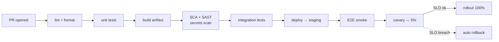

## Definition (interview-ready)

**Continuous Integration (CI)**: every code change triggers automated build + tests. **Continuous Delivery**: every commit could be released; releases are routine and low-risk. **Continuous Deployment**: every passing commit goes to production automatically. Modern CI/CD pipelines combine: lint → test → build → security scans → deploy → verify.

**One-liner:** A CI/CD pipeline automatically builds, tests and scans every change, produces one immutable artifact, and promotes that same artifact through staging to production with a gradual rollout (canary or blue-green) and automatic rollback when metrics regress.

## Why it matters

The deployment pipeline is where engineering velocity and operational quality intersect. Slow, manual, or unreliable CI/CD = slow shipping, late discovery of issues, dangerous rollbacks. Fast, automated, observable CI/CD = teams that ship 10× a day with confidence.



## Core concepts

### CI vs CD

- **CI**: build + test every commit. Goal: catch breakage fast.
- **Continuous Delivery**: every commit is releasable; deployment is a button-press.
- **Continuous Deployment**: every commit auto-deploys to prod (with quality gates).

Many teams say "CI/CD" meaning continuous delivery.

### A canonical pipeline

```
Push → CI (build + test + scan) → Artifact stored → Deploy to staging → Smoke tests → Deploy to prod (canary) → Verify → Promote / Roll back
```

### Stages

1. **Pre-commit**: linters, formatters, secret scanning (locally + as GitHub Action).
2. **PR build**: unit + integration tests, type check, security scans (SAST, SCA), code coverage.
3. **Merge to main**: full integration, build artifact (container image), push to registry.
4. **Staging deploy**: deploy artifact, smoke tests.
5. **Production deploy**: gradual rollout (canary, blue-green).
6. **Verify**: monitor SLO, error rates, latency post-deploy.
7. **Auto-rollback** on SLO breach.

### Build artifacts

- **Immutable**: same artifact deployed in staging and prod — eliminates "works in staging but not prod."
- **Tagged with commit SHA + semver**.
- **Stored** in artifact registry (ECR, GAR, Artifactory).
- **Image scanning** before deploy.

### Strategies for deployment

- **Recreate**: stop old, start new. Downtime.
- **Rolling**: gradually replace old with new. Standard for k8s Deployments.
- **Blue-green**: two complete environments; switch traffic on cutover.
- **Canary**: small % traffic to new version; monitor; expand.
- **Shadow**: send copy of traffic to new without affecting users.

(See [Feature Flags & Canary](/learn/notes/feature-flags-canary/) for canary / feature flag detail.)

### Testing in the pipeline

- **Unit**: fast, isolated. Most numerous.
- **Integration**: real DB, real services.
- **Contract**: producer/consumer schemas match. ([Testing Pyramid & Contract Tests](/learn/notes/testing-pyramid-contract-tests/).)
- **E2E**: full system, slowest. Run before deploys.
- **Performance**: gated thresholds.
- **Security**: SAST, SCA, container scan.

### Trunk-based development

Most teams: short-lived feature branches → merge to main daily. Avoid long-lived feature branches (merge hell).

For risky changes: **feature flags** ([Feature Flags & Canary](/learn/notes/feature-flags-canary/)) ship behind a flag, enable gradually.

### Secrets in CI

- Never echo secrets in build logs.
- Use environment scoped secrets (GitHub Actions secrets, etc.).
- Mask in logs automatically.
- Short-lived tokens (OIDC for cloud access, no long-lived AWS keys).

### Quality gates

Auto-reject merges if:
- Tests fail.
- Code coverage drops > X%.
- Security scan finds high/critical CVE.
- Linting / formatting issues.
- Bundle size grows > X%.
- Performance benchmark regression.

### Pull-request CI

- Every PR runs the pipeline.
- Fast feedback (< 10 min) — slow CI demoralizes.
- Required checks before merge.
- Use caching (deps, build outputs) aggressively.

### Tooling

- **GitHub Actions**: most popular for open-source + many teams.
- **GitLab CI**: integrated with GitLab.
- **CircleCI, Travis** (legacy), **Buildkite**, **TeamCity, Jenkins**.
- **Argo CD, Flux**: GitOps for k8s (deploy via git push).
- **Spinnaker**: complex multi-cloud deployments at scale.

### GitOps

Deploy by committing to a git repo; controller reconciles cluster to match.

```
Engineer: pushes change to manifests repo.
Argo CD watches repo, detects diff.
Argo CD applies change to cluster.
```

Benefits: full audit trail (git history = deploy history), easy rollback (revert commit), pull-based (the controller runs inside the cluster, so CI never needs cluster credentials).

### Pipeline observability

- **Build time** trends (slow CI = slow shipping).
- **Test flakiness** rate.
- **Deploy success rate**.
- **Mean time to recover** (rollback speed).
- **Deploy frequency** (DORA metric).
- **Lead time** (commit to prod).

### DORA metrics

Elite performers (DORA State of DevOps reports):
1. **Deployment frequency**: on demand (multiple per day).
2. **Lead time for changes**: < 1 day.
3. **Change failure rate**: ~5% in recent reports (0-15% in the 2021 report).
4. **Failed deployment recovery time** (formerly "time to restore service"): < 1 hour.

Since 2024 DORA also tracks a fifth metric, **rework rate** (unplanned deploys to fix user-facing bugs).

## How it works (a typical pipeline)

```
Developer pushes feature branch.
GitHub Actions:
  - Lint, format check
  - Unit tests
  - Build container
  - Image scan
  - Integration tests against ephemeral DB
  - Coverage report
Merge to main:
  - Above + push image to ECR with SHA tag
  - Deploy to staging
  - Smoke tests
  - Auto-deploy to prod (canary 5%, then 50%, then 100% with SLO checks at each step)
  - Notify Slack
  - Tag git release
On SLO breach:
  - Auto-rollback to previous version
  - Page on-call
```

## Real-world examples

- **Amazon**: reported tens of millions of deployments a year across its services (more than one per second on average).
- **Google**: famously: trunk-based, monorepo, automated testing.
- **Etsy**: early, influential advocate of Continuous Deployment (Deployinator).
- **GitHub**: deploys its monolith many times a day via ChatOps.

## Common pitfalls

- **Slow CI** (>30 min): demoralizes engineers, encourages skipping.
- **Flaky tests**: people learn to ignore failures → real bugs ship.
- **No staging or different from prod**: bugs surface late.
- **Manual deploys**: error-prone, slow.
- **No rollback path**: stuck with broken deploys.
- **Single shared environment**: contention.
- **Secrets in pipeline logs**.
- **Deploying on Friday afternoon**: cultural anti-pattern (though "deploy any day" with good CI/CD is the goal).
- **No deployment lock during incidents**.

## Practice questions

<Practice>

<QA q="CI vs Continuous Delivery vs Continuous Deployment?" level="easy">

CI = build + test on every commit to catch breakage fast. Continuous Delivery = every commit is releasable and deploying is a routine button-press. Continuous Deployment = every passing commit auto-deploys to prod through quality gates, with no human step.

</QA>

<QA q="What stages does a typical pipeline have?" level="easy">

Lint/format → unit tests → integration tests → build artifact → security scans → deploy to staging → smoke tests → production canary → full deploy → post-deploy verification → rollback on SLO breach.

</QA>

<QA q="What is trunk-based development and why pair it with feature flags?" level="easy">

Everyone works on short-lived branches and merges to main at least daily, avoiding long-lived branches and merge hell. Unfinished or risky work still merges, but ships **behind a feature flag** that is off, then gets enabled gradually. Deploying code and releasing behavior become separate steps.

</QA>

<QA q="What are the DORA metrics?" level="easy">

1. **Deployment frequency** (elite: on demand, several per day).
2. **Lead time for changes** (elite: under a day).
3. **Change failure rate** (elite: around 5% in recent reports).
4. **Failed deployment recovery time** (elite: under an hour).

Since 2024 DORA also tracks **rework rate**. The first two measure speed, the others stability; elite teams are good at both.

</QA>

<QA q="Why use immutable artifacts?" level="medium">

The same exact artifact (a container image tagged with the commit SHA) is deployed in dev, staging and prod. That eliminates "works in staging but not prod" drift from rebuilding, and any prod incident can be reproduced on a copy of that exact artifact. Scan the image once, before it is promoted.

</QA>

<QA q="How does GitOps work?" level="medium">

You deploy by committing to a git repo of manifests. A controller (Argo CD, Flux) watches the repo and reconciles the cluster to match. Benefits: full audit trail (git history = deploy history), easy rollback (revert the commit), and it is pull-based, so no cluster credentials are pushed out to CI.

</QA>

<QA q="Compare recreate, rolling, blue-green, canary and shadow deployments." level="medium">

- **Recreate**: stop old, start new. Simple, but downtime.
- **Rolling**: replace instances gradually. The k8s Deployment default.
- **Blue-green**: two full environments; switch traffic at cutover, switch back to roll back. Costs double capacity.
- **Canary**: a small % of traffic to the new version, watch metrics, expand.
- **Shadow**: copy live traffic to the new version without affecting users; good for validating behavior and load.

</QA>

<QA q="How should secrets be handled in CI?" level="medium">

Never echo them in build logs; use environment-scoped secret stores (for example GitHub Actions secrets) that are masked in logs automatically. Prefer **short-lived credentials**: CI authenticates to the cloud via OIDC instead of storing long-lived AWS keys. Add secret scanning in pre-commit and PR checks.

</QA>

<QA q="Why are flaky tests so damaging, and what do you do about them?" level="medium">

People learn to ignore red builds or hit retry, so real failures slip through, and each retry adds to pipeline time. Track flakiness as a pipeline metric, quarantine flaky tests out of the required set, fix or delete them with an owner and a deadline, and remove sources of nondeterminism (shared state, real clocks, ordering, network).

</QA>

<QA q="How do you deploy safely to production?" level="hard">

- Canary: 1-5% of traffic to the new version.
- Monitor SLOs and error rates against the old version.
- Auto-rollback on regression.
- Expand gradually: 5% → 25% → 50% → 100%.
- Feature flags for risky behavior; flag off = safe code path.
- Database changes backward-compatible only; expand-migrate-contract ([Schema Evolution](/learn/notes/schema-evolution/)).

</QA>

<QA q="A team has 45-minute CI. How do you improve it?" level="scenario">

- Profile first: where is the time spent?
- Cache dependencies, Docker layers and intermediate builds.
- Parallelize: shard the test suite.
- Rebalance the pyramid: more unit, fewer integration and E2E tests.
- Fix flakiness: each retry multiplies total time.
- Run only tests affected by the change on PRs.
- Split large monorepo modules. Target under 10 minutes for PR feedback.

</QA>

<QA q="A canary looked healthy but the full rollout failed. How can that happen?" level="scenario">

Things that only show up at full traffic:
- Hot keys or cache stampedes.
- Capacity: full traffic exceeds the new code's tuning (pools, memory).
- Downstream limits the small canary never hit.
- Time-of-day effects.
- Code paths the 5% slice didn't exercise.

Fix: slower rollout with more steps, automated rollback at each step, and better canary observability.

</QA>

<QA q="Design a CI/CD pipeline for a microservice." level="scenario">

- **Pre-commit**: gitleaks, formatter, linter.
- **PR CI**: lint, unit (1-3 min), integration (about 5 min), SAST, SCA, container scan, type check, coverage gate.
- **Merge to main**: full integration, build a container tagged with the SHA, push to the registry.
- **CD**: auto-deploy to staging, smoke tests, manual approval (or auto for low-risk services), canary to prod, monitor SLOs, expand.
- **Auto-rollback** on SLO breach.
- **DORA metrics dashboard**.

</QA>

</Practice>

## Quiz

<Quiz>

<MCQ q="Every commit to main passes the pipeline and lands in production with no human approval. What is this?" options={["Continuous Integration", "Continuous Delivery", "Continuous Deployment", "GitOps"]} answer={2}>

Continuous Deployment means passing commits deploy automatically. Continuous Delivery keeps every commit releasable but release is a decision. CI is build and test only; GitOps is a deployment mechanism.

</MCQ>

<MCQ q="Why does the pipeline build the container image once and promote that same image from staging to prod?" options={["So that what was tested is exactly what runs in prod", "Because registries forbid rebuilding", "To skip security scans in prod", "It makes images smaller"]} answer={0}>

Immutable artifacts remove rebuild drift: different dependency resolution or build environment can't sneak in between staging and prod.

</MCQ>

<MCQ q="Which is a key security benefit of pull-based GitOps with Argo CD or Flux?" options={["It encrypts every manifest", "It removes the need for code review", "It runs SAST on manifests", "CI does not need credentials to push into the cluster"]} answer={3}>

The in-cluster controller pulls from git and applies changes, so cluster credentials are never handed to the CI system. It doesn't replace review or scanning.

</MCQ>

<MCQ q="Which deployment strategy needs roughly double capacity during cutover but gives near-instant rollback?" options={["Recreate", "Blue-green", "Rolling", "Shadow"]} answer={1}>

Blue-green runs two full environments and switches traffic; switching back is the rollback. Recreate has downtime, rolling replaces gradually, and shadow mirrors traffic without serving users.

</MCQ>

<MCQ q="A CI job uses a long-lived AWS access key stored as a secret. What is the recommended improvement?" options={["Print the key in logs for debugging", "Rotate it yearly", "Use OIDC federation to get short-lived cloud credentials per run", "Store it in the repository instead"]} answer={2}>

Short-lived tokens via OIDC remove the long-lived key entirely, so there is nothing durable to leak.

</MCQ>

<MCQ q="Which pair are both DORA stability metrics?" options={["Change failure rate and failed deployment recovery time", "Deployment frequency and lead time for changes", "Build time and test coverage", "Lead time and change failure rate"]} answer={0}>

Change failure rate and recovery time measure stability; deployment frequency and lead time measure throughput. Build time and coverage are not DORA metrics.

</MCQ>

<MCQ q="A team's tests fail randomly about one run in ten and engineers now just click retry. What is the biggest risk?" options={["Higher cloud bill only", "Slower linting", "Larger artifacts", "Real failures get ignored and bugs ship"]} answer={3}>

Flakiness trains people to ignore red builds, so genuine regressions pass through. The extra time is real but secondary.

</MCQ>

<MCQ q="A canary at 5% passed, but at 100% the database connection pool exhausted. Which explanation fits best?" options={["The canary used a different artifact", "Load-dependent problems like capacity limits only appear at full traffic", "Canaries never test the database", "Feature flags were off"]} answer={1}>

Capacity, hot keys and downstream limits scale with traffic and may not show at 5%. Same artifact, same code; the load is what differs.

</MCQ>

<MCQ q="Which is the main reason to keep PR feedback under about 10 minutes?" options={["CI providers bill per 10-minute block", "Security scans time out after 10 minutes", "Slow feedback demoralizes engineers and encourages skipping or batching changes", "Git rejects slow checks"]} answer={2}>

Fast feedback keeps changes small and frequent. Slow CI pushes people to batch work or bypass checks, which hurts velocity and quality.

</MCQ>

</Quiz>

## TL;DR cheat sheet

- CI = build/test per commit. CD = deploy frequently and safely.
- Pipeline: lint → unit → integration → scan → build → deploy → verify.
- Immutable artifacts (container image with SHA).
- Canary + auto-rollback for safer prod deploys.
- Trunk-based + feature flags > long-lived branches.
- Tests: pyramid (lots of unit, fewer integration, smallest E2E).
- GitOps: deploy by committing to git.
- DORA metrics: frequency, lead time, failure rate, recovery time.
- Fast CI (< 10 min PR feedback) is key for velocity.

## Go deeper

- **Fowler**: ["Continuous Integration"](https://martinfowler.com/articles/continuousIntegration.html), ["Continuous Delivery"](https://martinfowler.com/bliki/ContinuousDelivery.html).
- **Book**: *Continuous Delivery* (Humble, Farley) — the canonical text.
- **Book**: *Accelerate* (Forsgren, Humble, Kim) — DORA research.
- **GitHub Actions docs**.
- **Argo CD / Flux** docs.
- **Google Cloud Build** + **Spinnaker** docs.
- **Atlassian DevOps content**: high quality intros.
