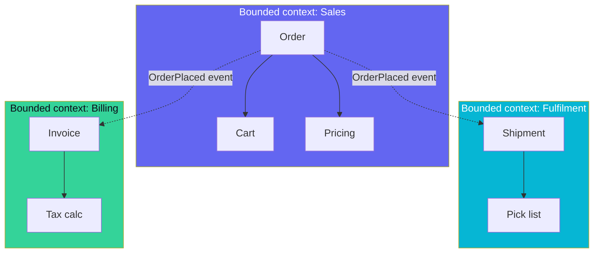

## Definition (interview-ready)

**Domain-Driven Design (DDD)** is a software-design approach centered on a deep model of the business domain. Key concepts:
- **Bounded context**: a portion of the system with its own consistent model and ubiquitous language.
- **Ubiquitous language**: shared vocabulary between developers and domain experts.
- **Aggregate**: a cluster of objects treated as a unit; an **aggregate root** is the entry point for changes.
- **Entity / Value object**: things with identity vs things defined by their values.
- **Domain event**: something significant that happened in the domain.



## Why it matters

DDD's tactical patterns (aggregates, entities, repositories) clarify code structure; its strategic patterns (bounded contexts, ubiquitous language) drive microservice boundaries, team boundaries, and API design. Most "microservices but everything's coupled" problems trace to ignoring DDD's strategic principles.

## Core concepts

### Bounded context

A consistent model within a clear boundary. Different bounded contexts may use the same word with different meanings:
- "Order" in **Sales context**: a request to purchase, with line items, payment intent, customer info.
- "Order" in **Fulfillment context**: a shipping unit with weight, dimensions, carrier, tracking number.
- "Order" in **Billing context**: a financial record with invoice number, tax, paid amount.

Same noun, different shape, different lifecycle. **Don't try to unify them** into one model — that's the path to ProductionMonolith.

### Context map

Diagram showing relationships between bounded contexts:
- **Partnership**: two teams co-design.
- **Customer-supplier**: upstream provides; downstream depends; coordination needed.
- **Conformist**: downstream accepts upstream's model as-is.
- **Anticorruption layer (ACL)**: translation layer protecting downstream from upstream's model.
- **Open Host Service**: published API for many consumers.
- **Published Language**: standard format (e.g., events) shared by multiple contexts.
- **Separate ways**: contexts choose not to integrate.

Useful for designing inter-service contracts.

### Ubiquitous language

The shared vocabulary used in conversations, code, docs. Developer says "Order" and domain expert understands — code's `class Order` reflects what the business calls it. No translation layer between conversation and code.

If you find yourself translating ("the user means X but we call it Y"), you have a model problem.

### Entity vs value object

- **Entity**: has identity that persists over time. `Customer(id=42)` is the same customer whether name changes or not.
- **Value object**: defined by its values. `Money(100, USD)`, `Address(...)`, `DateRange(start, end)`. Immutable. Two value objects with same values are interchangeable.

Rule of thumb: anything you'd query by id is an entity; anything you'd compare by `==` on values is a value object.

### Aggregate

A cluster of objects treated as a unit. One **aggregate root** is the entry point for all reads/writes through the aggregate.

Example:
```
Order (root)
├── OrderLine (child)
├── OrderLine
└── ShippingAddress (value object)
```

Outside code can only reference the root (`Order`). Changes to children go through the root (`order.addLine(...)`).

#### Rules

1. **One aggregate per transaction**: a transaction modifies one aggregate; cross-aggregate changes use domain events.
2. **Strong consistency within aggregate**: enforced atomically.
3. **Eventual consistency between aggregates**.
4. **Aggregate as DB transaction boundary**: typically.

Why: keeps transactions small, scales horizontally, avoids cross-aggregate locking.

#### Sizing

- Too big: long transactions, contention.
- Too small: hard to enforce invariants.
- Sweet spot: smallest aggregate that maintains its invariants.

### Domain event

Something significant happened: `OrderPlaced`, `PaymentFailed`, `InventoryReserved`.

- Past-tense.
- Carries enough data for consumers.
- Published after aggregate change commits.
- Consumed by other contexts (via Kafka / outbox).

### Repository

Abstracts persistence. Code uses `OrderRepository.find(id)` and `OrderRepository.save(order)`; doesn't know about SQL.

### Domain service

When logic doesn't naturally belong to one entity, put it in a **domain service** — stateless, named after a domain concept (`PricingService`, `TaxCalculator`).

### Anticorruption layer (ACL)

Translation between your model and an external model (legacy system, third-party API). Your code uses your model; ACL translates at the boundary.

Use case: integrating with a legacy ERP whose data model is ugly. Don't pollute your code; build an ACL.

### Event storming

Workshop method (Alberto Brandolini) for discovering bounded contexts:
- Sticky notes on a wall.
- Domain events (orange) in time order.
- Commands (blue) that trigger events.
- Aggregates (yellow) grouped by responsibility.
- Bounded contexts emerge from clusters.

Excellent for kicking off a new system or refactor.

## How it works (designing checkout)

```
Events:
  ItemAddedToCart, CheckoutInitiated, OrderPlaced,
  PaymentAuthorized, PaymentCaptured, OrderShipped, OrderDelivered

Bounded contexts identified:
  - Cart: ItemAdded, CheckoutInitiated.
  - Order: OrderPlaced.
  - Payment: PaymentAuthorized, PaymentCaptured.
  - Fulfillment: OrderShipped, OrderDelivered.

Each context has its own aggregates:
  - Cart (cart_id, line items, customer_ref).
  - Order (order_id, lines, status).
  - Payment (payment_id, amount, status).
  - Shipment (shipment_id, carrier, status).

Cross-context coordination via domain events on Kafka (or outbox).
Each context's "Order" is shaped to its needs.
```

## Real-world examples

- **Shopify**: bounded contexts loosely map to the components of their modular monolith (boundaries enforced with Packwerk).
- **Amazon**: famous two-pizza teams roughly = bounded contexts.
- **Uber**: Domain-Oriented Microservice Architecture (DOMA) groups services into domains with gateway interfaces.

## Common pitfalls

- **One God model** for the whole company: "the Customer" with 100 fields, used by every service.
- **Anemic domain model**: entities are dumb data bags; logic in services. (Just procedural with extra steps.)
- **Aggregates too big**: contention, slow transactions.
- **Aggregates referencing each other by object**: introduces transactional coupling. Use IDs instead.
- **No ubiquitous language**: developers use one term, business another → translations errors.
- **Microservices without bounded contexts**: distributed monolith.

## Practice questions

<Practice>

<QA q="What is a bounded context?" level="easy">

A boundary within which a domain model is consistent and coherent. Different bounded contexts can use the same word (Order, Customer) with different shapes and lifecycles: a Sales order has line items and payment intent, a Fulfillment order has weight, carrier and tracking. In practice it aligns with microservice and team boundaries.

</QA>

<QA q="What is the difference between an entity and a value object?" level="easy">

An entity has identity that persists over time: `Customer(id=42)` is the same customer even if its name changes. A value object is defined by its values (`Money(100, USD)`, `Address`), is immutable, and two with the same values are interchangeable. Rule of thumb: query by id → entity; compare by value → value object.

</QA>

<QA q="What is ubiquitous language and how do you notice it is missing?" level="easy">

A shared vocabulary used by developers and domain experts in conversations, code and docs, within one bounded context: if the business says "Order", the code has `class Order` meaning the same thing. If you keep translating ("the user means X but we call it Y"), you have a model problem, and those translations cause bugs.

</QA>

<QA q="What is a domain event?" level="easy">

A past-tense fact that something significant happened: `OrderPlaced`, `PaymentFailed`, `InventoryReserved`. It carries enough data for consumers, is published after the aggregate change commits (often via an outbox to Kafka), and is how other aggregates and contexts react without sharing a transaction.

</QA>

<QA q="What is an aggregate?" level="medium">

A cluster of objects treated as a single unit for consistency. The **aggregate root** is the only entry point: outside code references only the root, and changes to children go through it (`order.addLine(...)`). One aggregate per transaction; strong consistency inside, eventual consistency between aggregates.

</QA>

<QA q="What do repositories and domain services do?" level="medium">

A **repository** abstracts persistence for an aggregate: code calls `OrderRepository.find(id)` and `save(order)` without knowing about SQL. A **domain service** holds domain logic that doesn't naturally belong to one entity; it is stateless and named after a domain concept (`PricingService`, `TaxCalculator`).

</QA>

<QA q="What is an anticorruption layer?" level="medium">

A translation layer between your bounded context and an external system's model. You keep your clean model internally while integrating with messy externals such as a legacy ERP or a third-party API; the ACL converts at the boundary so the external model doesn't leak into and rot your design.

</QA>

<QA q="What is an anemic domain model and why is it a pitfall?" level="medium">

Entities are just data bags with getters and setters, and all the business rules live in service classes. Invariants are then scattered and easy to bypass, and it is really procedural code with extra layers. DDD puts behavior that protects invariants on the aggregate itself (`order.addLine` enforces the rules).

</QA>

<QA q="How does DDD inform microservice design?" level="medium">

Bounded contexts often map to microservices. Aggregates suggest natural transaction boundaries. Ubiquitous language makes the service's API use the right terms. Context maps (customer-supplier, conformist, ACL, open host service, published language) describe how services integrate. Microservices without bounded contexts tend to become a distributed monolith.

</QA>

<QA q="Why 'one aggregate per transaction'?" level="hard">

- Keeps transactions small → less contention and locking.
- Aggregates can be sharded across databases.
- Cross-aggregate changes go through domain events → loose coupling.
- Forces explicit design of cross-aggregate consistency (eventual, sagas).

Related rule: aggregates reference each other **by ID**, not by object, so one aggregate's transaction can't silently pull in another.

</QA>

<QA q="How do you size an aggregate?" level="hard">

Make it the **smallest cluster that can enforce its invariants** atomically. Too big (for example a Customer containing all their orders) means long transactions and contention on every write. Too small means an invariant spans aggregates and can't be enforced in one transaction. Ask: which rules must always be true immediately? Those belong inside one aggregate; everything else can be eventually consistent.

</QA>

<QA q="A team has a Customer model with 80 fields used by every service. Critique it." level="scenario">

- It ignores bounded contexts; different parts of the business need different shapes of "customer".
- Coupling: any change ripples to every service.
- Performance: 80 fields loaded when 5 are needed.
- Privacy: PII fields end up exposed in services that shouldn't see them.

Fix: identify the contexts; each owns its own slice of customer. Share a stable identifier (`customer_id`) and integrate via events.

</QA>

<QA q="How do you run an event storming session?" level="scenario">

Developers + domain experts in front of a wall or virtual canvas (Alberto Brandolini's method):
1. Domain events on orange stickies, in time order.
2. Commands (blue) that produce each event.
3. Actors who issue the commands.
4. Aggregates (yellow) emerge from related events and commands.
5. Bounded contexts are drawn around clusters of aggregates.
6. Hot spots and questions surface along the way.

Output: a domain map and a shared understanding, a strong start for a new system or a refactor.

</QA>

</Practice>

## Quiz

<Quiz>

<MCQ q="Sales, Fulfillment and Billing each have a different Order with different fields. What does DDD recommend?" options={["Merge them into one canonical Order model", "Keep separate models per bounded context and integrate via events and IDs", "Let Billing own the only Order table", "Rename two of them so the word Order appears once"]} answer={1}>

The same noun legitimately means different things in different contexts. Unifying them creates a god model; each context owns its shape and they share an identifier and events.

</MCQ>

<MCQ q="Which is the best example of a value object?" options={["Customer with id 42", "An Order with an order_id", "Money(100, USD)", "A Shipment with a tracking number"]} answer={2}>

Money is defined entirely by its values and is immutable; two equal amounts are interchangeable. The others have identity that persists as attributes change, so they are entities.

</MCQ>

<MCQ q="Placing an order must also reserve inventory, which is a separate aggregate. How should this be done in DDD style?" options={["Commit the Order, publish OrderPlaced, and let inventory react in its own transaction", "Update both aggregates in one database transaction", "Let Order hold an object reference to Inventory and modify it", "Merge Order and Inventory into one aggregate"]} answer={0}>

One aggregate per transaction; cross-aggregate effects flow through domain events with eventual consistency (or a saga if compensation is needed).

</MCQ>

<MCQ q="Why should aggregates reference other aggregates by ID rather than by object?" options={["IDs use less memory", "ORMs cannot load objects", "It is required by Kafka", "It avoids transactional coupling where saving one aggregate changes another"]} answer={3}>

Object references make it easy to modify two aggregates in one transaction and blur the consistency boundary. IDs keep each aggregate independently loadable and saveable.

</MCQ>

<MCQ q="Your service must integrate with a legacy ERP whose data model is confusing. What protects your domain model?" options={["Conformist relationship", "An anticorruption layer", "A shared database", "Separate ways"]} answer={1}>

An ACL translates the external model into yours at the boundary. Conformist means adopting their model, which is exactly what you want to avoid; separate ways means not integrating at all.

</MCQ>

<MCQ q="An aggregate is so large that most writes contend on the same rows and transactions are slow. What is the guideline for fixing it?" options={["Make it the smallest aggregate that still enforces its invariants", "Make every entity its own aggregate", "Add more indexes", "Use one aggregate per bounded context"]} answer={0}>

Too big means contention, too small means invariants can't be enforced atomically. Shrink to the minimum that protects the rules that must hold immediately.

</MCQ>

<MCQ q="Which naming fits a domain event?" options={["PlaceOrder", "OrderService", "OrderPlaced", "GetOrder"]} answer={2}>

Domain events are past-tense facts. PlaceOrder is a command, OrderService is a service and GetOrder is a query.

</MCQ>

<MCQ q="In a context map, what does a conformist relationship mean?" options={["Both teams co-design the model", "The upstream publishes a standard event format", "The contexts don't integrate", "The downstream accepts the upstream model as-is"]} answer={3}>

Conformist means the downstream adopts the upstream's model without translation. Co-design is partnership, a shared standard format is published language, and no integration is separate ways.

</MCQ>

<MCQ q="A codebase has Order classes with only getters and setters and all rules in OrderManager services. What is this called?" options={["Rich domain model", "Anemic domain model", "Anticorruption layer", "Event sourcing"]} answer={1}>

Data bags plus logic-heavy services is the anemic domain model pitfall. A rich model keeps invariant-protecting behavior on the aggregate.

</MCQ>

</Quiz>

## TL;DR cheat sheet

- **Bounded context**: boundary of a coherent model.
- **Ubiquitous language**: same vocab in code and conversation.
- **Entity**: has identity. **Value object**: defined by values, immutable.
- **Aggregate**: cluster of objects with one root entry point.
- **One aggregate per transaction**; eventual consistency between.
- **Domain events**: past-tense facts, propagated cross-context.
- **ACL**: translate at boundaries with messy externals.
- **Event storming**: collaborative discovery workshop.
- Microservices ≈ bounded contexts (mostly).
- Avoid anemic models and god aggregates.

## Go deeper

- **Eric Evans**: *Domain-Driven Design* — the "Blue Book."
- **Vaughn Vernon**: *Implementing Domain-Driven Design* — practical follow-up.
- **Alberto Brandolini**: *Introducing EventStorming* + blog.
- **Martin Fowler**: ["DomainDrivenDesign"](https://martinfowler.com/bliki/DomainDrivenDesign.html).
- **Sam Newman**: *Building Microservices* — strategic DDD applied to service boundaries.
- **Pluralsight / Udemy** DDD courses.
- [Microservices vs Monolith](/learn/notes/microservices-vs-monolith/) in this collection.
