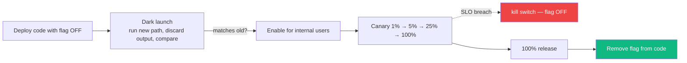
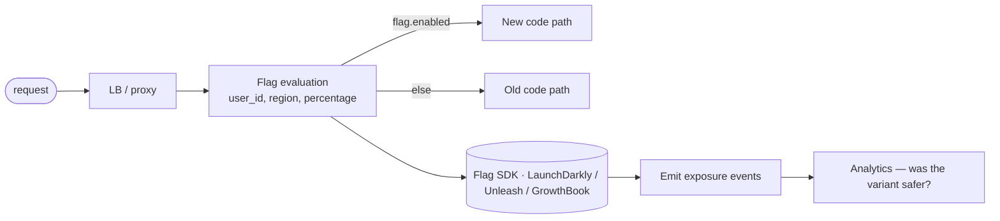

## Definition (interview-ready)

**Feature flags** are runtime switches that gate code paths, decoupling deploy from release. **Canary deployment** sends a small fraction of traffic to a new version, monitors, then expands. **Dark launch** runs new code in production without exposing it to users (shadow traffic, internal-only, hidden UI). Together: ship code safely with the ability to roll back without redeploying.

## Why it matters

The biggest cause of production incidents is "this deploy broke something." Feature flags + canary + dark launch separate the **risk of deploying code** from the **risk of releasing a feature**. Top-tier teams ship many times a day because of these patterns; teams without them ship cautiously and slowly.





## Core concepts

### Feature flags

A conditional in code:

```python
if flags.is_enabled("new_search_algo", user=current_user):
    return new_search(query)
else:
    return legacy_search(query)
```

The flag value is fetched from a remote config service at runtime. Change the flag → behavior changes without redeploy.

#### Types

- **Release flags**: short-lived, gate new code until ready.
- **Experiment flags**: A/B test variants.
- **Ops flags**: emergency kill switches (disable a feature in incidents).
- **Permission flags**: feature available only to certain users (beta testers, paid plans).
- **Long-lived configuration**: borderline — at some point it's just config.

### Lifecycle of a flag

1. **Create**: scaffold the flag in code + tooling.
2. **Roll out**: enable for 1%, 10%, 50%, 100% of users.
3. **Cleanup**: when flag is 100% and stable, remove the conditional + delete the flag.

**Flags accumulate technical debt.** A team with 200 active flags has a complicated codebase. Schedule cleanups.

### Canary deployment

Gradually ramp traffic to a new version:
- Deploy v2 alongside v1 (separate instances).
- Route 1-5% of traffic to v2.
- Monitor SLOs, error rates, latency.
- If healthy: 25% → 50% → 100%.
- If unhealthy: revert all traffic to v1, investigate.

Often implemented via:
- Service mesh (Istio, Linkerd) traffic splitting.
- Ingress controller weighted routing.
- Argo Rollouts / Flagger for k8s.
- LB weighted target groups.

### Blue-green deployment

Two complete environments — **blue** (current) and **green** (new). Cut over traffic from blue to green when ready. Easy rollback (switch back). Resource-intensive (double infra during transition).

### Dark launch

Run new code in production without users seeing it:
- **Shadow traffic**: send a copy of real requests to new code; compare results offline; users get the old code's response.
- **Hidden UI**: code is live, UI element not exposed.
- **Internal users only**: employees test in prod.

Useful for validating performance and correctness at scale before exposing to users.

### Progressive delivery

The umbrella term: feature flags + canary + dark launch + automated promotion. Combine to deploy code "to everyone in dev, behind flag" and roll out gradually with monitoring + auto-rollback.

### Targeting / segmentation

Flags can target:
- Percentage of users (random).
- Specific users (admins, beta testers).
- User attributes (country, plan, role).
- Sticky: same user always sees same variant (consistent UX).

```python
flags.is_enabled("new_checkout", user_id=42, country="IN", plan="pro")
```

### A/B testing

Same as experiment flags + analytics:
- Variant A vs B.
- Measure metric (conversion, engagement, latency).
- Statistical significance.
- Pick winner.

### Auto-rollback

CI/CD measures SLO during canary; if breached, revert traffic to old version automatically. Combine with feature flags: a bad path triggers flag-off without redeploy.

### Vendor tools

- **LaunchDarkly**: market leader; full-featured.
- **Optimizely**: A/B + flags.
- **Split** (now part of Harness): flags + experimentation.
- **Unleash**: open-source.
- **GrowthBook**: open-source + experimentation.
- **Statsig**: experimentation + flags + product analytics.
- Roll-your-own (DB + cache + SDK): viable for small teams.

### Common patterns

#### Kill switch
```python
if flags.is_enabled("disable_payments"):
    return error("Payments temporarily disabled")
```
On incidents, flip the switch — fast mitigation.

#### Gradual feature rollout
```python
if flags.is_enabled("new_algo", percentage=10):  # 10% rollout
    new_algo(...)
```

#### Backward compatibility
Keep both code paths; deprecate old after rollout complete.

#### Experimentation
```python
variant = flags.get_variant("checkout_layout", user_id, default="A")
render(variant)
analytics.log("checkout_view", variant=variant, user_id=user_id)
```

## How it works (a canary rollout)

```
1. Deploy v2 to 1 pod alongside v1 (which has 20 pods).
2. Service mesh / ingress configured: 5% traffic to v2.
3. Monitor for 15 min: error rate, p99 latency, business metrics.
4. If healthy: shift to 25% (5 pods of v2, scaled down v1).
5. Continue: 50% → 100%.
6. If unhealthy at any step: rollback all to v1.
7. Argo Rollouts / Flagger automates this.
```

## Real-world examples

- **Facebook**: Gatekeeper system — most features ship behind gates and roll out gradually.
- **Netflix**: chaos engineering + canary as continuous practice.
- **Google**: rollout to small fraction of users by experiment ID.
- **Microsoft**: feature flags in Windows Insider builds.

## Common pitfalls

- **Flag debt**: hundreds of stale flags clutter code.
- **No cleanup**: flag is 100% but conditional stays forever.
- **Flags as configuration**: blurs purpose; lifecycle is unclear.
- **No sticky bucketing**: user flickers between variants → bad UX.
- **No monitoring per variant**: don't know if rollout is OK.
- **Flag service as SPOF**: if flag service is down, default to safe behavior (usually old).
- **Testing only one variant**: untested code path waits for production.
- **No canary observability**: you'd never know if canary breaks.

## Practice questions

<Practice>

<QA q="Why decouple deploy from release?" level="easy">

Deploying code is not the same as exposing a feature. You can deploy dark code, run canaries and release features to subsets of users, which lowers the risk of each deploy. Without this, every deploy is a release: high stakes, so teams ship slowly.

</QA>

<QA q="What kinds of feature flags are there?" level="easy">

- **Release flags**: short-lived, gate new code until it's ready.
- **Experiment flags**: A/B test variants.
- **Ops flags**: kill switches to disable a feature during an incident.
- **Permission flags**: a feature only for certain users (beta testers, paid plans).

Long-lived "flags" that never go away are really configuration, and should be managed as such.

</QA>

<QA q="What is a kill switch and why is it valuable in an incident?" level="easy">

An ops flag that turns a feature or dependency off at runtime, for example `disable_payments` returning a friendly error. Flipping it takes seconds and needs no redeploy, so it is often the fastest mitigation while the real fix is built.

</QA>

<QA q="Walk through a canary deployment." level="medium">

Deploy v2 alongside v1. Route a small share (1-5%) of traffic to v2. Monitor SLOs, error rates, latency and business metrics. If healthy, expand: 25%, 50%, 100%. If not, send all traffic back to v1; the v2 code stays deployed for inspection. Tooling: Argo Rollouts, Flagger, service mesh traffic splitting, LB weighted target groups.

</QA>

<QA q="When do you use feature flags vs canary?" level="medium">

Usually both. Feature flags give per-user or per-feature control inside the running code. Canary gives per-traffic-percentage control at the LB or mesh, across versions of the code. Flags switch behavior; canaries expose a new build gradually. A common sequence: deploy with the flag off (dark code) → canary the build → enable the flag for 1% → ramp.

</QA>

<QA q="Canary vs blue-green: what is the trade-off?" level="medium">

Blue-green runs two complete environments and cuts all traffic over at once; rollback is switching back, but you pay for double infrastructure during the transition and every user moves together. Canary moves a small slice first, so problems hit few users and are caught by metrics, at the cost of a longer, more complex rollout.

</QA>

<QA q="What is a dark launch and how does shadow traffic work?" level="medium">

Running new code in production without users seeing its results. With **shadow traffic**, a copy of real requests goes to the new path; its output is compared offline and discarded, and users get the old path's response. Other forms: a hidden UI element, or enabling for internal users only. It validates performance and correctness at real scale before exposure.

</QA>

<QA q="What is sticky bucketing and why does it matter?" level="medium">

The same user always lands in the same variant, typically by hashing `user_id` + flag name into a bucket. Without it, users flicker between old and new behavior across requests, which is bad UX and also corrupts A/B results, since one user's behavior gets attributed to both variants.

</QA>

<QA q="What are the pitfalls of feature flags?" level="medium">

- Code complexity: every conditional adds a branch.
- Stale flags: conditionals left behind after 100% rollout.
- Testing: N flags means up to 2^N combinations; an untested path waits for production.
- The flag service can become a single point of failure; SDKs must fall back to a safe default (usually the old behavior).
- Misuse as configuration with no lifecycle.

</QA>

<QA q="How do you run an A/B test?" level="hard">

Assign users to variants with sticky, consistent bucketing. Render the different code or UI and log exposure events per variant. Measure the target metric (conversion, retention and so on), compute statistical significance, then pick the winner and clean up the flag. Tools: Optimizely, GrowthBook, LaunchDarkly, Statsig.

</QA>

<QA q="Design a feature flag service from scratch." level="scenario">

- **Storage**: flag definitions (rules, percentages) in a config DB.
- **Cache**: each app instance caches flags locally and refreshes periodically (for example every 30 s), so evaluation is in-process and fast.
- **SDK**: per-language clients with consistent bucketing (hash `user_id` + flag name for stickiness).
- **API + admin UI** for changes; **audit log** of every change.
- **Defaults**: the SDK falls back to a safe default if the service is unreachable.
- **Real-time push** (optional): WebSocket / SSE for instant propagation of kill switches.

</QA>

<QA q="A canary is healthy at 5% but errors spike at 50%. Why?" level="scenario">

- Hot keys or cache stampedes at higher load.
- Connection pool or thread pool exhaustion.
- A latent bug only hit by certain traffic patterns that the small slice didn't include.
- Time-of-day effects (5% ran in a quiet period, 50% at peak).
- Tail latency multiplied at scale.

Fix: more conservative ramps, better canary observability, and load tests.

</QA>

<QA q="How do you clean up flag debt?" level="scenario">

- Audit: list active flags with their last change date.
- An owner for each flag.
- Default action: if a flag has been at 100% for over 30 days, schedule its removal.
- Automate: a linter that reports conditionals on long-since-100% flags.
- Removal is a small, scoped, reviewed PR.
- Track flag count as a metric.

</QA>

</Practice>

## Quiz

<Quiz>

<MCQ q="A new checkout path is causing payment errors in production. What is the fastest mitigation if it is behind a flag?" options={["Revert the commit and redeploy", "Turn the flag off", "Scale up the service", "Start a canary of the previous version"]} answer={1}>

Flipping the flag changes behavior at runtime with no build or deploy, so it takes seconds. A redeploy or rollback works but is slower.

</MCQ>

<MCQ q="What does a canary control that a feature flag typically does not?" options={["Which users see a UI variant", "Which plan tier gets a feature", "What share of traffic reaches a new version of the deployed code", "Whether a code path is compiled in"]} answer={2}>

Canaries split traffic between builds at the LB or mesh. Flags switch behavior inside one build, per user or attribute.

</MCQ>

<MCQ q="Users report the new search UI appears and disappears between page loads. What is missing?" options={["Sticky bucketing per user", "A kill switch", "Blue-green deployment", "Shadow traffic"]} answer={0}>

Without consistent hashing of the user to a variant, each evaluation can land differently, so users flicker. Sticky bucketing fixes this and keeps A/B data clean.

</MCQ>

<MCQ q="In a shadow-traffic dark launch, which response does the user receive?" options={["The new path's response", "Whichever is faster", "Both, merged", "The old path's response; the new output is compared and discarded"]} answer={3}>

Shadowing copies requests to the new path for comparison only. Users are unaffected.

</MCQ>

<MCQ q="The flag service is unreachable. What should a well-designed SDK do?" options={["Throw on every evaluation", "Enable all flags", "Fall back to cached values or a safe default, usually the old behavior", "Block requests until it reconnects"]} answer={2}>

The flag service must not be a single point of failure. Cached values and safe defaults keep the app working.

</MCQ>

<MCQ q="Which is the main downside of blue-green compared with canary?" options={["Double infrastructure during cutover and all users switch at once", "Rollback is impossible", "It needs feature flags", "It only works on Kubernetes"]} answer={0}>

Blue-green gives fast rollback by switching back, but costs a full second environment and exposes everyone simultaneously. Canary limits the blast radius.

</MCQ>

<MCQ q="A flag has been at 100% for six months and nobody remembers it. What is the right action?" options={["Leave it in case of rollback", "Convert it to an A/B test", "Move it to a config file", "Remove the conditional and the dead path, then delete the flag"]} answer={3}>

Stale flags are pure debt: extra branches and untested paths. Once stable at 100%, remove them in a small reviewed PR.

</MCQ>

<MCQ q="Why can a canary pass at 5% but fail at 50%?" options={["Canaries only test read endpoints", "Load-dependent issues such as pool exhaustion or hot keys only appear at higher traffic", "The 50% step uses a different binary", "Feature flags reset at 50%"]} answer={1}>

The same code meets different load and traffic mix as the share grows. Conservative ramps and per-step monitoring catch this.

</MCQ>

<MCQ q="A codebase has 10 independent boolean flags. Why is exhaustive testing impractical?" options={["There are up to 1024 combinations of flag states", "Flags cannot be set in tests", "There are exactly 10 combinations", "Each flag needs its own environment"]} answer={0}>

N boolean flags give up to 2^N combinations; 2^10 is 1024. That is a key reason to keep flag counts low and short-lived.

</MCQ>

</Quiz>

## TL;DR cheat sheet

- **Feature flag** = runtime switch; deploy != release.
- **Canary** = % traffic to new version; ramp + monitor + auto-rollback.
- **Blue-green** = two full envs; switch cutover.
- **Dark launch** = run in prod without users seeing.
- Combine for **progressive delivery**.
- Targets: percentage, user attributes, sticky.
- Use kill switches for emergency mitigation.
- Schedule **flag cleanup**; flag debt is real.
- Vendor tools: LaunchDarkly, Optimizely, Split, GrowthBook, Statsig.

## Go deeper

- **Martin Fowler**: ["Feature Toggles"](https://martinfowler.com/articles/feature-toggles.html).
- **LaunchDarkly blog**: progressive delivery content.
- **Flagger / Argo Rollouts** docs.
- **Etsy engineering**: deployinator and feature flagging stories.
- **Pete Hodgson**: posts on feature flag patterns.
- **Book**: *Continuous Delivery* (Humble, Farley).
- **GrowthBook docs**: open-source experimentation.
