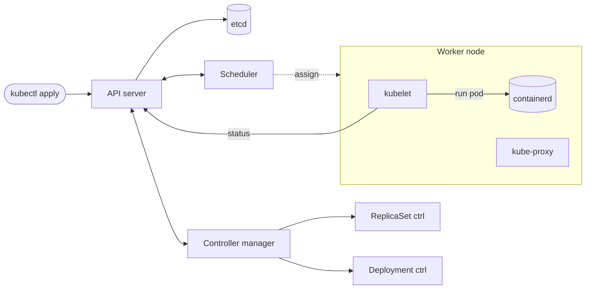

## Definition (interview-ready)

**Kubernetes (k8s)** is a container orchestration system. Apps run in **Pods** (one or more containers); **Deployments** manage rollout/rollback; **Services** give stable virtual IPs and load balancing across pod replicas; **Ingress** routes external HTTP traffic to Services with rules (host, path, TLS).

**One-liner:** Kubernetes is a control plane that keeps your declared state true: you say how many Pods of which image you want, Deployments roll them out, Services give them a stable address and load balancing, and Ingress (or Gateway API) brings external HTTP traffic in.

## Why it matters

K8s is the de facto standard for running containerized workloads at scale. Whether you love or hate it, large-scale deployments converge on k8s patterns (or work around its complexity). Knowing the primitives lets you reason about modern infra without getting lost in YAML.



## Core concepts

### Pod

- Smallest deployable unit: 1+ containers sharing network/storage.
- Has its own IP (within cluster).
- Ephemeral: pods come and go.
- Typically 1 main container + 0-2 sidecars (logging, mesh proxy).

### Deployment

- Manages a **ReplicaSet** which manages **Pods**.
- Declarative: "I want 5 replicas of nginx:1.21."
- Rolling updates: gradually replace old pods with new.
- Rollback by tracking history.

```yaml
apiVersion: apps/v1
kind: Deployment
metadata: { name: api }
spec:
  replicas: 3
  selector: { matchLabels: { app: api } }
  template:
    metadata: { labels: { app: api } }
    spec:
      containers:
      - name: api
        image: myrepo/api:v2.3
        ports: [{ containerPort: 8080 }]
        livenessProbe: { ... }
        readinessProbe: { ... }
```

### Service

- Stable virtual IP (ClusterIP) + DNS for a set of pods (selected by labels).
- Load-balances across selected pods.
- Pod IPs come and go; service IP is stable.
- Types:
  - **ClusterIP**: internal only. Default.
  - **NodePort**: opens a port on every node; basic external access.
  - **LoadBalancer**: cloud LB provisioned (e.g., AWS ELB).
  - **ExternalName**: CNAME alias.

### Ingress

- L7 routing in front of Services.
- Rules: host, path → Service.
- TLS termination.
- Implementations: ingress-nginx (community project retired March 2026 — no further fixes), AWS Load Balancer Controller, GKE Ingress, Traefik, Istio Gateway.
- The Ingress API is frozen; **Gateway API** is its successor for new L7 routing work.

```yaml
apiVersion: networking.k8s.io/v1
kind: Ingress
metadata: { name: web }
spec:
  rules:
  - host: api.example.com
    http:
      paths:
      - path: /v1
        pathType: Prefix
        backend:
          service: { name: api, port: { number: 80 } }
```

### Other workload types

- **StatefulSet**: pods with stable identity + persistent storage. For DBs, queues, anything stateful.
- **DaemonSet**: one pod per node (log collector, monitoring agent).
- **Job / CronJob**: batch / scheduled.

### Storage

- **Volume** (e.g. `emptyDir`): ephemeral, lifecycle tied to pod.
- **PersistentVolume (PV)**: backed by EBS, GCE PD, etc.
- **PersistentVolumeClaim (PVC)**: pod's request for storage; bound to a PV.
- **StorageClass**: how to provision new PVs (e.g., gp3 SSD on AWS).

### Config and secrets

- **ConfigMap**: non-sensitive config (env vars, files).
- **Secret**: sensitive values, but only base64-encoded, not encrypted. They are encrypted at rest only if you turn on etcd encryption (ideally with a KMS provider), and access must be locked down with RBAC. (See [Secrets Management](/learn/notes/secrets-management/) for better practices.)

### Networking model

- Every pod gets a unique IP.
- Pods can reach each other directly (CNI plugin handles routing — Calico, Cilium, Flannel).
- Services use kube-proxy (iptables or nftables; IPVS mode is deprecated since v1.35) to route to pod IPs — or an eBPF replacement such as Cilium.
- Network policies (Calico, Cilium) restrict pod-to-pod traffic — zero trust.

### Health checks

- **Liveness**: is the process alive? Failure → restart.
- **Readiness**: ready to serve? Failure → remove from Service endpoints (don't restart).
- **Startup**: for slow-starting apps; defers liveness.

### Autoscaling

- **HPA** (Horizontal Pod Autoscaler): scale replicas based on CPU/memory/custom metrics.
- **VPA** (Vertical Pod Autoscaler): adjust resource requests/limits.
- **Cluster Autoscaler**: add/remove nodes based on pending pods.
- **KEDA**: event-driven scaling (from Kafka lag, queue depth, etc.).

### RBAC

- **Roles**: define permissions (verbs × resources).
- **RoleBinding / ClusterRoleBinding**: bind role to user/service account.
- Service accounts for in-cluster identity.

### Deployments and rollouts

- **Rolling update** (default): incremental; by default `maxSurge` 25% and `maxUnavailable` 25% (configurable).
- **Recreate**: delete all old, then create new. Brief downtime.
- **Blue-green / canary**: requires custom logic or Argo Rollouts / Flagger.

### Resource requests and limits

- **Requests**: minimum the pod needs. Scheduler uses for placement.
- **Limits**: maximum. CPU above = throttled. Memory above = OOMKilled.

Tune both: too high wastes; too low gets pods killed.

## How it works (a request)

```
External user → Cloud LB → Ingress controller pod
  → matches host/path rule → backend Service
  → controller picks a ready pod from the Service's endpoints
    (most controllers proxy straight to the pod IP; traffic sent
     to the ClusterIP instead is DNATed by kube-proxy)
  → Pod processes request
  → Response back via reverse path
```

## Common pitfalls

- **No resource requests/limits**: pods OOM each other; scheduler can't pack right.
- **Liveness too aggressive**: pods restart-loop during startup.
- **Readiness == liveness**: failing readiness should not trigger restart.
- **No PodDisruptionBudget**: a cluster upgrade can drain all replicas at once.
- **Anti-affinity missing**: all replicas land on one node; node fails = full outage.
- **Latest tag**: image:latest → can't track which version is deployed. Always use immutable tags or digests.
- **No Network Policies**: any pod can hit any pod.
- **Secrets as plain ConfigMaps**: no.
- **etcd not backed up**: cluster state lost.
- **Single ingress without HA**.

## Practice questions

<Practice>

<QA q="What is a Pod, and why isn't a container the smallest unit?" level="easy">

A Pod is one or more containers sharing network (same IP and port space) and storage volumes. That allows sidecars (logging agents, mesh proxies) and init containers to co-locate with the main container. Kubernetes schedules, addresses and scales pods, not individual containers, so the pod is the unit.

</QA>

<QA q="What are the Service types and when do you use each?" level="easy">

- **ClusterIP** (default): stable internal virtual IP + DNS, cluster-only.
- **NodePort**: opens a port on every node; basic external access.
- **LoadBalancer**: provisions a cloud load balancer for the Service.
- **ExternalName**: a DNS CNAME alias to an external name.

</QA>

<QA q="Deployment vs StatefulSet vs DaemonSet vs Job: what does each run?" level="easy">

- **Deployment**: stateless replicas managed via a ReplicaSet, with rolling updates.
- **StatefulSet**: pods with stable identity and their own persistent storage, for databases and queues.
- **DaemonSet**: exactly one pod per node, for log collectors and monitoring agents.
- **Job / CronJob**: run-to-completion batch work, optionally on a schedule.

</QA>

<QA q="How does a Service load-balance traffic?" level="medium">

A Service is a virtual IP plus a label selector. kube-proxy on each node (iptables or nftables mode; IPVS is deprecated), or an eBPF replacement like Cilium, maintains rules that DNAT traffic for the virtual IP to one of the matching pod IPs. The control plane updates that set of endpoints as pods come and go, and only **ready** pods are included.

</QA>

<QA q="What is the difference between Ingress and a Service of type LoadBalancer?" level="medium">

A LoadBalancer Service provisions a cloud LB per service, which gets costly with many services. Ingress is one shared HTTP/HTTPS entry point with host/path rules to many services plus TLS termination: cheaper and richer for HTTP. Use LoadBalancer for non-HTTP or single-service exposure. For new L7 routing work, the Gateway API is the successor to the frozen Ingress API.

</QA>

<QA q="Why do we need liveness AND readiness probes?" level="medium">

Liveness: is the process alive? Failure → restart. Readiness: can it serve now? Failure → removed from Service endpoints, but not restarted. A pod can be alive but warming up, draining, or briefly missing a dependency; readiness keeps traffic away without pointless restarts. A **startup probe** defers liveness for slow-starting apps.

</QA>

<QA q="What do resource requests and limits do?" level="medium">

**Requests** are what the pod is guaranteed; the scheduler uses them to place pods on nodes. **Limits** are the maximum: CPU above the limit is **throttled**, memory above the limit gets the container **OOMKilled**. No requests means bad packing and noisy neighbors; requests too high waste capacity; limits too low cause throttling or kills.

</QA>

<QA q="HPA vs VPA vs Cluster Autoscaler vs KEDA?" level="medium">

- **HPA**: changes the replica count based on CPU, memory or custom metrics.
- **VPA**: adjusts a pod's resource requests and limits.
- **Cluster Autoscaler**: adds or removes nodes when pods are pending or nodes are underused.
- **KEDA**: event-driven scaling from sources like Kafka lag or queue depth.

HPA adds pods; Cluster Autoscaler adds the nodes to put them on.

</QA>

<QA q="Walk through a rolling update." level="medium">

You update the Deployment with a new image. The control plane creates a new ReplicaSet and gradually scales it up while scaling the old one down: new pods start, become ready, then old pods terminate, until all replicas are new. `maxSurge` and `maxUnavailable` (both 25% by default) control the pace. Rollback switches back to the previous ReplicaSet.

</QA>

<QA q="How do PodDisruptionBudgets and anti-affinity protect availability?" level="hard">

**Anti-affinity** (or topology spread) keeps replicas on different nodes or zones, so one node failure doesn't take out every replica. A **PodDisruptionBudget** limits how many replicas voluntary disruptions (node drains, cluster upgrades) may evict at once. Without them, a cluster upgrade can drain all replicas together and cause a full outage.

</QA>

<QA q="How would you do a canary deployment on Kubernetes?" level="scenario">

Native: two Deployments behind one Service, split roughly by replica count (for example 9 old, 1 new for about 10%). Coarse and tied to replica counts. More controllable: **Argo Rollouts** or **Flagger**, which use mesh or ingress traffic splitting and metrics to promote or roll back the canary automatically.

</QA>

<QA q="A pod is restarting in a loop. Diagnose it." level="scenario">

- Liveness probe failing: tune timeouts / initial delay or add a startup probe, or there is a real bug.
- OOMKilled: memory limit too low or a leak.
- Crash on startup: bad config, missing env var, unreachable dependency.
- Image pull error: wrong image or no registry permission.
- Init container failing.

Check `kubectl describe pod` (events, last state, exit code) and `kubectl logs --previous`.

</QA>

<QA q="How would you secure a Kubernetes cluster?" level="scenario">

- **RBAC**: least-privilege roles for users and service accounts.
- **Network Policies**: restrict pod-to-pod traffic.
- **Pod Security Standards** (PodSecurityPolicy is removed): block privileged pods, hostPath, extra capabilities.
- **Image scanning** (Trivy, Snyk) and immutable tags or digests, never `latest`.
- **Secrets** via Vault / external secrets; **etcd encryption at rest** (KMS).
- **mTLS** between services (service mesh), **audit logging**, prompt patching and hardened nodes.

</QA>

</Practice>

## Quiz

<Quiz>

<MCQ q="A pod's readiness probe starts failing while a downstream dependency is briefly unavailable. What does Kubernetes do?" options={["Restarts the container", "Removes the pod from Service endpoints but does not restart it", "Deletes the Deployment", "Moves the pod to another node"]} answer={1}>

Readiness failures only stop traffic to the pod. Restarts are triggered by liveness failures.

</MCQ>

<MCQ q="A container repeatedly exceeds its memory limit. What happens?" options={["It is throttled", "It is moved to a larger node", "It is OOMKilled and restarted per its restart policy", "The limit is raised automatically"]} answer={2}>

Memory over the limit cannot be throttled, so the kernel kills the container. CPU over its limit is what gets throttled.

</MCQ>

<MCQ q="You need a log collector running on every node. Which workload type fits?" options={["DaemonSet", "StatefulSet", "Deployment with replicas equal to node count", "CronJob"]} answer={0}>

A DaemonSet runs one pod per node and follows nodes as they join or leave. A Deployment can't guarantee one per node.

</MCQ>

<MCQ q="You expose 40 HTTP microservices externally. Why prefer Ingress over 40 LoadBalancer Services?" options={["LoadBalancer Services can't use TLS", "Ingress works for TCP databases too", "LoadBalancer Services don't scale", "One shared L7 entry point with host and path rules is cheaper and richer than one cloud LB per service"]} answer={3}>

Each LoadBalancer Service provisions its own cloud LB. Ingress (or Gateway API) shares one with routing rules.

</MCQ>

<MCQ q="During a cluster upgrade, all three replicas of a service were drained at the same time. What would have prevented the outage?" options={["A PodDisruptionBudget", "A larger memory limit", "A NodePort Service", "A ConfigMap"]} answer={0}>

A PDB limits how many pods voluntary disruptions like drains can evict at once. Anti-affinity also helps by spreading replicas.

</MCQ>

<MCQ q="Pods are stuck Pending because no node has enough free capacity. Which component adds nodes?" options={["HPA", "VPA", "Cluster Autoscaler", "kube-proxy"]} answer={2}>

HPA adds pods, VPA resizes pods, and kube-proxy handles Service routing. Cluster Autoscaler provisions nodes for pending pods.

</MCQ>

<MCQ q="What does the scheduler use to decide whether a pod fits on a node?" options={["The pod's limits", "Actual live CPU usage", "The image size", "The pod's resource requests"]} answer={3}>

Scheduling is based on requests. Limits cap usage at runtime; they are not used for placement.

</MCQ>

<MCQ q="Why is deploying image:latest a pitfall?" options={["Kubernetes rejects it", "You can't tell which version is running and rollbacks are unreliable", "It disables probes", "It always pulls a smaller image"]} answer={1}>

A mutable tag hides what is deployed and can change underneath you. Use immutable tags or digests.

</MCQ>

<MCQ q="A rolling update uses the defaults for a 4-replica Deployment. Which is true?" options={["All 4 old pods are deleted before new ones start", "Only one pod can ever be replaced per hour", "Up to 25% extra pods may be created and up to 25% may be unavailable during the rollout", "The update waits for manual approval at each pod"]} answer={2}>

Defaults are maxSurge 25% and maxUnavailable 25%. Deleting everything first is the Recreate strategy.

</MCQ>

</Quiz>

## TL;DR cheat sheet

- **Pod**: 1+ containers sharing network/storage. Smallest unit.
- **Deployment** → ReplicaSet → Pods. Rolling updates.
- **Service**: stable virtual IP + load-balance to pods by labels.
- **Ingress**: L7 HTTP routing in front of Services.
- **StatefulSet**: pods with stable identity + storage.
- **DaemonSet**: one pod per node.
- **HPA / VPA / Cluster Autoscaler**: scale.
- **Liveness vs readiness**: restart vs remove from endpoints.
- **Resource requests/limits**: tune carefully.
- **PodDisruptionBudget + anti-affinity**: HA across nodes/AZs.
- **Network Policies + RBAC**: zero trust.

## Go deeper

- **Kubernetes docs**: [kubernetes.io/docs](https://kubernetes.io/docs/) — tutorials are excellent.
- **KodeKloud**: [kodekloud.com](https://kodekloud.com/) — hands-on courses.
- **Kubernetes Up & Running** (Burns, Beda, Hightower).
- **CKA / CKAD certification** prep — solid hands-on practice.
- **Argo CD / Argo Rollouts** docs.
- **Istio / Linkerd** docs (service mesh).
