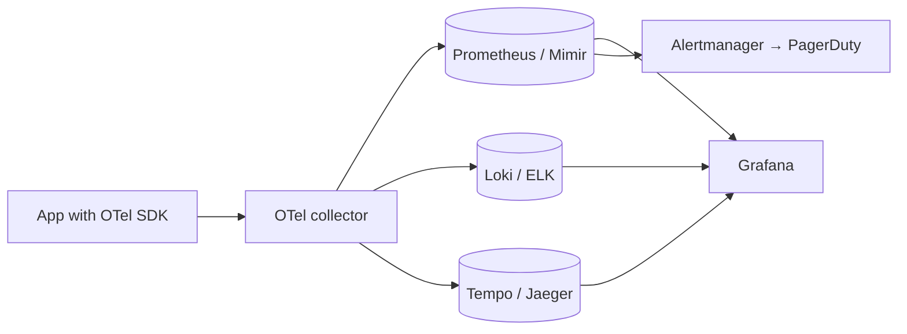

## Definition (interview-ready)

The "three pillars" of observability:
- **Metrics**: aggregated numerical time-series (CPU, request rate, error count). Tools: Prometheus, Datadog, Grafana Mimir (Grafana itself is the dashboard layer).
- **Logs**: discrete event records, structured or unstructured. Tools: ELK / EFK (Elasticsearch + Logstash/Fluentd + Kibana), Loki, Splunk.
- **Traces**: causally linked spans across services for a single request. Tools: Jaeger, Tempo, Zipkin, Datadog APM.

**OpenTelemetry (OTel)** is the CNCF's vendor-neutral standard for instrumenting and exporting all three.

**One-liner:** Metrics tell you cheaply that something is wrong, traces tell you where in the request path it went wrong, and logs tell you exactly what happened there; you link them with a shared trace ID.



## Why it matters

You can't operate what you can't observe. The difference between "the site is slow" and "the auth service has a p99 spike from DB connection pool exhaustion" is exactly the difference between a long incident and a fast one. Building observability is engineering's primary defense against production unknown unknowns.

## Core concepts

### Metrics

- Numerical samples over time, aggregated at collection.
- Tags / labels for dimensions: `http_requests_total{method="GET", status="200"}`.
- Pre-aggregated (counter, gauge, histogram, summary).
- Cheap to store, fast to query, ideal for dashboards and alerting.

**Prometheus model**: scrape metrics from /metrics endpoint on each instance; query with PromQL; store as time series.

**Cardinality killer**: too many tag combinations (e.g., `user_id` as a label) blow up the time-series count.

### Logs

- Discrete records of events.
- Structured (JSON) is far better than unstructured (free text) — queryable, filterable.
- Volume can be huge; cost can dominate observability spend.
- Logs are where high-cardinality detail belongs (user IDs, request IDs, error messages) because it can't go into metric labels, but log deliberately: every line costs money.

**Pattern**: log record = \{timestamp, level, service, trace_id, message, fields\}.

### Traces

- A trace = one request's journey across services.
- A trace = many spans, each with parent-child links.
- Each span: start time, duration, service, operation, tags.
- Sampled (1% typical) — full tracing would be too expensive.

Lets you see "request X took 2.3s — 1.8s was waiting for service Y."

### How they complement

- Metrics: aggregate — answers "is the system healthy overall?"
- Logs: detail — answers "what happened here?"
- Traces: causality — answers "what slowed *this* request?"

Use all three together; each one alone is incomplete.

### OpenTelemetry

- SDK in every language + collector that processes and routes telemetry.
- Vendor-agnostic export: same data → Prometheus, Jaeger, Datadog, etc.
- Auto-instrumentation for common frameworks.
- Becoming the default; replacing vendor-specific SDKs.

### Histograms vs summaries (Prometheus)

- **Histogram**: bucketed counts; aggregatable across instances; preferred.
- **Summary**: percentiles computed per-instance; can't aggregate (a server's p99 isn't averageable).

Use **histograms** with appropriate buckets; aggregate with `histogram_quantile()`.

### Latency percentiles

Always measure p50, p95, p99, p99.9 — not just average. Tail latency is what users feel.

### Service-level health vs deep dive

- Dashboard for service-level: golden signals ([RED / USE / Golden Signals](/learn/notes/red-use-golden-signals/)), error rate, p99 latency, RPS.
- Deep dive: traces for slow requests + logs scoped by trace_id.

### Sampling

For traces:
- **Head-based** (sample at start): simple, may miss interesting traces.
- **Tail-based** (decide at end based on outcome): keep all errors and slow ones; sample successful ones. More accurate but harder to implement.

For metrics: no sampling — aggregated at the source.
For logs: usually no sampling, but be selective about what you log.

### Cost management

- Logs are expensive in storage and ingestion fees.
- Drop low-value debug logs in prod.
- Retention tiers: hot (7 days, queryable) → cold (90 days, S3) → archive.
- Pre-aggregate logs into metrics where the data is fundamentally numeric.

## How it works (a debugging session)

```
Incident: "checkout slow"

1. Dashboard: checkout service p99 went from 200ms to 5s. Error rate normal.
2. Drill in by tag: which endpoint? -> /checkout.
3. Trace: pick a recent slow trace.
   - 4.8s spent in payment-service.
4. Payment service traces: 4.5s in DB call.
5. DB metrics: connection pool saturation; many waits.
6. Logs (filtered by trace_id): "connection acquired after 4500ms".
7. Root cause: pool too small after recent deploy.
```

## Real-world examples

- **Netflix**: extensive Atlas (metrics) + Mantis + traces. Famous for chaos engineering.
- **Google**: Borgmon (metrics) → Monarch; Dapper (tracing).
- **Uber**: Jaeger (open-sourced their tracing system).
- **Honeycomb**: pioneered high-cardinality observability events.
- **OpenTelemetry + Grafana stack**: open-source-first observability.

## Common pitfalls

- **High-cardinality labels in metrics**: blows up storage. Avoid user_id, request_id as labels.
- **Free-text logs**: ungrep-able when you need them most. Always structured.
- **No trace IDs in logs**: can't link logs to traces.
- **Sampling rate too low**: miss the interesting 0.1%.
- **No SLO-derived alerts**: noise from per-host alerts; alert fatigue.
- **Logs as primary signal**: expensive and slow. Metrics first, logs for detail.
- **Vendor lock-in**: telemetry pipeline only works for one vendor.

## Practice questions

<Practice>

<QA q="What is the difference between metrics, logs and traces?" level="easy">

Metrics = aggregated numerical time-series (cheap, fast, for dashboards and alerts): "is the system healthy?" Logs = discrete event records (detailed, expensive): "what happened here?" Traces = causally linked spans across services for one request (best for latency debugging): "what slowed this request?" Each alone is incomplete; use all three together.

</QA>

<QA q="How does Prometheus collect metrics?" level="easy">

It **scrapes** (pulls) a `/metrics` endpoint on each instance at an interval and stores the samples as time series identified by metric name plus labels, for example `http_requests_total` with `method` and `status` labels. You query with PromQL. Metric types: counter, gauge, histogram, summary.

</QA>

<QA q="Why should logs be structured?" level="easy">

Structured logs (for example JSON with timestamp, level, service, `trace_id`, message and fields) can be filtered and queried by field. Free-text logs are hard to search exactly when you need them most, during an incident. Structured fields also make it easy to join logs with traces.

</QA>

<QA q="What is metric cardinality and why do labels like user_id cause trouble?" level="medium">

Every unique combination of label values is a separate time series. A label with unbounded values, such as `user_id` or `request_id`, multiplies the series count by millions, blowing up memory, storage and query cost. Keep metric labels low-cardinality (method, status, endpoint) and put per-request detail in logs and traces.

</QA>

<QA q="Why prefer histograms over summaries in Prometheus?" level="medium">

Histograms store bucketed counts, which can be summed across instances, so you can compute a fleet-wide p99 with `histogram_quantile()`. Summaries compute percentiles per instance, and percentiles can't be averaged or combined, which makes them useless for service-wide views. Pick buckets that bracket your SLO thresholds.

</QA>

<QA q="How do you connect logs to traces?" level="medium">

Include the `trace_id` (and ideally `span_id`) in every log record emitted while handling a request. OpenTelemetry SDKs can inject this automatically. Then "all logs with trace_id X" shows everything that happened during one request across services, and a slow span links straight to its logs.

</QA>

<QA q="A service has p99 latency of 2s but an average of 100ms. What does that mean?" level="medium">

A small fraction of requests are very slow: tail latency. The average hides it, but users (and fan-out callers) feel the tail. Common causes: GC pauses, cold caches, slow downstream calls, lock or pool contention. Investigate with traces of the slow requests, and always track p50, p95, p99 and p99.9.

</QA>

<QA q="Head-based vs tail-based trace sampling?" level="medium">

**Head-based** decides at the start of the request (for example keep 1%). Simple and cheap, but it can drop the rare error or slow trace you need. **Tail-based** decides after the trace completes, based on the outcome: keep all errors and slow traces, sample the healthy ones. More useful, but harder to run because spans must be buffered until the decision.

</QA>

<QA q="What is OpenTelemetry?" level="medium">

The CNCF's open-source, vendor-neutral standard plus SDKs for instrumenting metrics, logs and traces. The OTel Collector receives, processes and exports telemetry to any backend (Prometheus, Jaeger, Datadog, Grafana and so on). It removes vendor lock-in in instrumentation and auto-instruments common frameworks.

</QA>

<QA q="How do you reduce trace volume cost?" level="hard">

- Sampling for normal traffic (around 1% is typical).
- Tail-based sampling: keep all errors and traces above a duration threshold, sample the rest.
- Drop irrelevant traces such as health checks.
- Retention: keep recent traces hot, archive older ones.

</QA>

<QA q="How do you keep logging costs under control?" level="hard">

- Drop low-value debug logs in production and be selective about what you log.
- Retention tiers: hot (about 7 days, queryable) → cold (about 90 days, object storage) → archive.
- Pre-aggregate numeric data into metrics instead of logging every event.
- Use metrics as the primary signal and logs for detail, not the other way round.

</QA>

<QA q="Design observability for a new microservice from day 1." level="scenario">

- OpenTelemetry SDK; auto-instrument HTTP and DB clients.
- Metrics: RPS, error rate and a latency histogram per endpoint.
- Structured logs with `trace_id`, level, service and request fields.
- Trace context propagated across service calls.
- Dashboards from a template (RED/USE, golden signals).
- Alerts tied to SLOs.
- All exports via the OTel Collector to your platform.

</QA>

<QA q="A team gets 500 alerts a day and ignores most. How do you fix it?" level="scenario">

- Audit: which alerts fired, which led to action, which are noise?
- Delete alerts that never lead to action.
- Replace per-host alerts with SLO-based, service-level alerts.
- Tier severities: only critical pages; the rest become tickets.
- Give every alert an owner; delete orphans.
- Every page must have a clear runbook.

</QA>

</Practice>

## Quiz

<Quiz>

<MCQ q="Checkout is slow and you need to know which downstream call made one specific request take 4 seconds. Which signal answers that most directly?" options={["Metrics", "A distributed trace", "Logs without trace IDs", "CPU utilization graphs"]} answer={1}>

A trace shows the spans of that request and how long each took. Metrics are aggregates and logs lack causal structure unless linked by trace_id.

</MCQ>

<MCQ q="You run 20 instances and want the service-wide p99 latency in Prometheus. What should you instrument?" options={["A summary on each instance, then average the p99s", "A gauge of the last latency", "A histogram, aggregated with histogram_quantile", "A counter of total requests"]} answer={2}>

Histogram buckets sum across instances, then histogram_quantile gives a true fleet-wide quantile. Averaging per-instance percentiles is mathematically wrong.

</MCQ>

<MCQ q="An engineer adds customer_id as a label on a request-count metric. What is the likely result?" options={["Series count explodes, raising memory and storage cost", "Queries become faster", "Nothing, since labels are free", "Prometheus automatically samples it"]} answer={0}>

Each label value creates a new series, so an unbounded ID multiplies the series count. Put per-customer detail in logs or traces.

</MCQ>

<MCQ q="You want to keep every failed and every slow trace while storing only a fraction of healthy ones. Which approach fits?" options={["Head-based sampling at 1%", "No tracing, logs only", "Sampling metrics", "Tail-based sampling"]} answer={3}>

Only tail-based sampling knows the outcome before deciding. Head-based sampling decides upfront and drops most errors along with everything else.

</MCQ>

<MCQ q="Average latency is 100 ms but p99 is 2 s. What is the right reading?" options={["The system is healthy because the average is low", "A small fraction of requests are very slow, and users feel that tail", "The p99 must be a measurement error", "All requests are moderately slow"]} answer={1}>

A big gap between average and p99 means a slow tail. Averages mask it; investigate via traces of slow requests.

</MCQ>

<MCQ q="What is the main purpose of putting trace_id in every log line?" options={["To compress logs", "To replace metrics", "To encrypt logs per request", "To pull up all logs for one request across services and jump between traces and logs"]} answer={3}>

The trace_id is the join key between pillars. It doesn't compress, encrypt or replace anything.

</MCQ>

<MCQ q="What does OpenTelemetry primarily solve?" options={["Vendor-neutral instrumentation and export, so you can switch or add backends without reinstrumenting", "Storing metrics long-term", "Rendering dashboards", "Paging on-call engineers"]} answer={0}>

OTel standardizes instrumentation and the collection pipeline. Storage, dashboards and paging are backend concerns such as Prometheus, Grafana and Alertmanager.

</MCQ>

<MCQ q="Observability spend is dominated by log ingestion. Which change helps most without losing key signals?" options={["Turn on debug logging everywhere", "Convert all metrics into logs", "Drop low-value debug logs, tier retention, and turn numeric log data into metrics", "Remove trace IDs from logs"]} answer={2}>

Logs are the expensive pillar. Cutting noise, moving old data to cheaper tiers and pre-aggregating numbers into metrics reduces cost while keeping detail where it matters.

</MCQ>

<MCQ q="A team pages on CPU above 80% on every host and gets constant noise. What is the better alerting basis?" options={["Lower the threshold to 70%", "SLO-based, service-level symptoms such as error rate and latency", "Page on every log error line", "Alert only on disk usage"]} answer={1}>

Users feel symptoms, not host CPU. SLO-based service alerts cut noise and page only when the user experience is at risk.

</MCQ>

</Quiz>

## TL;DR cheat sheet

- Three pillars: **Metrics** (aggregated), **Logs** (discrete), **Traces** (causal).
- Use OTel for vendor-neutral telemetry.
- Histograms not summaries.
- Avoid high-cardinality labels.
- Trace IDs in logs for cross-pillar correlation.
- Sampling + tail-based for trace volume.
- Alert on SLO breaches, not per-host.
- Cheap to add at the start; expensive to add after incidents.

## Go deeper

- **OpenTelemetry docs**: [opentelemetry.io/docs](https://opentelemetry.io/docs/).
- **Book**: *Observability Engineering* (Honeycomb).
- **Prometheus docs**: [prometheus.io/docs](https://prometheus.io/docs/).
- **Charity Majors** (Honeycomb CTO): blogs and talks on observability.
- **Distributed Tracing in Practice** (O'Reilly).
- **Cindy Sridharan**: ["Distributed Systems Observability"](https://www.oreilly.com/library/view/distributed-systems-observability/9781492033431/) free O'Reilly report.
- **Google SRE Book Ch. 6** (monitoring).
