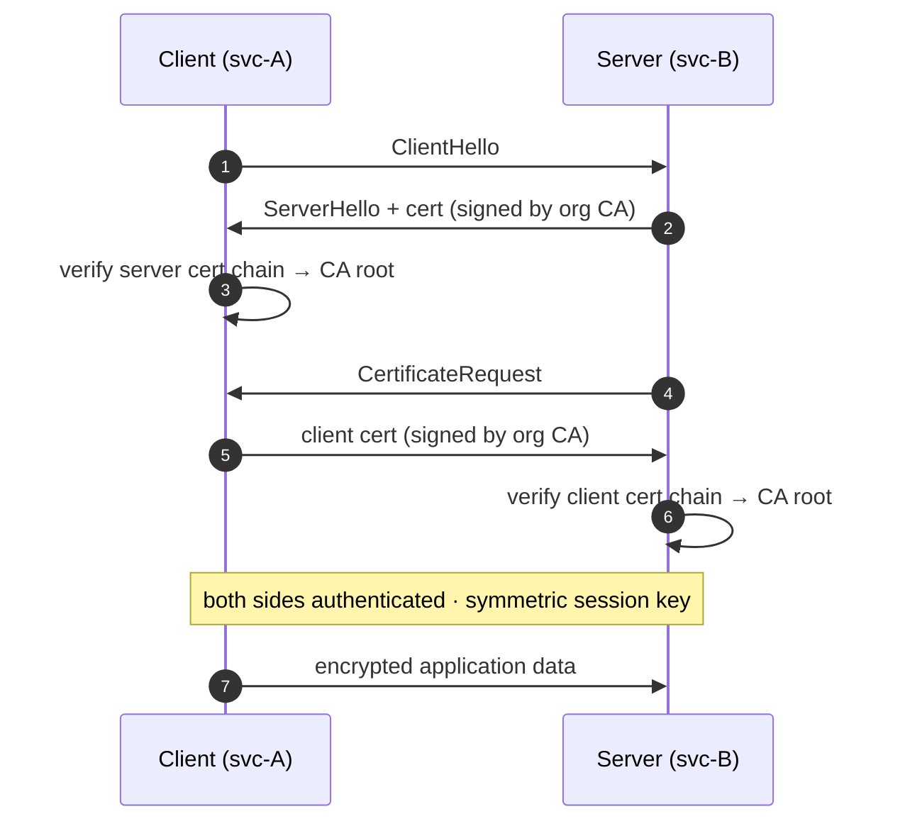
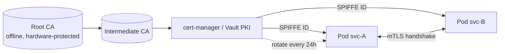

## Definition (interview-ready)

**mTLS (mutual TLS)** is TLS where **both** sides present certificates: the server proves its identity to the client (regular TLS) AND the client proves its identity to the server. **Certificate management** is the lifecycle of issuing, deploying, rotating, and revoking certs at scale — often automated via PKI infrastructure (Vault, AWS Private CA, smallstep, cert-manager).

## Why it matters

Service-to-service identity at scale demands stronger auth than shared secrets or bearer tokens. mTLS gives you encryption + cryptographic identity in one step, with no central token issuer to fail. The hard part isn't TLS itself — it's the lifecycle: rotation, revocation, expiry monitoring.





## Core concepts

### Regular TLS recap

- Server has a certificate signed by a CA.
- Client verifies cert chains to a trusted CA.
- They negotiate a session key via ECDHE.
- Encryption + integrity + server identity.

(See [Networking: TCP, UDP, TLS](/learn/notes/networking-tcp-udp-tls/) for the TLS handshake.)

### mTLS

Adds: client also presents a certificate (signed by a CA trusted by the server).

```
Client → Hello
Server → Hello + cert + key-exchange + cert-request
Client → cert + key-exchange + cert-verify
Both → derive session key
encrypted data ...
```

Now both sides are cryptographically identified.

### When mTLS shines

- **Service-to-service** inside a mesh (Istio, Linkerd auto-do this).
- **B2B APIs** with mutual identification.
- **IoT devices** authenticating to backend.
- **Database connections** (Postgres, etcd support mTLS).
- Zero-trust internal networks.

### vs bearer tokens

- Bearer token: anyone with the token is "authenticated" — token can be stolen, replayed (until rotation).
- mTLS: requires the private key, which never leaves the device. Stronger.
- Bearer is simpler to issue/revoke; mTLS requires PKI.

Modern systems often combine: mTLS for service identity + JWT for user identity carried in headers.

### PKI (Public Key Infrastructure)

- **Root CA**: trusted base; offline, rarely used directly.
- **Intermediate CA**: signs end-entity certs; rotated more often.
- **End-entity (leaf)** cert: actual cert for a service.
- **Chain of trust**: leaf → intermediate(s) → root.

Internal PKI: usually a private root CA, intermediates for each environment / region.

### Issuance

For services:
- **Manual**: openssl, hand-deploy. Doesn't scale.
- **Vault PKI**: HashiCorp Vault issues certs on demand.
- **AWS PCA**: Private Certificate Authority service.
- **cert-manager** (Kubernetes): issues certs via ACME or internal CA.
- **smallstep**: standalone PKI tool.
- **SPIFFE / SPIRE**: identity framework; SVIDs (SPIFFE Verifiable Identity Documents) as cert form.

### Rotation

Certificates expire. At scale:
- Short-lived certs (24h-7d) reduce risk if leaked.
- Automated rotation via cert-manager / Vault auto-renewal / SPIRE.
- Service must reload cert without restart (graceful).

### Revocation

If a cert is compromised before expiry:
- **CRL** (Certificate Revocation List): downloaded periodically, lists revoked serial numbers.
- **OCSP** (Online Certificate Status Protocol): real-time lookup per validation. (Public CAs are retreating from it for privacy/cost reasons; Let's Encrypt ended OCSP in 2025 in favor of CRLs.)
- **OCSP Stapling**: server stapled OCSP response to the handshake; client doesn't have to call.
- **Short cert lifetimes**: arguably the best revocation — just don't renew the compromised cert.

For internal PKI: prefer short lifetimes over CRL/OCSP. CRL/OCSP are operationally painful.

### Service mesh + mTLS

Istio / Linkerd inject sidecars (or, in Istio's ambient mode, per-node ztunnel proxies) that:
- Auto-issue workload identity (Istio uses SPIFFE IDs).
- Establish mTLS between sidecars transparently.
- Apps speak plain HTTP/gRPC to the local sidecar.
- Mesh control plane manages certs end-to-end.

This makes mTLS adoption painless for app developers.

### Trust bootstrapping

How does a service get its first cert?
- **Manual**: pre-shared root + private key.
- **Token-based**: short-lived token from an orchestrator (k8s service account, EC2 instance metadata).
- **Attestation**: TPM / Nitro Enclave attestation proves hardware identity.

In k8s: service account token → exchange for cert via SPIRE / cert-manager.

### Common cert formats

- **PEM**: text, `-----BEGIN CERTIFICATE-----`. Most common.
- **DER**: binary, raw.
- **PKCS#12 (.p12 / .pfx)**: cert + private key + chain in one file (often password-protected).

### TLS termination strategies

- **At LB only** (most common): client → LB (TLS) → backend (plaintext within VPC).
- **End-to-end**: client → LB (TLS) → backend (TLS). mTLS between LB and backend possible.
- **At sidecar**: app talks plain to sidecar; sidecar handles TLS externally.

Zero-trust: prefer end-to-end mTLS even inside the VPC.

## How it works (Istio auto-mTLS)

```
Pod A app → localhost (Envoy sidecar)
              Envoy A has SPIFFE identity cert auto-issued.
              Envoy A initiates mTLS to Envoy B.
              Both verify identities (SPIFFE IDs match expected).
              Encrypted tunnel established.
Envoy B → localhost (pod B app, plain)

App code: no changes. Mesh handles all crypto.
```

## Real-world examples

- **Istio + SPIRE**: enterprise zero-trust mesh.
- **Linkerd**: simpler service mesh with auto-mTLS.
- **Cloudflare Access**: mTLS for B2B portals.
- **AWS App Mesh**: managed service mesh with mTLS — discontinued Sept 30, 2026; AWS points users to ECS Service Connect.
- **Google's BeyondCorp**: zero-trust architecture; identity-aware proxy.

## Common pitfalls

- **Forgotten cert expiry**: a cert expires at 3 AM Sunday → outage. Monitor + alert weeks ahead.
- **Manual cert deployment** at scale: 100 services × certs = chaos. Automate.
- **No chain on the server**: clients without intermediate trust fail. Always serve full chain.
- **Bypassing verification** during dev (`InsecureSkipVerify`): leaks into prod.
- **Same cert across regions/services**: blast radius huge if leaked.
- **No revocation strategy**: compromise = wait for expiry.
- **CRL/OCSP unavailable on cert validation paths**: hard fail vs soft fail tradeoff (soft fail = security gap; hard fail = availability issue).

## Practice questions

<Practice>

<QA q="What is the difference between TLS and mTLS?" level="easy">

TLS: the server presents a certificate and the client verifies it. mTLS: the client also presents a certificate, signed by a CA the server trusts, and the server verifies it. Both sides are cryptographically identified, not just the server. Used for service-to-service auth, B2B APIs, IoT and zero-trust internal networks.

</QA>

<QA q="What are root, intermediate and leaf certificates?" level="easy">

- **Root CA**: the trust anchor; kept offline and hardware-protected, rarely used directly.
- **Intermediate CA**: signs end-entity certs; rotated more often, so the root stays safe.
- **Leaf (end-entity) cert**: the actual cert for a service.

Validation walks the chain leaf → intermediate(s) → root. Servers must send the full chain (leaf + intermediates), since clients usually only have the root.

</QA>

<QA q="PEM vs DER vs PKCS#12?" level="easy">

- **PEM**: Base64 text with `-----BEGIN CERTIFICATE-----` headers. The most common.
- **DER**: the same data in raw binary.
- **PKCS#12** (`.p12` / `.pfx`): one file bundling cert + private key + chain, often password-protected.

</QA>

<QA q="Why use mTLS over bearer tokens for service-to-service auth?" level="medium">

Tokens are bearer credentials: anyone holding one can authenticate, and they leak via logs, memory dumps or interception, then get replayed until they expire. mTLS requires the **private key**, which never leaves the host. Stronger identity binding, less leakable, and encryption in the same step. Bearer tokens are simpler to issue and revoke; mTLS needs a PKI.

</QA>

<QA q="How do mTLS and JWTs work together in a microservice system?" level="medium">

They answer different questions. mTLS proves **which service** is calling (workload identity) and encrypts the connection. A JWT forwarded in a header carries **which user** the call is on behalf of and their claims. The callee checks both: is this service allowed to call me, and is this user allowed to do this action?

</QA>

<QA q="What is SPIFFE/SPIRE?" level="medium">

SPIFFE is a standard for verifiable workload identity in distributed systems; SPIRE is its implementation. Each workload gets an **SVID** (an X.509 cert or JWT) carrying its SPIFFE ID, like `spiffe://example.com/ns/prod/sa/payment-service`. It answers "who am I talking to?" with short-lived, automatically rotated credentials.

</QA>

<QA q="How does a service get its first certificate (trust bootstrapping)?" level="medium">

Something must prove the workload's identity before a CA will sign for it:
- **Manual**: a pre-shared root + key. Doesn't scale.
- **Token-based**: a short-lived token from the orchestrator (k8s service account token, EC2 instance metadata) is exchanged for a cert.
- **Attestation**: TPM or Nitro Enclave attestation proves hardware identity.

In Kubernetes, typically a service account token is exchanged for a cert via SPIRE or cert-manager.

</QA>

<QA q="Where can TLS be terminated, and what does zero trust prefer?" level="medium">

- **At the LB only** (most common): TLS to the LB, plaintext to backends inside the VPC.
- **End-to-end**: TLS to the LB and again from the LB to the backend, optionally mTLS on that hop.
- **At a sidecar**: the app speaks plaintext to its local proxy, which does TLS on the network.

Zero trust prefers end-to-end mTLS even inside the VPC, since the network itself is not trusted.

</QA>

<QA q="How does a service mesh handle mTLS without app changes?" level="medium">

Each pod gets a sidecar proxy (Envoy), or in Istio's ambient mode a per-node ztunnel. The app talks plain HTTP/gRPC to the local proxy; proxies do mTLS to each other, including cert issuance, rotation and verification. The mesh control plane provisions workload identities (Istio uses SPIFFE IDs). App code is unchanged; the team gets zero-trust networking.

</QA>

<QA q="Pros and cons of CRL vs OCSP vs short-lived certs?" level="hard">

CRL: a downloaded list of revoked serials; can be large and stale between downloads. OCSP: real-time per-check lookup, but adds a round-trip and the responder can be down (hard fail hurts availability, soft fail is a security gap); public CAs are retreating from it (Let's Encrypt ended OCSP in 2025). OCSP stapling has the server attach the response to the handshake. Short-lived certs largely skip revocation: a compromised cert simply expires soon. Internal PKI usually prefers short lifetimes.

</QA>

<QA q="How would you handle cert rotation at scale?" level="hard">

Short-lived certs (about 1-7 days), auto-issued and renewed by cert-manager / Vault / SPIRE. Services reload certs without restarting. Monitor expiry and alert weeks ahead for anything long-lived. Use a service mesh to keep rotation out of app code. Test rotation regularly so a failure shows up in a drill, not at 3 AM.

</QA>

<QA q="A certificate's private key is leaked. What do you do?" level="scenario">

- Revoke it (CRL/OCSP) if you have revocation; if it is short-lived, it expires soon anyway.
- Generate a new key and issue a new cert from the current intermediate.
- Audit logs for misuse during the exposure window.
- If the service identity is affected, rotate dependent secrets too.
- With roughly 24h certs the cert problem mostly self-resolves; the bigger work is finding how the key leaked.

</QA>

<QA q="A handshake fails with 'x509: certificate signed by unknown authority'. Diagnose it." level="scenario">

This error means the client couldn't build a chain to a root it trusts:
- The client's trust store lacks the issuing root/intermediate CA.
- The server presents its leaf without intermediates, so the chain can't be built.
- Wrong trust store for the environment (prod CA in dev or vice versa), or a cert from a new CA after rotation that clients don't trust yet.

Also check for nearby issues: a hostname/SAN mismatch or an expired cert produce different x509 errors, so read the exact message. Inspect what is served with `openssl s_client -showcerts`.

</QA>

</Practice>

## Quiz

<Quiz>

<MCQ q="What does mTLS add compared with ordinary TLS?" options={["Encryption of the payload", "The client also presents a certificate and the server verifies it", "A faster handshake", "Certificates that never expire"]} answer={1}>

Ordinary TLS already encrypts and authenticates the server. mTLS adds client authentication with a certificate.

</MCQ>

<MCQ q="An attacker copies a service's bearer token from a log file. Why would the same theft not work against mTLS?" options={["mTLS certificates are secret", "mTLS traffic cannot be logged", "Authentication requires proving possession of the private key, which never left the host", "mTLS only works inside Kubernetes"]} answer={2}>

Certificates are public; the handshake proves possession of the private key. A stolen bearer token alone is enough to authenticate.

</MCQ>

<MCQ q="Clients fail to validate a server's certificate, but the same leaf works when the client has the intermediate installed. What is wrong?" options={["The server isn't sending the full chain", "The root CA is expired", "The client lacks a client certificate", "OCSP stapling is enabled"]} answer={0}>

Servers must send the leaf plus intermediates. Clients typically only trust roots, so a missing intermediate breaks the chain.

</MCQ>

<MCQ q="For an internal PKI, which revocation approach is usually preferred?" options={["Large CRLs downloaded daily", "OCSP with hard fail on every connection", "No revocation and 5-year certs", "Short-lived certs that are automatically renewed"]} answer={3}>

Short lifetimes bound the damage of a leak without depending on CRL distribution or OCSP availability.

</MCQ>

<MCQ q="In Istio with sidecars, what does application code need to do to get mTLS between services?" options={["Load certificates and configure TLS in each app", "Nothing; apps talk plaintext to the local proxy, which does mTLS", "Call SPIRE on every request", "Switch from HTTP to gRPC"]} answer={1}>

The proxies handle identity, handshakes and rotation transparently. That is the main reason meshes make mTLS adoption easy.

</MCQ>

<MCQ q="What is a SPIFFE SVID?" options={["A load balancer rule", "A revocation list entry", "A verifiable identity document, an X.509 cert or JWT carrying a workload's SPIFFE ID", "A Kubernetes secret type"]} answer={2}>

SVIDs are how SPIFFE expresses workload identity, issued and rotated by SPIRE or a mesh.

</MCQ>

<MCQ q="A service uses mTLS for service identity. How should it learn which end user a request is for?" options={["A forwarded JWT carrying the user's identity and claims", "The client certificate's common name", "The source IP address", "The TLS session ID"]} answer={0}>

mTLS identifies the calling workload, not the user. A JWT in a header carries user identity across hops.

</MCQ>

<MCQ q="A pod in Kubernetes needs its first workload certificate. What does it typically present to obtain one?" options={["The root CA private key", "A long-lived password in a ConfigMap", "A self-signed certificate", "Its service account token, exchanged via SPIRE or cert-manager"]} answer={3}>

Trust bootstrapping uses an orchestrator-issued, short-lived credential to prove identity. Distributing CA keys or passwords defeats the PKI.

</MCQ>

<MCQ q="An OCSP responder is unreachable and clients are configured to soft-fail. What is the trade-off?" options={["Connections fail, hurting availability", "Connections proceed, so a revoked cert might be accepted", "The certificate is automatically renewed", "The server switches to a CRL"]} answer={1}>

Soft fail keeps availability at the cost of a security gap; hard fail is the reverse. This is one reason internal PKI favors short-lived certs.

</MCQ>

</Quiz>

## TL;DR cheat sheet

- **TLS** = server identity. **mTLS** = both sides identified.
- Use mTLS for service-to-service, B2B, IoT, internal zero-trust.
- Stronger than bearer tokens (key never leaks).
- **PKI**: root CA → intermediate → leaf. Internal PKI for service certs.
- **Cert lifecycle**: issue → deploy → rotate → expire. Automate everything.
- **Short-lived certs** > CRL/OCSP for internal PKI.
- **Service mesh** (Istio, Linkerd) auto-handles mTLS.
- **SPIFFE/SPIRE** for workload identity.
- Monitor cert expiry. Always serve full chain.

## Go deeper

- **Cloudflare**: ["What is mutual TLS?"](https://www.cloudflare.com/learning/access-management/what-is-mutual-tls/).
- **smallstep blog**: [smallstep.com/blog](https://smallstep.com/blog/) — excellent PKI content.
- **SPIFFE docs**: [spiffe.io](https://spiffe.io/docs/).
- **Istio docs**: [security](https://istio.io/latest/docs/concepts/security/).
- **HashiCorp Vault PKI**: [developer.hashicorp.com/vault/tutorials/secrets-management/pki-engine](https://developer.hashicorp.com/vault/tutorials/secrets-management/pki-engine).
- **cert-manager docs**: [cert-manager.io](https://cert-manager.io/).
- **Book**: *Bulletproof TLS and PKI* (Ivan Ristic).
