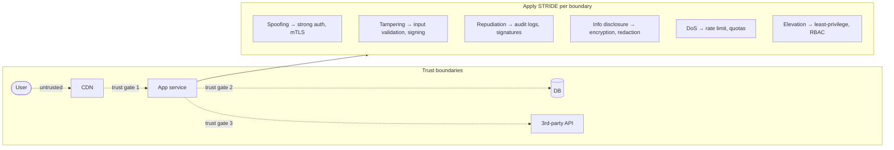

## Definition (interview-ready)

**OWASP Top 10** is a periodically updated list of the most critical web application security risks (broken access control, injection, broken auth, insecure design, etc.). **Threat modeling** is the structured practice of identifying and mitigating threats to a system; **STRIDE** is a popular taxonomy: **S**poofing, **T**ampering, **R**epudiation, **I**nformation disclosure, **D**enial of service, **E**levation of privilege.

**One-liner:** The OWASP Top 10 is the industry's ranked list of the most common web-app security risks, and threat modeling with STRIDE is how you find those risks in your own design before you build it: draw the data flows, mark the trust boundaries, and ask the six STRIDE questions at each crossing.

## Why it matters

Most web application breaches map to one of the OWASP Top 10 categories. Threat modeling early in design surfaces vulnerabilities cheaply — before code, before users, before compliance audits. Engineers who internalize OWASP + STRIDE write meaningfully more secure code by default.



## Core concepts

### OWASP Top 10 (2021 list, and what changed in 2025)

The **2025 edition** reshuffles it: A01 Broken Access Control (now absorbs SSRF), A02 Security Misconfiguration, A03 Software Supply Chain Failures (new, broadens "Vulnerable & Outdated Components"), A04 Cryptographic Failures, A05 Injection, A06 Insecure Design, A07 Authentication Failures, A08 Software or Data Integrity Failures, A09 Security Logging & Alerting Failures, A10 Mishandling of Exceptional Conditions (new). The 2021 list below is still the one most interview material references; numbers in this note use 2021 numbering.

1. **Broken Access Control** — failure to enforce that the user can only do what they're permitted. Pattern: IDOR (insecure direct object reference) — user fetches `/orders/123` belonging to someone else. Fix: server-side authorization on every operation, never just URL-based.

2. **Cryptographic Failures** — sensitive data exposed due to weak crypto or no crypto. Examples: no TLS, weak hashes (MD5/SHA1 for passwords — use bcrypt/Argon2), hardcoded keys.

3. **Injection** — untrusted input executed as code. SQL injection, command injection, NoSQL injection, LDAP injection. Fix: parameterized queries; never string-concatenate user input.

4. **Insecure Design** — flaws in the design itself, not implementation. e.g., no rate limiting on password reset. Fix: threat-model before building.

5. **Security Misconfiguration** — defaults left on, debug enabled in prod, verbose error pages, S3 buckets public. Fix: secure defaults, hardening, CI scanning.

6. **Vulnerable & Outdated Components** — using a library with a CVE. Fix: dependency scanning (Dependabot, Snyk), SBOM, prompt patching.

7. **Identification & Authentication Failures** — weak auth: brute-forceable, no MFA, predictable session IDs, no lockout. Fix: standardize on well-tested libraries; force MFA for sensitive accounts.

8. **Software & Data Integrity Failures** — supply chain compromises, untrusted updates. Fix: signed packages, integrity checks, lockfiles.

9. **Security Logging & Monitoring Failures** — no logs of security events; detection delayed. Fix: log authn / authz / sensitive ops; alert on anomalies.

10. **Server-Side Request Forgery (SSRF)** — server fetches a URL controlled by attacker, hits internal services. Fix: allowlist of outbound destinations, never let user URL be fetched server-side directly.

### Common attack patterns

- **SQL injection**: `'; DROP TABLE users; --` → fix: parameterized queries.
- **XSS** (cross-site scripting): inject JS into a page rendered to others → fix: contextual escaping; CSP header.
- **CSRF** (cross-site request forgery): trick logged-in user's browser into making a request → fix: CSRF tokens, SameSite cookies.
- **IDOR**: `/orders/123` → access someone else's → fix: per-request authorization.
- **SSRF**: pass `http://169.254.169.254/` (AWS metadata) to a server URL fetcher → fix: deny internal IPs.
- **XXE** (XML external entities): inject `<!ENTITY xxe SYSTEM "file:///etc/passwd">` → fix: disable XXE in XML parser.

### Threat modeling — when

- Before building a new feature.
- When designing a new service or system.
- After significant architectural changes.
- During pen-test prep.

Cheap upfront; expensive after deployment.

### STRIDE

For each component, ask:
- **Spoofing**: can someone impersonate a user/service?
- **Tampering**: can data be modified in transit/storage?
- **Repudiation**: can someone deny having done something?
- **Information disclosure**: can data leak to unauthorized parties?
- **Denial of service**: can someone overload / break availability?
- **Elevation of privilege**: can someone gain rights they shouldn't have?

For each: list threats, severity, mitigations.

### Other frameworks

- **DREAD**: Damage, Reproducibility, Exploitability, Affected users, Discoverability — risk scoring.
- **PASTA**: Process for Attack Simulation and Threat Analysis.
- **OCTAVE**: enterprise-focused.

STRIDE is the most commonly taught.

### Data flow diagrams (DFD)

The standard artifact for threat modeling:
- **Entities** (external users, attackers).
- **Processes** (your services).
- **Data stores** (DBs, queues).
- **Data flows** (arrows with what crosses).
- **Trust boundaries** (where trust changes — usually where most threats hide).

For each flow crossing a trust boundary, apply STRIDE.

### Secure-by-design principles

- **Least privilege**: minimum perms needed.
- **Defense in depth**: multiple layers; one failure doesn't = breach.
- **Fail securely**: errors don't reveal info or grant access.
- **Don't trust input**: validate at every boundary.
- **Separate duties**: no one identity does everything.
- **Audit everything sensitive**.

### Security in CI/CD

- **SAST** (static analysis): scan code for issues (CodeQL, Semgrep).
- **DAST** (dynamic): run app, attack it (OWASP ZAP).
- **SCA** (software composition): scan dependencies (Snyk, Dependabot).
- **Secret scanning**: gitleaks, GitHub.
- **IaC scanning**: Checkov, tfsec (now folded into Trivy) for Terraform.
- **Container scanning**: Trivy, Clair for image CVEs.

Pre-merge: SAST + secret scanning. Pre-deploy: SCA + IaC + container scan. Periodic: DAST.

### Bug bounty

External researchers paid to find vulnerabilities. Programs: HackerOne, Bugcrowd. Tier rewards by severity. Complements internal security.

## How it works (threat modeling a new feature)

```
Feature: "Allow users to upload a profile photo."

DFD: User → Web App → File store (S3) → CDN → other users.

STRIDE:
- Spoofing: can another user upload to victim's profile? → Auth on upload.
- Tampering: can someone modify a photo in transit? → TLS.
- Repudiation: do we log uploads? → Audit log.
- Info disclosure: can a public photo URL be guessed? → unguessable IDs (UUIDs).
- DoS: can someone upload 10K huge files? → rate limit, max size.
- EoP: can the upload code be tricked into RCE (e.g., via crafted JPEG, ImageMagick CVE)? → use safe image library, sandbox processing.

Mitigations: auth, TLS, audit, UUID, rate limit + size cap, safe processor.
```

## Real-world examples

- **Equifax breach (2017)**: outdated Struts library — OWASP #6 (vulnerable components).
- **Target breach**: stolen HVAC vendor credentials → lateral movement. OWASP #1 + #7 + lack of segmentation.
- **SolarWinds**: supply chain attack — OWASP #8 (integrity failures).
- **Many AWS S3 leaks**: misconfigured public buckets — OWASP #5.

## Common pitfalls

- **No threat modeling for new features**: vulnerabilities discovered after launch.
- **Authorization in URL filters only**: bypassed easily.
- **Server-side state validation skipped** because "client validates": never trust client.
- **Verbose error messages** in prod (stack traces, SQL errors).
- **DEBUG=true in production**.
- **Hardcoded admin credentials**.
- **No CSP / HSTS / SameSite cookies**.
- **Dependencies never updated**.
- **CI/CD without security scans**.

## Practice questions

<Practice>

<QA q="Walk through the OWASP Top 10." level="easy">

The 2021 list: (1) Broken Access Control, (2) Cryptographic Failures, (3) Injection, (4) Insecure Design, (5) Security Misconfiguration, (6) Vulnerable & Outdated Components, (7) Identification & Authentication Failures, (8) Software & Data Integrity Failures, (9) Security Logging & Monitoring Failures, (10) SSRF. Lead with the top 3 and an example and fix for each. Mention the 2025 edition: SSRF folds into Broken Access Control, Software Supply Chain Failures and Mishandling of Exceptional Conditions are new.

</QA>

<QA q="What is STRIDE?" level="easy">

A threat-modeling taxonomy: **S**poofing, **T**ampering, **R**epudiation, **I**nformation disclosure, **D**enial of service, **E**levation of privilege. For each component or flow, ask what each kind of threat looks like there; the result is a structured list of threats, severities and mitigations.

</QA>

<QA q="How do you prevent SQL injection?" level="easy">

- **Parameterized queries / prepared statements**. Never string-concatenate user input into SQL.
- ORMs do this by default; raw SQL needs explicit care.
- Defense in depth: input validation, least-privilege DB users, monitoring for anomalies.

</QA>

<QA q="How do you store passwords, and which OWASP category covers getting it wrong?" level="easy">

Hash them with a slow, salted password hashing algorithm such as **bcrypt or Argon2**. Fast hashes like MD5 or SHA-1 let attackers brute-force leaked hashes cheaply. Weak or missing crypto (no TLS, weak hashes, hardcoded keys) falls under **Cryptographic Failures**.

</QA>

<QA q="What are XSS and CSRF, and how do you defend against each?" level="medium">

- **XSS**: an attacker injects script into a page rendered to other users, which then runs with their session. Defense: contextual output escaping plus a Content Security Policy (CSP) header.
- **CSRF**: a malicious site makes a logged-in user's browser send a request to your app with their cookies. Defense: CSRF tokens and SameSite cookies.

XSS abuses your page's trust in content; CSRF abuses your server's trust in the browser.

</QA>

<QA q="A user can change `/orders/123` to `/orders/124` and see someone else's order. What kind of bug is it?" level="medium">

**IDOR** (Insecure Direct Object Reference), a form of Broken Access Control (OWASP #1). Fix: server-side authorization on every request, not URL filters, for example `WHERE order.id = ? AND order.user_id = current_user.id`. Unguessable IDs reduce discovery but are not a security control on their own.

</QA>

<QA q="How do you prevent SSRF?" level="medium">

- Allowlist outbound destinations (only known external APIs).
- Block private and special IP ranges (127.0.0.0/8 loopback, 10.0.0.0/8, 172.16.0.0/12, 192.168.0.0/16, 169.254.0.0/16 link-local, which includes the 169.254.169.254 cloud metadata endpoint, and IPv6 `::1/128` and `fc00::/7`).
- Check the IP the hostname actually resolves to, and re-check after redirects, so DNS rebinding or a redirect can't sneak in an internal address.
- Validate URLs strictly before fetching.
- Network level: egress restrictions from the service's VPC.

</QA>

<QA q="What is a data flow diagram in threat modeling and why do trust boundaries matter?" level="medium">

A DFD shows external entities, processes (your services), data stores and the data flows between them, with **trust boundaries** drawn where the level of trust changes (internet → app, app → DB, app → third party). Most threats hide at those crossings, so you apply STRIDE to every flow that crosses a boundary.

</QA>

<QA q="What are the core secure-by-design principles?" level="medium">

- **Least privilege**: grant only the permissions needed.
- **Defense in depth**: several layers, so one failure isn't a breach.
- **Fail securely**: errors don't leak information or grant access.
- **Don't trust input**: validate at every boundary, never rely on client-side checks.
- **Separation of duties**: no single identity can do everything.
- **Audit everything sensitive**.

</QA>

<QA q="How do you handle vulnerable dependencies?" level="hard">

- An SCA tool (Snyk, Dependabot, Trivy) in CI alerts on CVEs.
- Auto-PRs for patch versions; review minor/major upgrades.
- Patch SLAs, for example critical within 24h and high within 7 days.
- An SBOM (software bill of materials) per release for tracking what you ship.
- Fork or replace unmaintained dependencies.

</QA>

<QA q="Walk through a threat model for a password reset flow." level="scenario">

DFD: user → web → email → user clicks link → web → password change.
- Spoofing: can an attacker trigger resets for another user? → rate limit per account; don't reveal whether the email exists.
- Tampering: can the token be guessed or modified? → random 128-bit token (or HMAC-signed).
- Repudiation: log reset requests and completions.
- Info disclosure: send only to the registered address; don't echo it back.
- DoS: rate limit; CAPTCHA on excessive requests.
- EoP: single-use, short-TTL token, verified on use.

</QA>

<QA q="Threat-model a profile photo upload feature." level="scenario">

DFD: user → web app → object store (S3) → CDN → other users.
- Spoofing: uploading to someone else's profile → auth on upload.
- Tampering: changed in transit → TLS.
- Repudiation: → audit log of uploads.
- Info disclosure: guessable photo URLs → unguessable IDs (UUIDs).
- DoS: thousands of huge files → rate limit and max size.
- EoP: crafted image exploiting the processor (for example an ImageMagick CVE) → safe image library, sandboxed processing.

</QA>

<QA q="Design security into a CI/CD pipeline." level="scenario">

- **Pre-commit**: secret scanning hooks (gitleaks).
- **PR**: SAST (CodeQL, Semgrep), SCA (Snyk), IaC scanning (Checkov), secret scanning.
- **Build**: container vulnerability scan (Trivy).
- **Pre-deploy**: security gates that block on critical findings.
- **Post-deploy**: periodic DAST (ZAP) and runtime monitoring.
- A bug bounty for external coverage.

</QA>

</Practice>

## Quiz

<Quiz>

<MCQ q="A user changes an order ID in the URL and sees another customer's order. Which category is this?" options={["Injection", "Broken Access Control (IDOR)", "Cryptographic Failures", "Security Misconfiguration"]} answer={1}>

The server served an object without checking ownership: IDOR, under Broken Access Control. The fix is a per-request authorization check.

</MCQ>

<MCQ q="Which is the correct primary fix for SQL injection?" options={["Escape quotes with a regex", "Hide database error messages", "Parameterized queries or prepared statements", "Use a WAF only"]} answer={2}>

Parameterization keeps user input as data, never as SQL. Escaping, hiding errors and WAFs are partial defenses in depth at best.

</MCQ>

<MCQ q="A feature fetches a user-supplied URL server-side. An attacker submits http://169.254.169.254/. What is the attack?" options={["SSRF, reaching the cloud metadata service through your server", "CSRF", "XSS", "XXE"]} answer={0}>

The server is tricked into requesting an internal address. Fix with destination allowlists, private-IP blocking and egress controls.

</MCQ>

<MCQ q="In STRIDE, which threat does a tamper-evident audit log mainly address?" options={["Spoofing", "Denial of service", "Elevation of privilege", "Repudiation"]} answer={3}>

Repudiation is someone denying they performed an action. Reliable audit logs (and signatures) counter it.

</MCQ>

<MCQ q="Where should you focus STRIDE analysis on a data flow diagram?" options={["Only on the database", "On flows that cross trust boundaries", "Only on external users", "On the CI pipeline"]} answer={1}>

Trust boundaries are where trust levels change and where most threats live. Apply STRIDE to every flow crossing them.

</MCQ>

<MCQ q="A malicious site causes a logged-in user's browser to submit a funds transfer to your app. Which defense targets this directly?" options={["Content Security Policy", "Parameterized queries", "CSRF tokens and SameSite cookies", "bcrypt password hashing"]} answer={2}>

That is CSRF. CSP mainly mitigates XSS; the others address injection and password storage.

</MCQ>

<MCQ q="Which password storage approach is appropriate?" options={["Argon2 or bcrypt with a salt", "SHA-1 of the password", "MD5 with a fixed global salt", "AES encryption with a key in the config file"]} answer={0}>

Slow, salted password hashes make brute-forcing leaked hashes expensive. Fast hashes are cheap to crack and reversible encryption exposes all passwords if the key leaks.

</MCQ>

<MCQ q="The Equifax 2017 breach came from an unpatched Apache Struts library. Which control would most directly have caught it?" options={["DAST of the login page", "CSP headers", "Threat modeling the UI", "Software composition analysis with a patch SLA"]} answer={3}>

SCA flags known CVEs in dependencies, and a patch SLA makes sure they get fixed. This is the Vulnerable & Outdated Components category.

</MCQ>

<MCQ q="A password reset email contains a sequential numeric token. Which STRIDE category is most at risk?" options={["Repudiation", "Spoofing and elevation of privilege, since attackers can guess tokens and take over accounts", "Denial of service only", "None, because the email is private"]} answer={1}>

Guessable tokens let an attacker reset someone else's password and act as them. Use random 128-bit, single-use, short-TTL tokens.

</MCQ>

</Quiz>

## TL;DR cheat sheet

- Top OWASP threats: broken access control, crypto failures, injection.
- **STRIDE** for threat modeling.
- DFDs + trust boundaries to find threats.
- Parameterized queries; never trust client.
- Authorization per request, not just URL.
- Defense in depth.
- Security in CI/CD: SAST + SCA + secret scanning + IaC + container.
- Patch dependencies.
- Threat-model before building, not after breach.

## Go deeper

- **OWASP Top 10**: [owasp.org/www-project-top-ten](https://owasp.org/www-project-top-ten/).
- **OWASP Cheat Sheets**: [cheatsheetseries.owasp.org](https://cheatsheetseries.owasp.org/).
- **Microsoft STRIDE docs**: [learn.microsoft.com/threat-modeling](https://learn.microsoft.com/en-us/azure/security/develop/threat-modeling-tool).
- **Adam Shostack**: *Threat Modeling: Designing for Security* — definitive book.
- **Book**: *The Web Application Hacker's Handbook* — for offensive perspective.
- **Snyk, Semgrep, Trivy**: tooling docs.
- **Bug bounty platforms**: HackerOne, Bugcrowd for real-world findings.
