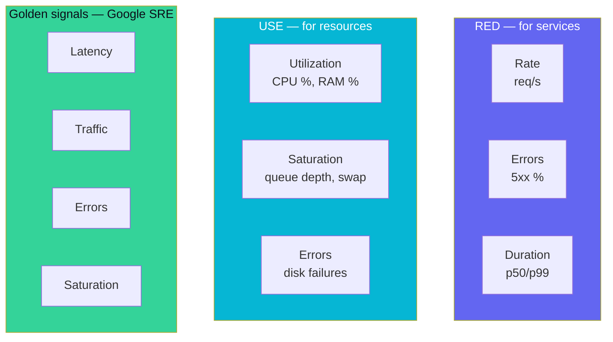

## Definition (interview-ready)

Three complementary frameworks for what to monitor:
- **RED** (Tom Wilkie): **R**ate, **E**rrors, **D**uration — for **request-driven services**.
- **USE** (Brendan Gregg): **U**tilization, **S**aturation, **E**rrors — for **resources** (CPU, disk, network).
- **Golden Signals** (Google SRE): **Latency, Traffic, Errors, Saturation** — for user-facing services.

**One-liner:** RED (rate, errors, duration) tells you whether a service is healthy, USE (utilization, saturation, errors) tells you whether a resource is the bottleneck, and Google's four golden signals are RED plus saturation; together they give a small, standard set of metrics for every dashboard.



## Why it matters

Without a model, dashboards become "everything we could measure," and the signal gets lost. These frameworks give you a small, consistent set of metrics per service / per resource that catches most problems.

## Core concepts

### RED — for services

For every service:
- **Rate**: requests/sec (per endpoint).
- **Errors**: error rate (per endpoint, ideally percent).
- **Duration**: latency distribution (p50, p95, p99).

Example PromQL:
```
sum(rate(http_requests_total{job="api"}[1m])) by (endpoint)
sum(rate(http_requests_total{job="api",status=~"5.."}[1m])) by (endpoint)
histogram_quantile(0.99, sum(rate(http_request_duration_seconds_bucket{job="api"}[1m])) by (le, endpoint))
```

These three metrics, per endpoint, cover most of what you need to know about a service's health.

### USE — for resources

For every resource:
- **Utilization**: % busy time.
- **Saturation**: queue depth or wait time (work piling up beyond capacity).
- **Errors**: error event count.

Apply to: CPU, memory, disk I/O, network, file descriptors, thread pool, connection pool.

Why both U and S: 100% utilization is a likely bottleneck but only hurts once work starts waiting; a resource averaging 80% can still be saturated (bursts queue up within the sampling interval).

### Golden Signals — Google SRE

For user-facing services:
- **Latency**: how long requests take.
- **Traffic**: how much demand (rate).
- **Errors**: rate of failed requests.
- **Saturation**: how full the service is (CPU, memory, queue depth).

Essentially RED + saturation.

### How they fit together

- **RED** for service health (above the kernel).
- **USE** for resource health (below the application).
- **Golden Signals** for user-facing experience.

Most teams build dashboards in a hierarchy:
1. **User experience** (golden signals): is the product working for users?
2. **Per-service** (RED): which service is sick?
3. **Per-resource** (USE): why is the service sick?

### Capacity planning

Saturation metric tells you when to scale:
- Around 70% sustained utilization → start scaling (a common rule of thumb, not a law).
- Sustained saturation (work regularly queueing) → scale now.
- Combine with traffic forecast to size.

### Per-endpoint vs aggregate

Aggregate metrics hide per-endpoint problems. A service that's 99% healthy but its `/checkout` is broken looks fine on aggregate. Always break down by endpoint.

### Dashboard hierarchy

Typical layout:
- **Overview**: traffic, error rate, p99 latency.
- **Per-endpoint**: RED for each endpoint.
- **Dependencies**: status of upstreams (DB, cache, downstream services).
- **Resources**: USE for CPU, memory, pool saturation.
- **Business metrics**: revenue, orders/sec, signups/sec.

Keep each dashboard focused; link to deeper ones.

## How it works (alert on RED)

```
# Alert: error rate above 5% (a simple threshold; SLO burn-rate alerts are better, see the SLO note)
- alert: HighErrorRate
  expr: |
    sum(rate(http_requests_total{status=~"5.."}[5m])) by (service)
    / sum(rate(http_requests_total[5m])) by (service)
    > 0.05
  for: 5m
  labels: { severity: page }
  annotations:
    summary: "{{ $labels.service }} error rate > 5%"

# Alert: p99 latency breach
- alert: HighLatency
  expr: histogram_quantile(0.99, sum(rate(http_request_duration_seconds_bucket[5m])) by (le, service)) > 1.5
  for: 5m
```

## Real-world examples

- **Google SRE Book**: established Golden Signals as the canonical framework.
- **Tom Wilkie at Weaveworks** (later Grafana Labs): codified RED (2015).
- **Brendan Gregg** (then at Joyent, later Netflix): codified USE for performance analysis (2012).
- **Prometheus + Grafana** standard dashboards lean on these.

## Common pitfalls

- **CPU-only monitoring**: CPU at 80% with a deep queue is much worse than 95% with no queue. Use saturation.
- **Average latency**: lies about tail. Always include p95/p99.
- **One global dashboard for everything**: noisy. Per-service RED is more actionable.
- **No business metrics**: technical metrics green, but revenue dropped — you wouldn't notice.
- **Ignoring saturation**: until it's too late and customers feel it.

## Practice questions

<Practice>

<QA q="What is RED?" level="easy">

Rate, Errors, Duration: three metrics per service, typically per endpoint. Rate = requests/sec, errors = failed requests (ideally as a percentage), duration = latency distribution (p50, p95, p99). It captures service health from the caller's point of view. Codified by Tom Wilkie.

</QA>

<QA q="What is USE and when do you apply it?" level="easy">

Utilization, Saturation, Errors, applied to every **resource**: CPU, memory, disk I/O, network, file descriptors, thread pools, connection pools. It tells you whether a resource is the bottleneck. Codified by Brendan Gregg. Use it once RED shows a service is sick and you need to find out why.

</QA>

<QA q="Walk through Google's golden signals." level="easy">

Latency (how long requests take), traffic (demand, the rate), errors (rate of failed requests) and saturation (how full the service is: CPU, memory, queue depth). They describe user-facing health; essentially RED plus saturation. Google SRE uses them as the starting template for any service.

</QA>

<QA q="Why track p95/p99 latency instead of average?" level="easy">

The average hides the tail. A service can average 100 ms while 1% of users wait seconds, and those slow requests are what users notice. Track a latency histogram and look at p50, p95 and p99.

</QA>

<QA q="How do RED, USE and the golden signals fit together?" level="medium">

They form a hierarchy for dashboards and debugging:
1. **Golden signals**: is the product working for users?
2. **RED per service**: which service is sick?
3. **USE per resource**: why is it sick?

RED covers health above the kernel; USE covers resources below the application.

</QA>

<QA q="What is the difference between utilization and saturation?" level="medium">

Utilization = the % of time a resource was busy. Saturation = work piling up beyond capacity (queue depth, wait time). High utilization with no queue is fine. Saturation is what users feel: a resource averaging 80% can still be saturated when bursts queue up within the sampling interval, and serialized access can saturate with low utilization.

</QA>

<QA q="Why break RED metrics down per endpoint?" level="medium">

Aggregates hide localized failures. A service can be 99% healthy overall while `/checkout`, a small share of traffic, is completely broken. Per-endpoint rate, errors and duration show the problem immediately, and the endpoints with the most business impact can get their own alerts.

</QA>

<QA q="Why include business metrics alongside RED and USE?" level="medium">

Technical metrics can be all green while users can't complete a purchase: a bug that returns 200 with wrong content, a broken payment provider flow, a frontend error. Business metrics like orders/sec, revenue and signups/sec catch those, so they belong at the top of the dashboard hierarchy.

</QA>

<QA q="How do you define saturation for a Kubernetes pod?" level="hard">

- CPU throttling rate (time capped by the CPU limit).
- Memory close to the limit (approaching OOMKill).
- Connection pool wait queue depth.
- HTTP server request queue.
- Disk I/O wait.

Combined, they express how much headroom is left before work starts waiting.

</QA>

<QA q="How do you use saturation in capacity planning?" level="hard">

Treat saturation as the scaling trigger: around 70% sustained utilization means start scaling, and any sustained saturation (work queueing) means scale now. Combine these with a traffic forecast to size capacity ahead of demand rather than reacting once customers already feel the queueing.

</QA>

<QA q="How would you design alerts using these frameworks?" level="scenario">

- RED-based: alert on error rate (for example over 5% for 5 minutes) and p99 latency (for example over 1.5 s for 5 minutes).
- USE-based: alert on sustained saturation (queue depth above 0 for 5 minutes) as an early capacity warning.
- Prefer symptom-based alerts tied to SLOs ([SLIs, SLOs & Error Budgets](/learn/notes/sli-slo-sla-error-budgets/)) over raw resource thresholds; page on symptoms, use resources for diagnosis.

</QA>

<QA q="A service's CPU is at 30% but p99 latency is bad. Diagnose it." level="scenario">

It is not CPU-bound. Check:
- **Saturation elsewhere**: connection pool full, thread pool full, queue piling up.
- **GC**: stop-the-world pauses inflating the tail.
- **Slow downstream**: DB, API, cache.
- **Lock contention**: threads waiting with little CPU use.
- **Network**: bandwidth or RTT to a dependency.

</QA>

<QA q="A team has hundreds of dashboards. How do you bring sanity?" level="scenario">

- Audit who looks at what; most go unused.
- Standardize: every service gets the same RED + USE template.
- Hierarchy: overview → per-service → per-resource, linked together.
- Link alerts to specific dashboard rows.
- Deprecate unused dashboards aggressively.
- One business-KPI dashboard at the top.

</QA>

</Practice>

## Quiz

<Quiz>

<MCQ q="Which framework is designed for resources such as CPU, disks and connection pools?" options={["RED", "USE", "Golden signals", "DORA"]} answer={1}>

USE (Utilization, Saturation, Errors) is per resource. RED is per service, golden signals are user-facing, and DORA measures delivery performance.

</MCQ>

<MCQ q="What do the golden signals add on top of RED?" options={["Utilization", "Business metrics", "Saturation", "Per-endpoint breakdown"]} answer={2}>

Latency, traffic and errors map to Duration, Rate and Errors; saturation is the extra signal.

</MCQ>

<MCQ q="A CPU averages 80% busy, yet requests are queueing during short bursts. Which USE metric reveals the problem?" options={["Saturation", "Utilization", "Errors", "Rate"]} answer={0}>

Averaged utilization smooths bursts away. Saturation (queue depth, wait time) shows work piling up beyond capacity.

</MCQ>

<MCQ q="Overall error rate is 0.5%, but every checkout request is failing. Why might the dashboard miss it?" options={["Error rates can't be measured for POST requests", "Latency hides errors", "Saturation is too low", "Checkout is a small share of traffic, so the aggregate hides it; break down per endpoint"]} answer={3}>

Aggregates dilute localized failures. Per-endpoint RED surfaces them immediately.

</MCQ>

<MCQ q="CPU is at 30% but p99 latency is very high. Which is the most likely class of cause?" options={["The service needs more CPU cores", "Waiting on something other than CPU, such as a full connection pool, GC pauses or a slow dependency", "The latency metric is wrong because CPU is low", "Too few endpoints"]} answer={1}>

Low CPU with high tail latency means time is spent waiting, not computing. Look at pool saturation, GC, locks and downstream latency.

</MCQ>

<MCQ q="All technical dashboards are green but orders per minute dropped 40%. What does this show?" options={["Business metrics are needed to catch failures technical metrics miss", "Prometheus is broken", "USE should replace RED", "Alerts should be based on CPU"]} answer={0}>

A request can succeed technically while the business flow fails. Business KPIs at the top of the hierarchy catch it.

</MCQ>

<MCQ q="Which is the best signal for Kubernetes pod saturation on CPU?" options={["Pod restart count", "Number of replicas", "Image size", "CPU throttling caused by the CPU limit"]} answer={3}>

Throttling means the pod wanted more CPU than its limit allowed, so work waited. Restarts and replica counts are not saturation measures.

</MCQ>

<MCQ q="Following Google SRE practice, what should page an on-call engineer?" options={["Any host above 70% CPU", "Symptoms tied to SLOs, such as error rate or latency breaches", "Every log line at ERROR level", "Disk utilization at 50%"]} answer={1}>

Symptom-based alerts reflect user pain. Resource thresholds are better used for diagnosis and capacity warnings than for paging.

</MCQ>

<MCQ q="In the dashboard hierarchy, what is the role of USE-per-resource views?" options={["Decide whether users are affected", "Replace business metrics", "Explain why a service that RED flagged is unhealthy", "Measure deployment frequency"]} answer={2}>

Golden signals say whether users are affected, RED says which service is sick, and USE says why.

</MCQ>

</Quiz>

## TL;DR cheat sheet

- **RED**: Rate, Errors, Duration — for services.
- **USE**: Utilization, Saturation, Errors — for resources.
- **Golden Signals**: Latency, Traffic, Errors, Saturation — for user-facing.
- Always include saturation; utilization alone is misleading.
- Always p95/p99 latency, not just average.
- Always per-endpoint, not just aggregate.
- Dashboard hierarchy: user experience → service health → resource health.
- Standardize across services; deprecate the rest.

## Go deeper

- **Brendan Gregg**: ["USE Method"](https://www.brendangregg.com/usemethod.html).
- **Tom Wilkie**: ["The RED Method: How to Instrument Your Services"](https://grafana.com/blog/the-red-method-how-to-instrument-your-services/).
- **Google SRE Book Ch. 6**: ["Monitoring Distributed Systems"](https://sre.google/sre-book/monitoring-distributed-systems/).
- **PromCon talks** on Prometheus dashboards.
- **Grafana docs** on dashboard design.
