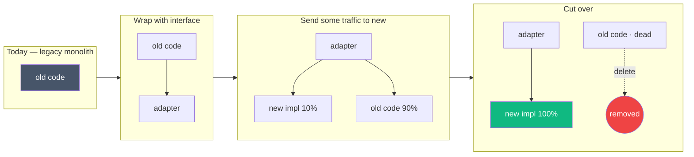

## Definition (interview-ready)

**Refactoring** is improving the internal structure of code without changing its external behavior. **Tech debt** is the implied cost of additional rework caused by choosing an easy/quick solution now instead of a better approach. Healthy teams continuously refactor and consciously manage debt — paying it down deliberately rather than waiting for catastrophic failure.

## Why it matters

Every codebase accumulates debt; what differs is how teams respond. Teams that ignore debt slow down progressively until they can't ship. Teams that refactor continuously keep velocity high for years. Refactoring is the practical skill; debt management is the discipline.



## Core concepts

### Refactoring (Fowler's definition)

> Disciplined technique for restructuring an existing body of code, altering its internal structure without changing its external behavior.

Key property: **behavior preservation**. Refactoring + tests = safe restructuring.

### Common refactorings

#### Method-level
- **Extract method**: pull a block into a named method.
- **Inline method**: when a method's body is as clear as its name.
- **Rename**: make names match concepts (a small change with big impact).
- **Replace temp with query**: replace a local variable with a method call.
- **Introduce parameter object**: bundle related parameters.

#### Class-level
- **Extract class**: when a class does two things.
- **Move method/field**: between classes.
- **Replace inheritance with delegation**: composition over inheritance.
- **Extract interface**: separate abstraction.

#### Design-level
- **Replace conditional with polymorphism**: a switch on type → subclasses.
- **Replace nested conditional with guard clauses**: flatten if/else nesting.
- **Replace null with null object** or Option/Maybe.
- **Introduce strategy pattern**: extract behavioral variants.

#### System-level
- **Strangler fig**: gradually replace a legacy system by routing new functionality to a new system while old continues.
- **Branch by abstraction**: introduce abstraction, swap implementations.
- **Expand-and-contract** ([Schema Evolution](/learn/notes/schema-evolution/)): for schema/API changes without big-bang releases.

### Code smells (Fowler)

Signs that refactoring may be needed:
- **Long method**: > ~20 lines often hard to follow.
- **Large class**: doing too many things.
- **Long parameter list**: bundle into objects.
- **Duplicated code**: extract method or shared utility.
- **Feature envy**: one class accessing another's data heavily — move the method.
- **Data clumps**: groups of variables always passed together — make a value object.
- **Primitive obsession**: string for everything (use a small typed wrapper).
- **Switch statement on type**: polymorphism.
- **Shotgun surgery**: one change touches many files — consolidate responsibility.
- **Comments**: often a smell — code should be self-explanatory; comments compensate.

### Test before refactor

The premise of refactoring: tests give you confidence behavior didn't change. If tests are missing:
1. Add **characterization tests** first (tests that document current behavior, even if quirky).
2. Then refactor.
3. As you refactor, improve tests.

### Tech debt categorization

Ward Cunningham coined "debt" as a metaphor. Martin Fowler's quadrant:

|             | Reckless        | Prudent             |
|-------------|-----------------|---------------------|
| **Deliberate** | "We don't have time" | "Ship now; refactor later" |
| **Inadvertent** | "What's design?"   | "Now we know better"      |

- **Reckless deliberate**: knowing better, choosing worse.
- **Prudent deliberate**: conscious tradeoff (often justified for speed).
- **Reckless inadvertent**: ignorance.
- **Prudent inadvertent**: learning shows what we'd do differently.

Manage all four. Prudent debt is fine if you actually plan to pay it.

### Strategies for managing debt

#### Boy Scout rule

Leave the campground cleaner than you found it. Every PR that touches a file should improve it slightly — rename a variable, extract a small function, add a missing test.

Over time, the codebase improves silently.

#### Refactoring as part of feature work

Tie refactoring to features: "to add feature X, first refactor Y." Don't make standalone "refactor PR-only" sprints — they have no business justification and stall.

#### Tech debt sprints / 20% time

Some teams dedicate ~20% of capacity to debt reduction. Helps but is no substitute for continuous improvement.

#### Inventory and prioritize

Maintain a tech debt list:
- What is the debt?
- What does it cost (per week, per incident)?
- What does fixing it unblock?
- Effort vs payoff.

Pick the highest-impact items.

#### Strangler fig pattern

For legacy systems too big to rewrite:
1. Build new system alongside.
2. Route new requests to new system.
3. Migrate functionality incrementally.
4. Eventually decommission old.

Named after the strangler fig tree that grows around its host.

### Anti-patterns

- **Big rewrite**: re-implement from scratch. Almost always fails — you re-create bugs, lose institutional knowledge, drag on for years.
- **Refactor in a separate branch for months**: merge becomes impossible. Refactor in main, behind flags.
- **Refactor without tests**: behavioral regressions.
- **"Productivity dip"**: ignoring debt until it cripples velocity, then heroics.
- **No metric for debt**: invisible; never prioritized.

### Refactoring techniques in practice

#### Working with legacy code

(Michael Feathers' *Working Effectively with Legacy Code*)

- **Sprout method / class**: add new functionality in a new method/class; tested separately.
- **Wrap method**: wrap legacy with new behavior + delegate.
- **Identify seams**: places where you can inject test doubles to make code testable.

#### Test-driven development (TDD)

Red → Green → Refactor. Write failing test, make it pass minimally, refactor with safety. Produces well-tested, often well-factored code.

### Measuring debt

- **Code coverage**: low coverage = riskier refactors.
- **Cyclomatic complexity**: high in files = harder to maintain.
- **Code churn**: files changed frequently = candidates for refactoring.
- **Sentry / on-call frequency**: which areas cause most incidents?
- **PR cycle time**: getting slower = code resistance.
- **DORA metrics**: deployment frequency dropping is a debt signal.

## How it works (a strangler migration)

```
Year 0: Legacy monolith handles all requests.
Year 1: New service receives a subset (e.g., /v2/user/...) via routing.
Year 2: More functionality migrated, monolith shrinks.
Year 3: Monolith handles only legacy data lookups; new code added to new service.
Year 4: Monolith decommissioned; new system is the system.

Throughout: both systems run; tests cover both; team can roll back any step.
```

## Real-world examples

- **GitHub's Rails monolith**: incremental refactoring; haven't done a big rewrite, just continuous improvement.
- **Shopify**: refactoring + modular monolith; teams own components (boundaries enforced with Packwerk).
- **Etsy**: famous for continuous delivery; constant small refactors.
- **Netflix**: refactored from monolith to microservices over years (not a big-bang rewrite).
- **Twitter's RoR-to-JVM migration**: years of strangler-style refactoring.

## Common pitfalls

- **Big rewrite**: kills velocity for years; often fails.
- **No tests + ambitious refactor**: bugs.
- **Refactoring in a parallel branch**: drift, merge pain.
- **Cosmetic-only refactoring**: rename without understanding → introduce bugs.
- **Refactor without aligning with product**: business doesn't see value; deprioritized.
- **"It's working, don't touch"**: until it isn't and then everyone's stuck.
- **Refactoring inside critical incidents**: don't. Stabilize, then refactor.

## Practice questions

<Practice>

<QA q="What's the difference between refactoring and rewriting?" level="easy">

Refactoring changes internal structure **without changing external behavior**; it's small, frequent, and safe when backed by tests. Rewriting replaces significant chunks of code and may change behavior. Refactor often; rewrite rarely.

</QA>

<QA q="What's a 'code smell'?" level="easy">

A surface indicator that something may be wrong in the code: long methods, duplicated code, large classes, primitive obsession, feature envy. Smells don't dictate a refactoring, they suggest where to look. Fowler's *Refactoring* lists 22 common smells in the 1st edition; the 2nd edition (2018) revises the catalog (adding e.g. Mysterious Name, Global Data).

</QA>

<QA q="What's the strangler fig pattern?" level="easy">

Build the new system alongside the legacy one. Route some functionality to the new system and expand gradually while the legacy keeps serving the rest. The legacy shrinks over time and is eventually decommissioned. It lets you migrate without big-bang risk, and every step can be rolled back.

</QA>

<QA q="What are characterization tests and when do you write them?" level="easy">

Tests that pin down what the code **currently does**, quirks included, rather than what it should do. You write them before refactoring code that lacks tests, so any behavior change shows up as a failure. Then refactor, and improve the tests as you go.

</QA>

<QA q="Explain Fowler's tech debt quadrant." level="medium">

Two axes: **deliberate vs inadvertent** and **reckless vs prudent**.
- Reckless deliberate: 'we don't have time' — knowing better, choosing worse.
- Prudent deliberate: 'ship now, refactor later' — a conscious tradeoff, often justified for speed.
- Reckless inadvertent: 'what's design?' — ignorance.
- Prudent inadvertent: 'now we know better' — learning reveals a better design.

All four need managing; prudent debt is fine only if you actually plan to pay it.

</QA>

<QA q="What's the Boy Scout rule and why tie refactoring to feature work?" level="medium">

Leave the code cleaner than you found it: every PR that touches a file improves it slightly (a rename, a small extracted function, a missing test). Over time the codebase improves silently. Tying bigger refactors to features ('to add X, first refactor Y') gives them a business justification; standalone refactor-only sprints tend to stall and get deprioritized.

</QA>

<QA q="How do sprout method, wrap method, and seams help with legacy code?" level="medium">

From Feathers' *Working Effectively with Legacy Code*:
- **Sprout method/class**: put new functionality in a new, separately tested method or class instead of growing the untested one.
- **Wrap method**: wrap legacy behavior with new behavior and delegate to the original.
- **Seams**: places where you can change behavior without editing the code there, e.g. to inject test doubles, making legacy code testable.

</QA>

<QA q="When is rewriting actually justified?" level="medium">

- The technology is genuinely incompatible (dead framework, no upgrade path).
- The codebase is small enough to rewrite in weeks, not years.
- The business has explicitly scoped the rewrite as a project.
- The team fully understands current behavior, so it can be re-implemented.

Otherwise refactor incrementally — big rewrites usually fail: you re-create bugs, lose institutional knowledge, and drag on for years.

</QA>

<QA q="How do you measure tech debt?" level="medium">

No single metric; combine signals:
- **Code coverage**: low coverage makes refactors riskier.
- **Cyclomatic complexity**: complex files are harder to maintain.
- **Code churn**: frequently changed files are refactoring candidates (especially if also complex).
- **Incident / on-call frequency** by area.
- **PR cycle time** getting slower signals code resistance.
- **DORA metrics**: dropping deployment frequency is a debt signal.

</QA>

<QA q="How would you approach a legacy codebase you've inherited?" level="scenario">

- Read first; don't change immediately.
- Add characterization tests where missing.
- Identify smells, but don't refactor everything at once.
- Apply the Boy Scout rule: small improvements every PR.
- Tie larger refactors to feature work — pay debt where there's payoff.
- Start with high-churn or incident-prone areas.

</QA>

<QA q="How do you justify refactoring to non-engineering stakeholders?" level="scenario">

- Tie it to product outcomes: 'after this refactor we can ship feature X in 1 week instead of 6.'
- Show data: incidents, slow deploys, on-call burden.
- Avoid 'refactor for refactoring's sake' pitches.
- Bundle it into feature work where possible.

</QA>

<QA q="A team is debating whether to ship now (with known debt) or refactor first. How do you decide?" level="scenario">

- Is the debt blocking the feature, or just adjacent to it?
- What does carrying it cost per week?
- What does fixing it now cost?
- Is there a quick mitigation that buys time?
- Critically: if you ship, track the debt explicitly so it isn't forgotten.

</QA>

<QA q="Design a process for managing tech debt." level="scenario">

- **Inventory**: a backlog of known debt with impact and effort estimates.
- **Ownership**: each item has a team owner.
- **Prioritization**: by ROI (impact / effort), incident proximity, business risk.
- **Capacity**: e.g. ~20% of sprint capacity, or rolled into feature work.
- **Metrics**: items shipped, incidents reduced, velocity trends.
- **Avoid** standalone 'tech debt months' — they cause context switches and lack business justification.

</QA>

<QA q="Your team wants to restructure a core module over several months. How do you avoid a merge nightmare?" level="scenario">

Don't do it in a long-lived parallel branch — it drifts and the merge becomes impossible. Refactor on main in small steps behind flags, using **branch by abstraction**: introduce an abstraction over the module, move callers onto it, build the new implementation behind it, shift traffic gradually, then delete the old implementation. Keep tests green at every step so any step can be rolled back.

</QA>

</Practice>

## Quiz

<Quiz>

<MCQ q="Which change is a refactoring in Fowler's sense?" options={["Extracting a block into a well-named method with all tests still passing", "Fixing a bug where totals were rounded wrongly", "Adding a new optional field to an API response", "Replacing the monolith with a new service written from scratch"]} answer={0}>

Refactoring alters internal structure without changing external behavior. A bug fix and a new API field change behavior; a from-scratch replacement is a rewrite.

</MCQ>

<MCQ q="You must refactor a module that has no tests. What should come first?" options={["Refactor carefully and rely on code review", "Write characterization tests that capture current behavior", "Rewrite the module so it is testable", "Add comments explaining each function"]} answer={1}>

Characterization tests document what the code does today, quirks included, so the refactor can be checked for behavior changes. Review alone is not a safety net, a rewrite adds risk, and comments don't verify behavior.

</MCQ>

<MCQ q="A team knowingly takes a shortcut to hit a launch date and logs a ticket to clean it up. Which quadrant is this?" options={["Reckless deliberate", "Reckless inadvertent", "Prudent deliberate", "Prudent inadvertent"]} answer={2}>

It's a conscious tradeoff with a plan to repay — prudent and deliberate. Reckless deliberate is 'we don't have time' with no plan; inadvertent debt is discovered later rather than chosen.

</MCQ>

<MCQ q="One class constantly reaches into another class's fields to compute things. Which smell and fix fit best?" options={["Shotgun surgery; consolidate responsibility", "Data clumps; introduce a value object", "Primitive obsession; add a typed wrapper", "Feature envy; move the method to the class that owns the data"]} answer={3}>

Feature envy is a method more interested in another class's data; the fix is to move it there. Shotgun surgery is one change touching many files, data clumps are variables always passed together, primitive obsession is using strings or ints for domain concepts.

</MCQ>

<MCQ q="Why does the strangler fig pattern lower migration risk compared with a big rewrite?" options={["It avoids the need for any tests", "Both systems run while functionality moves incrementally, so each step can be rolled back", "It finishes faster than any rewrite", "It requires no routing layer"]} answer={1}>

Incremental routing to the new system keeps the old one serving and every step reversible. It still needs tests and a routing or adapter layer, and it often takes years, not less time.

</MCQ>

<MCQ q="Which practice is most likely to make a large refactor fail?" options={["Doing it for months in a long-lived parallel branch", "Doing it on main behind feature flags", "Introducing an abstraction and swapping implementations behind it", "Tying each step to feature work"]} answer={0}>

Long-lived branches drift from main and make the final merge painful or impossible. Flags on main, branch by abstraction, and feature-tied steps are the recommended alternatives.

</MCQ>

<MCQ q="Which signal best suggests which files to refactor first?" options={["Files with the most comments", "Files that have not changed in years", "Files with high churn that are also tied to frequent incidents", "Files with the fewest lines"]} answer={2}>

Churn plus incident frequency shows where debt is actively costing time and reliability. Stable, untouched files usually aren't worth the risk; comment count and size alone say little.

</MCQ>

<MCQ q="To add behavior to an untested legacy method with minimal risk, Feathers suggests:" options={["Inlining the legacy method into its callers", "Deleting the legacy method and rewriting it", "Adding the new logic directly in the middle of the legacy method", "Sprouting a new, separately tested method and calling it from the legacy code"]} answer={3}>

Sprout method keeps new code isolated and testable while touching the legacy code minimally. Inlining, rewriting, or editing the untested middle all increase risk.

</MCQ>

<MCQ q="A refactor-only sprint keeps getting cancelled by product. What is the most effective change?" options={["Schedule a whole tech debt month instead", "Tie refactors to features and show their impact on delivery time and incidents", "Do the refactors secretly in a separate branch", "Stop tracking debt so it doesn't distract planning"]} answer={1}>

Debt work gets prioritized when it's linked to outcomes stakeholders care about. Debt months cause context switches, secret branches cause merge pain, and untracked debt is never prioritized.

</MCQ>

</Quiz>

## TL;DR cheat sheet

- **Refactor**: improve structure without changing behavior.
- **Tests are the safety net**: characterize first if missing.
- Common smells: long method, large class, duplicates, primitive obsession, feature envy.
- **Boy Scout rule**: improve as you go.
- Bundle refactors with feature work.
- **Strangler fig** for big legacy migrations.
- **Big rewrites** usually fail. Avoid.
- Track debt explicitly: inventory + impact + plan.
- DORA metrics + on-call frequency reveal debt impact.

## Go deeper

- **Martin Fowler**: *Refactoring* (2nd ed) — bible of the discipline.
- **Refactoring Guru**: [refactoring.guru](https://refactoring.guru/) — patterns + examples.
- **Michael Feathers**: *Working Effectively with Legacy Code* — the playbook for messy codebases.
- **Kent Beck**: *Test-Driven Development by Example*.
- **Ward Cunningham**: original "debt" coining; videos on debt metaphor.
- **Sandi Metz** talks: pragmatic refactoring (OO, often Ruby).
- [Schema Evolution](/learn/notes/schema-evolution/) — expand-migrate-contract is a refactoring pattern.
- **Continuous Refactoring** culture posts from Spotify, Shopify, Etsy.
