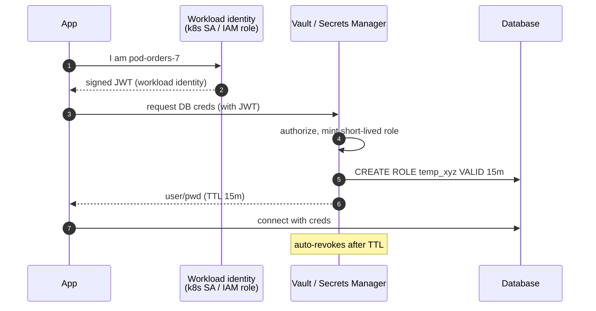

## Definition (interview-ready)

**Secrets** are sensitive credentials (DB passwords, API keys, signing keys, OAuth client secrets). **Secrets management** is the discipline of storing, distributing, rotating, and auditing them — never in code, never in plain config files. Tools: **HashiCorp Vault**, **AWS Secrets Manager**, **AWS KMS**, **GCP Secret Manager**, **GCP KMS**, **Azure Key Vault**, **SOPS**.

**One-liner:** Secrets management means keeping credentials out of code and config, delivering them to workloads at runtime based on the workload's identity, making them short-lived or regularly rotated, and logging every access.

## Why it matters

Leaked secrets are responsible for many of the largest production incidents (data breaches, crypto thefts, abused cloud accounts). Done right, secrets are short-lived, dynamically issued, audited per access, and never reach a developer's laptop in plaintext.




## Core concepts

### What's a secret?

- Database passwords, API keys.
- TLS private keys, SSH keys.
- OAuth client secrets, JWT signing keys.
- Encryption keys (KMS-managed).
- Tokens (cloud, GitHub, internal).

### Where they shouldn't be

- **In git** (even private repos — gitleaks scans find them).
- **In Dockerfile** `ENV`/`ARG` values (stored in the image config and `docker history`, readable by anyone who can pull the image).
- **In CI/CD logs** (echo them once and they're in your build history forever).
- **In plain environment variables, if you can avoid it**: readable via `/proc/PID/environ` by the same user or root, inherited by child processes, and often dumped by crash reports and debug pages. Files mounted with tight permissions, or fetching at runtime, are safer.

### Vault patterns

#### Static secret (KV store)

Store the credential; apps fetch on startup.

```
vault kv put secret/myapp/db username=admin password=...
vault kv get secret/myapp/db
```

Limitation: still a long-lived credential.

#### Dynamic secrets

Vault generates a unique short-lived credential per request, deletes when done.

E.g., `vault read database/creds/myapp-role` → returns a unique DB username + password valid for the role's TTL (say 1 hour), automatically dropped at expiry.

Benefits:
- No two services share a credential.
- Leaked credential expires in an hour.
- Per-request audit trail.

Supported: AWS IAM credentials, DB users (Postgres, MySQL), SSH OTPs, PKI certs, etc.

#### Transit (encryption as a service)

Vault encrypts on demand without giving you the key. Apps call `vault write transit/encrypt/mykey plaintext=...` and get ciphertext back; later call decrypt. Useful for encrypting data fields without managing keys.

### KMS (Key Management Service)

Centralized key store. AWS KMS, GCP KMS, Azure Key Vault.

- Keys never leave KMS.
- Apps call KMS to encrypt/decrypt data.
- Envelope encryption: KMS encrypts a **data key**, app uses the data key to encrypt large data. KMS only sees small data keys.

Use case: encrypting fields in DB, encrypting S3 objects with customer-managed keys.

### Envelope encryption

```
data → AES → encrypted_data
key generated locally; encrypted by KMS → encrypted_data_key

Store: encrypted_data + encrypted_data_key
Read: KMS decrypts data_key → use data_key to decrypt data.
```

Why: KMS calls are network round-trips (milliseconds each) and rate-limited, and KMS only encrypts small payloads directly (AWS KMS `Encrypt` takes at most 4 KB). Envelope = KMS used once per data key, not per encryption.

### Rotation

- Secrets must be rotatable.
- Dynamic secrets (Vault DB engine): rotation is automatic — every new lease has a new credential.
- Static secrets: rotate on a schedule, for example AWS Secrets Manager rotation functions or Vault database static roles, which change a fixed DB user's password every rotation period.
- App must handle: receive new secret, gracefully switch.

### Secrets in Kubernetes

- **k8s Secrets**: only base64-encoded, stored in etcd, and encrypted at rest only if etcd encryption is configured (many managed clusters do this for you, ideally with KMS). Not strong by themselves.
- **Vault Agent / CSI driver**: pulls real secrets from Vault and mounts as files.
- **External Secrets Operator (ESO)**: syncs from Vault / AWS Secrets Manager / GCP Secret Manager into k8s Secrets.
- **SOPS + age**: secrets encrypted in git, decrypted at deploy time.

### Workload identity

How does a service authenticate to Vault?
- **AppRole**: long-lived role ID + secret ID. Decent.
- **Kubernetes ServiceAccount**: Vault validates the SA token via k8s API.
- **Cloud workload identity**: AWS IAM role, GCP Workload Identity, Azure Managed Identity. Best — no secret to manage.

### Auditing

Every secret access logged: who, what secret, when, success/failure.

Critical for: incident response, compliance, forensics.

### Just-in-time access

For human access to production secrets:
- **Break-glass**: regular access denied; emergency access requires approval + audit.
- **Approval flow**: another engineer approves; logged.
- **Time-bound**: access expires automatically.

### Secret scanning

- **gitleaks, trufflehog**: scan repos for leaked secrets.
- **Pre-commit hooks**: catch before commit.
- **Provider scanning**: GitHub Secret Scanning detects exposed tokens in public repos and notifies the issuer (AWS, GCP, ...), which may revoke or quarantine them (AWS attaches a quarantine policy to the leaked key).

## How it works (a Vault DB credential flow)

```
1. App boots in k8s. Service Account = "payment-svc".
2. Vault Agent reads SA token, presents to Vault.
3. Vault validates token via k8s API; matches "payment-svc" → Vault role.
4. Vault role grants access to "database/creds/payment-role".
5. App requests DB credentials.
6. Vault DB engine connects to DB, CREATE USER xyz123 with password rnd, GRANT permissions.
7. Vault returns { username: xyz123, password: rnd, lease_id: ..., ttl: 1h } to app.
8. App connects to DB with these creds.
9. After 1h, Vault revokes the user (DROP USER) and app must request new ones.
10. All access logged in Vault audit.
```

## Real-world examples

- **HashiCorp Vault** (IBM): de facto standard, widely used by large enterprises; source-available under BSL since 2023 — **OpenBao** is the open-source (MPL) fork.
- **AWS Secrets Manager + KMS**: managed AWS ecosystem.
- **GCP Secret Manager + KMS**: GCP equivalent.
- **Doppler, Pulumi ESC**: modern SaaS secrets managers.
- **GitHub Advanced Security**: secret scanning + push protection.

## Common pitfalls

- **Secrets in code / git history**: clean git history is hard; assume permanently leaked.
- **Same secret across environments**: dev compromise = prod compromise.
- **No rotation**: long-lived credentials live for years.
- **Plain env vars**: visible via `/proc`, debugger, error pages.
- **Secrets in logs**: hard to remove from log archives; cleanse at source.
- **No audit**: can't tell who used what.
- **Hardcoded admin credentials** in scripts.
- **Vault as SPOF**: if Vault is down, services can't get secrets. HA + caching.
- **Trust in CI/CD logs**: print a secret once, it's archived.

## Practice questions

<Practice>

<QA q="Where should secrets never live, and why?" level="easy">

- **Git** (even private repos) — history is effectively permanent and scanners find them.
- **Dockerfile ENV** — baked into the image config and history, which anyone with the image can read.
- **CI/CD logs** — print once and it's in build history forever.
- **Plain environment variables** — visible via `/proc/PID/environ`, debuggers, error pages.

Fetch them at runtime from a secrets manager instead.

</QA>

<QA q="What's a dynamic secret?" level="easy">

A credential generated on demand, unique per requester, with a short TTL. Vault creates it (e.g. a DB user) and revokes it after expiry. No two services share it and there's no long-lived credential to leak; each issue is audited. It replaces static stored credentials.

</QA>

<QA q="How do you catch secrets before they leak through a repo?" level="easy">

Layers: **pre-commit hooks** to block commits locally, **gitleaks / trufflehog** scans in CI, and **provider scanning** (GitHub Secret Scanning with push protection) that detects exposed tokens and notifies the issuer, which may revoke or quarantine them. Scanning is a safety net; the real fix is never having plaintext secrets near the code.

</QA>

<QA q="What's envelope encryption and why use it?" level="medium">

A two-layer scheme: data is encrypted locally with a generated **data key**; the data key is encrypted by a master key held in KMS. You store the ciphertext plus the encrypted data key. KMS calls are slow (~10 ms) and rate-limited, so encrypting all data directly via KMS is expensive; with envelopes KMS is used once per data key, not per encryption, and only ever sees small keys.

</QA>

<QA q="How does KMS protect a key?" level="medium">

Keys are kept inside hardware security modules and never leave; all cryptographic operations happen inside KMS. Even if your cloud account is compromised, the key bytes can't be exfiltrated — only the ability to *use* the key, which is auditable and revocable.

</QA>

<QA q="What is Vault's Transit engine for?" level="medium">

Encryption as a service: apps send plaintext to `transit/encrypt/mykey` and get ciphertext back, and later call decrypt — without ever holding the key. Useful for encrypting data fields (e.g. PII columns) without building key management into every app.

</QA>

<QA q="How do services authenticate to Vault?" level="medium">

- **Cloud workload identity** (AWS IAM role, GCP Workload Identity, Azure Managed Identity): **best**, because there's no secret to manage on the client.
- **Kubernetes ServiceAccount token**: Vault validates it via the k8s API and maps it to a Vault role.
- **AppRole**: long-lived role ID + secret ID — decent, but you still have to deliver the secret ID.
- Avoid shared secrets distributed by hand.

</QA>

<QA q="How would you handle secrets in Kubernetes?" level="medium">

Ranked:
- **Workload identity + Vault dynamic secrets**, fetched at runtime and short-lived. Best.
- **External Secrets Operator**: syncs from Vault / AWS Secrets Manager / GCP Secret Manager into k8s Secrets.
- **Vault Agent / CSI driver**: mounts secrets as files.
- **k8s Secrets alone**: just base64 in etcd; weak unless etcd is KMS-encrypted and access is tight.

Don't rely on raw k8s Secrets without external backing.

</QA>

<QA q="How should humans get access to production secrets?" level="medium">

Just-in-time, not standing access: an **approval flow** (another engineer approves), **time-bound** grants that expire automatically, and a **break-glass** path for emergencies that requires approval and is heavily audited. Every access is logged — who, which secret, when, success or failure.

</QA>

<QA q="A repo has a secret committed in history. What now?" level="scenario">

- Treat it as compromised — **rotate immediately**, even after removal.
- Remove it from history (`git filter-repo`) and force-push, but assume it was already scraped.
- Audit logs for use during the exposure window.
- Move the secret to Vault / a secrets manager.
- Add secret scanning and pre-commit hooks to prevent recurrence.

</QA>

<QA q="Design rotation for a long-lived API key shared across many services." level="scenario">

- Prefer migrating to short-lived credentials (dynamic secrets, OAuth tokens).
- If unavoidable: scheduled rotation, services pick up the new key via SDK or a reloaded mount, and a **graceful handoff** window where both old and new keys are accepted.
- For external-provider keys (e.g. Stripe), use the provider's rotation support and roll the new key out gradually before revoking the old one.

</QA>

<QA q="A team logs 'API key invalid: sk_xxxxxx' with the actual key. How do you prevent it?" level="scenario">

- **Treat the key as compromised** and rotate it now; log archives are hard to purge.
- **Mask at the logger level**: middleware that scrubs known secret patterns.
- **Code review + linters** that flag logging secret-like variables.
- Never put secret strings in error responses.
- Educate: never log raw secrets, even for debugging.

</QA>

<QA q="Your services fetch secrets from Vault at startup. What happens if Vault goes down, and how do you design for it?" level="scenario">

Vault becomes a single point of failure: new pods can't start and dynamic leases can't be renewed. Mitigations: run Vault in **HA**, have clients (e.g. Vault Agent) **cache** current secrets so running services keep working, use TTLs long enough to ride out a short outage, and monitor Vault like a tier-0 dependency.

</QA>

</Practice>

## Quiz

<Quiz>

<MCQ q="Why is envelope encryption preferred over sending all data to KMS for encryption?" options={["KMS cannot encrypt data at all", "Data keys are stronger than KMS master keys", "KMS calls are slow and rate-limited, so KMS should only wrap small data keys", "It removes the need to store any keys"]} answer={2}>

KMS is used once per data key while bulk data is encrypted locally. KMS can encrypt small payloads directly, the master key is not weaker, and you still store the encrypted data key alongside the data.

</MCQ>

<MCQ q="What is the main security benefit of Vault dynamic database credentials?" options={["Each requester gets a unique, short-lived credential that is auto-revoked", "Credentials are stored encrypted in git", "The database no longer needs authentication", "One strong password is shared by every service"]} answer={0}>

Unique, short-TTL credentials limit blast radius and give per-request auditing. Storing in git, dropping auth, or sharing one password are the opposite of the goal.

</MCQ>

<MCQ q="Which way of authenticating a service to Vault is generally best?" options={["A shared token emailed to each team", "AppRole with a secret ID baked into the image", "A static password in an environment variable", "Cloud workload identity such as an IAM role"]} answer={3}>

Workload identity means there's no client-side secret to manage or leak. Baking a secret ID into an image, env-var passwords, and shared tokens all create long-lived secrets to protect.

</MCQ>

<MCQ q="Why are plain Kubernetes Secrets considered weak on their own?" options={["They cannot be mounted into pods", "They are only base64-encoded and protected by etcd and RBAC configuration", "They are automatically pushed to git", "They expire every hour"]} answer={1}>

Base64 is encoding, not encryption; safety depends on etcd encryption at rest and access control. They can be mounted, aren't pushed to git automatically, and don't expire.

</MCQ>

<MCQ q="A secret was committed and the commit was removed from history an hour later. What is the right next step?" options={["Nothing — it is gone from history", "Rotate the secret and audit for use during the exposure window", "Make the repo private", "Add the file to .gitignore"]} answer={1}>

Assume it was scraped; only rotation actually invalidates it. Rewriting history, going private, or .gitignore don't revoke a credential that may already be copied.

</MCQ>

<MCQ q="What does Vault's Transit engine provide?" options={["Encryption and decryption as a service without handing the key to the app", "Network transport encryption between pods", "Replication of secrets across regions", "Automatic git history rewriting"]} answer={0}>

Apps call encrypt or decrypt and get results back, never holding the key. It is not TLS, a replication feature, or a git tool.

</MCQ>

<MCQ q="An attacker gains API access to your cloud account. What can they do with a KMS key?" options={["Download the raw key bytes", "Nothing, since KMS keys are useless without the HSM vendor", "Copy the key to another provider", "Use the key through KMS APIs, which is logged and can be revoked"]} answer={3}>

Key material never leaves KMS, so the risk is misuse of the key via API — auditable and revocable — not exfiltration of the key itself.

</MCQ>

<MCQ q="You rotate a static API key used by many services. What avoids an outage?" options={["Revoke the old key first, then deploy the new one", "Rotate only during a full maintenance window with all services stopped", "Accept both old and new keys for a window while services pick up the new key", "Keep the old key forever as a backup"]} answer={2}>

A dual-key grace window lets clients switch without failed requests, after which the old key is revoked. Revoking first breaks callers, a full stop is unnecessary, and keeping the old key defeats rotation.

</MCQ>

<MCQ q="Why is putting a secret in a Dockerfile ENV instruction risky?" options={["The value is stored in the image config and history, visible to anyone who can pull the image", "Docker encrypts it with a weak cipher", "ENV values are deleted at runtime", "It makes the image larger"]} answer={0}>

ENV values become part of the image metadata (config and docker history), readable by anyone with the image. The other options are false or irrelevant to security.

</MCQ>

</Quiz>

## TL;DR cheat sheet

- Secrets never in code/git/logs/plain env.
- **Dynamic secrets** (Vault): short-lived, unique-per-request, auto-revoke.
- **KMS**: keys never leave; envelope encryption for performance.
- **Workload identity** (cloud) > AppRole > shared secrets.
- **Rotation**: short TTLs + automated re-issue.
- **k8s Secrets** alone are weak — back with Vault/ESO/CSI.
- **Audit log** every access.
- **Secret scanning** in CI + GitHub.
- Assume any leaked secret is compromised — rotate.

## Go deeper

- **HashiCorp Vault docs**: [developer.hashicorp.com/vault](https://developer.hashicorp.com/vault).
- **AWS Secrets Manager + KMS docs**.
- **GCP Secret Manager docs**.
- **OWASP secrets management cheat sheet**: [cheatsheetseries.owasp.org](https://cheatsheetseries.owasp.org/cheatsheets/Secrets_Management_Cheat_Sheet.html).
- **External Secrets Operator**: [external-secrets.io](https://external-secrets.io/).
- **gitleaks**: [github.com/gitleaks/gitleaks](https://github.com/gitleaks/gitleaks).
- **Doppler / Pulumi ESC** documentation.
