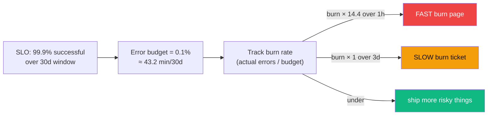

## Definition (interview-ready)

- **SLI (Service Level Indicator)**: a measured aspect of service quality (e.g., success rate, p99 latency).
- **SLO (Service Level Objective)**: an internal target for an SLI (e.g., 99.9% successful requests).
- **SLA (Service Level Agreement)**: an external contract with consequences (refunds, penalties) if SLO is missed.
- **Error budget**: 1 - SLO. The amount of unreliability you can "spend" — on risky deploys, experiments, or just unlucky incidents — before missing the SLO.

**One-liner:** An SLI is what you measure about the user experience, an SLO is the internal target for it, an SLA is the contractual promise with penalties (set looser than the SLO), and the error budget, 1 minus the SLO, is how much failure you can afford before you must slow down and fix reliability.



| Term | Audience | Teeth |
|---|---|---|
| **SLI** | engineers | what you measure |
| **SLO** | internal | what you target |
| **SLA** | customers | contractually owed (refunds, etc.) |
| **Error budget** | leadership + eng | how much risk you can spend |

## Why it matters

Without SLOs, "reliability" is debated forever. With SLOs, you have a concrete target everyone agrees on, alerts you only when it matters, and an error budget that turns reliability into a quantitative resource you can spend. This is the foundation of Google-style SRE.

## Core concepts

### SLI examples

- **Availability**: (successful requests) / (total requests).
- **Latency**: % of requests faster than threshold (e.g., 95% < 500ms).
- **Quality**: % of requests with full results (vs degraded).
- **Freshness**: % of data updated within N minutes.
- **Correctness**: % of operations that produce correct results (harder to measure).

Pick SLIs that **users feel**. CPU utilization is not an SLI; it's a resource metric.

### Choosing SLOs

A common framework:
- **Easy SLOs**: 99% / 99.5% — early-stage services, low impact.
- **Standard**: 99.9% (three 9s) — most production services.
- **Aggressive**: 99.99% — payment, auth, core infra.
- **Extreme**: 99.999% — only for critical infra (DNS, search backbone). Very expensive.

A common rule of thumb: each extra 9 costs roughly 10× more effort and money, because the allowed downtime shrinks 10×.

### Time windows

SLO is over a **window**: rolling 30 days, calendar month, etc.

Common: rolling 30 days. Captures both short-term and slow burns.

### Error budget

Budget = 1 - SLO. For 99.9% SLO over 30 days:
```
Total minutes in 30 days = 43,200
Allowed downtime = 0.1% × 43,200 = 43.2 minutes
```

That's the budget. Spend it on deploys, chaos experiments, planned maintenance, real incidents.

### Burn rate

How fast you're burning through the budget.

```
burn_rate = (current error rate) / (allowable error rate per SLO)
```

If burn_rate = 1, you'll exhaust the budget exactly at the SLO window end.
If burn_rate = 10, you'll exhaust it in 1/10 the time.

### Multi-window, multi-burn-rate alerts

Google SRE pattern for sane alerting:
- **Fast burn**: errors spiking now (14.4× burn over 1h, confirmed over 5min → page; 6× over 6h, confirmed over 30min → page).
- **Slow burn**: subtle issue over days (1× burn over 3 days, confirmed over 6h → ticket).

Alert when either triggers — fast for incidents, slow for creeping issues.

```yaml
- alert: SLOErrorBudgetBurnFast
  expr: |
    job:slo_errors_per_request:ratio_rate1h{job="api"} > (14.4 * 0.001)
    and
    job:slo_errors_per_request:ratio_rate5m{job="api"} > (14.4 * 0.001)
  for: 2m
  labels: { severity: page }
```

### SLA vs SLO

- **SLA**: external commitment with **penalties**. "If we breach 99.9%, you get 10% refund."
- **SLO**: internal target, always **stricter than SLA** to allow buffer.
- **SLI**: the measurement.

E.g., SLA 99.9%, SLO 99.95% — gives you 0.05% buffer to fix issues before users get refunds.

### Error budget policy

A pre-agreed policy about what to do when budget is spent:
- **Budget healthy**: deploy freely, take risks, run experiments.
- **Budget nearly spent**: pause non-critical changes, focus on reliability fixes.
- **Budget exhausted (SLO breached)**: incident retrospective; engineering priorities shift.

Codify this; otherwise the conversation about "should we deploy now?" never ends.

### Multi-tier SLOs

Different SLOs for different operations:
- Critical (POST /payment): 99.99%.
- Important (GET /home): 99.9%.
- Background (POST /analytics): 99%.

Per-endpoint SLOs reflect business impact.

## How it works (a quarter of SLO management)

```
Q3 SLO: 99.9% availability for /checkout, measured over the quarter
(~13 weeks ≈ 131,000 min → error budget ≈ 131 min).

Week 1: deploy, accidental 5-min outage. Budget burned: 5 / 131 ≈ 4%.
Week 2: smooth.
Week 3: subtle degradation, 10% errors for 2 hours (≈ 12 error-minutes). Budget burned: ≈ 13% total.
Week 6: half-quarter checkpoint — ~87% budget remaining; team is doing well.
Week 8: deploy goes wrong, 1-hour full outage. Budget burned: ≈ 59% total.
Week 9: budget tight; freeze risky deploys for the rest of the period.
Weeks 10-12: small fixes only; ~70% of budget burned by end.
Week 13: SLO met at ≈ 99.93%.

Retrospective: which incidents were preventable? What invest in prevention?
```

## Real-world examples

- **Google SRE**: founded the methodology.
- **GitHub**: public status page + SLOs.
- **AWS**: publishes per-service SLAs (with service-credit schedules) for most services.
- **Twilio, Slack, Cloudflare**: publish SLAs for paid plans.

## Common pitfalls

- **No SLOs**: every outage is debated by feel.
- **SLOs without policies**: budget burn never triggers action.
- **Vanity SLOs**: 99.99% on everything → costly and futile.
- **SLI of internal metrics, not user-felt**: CPU% isn't an SLI.
- **No multi-window alerts**: either too noisy or too slow.
- **SLA stricter than SLO**: zero buffer — refund storms when you breach.
- **Ignoring planned maintenance**: must be accounted for in budget.
- **No team ownership** of the SLO.

## Practice questions

<Practice>

<QA q="SLI vs SLO vs SLA?" level="easy">

**SLI** = a measured aspect of service quality (e.g. success rate). **SLO** = the internal target for it (99.9%). **SLA** = an external commitment with penalties (e.g. 99.9% with refunds on breach). The SLO is stricter than the SLA so there's a buffer before customers are owed anything.

</QA>

<QA q="What's an error budget, and how big is it for 99.9% over 30 days?" level="easy">

Error budget = 1 − SLO. For 99.9% over 30 days: 0.1% × 43,200 min ≈ **43.2 minutes**. It's the unreliability you can spend on deploys, experiments, planned maintenance, or incidents without violating the SLO — it turns the reliability-vs-velocity debate into a number.

</QA>

<QA q="Is CPU utilization a good SLI? What makes a good SLI?" level="easy">

No — CPU is a resource metric; users don't feel it directly. Good SLIs measure what **users experience**: availability (successful / total requests), latency (% of requests under a threshold, e.g. 95% under 500 ms), quality (% of full vs degraded responses), freshness (% of data updated within N minutes), and correctness.

</QA>

<QA q="How do you pick the right SLO?" level="medium">

From user expectations and business impact. Critical paths (payments, auth): 99.99%. Most production services: 99.9%. Early-stage or low-impact: 99–99.5%. Each extra 9 costs roughly 10× more, so avoid 'vanity' SLOs that are expensive and force unnecessary work. Different endpoints can have different SLOs.

</QA>

<QA q="What's burn rate, and how does it differ from budget remaining?" level="medium">

Burn rate = current error rate / error rate allowed by the SLO. At 1× you exhaust the budget exactly at the window's end; at 10× you exhaust it in a tenth of the window. Budget remaining is the absolute unreliability still allowed. Burn rate tells you **trajectory**: even with plenty of budget left, a high burn rate means you'll run out soon. Use budget for context, burn rate for urgency.

</QA>

<QA q="What is an error budget policy and why codify it?" level="medium">

A pre-agreed rule for what happens at each budget level: healthy → deploy freely and run experiments; nearly spent → pause non-critical changes, focus on reliability; exhausted (SLO breached) → retrospective and engineering priorities shift. Without it, budget burn never triggers action and 'should we deploy now?' is argued every time.

</QA>

<QA q="Why should the SLO be stricter than the SLA?" level="medium">

The gap is a buffer: if the SLA is 99.9% and the SLO 99.95%, missing the SLO alerts the team and changes priorities before customers are owed refunds. An SLA stricter than (or equal to) the SLO means you breach the contract with no warning — refund storms.

</QA>

<QA q="How do you alert on an SLO?" level="hard">

**Multi-window, multi-burn-rate** alerts: page on fast burn (e.g. 14.4× over 1 h, confirmed over 5 min; 6× over 6 h, confirmed over 30 min) and open a ticket on slow burn (1× over 3 days, confirmed over 6 h). The long window gives significance, the short window makes the alert stop quickly once the problem is fixed. This avoids per-event alerts that drown on-call while still catching creeping issues.

</QA>

<QA q="With a 99.9% / 30-day SLO, how much budget does a 14.4x burn consume in one hour?" level="hard">

At 14.4× for 1 hour you consume 14.4 / 720 (hours in 30 days) = **2%** of the monthly budget. Sustained, the whole budget would be gone in 720 / 14.4 = 50 hours — about two days — which is why that threshold pages.

</QA>

<QA q="How do you handle a recent feature that's slow but not broken?" level="scenario">

Check its SLO impact. If the latency SLI is eating into budget, treat it as a reliability issue and prioritize the fix. If you're comfortably within budget, ship and iterate. The error budget makes the decision objective instead of a matter of opinion.

</QA>

<QA q="Design SLOs for a new e-commerce service." level="scenario">

- /search: 99.9% successful, 99% under 500 ms.
- /product (catalog read): 99.95% available, 99% under 300 ms.
- /cart (mutation): 99.9% available, 99% under 500 ms.
- /checkout (payment): 99.99% available, 99% under 800 ms — the highest tier.
- /order-history: 99.5% available, 95% under 1 s.

Per-endpoint SLOs reflect business impact; use a rolling 30-day window and an agreed budget policy.

</QA>

<QA q="A team consistently misses its SLO. What now?" level="scenario">

- Honest retrospective: is the SLO realistic for the system and the work?
- Either invest in reliability (rate limits, circuit breakers, redundancy) or relax the SLO to a sustainable target.
- Apply the budget policy: pause risky changes until back within budget; shift engineering priority to reliability.
- If it's still missed despite investment, the SLO is likely too aggressive for the system's current state.

</QA>

<QA q="Your SLO is 99.9% per calendar month and maintenance windows are excluded from the SLI. What's wrong?" level="scenario">

Users still feel maintenance, so excluding it makes the SLI dishonest — planned maintenance should be counted against the budget. A calendar-month window also resets the budget abruptly; a **rolling 30-day** window is more common because it captures both short incidents and slow burns continuously.

</QA>

</Practice>

## Quiz

<Quiz>

<MCQ q="A service has a 99.9% availability SLO over 30 days. Roughly how much full downtime does the error budget allow?" options={["4.3 minutes", "43 minutes", "7.2 hours", "4.3 hours"]} answer={1}>

0.1% of 43,200 minutes is 43.2 minutes. 4.3 minutes is the 99.99% budget; the hour figures correspond to looser SLOs.

</MCQ>

<MCQ q="Which is the best SLI for a user-facing API?" options={["Average CPU utilization of API pods", "Number of pods running", "Percentage of requests that succeed and complete under 500 ms", "Size of the request queue in bytes"]} answer={2}>

SLIs should reflect what users feel — success and latency. CPU, pod count, and queue size are resource or internal metrics that may or may not affect users.

</MCQ>

<MCQ q="How should SLA and SLO relate?" options={["The SLO should be stricter than the SLA to leave a buffer", "The SLA should be stricter than the SLO", "They should always be identical", "SLAs are internal and SLOs are external"]} answer={0}>

The internal target must be tighter so the team reacts before contractual penalties apply. An SLA stricter than the SLO gives zero warning; and SLAs are the external ones.

</MCQ>

<MCQ q="Burn rate is currently 1. What does that mean?" options={["The service is down", "1% of the budget is left", "The budget is already exhausted", "At this pace the budget runs out exactly at the end of the window"]} answer={3}>

Burn rate is error rate divided by the allowed error rate; 1× spends the budget evenly over the window. It does not describe remaining budget or an outage.

</MCQ>

<MCQ q="Why use both a long and a short window in a burn-rate alert?" options={["To double the number of pages", "The long window shows a significant burn, and the short window confirms it is still happening so the alert clears quickly", "Prometheus requires two windows", "The short window measures latency and the long one availability"]} answer={1}>

Requiring both avoids paging on brief blips and stops paging soon after recovery. It's a design choice, not a Prometheus requirement, and both windows measure the same SLI.

</MCQ>

<MCQ q="Half the monthly budget remains, but the burn rate is 20x over the last hour. What should happen?" options={["Nothing, plenty of budget remains", "Wait for the monthly report", "Page on-call — at this rate the remaining budget will be gone soon", "Raise the SLO to 99.99%"]} answer={2}>

Burn rate shows trajectory: a high rate exhausts even a healthy remaining budget quickly, which is exactly what fast-burn paging is for. Raising the SLO makes things worse.

</MCQ>

<MCQ q="The error budget for the period is depleted. Under a typical error budget policy, what happens?" options={["Pause non-critical and risky changes and prioritize reliability work", "Increase deploy frequency to recover faster", "Delete the SLO for this period", "Automatically refund all customers"]} answer={0}>

The policy shifts focus to reliability until the budget recovers. Deploying more adds risk, deleting the SLO defeats it, and refunds come from SLA breaches, not internal budget exhaustion.

</MCQ>

<MCQ q="A team proposes 99.99% for every endpoint, including analytics ingestion. What's the main problem?" options={["99.99% is impossible to measure", "Analytics endpoints cannot have SLOs", "Higher SLOs reduce the error budget for deploys only", "Each extra 9 costs roughly 10x more; SLOs should follow business impact per endpoint"]} answer={3}>

Vanity SLOs are expensive and force unneeded work; background endpoints like analytics can sit at 99%. 99.99% is measurable, and any endpoint can have an SLO.

</MCQ>

<MCQ q="Sustained 14.4x burn on a 30-day SLO exhausts the full budget in about how long?" options={["1 hour", "50 hours", "14.4 days", "30 days"]} answer={1}>

720 hours divided by 14.4 is 50 hours, about two days; one hour of it uses 2% of the budget. 30 days is the 1x case.

</MCQ>

</Quiz>

## TL;DR cheat sheet

- **SLI**: measured aspect (e.g., success rate).
- **SLO**: internal target (e.g., 99.9% in 30 days).
- **SLA**: external commitment with penalties.
- **Error budget = 1 - SLO**; allowable unreliability.
- **Burn rate**: how fast you're consuming the budget.
- Multi-window, multi-burn-rate alerts (fast burn = page, slow = ticket).
- Per-endpoint SLOs reflect business impact.
- Each "9" added costs ~10×.
- Error budget policy: freeze risky changes when budget low.
- SLO is a tool to balance velocity vs reliability.

## Go deeper

- **Google SRE Book Ch. 4**: ["Service Level Objectives"](https://sre.google/sre-book/service-level-objectives/).
- **Google SRE Workbook**: ["Implementing SLOs"](https://sre.google/workbook/implementing-slos/) — the practical guide.
- **Alex Hidalgo**: ["Implementing Service Level Objectives"](https://www.oreilly.com/library/view/implementing-service-level/9781492076803/).
- **Charity Majors**: blogs on observability and SLOs.
- **Burn rate alerts** in Prometheus: docs and recipes.
- **OpenSLO** spec.
