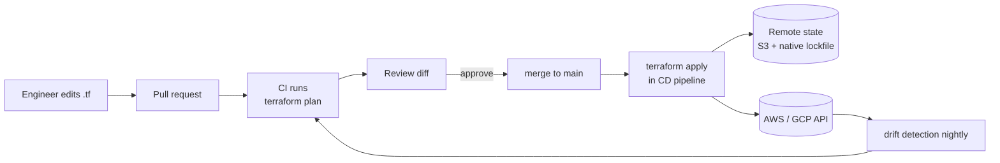

## Definition (interview-ready)

**Infrastructure as Code (IaC)** is managing cloud infrastructure via declarative source files (versioned, reviewed, applied programmatically) instead of clicking in consoles. **Terraform** (HashiCorp, now IBM; BSL-licensed since 2023 — **OpenTofu** is the open-source fork) is the dominant tool: write `.tf` files describing desired state, Terraform plans diffs against current state, applies them. **State** (`.tfstate`) tracks what's deployed.

## Why it matters

Hand-managed infra drifts, can't be audited, and is a common cause of "it works in staging but not prod." IaC turns infra into code: review, test, version, repeat. Every modern team needs IaC.



## Core concepts

### Terraform basics

```hcl
# main.tf
provider "aws" { region = "us-east-1" }

resource "aws_s3_bucket" "logs" {
  bucket = "myapp-logs-2026"
}

resource "aws_iam_role" "lambda" {
  name = "lambda-exec-role"
  assume_role_policy = jsonencode({ ... })
}
```

Commands:
- `terraform init`: download provider plugins.
- `terraform plan`: show what would change.
- `terraform apply`: make it so.
- `terraform destroy`: tear it down.

### State

`terraform.tfstate`: source of truth for what Terraform created. Stored:
- Locally (default — bad for teams).
- **Remote backend**: S3, GCS, Azure, HCP Terraform (formerly Terraform Cloud) — required for shared use.
- **State locking**: S3 native lockfile (`use_lockfile = true`, Terraform 1.10+; the older DynamoDB lock table is deprecated), GCS backend's built-in lock file — prevents two engineers applying simultaneously.

### Variables and outputs

```hcl
variable "env" { type = string }
output "bucket_arn" { value = aws_s3_bucket.logs.arn }
```

### Modules

Reusable building blocks: a directory of `.tf` files that you call:

```hcl
module "vpc" {
  source = "./modules/vpc"
  name   = "prod-vpc"
  cidr   = "10.0.0.0/16"
}
```

Or from the registry: `source = "terraform-aws-modules/vpc/aws"`.

### Workspaces / environments

- One config, multiple state files (dev, staging, prod).
- Common pattern: separate directories per env (`envs/prod/`, `envs/staging/`) sharing modules.
- Avoid Terraform workspaces for env separation in production — directory-based is clearer.

### Drift detection

`terraform plan` shows the difference between code and reality. If someone manually changes infra, plan reveals drift. Reapply to converge.

### Lifecycle

```hcl
resource "aws_db_instance" "primary" {
  ...
  lifecycle {
    prevent_destroy = true        # safety
    ignore_changes = [password]   # avoid drift on managed-elsewhere fields
    create_before_destroy = true  # new before kill on replacement
  }
}
```

### Best practices

- **Remote state** with locking.
- **Modules** for reusable patterns.
- **Naming conventions** (env in resource names).
- **Tags everywhere** for cost attribution.
- **No secrets in tf files** — use Secrets Manager / Vault.
- **`terraform plan` in CI** for every PR.
- **Manual approval** before `apply` in prod.
- **State backups**: state file corruption = manual recovery hell.
- **Use cloud-managed where possible** (RDS over EC2-with-MySQL).

### Pulumi (alternative)

IaC in real programming languages (TypeScript, Python, Go, .NET) instead of HCL. Pros: real loops, conditionals, libraries; ecosystem familiarity. Cons: easier to write bad infra code; same state-management complexity.

### CDK (AWS)

AWS Cloud Development Kit: TypeScript/Python/Java DSL that synthesizes to CloudFormation. AWS-native. Good if you're all-in on AWS.

### CloudFormation (AWS native)

Declarative YAML/JSON. Native AWS rollback semantics. Less ergonomic than Terraform; AWS-only.

### Ansible / Chef / Puppet

Configuration management for existing servers (install packages, manage files). Different layer from Terraform (which provisions cloud resources). Some overlap; immutable-image patterns (Packer + Terraform) often replace them.

## How it works (a PR flow)

```
Developer:
  edit terraform/prod/main.tf
  terraform plan locally → check
  open PR
CI:
  terraform plan against remote state → result in PR
Reviewer:
  reads plan: 1 resource to add, 1 to modify
  approves
Merge:
  CI runs terraform apply with prod creds (gated by manual approval or signed-off plan)
  state updated
```

## Common pitfalls

- **State file in git**: contains secrets, sensitive. Never commit. Use remote backend.
- **No state lock**: two applies at once → corruption.
- **Hand-editing infra**: drift. Always go through Terraform.
- **Mega-config in one file**: slow, scary plans. Split into smaller modules / states.
- **No CI plan**: surprises on apply.
- **Secrets in tf files**: visible in state. Pull from Vault / Secrets Manager.
- **Forgetting `prevent_destroy`** on stateful resources (RDS, S3): one bad PR can delete production data.
- **Mixing Terraform with manual changes**: pick one.
- **No backup of state**: corruption = manual reconstruction.
- **Mixed providers/versions in one config**: dependency hell.

## Practice questions

<Practice>

<QA q="What's IaC and why use it?" level="easy">

Infrastructure as Code: cloud resources defined in versioned code, reviewed, and applied programmatically instead of console clicks. Benefits: **reproducible** (same code → same infra), **reviewable** (PRs, diffs), **auditable** (git history), **recoverable** (re-apply after a disaster).

</QA>

<QA q="What do `terraform init`, `plan`, `apply`, and `destroy` do?" level="easy">

- `init`: download provider plugins and set up the backend.
- `plan`: show what would change to make reality match the config.
- `apply`: make those changes and update state.
- `destroy`: tear down everything the config manages.

</QA>

<QA q="What's a Terraform module?" level="easy">

A reusable building block: a directory of `.tf` files with input variables and outputs that you call from other configs (`module "vpc" { source = "./modules/vpc" ... }`), or pull from the registry (e.g. `terraform-aws-modules/vpc/aws`). Modules let every environment share the same VPC, RDS, or app patterns.

</QA>

<QA q="How does Terraform state work?" level="medium">

The state file (`.tfstate`) records what Terraform has created and maps config resources to real ones. Terraform compares desired config with state and the real world to compute a plan. Teams store it in a **remote backend** (S3, GCS, Azure, HCP Terraform) with **locking** — S3 `use_lockfile` (Terraform 1.10+; DynamoDB on older setups) or GCS's built-in lock — so two applies can't run concurrently.

</QA>

<QA q="Why should the state file never be committed to git?" level="medium">

State can contain sensitive values (passwords, keys) in plain form, and git has no locking, so two engineers can apply from divergent copies and corrupt it. Use a remote backend with encryption at rest, locking, and backups — state corruption otherwise means manual reconstruction.

</QA>

<QA q="What do `prevent_destroy` and `ignore_changes` do in a lifecycle block?" level="medium">

- `prevent_destroy = true`: any plan that would destroy the resource errors out — a safety net for stateful resources like RDS or S3 holding production data.
- `ignore_changes = [password]`: Terraform ignores differences in those attributes, avoiding perpetual drift on fields managed elsewhere.

</QA>

<QA q="What does `create_before_destroy` do?" level="medium">

When a change forces replacement, Terraform creates the new resource **before** destroying the old one (the default is destroy first). It avoids brief outages for stateless resources such as a load balancer target group. Use with care on stateful resources and on resources with unique names that would collide.

</QA>

<QA q="How does Terraform differ from Ansible, Chef, or Puppet?" level="medium">

Terraform **provisions** cloud resources (VPCs, DBs, buckets). Ansible/Chef/Puppet are **configuration management** for existing servers (install packages, manage files). There's overlap, but immutable-image patterns (Packer builds the image, Terraform deploys it) often replace config management.

</QA>

<QA q="Terraform vs CloudFormation vs Pulumi vs CDK?" level="medium">

- **Terraform**: multi-cloud, HCL, the industry standard.
- **CloudFormation**: AWS-native YAML/JSON with native rollback; less ergonomic, AWS-only.
- **Pulumi**: real languages (TS, Python, Go, .NET) — more expressive, but easier to write bad infra code; same state complexity.
- **CDK**: TS/Python/Java that synthesizes to CloudFormation; AWS-native.

Multi-cloud or non-AWS: Terraform. AWS-only with a strong programming preference: CDK or Pulumi.

</QA>

<QA q="How do you handle secrets in Terraform?" level="hard">

Never put them in `.tf` files. Options:
- Read from Secrets Manager / Vault at provision time.
- Generate with `random_password` and write to Secrets Manager via Terraform.
- Mark variables `sensitive = true` — this only redacts output; the value **still lands in state**. CI passes them via environment variables.
- Terraform 1.10+ ephemeral values and 1.11+ write-only arguments keep secrets out of state entirely.
- Keep state encrypted (S3 SSE, GCS encryption).

</QA>

<QA q="How would you test Terraform code?" level="hard">

- `terraform validate` for syntax and internal consistency.
- `plan` in CI on every PR to catch accidental destruction.
- Static analysis: tfsec (now part of Trivy), Checkov.
- Module tests with native `terraform test` (1.6+).
- Integration tests: Terratest (Go) or kitchen-terraform — provision a real environment, check behavior, tear down.
- Policy as code: OPA / Sentinel for org rules ('no public S3 buckets').

</QA>

<QA q="A teammate manually changed infra. What happens and what do you do?" level="scenario">

The next `terraform plan` shows **drift**. If the change wasn't intended, re-apply to revert it. If it's legitimate, update the code to match (and `import` any manually created resources into state). Nightly drift detection catches this early; the real fix is a culture of no manual changes.

</QA>

<QA q="How would you organize Terraform for prod, staging, and dev?" level="scenario">

Per-environment directories sharing modules:

```
modules/
  vpc/  rds/  app/
envs/
  dev/  staging/  prod/
```

Each env has its own variables and **its own remote state**, so a bad dev apply can't touch prod. Avoid Terraform workspaces for environment separation — directories are clearer. Run `plan` in CI per PR and require manual approval before prod `apply`.

</QA>

</Practice>

## Quiz

<Quiz>

<MCQ q="What does terraform plan compare to decide what to change?" options={["The config against the previous git commit", "The desired config against state and the real infrastructure", "Two workspaces against each other", "The provider version against the registry"]} answer={1}>

Plan diffs desired config against what state says exists, refreshed from the real cloud. It does not diff git commits, workspaces, or provider versions.

</MCQ>

<MCQ q="Why is state locking needed?" options={["To encrypt the state file", "To stop anyone from reading the state", "To prevent two concurrent applies from corrupting the state", "To speed up plans"]} answer={2}>

Locking serializes writes so simultaneous applies can't clobber each other. Encryption and access control are separate concerns, and locking doesn't make plans faster.

</MCQ>

<MCQ q="You mark a database password variable as sensitive = true. Where can the value still appear?" options={["In the state file", "Nowhere — it is fully removed", "Only in the plan output", "Only in the provider binary"]} answer={0}>

sensitive only redacts CLI output; the value is still stored in state. Ephemeral values and write-only arguments (1.10+ and 1.11+) are what keep secrets out of state.

</MCQ>

<MCQ q="A PR would accidentally replace the production RDS instance. Which lifecycle setting makes that plan fail?" options={["create_before_destroy = true", "ignore_changes = all", "depends_on", "prevent_destroy = true"]} answer={3}>

prevent_destroy errors out on any plan that destroys the resource. create_before_destroy changes replacement order but still destroys; ignore_changes hides diffs; depends_on is ordering.

</MCQ>

<MCQ q="An engineer changed a security group in the console. What will the next terraform plan show?" options={["Nothing — Terraform only tracks its own changes", "A drift diff proposing to revert the resource to match the code", "An error that state is corrupt", "A prompt to delete the security group"]} answer={1}>

Plan refreshes real infrastructure and proposes changes to converge on the config. You either apply to revert or update the code if the change was intended.

</MCQ>

<MCQ q="What is the recommended way to separate prod, staging, and dev?" options={["One directory and one state, switched with variables", "Terraform workspaces in a single directory", "Separate directories per env, each with its own state, sharing modules", "A separate copy-pasted config per env with no modules"]} answer={2}>

Per-env directories with separate state isolate blast radius and stay readable, while modules avoid duplication. A single state couples environments, workspaces are easy to confuse, and copy-paste drifts.

</MCQ>

<MCQ q="Which tool would you use to enforce an org rule like no public S3 buckets on every plan?" options={["Policy as code such as OPA or Sentinel", "terraform fmt", "terraform init", "A remote backend"]} answer={0}>

Policy-as-code engines evaluate plans against org rules. fmt only formats, init installs providers, and a backend stores state.

</MCQ>

<MCQ q="How does Terraform differ from Ansible in its typical role?" options={["Terraform only works on AWS", "Ansible provisions cloud networks while Terraform installs packages", "They are identical tools with different syntax", "Terraform provisions cloud resources; Ansible configures software on existing servers"]} answer={3}>

Terraform is a provisioning tool and Ansible is configuration management, though they overlap. Terraform is multi-cloud, and the roles in option B are reversed.

</MCQ>

<MCQ q="What does create_before_destroy change when a resource must be replaced?" options={["It skips the replacement entirely", "The new resource is created first, then the old one is destroyed", "It keeps both resources forever", "It destroys the old one first, then creates the new one"]} answer={1}>

It flips the default destroy-then-create order to reduce downtime. It doesn't skip replacement or keep both; option D is the default behavior.

</MCQ>

</Quiz>

## TL;DR cheat sheet

- IaC = infra in code: versioned, reviewed, reproducible.
- **Terraform** = dominant tool, HCL, multi-cloud.
- **State** = source of truth. Remote backend with locking.
- **Modules** for reusable patterns.
- **PR + plan in CI** before apply.
- **Secrets** never in `.tf` files; from Secrets Manager / Vault.
- **prevent_destroy** on critical resources.
- **Drift** = manual changes; reapply or import.
- **Policy as code** (OPA/Sentinel) for org rules.

## Go deeper

- **Terraform docs**: [developer.hashicorp.com/terraform](https://developer.hashicorp.com/terraform/tutorials).
- **Gruntwork blog**: production Terraform patterns.
- **Terraform Up & Running** (Yevgeniy Brikman).
- **Pulumi docs** for programmable IaC.
- **AWS CDK docs**.
- **Spacelift / Atlantis / HCP Terraform** for CI/CD-style workflows.
- **tfsec, Checkov, OPA Conftest** for security.
