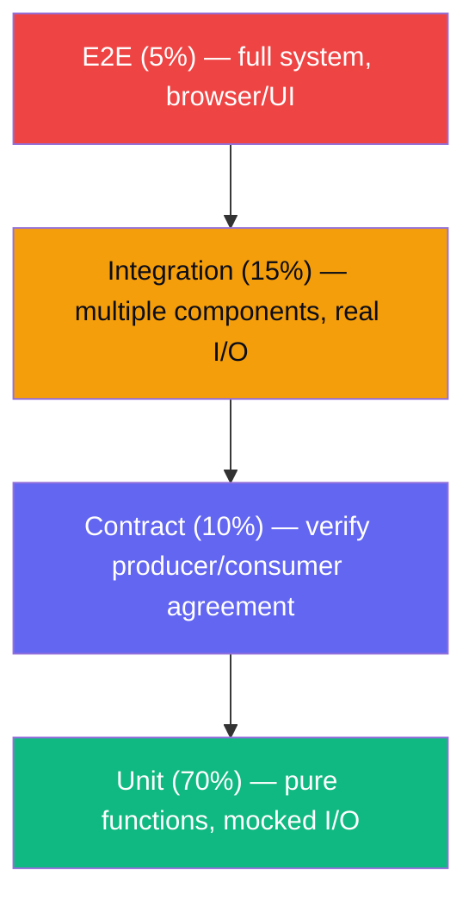
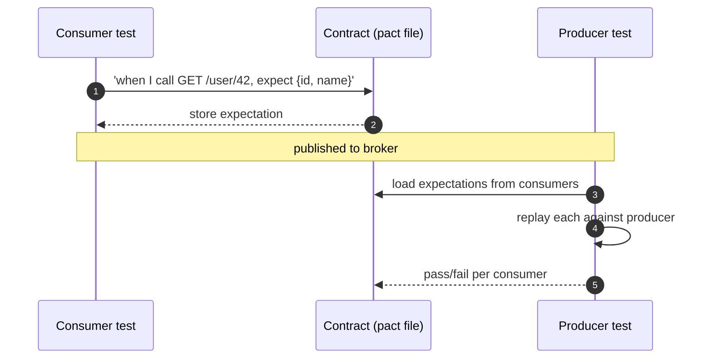

## Definition (interview-ready)

The **testing pyramid** (Mike Cohn) says to write many **unit** tests, fewer **integration** tests and only a few **end-to-end (E2E)** tests. The higher a test sits, the slower and more expensive it is and the more likely it is to be flaky. **Contract tests** are a focused kind of integration test: they check the agreement between a provider (an API) and a consumer (its caller) without running both together.

**One-liner:** The testing pyramid means lots of fast unit tests, fewer integration tests and a handful of E2E tests for critical journeys, because tests get slower, costlier and flakier as they go up; contract tests sit at service boundaries to catch API breaks without full E2E runs.

## Why it matters

Without a coherent test strategy, you either ship bugs (too few tests) or move at the speed of glaciers (too many flaky, slow E2E tests). Knowing the pyramid prevents the most common anti-pattern in test suites: bloated, slow, fragile, and (worst) ignored.





## Core concepts

### The pyramid

```
            /‾‾‾‾‾\
           |  E2E  |   few, slow, expensive
           |-------|
           | Integ |   moderate
           |-------|
           |       |
           | Unit  |   many, fast, cheap
           ‾‾‾‾‾‾‾‾‾
```

- **Unit**: test a single function/class in isolation. Fast (ms each). High coverage of logic.
- **Integration**: tests across modules / against real DB / real downstream. Slower (seconds). Confirms wiring.
- **E2E**: full system, real or near-real env. Slowest. Confirms the user flow works.

Roughly: 70% unit, 20% integration, 10% E2E.

### Why this shape?

- Unit tests are fast → run on every save / every PR → fast feedback.
- E2E tests are slow → only practical to run on a small set of critical flows.
- Inverting the pyramid → slow CI, flaky tests, fragile suite.

### Anti-patterns

- **Ice cream cone**: lots of E2E, few unit. Slow CI, hard to diagnose failures.
- **Hourglass**: many unit + many E2E, no integration. Wiring bugs slip past unit, surface as flaky E2E.
- **No tests**: bugs ship to prod.

### Unit tests

- Mock or stub external dependencies (DB, HTTP).
- Test public interface, not internals.
- Single assertion focus (one behavior per test).
- Fast: < 100 ms per test.
- Examples: pure functions, business logic, edge cases.

### Integration tests

- Real DB (test container or in-memory equivalent), real HTTP servers (within process).
- Verify cross-component behavior.
- Slower: seconds per test.
- Examples: repository methods against a real DB, controller-to-service-to-DB chains.

### E2E tests

- Full system in a near-production environment.
- Tools: Cypress, Playwright (browser), Postman/Newman (API).
- Focus on **critical user journeys**, not every UI button.
- Examples: "user signs up, logs in, completes checkout."

### Contract tests

A pact between a **consumer** (e.g., mobile app) and a **provider** (e.g., backend API). Tests both sides match without running them together.

**Consumer-driven contract tests** (Pact framework):
1. Consumer writes its expectations: "When I call GET /user/42, I expect \{ id, name, email \}."
2. Pact framework generates a "contract" file (JSON).
3. Provider runs tests against the contract: "Can I satisfy this consumer's expectation?"
4. If provider changes its API, its tests fail → know before deploy.

Use cases:
- Microservices: many consumers per provider; avoid running all consumers in CI.
- API + frontend: confirm shape without E2E.
- Cross-team API agreements.

### Property-based testing

- Don't write `assert function(2) == 4`; instead: `for all integers n, function(n) == n * 2`.
- Tools: QuickCheck (Haskell), Hypothesis (Python), fast-check (JS).
- Finds edge cases unit tests miss (negatives, edge integers, weird strings).

### Snapshot tests

- Capture output once; subsequent runs compare to snapshot.
- Useful for: rendered UI components, generated config.
- Beware: easy to commit a wrong snapshot ("looks fine, ship it").

### Mutation testing

- Tool intentionally modifies your code (e.g., flips `<` to `>`); runs your tests.
- If tests still pass, your tests aren't catching the mutation.
- Reveals weak tests. Tools: Stryker (JS), Pitest (Java).

### Test doubles

- **Stub**: returns canned data.
- **Mock**: verifies interaction (e.g., "was this method called once?").
- **Fake**: lightweight working implementation (in-memory DB).
- **Dummy**: placeholder, never used.

Prefer **fakes** over mocks where possible — closer to real behavior, less brittle.

### Test data management

- Fresh DB per test (test containers) or transaction rollback.
- Factory / fixture libraries (FactoryBot in Ruby, factory_boy in Python).
- Don't share state across tests.
- Seed minimal data; test sets up what it needs.

### Flakiness

A flaky test = passes sometimes, fails sometimes, same code. Kills trust in the suite. Causes:
- Time-dependent (timezone, clock).
- Order-dependent (state leak).
- Concurrency (race condition).
- Network/external (rely on flaky service).

Fix, quarantine or **delete** flaky tests. A test that fails at random teaches people to ignore red builds, which can be worse than having no test.

### Test pyramid for backends

- 70% unit: business logic, data transformations, validators.
- 20% integration: DB, message bus, third-party stubs.
- 5-10% E2E: critical workflows (sign-up, payment, key feature).
- + Contract tests at the boundary between services.

### Test coverage

- Goal: catch important behaviors, not "100% line coverage."
- Coverage % is a proxy; can be gamed.
- Useful: identify untested code paths; flag PRs that drop coverage by > 5%.

## How it works (consumer-driven contract test with Pact)

```
Consumer (frontend) test:
  - Set up Pact mock provider.
  - "When I GET /api/user/42 → expect 200 + body { id, name }."
  - Run consumer code against mock.
  - Pact writes pacts/frontend-backend.json.

Pact broker:
  - Stores contracts.
  - Provider's CI fetches them.

Provider (backend) test:
  - "Replay the contract: does my real API return what consumer expects?"
  - Provider runs the contract test with its real handler.
  - Pass / fail per contract.

Provider CI fails if it would break consumer → safe to deploy.
```

## Real-world examples

- **Google**: its Testing Blog post "Just Say No to More End-to-End Tests" (2015) popularised the 70/20/10 unit/integration/E2E split; its build system Blaze (open-sourced as Bazel) runs tests in parallel and caches results.
- **Pact** (open-source from Realestate.com.au): de facto consumer-driven contract framework.
- **Netflix**: chaos engineering (Chaos Monkey) tests resilience by injecting failures in production. It complements the pyramid; it doesn't replace it.

## Common pitfalls

- **Too many E2E, too few unit**: slow CI, flaky failures.
- **Mocking everything**: tests pass but app breaks (mocks don't match reality).
- **Shared mutable state**: order-dependent tests.
- **Ignoring flakiness**: people stop trusting CI.
- **"100% coverage" obsession**: write tests of trivial accessors instead of meaningful behavior.
- **No contract tests in microservices**: API changes break consumers silently.
- **Test data tied to dev DB**: can't run independently.

## Practice questions

<Practice>

<QA q="Explain the testing pyramid." level="easy">

Bottom: many fast **unit** tests. Middle: fewer **integration** tests. Top: few **E2E** tests. Cost and run time rise up the pyramid while feedback speed and reliability fall. Aim for roughly 70/20/10 unit/integration/E2E, plus contract tests at service boundaries. Inverting it (mostly E2E) leads to slow, flaky CI.

</QA>

<QA q="What are the ice cream cone and hourglass anti-patterns?" level="easy">

- **Ice cream cone**: lots of E2E, few unit tests — slow CI and failures that are hard to diagnose.
- **Hourglass**: many unit and many E2E tests but almost no integration — wiring bugs slip past the unit tests and surface as flaky E2E failures.

</QA>

<QA q="What's the difference between a mock and a stub?" level="easy">

A **stub** returns canned data ('when called, return X'). A **mock** verifies interaction ('was this called once with these args?'). Stubs answer 'what does the dependency return'; mocks answer 'did we call the dependency correctly'. They're often used together.

</QA>

<QA q="What's a fake, and why prefer fakes over mocks where practical?" level="medium">

A **fake** is a lightweight working implementation, e.g. an in-memory repository. It behaves like the real thing, so tests exercise realistic behavior and don't break every time you change which methods get called. Heavy mocking couples tests to implementation details and can pass while the real app breaks because the mocks don't match reality.

</QA>

<QA q="When would you write a contract test instead of an E2E test?" level="medium">

When you want to verify the API agreement between two services without running both together. It's faster, isolated, and scales to many consumers per provider. E2E covers user journeys; contract tests cover the integration shape at a service boundary.

</QA>

<QA q="How does Pact work?" level="medium">

Consumer-driven: the consumer's test runs against a Pact mock provider and records its expectations ('GET /user/42 → 200 with id, name') into a JSON contract. Contracts are published to a **Pact broker**. The provider's CI fetches them and replays each against its real implementation. If the provider would break a consumer's expectations, its CI fails before deploy.

</QA>

<QA q="What is property-based testing and what does it find?" level="medium">

Instead of fixed examples, you state a property that must hold for all inputs ('for all integers n, f(n) == n * 2') and the tool generates many inputs. It finds edge cases example tests miss — negatives, boundary integers, odd strings. Tools: Hypothesis (Python), fast-check (JS), QuickCheck (Haskell).

</QA>

<QA q="What does mutation testing tell you that coverage doesn't?" level="medium">

The tool deliberately changes your code (e.g. flips `<` to `>`) and reruns the tests. If tests still pass, they didn't detect the change — they execute the code but don't really check it. Coverage only says lines ran. Tools: Stryker (JS), Pitest (Java).

</QA>

<QA q="Flaky test — how do you handle it?" level="medium">

- Find the cause: time dependence (timezone, clock), order dependence (state leak), concurrency races, or flaky external services.
- Fix the root cause if you can.
- **Quarantine** it (run separately, failures allowed) while investigating.
- Delete it if it can't be fixed and isn't catching real bugs — a misleading test erodes trust in all of CI.

</QA>

<QA q="How do you test code that calls external APIs?" level="hard">

- Unit: mock the API client; test your wrapping logic.
- Integration: replay recorded responses (VCR cassettes — Polly.JS, VCR-Ruby) or run a local fake server (WireMock).
- Contract: periodically verify the external API's real shape.
- Avoid hitting the real third-party API in CI: rate limits, flakiness, cost.

</QA>

<QA q="How would you test a payment service?" level="scenario">

- **Unit** (lots): fee calculation, validation, state transitions.
- **Integration**: real test DB, faked payment provider; verify state writes.
- **Contract**: with consumers such as orders and refunds.
- **E2E**: full checkout on a few key paths against the provider sandbox.
- **Property-based**: invariants like 'balance never negative'.
- **Chaos / load**: provider down, network partition.

</QA>

<QA q="A 30-minute E2E suite is too slow. How do you reduce it?" level="scenario">

- Audit which tests catch which bugs; many are redundant.
- Push logic-heavy checks down to unit or integration; keep E2E for critical user journeys.
- Parallelize: shard across CI runners.
- Run E2E selectively based on what the change touches.
- Remove flaky tests.

</QA>

<QA q="Leadership wants a 100% coverage target. How do you respond?" level="scenario">

Coverage is a proxy and can be gamed — teams end up testing trivial accessors instead of meaningful behavior. Better: aim for tests that catch important behaviors, use coverage to **find untested paths** and flag PRs that drop it significantly, and use mutation testing to judge whether tests actually assert anything.

</QA>

</Practice>

## Quiz

<Quiz>

<MCQ q="Why should most tests be unit tests?" options={["They test the full user journey", "They are fast and isolated, giving quick, precise feedback on every change", "They never need maintenance", "They replace the need for integration tests"]} answer={1}>

Unit tests run in milliseconds and pinpoint the failing logic. They don't cover full journeys, still need maintenance, and can't catch wiring bugs that integration tests do.

</MCQ>

<MCQ q="A suite has hundreds of unit and E2E tests but almost no integration tests. DB wiring bugs show up as flaky E2E failures. What is this anti-pattern?" options={["Ice cream cone", "Testing pyramid", "Hourglass", "Snapshot drift"]} answer={2}>

Many unit and E2E tests with a thin middle is the hourglass. The ice cream cone is mostly E2E with few unit tests.

</MCQ>

<MCQ q="A test asserts that sendEmail was called exactly once with the user's address. Which test double is that?" options={["Mock", "Stub", "Fake", "Dummy"]} answer={0}>

Verifying an interaction is what a mock does. A stub returns canned data, a fake is a working lightweight implementation, and a dummy is an unused placeholder.

</MCQ>

<MCQ q="In consumer-driven contract testing with Pact, who defines the contract?" options={["The provider, from its OpenAPI spec", "A QA team, from E2E runs", "The Pact broker, from production traffic", "The consumer, by recording its expectations in its own tests"]} answer={3}>

The consumer's tests generate the pact; the provider replays it against its real implementation. The broker only stores and shares contracts.

</MCQ>

<MCQ q="What does it mean if many mutants survive mutation testing?" options={["The code has many bugs", "The tests run the code but don't assert enough to catch changes", "Coverage is too high", "The build is misconfigured"]} answer={1}>

A surviving mutant means a code change went undetected — weak assertions. It says nothing directly about existing bugs, and high coverage can coexist with survivors.

</MCQ>

<MCQ q="A test passes alone but fails when run after another test. What is the most likely cause?" options={["A clock or timezone dependency", "A slow network", "Shared mutable state leaking between tests", "Too many assertions"]} answer={2}>

Order dependence usually comes from state leaking across tests; fix by giving each test fresh data or a rolled-back transaction. Time and network issues cause flakiness independent of order.

</MCQ>

<MCQ q="Which input does property-based testing help find that example-based tests often miss?" options={["Edge cases such as negatives, boundary integers, and odd strings", "UI layout regressions", "Slow database queries", "Leaked secrets"]} answer={0}>

Generators explore many inputs against a stated invariant, surfacing edge cases. UI layouts suit snapshot tests; performance and secrets need other tooling.

</MCQ>

<MCQ q="How should a CI pipeline handle a third-party payment API?" options={["Call the live API on every test run", "Skip testing that code", "Only test it manually before releases", "Use recorded responses or a fake server, plus periodic checks of the real API's shape"]} answer={3}>

Replays or a WireMock-style fake keep CI fast and deterministic, while periodic contract checks catch real API changes. Live calls in CI bring rate limits, flakiness, and cost.

</MCQ>

<MCQ q="A flaky E2E test fails 1 run in 20 and nobody can find why. What is the best interim action?" options={["Keep it in the main gate and rerun until green", "Quarantine it while investigating, and delete it if it cannot be fixed", "Increase its timeout to 10 minutes", "Disable all E2E tests"]} answer={1}>

Quarantine protects trust in CI while you debug. Rerunning until green trains people to ignore failures, longer timeouts rarely fix the cause, and disabling everything throws away good coverage.

</MCQ>

</Quiz>

## TL;DR cheat sheet

- Pyramid: many **unit** (70%), fewer **integration** (20%), fewest **E2E** (10%).
- Cost ↑ and feedback time ↑ as you go up.
- **Contract tests** between services (Pact) catch API breaks without E2E.
- **Property-based** for invariants.
- **Mutation testing** to assess test quality.
- Fakes > mocks where practical.
- Fix, quarantine or delete flaky tests.
- Don't chase 100% coverage; chase meaningful tests.

## Go deeper

- **Martin Fowler**: ["Practical Test Pyramid"](https://martinfowler.com/articles/practical-test-pyramid.html).
- **Pact docs**: [docs.pact.io](https://docs.pact.io/).
- **Mike Cohn**: *Succeeding with Agile* — origin of the pyramid.
- **Book**: *Working Effectively with Unit Tests* (Jay Fields).
- **Property-based**: Hypothesis (Python), fast-check (JS), QuickCheck (Haskell).
- **Mutation testing**: Stryker, Pitest.
- **Testcontainers**: real DB/services in tests.
