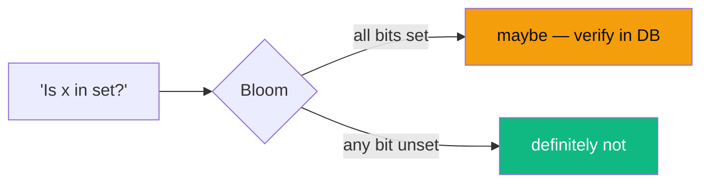
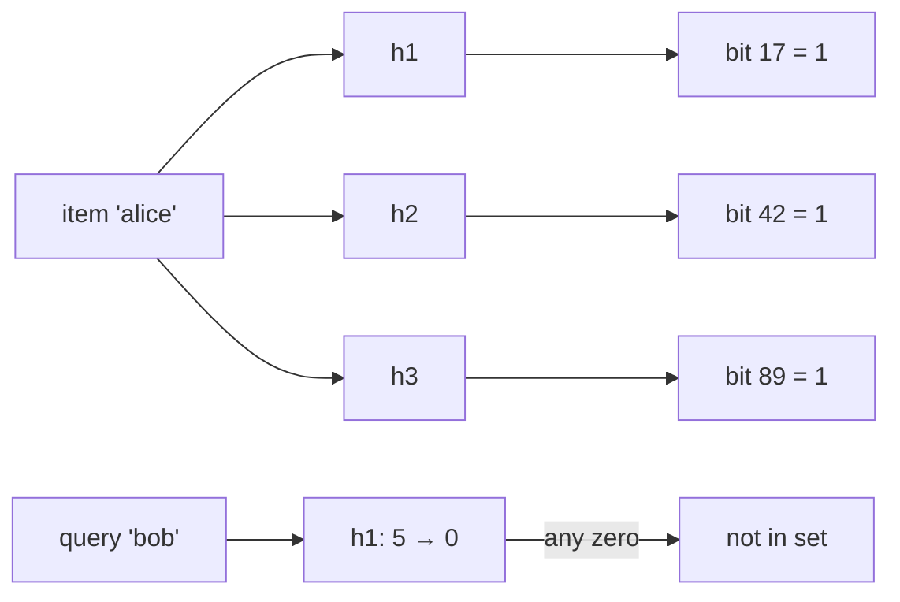
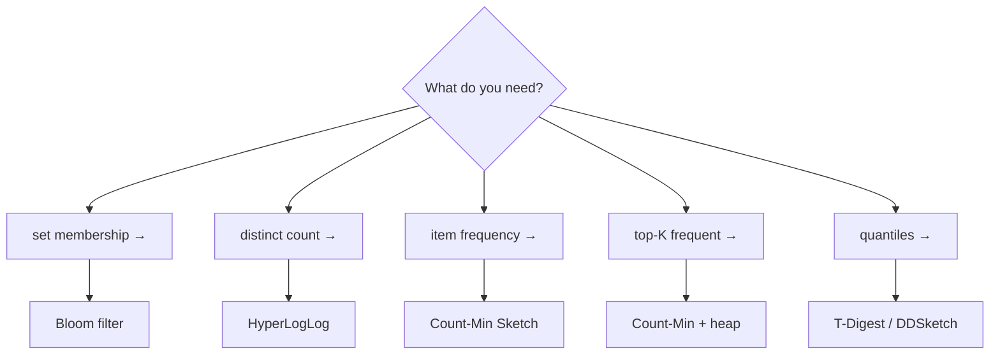
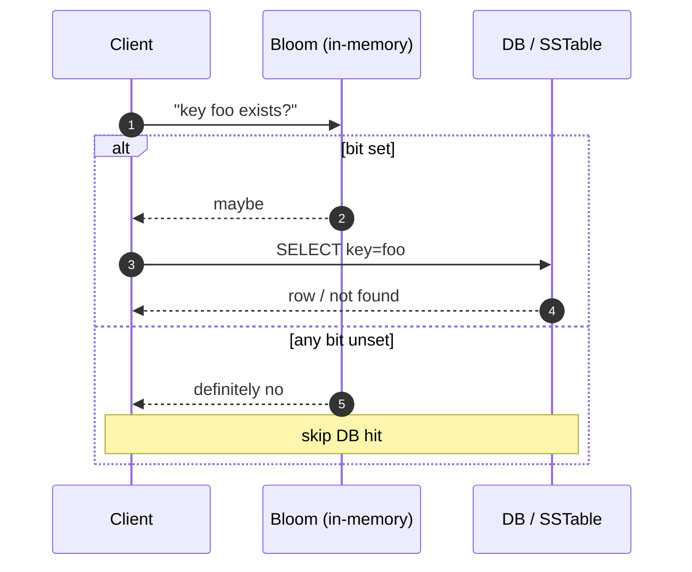

## Definition (interview-ready)

**Probabilistic data structures** trade exact answers for orders-of-magnitude less memory and CPU, by accepting a bounded error rate. **Bloom filter**: set membership with no false negatives, tunable false positives. **HyperLogLog (HLL)**: cardinality (distinct count) using ~12 KB (Redis's implementation) to estimate billions of uniques with ~0.81% standard error. **Count-Min Sketch (CMS)**: frequency estimates for stream items in bounded memory. **Top-K** / **Heavy Hitters**: track the K most-frequent items in a stream without storing all of them.

**One-liner:** Probabilistic data structures give approximate answers with a known, tunable error in a tiny, fixed amount of memory: a Bloom filter for 'have I seen this?' with no false negatives, HyperLogLog for distinct counts, Count-Min Sketch for frequencies, and a sketch plus heap for top-K.

## Why it matters

Once your data doesn't fit in memory (and at scale, it never does), exact answers become prohibitively expensive. Probabilistic structures let you answer "is this email in our spam list?" or "how many unique visitors today?" or "what are the trending hashtags right now?" using a tiny fraction of the memory exact answers would need — at error rates so low they're indistinguishable for the use case.

## Core concepts

### Bloom filter

A bit-array of size `m` plus `k` independent hash functions. To **add** an item: hash with each of the `k` functions, set those `k` bits. To **test**: hash, check all `k` bits — if any is 0, definitely not present; if all are 1, *probably* present (false positives possible).

- **False positive rate** ≈ `(1 - e^(-kn/m))^k` where `n` = items inserted. With `m = 10n` and `k = 7`, error ≈ 0.8%.
- **No deletes** (without a *counting* Bloom variant — each cell is a small counter instead of a bit).
- **No false negatives** — if it says "not present," it's truly absent.

### HyperLogLog (HLL)

Estimates the cardinality (number of distinct elements) of a stream. Memory: ~12 KB for **2^64 distinct values with ~0.81% relative error.**

How: hash each item to a uniform bit string; observe the position of the leftmost 1-bit; the maximum observed → estimate of cardinality (≈ 2^max). Use multiple "registers" (one per hash bucket) and harmonic mean for stability.

- Merges associatively: HLL(A) ∪ HLL(B) = pairwise max of registers. Lets you parallel-count per shard and combine.

### Count-Min Sketch (CMS)

A 2D matrix of size `d × w` (d = number of hash rows, w = width). To **add** item `x` with count `c`: for each row `i`, increment `CMS[i][h_i(x) % w] += c`. To **query frequency** of `x`: return the *minimum* of those `d` cells.

- **Never underestimates**: collisions only add to a cell, so the answer is the true count or higher (assuming counts only go up).
- Error bound: with `N` = total of all counts, the overcount is at most `2N / w` with probability at least `1 - (1/2)^d`.
- Common sizing: `w = 2/ε`, `d = log₂(1/δ)` (the original paper uses `w = ⌈e/ε⌉`, `d = ⌈ln(1/δ)⌉`, giving error ≤ ε·N with probability 1 − δ).

### Top-K (Heavy Hitters)

Either:
- **Count-Min + min-heap** of top K observed items. When a candidate beats the heap min, replace.
- **Misra-Gries** / **Space-Saving** algorithms: deterministic, bounded-error counters.

## How it works — when to reach for which

| Structure | Memory | Error | Operations |
|---|---|---|---|
| Bloom (m=10n) | ~10n bits | ~1% FP | add, test |
| HLL | ~12 KB | ~0.81% | add, count, merge |
| CMS (d=5, w=2^16) | ~1.3 MB (32-bit counters) | overcount ≤ ~0.004% of total count (e/w), w.h.p. | add, count |
| T-Digest | ~5 KB | sub-1% on tails | quantile |

### Bloom in front of a slow store (canonical pattern)

Cassandra/RocksDB use this per-SSTable: a read first checks the per-file Bloom; if no, skip the file entirely. Cuts read amplification dramatically.

### HLL for daily uniques

- Each event ingester maintains an HLL register.
- Aggregator merges HLLs hourly into a daily HLL.
- Store the **HLL itself** (not the count) so any window can be re-aggregated (HLL(week) = merge(HLL(d1), ..., HLL(d7))).

## Real-world examples

- **Cassandra/RocksDB** Bloom filters on SSTables.
- **Chrome's Safe Browsing** historically kept a local Bloom filter of malicious-URL hash prefixes and verified against the server only on a hit (later replaced by a compact sorted prefix set).
- **Bitcoin SPV clients** (BIP 37) used Bloom filters to ask full nodes for relevant txs; it leaked more privacy than intended and is disabled by default in Bitcoin Core since 0.19, superseded by BIP 157/158 compact block filters.
- **Medium** used Bloom filters for its "already read" recommendation filter (replaced with direct DB queries in 2025).
- **Redis** ships HLL (`PFADD`, `PFCOUNT`, `PFMERGE`) for cardinality.
- **Druid, Pinot, ClickHouse** use HLL for approximate distinct counts in queries.
- **DDoS detection / heavy hitter detection** in routers: Count-Min on src-IP.
- **Trending-topic / heavy-hitter systems** commonly combine count-min sketch + decay + heap.
- **Quantile estimation in observability**: Datadog uses DDSketch (which it created); Elasticsearch percentiles use T-Digest. Prometheus instead uses histograms (classic buckets or native exponential histograms) and client-side summaries.

## Common pitfalls

- **Treating Bloom positives as definitive.** A positive means *maybe* — you must verify in the source of truth.
- **Forgetting to size for the eventual `n`.** A Bloom sized for 1M items used at 100M items has ~100% false positive rate (every bit set). Re-create with bigger `m` and rebuild from data.
- **Sharing one Bloom across mutating sets** — no deletes. Either use counting-Bloom (more memory) or **rebuild periodically** from authoritative data.
- **HLL over a tiny cardinality.** The raw HLL estimator is biased at small cardinalities. Good implementations (HLL++, Redis) correct this with linear counting / a sparse exact-ish encoding — check yours does, or count exactly below a threshold.
- **CMS with negative counts.** The "take the minimum" trick assumes no item's count goes below zero. Decay is fine: multiplying every cell by, say, 0.95 keeps each cell at or above the item's decayed true count. If counts can genuinely go negative (arbitrary decrements), use the **Count-Median** variant (median across rows). For sliding windows, another option is one sketch per time bucket, dropping old buckets.
- **Hashing the same item with correlated hash functions.** `k` Bloom hashes must be *independent*. Common trick: `h_i(x) = h_a(x) + i * h_b(x)` with two strong hashes.
- **Persisting Bloom bits but not the parameters.** Recreating needs `m`, `k`, and the exact hash functions. Encode them in the serialized payload.
- **Confusing approximate with wrong.** A 1% false positive rate on a spam check is fine; on a "do they have permission to access this row?" check it's a security bug. Match the structure's error model to the use case.

## Practice questions

<Practice>

<QA q="What's a Bloom filter and why use it?" level="easy">

A bit array of size `m` plus `k` independent hash functions for set membership. Add: set the `k` hashed bits. Test: if any of the `k` bits is 0 the item is definitely absent; if all are 1 it's *probably* present. Used to skip an expensive lookup when the answer is 'no'. False positives possible, false negatives impossible.

</QA>

<QA q="A Bloom filter says 'yes' — what does that mean?" level="easy">

The item *might* be in the set. You must verify against the authoritative source. Only 'no' is certain.

</QA>

<QA q="Which structure do you reach for: membership, distinct count, item frequency, top-K, quantiles?" level="easy">

- Membership → **Bloom filter**.
- Distinct count → **HyperLogLog**.
- Frequency of an item → **Count-Min Sketch**.
- Top-K frequent → **CMS + min-heap**, or Misra-Gries / Space-Saving.
- Quantiles (p50/p99) → **T-Digest / DDSketch**.

</QA>

<QA q="Why can't you delete from a Bloom filter?" level="medium">

Multiple items may share each bit. Clearing a bit could erase other items' membership signal and introduce false negatives, which Bloom guarantees never happen. Use a **counting Bloom** (each cell a small counter: increment on add, decrement on remove) at the cost of more memory, or rebuild periodically from authoritative data.

</QA>

<QA q="How does HyperLogLog estimate cardinality, and why do HLLs merge cleanly?" level="medium">

Hash each item to a uniform bit string and track the position of the leftmost 1-bit; a maximum position of r suggests roughly 2^r distinct items. Many registers (one per hash bucket) combined with a harmonic mean stabilize the estimate. Merging is the **pairwise max of registers**, so per-shard or per-day HLLs combine into a union without double-counting. In Redis: ~12 KB, ~0.81% standard error.

</QA>

<QA q="Why does a Count-Min Sketch only ever overestimate?" level="medium">

Each item increments one cell in each of `d` rows. Other items colliding in the same cell only **add** to it, and counts are never lost, so every cell is at least the true count. Taking the **minimum** across rows picks the least-polluted estimate. Error shrinks as width `w` grows; more rows `d` raise the probability the bound holds.

</QA>

<QA q="How would you count daily unique visitors across 100 web servers, each seeing tens of thousands of events per second?" level="medium">

Each server keeps an HLL in memory (~12 KB) and pushes it to a central aggregator every minute. The aggregator merges (pairwise max of registers) into hourly and daily HLLs and queries the daily HLL for the count. Store the HLLs themselves, not just counts, so any window can be re-aggregated. RAM and network cost are trivial.

</QA>

<QA q="Size a Bloom filter for 10M items at 1% false-positive rate." level="medium">

`m = -n·ln(p) / (ln 2)²` → `m ≈ 95.85 M bits ≈ 12 MB`. `k = (m/n)·ln 2 ≈ 6.6` → use 7 hashes. Shortcut: `m ≈ 1.44 · n · log2(1/p)` bits (about 9.6 bits per item at 1%). For a distributed deployment, partition.

</QA>

<QA q="Design a real-time 'trending hashtags' service at Twitter scale." level="hard">

Ingest the tweet stream → per-shard Count-Min Sketch keyed by hashtag plus a per-shard min-heap of top-K candidates. Every minute each shard ships its (CMS, top-K) to a global merger, which adds the CMSes element-wise and picks the top-K from the combined candidates. Decay counts on each merge (e.g. multiply all cells by 0.95) so old hashtags fade. Queries read the global top-K. Memory per shard is fixed regardless of hashtag diversity.

</QA>

<QA q="Reading from a cold store costs 100ms per query. How can a Bloom filter cut p99?" level="hard">

Keep an in-memory Bloom of all keys known to exist in front of the cold store. Check it first (under 1 µs): 'no' → return empty immediately; 'yes' → go to the store. Sized for 10M items at 0.5% false positives it's ~14 MB (≈110 M bits, k ≈ 8). Every query for a key that doesn't exist now skips the 100 ms read (except the 0.5% false positives), which cuts p99 when many queries are for missing keys. Rebuild it daily from a snapshot. Cassandra and RocksDB use the same idea per SSTable.

</QA>

<QA q="A teammate proposes HLL to count distinct IPs hitting an endpoint per hour. What edge cases do you raise?" level="scenario">

(a) The raw HLL estimator is biased at very small cardinalities — confirm small-range correction (HLL++ / Redis) or count exactly below a threshold. (b) HLL gives a **count**, not the IPs — you can't list them. (c) HLLs aren't subtractable: 'new uniques today' is only approximable as HLL(today ∪ yesterday) − HLL(yesterday), and the error of that difference can be large compared with a small result. (d) Persist the register state, not the estimated count, so you can re-aggregate.

</QA>

<QA q="A Bloom filter sized for 1M items now holds 100M, and the DB load it was saving has returned. What happened and what do you do?" level="scenario">

It's overfilled: nearly every bit is set, so the false-positive rate approaches 100% and almost every query passes through to the DB. You can't resize a Bloom in place — create a new one with `m` sized for the expected eventual `n` and rebuild from authoritative data. Persist `m`, `k`, and the hash functions with the bits so it can be recreated, and monitor fill ratio.

</QA>

<QA q="Someone wants a Bloom filter to check 'is this user allowed to access this row?' Good idea?" level="scenario">

No. A false positive would grant access — approximate becomes a security bug. Match the error model to the use case: a 1% false-positive rate is fine for a spam pre-check or cache bypass, where a 'maybe' is verified against the source of truth, but not for authorization decisions.

</QA>

</Practice>

## Quiz

<Quiz>

<MCQ q="A Bloom filter test returns 'not present'. How confident can you be?" options={["Certain — Bloom filters have no false negatives", "About 99% if sized for 1% error", "Not at all — you must check the DB", "Certain only for counting Bloom filters"]} answer={0}>

If any hashed bit is 0, the item was never added, so 'no' is always correct. The false-positive rate applies to 'yes' answers.

</MCQ>

<MCQ q="Why must a Count-Min Sketch query take the minimum across rows?" options={["To get an underestimate for safety", "Each row's cell includes the true count plus collisions, so the minimum is the least inflated", "Because rows store counts in different units", "To make deletions possible"]} answer={1}>

Collisions only add, so each cell is an overestimate; the minimum is closest to the truth. CMS never underestimates, rows use the same units, and the minimum has nothing to do with deletes.

</MCQ>

<MCQ q="You have per-day HLLs and need weekly uniques. What do you do?" options={["Add the seven daily counts", "Average the daily counts and multiply by 7", "Merge the seven HLLs with a pairwise max of registers and count the result", "Rebuild from raw logs — HLLs cannot be combined"]} answer={2}>

HLL union is a register-wise max, which correctly handles visitors seen on several days. Summing counts double-counts repeat visitors.

</MCQ>

<MCQ q="Why is clearing bits to delete an item from a plain Bloom filter unsafe?" options={["It is slow", "It would increase the false positive rate", "Bits are read-only after creation", "Other items may share those bits, so they could start testing as absent"]} answer={3}>

Shared bits mean clearing them can create false negatives, breaking Bloom's core guarantee. Counting Bloom filters or periodic rebuilds handle deletion.

</MCQ>

<MCQ q="Which structure fits estimating p99 latency from a high-volume stream in small memory?" options={["T-Digest or DDSketch", "HyperLogLog", "Bloom filter", "Count-Min Sketch"]} answer={0}>

Quantile sketches like T-Digest and DDSketch estimate percentiles. HLL counts distincts, Bloom tests membership, and CMS estimates per-item frequencies.

</MCQ>

<MCQ q="A Bloom filter sized for 1M items now holds 100M. What is the effect?" options={["False negatives start appearing", "Memory grows automatically to compensate", "Almost all bits are set, so the false positive rate approaches 100%", "Nothing changes — Bloom filters scale with n"]} answer={2}>

Bloom filters have fixed size; overfilling saturates the bits and nearly every query returns 'maybe'. There are still no false negatives, and it won't grow on its own.

</MCQ>

<MCQ q="Why do Cassandra and RocksDB keep a Bloom filter per SSTable?" options={["To compress the data files", "To skip reading files that definitely do not contain the key, cutting read amplification", "To guarantee reads see the latest write", "To count distinct keys per file exactly"]} answer={1}>

A 'no' from the per-file Bloom lets the read skip that file entirely. Blooms don't compress data, provide consistency, or count exactly.

</MCQ>

<MCQ q="Which use of a probabilistic structure is inappropriate?" options={["HLL for approximate daily uniques on a dashboard", "Bloom filter to skip cache misses before hitting a DB", "Count-Min Sketch for trending-topic candidates", "Bloom filter as the final authorization check for row access"]} answer={3}>

A false positive in an authorization check grants access — a security bug. The others tolerate small errors or verify 'maybe' answers against the source of truth.

</MCQ>

<MCQ q="Using the rule of thumb, roughly how many bits per item does a Bloom filter need for a 1% false positive rate?" options={["About 1 bit", "About 10 bits", "About 64 bits", "About 1,000 bits"]} answer={1}>

m is about 1.44 times log2 of 1/p bits per item; for p equal to 0.01 that's about 9.6 bits, with k around 7 hashes.

</MCQ>

</Quiz>

## TL;DR cheat sheet

- **Bloom** = "is x in set?" — bit array + k hashes — false positives, no false negatives.
- **HyperLogLog** = "how many distinct?" — ~12 KB → billions of distincts at ~0.81% standard error, merges cleanly.
- **Count-Min Sketch** = "frequency of x?" — overestimates, never under.
- **Top-K** = CMS + min-heap, or Misra-Gries / Space-Saving.
- **T-Digest / DDSketch** = quantiles (p50/p99).
- Sizing: Bloom `m ≈ 1.44 · n · log2(1/p)` bits; pick `k ≈ ln 2 · m/n`.
- Always verify Bloom positives in the source of truth.
- No deletes from plain Bloom — use counting variant or rebuild.
- Raw HLL is biased at low cardinalities; use an implementation with small-range correction (HLL++ / Redis) or exact counts below a threshold.

## Go deeper

- "Space/Time Trade-offs in Hash Coding with Allowable Errors" — Burton Bloom, 1970 (the original paper)
- "HyperLogLog: the analysis of a near-optimal cardinality estimation algorithm" — Flajolet et al., 2007
- "An Improved Data Stream Summary: The Count-Min Sketch and its Applications" — Cormode & Muthukrishnan
- [Redis Probabilistic Data Structures docs](https://redis.io/docs/latest/data-types/probabilistic/)
- "Xor Filters: Faster and Smaller Than Bloom and Cuckoo Filters" — Graf & Lemire, 2020
