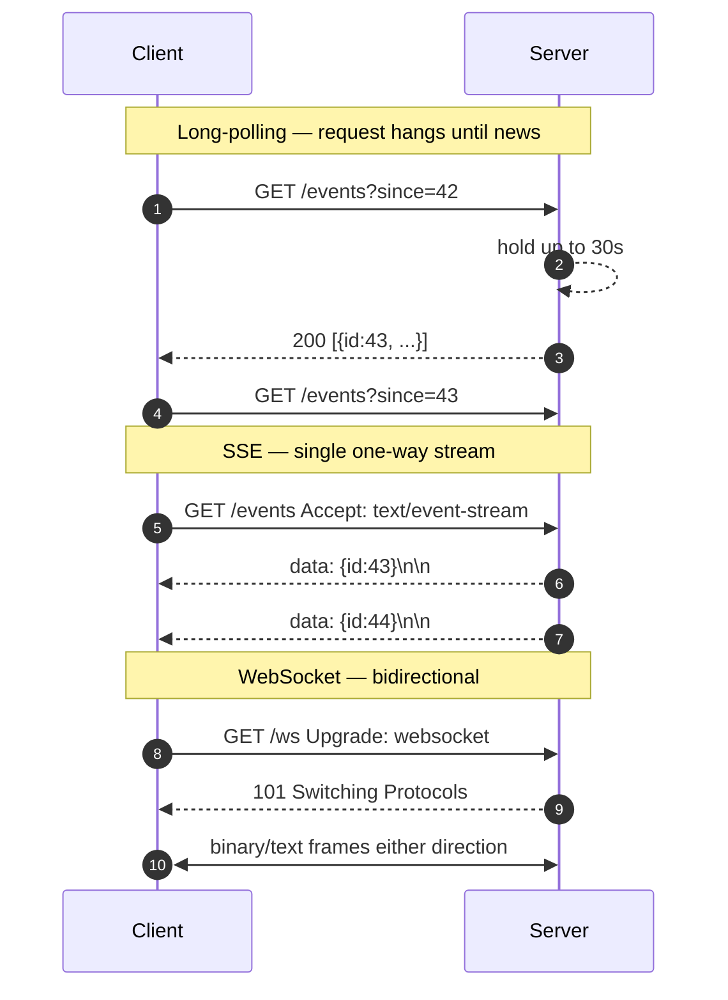
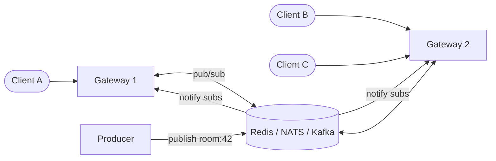

## Definition (interview-ready)

When a server needs to push data to a client without the client asking, you choose between **long-polling** (client keeps opening HTTP requests that the server holds open until it has news), **Server-Sent Events (SSE)** (one-way HTTP stream from server to client over a long-lived connection), and **WebSockets** (full-duplex TCP connection upgraded from HTTP, used for both directions). Each trades complexity, browser/proxy compatibility, and bidirectionality differently. When the app is closed, none of them work on mobile, and you push through the OS services **APNs** (Apple) and **FCM** (Google) instead.

**One-liner:** For server push I pick SSE when data flows one way (simple HTTP, auto-reconnect), WebSockets when both sides talk often (full-duplex, but stateful connections that need a pub/sub backplane to scale), long-polling as the works-everywhere fallback, and APNs/FCM when the app isn't open.

## Why it matters

Chat, notifications, live dashboards, collaborative editors, gaming, live sports scores, trading apps, presence indicators — none of these work cleanly with request/response polling. Picking the wrong primitive (long-poll where WS is needed, or vice versa) cascades into connection-explosion bills, head-of-line blocking, and proxy misery. The decision drives everything from your LB config to your sticky-session model to whether mobile clients drain battery.



## Core concepts

### Long-polling

The HTTP request stays open until the server has data or a timeout fires (~30 s). On response, the client immediately opens a new request.

- **Pros:** works with any HTTP infra (LBs, proxies, CDNs). No special protocols. Fallback for everything else.
- **Cons:** per-message HTTP request/response overhead (headers, plus new TCP/TLS handshakes if keep-alive connections aren't reused). Doubles request rate when busy. Hard to scale beyond ~10K concurrent on a single node without async I/O.
- **Use it when:** client environment is hostile (corporate proxies, ancient browsers), you only need notifications every few seconds, or as a fallback when WS fails.

### Server-Sent Events (SSE)

The client sends one HTTP request with `Accept: text/event-stream`. The server keeps the connection open and streams **named, ID'd events** as `event: x\ndata: y\n\n`. Auto-reconnect with `Last-Event-ID` resumes from where the stream was cut.

- **Pros:** built-in browser API (`EventSource`), auto-reconnect, runs over standard HTTP/2 (or HTTP/1.1). Works with most proxies. Resumable.
- **Cons:** **one-way only** (server → client). Over HTTP/1.1, browsers allow only about 6 connections per domain, shared across all tabs, so many open SSE streams can starve each other. HTTP/2 lifts this by multiplexing streams on one connection.
- **Use it when:** server pushes, client doesn't need a constant return channel beyond occasional REST calls. Notifications, live feeds, log tails, GPT-style token streaming.

### WebSockets

Client requests `Upgrade: websocket`; on `101 Switching Protocols` the underlying TCP connection becomes framed bidirectional. Frames carry text or binary, ping/pong for keepalive.

- **Pros:** full-duplex, low overhead per message (~2-14 byte framing), can carry binary, low latency.
- **Cons:** **stateful long-lived connections.** Sticky sessions or a fan-out bus (Redis pub/sub, Kafka) needed for horizontal scaling. Many corporate proxies still block or break WS upgrades. No standard auto-reconnect — you must build it.
- **Use it when:** truly bidirectional + low-latency + high-frequency (chat, collab, gaming, dashboards).

### HTTP/2 server push (deprecated)

A footnote — not used in practice. Chrome removed it in 2022. Use SSE or WS instead.

### gRPC streaming

For service-to-service push, gRPC server-streaming and bidi-streaming over HTTP/2 are usually cleaner than WS. Strongly typed, built-in flow control. Cannot speak to a browser directly without a proxy (grpc-web).

### Scaling WebSockets in depth

A WebSocket is a long-lived, **stateful** connection: the server process holding it is the only one that can write to that user. That one fact drives every scaling decision.

**1. Load balancing and sticky sessions**

- Once a WebSocket is open, every frame flows over the same TCP connection, so it naturally stays on one server. "Stickiness" for the open socket is automatic.
- Sticky sessions (routing a client to the same server by cookie or IP hash) matter when one logical session uses **several HTTP requests**: for example the long-polling fallback in libraries like Socket.IO, where each poll must reach the server that holds the session state. Socket.IO's docs say sticky sessions are required when HTTP long-polling is enabled.
- The LB must support the HTTP `Upgrade` handshake (L7 proxies like NGINX, Envoy, HAProxy, AWS ALB do) or pass TCP straight through at L4. Raise its **idle timeout** above your heartbeat interval, or it will silently cut quiet sockets.

**2. Pub/sub backplane (cross-node fan-out)**

User A is on gateway 1, user B on gateway 2. When A messages B, gateway 1 can't write to B's socket. So every gateway subscribes to a shared bus (Redis Pub/Sub, NATS, Kafka) and publishes there; the gateway holding B's socket delivers it. Keep a **presence/routing map** (user ID to gateway ID, in Redis with a TTL refreshed by heartbeats) if you want to send to one gateway instead of broadcasting to all.

- Redis Pub/Sub is fire-and-forget: if a gateway is disconnected for a moment, it misses messages. If you need replay, use Redis Streams or Kafka plus per-room sequence numbers (see the reconnect question below).

**3. Connection limits per node**

What actually caps connections on one box:

- **File descriptors:** every socket is a file descriptor. Raise `ulimit -n` / `nofile` well above the target connection count.
- **Memory:** kernel socket buffers plus your per-connection app state (buffers, user info, subscriptions). This is usually the real ceiling.
- **Ephemeral ports at the proxy:** a proxy opening connections to one backend IP:port is limited by its local port range (Linux default `ip_local_port_range` is 32768–60999, about 28K ports per destination). Fix with more backend IPs/ports or more proxy source IPs. The server's own listening port is **not** a limit, because each connection is identified by the full (source IP, source port, dest IP, dest port) tuple.
- **Event-driven I/O:** use epoll/kqueue-based servers (Netty, Go, Node, Tokio), not one thread per connection.

**4. Heartbeats and dead-connection detection**

- Use WebSocket ping/pong control frames (RFC 6455) or app-level pings every 20–30 s from **both** sides.
- Without them, a phone that drops off Wi-Fi leaves a half-open TCP connection: the server thinks it's alive and keeps buffering for it. Missing pongs let you close it and free memory.
- Heartbeats also keep NATs and LBs from expiring the idle connection.

**5. Deploys and reconnect storms**

- Restarting a node drops all its sockets at once, and every client reconnects in the same second. Drain gracefully (stop accepting, send a close frame, let clients move over time) and make clients reconnect with **exponential backoff plus random jitter**.

### Mobile push notifications: FCM and APNs

WebSockets and SSE only work while your app is open and connected. When the app is in the background or killed, the OS won't keep your socket alive (for battery reasons). Instead, the OS vendor runs **one shared, always-on connection per device**, and every app's notifications ride on it:

- **APNs** (Apple Push Notification service) for iOS, iPadOS, macOS, watchOS.
- **FCM** (Firebase Cloud Messaging) for Android (and it can also send to iOS and web; for iOS it hands off to APNs, so you upload your APNs key to Firebase).

**The three parties**

```
1. Device app  --register-->  APNs / FCM         gets a device token
2. Device app  --token----->  Your backend        store (user_id, token, platform)
3. Your backend (the "provider") --send(token, payload)--> APNs / FCM --> device
```

- **Device token / registration token:** an opaque string that addresses one app install on one device. It is **not** permanent: it can change after reinstall, restore from backup, or a refresh. The app must send the new value to your backend whenever it changes (FCM's `onNewToken` callback on Android; on iOS, every launch's `didRegisterForRemoteNotificationsWithDeviceToken`).
- Your backend stores tokens per user (a user often has several devices) and is called the **provider** or app server.

**APNs details**

- Your server sends an **HTTP/2** request to APNs (`api.push.apple.com` for production, `api.sandbox.push.apple.com` for development), one request per notification, many multiplexed on one connection.
- **Two ways to authenticate:**

| | Token-based (recommended) | Certificate-based |
|---|---|---|
| Credential | A `.p8` signing key from your Apple developer account | A TLS client certificate per app |
| How | Sign a short **JWT** (`alg: ES256`, header `kid` = key ID, claims `iss` = team ID, `iat` = issue time) and send it as `authorization: bearer` | Present the certificate in the TLS handshake |
| Expiry | Refresh the JWT no more than once every 20 min and no less than once every 60 min; APNs rejects tokens older than an hour | Certificate expires and must be renewed (yearly) |
| Scope | One key works for all your apps and both environments | One certificate per app (topic) |

- Useful headers: `apns-push-type` (e.g. `alert`, `background`), `apns-priority` (`10` = send now, `5` = send at a power-friendly time), `apns-expiration` (how long APNs keeps trying if the device is offline), `apns-collapse-id` (newer notification replaces older ones with the same ID).

**FCM details**

- Send with the **FCM HTTP v1 API**: `POST` to `fcm.googleapis.com/v1/projects/PROJECT_ID/messages:send`, authenticated with a short-lived **OAuth 2.0 access token** from a Google service account (the Admin SDKs handle this for you).
- The **legacy HTTP and XMPP APIs** (server-key based) were deprecated on June 20, 2023, and Google began shutting them down on July 22, 2024. New code must use HTTP v1.
- **Notification vs data messages:**
  - **Notification message** (`notification` block with title/body): when the app is in the background, the **system** shows it in the tray automatically; your code doesn't run until the user taps.
  - **Data message** (only a `data` block of key-value pairs): always delivered to your app code (`onMessageReceived` on Android), which decides what to do (show a custom notification, sync data). You can send both blocks together.
- **Collapse keys:** a *collapsible* message (e.g. "new mail, sync now") replaces the older pending one with the same collapse key, so an offline device gets only the latest. FCM keeps at most **4 different collapse keys** per device at a time.
- **Priority:** `normal` (may be delayed while the device is in Doze, battery-friendly) or `high` (delivered right away and can wake the device). Use `high` only for messages that show something to the user; Android may lower the priority of apps whose high-priority messages don't lead to visible notifications.
- **TTL:** how long FCM stores the message if the device is offline. Default and maximum are **4 weeks**; `0` means deliver now or drop.
- Payloads are small (4 KB for FCM messages). Send an ID and let the app fetch details.

**Handling invalid tokens (important in interviews)**

Every send returns a per-token result. Clean up based on it, or your token table fills with dead entries and you waste sends:

| Response | Meaning | Action |
|---|---|---|
| FCM `404 UNREGISTERED` | App uninstalled, token expired, or app unregistered | Delete the token |
| FCM `400 INVALID_ARGUMENT` (bad token) | Malformed or truncated token | Fix the bug storing tokens; drop that token |
| APNs `410 Unregistered` | Token no longer active for this app | Delete the token (Apple says it's final; don't retry) |
| APNs `400 BadDeviceToken` | Bad token, or prod/sandbox mismatch | Don't retry; check environment, then drop |
| APNs `429 TooManyRequests`, FCM `429` / `5xx` | Throttled or temporary failure | Retry with exponential backoff |

**Typical notification service design**

```
Event producers --> Kafka "notifications" topic --> Notification workers
   workers: look up user prefs + device tokens, render template,
            rate limit per user, dedupe by notification ID
   --> provider adapters (APNs HTTP/2 pool, FCM HTTP v1 client)
   --> results: delete dead tokens, retry 429/5xx with backoff, record metrics
```

**How to say it in an interview:** "The device registers with APNs or FCM and gets a token, the app sends that token to us, and our backend sends to APNs over HTTP/2 with a `.p8`-signed JWT or to FCM's HTTP v1 API with an OAuth token. We use collapse keys and TTL for stale messages, high priority only for visible alerts, and we delete tokens when APNs says 410 or FCM says UNREGISTERED."

## How it works

### Sizing a single node

| Mechanism | Connections per node (typical) | RAM per connection |
|---|---|---|
| Long-polling (async server) | 50K–100K | 4–16 KB |
| SSE | 50K–200K | 8 KB |
| WebSocket | 100K–500K (epoll/kqueue) | 4–16 KB |

The bottleneck for WS is rarely CPU and rarely the connection count itself — it's **outbound bandwidth × fan-out**. A single message broadcast to 100K subscribers = 100K writes.

### Horizontal scale: fan-out bus

Multiple WS/SSE gateways need to share state. Common patterns:



- Each gateway subscribes to the **rooms / channels** its clients care about.
- Producer publishes once to the bus; bus fans out to interested gateways; gateways write to their connections.
- For very high fan-out, use a **fan-out tree**: the bus feeds a few relay nodes, each of which forwards to many gateways. Discord, for example, added relay processes to split fan-out for its largest servers.

### Heartbeats and reconnects

- WS: send `ping` every 20–30 s. If no `pong` in 10 s → close, reconnect with backoff.
- SSE: server sends a comment line `:keep-alive\n\n` periodically. Browser auto-reconnects on close.
- Long-poll: timeout itself is the heartbeat.

### Authentication

- WS handshake is a regular HTTP request. The browser `WebSocket` API can't set custom headers such as `Authorization`, so browsers use cookies (and the server must check the `Origin` header to block cross-site WebSocket hijacking) or a short-lived one-time ticket in the query string. Non-browser clients can send a bearer token header. **Never** put a long-lived bearer token in a query string (gets logged).
- After upgrade, you can no longer rely on per-request headers — auth is **per-connection**. Track user identity in connection state.

### Mobile considerations

- WS over flaky cellular: TCP retransmits make latency bad. Some apps switch to QUIC-based protocols (HTTP/3-style) under the hood.
- Background tabs: browsers throttle JS timers in inactive tabs, so client-driven heartbeats get delayed. Don't depend on tight heartbeats from the client.

## Real-world examples

- **Slack, Discord, WhatsApp Web:** WebSockets (Slack via regional stateful gateway servers; Discord's gateway runs on Elixir/Erlang). WhatsApp's mobile apps use their own binary protocol over a persistent connection.
- **Twitter streaming API (v1.1 / v2 filtered stream):** a long-lived HTTP response with chunked, newline-delimited JSON — SSE-like one-way push, though not the SSE wire format.
- **GitHub Actions live logs:** the web UI tails running jobs over WebSockets.
- **OpenAI / Anthropic streaming responses:** SSE — tokens stream in as the model generates them.
- **Figma:** WebSockets with a CRDT-inspired sync protocol. **Google Docs:** operational transform over Google's own HTTP-based streaming channel.
- **Stock tickers, sports apps:** WebSockets, sometimes pub/sub via WAMP.
- **Notifications (push to mobile):** SSE/WS for in-app while open; **APNs/FCM** for closed/background — different problem.

## Common pitfalls

- **Using WS where SSE would do.** If pushes are one-way (notifications, log streaming), SSE is simpler, plays nicer with proxies, and resumes automatically.
- **No fan-out plan.** A single-node WS prototype that "works locally" falls apart at the first horizontal scaling event. Plan the pub/sub bus on day one.
- **Sticky sessions as the only scale strategy.** Sticky binds users to nodes — a failure cascade if one node dies. Prefer **stateless gateways with a shared bus**.
- **Forgetting to reauth on reconnect.** Reconnects often happen after token expiry. The client thinks it's still authed; the server should re-validate.
- **Broadcasting without per-client filtering.** A naive "send to all" wastes bandwidth and exposes data. Maintain a `room → connection_ids` index.
- **Slow consumers.** A client on bad wifi can back-pressure your write buffer. Per-connection bounded queue + drop-on-overflow + reconnect protocol.
- **Heartbeat in only one direction.** You'll miss half-open TCP connections (NAT timeouts, dead peers). Heartbeat both ways.
- **Long-polling with synchronous servers.** Each held request consumes a thread. Use async (Netty, Tornado, Node, Go, Tokio) or it falls over.
- **Treating WS as request/response.** It's a stream; correlating responses to requests requires you to add message IDs and your own multiplexing.

## Practice questions

<Practice>

<QA q="What is the difference between WebSockets and SSE?" level="easy">

WebSocket is full-duplex: both sides send framed text or binary messages over one upgraded TCP connection. SSE is one-way, server to client, over a normal HTTP response that stays open. WS needs the `Upgrade` handshake; SSE is plain HTTP streaming with built-in reconnect and `Last-Event-ID` resume.

</QA>

<QA q="Why not just poll?" level="easy">

Polling every fraction of a second burns CPU and bandwidth on both sides; polling every few seconds adds too much latency for chat or dashboards. Long-polling, SSE and WebSockets all deliver as soon as data is available without that request rate.

</QA>

<QA q="Why can't you use a WebSocket to notify a user whose app is closed?" level="easy">

Mobile OSes don't keep background apps' sockets alive, to save battery. The connection is gone, so the server has nowhere to write. Instead you send through APNs (Apple) or FCM (Android), which keep one shared system connection per device and wake or notify your app.

</QA>

<QA q="How do you scale a WebSocket service to 1M concurrent users?" level="medium">

Run many gateway nodes, each holding a large share of connections (event-driven I/O, raised file-descriptor limits, enough memory). Put an LB that supports the WS upgrade (or L4 pass-through) in front, with idle timeouts above the heartbeat interval. Use a pub/sub backplane (Redis, NATS, Kafka) so any gateway can deliver to users on other gateways, and keep a user-to-gateway presence map. Add bidirectional heartbeats, drop-on-overflow for slow clients, and jittered reconnect backoff.

</QA>

<QA q="A user keeps disconnecting and reconnecting on a flaky network. How do you avoid losing messages?" level="medium">

Tag every message with a monotonic per-room sequence number. The client remembers the last one it saw and on reconnect asks for everything after it. The server replays from a short retention buffer (for example Redis Streams or Kafka); for longer gaps the client falls back to fetching history via REST.

</QA>

<QA q="WebSocket vs HTTP/2 or gRPC streaming: when do you pick which?" level="medium">

WebSocket for browser to server when you need two-way messaging with small framing overhead. HTTP/2 or gRPC streaming for service to service, where you get flow control, multiplexing and typed contracts. Browsers can't use raw gRPC streams without a proxy like grpc-web.

</QA>

<QA q="Walk through how a push notification reaches an iPhone." level="medium">

1. The app registers with APNs and receives a **device token**.
2. The app sends the token to your backend, which stores it against the user.
3. Your backend (the provider) sends an HTTP/2 request to APNs with the token, a JSON payload and headers like `apns-push-type`, `apns-priority`, `apns-expiration`, authenticated with a `.p8`-signed JWT (or a certificate).
4. APNs delivers it over its own persistent connection to the device, or stores it until `apns-expiration` if the device is offline.

</QA>

<QA q="Token-based vs certificate-based APNs authentication?" level="medium">

Token-based: you download one `.p8` key and sign a short JWT (ES256, with key ID, team ID and issue time). One key works for all your apps and both environments, and you refresh the JWT every 20–60 minutes. Certificate-based: a TLS client certificate per app that expires and must be renewed, a common cause of surprise outages. Token-based is the modern recommendation.

</QA>

<QA q="What is the difference between FCM notification and data messages?" level="medium">

A notification message carries user-visible fields (title, body). When the app is in the background, the system shows it automatically and your code doesn't run until the tap. A data message carries only custom key-value pairs and is always handed to your app code, which decides what to do. Use data messages when the app must control rendering or do a sync; you can include both blocks.

</QA>

<QA q="How should a notification service handle invalid device tokens?" level="hard">

Read the per-token result of every send. Delete the token on FCM `UNREGISTERED` (404) or APNs `410 Unregistered`; Apple calls 410 final, so never retry it. Treat FCM `INVALID_ARGUMENT` for a token or APNs `BadDeviceToken` as a bug or environment mismatch (sandbox vs production) and drop the token. Retry `429` and `5xx` with exponential backoff. Also accept token refreshes from the app (FCM `onNewToken`), because tokens change after reinstall or restore.

</QA>

<QA q="What do collapse keys, priority and TTL do in FCM?" level="hard">

- **Collapse key:** newer messages with the same key replace older pending ones, so an offline device gets only the latest. FCM keeps at most 4 different collapse keys per device.
- **Priority:** `normal` may be delayed in Doze to save battery; `high` is delivered immediately and can wake the device. If high-priority messages don't lead to visible notifications, FCM may deprioritize them.
- **TTL:** how long FCM keeps trying an offline device; default and max are 4 weeks, and 0 means now-or-never (good for an incoming call alert).

</QA>

<QA q="Design real-time delivery for a live-event chat with 100K users in one room." level="scenario">

At 100K subscribers and 10 messages per second that's 1M outbound writes per second for one room. Shard gateways; map each room to a small set of fan-out nodes that forward to every gateway with subscribers (a fan-out tree), and let gateways write to their local sockets. Apply drop-on-overflow per client and consider coalescing (show 100 new messages instead of pushing each one). Rate-limit chatty senders per room.

</QA>

<QA q="A user says they get messages only after refreshing. Diagnose." level="scenario">

- A corporate proxy may strip the WS upgrade: check that the client falls back to SSE or long-polling.
- A NAT or LB idle timeout killed the connection and neither side noticed: add heartbeats in both directions and raise LB idle timeouts.
- The server's per-connection write queue is full and dropping silently: expose queue depth as a metric.
- Auth expired and reconnects fail silently: log reconnect errors client-side and re-authenticate on reconnect.

</QA>

<QA q="WebSocket server costs double every 3 months while users grow only 20 percent per month. Where is the leak?" level="scenario">

Likely fan-out amplification (a few hot rooms multiplying writes), per-message bookkeeping (logging or persisting every frame per connection), zombie connections never closed because dead peers aren't detected, or no per-room rate cap so one bot drives cost. Add per-room metrics (subscribers times messages per second), heartbeats to reap dead sockets, and per-room send limits.

</QA>

</Practice>

## Quiz

<Quiz>

<MCQ q="Which push mechanism is one-way server to client with built-in browser auto-reconnect?" options={["WebSocket", "Server-Sent Events", "Long-polling", "gRPC bidi streaming"]} answer={1}>

SSE uses `EventSource`, reconnects automatically and resumes with `Last-Event-ID`. WebSockets need you to build reconnect yourself.

</MCQ>

<MCQ q="Why do multi-node WebSocket deployments need a pub/sub backplane?" options={["To compress frames", "A sender and receiver can be connected to different nodes", "Browsers require it", "To terminate TLS"]} answer={1}>

Only the node holding a socket can write to it, so nodes publish to a shared bus and the right node delivers.

</MCQ>

<MCQ q="According to Socket.IO docs, when are sticky sessions required?" options={["Always, even WebSocket-only", "When HTTP long-polling transport is enabled", "Only with Redis adapter", "Never"]} answer={1}>

Long-polling uses many HTTP requests per session, and each must reach the node holding that session.

</MCQ>

<MCQ q="What does an APNs 410 Unregistered response mean?" options={["Retry later", "Payload too large", "Token is no longer active, delete it", "JWT expired"]} answer={2}>

Apple treats 410 as final for that token and topic. Remove it and don't retry.

</MCQ>

<MCQ q="For APNs token-based auth, how often should the JWT be refreshed?" options={["Every request", "No more than once per 20 min, no less than once per 60 min", "Once a year", "Never, it does not expire"]} answer={1}>

Refreshing too often triggers errors; tokens older than an hour are rejected.

</MCQ>

<MCQ q="How does the FCM HTTP v1 API authenticate requests?" options={["Legacy server key", "Short-lived OAuth 2.0 access token from a service account", "APNs .p8 key", "Basic auth"]} answer={1}>

HTTP v1 uses OAuth 2.0 tokens. The server-key based legacy APIs were deprecated in June 2023 and shutdown began July 2024.

</MCQ>

<MCQ q="An Android app in the background receives an FCM message with only a data block. What happens?" options={["System tray shows it automatically", "It is dropped", "It is delivered to the app's message handler", "It waits until the app is opened"]} answer={2}>

Data-only messages go to `onMessageReceived` in the foreground and background (not if the user force-stopped the app); the app decides what to show.

</MCQ>

<MCQ q="A device was offline and 10 collapsible messages with the same collapse key were sent. What arrives?" options={["All 10", "The first one", "Only the latest", "None"]} answer={2}>

Collapsible messages replace earlier pending ones with the same key.

</MCQ>

<MCQ q="What usually caps WebSocket connections per server first?" options={["The listening port number", "Memory and file descriptor limits", "The 65,535 server port limit per client", "HTTP header size"]} answer={1}>

Each socket is a file descriptor and needs memory. The server's single listening port isn't a limit because connections are identified by the full 4-tuple.

</MCQ>

<MCQ q="Why add random jitter to client reconnect backoff?" options={["To save battery only", "To avoid a reconnect storm when a node restarts", "Browsers require it", "To keep TLS sessions alive"]} answer={1}>

When a node drops thousands of sockets, synchronized reconnects can overload the remaining nodes. Jitter spreads them out.

</MCQ>

</Quiz>

## TL;DR cheat sheet

- **Long-poll**: works everywhere, simplest fallback, expensive at scale.
- **SSE**: server → client only, browser-native, resume via `Last-Event-ID`, perfect for notifications/log streams/LLM tokens.
- **WebSocket**: full-duplex, low overhead, scale via pub/sub fan-out bus, need heartbeats + reconnect logic.
- Pick **SSE** if push is one-way; pick **WS** if truly bidirectional + high frequency.
- Scale plan: stateless gateways + Redis/NATS/Kafka pub/sub + sticky-aware LB.
- Heartbeats both ways. Per-room indexing. Drop-on-overflow. Reauth on reconnect. Replay since last-ID.
- gRPC streaming for service ↔ service; WS for browser ↔ service.
- WS limits per node: file descriptors + memory; LB idle timeout above heartbeat; jittered reconnects on deploy.
- App closed → **APNs / FCM**. Device token → your backend → APNs (HTTP/2, `.p8` JWT or cert) or FCM HTTP v1 (OAuth 2.0). Legacy FCM APIs: deprecated June 2023, shutdown from July 2024.
- FCM: notification vs data messages, collapse key (max 4 per device), `high` priority only for visible alerts, TTL default/max 4 weeks. Delete tokens on FCM `UNREGISTERED` / APNs `410`.

## Go deeper

- [RFC 6455 — The WebSocket Protocol](https://datatracker.ietf.org/doc/html/rfc6455)
- [WHATWG — Server-Sent Events](https://html.spec.whatwg.org/multipage/server-sent-events.html)
- "How Discord Scaled Elixir to 5,000,000 Concurrent Users" — Discord engineering blog
- ["Real-time Messaging"](https://slack.engineering/real-time-messaging/) — Slack engineering blog
- [Mozilla MDN — WebSockets API](https://developer.mozilla.org/docs/Web/API/WebSocket)
- [Socket.IO — Using multiple nodes](https://socket.io/docs/v4/using-multiple-nodes/)
- [Firebase — FCM error codes](https://firebase.google.com/docs/cloud-messaging/error-codes)
- [Firebase — Android message priority](https://firebase.google.com/docs/cloud-messaging/android/message-priority)
- [Apple — Establishing a token-based connection to APNs](https://developer.apple.com/documentation/usernotifications/establishing-a-token-based-connection-to-apns)
