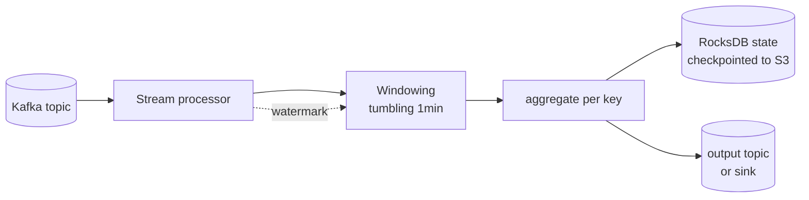
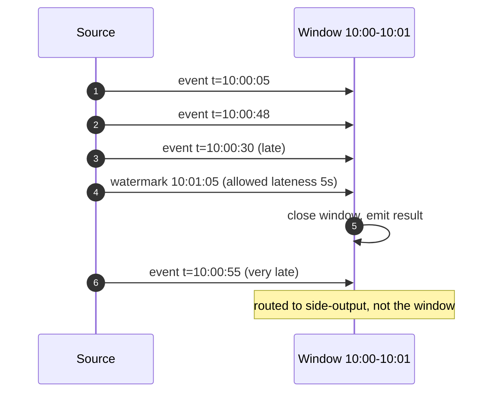
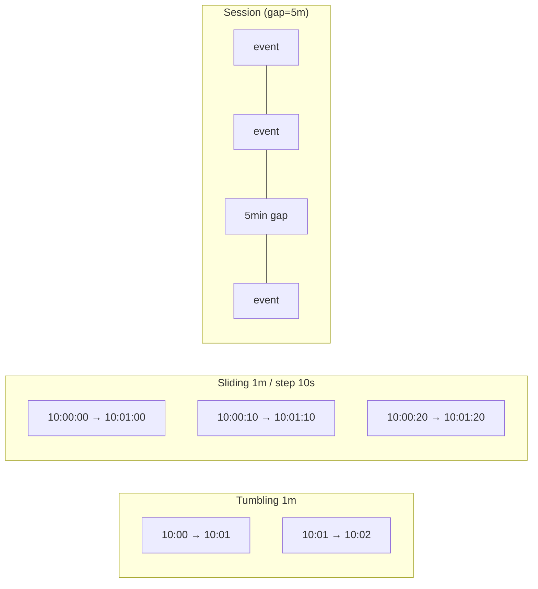
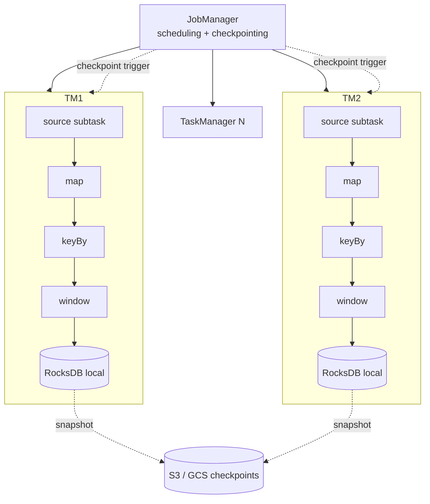
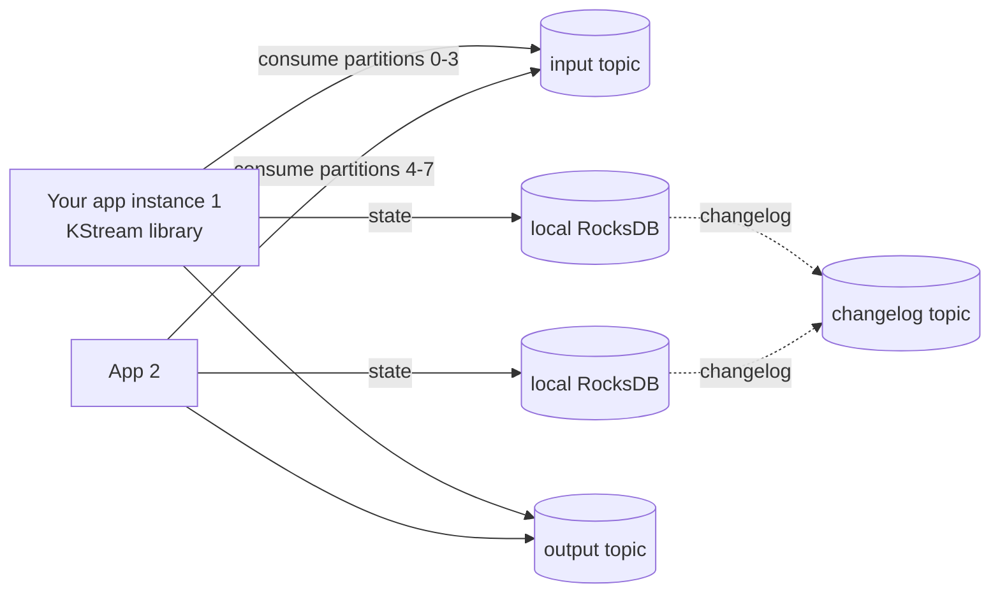

## Definition (interview-ready)

**Stream processing** is computation over an unbounded sequence of events with low latency, typically driven by Kafka or another log. **Apache Flink** is a distributed engine with sophisticated state management, event-time semantics, watermarks, and exactly-once guarantees. **Kafka Streams** is a library (not a cluster) that runs inside your app, scaling via Kafka consumer-group rebalancing and using Kafka topics as state-store backups. **Windowing** chops the infinite stream into bounded buckets (tumbling, sliding, session); **watermarks** are the engine's mechanism for deciding "no more late events of this kind will arrive" so it can emit results.

## Why it matters

Batch (Spark daily job) gives correct answers at high latency. Stream processing gives "good enough now" results in seconds, which most modern products need: fraud detection, real-time pricing, live dashboards, recommendation features, ad attribution, alerting. The hard parts — out-of-order events, late data, exactly-once, large state, restart-from-savepoint — are the topics interviews dig into.

## Core concepts

### Event time vs processing time

- **Event time** = when the event happened (timestamp in the payload).
- **Processing time** = when the engine sees it (wall clock).
- Out-of-order arrival is normal: an event from `t=10:00:05` may arrive at `t=10:00:12`.
- Correct results require **event-time** windowing. Processing-time is faster but wrong on retries, replays, or burst recovery.

### Watermarks

A watermark `W(t)` is a promise from the source: "no events with event time < t will arrive after this point." When watermark passes the window end, the engine closes and emits the window.

- Tight watermarks → low latency, more "late" data rejected.
- Loose watermarks → higher latency, more correctness.
- Standard approach: `watermark = max_event_time_seen - max_out_of_orderness` (Flink's `forBoundedOutOfOrderness`). **Allowed lateness** is a separate per-window grace period: the window keeps its state after the watermark passes and re-fires for late events within that bound.

### Windows

- **Tumbling**: fixed, non-overlapping (every minute). Most common.
- **Sliding**: fixed-size, overlapping (every 10s, size 1min). Higher emission rate.
- **Session**: keyed gap-based ("close when idle 5 min"). User-session analytics.
- **Global / count-based**: not time, but event count (every N events).

### State

A stream job's state is keyed state (per-key counters, dictionaries) and operator state (broadcast configs, source offsets). Sources of correctness pain:

- State must be **fault-tolerant** → checkpointed to durable store (S3, GCS).
- On restart, restore from latest checkpoint → resume processing exactly where you left off.
- For Flink: **RocksDB-backed state**, periodic snapshots, **checkpoint barriers** (asynchronous barrier snapshotting, a Chandy-Lamport variant) flow through the DAG to ensure all operators checkpoint at the same logical instant.

### Exactly-once

Misunderstood. Three flavours:

| Flavour | What it guarantees |
|---|---|
| **At-most-once** | may drop, never duplicate |
| **At-least-once** | may duplicate, never drop |
| **Exactly-once** (effectively-once) | side-effects happen exactly once, even on retries |

Real exactly-once requires:
- **Source replay** (Kafka has this).
- **Idempotent or transactional sink** (Kafka transactions; Iceberg/Delta commits; idempotent upserts in DB).
- **Operator state checkpointed atomically** with the input offsets.

Flink calls this **end-to-end exactly-once** when source + sink support it. Most "exactly-once" claims you hear are at-least-once + idempotent consumer downstream.

### Backpressure

If a downstream operator slows down, the engine must signal upstream operators to slow down too — otherwise queues unbounded-grow. Flink propagates backpressure via credit-based flow control between tasks (since 1.5; earlier versions relied on TCP buffer fullness). Kafka Streams is pull-based and pauses partitions whose buffers are full. Symptoms: rising consumer lag.

## How it works

### Flink architecture

### Kafka Streams architecture

- **No cluster of its own** — it's a library you embed in your app/JVM.
- Scales by adding instances → Kafka rebalances partitions → state migrates by replaying the changelog topic.
- Simpler operationally if you already run Kafka + JVM apps; less powerful than Flink (no event-time guarantees as strong, simpler windowing, no real Python ecosystem).

### Flink vs Kafka Streams vs Spark Structured Streaming

| | Flink | Kafka Streams | Spark Structured Streaming |
|---|---|---|---|
| Model | true streaming (per-event) | true streaming (per-event) | micro-batch (small batches) |
| Cluster | yes (JobManager/TM) | no (library) | yes |
| State | RocksDB + checkpoints | RocksDB + changelog topic | versioned state store (HDFS-backed or RocksDB) |
| Latency | tens of ms | tens of ms | ~100 ms to seconds (micro-batch); ~1 ms in experimental continuous mode |
| Throughput | very high | high | very high |
| Watermarks | first-class | limited | yes |
| Languages | Java, Scala, Python (PyFlink), SQL | Java, Scala | Scala, Java, Python, SQL |
| Best for | low-latency complex pipelines | "stream processing inside my service" | unified batch+stream on existing Spark infra |

## Real-world examples

- **Uber:** Flink for surge pricing, ETA estimation, fraud — sub-second feature pipelines.
- **Netflix:** Flink for content recommendations, anomaly detection, payment risk.
- **Alibaba:** Flink at massive scale (powers Singles Day real-time dashboards).
- **Pinterest:** Flink for ML feature freshness.
- **Robinhood:** Flink for positions, fraud detection and data ingestion (Current 2024 talk).

## Common pitfalls

- **Using processing time when you mean event time.** Replays, recoveries, backfills will silently corrupt aggregates.
- **No allowed-lateness.** Real event streams always have stragglers; without lateness, every late event is lost.
- **Unbounded state.** A keyBy on an ever-growing key space (e.g., raw UUIDs) accumulates state forever. Add TTL or scope by window.
- **No state size monitoring.** RocksDB grows; checkpoints get expensive; eventually slow snapshots block processing.
- **Treating "exactly-once" as automatic.** It's a chain — break any link and you're at-least-once. Verify sink supports transactions or is idempotent.
- **Skew on a hot key.** All events for "celebrity_user_id" land on one operator instance. Mitigate by adding a salt: `keyBy = (key, hash(event) % N)` then `union → aggregate`.
- **Restart from scratch instead of from savepoint.** Restoring from a savepoint preserves state; restart from offset 0 reprocesses everything (correct only if everything is idempotent).
- **Kafka Streams with too few partitions.** Parallelism is capped at # of input partitions. Repartition early if you need more.
- **Side-effects in operators.** Calling an external API from a `map()` adds latency and breaks exactly-once. Use **async I/O** with checkpointed deduplication.

## Practice questions

<Practice>

<QA q="What's the difference between stream and batch processing?" level="easy">

Batch processes bounded data with results minutes to hours later. Stream processing handles unbounded data with results in milliseconds to seconds. Streaming pays for low latency with harder problems: out-of-order and late events, large fault-tolerant state, and exactly-once.

</QA>

<QA q="Event time vs processing time — which should windows use?" level="easy">

**Event time** is when the event happened (timestamp in the payload); **processing time** is when the engine sees it. Out-of-order arrival is normal, so correct aggregates need **event-time** windows. Processing-time windows are simpler and faster but give wrong results on retries, replays, backfills, and burst recovery.

</QA>

<QA q="What's a watermark?" level="easy">

A promise flowing with the stream that no event with event time earlier than W will arrive after this point. When the watermark passes a window's end, the engine closes the window and emits its result. A common choice is `max_event_time_seen - max_out_of_orderness` (Flink's `forBoundedOutOfOrderness`).

</QA>

<QA q="Tumbling vs sliding vs session windows — when do you use each?" level="medium">

- **Tumbling** (fixed, non-overlapping): simple periodic aggregates — requests per minute.
- **Sliding** (fixed size, overlapping): smoothed metrics — a 5-minute moving average updated every 10 s; higher emission rate.
- **Session** (keyed, gap-based): per-user activity bursts — page views per session ending after 5 minutes idle.

</QA>

<QA q="How do bounded out-of-orderness and allowed lateness differ?" level="medium">

Out-of-orderness shapes the **watermark**: it delays window closing so moderately late events still land on time — the latency vs completeness knob (tight → low latency, more data counted as late; loose → higher latency, more correct). **Allowed lateness** is a per-window grace period after the watermark passes: the window keeps its state and re-fires when late events arrive within that bound. Events later than that go to a side output instead of being silently dropped.

</QA>

<QA q="How does Flink checkpoint state consistently across a distributed job?" level="medium">

The JobManager injects **checkpoint barriers** into the sources; they flow through the DAG with the data (asynchronous barrier snapshotting, a Chandy-Lamport variant). When an operator has received the barrier on all its inputs (aligned checkpoints), it snapshots its state — typically RocksDB — to durable storage like S3 or GCS. All operators thus snapshot at the same logical instant, together with the source offsets, so a restore resumes exactly where the checkpoint left off.

</QA>

<QA q="How does Kafka Streams scale, and what caps its parallelism?" level="medium">

It's a library inside your app, not a cluster. You add instances; Kafka's consumer-group rebalancing reassigns partitions, and local RocksDB state migrates by replaying its **changelog topic**. Parallelism is capped at the number of input partitions — repartition early if you need more.

</QA>

<QA q="Compare Flink vs Kafka Streams for a project. Decision criteria?" level="medium">

Pick **Kafka Streams** if you already run Kafka and JVM apps, want stream logic embedded next to your service code, have low-to-moderate scale, and want a simpler operational model. Pick **Flink** if you need very low latency with strong event-time and watermark semantics, state grows large (tens of GB+), you need non-JVM languages (PyFlink), sophisticated multi-stream joins, and can afford to run a cluster.

</QA>

<QA q="Your Flink job is correct in dev but produces wrong aggregates after restart in prod. Why?" level="hard">

Likely processing-time windows: replayed events after the restart land in different windows than originally. Switch to event-time windows with watermarks. Or the sink isn't transactional, so outputs re-emitted on restart are written twice; use a sink with exactly-once support or make writes idempotent.

</QA>

<QA q="Explain end-to-end exactly-once between Kafka → Flink → Postgres." level="hard">

Source: Kafka offsets are stored in Flink's checkpoint state (committing them back to Kafka is only for monitoring). Operators: state is snapshotted atomically with the offsets via barriers. Sink: **two-phase commit** — writes go into a Postgres transaction that is pre-committed at the checkpoint and committed only when the checkpoint completes. On failure: restore state from the checkpoint, replay from the checkpointed offsets; uncommitted transactions roll back and are redone. Every input affects Postgres exactly once.

</QA>

<QA q="Design real-time fraud detection on card swipes at 10K transactions/sec." level="scenario">

Kafka topic `transactions` partitioned by `card_id`. Flink: `keyBy(card_id)` → per-card sliding window (last 5 minutes) → features (count, sum, distinct merchants, geo distance from last swipe) → model scoring via **async I/O** with a cache. Above a threshold, emit to an `alerts` topic. State ≈ 10M active cards × ~1 KB ≈ 10 GB across the cluster in RocksDB, checkpointed to S3 every 30 s. Watermark at `max_event_time - 30s`. Exactly-once via Kafka source + transactional Kafka sink.

</QA>

<QA q="You're seeing growing consumer lag in a production Flink job. Walk through diagnosis." level="scenario">

Check (a) **backpressure** — the Flink UI shows the slow operator, often a sink or stateful op; (b) **state size** — RocksDB compaction or state explosion, disk usage; (c) **skew** — uneven subtask throughput from a hot key; (d) **checkpoint duration** — slow snapshots hurt processing; (e) **JVM GC pressure**. Fix by cause: scale out, salt the hot key, async I/O for slow sinks or lookups, tune checkpoint storage.

</QA>

<QA q="One celebrity user's events overwhelm a single operator, and state for a keyBy on raw request UUIDs keeps growing. Fix both." level="scenario">

**Hot key skew**: salt the key — `keyBy((key, hash(event) % N))` to spread the load, pre-aggregate per salted key, then merge partial results per real key. **Unbounded state**: a key space that grows forever accumulates state forever; add **state TTL** or scope state to a window so it's cleared when the window closes, and monitor state size and checkpoint duration.

</QA>

</Practice>

## Quiz

<Quiz>

<MCQ q="A job replays a day of Kafka data after an outage. Which windowing gives the same results as the original run?" options={["Processing-time windows", "Count-based windows with a wall-clock trigger", "Event-time windows with watermarks", "No windowing at all"]} answer={2}>

Event-time windows assign events by their own timestamps, so replays land in the same windows. Processing-time windows lump the whole replay into the current wall-clock windows.

</MCQ>

<MCQ q="What does a watermark of 10:01:05 tell a window operator?" options={["No more events with event time before 10:01:05 are expected, so windows ending earlier can fire", "The current wall-clock time is 10:01:05", "All events up to 10:01:05 have been written to the sink", "The next checkpoint starts at 10:01:05"]} answer={0}>

A watermark is an event-time progress assertion that triggers window completion. It isn't wall-clock time, a sink acknowledgement, or a checkpoint schedule.

</MCQ>

<MCQ q="You tighten the watermark's out-of-orderness bound from 30 s to 2 s. What is the trade-off?" options={["Higher latency, fewer late events", "No change in latency or correctness", "State becomes unbounded", "Lower latency, but more events arrive after their window fired"]} answer={3}>

A tighter bound closes windows sooner, so results come faster but more stragglers count as late. A looser bound does the opposite.

</MCQ>

<MCQ q="Which window type fits 'page views per user visit, where a visit ends after 30 minutes of inactivity'?" options={["Tumbling", "Session", "Sliding", "Global count"]} answer={1}>

Session windows are keyed and gap-based. Tumbling and sliding windows have fixed sizes unrelated to user activity, and count windows ignore time.

</MCQ>

<MCQ q="Which piece is NOT required for end-to-end exactly-once from Kafka through Flink to a database?" options={["A replayable source", "Operator state checkpointed atomically with input offsets", "A transactional or idempotent sink", "Processing-time windows"]} answer={3}>

Exactly-once needs source replay, consistent checkpoints, and a transactional or idempotent sink. The window time domain is unrelated — and event time is usually what you want anyway.

</MCQ>

<MCQ q="Why do Flink checkpoint barriers flow with the data?" options={["So every operator snapshots state at the same logical point in the stream", "To compress records in flight", "To carry watermarks downstream", "To rebalance partitions between TaskManagers"]} answer={0}>

Barriers mark a consistent cut: an operator snapshots once the barrier has passed its inputs, aligning all state with the same source offsets. They don't compress data, carry watermarks, or rebalance work.

</MCQ>

<MCQ q="A Kafka Streams app reads a 6-partition topic. You scale from 6 to 12 instances. What happens?" options={["Throughput doubles", "Each partition is split between two instances", "Six instances sit idle, because parallelism is capped by partition count", "The app crashes on rebalance"]} answer={2}>

Each partition is consumed by one instance in the group, so instances beyond the partition count get no work. Repartition to more partitions to scale further.

</MCQ>

<MCQ q="Flink lag is rising and the UI shows one window subtask far busier than the others. What is the most likely cause and fix?" options={["Checkpoints too frequent; disable checkpointing", "A hot key; salt the key and aggregate in two stages", "Too many partitions; reduce them", "Processing-time windows; switch to count windows"]} answer={1}>

One overloaded subtask points to key skew; salting spreads the hot key, then a second stage merges partials. Disabling checkpoints sacrifices fault tolerance and the other options don't address skew.

</MCQ>

<MCQ q="How does Kafka Streams restore local state when a partition moves to a new instance?" options={["It copies RocksDB files from S3 checkpoints", "It asks the JobManager for a savepoint", "It recomputes state from the output topic", "It replays the state store's changelog topic in Kafka"]} answer={3}>

Kafka Streams backs each state store with a changelog topic and rebuilds local RocksDB from it. S3 checkpoints and JobManager savepoints are Flink concepts.

</MCQ>

</Quiz>

## TL;DR cheat sheet

- **Event time, not processing time.** Always.
- **Watermark** = "no more events before t" → triggers window close.
- **Allowed lateness** so late stragglers still update results.
- **Windows**: tumbling (periodic), sliding (smoothed), session (gap-based).
- **State**: keyed + operator; in RocksDB; checkpointed to durable store.
- **Exactly-once** is a chain: source replay + atomic checkpoints + transactional or idempotent sink.
- **Flink** = cluster, complex, low latency, strong semantics. **Kafka Streams** = library in your app, simpler, leans on Kafka for everything.
- **Backpressure** propagates via slow buffers → upstream slows automatically.
- **Skew fix**: salt the key, then aggregate.
- Always monitor: consumer lag, state size, checkpoint duration, GC.

## Go deeper

- "Streaming Systems" by Tyler Akidau et al. — the canonical book (concepts apply to all engines).
- [Flink Docs — Event Time & Watermarks](https://nightlies.apache.org/flink/flink-docs-stable/docs/concepts/time/)
- [Kafka Streams docs](https://kafka.apache.org/documentation/streams/)
- "The Dataflow Model" — Akidau, Bradshaw, et al. (Google, 2015) — the watermark/trigger model (low watermarks first appeared in MillWheel, 2013)
- "Lightweight Asynchronous Snapshots for Distributed Dataflows" — Carbone et al. (Flink checkpointing paper)
