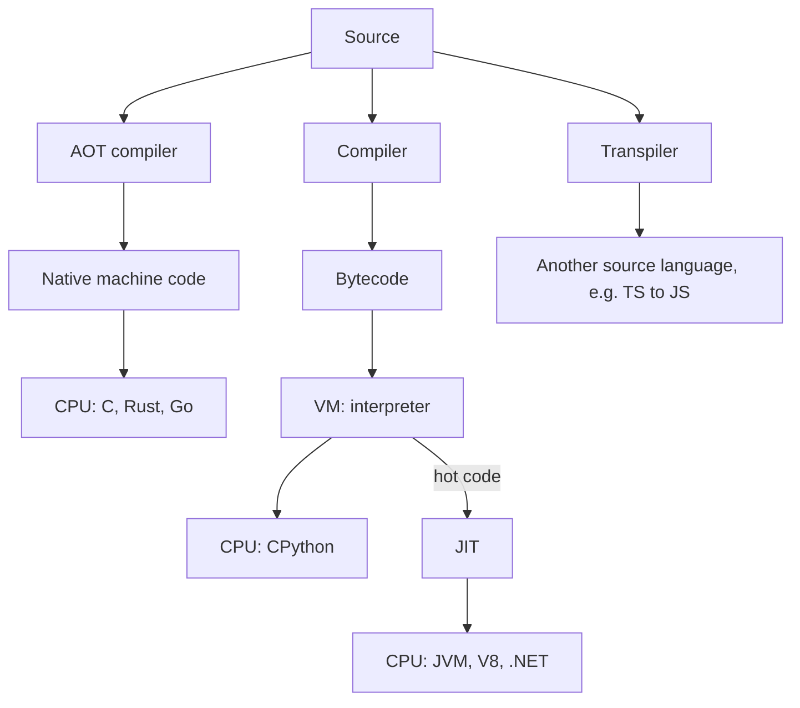
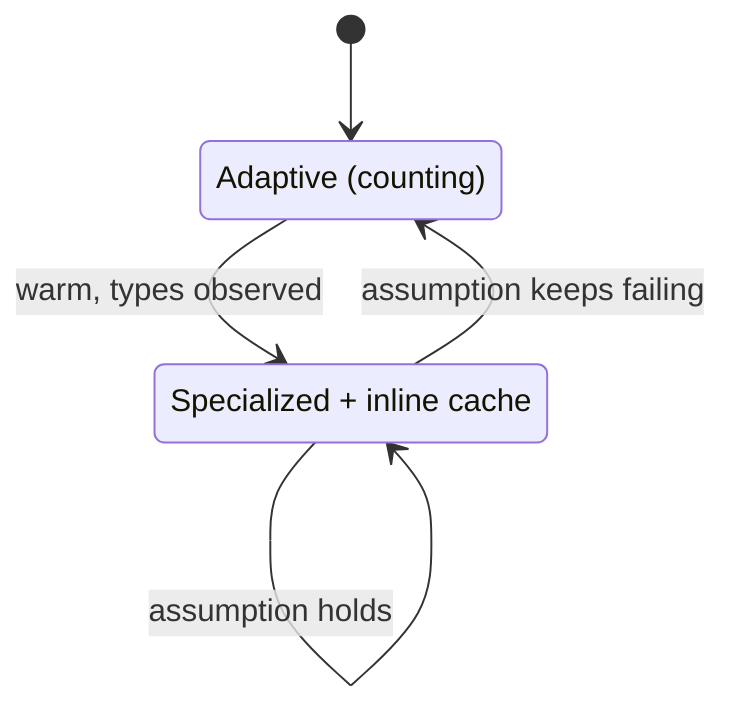
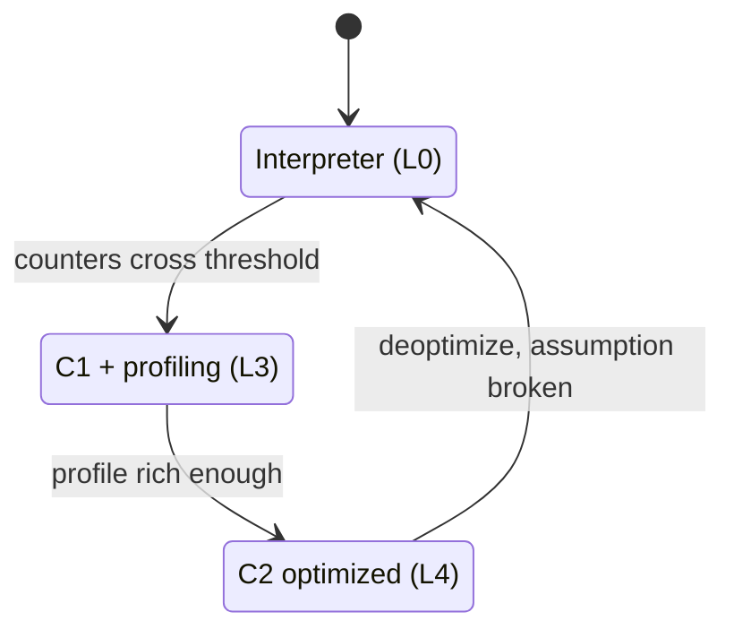

## Definition (interview-ready)

"Compiled vs interpreted" is not a property of a language. It is a property of an **implementation**, and most real implementations sit somewhere on a spectrum:

- **AOT (ahead-of-time) native compilation**: a compiler turns source into machine code for one CPU and OS *before* the program runs. C, C++, Rust and Go work this way. You ship a binary.
- **Bytecode + virtual machine**: source is compiled to **bytecode**, a compact instruction set for an imaginary machine. A VM then runs it. Java (`.class` files) and CPython (`.pyc` files) work this way.
- **Interpreter**: a loop that reads one instruction at a time and does what it says. CPython's VM is mainly an interpreter.
- **JIT (just-in-time) compilation**: while the program runs, the VM notices which code is hot and compiles *that* code to machine code, using what it has learned at runtime. The JVM (HotSpot), V8 (JavaScript) and .NET do this.
- **Transpilation**: compiling one high-level language into another, like TypeScript to JavaScript.

**One-liner:** Java is compiled to bytecode by `javac`, interpreted at first by the JVM, and the hot parts are JIT-compiled to machine code; Go is compiled straight to a native binary; CPython compiles to bytecode and interprets it.

## Why it matters

This is behind a lot of production behaviour that interviewers like to probe:

- **Warmup.** A freshly started Java service is slow for its first seconds or minutes, because hot code is still being interpreted and profiled. This is why you warm up instances before sending full traffic, and why p99 latency spikes right after a deploy.
- **Startup time and memory.** A JVM or Python process starts slower and uses more memory than a Go binary. That matters for serverless, CLIs and autoscaling.
- **"Why is Python slow?"** Pure-Python loops go through an interpreter that does a lot of work per bytecode instruction. Knowing that explains why NumPy, C extensions, and recent CPython speedups help.
- **Benchmarking.** If you benchmark Java without warmup, you measure the interpreter, not the code you will run in production.
- **GraalVM native image and Go** come up whenever someone asks how to cut cold starts.

## Core concepts

### The spectrum, with a mental model

Think of a recipe written in French:

- **AOT compiler**: someone translates the whole recipe into English before you start cooking. Fast to follow, but the translator had to guess what you'd need.
- **Interpreter**: a translator stands next to you and translates one line at a time, every time. Flexible, but slow, and the same line gets re-translated on every pass.
- **JIT**: the translator starts line by line, notices you make this cake every day, and writes down a polished English version of the steps you actually use.

The four paths from source code to the CPU:



### What bytecode is

Bytecode is a **portable instruction set for a virtual machine**. It is lower-level than source code (no loops or expressions, just simple steps) but higher-level than machine code (it knows about objects, method calls and types, and doesn't care about CPU registers).

Both the JVM and CPython use a **stack machine**: instructions push values onto an operand stack and pop them off. Here is a tiny Java method:

```java
public class Add {
    static int add(int a, int b) { return a + b; }
}
```

Running `javac Add.java && javap -c Add.class` (JDK 17) prints:

```
  static int add(int, int);
    Code:
       0: iload_0      // push local variable 0 (a)
       1: iload_1      // push local variable 1 (b)
       2: iadd         // pop two ints, push their sum
       3: ireturn      // return the int on top of the stack
```

The numbers on the left are byte offsets. Notice that the JVM's bytecode is **typed**: `iadd` adds ints, `ladd` adds longs, `dadd` adds doubles. `javac` already knows the types.

The same function in Python:

```python
import dis

def add(a, b):
    return a + b

dis.dis(add)
```

Output on CPython 3.14 (exact opcodes change between versions):

```
  3           RESUME                   0

  4           LOAD_FAST_BORROW_LOAD_FAST_BORROW 1 (a, b)
              BINARY_OP                0 (+)
              RETURN_VALUE
```

Python's `BINARY_OP (+)` is **untyped**: at runtime it must check what `a` and `b` are. They could be ints, floats, strings, lists, or a class with `__add__`. That per-instruction type checking is a big part of why naive interpreters are slow, and it's exactly what the 3.11 specializing interpreter attacks (below).

Two details that come up in interviews:

- **CPython bytecode is an implementation detail.** The `dis` docs say it can change between versions, and it does almost every release. `.pyc` files are tied to a Python version.
- **JVM bytecode is a specification.** The JVM spec defines the `.class` format and instructions, which is why Kotlin, Scala and Clojure can all target the JVM.

### The interpreter loop

An interpreter is, at heart, one big loop:

```c
for (;;) {
    opcode = *ip++;            // fetch the next instruction
    switch (opcode) {          // decode
    case LOAD_FAST:  push(locals[arg]); break;
    case BINARY_OP:  b = pop(); a = pop(); push(generic_add(a, b)); break;
    case RETURN_VALUE: return pop();
    ...
    }
}
```

CPython's real loop lives in `Python/ceval.c`, and since 3.12 the instruction bodies are generated from a small DSL (`Python/bytecodes.c`). The cost per instruction is the fetch, the dispatch (jumping to the right case), and the generic work inside (type checks, reference counting, boxing every int as a heap object). A compiler can remove most of that; an interpreter pays it every time.

### CPython 3.11+: the specializing adaptive interpreter

**PEP 659** (shipped in Python 3.11) made CPython rewrite its own bytecode as it runs, a technique called **quickening**:

1. Generic instructions that would benefit (attribute loads, global loads, binary ops, calls) count how often they run.
2. Once warm, the interpreter swaps in a **specialized** version for the types it actually saw, plus a small inline cache stored right after the instruction.
3. Each specialized instruction checks its assumption cheaply. If the assumption keeps failing, it **de-specializes** back to the adaptive form and can re-specialize later.

The life of one instruction under quickening:



You can see it with `dis.dis(add, adaptive=True)` after calling `add(1, 2)` a thousand times (CPython 3.14):

```
  4           LOAD_FAST_BORROW_LOAD_FAST_BORROW 1 (a, b)
              BINARY_OP_ADD_INT        0 (+)
              RETURN_VALUE
```

`BINARY_OP` became `BINARY_OP_ADD_INT`: a fast path that only checks "are both exact ints?" and adds them. Other examples from the PEP are `LOAD_ATTR_INSTANCE_VALUE` and `LOAD_GLOBAL_BUILTIN`. This is still an interpreter. No machine code is generated.

### CPython 3.13+: the experimental JIT

**PEP 744** added an experimental JIT in **Python 3.13**:

- Hot bytecode is translated into smaller **micro-ops**, optimized as traces, and then turned into machine code by a **copy-and-patch** JIT: pre-compiled machine-code templates (built with LLVM at *build* time) are copied and their holes patched with real values. There's no LLVM dependency at runtime.
- It's **off by default**. In 3.13 you build CPython with `./configure --enable-experimental-jit`; a build with `yes-off` lets you turn it on at runtime with `PYTHON_JIT=1`. The 3.14 Windows and macOS binary releases include it, still experimental.
- The PEP itself says performance is currently roughly on par with the specializing interpreter. Don't claim big JIT speedups for CPython in an interview.

Separately, 3.13 also added the experimental **free-threaded** (no-GIL) build, which became officially supported in 3.14 (PEP 779). See [Python GIL and Event Loop](/learn/notes/python-gil-event-loop/).

### JVM tiered compilation

HotSpot has two JIT compilers:

- **C1** (the "client" compiler): compiles quickly, does light optimization.
- **C2** (the "server" compiler): compiles slowly, does heavy optimization (aggressive inlining, escape analysis, loop optimizations) guided by profile data.

**Tiered compilation** (introduced in Java 7, on by default since Java 8) uses both. HotSpot numbers the tiers 0 to 4:

| Level | What runs | Profiling? |
|---|---|---|
| 0 | Interpreter | Yes (counters) |
| 1 | C1, full optimization | No (used for trivial methods) |
| 2 | C1 | Invocation and loop counters only |
| 3 | C1 | Full profiling (types seen, branches taken) |
| 4 | C2 | No — uses the profile gathered earlier |

A typical hot method goes **0 → 3 → 4**: interpreted, then compiled quickly by C1 with profiling turned on, then recompiled by C2 once the profile is rich enough. The early C1 code gives fast startup; the C2 code gives top speed.

Other mechanisms worth naming:

- **Counters.** The VM counts method invocations and loop back-edges. Crossing thresholds triggers compilation in background compiler threads, so the application keeps running meanwhile.
- **OSR (on-stack replacement).** A method that is called once but runs a long loop (like `main`) can be switched to compiled code *in the middle of the loop*.
- **Speculation.** C2 optimizes for what the profile says is true. "This call site always sees `ArrayList`" lets it inline `ArrayList.get` directly. "This branch is never taken" lets it drop the branch.
- **Deoptimization.** If a speculation turns out wrong (a `LinkedList` shows up, a new subclass is loaded that breaks an assumption, the never-taken branch is taken), the compiled code is thrown away. Execution falls back to the interpreter at the right point, and the method can be recompiled later with better information.

Speculation plus deoptimization is the JIT's superpower: it can make optimizations an AOT compiler can't safely make, because it can always back out.

A hot method's path through the tiers, and the way back:



Useful flags: `-XX:+PrintCompilation` shows methods as they compile; `-XX:-TieredCompilation` turns tiering off; the code cache that stores compiled code has its own size limit (`-XX:ReservedCodeCacheSize`), and if it fills up the JIT stops compiling.

### V8, briefly

V8 (Chrome, Node.js) has the same shape with more tiers:

- **Ignition**: interpreter for V8 bytecode.
- **Sparkplug** (2021): a baseline compiler that turns bytecode into machine code very quickly, with little optimization.
- **Maglev** (Chrome M117): a mid-tier optimizing compiler, "good enough code, fast enough".
- **TurboFan**: the top-tier optimizing compiler.

Like HotSpot, the optimizing tiers speculate on the types they've seen and deoptimize when wrong. That's why JavaScript code that keeps object shapes and types consistent ("monomorphic") runs faster.

### GraalVM Native Image: AOT for Java

**GraalVM Native Image** compiles a Java application ahead of time into a standalone native executable:

- At build time, static analysis finds every class, method and field that is **reachable** from `main`. This is the **closed-world assumption**: anything not seen at build time is not in the binary.
- Benefits: startup in milliseconds, lower memory, no warmup, small container images.
- Costs: long builds; reflection, dynamic proxies, JNI and resource loading need **reachability metadata** (JSON config or annotations) because static analysis can't predict them; and no runtime profile, so peak throughput can be lower than a warmed-up C2 JIT unless you use profile-guided optimization.

Frameworks like Spring Boot 3, Quarkus and Micronaut generate much of that metadata for you.

The JDK itself is also moving toward AOT help without giving up the JIT: **JEP 483 (JDK 24)** adds an AOT cache, recorded in a training run with `-XX:AOTMode=record`, assembled with `-XX:AOTMode=create`, and loaded with `-XX:AOTCache=app.aot` (JDK 25's JEP 514 merges the first two steps into `-XX:AOTCacheOutput`), so classes are already loaded and linked at startup.

### Go: AOT with a runtime

Go compiles straight to a native binary, but that binary still contains a **runtime**: the garbage collector, the goroutine scheduler and stack management. So Go has no warmup and starts fast, yet is still a managed language. Since Go 1.21, **profile-guided optimization** (`default.pgo` in the main package) lets the compiler use a CPU profile from production to make better inlining decisions — getting some of the JIT's "optimize for real usage" benefit at build time. See [Go Runtime and Scheduler](/learn/notes/go-runtime-scheduler/).

### AOT vs JIT: the trade-off table

| | AOT native (C, Rust, Go, GraalVM native image) | Bytecode + JIT (JVM, V8, .NET) | Pure interpreter (CPython default) |
|---|---|---|---|
| Startup | Fastest | Slower: VM boot, class loading | Fast-ish, but slow to run |
| Warmup | None | Seconds to minutes until hot code is C2-compiled | Minimal: only PEP 659 specialization, which kicks in quickly |
| Peak performance | High, fixed at build time | Very high: uses runtime profile, speculative inlining | Lowest |
| Memory footprint | Lowest | Higher: JIT compilers, code cache, profile data, metadata | Moderate |
| Optimizes for real traffic | Only with PGO | Yes, continuously | No (beyond PEP 659 specialization) |
| Can undo bad guesses | No | Yes (deoptimization) | Not needed |
| Portability of artifact | One binary per OS/CPU | One `.jar` runs anywhere with a JVM | Source/`.pyc` runs anywhere with Python |
| Dynamic features (reflection, class loading) | Restricted or configured | Full | Full |

Rule of thumb for interviews: **AOT wins on startup and footprint** (serverless, CLIs, sidecars, fast autoscaling). **JIT wins on long-running peak throughput** (big services that live for days).

## How it works (one Java method, start to finish)

1. `javac` compiles `OrderService.price(...)` to bytecode in `OrderService.class`.
2. On the first request, the JVM loads, verifies and links the class, then the **interpreter** runs `price` (level 0), counting calls.
3. After enough calls, `price` is queued for **C1 with full profiling** (level 3). A compiler thread compiles it in the background; the interpreter keeps running it meanwhile.
4. The C1 code runs and records which types reach each call and which branches are taken.
5. Once hot enough, `price` is queued for **C2** (level 4). C2 sees that `discount.apply()` is always `PercentDiscount` and inlines it, removes a never-taken null branch, and uses escape analysis to drop a temporary object.
6. Weeks later, a new `BogoDiscount` class is loaded and shows up at that call site. The inlining assumption is broken, so the C2 code is **deoptimized**. That call drops back to the interpreter, the method is re-profiled, and C2 later recompiles it handling both types.

In production you see steps 2 to 5 as **elevated latency right after a deploy**, which then settles.

## Real-world examples

- **Python 3.11** became notably faster than 3.10 (the release notes say 10–60%, about 25% on average) through the specializing adaptive interpreter (PEP 659) plus cheaper frames and function calls, not a JIT.
- **Chrome M117** shipped V8's Maglev compiler between Sparkplug and TurboFan.
- **JDK 24** added the AOT class loading and linking cache (JEP 483) to cut JVM startup.
- **Spring Boot 3, Quarkus and Micronaut** support GraalVM native images for fast-starting Java services.

## Common pitfalls

- **Saying "Java is interpreted" or "Java is compiled".** It's both: compiled to bytecode, then interpreted and JIT-compiled.
- **Benchmarking a JVM without warmup.** Use JMH, which handles warmup, dead-code elimination and forking.
- **Sending full traffic to cold JVM instances.** Ramp traffic gradually or run warmup requests during readiness checks.
- **Expecting the CPython 3.13 JIT to make everything fast.** It's experimental and off by default.
- **Treating `.pyc` files or `dis` output as stable.** They change every minor release.
- **Assuming GraalVM native image is always faster.** It wins startup and memory; a warmed-up C2 often wins peak throughput.
- **Polymorphic hot call sites in Java or JavaScript.** Feeding many different types through one hot call site defeats inlining.
- **Code cache full.** In very large apps, the JVM logs that the code cache is full and stops compiling, and performance drops.

## Practice questions

<Practice>

<QA q="Is Java compiled or interpreted?" level="easy">

Both. `javac` compiles source to **bytecode** (`.class` files) ahead of time. At runtime the JVM **interprets** that bytecode at first and **JIT-compiles** the hot methods to native machine code, using profile data gathered while it runs. So: compiled to bytecode, then interpreted and JIT-compiled.

</QA>

<QA q="What is bytecode, and why do the JVM and CPython use it instead of running source directly?" level="easy">

Bytecode is a compact, portable instruction set for a virtual machine, lower-level than source but independent of any real CPU. Parsing and compiling the source happens once, and the VM then runs simple instructions quickly. It also gives portability: one `.class` file runs on any JVM. Both the JVM and CPython use a **stack machine** design, where instructions push and pop values on an operand stack.

</QA>

<QA q="Walk through the `javap -c` output for a method that returns `a + b` on two ints." level="easy">

```
0: iload_0    // push local 0 (a)
1: iload_1    // push local 1 (b)
2: iadd       // pop two ints, push sum
3: ireturn    // return top of stack
```

It's a stack machine: load both arguments onto the operand stack, add, return. The `i` prefix means int. JVM bytecode is typed, so longs would use `lload`/`ladd`, doubles `dload`/`dadd`.

</QA>

<QA q="What is the difference between AOT and JIT compilation?" level="easy">

**AOT** compiles to machine code before the program runs (C, Rust, Go, GraalVM native image): fast startup, no warmup, low memory, but optimizations are fixed at build time. **JIT** compiles while the program runs (HotSpot, V8): slower startup and warmup, more memory, but it optimizes for the actual runtime behaviour, can speculate (inline the one type it always sees), and can deoptimize if a guess is wrong. That often gives higher peak throughput for long-running services.

</QA>

<QA q="Why is Python's `a + b` slower than Java's at the bytecode level?" level="medium">

Java's `iadd` is typed: the compiler already proved both operands are ints, so the instruction just adds two machine integers. Python's `BINARY_OP (+)` is generic: at runtime it must check the types of both objects, find the right `__add__`, handle int overflow into big ints, and allocate a result object, all inside an interpreter loop with dispatch overhead per instruction. PEP 659 in 3.11 reduces this by specializing to `BINARY_OP_ADD_INT` once it sees ints, but it's still interpreted.

</QA>

<QA q="What did PEP 659 change in CPython 3.11?" level="medium">

It made the interpreter **specializing and adaptive**. Instructions that benefit (attribute loads, global loads, binary ops, calls) count executions; once warm, the interpreter rewrites them in place (quickening) into type-specialized versions with inline caches, like `LOAD_ATTR_INSTANCE_VALUE` or `BINARY_OP_ADD_INT`. Each specialized instruction checks its assumption cheaply; if it keeps failing, it de-specializes and can re-specialize later. No machine code is generated. It's still an interpreter, just a much smarter one.

</QA>

<QA q="Does Python have a JIT?" level="medium">

CPython got an **experimental** JIT in 3.13 (PEP 744). It translates hot code into micro-op traces and compiles them with a copy-and-patch technique: machine-code templates built with LLVM at CPython build time are copied and patched at runtime. It's off by default (build with `--enable-experimental-jit`; a `yes-off` build can enable it with `PYTHON_JIT=1`), and the PEP says performance is roughly on par with the specializing interpreter so far. PyPy, a separate implementation, has had a tracing JIT for a long time.

</QA>

<QA q="Explain HotSpot tiered compilation." level="medium">

HotSpot has two JITs: **C1** (fast compile, light optimization) and **C2** (slow compile, aggressive profile-guided optimization). With tiered compilation (default since Java 8), a hot method typically moves from the **interpreter (level 0)** to **C1 with full profiling (level 3)** to **C2 (level 4)**. C1 gives decent speed early; its profiling data (types seen, branches taken) feeds C2. Compilation happens in background threads, triggered by invocation and loop back-edge counters. **OSR** can switch a long-running loop to compiled code mid-execution.

</QA>

<QA q="What is deoptimization and why does the JIT need it?" level="hard">

C2 optimizes **speculatively** based on the profile: inline the only receiver type seen at a call site, drop branches never taken, assume a class has no subclasses. If a speculation becomes false (a new type arrives, a new subclass is loaded, a cold branch is taken), the optimized code is no longer valid. **Deoptimization** discards it and reconstructs the interpreter's state at that exact point, so execution continues correctly in the interpreter. The method can be re-profiled and recompiled. It lets the JIT make optimizations an AOT compiler cannot safely make, because it always has a way back.

</QA>

<QA q="What is GraalVM Native Image, and what is the closed-world assumption?" level="medium">

Native Image compiles a Java app ahead of time into a standalone executable. At build time it does static analysis from `main` to find all reachable classes, methods and fields; only those go into the binary. The **closed-world assumption** means everything that can run must be known at build time. So reflection, dynamic proxies, JNI and resources need explicit reachability metadata. You get millisecond startup and low memory, but longer builds and usually lower peak throughput than a warmed-up C2 without PGO.

</QA>

<QA q="Go compiles to native code. Does it have a runtime? How does it compare to the JVM?" level="medium">

Yes. Every Go binary includes the Go runtime: garbage collector, goroutine scheduler and growable stacks. But there is no interpreter or JIT, so no warmup and fast startup with a small footprint. The trade-off is that the compiler can't speculate on runtime behaviour. Since Go 1.21, profile-guided optimization lets you feed a production CPU profile (`default.pgo`) into the build to improve inlining, recovering some of that benefit.

</QA>

<QA q="How does V8 execute JavaScript?" level="medium">

V8 parses JavaScript to bytecode run by the **Ignition** interpreter, which also collects type feedback. Hot functions move up the tiers: **Sparkplug** (very fast baseline compile with little optimization), **Maglev** (mid-tier optimizer, shipped in Chrome M117), and **TurboFan** (top-tier optimizer). The optimizing tiers speculate on observed types and object shapes and deoptimize when wrong, so consistent (monomorphic) code is faster.

</QA>

<QA q="Your Java service shows high p99 latency for the first two minutes after every deploy, then it is fine. Why, and what do you do?" level="scenario">

That's JIT **warmup**: right after start, hot paths run in the interpreter or C1 code, class loading and static initializers are still happening, and caches and connection pools are cold. Fixes:

- Ramp traffic gradually (slow start on the load balancer, or a canary).
- Warm up before reporting ready: run representative requests in the readiness phase.
- Reduce class loading cost: CDS / the JDK 24+ AOT cache (`-XX:AOTCache`).
- For short-lived or scale-to-zero services, consider GraalVM native image.
- Pre-fill caches and connection pools at startup.

Confirm with `-XX:+PrintCompilation` or JFR that the latency settles as compilation finishes.

</QA>

<QA q="You need to pick a runtime for an AWS Lambda function with spiky traffic and strict cold-start limits. What do you consider?" level="scenario">

Cold-start time and memory dominate, so AOT-compiled options look best: Go, Rust, or Java via GraalVM native image. A plain JVM pays VM boot, class loading and warmup on every cold start, and JIT benefits barely arrive in a short-lived invocation. Python starts reasonably fast but runs CPU-bound code slowly. If the team is Java-only, native image plus framework support (Spring Boot 3, Quarkus, Micronaut) is the usual answer, accepting longer builds and reflection configuration.

</QA>

<QA q="A microbenchmark shows that a Java method takes 0 ns. What happened?" level="hard">

C2 likely proved the result is never used and **eliminated the code as dead**, or hoisted a constant computation out of the loop. Naive benchmarks also mix interpreter, C1 and C2 phases, and can be distorted by OSR. Use **JMH**: it runs warmup iterations, forks fresh JVMs, and provides `Blackhole` to consume results so the JIT can't remove the work.

</QA>

</Practice>

## Quiz

<Quiz>

<MCQ q="Which statement about Java execution is most accurate?" options={["javac produces native machine code for the target CPU", "The JVM always interprets bytecode and never generates machine code", "javac produces bytecode; the JVM interprets it and JIT-compiles hot methods", "Java source is interpreted line by line like a shell script"]} answer={2}>

javac emits portable bytecode. HotSpot starts by interpreting it and JIT-compiles hot code with C1 and C2. It never runs source directly, and it does generate machine code for hot methods.

</MCQ>

<MCQ q="In HotSpot tiered compilation, what is the typical path of a hot method?" options={["Level 4 to level 0", "Interpreter (0) to C1 with full profiling (3) to C2 (4)", "C2 first, then C1 for profiling", "Interpreter only, unless -server is passed"]} answer={1}>

Methods start interpreted, get a quick C1 compile with profiling at level 3, and are recompiled by C2 at level 4 using that profile. C2 does not come first, and tiered compilation is on by default since Java 8.

</MCQ>

<MCQ q="What does deoptimization do?" options={["Discards speculatively optimized code whose assumptions broke and resumes in the interpreter", "Lowers the GC priority of a thread", "Removes unused classes from the heap", "Compiles a method with fewer optimizations to save memory"]} answer={0}>

When an assumption C2 relied on stops holding, the compiled code is invalidated and execution continues in the interpreter at the equivalent point. It is not about GC, class unloading or compile levels for memory.

</MCQ>

<MCQ q="What did PEP 659 introduce in CPython 3.11?" options={["A tracing JIT using LLVM at runtime", "Removal of the GIL", "A specializing adaptive interpreter that rewrites bytecode into type-specialized instructions", "Static typing enforced at runtime"]} answer={2}>

PEP 659 quickens generic instructions into specialized ones like BINARY_OP_ADD_INT with inline caches. It generates no machine code. The experimental JIT came in 3.13, free threading is PEP 703, and type hints are still not enforced.

</MCQ>

<MCQ q="How is the experimental JIT in CPython 3.13 enabled?" options={["It is on by default in every build", "With the -O command-line flag", "By importing the jit module", "By building CPython with --enable-experimental-jit"]} answer={3}>

It is off by default and must be built in with the configure option; a yes-off build can then toggle it with PYTHON_JIT. -O only strips asserts, and there is no jit module switch.

</MCQ>

<MCQ q="What is the main drawback of GraalVM Native Image compared to a warmed-up HotSpot JVM?" options={["Slower startup", "Higher memory use at idle", "Cannot run Spring Boot applications at all", "Reflection and dynamic features need build-time metadata, and peak throughput can be lower without PGO"]} answer={3}>

The closed-world analysis needs reachability metadata for reflection, proxies and JNI, and without runtime profiling peak throughput can trail C2. Startup and memory are where native image wins, and Spring Boot 3 supports it.

</MCQ>

<MCQ q="Why can a JIT sometimes beat an AOT compiler on peak performance?" options={["It uses runtime profile data to speculate, for example inlining the only type seen at a call site, and can deoptimize if wrong", "JIT compilers skip type checks entirely", "Machine code from a JIT runs at a higher CPU clock", "AOT compilers cannot inline functions"]} answer={0}>

Profile-guided speculation backed by deoptimization lets the JIT make optimizations an AOT compiler cannot prove safe. JIT code still checks its assumptions (guards), there's no clock difference, and AOT compilers do inline.

</MCQ>

<MCQ q="Which is true of CPython bytecode?" options={["It is standardized like JVM bytecode", "It is an implementation detail that can change between Python versions", "It is identical to WebAssembly", "It is typed, with separate instructions for int and float addition"]} answer={1}>

The dis documentation warns that bytecode is a CPython implementation detail, and opcodes change most releases. JVM bytecode is the specified one, and Python's BINARY_OP is generic, not typed per operand.

</MCQ>

<MCQ q="Which V8 tier is the interpreter?" options={["TurboFan", "Maglev", "Ignition", "Sparkplug"]} answer={2}>

Ignition interprets V8 bytecode and collects feedback. Sparkplug is the fast baseline compiler, Maglev the mid-tier optimizer, TurboFan the top-tier optimizer.

</MCQ>

</Quiz>

## TL;DR cheat sheet

- Compiled vs interpreted describes **implementations**, not languages. Spectrum: AOT native → bytecode VM + interpreter → JIT → transpile.
- **Bytecode** = portable VM instructions. JVM and CPython are **stack machines**. JVM bytecode is typed and specified; CPython bytecode is generic and changes per version (`javap -c`, `dis.dis`).
- **CPython**: compiles to bytecode, interprets in `ceval.c`. **3.11** specializing adaptive interpreter (PEP 659). **3.13** experimental copy-and-patch JIT (PEP 744), off by default.
- **HotSpot tiers**: 0 interpreter → 3 C1 + profiling → 4 C2. Counters trigger compiles; OSR for long loops; **speculate + deoptimize**.
- **V8**: Ignition → Sparkplug → Maglev → TurboFan.
- **GraalVM native image**: AOT, closed world, fast startup and low memory, needs reflection metadata.
- **Go**: AOT binary with a runtime (GC + scheduler), no warmup; PGO since 1.21.
- **AOT** wins startup and footprint; **JIT** wins long-running peak throughput. Warm up JVMs before full traffic; benchmark with JMH.

## Go deeper

- **Python docs**: [dis — Disassembler for Python bytecode](https://docs.python.org/3/library/dis.html).
- **PEP 659**: [Specializing Adaptive Interpreter](https://peps.python.org/pep-0659/).
- **PEP 744**: [JIT Compilation](https://peps.python.org/pep-0744/), and [What's New in Python 3.13](https://docs.python.org/3/whatsnew/3.13.html).
- **JVM spec**: [Chapter 6, The Java Virtual Machine Instruction Set](https://docs.oracle.com/javase/specs/jvms/se21/html/jvms-6.html).
- **Oracle**: [Java HotSpot VM performance enhancements](https://docs.oracle.com/en/java/javase/21/vm/java-hotspot-virtual-machine-performance-enhancements.html) (tiered compilation, escape analysis).
- **V8 blog**: [Maglev — V8's fastest optimizing JIT](https://v8.dev/blog/maglev).
- **GraalVM**: [Native Image reference manual](https://www.graalvm.org/latest/reference-manual/native-image/).
- **Book**: [Crafting Interpreters](https://craftinginterpreters.com/) by Robert Nystrom — builds a bytecode VM from scratch.
