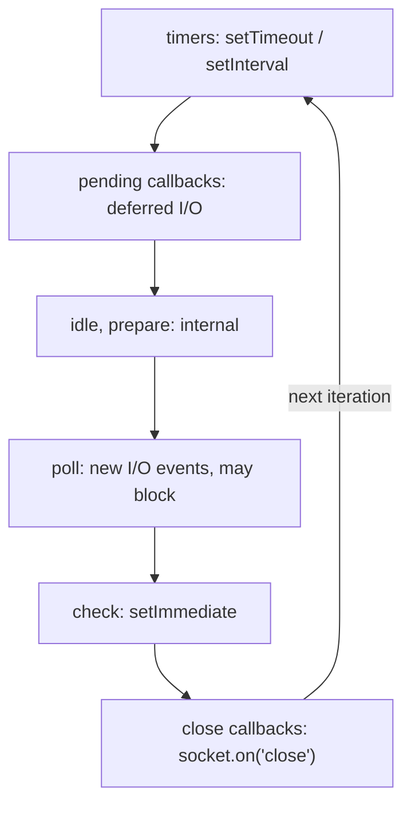
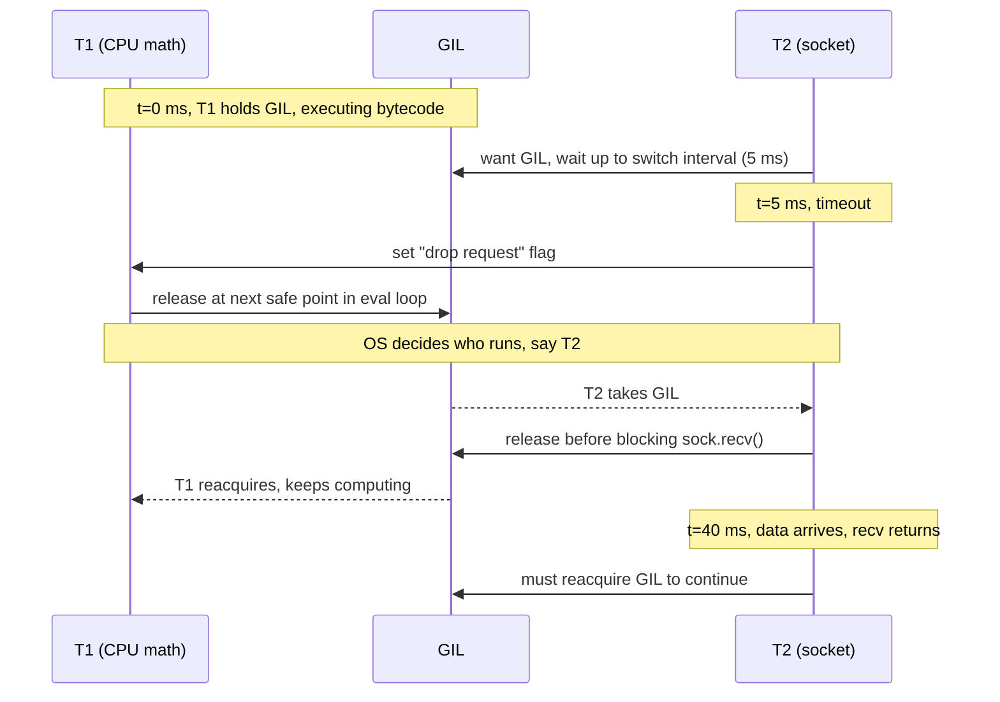
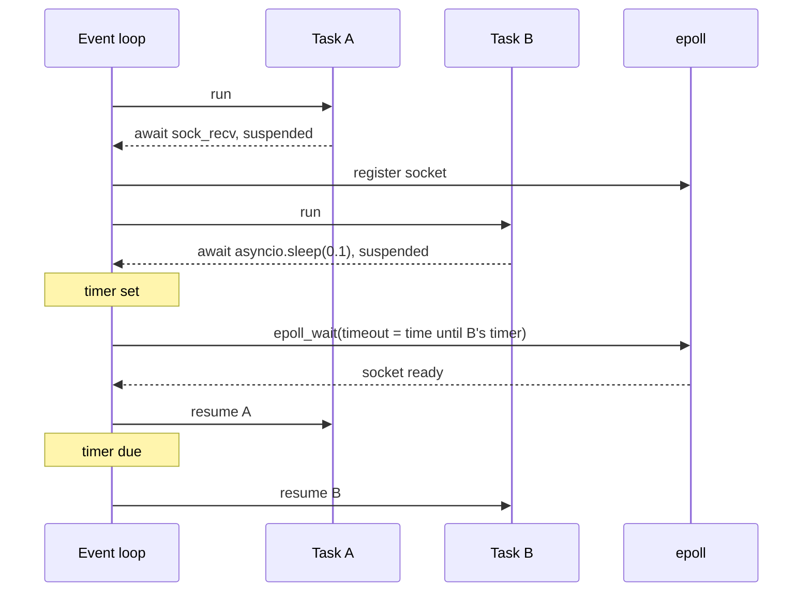

## Definition (interview-ready)

The **GIL (Global Interpreter Lock)** is a mutex inside CPython (the standard Python interpreter) that lets only **one thread execute Python bytecode at a time**. It keeps the interpreter's internals, like reference counts and built-in `dict`s, safe without fine-grained locks. Threads still help for **I/O-bound** work because the GIL is released while waiting on I/O, but they don't give parallel speedups for **CPU-bound** pure-Python code. For that you use **processes** (`multiprocessing`), C extensions that release the GIL, **subinterpreters** (each with its own GIL since 3.12), or the **free-threaded build** (no GIL; experimental in 3.13, officially supported but not the default since 3.14).

An **event loop** is a single thread that runs many tasks concurrently by never blocking: it asks the OS which sockets are ready (epoll on Linux, kqueue on macOS), runs the callbacks or coroutines waiting on them, and repeats. Python's `asyncio` and Node.js both work this way. The golden rule: **never block the loop**, or every task stalls.

**One-liner:** The GIL is CPython's lock that lets only one thread run Python bytecode at a time, so threads help with I/O-bound work but not CPU-bound pure Python. An event loop is one thread juggling many non-blocking tasks, so it scales I/O concurrency as long as nothing blocks it.

## Why it matters

- "Why is my multithreaded Python not using more than one core?" is one of the most common interview and production questions.
- Choosing between threads, `asyncio`, and processes decides whether a service handles 50 or 50,000 concurrent connections, and whether CPU work scales.
- Blocking the event loop (a synchronous DB driver, a big JSON parse, `time.sleep`) is a top cause of latency spikes in Python async and Node services.
- Interviewers love the cross-language comparison: Python threads vs Go goroutines vs Java virtual threads vs Node's event loop.

Locks, races and deadlocks are covered in [OS Concurrency](/learn/notes/os-concurrency/); Go's model is in [Go Runtime Scheduler](/learn/notes/go-runtime-scheduler/). This note doesn't repeat them.

## Core concepts

### What the GIL is, and why it exists

Analogy: a shared kitchen with **one chef's knife**. Several cooks (threads) can be in the kitchen, and while one waits for the oven (I/O), another can use the knife. But only one cook chops at a time.

Why does CPython have it? CPython manages memory with **reference counting**: every object has a counter of how many references point to it, and it's freed when the counter hits zero. Every assignment and function call changes counters. Without a lock, two threads incrementing the same counter could lose an update (a race), freeing a live object or leaking a dead one. Options were:

1. Lock every object (slow for single-threaded code, deadlock-prone, lots of lock overhead).
2. Make every refcount update atomic (also slower for the common single-threaded case).
3. **One big lock around the interpreter** (simple, fast single-threaded, easy for C extensions).

CPython chose 3 in the 1990s. A huge ecosystem of C extensions then grew up assuming the GIL exists, which is why removing it took decades.

**The GIL protects the interpreter, not your code.** `counter += 1` is several bytecodes (load, add, store), and a thread switch can happen between them. You still need `threading.Lock` for your own shared state.

### When the GIL is released

- **Blocking I/O**: socket reads, file reads, `time.sleep`, waiting on a lock. The Python docs: the GIL "is always released when doing I/O".
- **C extensions that opt in**: `hashlib`, `zlib`, and libraries like NumPy release it around heavy computation, so those calls can run in parallel across threads.
- **Periodically, for fairness**: a thread waiting for the GIL asks the running thread to drop it after the **switch interval**, 5 ms by default (`sys.getswitchinterval()` returns `0.005`; change it with `sys.setswitchinterval`). Which thread runs next is up to the OS.

### CPU-bound vs I/O-bound impact

| Workload | Threads (GIL build) | asyncio | Processes |
|---|---|---|---|
| I/O-bound (HTTP calls, DB queries) | Good: GIL released while waiting | Best for many thousands of connections | Works but wasteful (memory, IPC) |
| CPU-bound pure Python (parsing, loops) | **No speedup**, often slower from contention | No speedup, and it blocks the loop | **Scales with cores** |
| CPU-bound in GIL-releasing C (NumPy, hashlib) | Scales across cores | Offload to a thread pool | Scales, but data copying costs |

Example: 4 threads each computing `sum(i*i for i in range(10**7))` take about as long as doing them one after another on a GIL build. With `ProcessPoolExecutor(4)` they run in parallel.

### multiprocessing: sidestep the GIL with processes

Each process has its own interpreter and its own GIL, so CPU work runs in parallel. The costs:

- **Memory**: a full interpreter per process.
- **IPC (inter-process communication)**: arguments and results are **pickled** (serialized) and sent through pipes. Passing a 500 MB DataFrame to a worker means copying it. Use `multiprocessing.shared_memory` or memory-mapped files for large data.
- **Start methods**: `fork` (copy the parent process, fast but unsafe if the parent has threads), `spawn` (start a fresh interpreter, safe but slow), `forkserver` (fork from a clean helper process). **Since Python 3.14**, the default on Linux and other non-macOS Unix is `forkserver`; macOS and Windows default to `spawn`.

```python
from concurrent.futures import ProcessPoolExecutor

def cpu_heavy(n: int) -> int:
    return sum(i * i for i in range(n))

if __name__ == "__main__":          # required with spawn/forkserver
    with ProcessPoolExecutor(max_workers=4) as pool:
        print(list(pool.map(cpu_heavy, [10**7] * 4)))
```

### The free-threaded build (PEP 703)

**PEP 703** makes the GIL optional. It was accepted in October 2023 with a gradual, reversible rollout.

| Version | Status |
|---|---|
| 3.13 (Oct 2024) | Free-threaded build added as **experimental**. A separate binary (often named `python3.13t`). |
| 3.14 (Oct 2025) | **Officially supported, still optional** (PEP 779, "phase II"). Specializing interpreter enabled in free-threaded mode; single-thread penalty roughly 5–10% per the 3.14 release notes. |
| 3.15 (Oct 2026) | Still optional, not the default. Adds a Stable ABI for free-threaded builds (`abi3t`, PEP 803), and official macOS installers include free-threading support by default. |

Making it the **default** ("phase III") needs a future PEP.

How it works without a GIL (from PEP 703):

- **Biased reference counting**: the thread that owns an object updates its refcount cheaply without atomics; other threads use a separate atomic counter.
- **Immortal objects**: `None`, small ints, interned strings never change refcount (PEP 683).
- **Deferred reference counting** for frequently shared objects like functions and modules.
- **mimalloc** as a thread-safe allocator.
- **Per-object locks** on `list`, `dict`, `set` so built-ins stay safe.

Practical notes:

- Check at runtime with `sys._is_gil_enabled()`. Force the GIL on with `PYTHON_GIL=1` or `-X gil=1`.
- Importing a C extension not marked free-threading-safe **re-enables the GIL** with a warning. Library support is the real gating factor.
- Your code still needs locks for its own invariants. Free threading removes the interpreter lock, not race conditions.

### Subinterpreters (PEP 684, PEP 734)

A **subinterpreter** is a separate Python interpreter inside the same process, with its own modules and objects.

- **PEP 684 (Python 3.12)**: each interpreter can have **its own GIL**, so interpreters run in parallel on different cores. At first this was C-API only.
- **Python 3.14**: `concurrent.interpreters` (PEP 734) exposes them to Python code, plus `concurrent.futures.InterpreterPoolExecutor`.
- Model: like processes (isolation, no shared objects by default, communicate via queues) but in one OS process. Today they have slower startup and limited sharing; many C extensions don't support them yet.

### The event loop concept

Analogy: one waiter serving 50 tables. They never stand at a table waiting for the kitchen. They take an order, hand it off, and serve whichever table is ready next. One waiter, many tables, as long as nobody makes the waiter cook.

Mechanics:

1. Sockets are set to **non-blocking** mode: a read with no data returns "would block" instead of sleeping.
2. The loop registers interest in sockets with the OS **readiness API**: `epoll` (Linux), `kqueue` (macOS/BSD). Windows uses **IOCP** (I/O completion ports), which reports completed operations instead of readiness.
3. Loop iteration: wait until some sockets are ready or the next timer is due → run the callbacks or resume the coroutines for those → repeat.

```
            ┌────────────────────────────────────────┐
            │  run ready callbacks / resume tasks    │◀──┐
            └──────────────────┬─────────────────────┘   │
                               ▼                         │
            ┌────────────────────────────────────────┐   │
            │  epoll_wait / kqueue (timeout = next   │   │
            │  timer): which sockets are ready?      │───┘
            └────────────────────────────────────────┘
```

**Concurrency without parallelism**: one thread, one core. Great for I/O-heavy work (thousands of mostly idle connections), useless for CPU-heavy work.

### asyncio

- `async def` defines a **coroutine function**; calling it returns a coroutine object and runs nothing yet.
- `await` suspends the coroutine until the awaited thing finishes and hands control back to the loop. **Switches only happen at `await`** (cooperative scheduling), so code between two awaits runs atomically with respect to other tasks.
- `asyncio.create_task(coro())` schedules a coroutine to run concurrently. `asyncio.TaskGroup` (3.11+) runs a group and cancels the rest if one fails. `asyncio.gather` also runs several concurrently.
- On Unix the default loop uses the `selectors` module (epoll on Linux, kqueue on macOS).
- Offload blocking code with `await asyncio.to_thread(fn, ...)` (3.9+) or `loop.run_in_executor(pool, fn, ...)`: thread pool for blocking I/O, process pool (or interpreter pool) for CPU work.

```python
import asyncio, httpx

async def fetch(client, url):
    r = await client.get(url)        # loop serves other tasks while waiting
    return r.status_code

async def main(urls):
    async with httpx.AsyncClient() as client:
        async with asyncio.TaskGroup() as tg:
            tasks = [tg.create_task(fetch(client, u)) for u in urls]
    return [t.result() for t in tasks]
```

### Node.js event loop phases

Node runs your JavaScript on **one thread** on top of **libuv**, a C library that provides the event loop and a **thread pool**. Each loop iteration goes through phases:

The phases of one loop iteration:



- **Since libuv 1.45 (Node 20)**, timers run after the poll phase in each iteration (earlier versions ran them before polling), though libuv still runs timers once before entering the loop.
- **Microtasks**: after each callback, Node drains the `process.nextTick` queue and the **promise** microtask queue before moving on. In CommonJS, `nextTick` callbacks run before promise callbacks; in ES modules the promise callbacks come first. Recursive `nextTick` or promise chains can **starve** I/O.
- **Inside an I/O callback**, `setImmediate` always fires before `setTimeout(fn, 0)`. From the main module, their order isn't deterministic.
- **The libuv thread pool** (default **4** threads, set with `UV_THREADPOOL_SIZE`, max 1024) handles work the OS can't do asynchronously: **file system operations** (per the Node docs, all async `fs` APIs except `fs.FSWatcher`), DNS `getaddrinfo` (used by `dns.lookup`), plus `crypto.pbkdf2`, `zlib` and similar. Network sockets don't use it; they use epoll/kqueue/IOCP directly.
- For CPU parallelism: `worker_threads` (separate JS engines in threads, communicating by messages or `SharedArrayBuffer`) or the `cluster` module (multiple processes).

### Blocking the loop: the cardinal sin

Anything that runs a long time **without yielding** freezes every connection on that loop.

| Blocks the loop | Do instead |
|---|---|
| Python: `time.sleep(1)` inside `async def` | `await asyncio.sleep(1)` |
| Python: `requests.get(...)` or a sync DB driver inside `async def` | async client (`httpx.AsyncClient`, `asyncpg`) or `asyncio.to_thread` |
| Python: big CPU work (image resize, giant JSON) | `run_in_executor` with a `ProcessPoolExecutor` |
| Node: `fs.readFileSync`, `crypto.pbkdf2Sync` in a request handler | async versions (use the thread pool) |
| Node: `JSON.parse` of a 200 MB string, catastrophic regex | stream, chunk, or move to `worker_threads` |

Detection: Python `asyncio` **debug mode** (`PYTHONASYNCIODEBUG=1` or `asyncio.run(main(), debug=True)`) logs callbacks slower than `loop.slow_callback_duration`, **100 ms** by default. In Node, watch event-loop delay (`perf_hooks.monitorEventLoopDelay`). A blocked loop shows up as a sudden rise in p99 for **all** endpoints at once, while CPU on one core is pinned at 100%.

### Threads vs coroutines vs processes

| | OS threads | Coroutines / green threads | Processes |
|---|---|---|---|
| **Memory per unit** | Large reserved stack (Java default 1 MB, glibc often 8 MB virtual) | Small: a heap object (Python coroutine, JS promise) or a growable stack (goroutine starts at 2 KB) | Whole address space and interpreter, MBs to tens of MBs |
| **Switching** | Preemptive, by the kernel; costs a kernel context switch | User space: at `await` (Python, JS) or by the runtime scheduler (Go, Java virtual threads); much cheaper | Kernel context switch plus address-space switch (TLB effects) |
| **Parallelism** | Yes (except CPython with GIL) | Python asyncio / Node: **no**, one thread. Go goroutines and Java virtual threads: **yes**, multiplexed onto many OS threads | **Yes** |
| **Isolation** | None: shared memory, one crash kills all | None: shared memory | **Strong**: separate memory, crash contained |
| **Communication** | Shared memory + locks | Shared memory (no locks needed between awaits in single-threaded loops) | IPC: pipes, sockets, shared memory, pickling |
| **Typical scale** | Hundreds to low thousands | 10k to 1M+ | Roughly one per core |

When to use what, by language:

| Language | I/O-bound, high concurrency | CPU-bound | Notes |
|---|---|---|---|
| **Python** | `asyncio` (or threads for moderate concurrency / sync libraries) | `ProcessPoolExecutor`, NumPy or other GIL-releasing C code, subinterpreters, free-threaded build if your libraries support it | Threads give no CPU parallelism on a GIL build |
| **Java** | Virtual threads (JDK 21+, JEP 444): write blocking code, the JVM parks them | Platform thread pool sized near core count, `ForkJoinPool` | Platform threads map 1:1 to OS threads. See [Executors and virtual threads](/learn/notes/java-executors-virtual-threads/) |
| **Go** | Goroutines (netpoller handles waiting) | Goroutines too: they run in parallel across `GOMAXPROCS` threads | One model for both. See [Go scheduler](/learn/notes/go-runtime-scheduler/) |
| **Node.js** | The event loop with async APIs | `worker_threads` or `cluster` / multiple processes | Never do heavy CPU on the main thread |

**How to say it in an interview:** "Threads give preemptive concurrency with shared memory; in CPython the GIL stops them from running Python bytecode in parallel. Coroutines are cooperative and cheap, ideal for lots of waiting, but one blocking call stalls everyone. Processes give true parallelism and isolation at the cost of memory and serialization. Go and Java virtual threads combine cheap coroutine-style units with real parallelism."

## How it works (two threads and a GIL)

Two threads on a GIL build, T1 doing CPU math and T2 handling a socket:

The hand-offs, step by step:



Same thing with asyncio, one thread:



## Real-world examples

- **Pre-fork WSGI servers** like Gunicorn and uWSGI run several worker processes per host so a Django or Flask app uses all cores despite the GIL. This is the standard Python web deployment pattern.
- **Uvicorn / FastAPI** serve async Python apps on an `asyncio` event loop (optionally `uvloop`, a libuv-based loop) with multiple worker processes for multi-core.
- **NumPy, pandas, PyTorch** release the GIL inside heavy C/C++ kernels, which is why scientific Python often parallelizes fine with threads.
- **Node.js** services hitting slow `fs` or `dns.lookup` calls can saturate the 4-thread libuv pool, so unrelated file reads queue up; raising `UV_THREADPOOL_SIZE` is a documented knob.
- **Python 3.14** ships `python -m asyncio ps PID` and `pstree` to inspect tasks in a running process.

## Common pitfalls

- **Expecting threads to speed up CPU-bound Python** on a GIL build. They won't. Use processes or move the hot loop into a GIL-releasing library.
- **Assuming the GIL makes your code thread-safe.** `x += 1`, check-then-set on a dict, and multi-step updates can interleave. Use locks.
- **Calling blocking functions inside `async def`**: `requests`, `time.sleep`, sync DB drivers, heavy CPU. The whole loop freezes.
- **Forgetting `await`**: `fetch()` without await creates a coroutine that never runs; Python warns `coroutine ... was never awaited`.
- **Fire-and-forget tasks**: the loop holds only weak references to tasks; keep a reference to the task (or use `TaskGroup`), or it can be garbage-collected mid-flight.
- **`fork` with threads**: forking a process that has threads can deadlock the child (a lock held by a thread that doesn't exist in the child). Prefer `spawn`/`forkserver` (the Linux default since 3.14).
- **Huge payloads to process pools**: pickling costs can exceed the work. Send references (file paths, shared memory names) instead.
- **Node: `nextTick`/promise recursion** starving I/O, and `*Sync` APIs in request paths.
- **Node: saturating the libuv pool** with `fs`, `dns.lookup` and `crypto` calls; everything else using the pool waits.
- **Free-threaded build surprises**: one unsupported C extension silently re-enables the GIL (it does warn); check `sys._is_gil_enabled()`.

## Practice questions

<Practice>

<QA q="What is the GIL and why does CPython have it?" level="easy">

A mutex in CPython that allows only one thread to execute Python bytecode at a time. It exists because CPython uses reference counting for memory management; without a lock, concurrent refcount updates would race and corrupt memory. One global lock was simpler and faster for single-threaded code than per-object locking or atomic refcounts, and C extensions came to rely on it.

</QA>

<QA q="Do Python threads help at all, given the GIL?" level="easy">

Yes, for I/O-bound work. The GIL is released during blocking I/O (sockets, files, sleep), so while one thread waits on the network another runs. They also help when the heavy work is in C code that releases the GIL (NumPy, hashlib, zlib). They don't help CPU-bound pure-Python code on a GIL build.

</QA>

<QA q="What is an event loop?" level="easy">

A single thread that runs many tasks by never blocking. It uses non-blocking sockets and an OS readiness API (epoll, kqueue; IOCP on Windows) to wait for whichever I/O or timer is ready, runs the corresponding callbacks or resumes coroutines, then waits again. It gives high concurrency for I/O-bound work on one core, but any long-running synchronous code stalls all tasks.

</QA>

<QA q="Does the GIL make `counter += 1` thread-safe?" level="easy">

No. `counter += 1` compiles to several bytecodes (load, add, store). The interpreter can switch threads between them, so two threads can read the same old value and one increment is lost. Use `threading.Lock` or a thread-safe structure like `queue.Queue`. The GIL protects the interpreter's internals, not your invariants.

</QA>

<QA q="When should you use asyncio vs threads vs multiprocessing in Python?" level="medium">

- **asyncio**: many concurrent I/O operations (thousands of connections) with async-capable libraries.
- **Threads**: moderate I/O concurrency, especially with blocking libraries that have no async version, or GIL-releasing C work.
- **multiprocessing / ProcessPoolExecutor**: CPU-bound pure-Python work that must use multiple cores.

Common combination: asyncio for the server, `to_thread` for a blocking library, a process pool for CPU-heavy steps.

</QA>

<QA q="How does Python decide when to switch between threads?" level="medium">

A thread releases the GIL when it blocks (I/O, sleep, lock wait) or calls C code that releases it. Otherwise, a waiting thread asks the running one to drop the GIL after the switch interval, 5 ms by default (`sys.setswitchinterval`). The running thread drops it at the next safe point in the eval loop. Which thread acquires it next is up to the OS scheduler; CPython has no scheduler of its own.

</QA>

<QA q="What is the free-threaded build, and is it production ready?" level="medium">

A CPython build with the GIL removed (PEP 703), using biased reference counting, immortal objects, deferred refcounting, mimalloc and per-object locks on built-ins. Experimental in 3.13; officially supported but optional since 3.14 (PEP 779); still not the default in 3.15. Single-threaded code runs a bit slower (roughly 5–10% in 3.14). The real question is library support: importing an extension that isn't marked free-threading-safe re-enables the GIL. Check with `sys._is_gil_enabled()`.

</QA>

<QA q="What are subinterpreters and how do they differ from threads and processes?" level="medium">

Multiple isolated Python interpreters in one process. Since 3.12 (PEP 684) each can have its own GIL, so they run in parallel; since 3.14 they're usable from Python via `concurrent.interpreters` and `InterpreterPoolExecutor`. Unlike threads, they don't share Python objects (communication goes through queues or channels). Unlike processes, they live in one OS process, so they avoid process overhead, but a crash in native code still takes everything down, and many C extensions don't support them yet.

</QA>

<QA q="Walk through the phases of the Node.js event loop." level="medium">

Timers (`setTimeout`/`setInterval`) → pending callbacks (deferred I/O callbacks) → idle/prepare (internal) → **poll** (fetch new I/O events and run their callbacks, possibly blocking while waiting) → **check** (`setImmediate`) → close callbacks. Between callbacks, Node drains the `process.nextTick` queue and promise microtasks. Since libuv 1.45 (Node 20), timers run after the poll phase rather than before it. File system work and `dns.lookup` run on the libuv thread pool (4 threads by default), not on the loop.

</QA>

<QA q="Why does `setImmediate` always run before `setTimeout(fn, 0)` inside an I/O callback, but not in the main module?" level="hard">

An I/O callback runs in the poll phase. The next phase is **check**, where `setImmediate` callbacks run, before the loop comes back around to the timers. From the main module, whether the 1 ms minimum timer has already expired when the loop first checks timers depends on how fast the process started, so the order is non-deterministic.

</QA>

<QA q="Compare threads, coroutines and processes on memory, switching cost, parallelism and isolation." level="hard">

- **Threads**: large stacks (about 1 MB reserved in Java, often 8 MB with glibc), kernel-scheduled preemptive switches, parallel (not in CPython with the GIL), shared memory with no isolation.
- **Coroutines**: tiny (heap objects or small growable stacks), switch in user space at await points or via a runtime scheduler, parallel only if the runtime multiplexes onto many threads (Go, Java virtual threads; not asyncio or Node), shared memory.
- **Processes**: heaviest (own address space), most expensive switch, parallel, strongly isolated; communicate via IPC with serialization.

</QA>

<QA q="Why is cooperative scheduling both an advantage and a risk?" level="hard">

Advantage: task switches only happen at `await`, so code between awaits runs without interruption. You often don't need locks for shared state in a single-threaded loop, and switches are cheap. Risk: a task that doesn't await (CPU work, a blocking call) never yields, so every other task waits. Preemptive schedulers (OS threads, Go's async preemption) don't have that failure mode but need locks.

</QA>

<QA q="How do Java virtual threads and Go goroutines differ from asyncio coroutines?" level="hard">

All three are cheap, runtime-managed units of concurrency. But Go and Java virtual threads let you write **ordinary blocking code**: the runtime parks the unit on I/O and multiplexes many onto a pool of OS threads, giving parallelism across cores. Go also preempts long-running goroutines. asyncio requires `async`/`await` "coloring" through the call stack, runs on one thread, and only switches at awaits, so a blocking call stalls everything.

</QA>

<QA q="A FastAPI service's p99 jumps from 30 ms to 2 s for all endpoints whenever one report endpoint is called. CPU on one core is at 100%. What's happening and how do you fix it?" level="scenario">

The report endpoint is doing CPU-heavy or blocking work inside an `async def` handler, which blocks the event loop; every other request on that worker waits. Confirm with asyncio debug mode (slow callback warnings over 100 ms) or `py-spy dump`. Fixes: make the handler a plain `def` (FastAPI runs those in a thread pool, fine if it's blocking I/O), offload CPU work with `run_in_executor(ProcessPoolExecutor)`, move reports to a background job queue, and run several worker processes.

</QA>

<QA q="A data pipeline uses 16 threads to parse JSON files on a 16-core box, but only uses about 1 core. The team asks whether to rewrite it in Go. What do you advise?" level="scenario">

JSON parsing in pure Python is CPU-bound, so the GIL serializes it. Options before a rewrite: switch to `ProcessPoolExecutor` (pass file paths, not contents, to keep pickling cheap); use a faster parser implemented in C or Rust (orjson); try the free-threaded build if every dependency supports it; or subinterpreters via `InterpreterPoolExecutor` on 3.14+. Measure each. A Go rewrite is justified only if the remaining overhead still matters after using all cores.

</QA>

<QA q="A Node.js service that reads many small files and hashes passwords with `crypto.pbkdf2` sees file reads take seconds under load, while CPU looks moderate. Why?" level="scenario">

Both `fs` operations and async `crypto.pbkdf2` run on the libuv thread pool, which has only 4 threads by default. Password hashing occupies the pool, so file reads queue behind it. Fixes: raise `UV_THREADPOOL_SIZE` (set before the pool is first used), move hashing to `worker_threads` or a separate service, and cache file contents. Avoid `pbkdf2Sync`, which would block the main loop instead.

</QA>

</Practice>

## Quiz

<Quiz>

<MCQ q="Which workload benefits from multiple threads on a standard CPython build with the GIL?" options={["Pure-Python prime number search", "Fetching 100 URLs over HTTP", "A pure-Python nested loop over a matrix", "Recursively computing Fibonacci numbers"]} answer={1}>

Network I/O releases the GIL while waiting, so threads overlap the waits. The other three are CPU-bound pure Python and are serialized by the GIL.

</MCQ>

<MCQ q="What is the default thread switch interval in CPython?" options={["5 ms", "100 ms", "1 ms", "10 ms"]} answer={0}>

`sys.getswitchinterval()` returns 0.005 seconds. 100 ms is asyncio's default slow-callback threshold in debug mode; 10 ms is Go's preemption time slice.

</MCQ>

<MCQ q="What is the status of the free-threaded (no-GIL) CPython build in Python 3.14?" options={["Removed after the 3.13 experiment", "The default build", "Officially supported but optional", "Only available through the C API"]} answer={2}>

PEP 779 moved it to supported (phase II) in 3.14. It's still a separate, optional build; making it the default would need a future PEP.

</MCQ>

<MCQ q="What did PEP 684 (Python 3.12) introduce?" options={["Async generators", "A per-interpreter GIL so subinterpreters can run in parallel", "The free-threaded build", "The forkserver start method"]} answer={1}>

PEP 684 gave each subinterpreter its own GIL, initially through the C API. Python-level access came with `concurrent.interpreters` in 3.14 (PEP 734).

</MCQ>

<MCQ q="Inside an async def handler, which call blocks the asyncio event loop?" options={["await asyncio.sleep(1)", "await asyncio.to_thread(requests.get, url)", "await client.get(url) with httpx.AsyncClient", "time.sleep(1)"]} answer={3}>

`time.sleep` blocks the thread running the loop. `asyncio.sleep` yields to the loop, `to_thread` runs the blocking call on a worker thread, and the async client awaits non-blocking I/O.

</MCQ>

<MCQ q="In Node.js, which work runs on the libuv thread pool?" options={["Incoming HTTP socket reads", "setTimeout callbacks", "fs.readFile and dns.lookup", "Promise callbacks"]} answer={2}>

File system operations and `getaddrinfo` (used by `dns.lookup`) go to the pool (4 threads by default). Sockets use epoll/kqueue/IOCP directly; timers and promise callbacks run on the main thread.

</MCQ>

<MCQ q="In a Node.js CommonJS module, what is the output order of: console.log sync, a resolved promise then, process.nextTick, setTimeout 0?" options={["sync, promise, nextTick, timeout", "sync, nextTick, promise, timeout", "nextTick, sync, promise, timeout", "sync, timeout, nextTick, promise"]} answer={1}>

Synchronous code runs first, then the nextTick queue, then promise microtasks, then the timers phase. In an ES module, the promise callback would run before nextTick.

</MCQ>

<MCQ q="Why can processes achieve CPU parallelism in Python when threads cannot?" options={["Each process has its own interpreter and its own GIL", "Processes disable reference counting", "The OS gives processes priority", "multiprocessing uses the free-threaded build"]} answer={0}>

Every process runs a separate interpreter with its own GIL, so they don't contend. The cost is memory and pickling data between processes.

</MCQ>

<MCQ q="Which runtime lets you write plain blocking code while still multiplexing many units onto a few OS threads in parallel?" options={["Python asyncio", "Node.js main thread", "CPython threads on a GIL build", "Java virtual threads (JDK 21+)"]} answer={3}>

Virtual threads (like goroutines) park on blocking I/O and run on a pool of carrier threads across cores. asyncio and Node need async APIs and run one thread; CPython threads can't run bytecode in parallel under the GIL.

</MCQ>

</Quiz>

## TL;DR cheat sheet

- **GIL**: one thread runs Python bytecode at a time; protects refcounts and built-ins, not your code. Released on I/O, in opt-in C code, and every 5 ms switch interval.
- **I/O-bound** → threads or asyncio. **CPU-bound pure Python** → processes (or GIL-releasing C, subinterpreters, free-threaded build).
- **Free-threaded**: PEP 703; experimental 3.13, supported-but-optional 3.14 (PEP 779), still optional in 3.15. Unsupported C extensions re-enable the GIL.
- **Subinterpreters**: per-interpreter GIL (3.12, PEP 684); Python API `concurrent.interpreters` and `InterpreterPoolExecutor` (3.14).
- **multiprocessing**: pickling cost; Linux default start method is `forkserver` since 3.14, macOS/Windows `spawn`.
- **Event loop**: one thread + non-blocking I/O + epoll/kqueue/IOCP. Switches only at `await`. Never block it; debug mode flags callbacks over 100 ms.
- **Node**: timers → pending → idle/prepare → poll → check (`setImmediate`) → close. nextTick + promises drain between callbacks. libuv pool = 4 threads for fs, `dns.lookup`, crypto, zlib.
- **Threads**: preemptive, heavy, shared memory. **Coroutines**: cooperative, cheap. **Processes**: isolated, parallel, heavy IPC. Go goroutines and Java virtual threads = cheap and parallel.

## Go deeper

- **Python docs**: [Free-threading HOWTO](https://docs.python.org/3/howto/free-threading-python.html), [asyncio development guide](https://docs.python.org/3/library/asyncio-dev.html), [threading](https://docs.python.org/3/library/threading.html), [multiprocessing](https://docs.python.org/3/library/multiprocessing.html), [concurrent.interpreters](https://docs.python.org/3/library/concurrent.interpreters.html).
- **PEPs**: [PEP 703](https://peps.python.org/pep-0703/) (optional GIL), [PEP 779](https://peps.python.org/pep-0779/) (supported status), [PEP 684](https://peps.python.org/pep-0684/) (per-interpreter GIL), [PEP 734](https://peps.python.org/pep-0734/) (interpreters in the stdlib).
- **What's new**: [Python 3.14](https://docs.python.org/3/whatsnew/3.14.html).
- **Node.js**: [The Node.js Event Loop](https://nodejs.org/en/learn/asynchronous-work/event-loop-timers-and-nexttick), [Don't Block the Event Loop](https://nodejs.org/en/learn/asynchronous-work/dont-block-the-event-loop).
- **libuv**: [Design overview](https://docs.libuv.org/en/v1.x/design.html), [Thread pool](https://docs.libuv.org/en/v1.x/threadpool.html).
- **Talk**: David Beazley, "Understanding the Python GIL" (PyCon 2010).
- Related notes: [OS Concurrency](/learn/notes/os-concurrency/), [Go Runtime Scheduler](/learn/notes/go-runtime-scheduler/), [Processes and threads](/learn/notes/os-processes-threads/), [Java executors and virtual threads](/learn/notes/java-executors-virtual-threads/).
