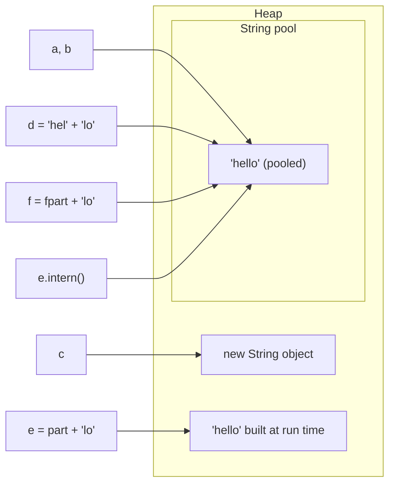
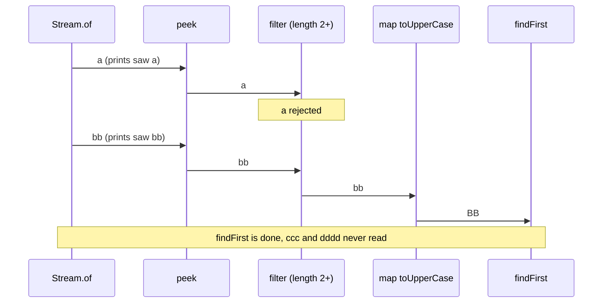
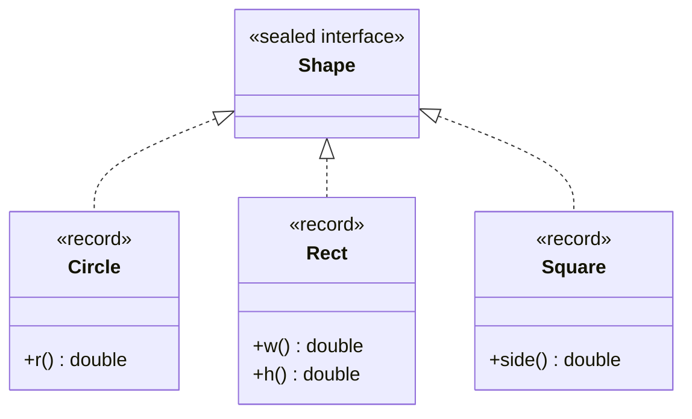

## Definition (interview-ready)

Four ideas that sit underneath most everyday Java code:

- **Immutability**: an immutable object's state can't change after construction. `String`, `Integer`, `LocalDate` and records (when their components are immutable) are examples. Immutable objects are simple to reason about, safe to share between threads, and safe to use as map keys.
- **Strings and the string pool**: `String` is immutable. The JVM keeps a **pool** of unique string instances; every string literal is taken from that pool, so `"hi" == "hi"` is true, but a string built at run time is a separate object. Compare strings with `equals`, never `==`.
- **Streams**: `java.util.stream` lets you describe a pipeline (source → intermediate operations → one terminal operation). Intermediate operations are **lazy**; nothing runs until the terminal operation, and then elements flow through the whole pipeline one at a time.
- **`Optional`**: a container that holds either one value or nothing. It's meant mainly as a **return type** for "there might be no result", so callers can't forget the empty case.

**One-liner:** Immutable objects are thread-safe for free; strings are immutable and their literals are pooled, but you still compare them with `equals`. Streams are lazy pipelines that only run when a terminal operation is called, and `Optional` is for return types, not fields or parameters.

## Why it matters

- Mutable shared state is the root of most concurrency bugs and many "who changed my object?" bugs. Immutability removes the problem.
- `==` on strings and boxed integers is one of the most common Java bugs, and it often passes tests because small values and literals happen to be shared.
- Streams are everywhere in modern codebases. Misusing them (side effects, reusing a stream, `toMap` without a merge function, careless `parallel()`) causes crashes and subtle wrong answers.
- `Optional` misuse (calling `get()` blindly, `Optional` fields, `orElse` with expensive work) is a frequent code-review comment.
- Interviewers use "what changed in Java 8 / 11 / 17 / 21?" to check whether you've kept up.

## Core concepts

### The immutable class recipe

*Effective Java* Item 17 ("Minimize mutability") gives the rules:

1. **No setters** or other methods that change state.
2. Make the class **`final`** (or give it only private constructors), so a subclass can't add mutable behaviour.
3. Make all fields **`private final`**.
4. **Defensive copies** of mutable inputs in the constructor, and never hand out a reference to a mutable internal object.
5. "Changes" return a **new object** (`withX(...)`), like `String.toUpperCase()` or `LocalDate.plusDays()`.

Why `final` fields matter beyond style: the Java Memory Model guarantees that once the constructor finishes (and `this` didn't escape during construction), every thread sees the correct values of `final` fields without synchronization. See [Java Concurrency](/learn/notes/java-concurrency-locks/).

### Records (Java 16)

A **record** (JEP 395, final in Java 16) is a compact way to declare a data carrier. `record Money(String currency, long cents)` gives you private final fields, a canonical constructor, accessors `currency()` and `cents()`, and `equals`, `hashCode` and `toString` built from all components. Records are implicitly `final` and can't extend another class.

```java
// Run with: java ImmutableDemo.java
import java.util.*;

public class ImmutableDemo {
    // Classic recipe
    static final class Order {
        private final String id;
        private final List<String> items;

        Order(String id, List<String> items) {
            this.id = Objects.requireNonNull(id);
            this.items = List.copyOf(items);       // defensive copy in
        }
        String id() { return id; }
        List<String> items() { return items; }     // already unmodifiable, safe to return
        Order withItem(String item) {               // "mutators" return a new object
            List<String> next = new ArrayList<>(items);
            next.add(item);
            return new Order(id, next);
        }
    }

    // Same idea as a record
    record Money(String currency, long cents) {
        Money {                                     // compact constructor validates
            Objects.requireNonNull(currency);
            if (cents < 0) throw new IllegalArgumentException("negative");
        }
    }

    record Basket(List<String> items) {
        Basket { items = List.copyOf(items); }      // records are shallowly immutable
    }

    public static void main(String[] args) {
        List<String> src = new ArrayList<>(List.of("pen"));
        Order o = new Order("o-1", src);
        src.add("hacked");
        System.out.println(o.items());
        System.out.println(o.withItem("ink").items() + " original still " + o.items());

        Money a = new Money("INR", 500), b = new Money("INR", 500);
        System.out.println(a + " equals " + b + " -> " + a.equals(b) + ", same hash " + (a.hashCode() == b.hashCode()));
        try { new Money("INR", -1); } catch (IllegalArgumentException e) { System.out.println("rejected: " + e.getMessage()); }

        List<String> raw = new ArrayList<>(List.of("x"));
        Basket basket = new Basket(raw);
        raw.add("y");
        System.out.println(basket.items());
    }
}
```

```
[pen]
[pen, ink] original still [pen]
Money[currency=INR, cents=500] equals Money[currency=INR, cents=500] -> true, same hash true
rejected: negative
[x]
```

Key point: records are only **shallowly** immutable. A record holding a `List` would expose whatever list you passed in. The compact constructor with `List.copyOf` fixes that.

### String immutability and why it's designed that way

A `String` can't be changed after creation; every "modifying" method returns a new string. That enables:

- **Safe sharing and pooling**: many references can point at one instance.
- **Hash caching**: `String` computes `hashCode()` once and stores it, which makes strings fast `HashMap` keys.
- **Security**: a file path or class name checked by one piece of code can't be changed underneath it afterwards.
- **Thread safety** without locks.

### The string pool, `intern()`, and `==` vs `equals`

The JVM keeps a table of unique string instances (the **string pool**, or interned strings). The JLS (3.10.5) guarantees that string literals, and more generally the values of **constant expressions**, are interned, so identical literals anywhere in the program refer to the same object. Strings computed at run time are new objects unless you call `intern()`, which returns the pooled instance with the same contents (adding it if needed).

Since **JDK 7** the pool lives in the regular **heap**, not PermGen, so interned strings are garbage collected like other objects.

```java
// Run with: java StringPool.java
public class StringPool {
    public static void main(String[] args) {
        String a = "hello";
        String b = "hello";
        String c = new String("hello");
        String d = "hel" + "lo";                  // compile-time constant
        String part = "hel";
        String e = part + "lo";                   // built at run time
        final String fpart = "hel";
        String f = fpart + "lo";                  // constant variable -> constant expression

        System.out.println("a == b          " + (a == b));
        System.out.println("a == c          " + (a == c));
        System.out.println("a.equals(c)     " + a.equals(c));
        System.out.println("a == d          " + (a == d));
        System.out.println("a == e          " + (a == e));
        System.out.println("a == f          " + (a == f));
        System.out.println("a == e.intern() " + (a == e.intern()));

        Integer x = 127, y = 127, p = 128, q = 128;
        System.out.println("Integer 127 ==  " + (x == y));
        System.out.println("Integer 128 ==  " + (p == q));
        System.out.println("128 equals      " + p.equals(q));
    }
}
```

```
a == b          true
a == c          false
a.equals(c)     true
a == d          true
a == e          false
a == f          true
a == e.intern() true
Integer 127 ==  true
Integer 128 ==  false
128 equals      true
```

Where each variable from the demo points (the arrows are references, which is what `==` compares):



- `==` compares **references** (same object?). `equals` compares **contents**. For strings you almost always want `equals`.
- `new String("hello")` always creates a new object, even though the literal inside it is pooled.
- `"hel" + "lo"` and `fpart + "lo"` (where `fpart` is a `final` local initialised with a constant) are **constant expressions**, folded by the compiler and pooled. `part + "lo"` is computed at run time.
- The same trap exists for boxed numbers: the JLS (5.1.7) requires boxing to reuse cached objects for `int` values from -128 to 127, so `==` "works" for small numbers and fails for 128 with default settings. Compare boxed values with `equals`, or unbox.

`intern()` is rarely worth calling by hand. If many duplicate strings are wasting heap, G1 has **string deduplication** (`-XX:+UseStringDeduplication`, JEP 192; since JDK 18 the other collectors support it too), which shares the underlying character arrays without changing identity.

### Compact strings (JEP 254, Java 9)

Before Java 9, a `String` stored a `char[]`, using 2 bytes per character. Since **Java 9** it stores a `byte[]` plus a `coder` flag:

- **LATIN1**: if every character fits in one byte (ISO-8859-1), each character takes **1 byte**.
- **UTF16**: otherwise, 2 bytes per character, as before.

Most strings in typical server apps (identifiers, JSON keys, English text) are Latin-1, so this roughly halves the memory they use. It's on by default and invisible to your code. It can be turned off with `-XX:-CompactStrings`.

### StringBuilder and concatenation

Because strings are immutable, building one in a loop with `+=` creates a new string (and copies all characters so far) on every iteration: O(n²) total work.

```java
String s = "";
for (String part : parts) s += part;          // O(n^2): new string every time

StringBuilder sb = new StringBuilder();
for (String part : parts) sb.append(part);     // amortized O(n)
String joined = sb.toString();                 // or String.join(",", parts)
```

- `StringBuilder` is mutable and **not synchronized**. `StringBuffer` is the old synchronized version; there's rarely a reason to use it.
- A single expression like `"id=" + id + ", name=" + name` is fine. Since Java 9 (JEP 280) the compiler turns it into one `invokedynamic` call that the JVM optimises. The problem is only concatenation **across loop iterations**.

### Streams: how a pipeline runs

A stream pipeline has three parts:

```
source            intermediate ops (lazy)            terminal op (eager)
list.stream()  →  filter → map → sorted → limit   →  collect / forEach / count / findFirst
```

- **Intermediate operations** (`filter`, `map`, `flatMap`, `distinct`, `sorted`, `limit`, `peek`) return a new stream and **do nothing** by themselves.
- The **terminal operation** (`collect`, `toList`, `forEach`, `reduce`, `count`, `findFirst`, `anyMatch`) starts the traversal and produces a result or side effect.
- Elements flow through the pipeline **one at a time** ("vertically"), not stage by stage. That's what lets short-circuiting operations like `findFirst` and `limit` stop early, and it's how infinite streams can work.
- **Stateless** operations (`filter`, `map`) handle each element on its own. **Stateful** ones (`distinct`, `sorted`) need to remember earlier elements; `sorted` must see **all** elements before it can emit the first one.
- A stream can be consumed **only once**.

```java
// Run with: java StreamsDemo.java
import java.util.*;
import java.util.stream.*;

public class StreamsDemo {
    record Order(String city, String customer, int amount) {}

    public static void main(String[] args) {
        // 1. Laziness: nothing runs until the terminal operation; elements flow one at a time
        Stream<String> pipeline = Stream.of("a", "bb", "ccc", "dddd")
                .peek(s -> System.out.println("saw " + s))
                .filter(s -> s.length() >= 2)
                .map(String::toUpperCase);
        System.out.println("pipeline built, nothing printed yet");
        System.out.println("first = " + pipeline.findFirst().orElseThrow());

        // 2. A stream can be consumed only once
        Stream<Integer> once = Stream.of(1, 2, 3);
        once.count();
        try { once.count(); }
        catch (IllegalStateException e) { System.out.println("reuse -> " + e.getMessage()); }

        List<Order> orders = List.of(
                new Order("Pune", "asha", 300),
                new Order("Delhi", "ravi", 500),
                new Order("Pune", "meera", 200),
                new Order("Delhi", "asha", 100));

        // 3. groupingBy with downstream collectors
        Map<String, Integer> revenueByCity = orders.stream()
                .collect(Collectors.groupingBy(Order::city, TreeMap::new,
                        Collectors.summingInt(Order::amount)));
        System.out.println(revenueByCity);

        Map<Boolean, Long> bigOrSmall = orders.stream()
                .collect(Collectors.partitioningBy(o -> o.amount() >= 300, Collectors.counting()));
        System.out.println(bigOrSmall);

        // 4. toMap with duplicate keys
        try {
            orders.stream().collect(Collectors.toMap(Order::customer, Order::amount));
        } catch (IllegalStateException e) {
            System.out.println("toMap dup -> " + e.getMessage());
        }
        Map<String, Integer> spendByCustomer = orders.stream()
                .collect(Collectors.toMap(Order::customer, Order::amount, Integer::sum, TreeMap::new));
        System.out.println(spendByCustomer);

        // 5. Stateful op: sorted must see everything before emitting
        Stream.of(3, 1, 2)
                .peek(n -> System.out.print("in:" + n + " "))
                .sorted()
                .forEach(n -> System.out.print("out:" + n + " "));
        System.out.println();

        // 6. count() may skip the pipeline when the size is known (JDK 9+)
        long n = List.of(1, 2, 3).stream().peek(i -> System.out.println("peek " + i)).count();
        System.out.println("count = " + n + " (peek never ran)");

        // 7. Stream.toList() is unmodifiable
        List<String> names = orders.stream().map(Order::customer).distinct().toList();
        try { names.add("x"); } catch (UnsupportedOperationException e) { System.out.println("toList() is unmodifiable: " + names); }
    }
}
```

```
pipeline built, nothing printed yet
saw a
saw bb
first = BB
reuse -> stream has already been operated upon or closed
{Delhi=600, Pune=500}
{false=2, true=2}
toMap dup -> Duplicate key asha (attempted merging values 300 and 100)
{asha=400, meera=200, ravi=500}
in:3 in:1 in:2 out:1 out:2 out:3 
count = 3 (peek never ran)
toList() is unmodifiable: [asha, ravi, meera]
```

Part 1 of the demo, element by element. Each element goes through every stage before the next one starts:



What each part shows:

1. **Laziness and short-circuiting**: `"ccc"` and `"dddd"` were never even looked at, because `findFirst` stopped after `"bb"` passed the filter.
2. **One use only**: the second terminal operation throws `IllegalStateException`. Keep a `Supplier<Stream<T>>` or re-create the stream from the source.
3. **`groupingBy`** takes a key function, optionally a map factory, and a **downstream collector** (`counting()`, `summingInt`, `mapping`, `toSet`, ...). Without a map factory, the result type is unspecified (it's a `HashMap` in practice), so pass `TreeMap::new` if you need order. `partitioningBy` is the two-bucket version keyed by `true`/`false`.
4. **`toMap` without a merge function throws `IllegalStateException` on a duplicate key.** Always ask "can keys repeat?" and pass a merge function (`Integer::sum`, `(a, b) -> a`, ...). `toMap` also throws `NullPointerException` if a value is null.
5. **`sorted` is a barrier**: every element goes in before the first comes out.
6. **Don't rely on side effects in `peek` or `map`**: since Java 9, `count()` can compute the size straight from the source and skip the pipeline. The Javadoc says `peek` exists mainly for debugging.
7. **`Stream.toList()`** (Java 16) returns an unmodifiable list. `Collectors.toList()` makes no promise about mutability or type (it's an `ArrayList` today); use `Collectors.toCollection(ArrayList::new)` if you need to modify the result.

### Parallel streams: when they help and when they hurt

`parallelStream()` or `.parallel()` splits the source and runs chunks on the **common `ForkJoinPool`**, whose default parallelism is one less than the number of available processors.

Caveats:

- **Shared pool**: every parallel stream in the JVM uses the same common pool. A parallel stream doing **blocking I/O** (HTTP calls, DB queries) starves everything else that uses it. Parallel streams are for CPU-bound work.
- **Overhead**: splitting and merging cost something. For small collections or cheap per-element work, parallel is often **slower**.
- **Source matters**: arrays and `ArrayList` split well; `LinkedList` and `Stream.iterate` split badly.
- **Ordering costs**: `findFirst`, `limit` and `forEachOrdered` on an ordered parallel stream must respect order, which limits speed-up. `forEach` on a parallel stream runs in **any order**.
- **Side effects break**: adding to a shared `ArrayList` from a parallel `forEach` loses elements or throws. Use collectors, which are designed to combine partial results safely.
- *Effective Java* Item 48: "Use caution when making streams parallel". Measure before and after.

### Common stream mistakes

- Reusing a stream after a terminal operation.
- Building results with side effects (`forEach(list::add)`) instead of `collect`/`toList`.
- `toMap` without a merge function on data that can contain duplicate keys.
- Modifying the source collection inside the pipeline (the docs call this **interference**); behaviour is undefined, and you may get `ConcurrentModificationException`.
- Expecting `peek` or `map` side effects to always run.
- Using `.parallel()` for I/O or tiny inputs.
- Long, clever pipelines nobody can debug. A plain loop is fine, especially with checked exceptions or early exits.
- Boxing overhead: use `mapToInt`, `IntStream.sum()` and friends for numeric work.

### Optional: what it's for

The `Optional` Javadoc says it's "primarily intended for use as a method return type where there is a clear need to represent 'no result,' and where using null is likely to cause errors", and that a variable of type `Optional` should never itself be `null`.

```java
// Run with: java OptionalDemo.java
import java.util.*;

public class OptionalDemo {
    static String expensiveDefault() {
        System.out.println("  expensiveDefault() called");
        return "guest";
    }

    static Optional<String> findUser(int id) {
        return id == 1 ? Optional.of("asha") : Optional.empty();
    }

    public static void main(String[] args) {
        System.out.println("orElse:");
        String a = findUser(1).orElse(expensiveDefault());          // runs even though value is present
        System.out.println("orElseGet:");
        String b = findUser(1).orElseGet(OptionalDemo::expensiveDefault); // lazy: not called
        System.out.println(a + " " + b);

        String shout = findUser(1).map(String::toUpperCase).filter(s -> s.startsWith("A")).orElse("none");
        System.out.println(shout);

        try { findUser(2).orElseThrow(); }
        catch (NoSuchElementException e) { System.out.println("orElseThrow -> " + e.getMessage()); }

        try { Optional.of(null); }
        catch (NullPointerException e) { System.out.println("Optional.of(null) -> NPE; use ofNullable"); }
        System.out.println(Optional.ofNullable(null).isEmpty());
    }
}
```

```
orElse:
  expensiveDefault() called
orElseGet:
asha asha
ASHA
orElseThrow -> No value present
Optional.of(null) -> NPE; use ofNullable
true
```

- **`orElse(x)` always evaluates `x`**, because it's an ordinary method argument. **`orElseGet(supplier)`** only calls the supplier when the Optional is empty. Use `orElse` for constants and `orElseGet` for anything that computes, allocates, or does I/O.
- Use `map`, `flatMap`, `filter`, `ifPresent`, `ifPresentOrElse` (Java 9), `or` (Java 9) to work with the value without unwrapping it.
- `orElseThrow()` with no argument (Java 10) is the clearer name for `get()`; the Javadoc calls it the preferred alternative.
- `Optional.of(null)` throws; use `Optional.ofNullable` when the value may be null.

**Anti-patterns** (*Effective Java* Item 55, "Return optionals judiciously"):

- `opt.isPresent() ? opt.get() : default` — that's just `orElse` with extra steps.
- Calling `get()` without checking. It throws `NoSuchElementException`, which is no better than an NPE.
- **`Optional` fields, parameters, or collection elements.** It isn't `Serializable`, it adds an allocation, and an empty collection already means "nothing". Use `null` internally or overloads for parameters.
- **Returning `null` from a method declared to return `Optional`.** That defeats the whole point.
- `Optional<List<T>>`: return an empty list instead.
- `Optional<Integer>` in hot paths: use `OptionalInt`/`OptionalLong`/`OptionalDouble` to avoid boxing.
- Comparing with `==` or synchronizing on an Optional. It's a value-based class; the Javadoc says `Optional.empty()` isn't guaranteed to be a singleton.

### Modern Java features tour

| Feature | Final in | JEP | What it gives you |
|---|---|---|---|
| Lambdas, streams, `Optional` | Java 8 | (JSR 335) | Functional style for collections |
| Compact strings | Java 9 | 254 | Latin-1 strings use 1 byte per char |
| `List.of` / `Set.of` / `Map.of` | Java 9 | 269 | Immutable collection literals |
| `var` for local variables | Java 10 | 286 | Type inference for locals (still statically typed) |
| `var` in lambda parameters | Java 11 | 323 | Lets you annotate inferred lambda params |
| Switch expressions (`->`, `yield`) | Java 14 | 361 | `switch` returns a value, no fall-through |
| Text blocks (`"""`) | Java 15 | 378 | Multi-line string literals |
| Pattern matching for `instanceof` | Java 16 | 394 | `if (o instanceof String s)` |
| Records | Java 16 | 395 | Concise immutable data carriers |
| Sealed classes | Java 17 | 409 | Restrict which classes may extend or implement a type |
| Record patterns | Java 21 | 440 | Deconstruct records in `instanceof` and `switch` |
| Pattern matching for `switch` | Java 21 | 441 | Type patterns, `when` guards, `case null`, exhaustiveness |
| Sequenced collections | Java 21 | 431 | `getFirst`, `getLast`, `reversed` on lists, deques, `LinkedHashMap` |
| Virtual threads | Java 21 | 444 | See [Executors and Virtual Threads](/learn/notes/java-executors-virtual-threads/) |

Most of these were previews for one or more releases before becoming final; the table lists the release where each became a standard feature. Java 8, 11, 17, 21 and 25 are long-term support (LTS) releases, which is why interviewers ask about them.

Putting several together (sealed interface + records + exhaustive pattern-matching `switch` + `var` + a text block):

```java
// Run with: java ModernJava.java   (Java 21+)
import java.util.*;

public class ModernJava {
    sealed interface Shape permits Circle, Rect, Square {}
    record Circle(double r) implements Shape {}
    record Rect(double w, double h) implements Shape {}
    record Square(double side) implements Shape {}

    static double area(Shape s) {
        return switch (s) {                                   // exhaustive: no default needed
            case Circle c -> Math.PI * c.r() * c.r();
            case Rect(double w, double h) when w == h -> w * w; // record pattern + guard
            case Rect(double w, double h) -> w * h;
            case Square sq -> sq.side() * sq.side();
        };
    }

    static String describe(Object o) {
        if (o instanceof String str && !str.isBlank()) {      // pattern matching for instanceof
            return "string of length " + str.length();
        }
        return switch (o) {
            case null -> "null!";
            case Integer i when i > 100 -> "big int";
            case Integer i -> "int " + i;
            default -> "something else";
        };
    }

    public static void main(String[] args) {
        var shapes = List.of(new Circle(1), new Rect(2, 3), new Rect(2, 2), new Square(3));
        for (var s : shapes) System.out.printf("%s -> %.2f%n", s, area(s));

        System.out.println(describe("hi") + ", " + describe(500) + ", " + describe(7) + ", " + describe(null));

        String json = """
                {
                  "name": "asha",
                  "role": "admin"
                }
                """;
        System.out.print(json);

        int day = 6;
        String kind = switch (day) {                          // switch expression
            case 6, 7 -> "weekend";
            default -> {
                String tmp = "week";
                yield tmp + "day";
            }
        };
        System.out.println(kind);
    }
}
```

```
Circle[r=1.0] -> 3.14
Rect[w=2.0, h=3.0] -> 6.00
Rect[w=2.0, h=2.0] -> 4.00
Square[side=3.0] -> 9.00
string of length 2, big int, int 7, null!
{
  "name": "asha",
  "role": "admin"
}
weekend
```

The type hierarchy from the example: one sealed interface and exactly three permitted records.



Why sealed + records + switch matter together: because `Shape` is sealed, the compiler knows every possible subtype, so the `switch` is checked for **exhaustiveness** and needs no `default`. Add a new `Triangle` record to the `permits` list and every switch that doesn't handle it stops compiling. That's the Java version of algebraic data types.

`var` notes: it only works for local variables with an initializer (and loop variables); the type is still fixed at compile time. Use it when the type is obvious from the right-hand side.

## How it works (what the compiler and JVM do)

- **String literals**: the compiler puts each literal in the class file's constant pool. When the JVM first resolves one, it looks it up in the string table (the pool) and reuses the existing instance or adds it. Constant expressions like `"hel" + "lo"` are folded at compile time, so they're just literals.
- **Runtime concatenation** (`a + b` with non-constants) compiles, since Java 9, to an `invokedynamic` call bootstrapped by `StringConcatFactory`, which builds the result efficiently. The result is a new, non-pooled string.
- **Records**: the compiler generates the fields, accessors and canonical constructor; `equals`, `hashCode` and `toString` are produced at run time via `invokedynamic` and `ObjectMethods`.
- **Streams**: each intermediate operation wraps the previous stage. The terminal operation builds a chain of "sinks" and pushes each element from the source's `Spliterator` through all of them. Short-circuiting operations tell the source to stop. In parallel mode the `Spliterator` is split recursively and the chunks run as `ForkJoinTask`s.

## Real-world examples

- **`String`'s own design** (immutable, cached hash) is why it's the most common `HashMap` key in Java code.
- **JEP 254** (compact strings) was motivated by measurements that strings are a large share of heap in typical applications and most contain only Latin-1 characters.
- **JDK APIs return `Optional`** where "no result" is normal, for example `Stream.findFirst()`, `Stream.max()`, and `ProcessHandle.parent()`.
- **Spring Data repositories** return `Optional<T>` from `findById`, which is the intended use: a return type for a lookup that may find nothing. See [Spring Data JPA](/learn/notes/spring-data-jpa/).

## Common pitfalls

- Comparing strings or boxed numbers with `==`.
- "Immutable" classes that expose a mutable `List` or `Date` field, or records holding mutable components without a defensive copy.
- `+=` on strings inside loops.
- Reusing a stream; side effects in `map`/`peek`; `toMap` without a merge function; `Collectors.toList()` assumed mutable or `Stream.toList()` assumed mutable.
- `parallelStream()` for I/O or small inputs, or with shared mutable state.
- `Optional.get()` without a check; `orElse(expensiveCall())`; `Optional` fields and parameters; returning `null` instead of `Optional.empty()`.
- Calling `intern()` everywhere "to save memory". Use G1 string deduplication if duplicate strings really are a problem.
- Using `var` where it hides an important type, like `var x = service.process();`.

## Practice questions

<Practice>

<QA q="How do you make a class immutable?" level="easy">

Make the class `final` (or only private constructors), make all fields `private final`, provide no setters, make defensive copies of mutable constructor arguments (`List.copyOf`, `new Date(d.getTime())`), and never return references to mutable internals. Operations that 'change' the object return a new instance. Records give you most of this automatically, but you still need defensive copies of mutable components.

</QA>

<QA q="What is the difference between `==` and `equals` for strings?" level="easy">

`==` checks whether two references point to the same object; `equals` checks whether the character sequences are the same. Literals are pooled, so two identical literals compare `==` as true, which hides bugs, but strings built at run time (from input, concatenation of variables, `new String`) are distinct objects. Always use `equals` (or `Objects.equals` for null safety).

</QA>

<QA q="Why is `String` immutable?" level="easy">

So instances can be safely shared and pooled, so the hash code can be cached (fast `HashMap` keys), so strings are thread-safe without locks, and for security: a path, URL or class name validated by one component can't be changed afterwards by another. The cost is that every modification creates a new object, which is why you use `StringBuilder` in loops.

</QA>

<QA q="What is the difference between intermediate and terminal stream operations?" level="easy">

Intermediate operations (`filter`, `map`, `sorted`, `distinct`, `limit`) return a new stream and are lazy: they just describe the pipeline. A terminal operation (`collect`, `toList`, `forEach`, `count`, `reduce`, `findFirst`) triggers processing and produces a result or side effect. After the terminal operation the stream is consumed; using it again throws `IllegalStateException`.

</QA>

<QA q="`orElse` vs `orElseGet` — what is the difference?" level="easy">

`orElse(value)` takes an already-computed value, so the argument expression is always evaluated, even when the Optional has a value. `orElseGet(supplier)` only calls the supplier when the Optional is empty. Use `orElse` for constants and `orElseGet` when the default is expensive or has side effects, such as a DB call.

</QA>

<QA q="Explain the string pool and `intern()`. Where does the pool live?" level="medium">

The JVM keeps a table of unique `String` instances. String literals and compile-time constant expressions are automatically interned, so identical literals share one object. `s.intern()` returns the pooled instance with the same contents, adding `s` if none exists. Since JDK 7 the pool is in the normal heap (before that it was in PermGen), so unused interned strings can be garbage collected. Manual interning is rarely needed; G1's string deduplication is the usual answer to duplicate-string memory waste.

</QA>

<QA q="What are compact strings?" level="medium">

Since Java 9 (JEP 254), `String` stores its characters in a `byte[]` plus a coder flag instead of a `char[]`. If every character fits in Latin-1, each takes one byte; otherwise the string uses UTF-16 with two bytes per character. Most strings in typical apps are Latin-1, so string memory drops by up to half with no code changes. `-XX:-CompactStrings` turns it off.

</QA>

<QA q="What is the difference between stateless and stateful intermediate operations?" level="medium">

Stateless operations like `filter` and `map` process each element independently, so a pipeline of them runs in a single pass with no buffering. Stateful operations like `distinct` and `sorted` depend on previously seen elements; `sorted` must consume the entire input before emitting anything. Stateful operations are more expensive, block short-circuiting from upstream, and are harder to parallelise.

</QA>

<QA q="What happens with `Collectors.toMap` when two elements have the same key?" level="medium">

The two-argument `toMap(keyFn, valueFn)` throws `IllegalStateException` with a 'Duplicate key' message. Pass a merge function as the third argument to decide what to keep (`Integer::sum`, `(a, b) -> a`, `(a, b) -> b`), and a fourth argument such as `TreeMap::new` to choose the map type. `toMap` also throws `NullPointerException` for null values. If you want all values per key, use `groupingBy` instead.

</QA>

<QA q="When should and shouldn't you use `Optional`?" level="medium">

Use it as a method return type when 'no result' is a normal outcome, so callers must handle the empty case; chain `map`, `filter`, `orElse`, `orElseGet`, `orElseThrow`. Don't use it for fields (not serializable, extra allocation), parameters (use overloads or null), collection elements or wrapping collections (return an empty collection), and never return `null` from an Optional-returning method. In hot numeric code, use `OptionalInt` and friends to avoid boxing.

</QA>

<QA q="What are records and what are their limitations?" level="medium">

Records (final in Java 16) are concise, transparent data carriers: the compiler generates private final fields, a canonical constructor, accessors, and `equals`/`hashCode`/`toString` from the components. You can add a compact constructor for validation, static members and instance methods. Limitations: they're implicitly final, can't extend another class (they can implement interfaces), can't declare extra instance fields, and are only shallowly immutable, so mutable components need defensive copies.

</QA>

<QA q="What do sealed classes add, and how do they work with pattern matching for `switch`?" level="hard">

A sealed class or interface (Java 17) lists exactly which classes may extend or implement it with `permits`; each permitted subclass must be `final`, `sealed` or `non-sealed`. Because the set of subtypes is closed, a pattern-matching `switch` over the sealed type (Java 21) can be checked for exhaustiveness without a `default`. Adding a new permitted subtype then causes compile errors in every switch that doesn't handle it, which is safer than a silent default branch.

</QA>

<QA q="When would a parallel stream make things worse?" level="hard">

When the work per element is tiny or the input is small (splitting and merging cost more than they save); when the source splits badly (`LinkedList`, `Stream.iterate`, I/O-backed sources); when the operations are order-dependent (`limit`, `findFirst`, `forEachOrdered` on ordered streams); when the lambdas block on I/O, because all parallel streams share the common `ForkJoinPool` and you starve other users; and when the code relies on shared mutable state, which gives wrong results. Measure before parallelising.

</QA>

<QA q="A profile shows a request handler spending most of its time in string concatenation and GC. The code builds a CSV row by row with `+=`. What is wrong and how do you fix it?" level="scenario">

Each `+=` creates a new `String` and copies everything built so far, so building n rows costs O(n squared) character copies and allocates large garbage strings that pressure the GC. Use one `StringBuilder` (pre-sized if you can estimate the length), `String.join`/`Collectors.joining` for simple cases, or stream rows straight to the output writer instead of building one huge string in memory.

</QA>

<QA q="After a refactor, a dashboard shows wrong totals. The new code uses `orders.parallelStream().forEach(o -> totals.add(o.amount()))` with `totals` an `ArrayList`. Explain and fix." level="scenario">

`ArrayList` isn't thread-safe; concurrent `add` calls from the common pool's threads overwrite each other or corrupt the internal array, so elements are lost (or `ArrayIndexOutOfBoundsException` appears). It's also the side-effect anti-pattern. Fix: let the stream do the reduction, for example `orders.stream().mapToInt(Order::amount).sum()` or `.map(...).toList()`. Drop `parallel` unless measurements show a real gain for this CPU-bound, large input.

</QA>

<QA q="A team adds `Optional` fields to their JPA entities and DTOs, and Jackson serialization starts producing odd output. What advice do you give?" level="scenario">

`Optional` was designed as a return type, not a field type: it isn't `Serializable`, adds an allocation per field, and frameworks need extra modules to handle it. Keep fields nullable (or use sensible defaults), and expose `Optional` from getters or query methods where absence is meaningful, such as `Optional<String> middleName()`. For DTOs, model optional JSON properties as nullable fields with clear documentation or validation annotations.

</QA>

</Practice>

## Quiz

<Quiz>

<MCQ q="Given String a = hello as a literal and String e built at run time from a variable plus a literal with the same contents, what is a == e?" options={["true, because all strings are pooled", "false, because a run-time concatenation creates a new object", "true, because the compiler always folds concatenation", "It throws a NullPointerException"]} answer={1}>

Only literals and compile-time constant expressions are interned automatically. Concatenation involving a non-final variable runs at run time and produces a new String, so == is false while equals is true. Calling e.intern() would return the pooled instance.

</MCQ>

<MCQ q="Integer p = 128; Integer q = 128; With default JVM settings, what does p == q print?" options={["false", "true", "It does not compile", "It depends on the garbage collector"]} answer={0}>

Boxing must reuse cached objects only for values from -128 to 127 (JLS 5.1.7). 128 is outside the guaranteed cache, so two different Integer objects are created and == compares references. Use equals.

</MCQ>

<MCQ q="What does Stream.of(a, bb, ccc).peek(print).filter(len at least 2).findFirst() print from peek?" options={["a, bb, ccc", "a, bb", "Nothing, peek never runs", "bb only"]} answer={1}>

Elements flow one at a time through the pipeline, and findFirst short-circuits as soon as bb passes the filter, so ccc is never pulled from the source. peek runs for a and bb only.

</MCQ>

<MCQ q="What does Collectors.toMap(keyFn, valueFn) do when two elements map to the same key?" options={["Keeps the first value", "Keeps the last value", "Throws IllegalStateException", "Creates a list of values"]} answer={2}>

Without a merge function, a duplicate key is an error: IllegalStateException with a Duplicate key message. Supply a merge function to choose, or use groupingBy to collect all values.

</MCQ>

<MCQ q="findUser(1) returns a non-empty Optional. Which call still invokes loadDefault()?" options={["findUser(1).orElseGet(this::loadDefault)", "findUser(1).or(() -> Optional.of(loadDefault()))", "findUser(1).map(x -> x)", "findUser(1).orElse(loadDefault())"]} answer={3}>

orElse takes a value, so its argument expression is evaluated before the call regardless of whether the Optional is empty. orElseGet and or take suppliers that only run when the Optional is empty, and map never calls loadDefault.

</MCQ>

<MCQ q="Since Java 9, how does a String whose characters are all Latin-1 store its contents?" options={["As a byte array, 1 byte per character, with a coder flag", "As a char array, 2 bytes per character", "As UTF-8 bytes", "In native memory outside the heap"]} answer={0}>

JEP 254 compact strings use a byte array plus a coder field: LATIN1 uses one byte per character and UTF16 two. The encoding is not UTF-8, and the array is a normal heap object.

</MCQ>

<MCQ q="In which Java release did pattern matching for switch become a final (non-preview) feature?" options={["Java 14", "Java 16", "Java 17", "Java 21"]} answer={3}>

JEP 441 finalized pattern matching for switch in Java 21, alongside record patterns (JEP 440). Java 14 finalized switch expressions, Java 16 records and instanceof patterns, and Java 17 sealed classes.

</MCQ>

<MCQ q="Why can a switch over a sealed interface omit the default branch?" options={["Because sealed interfaces cannot be null", "Because switch on objects always falls through to the last case", "Because the compiler knows the complete set of permitted subtypes and can check exhaustiveness", "Because records always override equals"]} answer={2}>

A sealed type lists its permitted subtypes, so the compiler can verify every case is covered. A null selector still throws NullPointerException unless there is a case null. Fall-through and equals have nothing to do with exhaustiveness.

</MCQ>

<MCQ q="A record declares one component of type List of String and simply stores the caller's list. Which statement is true?" options={["Records deep-copy all components automatically", "Records cannot have List components", "The compiler makes the list unmodifiable", "The record is only shallowly immutable, so the caller can still change the list it exposes"]} answer={3}>

Record fields are final, but final only fixes the reference. If the caller keeps and mutates the list, the record's state changes. Use a compact constructor with List.copyOf to make it truly immutable.

</MCQ>

<MCQ q="Which is the best reason NOT to run blocking HTTP calls inside a parallel stream?" options={["Parallel streams do not support lambdas that throw", "All parallel streams share the common ForkJoinPool, so blocking threads starve other parallel work in the JVM", "Parallel streams always run on a single thread", "HTTP clients are not allowed in streams"]} answer={1}>

Parallel streams use the common ForkJoinPool, sized to about the number of cores minus one. Blocking those threads on I/O stalls every other parallel stream and CompletableFuture default task in the process. The other options are false.

</MCQ>

</Quiz>

## TL;DR cheat sheet

- **Immutable recipe**: final class, private final fields, no setters, defensive copies in and out, `withX` returns new objects. Records do most of it (shallowly).
- **Strings**: immutable, hash cached, literals and constant expressions pooled; pool in the heap since JDK 7; compare with `equals`. Boxed `Integer` `==` works only by accident for -128 to 127.
- **Compact strings** (Java 9): `byte[]` + coder, Latin-1 = 1 byte per char.
- **`StringBuilder`** in loops; a single `+` expression is fine (indy concat since Java 9).
- **Streams**: lazy intermediates, one terminal op, elements flow one at a time, short-circuiting; stateful `sorted`/`distinct`; single use; no side effects; `toMap` needs a merge function for duplicates; `Stream.toList()` is unmodifiable.
- **Parallel**: common ForkJoinPool, CPU-bound and large inputs only, measure.
- **Optional**: return type only; `orElseGet` for expensive defaults; no fields/params/`get()` without check; never return null.
- **Versions**: `var` 10, switch expressions 14, text blocks 15, records and `instanceof` patterns 16, sealed 17, pattern `switch` + record patterns + sequenced collections + virtual threads 21.

## Go deeper

- **Javadoc (JDK 21)**: [String](https://docs.oracle.com/en/java/javase/21/docs/api/java.base/java/lang/String.html), [java.util.stream package summary](https://docs.oracle.com/en/java/javase/21/docs/api/java.base/java/util/stream/package-summary.html), [Collectors](https://docs.oracle.com/en/java/javase/21/docs/api/java.base/java/util/stream/Collectors.html), [Optional](https://docs.oracle.com/en/java/javase/21/docs/api/java.base/java/util/Optional.html).
- **JLS**: [Chapter 3, Lexical Structure](https://docs.oracle.com/javase/specs/jls/se21/html/jls-3.html) (section 3.10.5 on string literals and interning).
- **JEPs**: [254 Compact Strings](https://openjdk.org/jeps/254), [395 Records](https://openjdk.org/jeps/395), [409 Sealed Classes](https://openjdk.org/jeps/409), [441 Pattern Matching for switch](https://openjdk.org/jeps/441), [378 Text Blocks](https://openjdk.org/jeps/378).
- **Oracle**: [Java Language Changes by release](https://docs.oracle.com/en/java/javase/21/language/java-language-changes.html).
- **Book**: *Effective Java* (3rd ed.), Item 17 (minimize mutability), Items 45 to 48 (streams), Item 55 (optionals).
