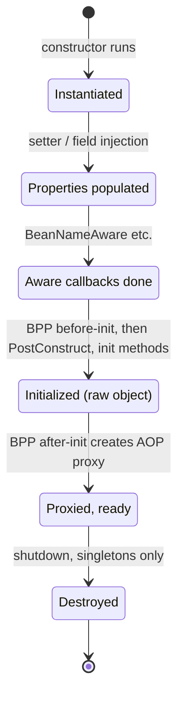
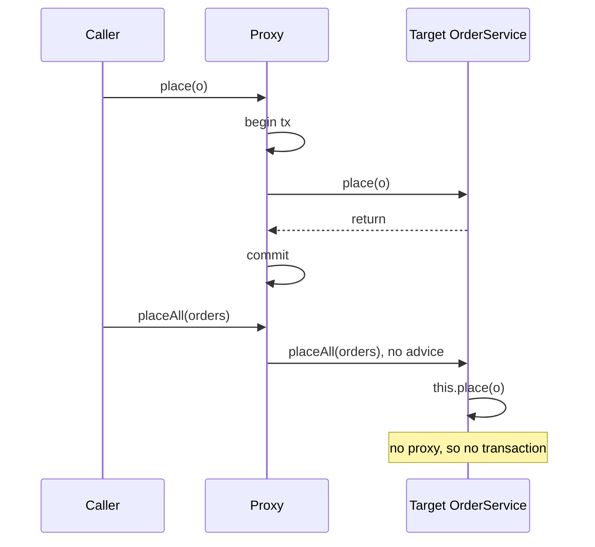
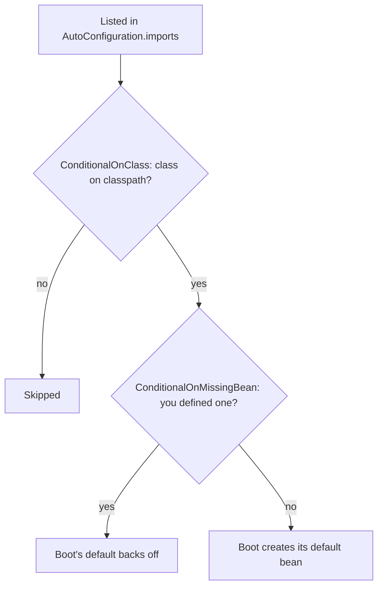

## Definition (interview-ready)

**Inversion of Control (IoC)** means your classes don't create their own collaborators; a container creates them and hands them in. **Dependency Injection (DI)** is how Spring does IoC: it calls your constructor (or setters) with the dependencies already built. The container is the **`ApplicationContext`**. The objects it manages are **beans**. For each bean, Spring instantiates it, injects dependencies, runs lifecycle callbacks, and may wrap it in a **proxy** to add behaviour such as transactions or security. **Spring Boot** sits on top and **auto-configures** beans based on what's on the classpath and in your properties, so a `spring-boot-starter-webmvc` dependency gives you a working web server with no XML and very little code.

**One-liner:** Spring's IoC container (the `ApplicationContext`) creates your beans, injects their dependencies (ideally through constructors), runs their lifecycle callbacks and wraps them in proxies for things like transactions, while Spring Boot auto-configures sensible default beans from the classpath and properties that back off as soon as you define your own.

## Why it matters

- Almost every Java backend interview at product companies includes "explain the bean lifecycle", "why constructor injection", or "why didn't my `@Transactional` work". All three are answered by understanding the container and proxies.
- Many production bugs come from container behaviour: a prototype bean that is silently shared, a method annotation that never runs because of self-invocation, a property that is overridden by an environment variable you forgot about.
- Spring Boot's "magic" is just conditional configuration. Once you can explain how auto-configuration decides what to create, you can debug it and override it confidently.

Version context used in this note: **Spring Framework 6.x / 7.x** with **Spring Boot 3.x / 4.x**. Boot 3 moved from the `javax.*` packages to **`jakarta.*`** (for example `jakarta.annotation.PostConstruct`, `jakarta.persistence.Entity`) and requires Java 17+. Boot 4 (built on Framework 7) keeps the Jakarta namespace and splits auto-configuration into smaller modules; for example the web starter is now `spring-boot-starter-webmvc` and the old `spring-boot-starter-web` name is deprecated.

## Core concepts

### IoC and DI in one picture

Without IoC, a class builds what it needs:

```java
class OrderService {
    private final PaymentClient client = new PaymentClient("https://pay", 3); // hard-wired
}
```

You can't swap the client in tests, and every class repeats construction logic. With DI the class just *declares* what it needs:

```java
@Service
class OrderService {
    private final PaymentClient client;

    OrderService(PaymentClient client) {   // Spring passes the bean in
        this.client = client;
    }
}
```

The analogy: a restaurant kitchen. The chef (your class) doesn't grow vegetables; ingredients are delivered (injected) by the supplier (the container). The chef only says what the recipe needs.

### Constructor vs setter vs field injection

| Style | How | Good for | Problems |
|---|---|---|---|
| **Constructor** | dependencies are constructor parameters | Mandatory dependencies | Long constructors show the class does too much (that's a feature) |
| **Setter** | `@Autowired` on a setter | Optional dependencies with sensible defaults | Object can exist half-wired; needs null checks |
| **Field** | `@Autowired` on a private field | Nothing much (short demo code) | Can't make the field `final`, hidden dependencies, needs reflection or a Spring context to test |

**Why constructor injection wins** (and is what the Spring team recommends):

1. Fields can be `final`, so the object is **immutable** after construction.
2. A required dependency can never be `null`, because the object can't be built without it.
3. The bean is **fully initialized** when anyone gets it.
4. Unit tests just call `new OrderService(mockClient)`, no Spring needed.
5. Constructor cycles fail fast at startup instead of hiding.

Since Spring 4.3, if a class has **exactly one constructor**, you don't need `@Autowired` on it. With Lombok, `@RequiredArgsConstructor` generates that constructor for all `final` fields.

### ApplicationContext and component scanning

The `ApplicationContext` is the container. It extends `BeanFactory` (basic bean creation) and adds events, internationalisation (`MessageSource`), resource loading, and environment/profile support. In a Boot app, `SpringApplication.run(...)` creates it for you.

**Component scanning** finds classes annotated with `@Component` (and its specialisations `@Service`, `@Repository`, `@Controller`, `@RestController`, `@Configuration`) under the base package and registers them as beans. In Boot, `@SpringBootApplication` scans the package of the main class and everything below it. A classic bug: a bean in a sibling package (`com.acme.shared` when the main class is in `com.acme.app`) is never found.

`@Repository` also enables exception translation (database exceptions become Spring's `DataAccessException` hierarchy). `@Service` is just a semantic marker.

### @Bean vs @Component

| | `@Component` (and friends) | `@Bean` method |
|---|---|---|
| Where | On **your class** | On a method inside a `@Configuration` class |
| Who constructs | Spring calls the constructor | Your method body builds the object |
| Use when | You own the source code | Third-party classes (an `ObjectMapper`, an HTTP client) or construction needs logic |

```java
@Configuration
class HttpConfig {
    @Bean
    RestClient paymentRestClient(RestClient.Builder builder) {
        return builder.baseUrl("https://payments.internal").build();
    }
}
```

Detail interviewers like: in a full `@Configuration` class, Spring subclasses the class with CGLIB so that calling one `@Bean` method from another returns the **same singleton** instead of creating a second object. With `@Configuration(proxyBeanMethods = false)` (what Boot's own auto-configurations use for faster startup), that interception is off, so you should take dependencies as method parameters instead of calling other `@Bean` methods.

### Choosing between candidates: @Primary and @Qualifier

If two beans implement `PaymentClient`, injecting `PaymentClient` is ambiguous and startup fails with `NoUniqueBeanDefinitionException`.

- **`@Primary`** on one bean: "use this one unless told otherwise".
- **`@Qualifier("stripe")`** at the injection point: "I want exactly this one". A qualifier beats `@Primary`.
- Injecting `List` of `PaymentClient` (written `List<PaymentClient>`) gives you **all** of them, which is the clean way to build a strategy registry.

### Bean scopes

| Scope | One instance per… | Notes |
|---|---|---|
| **singleton** (default) | `ApplicationContext` | Not the GoF singleton: one per container, per bean definition. Must be thread-safe (no per-request mutable fields). |
| **prototype** | every lookup / injection | Spring creates it and hands it over; **destroy callbacks are not called** for prototypes. |
| **request** | HTTP request | Web-aware context only |
| **session** | HTTP session | Web-aware context only |
| **application** | `ServletContext` | Like singleton but stored in the servlet context |
| **websocket** | WebSocket session | Web-aware context only |

### The prototype-in-singleton gotcha

Dependencies are resolved **once**, when the singleton is created. So a prototype injected into a singleton is created once and then reused forever, which is probably not what you meant:

```java
@Component @Scope("prototype")
class ReportBuilder { /* mutable state per report */ }

@Service
class ReportService {
    private final ReportBuilder builder;   // ⚠️ the SAME instance for every call
    ReportService(ReportBuilder builder) { this.builder = builder; }
}
```

Fixes: inject an `ObjectProvider` of `ReportBuilder` (written `ObjectProvider<ReportBuilder>`) and call `getObject()` each time; use `@Lookup` method injection; or use a **scoped proxy** (`@Scope(value = "prototype", proxyMode = ScopedProxyMode.TARGET_CLASS)`), where every method call on the proxy goes to a fresh target. The same idea is how a singleton safely uses a `request`-scoped bean: the injected object is a proxy that finds the current request's instance on each call.

### The bean lifecycle

```
 1. Instantiate           constructor runs (constructor injection happens here)
 2. Populate properties   setter / field injection
 3. Aware callbacks       BeanNameAware, BeanFactoryAware, ApplicationContextAware …
 4. BeanPostProcessor     postProcessBeforeInitialization(bean, name)
 5. Init callbacks        @PostConstruct  →  afterPropertiesSet()  →  custom init-method
 6. BeanPostProcessor     postProcessAfterInitialization(bean, name)
                          ← AOP proxies (@Transactional, @Async, @Cacheable…) are created HERE
 7. Bean in use           other beans receive the proxy, not the raw object
 8. Shutdown              @PreDestroy  →  DisposableBean.destroy()  →  custom destroy-method
                          (not for prototypes — Spring never destroys them)
```

The same lifecycle as states a bean moves through:



Two consequences people get asked about:

- **`@PostConstruct` runs on the raw object, before the proxy exists.** Calling a `@Transactional` method of the same bean from `@PostConstruct` runs with no transaction. If you need the fully proxied, fully started app, listen for `ApplicationReadyEvent` instead.
- A **`BeanPostProcessor`** is the extension point Spring itself uses. `@Autowired` processing, `@PostConstruct` handling and proxy creation are all post-processors. A `BeanFactoryPostProcessor` is different: it runs earlier and edits bean **definitions** (for example resolving `${...}` placeholders), not bean instances.

### Circular dependencies

`A` needs `B` and `B` needs `A`.

- With **constructor injection** the cycle is unresolvable: Spring can't construct either first, so it throws `BeanCurrentlyInCreationException`.
- With setter/field injection, Spring used to break the cycle by handing out an early reference to a half-built bean.
- **Since Spring Boot 2.6, circular references are prohibited by default** and startup fails even for field injection. You can restore the old behaviour with `spring.main.allow-circular-references=true`, but the right fix is to break the cycle: extract the shared logic into a third bean, publish an event instead of calling back, or (as a last resort) inject `@Lazy` / `ObjectProvider` on one side.

A cycle almost always means two classes have tangled responsibilities. Say that in the interview.

### Proxies: JDK vs CGLIB, and self-invocation

Spring adds cross-cutting behaviour (transactions, security, caching, async, retries) by wrapping the bean in a **proxy** that runs the extra logic and then calls your method.

| | JDK dynamic proxy | CGLIB proxy |
|---|---|---|
| How | Implements the bean's **interfaces** | Generates a **subclass** of the bean's class |
| Requires | At least one interface | Non-final class |
| Limits | Only interface methods are intercepted; you can't inject the concrete class type | `final` and `private` methods can't be intercepted; `final` classes can't be proxied |
| Default | Core Spring's choice when the bean has interfaces | **Spring Boot's default** (`spring.aop.proxy-target-class=true`) |

**Self-invocation**: the proxy only sees calls that come *through* it. A call on `this` goes straight to the target:

```java
@Service
class OrderService {
    public void placeAll(List<Order> orders) {
        orders.forEach(this::place);     // ⚠️ bypasses the proxy
    }

    @Transactional
    public void place(Order o) { ... }  // no transaction when called from placeAll
}
```

```
caller ──▶ [ proxy: begin tx → target.place() → commit ]   ✅ advice runs
target.placeAll() ──this.place()──▶ target.place()          ❌ proxy never involved
```

Both calls side by side. Only the first one passes through the proxy:



Fixes, best first: move `place` into another bean; inject the bean into itself (self-injection, often with `@Lazy`) and call through that; use `TransactionTemplate` for programmatic control; or switch to AspectJ weaving, which modifies bytecode and has no proxy. `AopContext.currentProxy()` works but ties your code to Spring AOP.

### Auto-configuration: how Boot decides what to create

`@SpringBootApplication` is three annotations:

- `@SpringBootConfiguration` (a `@Configuration`),
- `@ComponentScan` (scan this package and below),
- **`@EnableAutoConfiguration`** (load Boot's auto-configuration classes).

Auto-configuration classes are listed in a file inside each jar:

```
META-INF/spring/org.springframework.boot.autoconfigure.AutoConfiguration.imports
```

(Boot 2.7 introduced this file; Boot 3.0 stopped reading auto-configurations from the older `spring.factories`.) Each listed class is an `@AutoConfiguration` guarded by **conditions**:

| Condition | Creates beans only if… |
|---|---|
| `@ConditionalOnClass` / `@ConditionalOnMissingClass` | a class is (not) on the classpath — e.g. a DataSource config only when a JDBC driver is present |
| `@ConditionalOnBean` / `@ConditionalOnMissingBean` | a bean of that type does (not) already exist |
| `@ConditionalOnProperty` | a property has a given value (`feature.x.enabled=true`) |
| `@ConditionalOnResource` | a file exists |
| `@ConditionalOnWebApplication` / `@ConditionalOnNotWebApplication` | it is (not) a web app |
| `@ConditionalOnExpression` | a SpEL expression is true |

The key design rule is **`@ConditionalOnMissingBean`: your beans win.** Boot loads auto-configurations *after* your own bean definitions, so if you declare your own `ObjectMapper` or `DataSource`, Boot's default backs off.

How one auto-configuration (say, Boot's default `ObjectMapper`) decides whether to create its bean:



Debugging: run with `--debug` (or `debug=true`) to print the **condition evaluation report** showing which auto-configurations matched and why. The Actuator `/actuator/conditions` endpoint shows the same at runtime. To turn one off: `@SpringBootApplication(exclude = DataSourceAutoConfiguration.class)` or `spring.autoconfigure.exclude=...`.

### Profiles and externalized configuration

A **profile** is a named set of beans and properties, such as `dev`, `stg`, `prod`. Activate with `spring.profiles.active=prod` (property, env var `SPRING_PROFILES_ACTIVE`, or command line). `@Profile("prod")` on a bean registers it only in that profile, and `application-prod.yml` is loaded on top of `application.yml`.

Boot reads properties from many sources. **Later sources override earlier ones.** The order, simplified:

```
lowest  1. SpringApplication default properties
        2. @PropertySource on @Configuration classes
        3. Config data files (application.yml / .properties — see below)
        4. random.* values
        5. OS environment variables          (SERVER_PORT → server.port)
        6. Java system properties            (-Dserver.port=…)
        7. JNDI, ServletContext / ServletConfig init params
        8. SPRING_APPLICATION_JSON
        9. Command-line arguments            (--server.port=…)
highest 10. Test properties (@SpringBootTest(properties=…), @DynamicPropertySource, @TestPropertySource)
```

Among config files, **outside the jar beats inside the jar**, and **profile-specific beats plain**: `application.yml` in jar → `application-prod.yml` in jar → `application.yml` next to the jar → `application-prod.yml` next to the jar. If one location has both `.properties` and `.yml`, `.properties` wins.

Practical upshot: an environment variable silently beats your YAML. When "my config change did nothing", check `/actuator/env` to see which source won.

Prefer **`@ConfigurationProperties`** (a typed, validated class bound to a prefix) over scattered `@Value("${...}")` for anything with more than one or two keys.

### Error handling: @ControllerAdvice and ProblemDetail

Don't catch-and-format exceptions in every controller. Centralise it:

- **`@ExceptionHandler(SomeException.class)`** on a method handles that exception. Inside a controller it applies to that controller only.
- **`@ControllerAdvice`** (or `@RestControllerAdvice`, which adds `@ResponseBody`) makes those handlers **global**.

Since **Spring Framework 6**, there is a standard error body: **`ProblemDetail`**, which implements **RFC 9457 "Problem Details for HTTP APIs"** (the successor to RFC 7807). It has the standard fields `type`, `title`, `status`, `detail`, `instance`, plus any custom properties, and is served as `application/problem+json`.

```java
@RestControllerAdvice
class ApiErrors extends ResponseEntityExceptionHandler {   // handles Spring MVC's own exceptions too

    @ExceptionHandler(OrderNotFoundException.class)
    ProblemDetail notFound(OrderNotFoundException ex) {
        ProblemDetail pd = ProblemDetail.forStatusAndDetail(HttpStatus.NOT_FOUND, ex.getMessage());
        pd.setTitle("Order not found");
        pd.setProperty("orderId", ex.orderId());
        return pd;
    }
}
```

```json
{ "type": "about:blank", "title": "Order not found", "status": 404,
  "detail": "Order 42 does not exist", "instance": "/orders/42", "orderId": 42 }
```

In Spring Boot you can also set `spring.mvc.problemdetails.enabled=true` to make Spring MVC's built-in exceptions render as `ProblemDetail` without writing the advice. Never return stack traces or SQL errors in the body; log them with a correlation ID instead. More on API error design in [API design practices](/learn/notes/api-design-practices/).

## How it works

What happens when you run a Boot app, end to end:

```
main() → SpringApplication.run(App.class)
  1. Prepare Environment: load property sources, activate profiles
  2. Create the ApplicationContext (servlet, reactive, or plain)
  3. Read bean definitions:
       • component scan from App's package
       • your @Configuration / @Bean methods
       • AutoConfiguration.imports → conditions evaluated → matching configs registered
  4. Run BeanFactoryPostProcessors (resolve ${…} placeholders, etc.)
  5. Register BeanPostProcessors
  6. Instantiate all non-lazy singletons (lifecycle steps 1–6 above)
       → proxies created for beans with @Transactional, @Async, @PreAuthorize…
  7. Start the embedded web server (Tomcat by default)
  8. Run CommandLineRunner / ApplicationRunner beans → publish ApplicationReadyEvent
  … serve traffic …
  9. SIGTERM → graceful shutdown → @PreDestroy / destroy callbacks on singletons
```

How to say it in an interview: *"Spring builds a graph of bean definitions from my code and from conditional auto-configurations, creates every singleton through a fixed lifecycle, wraps beans that need cross-cutting behaviour in proxies during post-processing, and then starts the web server."*

## Real-world examples

- **Spring Boot 2.6** changed the default to forbid circular bean references, and the official release notes tell users to break the cycle or set `spring.main.allow-circular-references=true`.
- **Spring Framework 6.0** added `ProblemDetail` and `ErrorResponse`, and all Spring MVC exceptions now implement `ErrorResponse`, so errors can be rendered in the RFC 9457 format.
- **Spring Boot's own auto-configurations** use `@ConditionalOnMissingBean` throughout; that is exactly why declaring your own `ObjectMapper` bean replaces Boot's.

## Common pitfalls

- **Field injection everywhere.** Hidden dependencies, no `final`, hard to unit test. Use constructor injection.
- **Mutable state in a singleton** (a `SimpleDateFormat` or a "current user" field). Singletons are shared by all request threads.
- **Prototype injected into a singleton** and expected to be fresh each call.
- **Self-invocation** of `@Transactional`, `@Async`, `@Cacheable` or `@PreAuthorize` methods: no proxy, no behaviour.
- **`final` class or method** with a CGLIB proxy: the method silently isn't intercepted.
- **Doing heavy work in `@PostConstruct`** (remote calls, cache warming that needs transactions). It blocks startup and runs before proxies exist. Use `ApplicationReadyEvent`.
- **Turning `allow-circular-references` back on** to hide a design problem.
- **Bean in a package outside the scan root**, so it is never registered.
- **"Config didn't apply"** because an env var or command-line arg overrides it. Check `/actuator/env`.
- **`@Profile` beans with no default**, so the app fails to start when no profile is active.
- **Leaking exception messages and stack traces** in error responses.

## Practice questions

<Practice>

<QA q="What is the difference between IoC and DI?" level="easy">

**IoC** is the principle: control over creating and wiring objects moves from your code to a framework. **DI** is the technique Spring uses to implement it: the container passes dependencies into your object through its constructor, setters or fields. So DI is one way to achieve IoC (a service locator is another, worse one).

</QA>

<QA q="Why does the Spring team recommend constructor injection over field injection?" level="easy">

- Fields can be `final`, so the object is immutable.
- Required dependencies can't be `null`; the object can't exist without them.
- The bean is fully initialized when handed out.
- Plain unit tests: `new OrderService(mock)` with no Spring context or reflection.
- Too many constructor parameters makes a design smell visible.
- Constructor cycles fail at startup instead of hiding.

Use setter injection only for optional dependencies with defaults. Since Spring 4.3 a single constructor needs no `@Autowired`.

</QA>

<QA q="When do you use `@Bean` instead of `@Component`?" level="easy">

`@Component` goes on a class you own; Spring calls its constructor. `@Bean` goes on a factory method in a `@Configuration` class; you write the construction code. Use `@Bean` for third-party classes you can't annotate (`ObjectMapper`, HTTP clients, `DataSource`), when construction needs logic, or when you need several differently configured instances of the same type.

</QA>

<QA q="List Spring's bean scopes. Is a singleton bean thread-safe?" level="easy">

singleton (default, one per container), prototype (new per lookup), and the web scopes request, session, application and websocket.

A singleton is **not** automatically thread-safe. Spring gives every thread the same instance and adds no locking. Singletons should be stateless (only `final` references to other beans and immutable config). Put per-request data in method parameters, local variables or a request-scoped bean.

</QA>

<QA q="Two beans implement the same interface. How do you control which one is injected?" level="easy">

Startup fails with `NoUniqueBeanDefinitionException` unless you disambiguate. Mark one `@Primary` to make it the default, or use `@Qualifier("name")` at the injection point to pick exactly one (a qualifier overrides `@Primary`). Or inject all of them as a `List` or `Map` keyed by bean name, which is a clean way to build a strategy pattern.

</QA>

<QA q="Walk through the Spring bean lifecycle." level="medium">

1. Instantiate (constructor injection).
2. Populate properties (setter/field injection).
3. `Aware` callbacks (`BeanNameAware`, `ApplicationContextAware`…).
4. `BeanPostProcessor.postProcessBeforeInitialization`.
5. Init: `@PostConstruct`, then `afterPropertiesSet()`, then a custom `initMethod`.
6. `BeanPostProcessor.postProcessAfterInitialization` — this is where AOP proxies for `@Transactional`, `@Async` etc. are created.
7. Bean in use (others hold the proxy).
8. On shutdown: `@PreDestroy`, then `destroy()`, then a custom `destroyMethod` — for singletons (and other container-managed scopes), never for prototypes.

</QA>

<QA q="You inject a prototype-scoped bean into a singleton. What happens and how do you fix it?" level="medium">

The prototype is created **once**, when the singleton is wired, and the singleton reuses that instance forever, because injection happens only at creation time. Fixes: inject `ObjectProvider` (or `ObjectFactory` / `jakarta.inject.Provider`) and call `getObject()` per use; use `@Lookup` method injection; or make the prototype a scoped proxy so every call on the proxy uses a new target.

</QA>

<QA q="Why might a `@Transactional` method called from `@PostConstruct` not run in a transaction?" level="medium">

`@PostConstruct` runs during initialization on the **raw** bean, before `postProcessAfterInitialization` wraps it in the transactional proxy. Calls made from it are also self-invocations on `this`. Either way, no proxy, no transaction. Move the work to an `ApplicationReadyEvent` listener (or another bean's method), or use `TransactionTemplate` explicitly.

</QA>

<QA q="What are JDK dynamic proxies and CGLIB proxies? Which does Spring Boot use?" level="medium">

A JDK proxy implements the bean's interfaces and forwards calls; it can only intercept interface methods, and you can only inject it by interface type. A CGLIB proxy is a generated subclass; it can proxy classes without interfaces but can't intercept `final` or `private` methods or proxy `final` classes. Core Spring uses JDK proxies when interfaces exist; **Spring Boot defaults to CGLIB** (`spring.aop.proxy-target-class=true`), which avoids "bean is not of required type" errors when injecting by class.

</QA>

<QA q="How does Spring Boot auto-configuration work?" level="medium">

`@SpringBootApplication` includes `@EnableAutoConfiguration`, which loads the classes listed in each jar's `META-INF/spring/org.springframework.boot.autoconfigure.AutoConfiguration.imports`. Each is an `@AutoConfiguration` class guarded by conditions: `@ConditionalOnClass` (is the library present?), `@ConditionalOnProperty`, `@ConditionalOnWebApplication`, and especially `@ConditionalOnMissingBean`, so a bean you define replaces the default. They are processed after your own beans. Use `--debug` or `/actuator/conditions` to see what matched, and `exclude` to disable one.

</QA>

<QA q="How do you handle circular dependencies in Spring, and what changed in Boot 2.6?" level="medium">

Constructor-injection cycles are always unresolvable and throw `BeanCurrentlyInCreationException`. Setter/field cycles used to be resolved with early references to half-built beans, but **Spring Boot 2.6 forbids circular references by default**. `spring.main.allow-circular-references=true` restores the old behaviour, but the proper fix is redesign: extract the shared logic into a third bean, use events, or as a last resort make one side lazy (`@Lazy` or `ObjectProvider`). A cycle is usually a sign of mixed responsibilities.

</QA>

<QA q="In what order does Spring Boot apply property sources? Your YAML says port 8080 but the app starts on 9090 — why?" level="hard">

Later sources override earlier ones: default properties → `@PropertySource` → config files → random → **OS env vars** → Java system properties → JNDI/servlet params → `SPRING_APPLICATION_JSON` → **command-line args** → test properties. Within config files: inside-jar plain, inside-jar profile-specific, outside-jar plain, outside-jar profile-specific. So something higher wins: an env var `SERVER_PORT=9090`, `-Dserver.port`, a `--server.port` argument, an external or profile-specific file. `/actuator/env` shows which source supplied the value.

</QA>

<QA q="How would you design consistent error responses across a Spring Boot API?" level="hard">

One `@RestControllerAdvice` (extending `ResponseEntityExceptionHandler` so Spring MVC's own exceptions such as validation errors are covered) with `@ExceptionHandler` methods that map domain exceptions to statuses. Return `ProblemDetail` (RFC 9457, Spring 6+): `type`, `title`, `status`, `detail`, `instance`, plus custom fields like an error code or invalid fields. Content type `application/problem+json`. Log the full exception with a correlation/trace ID; never return stack traces or SQL. Map unknown exceptions to 500 with a generic message.

</QA>

<QA q="You write a library that should give consumers a default `AuditClient` bean they can override. How?" level="hard">

Write an `@AutoConfiguration` class, list it in `META-INF/spring/org.springframework.boot.autoconfigure.AutoConfiguration.imports`, and declare the bean with `@ConditionalOnMissingBean` so a user's own `AuditClient` wins. Guard it with `@ConditionalOnClass` for any optional dependency and `@ConditionalOnProperty(prefix = "audit", name = "enabled", matchIfMissing = true)` for an off switch. Bind settings with `@ConfigurationProperties`. Don't rely on component scanning for library code: consumers' scan roots won't include your package.

</QA>

<QA q="A teammate says 'my `@Async` method runs synchronously'. What do you check?" level="scenario">

1. Is `@EnableAsync` present?
2. **Self-invocation**: is it called from the same class? Then the proxy is bypassed.
3. Is the method `private` or `final`, or the class `final`? CGLIB can't intercept it.
4. Is the object a Spring bean at all, or created with `new`?
5. Is it called from `@PostConstruct`, before proxies exist?

Fix by moving the async method to a separate bean and calling it through injection. The same checklist applies to `@Transactional`, `@Cacheable` and `@PreAuthorize`.

</QA>

<QA q="After adding a new library, the app fails at startup with two `DataSource` beans. How do you debug?" level="scenario">

Run with `--debug` to read the condition evaluation report and see which auto-configuration created each bean. The new library probably ships its own auto-configuration that doesn't use `@ConditionalOnMissingBean`, or you defined one and it defined another. Options: mark yours `@Primary`, use `@Qualifier` at injection points, exclude the library's auto-configuration (`spring.autoconfigure.exclude`), or remove the duplicate definition. Then check transaction managers and JPA, which also expect a single primary `DataSource`.

</QA>

</Practice>

## Quiz

<Quiz>

<MCQ q="In which lifecycle step does Spring usually create the AOP proxy for a @Transactional bean?" options={["Before the constructor runs", "In BeanPostProcessor.postProcessAfterInitialization", "In the @PostConstruct method", "When the first request arrives"]} answer={1}>

Auto-proxy creators are BeanPostProcessors that wrap the bean after initialization callbacks finish. That is why @PostConstruct runs on the raw object. Proxies are not created before construction or lazily on first request.

</MCQ>

<MCQ q="A singleton bean has a prototype-scoped dependency injected through its constructor. How many prototype instances does the singleton use?" options={["A new one per method call", "A new one per HTTP request", "Exactly one, created when the singleton was wired", "None until getBean is called"]} answer={2}>

Injection happens once at creation, so the singleton keeps that single prototype instance. To get fresh instances use ObjectProvider, @Lookup or a scoped proxy.

</MCQ>

<MCQ q="placeAll() calls this.place() in the same bean, and place() is annotated @Transactional. What happens?" options={["place() runs in a new transaction", "place() runs without the transactional advice because the call bypasses the proxy", "Spring throws an exception at startup", "place() joins a transaction only if placeAll() is public"]} answer={1}>

Proxy-based AOP only intercepts calls that come through the proxy. A call on this goes directly to the target, so no transaction starts. Nothing fails at startup.

</MCQ>

<MCQ q="Since Spring Boot 2.6, what happens by default when two beans depend on each other through field injection?" options={["Spring resolves it with early references", "Startup fails because circular references are prohibited by default", "Spring creates two copies of each bean", "One field is silently left null"]} answer={1}>

Boot 2.6 made spring.main.allow-circular-references default to false, so the context fails to start. Early-reference resolution is only used if you opt back in.

</MCQ>

<MCQ q="Which condition makes Boot's default bean back off when you define your own bean of the same type?" options={["@ConditionalOnClass", "@ConditionalOnProperty", "@ConditionalOnMissingBean", "@ConditionalOnWebApplication"]} answer={2}>

@ConditionalOnMissingBean creates the default only if no bean of that type exists yet, and auto-configurations run after user definitions. The others check classpath, properties or application type.

</MCQ>

<MCQ q="server.port is 8080 in application.yml inside the jar, SERVER_PORT=9090 is set in the environment, and the app is started with --server.port=7070. Which port is used?" options={["8080", "9090", "7070", "The app fails due to conflicting values"]} answer={2}>

Command-line arguments are higher in Boot's precedence order than OS environment variables, which are higher than config files. Conflicts are resolved by precedence, not errors.

</MCQ>

<MCQ q="Which destruction callback is NOT invoked by Spring?" options={["@PreDestroy on a singleton", "DisposableBean.destroy() on a singleton", "A custom destroyMethod on a singleton", "@PreDestroy on a prototype-scoped bean"]} answer={3}>

Spring hands prototypes to the caller and does not manage the rest of their lifecycle, so their destroy callbacks never run. Singleton destroy callbacks run on context close.

</MCQ>

<MCQ q="Which file does Spring Boot 3 and later read to discover auto-configuration classes?" options={["META-INF/spring.factories", "META-INF/spring/org.springframework.boot.autoconfigure.AutoConfiguration.imports", "application.yml under spring.autoconfigure.include", "META-INF/MANIFEST.MF"]} answer={1}>

The imports file was introduced in Boot 2.7 and became the only source of auto-configurations in Boot 3.0. spring.factories is no longer read for auto-configurations; the other two are not discovery mechanisms.

</MCQ>

<MCQ q="What does Spring's ProblemDetail represent?" options={["A Spring-only error format with no standard behind it", "The RFC 9457 Problem Details format for HTTP API errors", "A log4j2 error layout", "A JSON:API error object"]} answer={1}>

ProblemDetail (Spring Framework 6+) models RFC 9457, the successor to RFC 7807, with type, title, status, detail and instance fields, served as application/problem+json.

</MCQ>

</Quiz>

## TL;DR cheat sheet

- **IoC** = the container builds and wires objects; **DI** = it passes dependencies in. Prefer **constructor injection** (`final`, never null, testable).
- `@Component` on your class; `@Bean` method for third-party or custom construction. Ambiguity → `@Primary` or `@Qualifier`.
- Scopes: **singleton** (default, shared across threads, keep stateless), prototype (not destroyed by Spring), request, session, application, websocket.
- Prototype inside singleton = created once. Use `ObjectProvider`, `@Lookup`, or a scoped proxy.
- Lifecycle: construct → inject → Aware → BPP before → `@PostConstruct` → `afterPropertiesSet` → init-method → **BPP after (proxies)** → use → `@PreDestroy` → `destroy` → destroy-method.
- **Circular references fail by default since Boot 2.6.** Fix the design.
- Proxies: JDK (interfaces) vs **CGLIB (subclass; Boot default)**. No interception of `final`/`private` methods or **self-invocation**.
- Auto-config: `@EnableAutoConfiguration` → `AutoConfiguration.imports` → `@Conditional...`; **`@ConditionalOnMissingBean` lets your beans win**. Debug with `--debug`.
- Property precedence: files (outside jar and profile-specific win) less than env vars less than system props less than command line.
- Errors: `@RestControllerAdvice` + `@ExceptionHandler` returning **`ProblemDetail`** (RFC 9457).
- Boot 3+: `jakarta.*` packages, Java 17+. Boot 4: Framework 7, modular starters (`spring-boot-starter-webmvc`).

## Go deeper

- **Spring Framework reference**: [The IoC container](https://docs.spring.io/spring-framework/reference/core/beans.html), [Bean scopes](https://docs.spring.io/spring-framework/reference/core/beans/factory-scopes.html), [Lifecycle callbacks](https://docs.spring.io/spring-framework/reference/core/beans/factory-nature.html), [Proxying mechanisms](https://docs.spring.io/spring-framework/reference/core/aop/proxying.html), [Error responses](https://docs.spring.io/spring-framework/reference/web/webmvc/mvc-ann-rest-exceptions.html).
- **Spring Boot reference**: [Creating your own auto-configuration](https://docs.spring.io/spring-boot/reference/features/developing-auto-configuration.html), [Externalized configuration](https://docs.spring.io/spring-boot/reference/features/external-config.html).
- **Spring Boot 2.6 release notes**: [Circular references prohibited by default](https://github.com/spring-projects/spring-boot/wiki/Spring-Boot-2.6-Release-Notes).
- **RFC 9457**: [Problem Details for HTTP APIs](https://www.rfc-editor.org/rfc/rfc9457).
- Related notes: [Spring Data JPA and Hibernate](/learn/notes/spring-data-jpa/), [Spring Security and JWT](/learn/notes/spring-security-jwt/).
