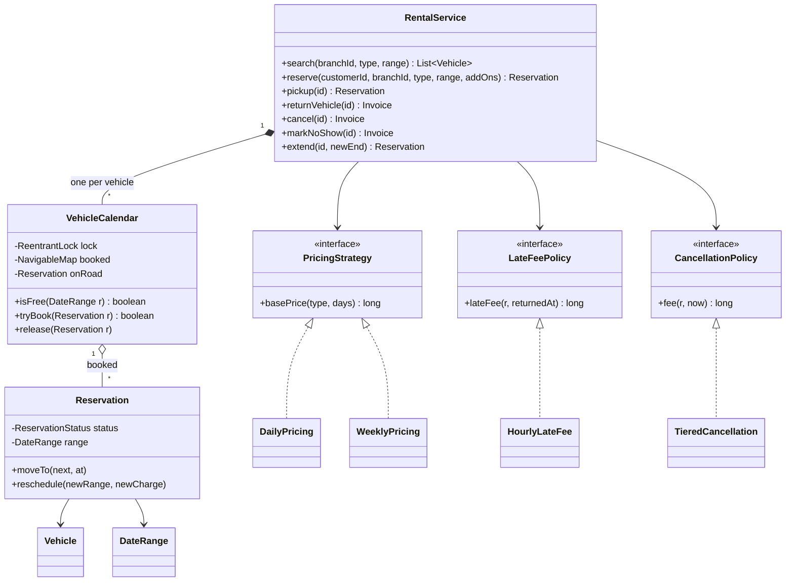
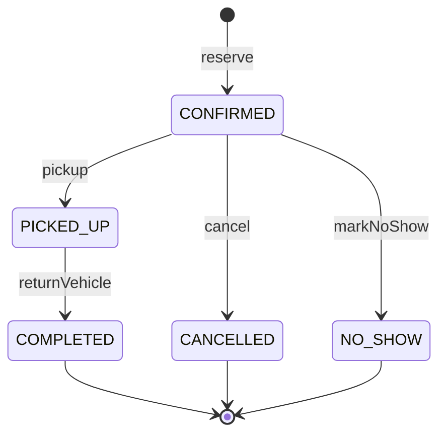

## Definition (interview-ready)

A car rental system lets customers search a branch for a vehicle type over a date range, reserve one, pick it up, return it and pay, with many customers booking at once. The core entities are `Branch`, `Vehicle` (with a `VehicleType`), a half-open `DateRange` [start, end), a `Reservation` with an explicit status, and one `VehicleCalendar` per vehicle that holds its non-overlapping reservations in a `TreeMap` sorted by start time. A `RentalService` coordinates search, reserve, cancel, pickup, return and extend. Pricing, late fees and cancellation fees are **Strategy** interfaces injected through the constructor, because those are the rules the business changes. The reservation lifecycle is a small **state machine** on an enum, so illegal moves (cancel after pickup, return twice) fail loudly. Double booking is impossible because the overlap check and the insert happen together under that vehicle's own `ReentrantLock`.

**One-liner:** One calendar and one lock per vehicle, half-open date ranges checked against two `TreeMap` neighbours, an enum state machine for the reservation lifecycle, and Strategy for pricing, late fees and cancellation.

## Problem statement

> Design and implement a car rental system.
>
> - The company has **several branches**. Each branch has vehicles of different **types**: hatchback, sedan and SUV.
> - A customer can **search** a branch for a vehicle type that is free for a given pickup and return time, and **reserve** one.
> - A vehicle must **never be booked twice** for overlapping times, even when many customers book at the same moment.
> - The price depends on the vehicle type and the number of days. Rentals of a week or longer get a **weekly rate**. Customers can add **extras** such as GPS, a child seat, insurance or an extra driver.
> - At the counter the customer **picks up** the car and later **returns** it. Returning late costs a **late fee**.
> - Customers can **cancel**. Cancelling early is free; cancelling close to the pickup time costs money. A customer who never turns up is a **no-show**.
> - Customers can ask to **extend** a rental if the car is free for the extra time.
> - Write a demo `main` and keep it easy to change prices and fee rules.

This problem looks like a CRUD exercise, but interviewers use it to test three things: whether you get **interval overlap** right (the boundary case trips most people), whether two concurrent bookings can sneak past your check, and whether the reservation lifecycle is modelled explicitly or as a pile of booleans. If you have done the [Meeting Room Scheduler](/learn/notes/lld-meeting-room-scheduler/), the calendar idea will feel familiar; this note reuses it and spends its time on what is new: inventory by type, pricing, fees and the lifecycle.

## Clarifying questions to ask

Ask these in the first five minutes and write the answers as a comment at the top of your file.

| Question | Assumed answer |
|---|---|
| Does the customer book a specific car or a car type? | A **type** at a branch ("a sedan at the airport"). The system picks a free vehicle. This is how most rental companies sell. |
| Is a rental ending at 10:00 in conflict with one starting at 10:00? | **No.** Ranges are half-open: [start, end). Back-to-back rentals are allowed. |
| How are days counted? | Every started 24 hours is a day, minimum one. 3 days and 1 minute is 4 days. |
| How does the weekly rate work? | Full weeks at the weekly rate, leftover days at the daily rate, but leftover days never cost more than one more week. |
| Late return? | One hour of grace. After that, every started hour late is charged at an hourly rate for the type. |
| Cancellation? | 48 hours or more before pickup: free. Less than 48 hours: 50% of the rental charge. At or after pickup time: 100%. |
| No-show? | If the car is not picked up within 3 hours of the start, staff can mark it a no-show, charged like a cancellation at that time (100%). |
| Return to a different branch (one-way)? | Out of scope; same branch. Mention it as an extension. |
| Payments, accounts, driving-licence checks? | Out of scope. We produce an `Invoice` with the amounts. |
| Concurrency? | Yes: many customers search and book at once. No vehicle may be double booked. |
| Money type? | Whole rupees as `long`. Say you would use `BigDecimal` or paise if fractions appear. |
| Time zones? | Each branch works in its local time, modelled as `LocalDateTime`. Say you would store `Instant` plus the branch's zone in production. |

## Requirements

**Functional (in scope)**

1. Register branches and vehicles (id, plate, type, home branch).
2. `search(branch, type, range)` returns vehicles free for the whole range.
3. `quote(type, range, addOns)` returns the price before booking.
4. `reserve(customer, branch, type, range, addOns)` books any free vehicle of that type or fails.
5. `cancel`, `pickup`, `returnVehicle`, `markNoShow` and `extend` move a reservation through its lifecycle and return an `Invoice` where money is involved.
6. Pluggable pricing, late-fee and cancellation rules.

**Non-functional**

- No double booking under concurrent requests; bookings for different vehicles do not block each other.
- Testable: time is injected through a `Clock`; every rule is an interface.
- Illegal lifecycle moves are rejected with a clear error, never silently ignored.

**Out of scope:** payments, customer accounts, one-way rentals, vehicle maintenance, fuel and damage charges, persistence. Each appears in [Extensions](#extensions-interviewers-ask-for).

## Entities and relationships

```text
 Branch(id, city) 1 ──────────── * Vehicle(id, plate, type, branchId)
                                        │ 1
                                        │ has exactly one
                                        ▼
                                  VehicleCalendar
                                   ├─ TreeMap<start, Reservation>   (live, never overlapping)
                                   ├─ onRoad: Reservation?          (picked up, not yet returned)
                                   └─ ReentrantLock                 (one per vehicle)

 Reservation(id, customerId, vehicle, range: DateRange, addOns, rentalCharge,
             status: ReservationStatus, pickedUpAt, returnedAt)

 DateRange[start, end)   overlaps(o) = start < o.end && o.start < end

 ReservationStatus:   CONFIRMED ──pickup──► PICKED_UP ──return──► COMPLETED
                         │  └────cancel────► CANCELLED
                         └──────no-show────► NO_SHOW          (last three are terminal)

 RentalService ── the facade callers use
   ├─ Map<branchId, List<Vehicle>>, Map<vehicleId, VehicleCalendar>, Map<id, Reservation>
   ├─ ◆ PricingStrategy      ◁── DailyPricing, WeeklyPricing
   ├─ ◆ LateFeePolicy        ◁── HourlyLateFee
   ├─ ◆ CancellationPolicy   ◁── TieredCancellation
   └─ ◆ Clock
 AddOn enum (GPS, CHILD_SEAT, FULL_INSURANCE per day; EXTRA_DRIVER flat)    Invoice record
```

The core classes from the full solution, with their key methods:



The `ReservationStatus` state machine from `canMoveTo`, with the service method that drives each move:



- A `Branch` **has** vehicles; a `Vehicle` **has** one calendar. The calendar is the only place that can add a reservation for that vehicle, so it owns the invariant "no two live reservations of this vehicle overlap".
- `Branch`, `Vehicle`, `DateRange` and `Invoice` are immutable records. `Reservation` is a class because its status changes; every change happens while its vehicle's lock is held.
- `RentalService` **depends on** four interfaces, all injected through its constructor.

## Design patterns used and why

| Pattern | Where | Why it earns its place |
|---|---|---|
| **Strategy** | `PricingStrategy`, `LateFeePolicy`, `CancellationPolicy` | These are exactly the rules the business tweaks every quarter (festival pricing, a stricter cancellation rule). Each change is a new class wired in `main`; the service never changes. See [Strategy](/learn/notes/behavioral-patterns/). |
| **State machine (enum-based State)** | `ReservationStatus.canMoveTo` | The lifecycle has five states and four legal moves. Writing them in one `switch` makes illegal moves impossible to miss. A full State pattern (a class per state) is overkill when states differ only in which moves they allow; see [State](/learn/notes/behavioral-patterns/). |
| **Facade** | `RentalService` | Callers see one small API; calendars, locks and policies stay hidden. See [Structural Patterns](/learn/notes/structural-patterns/). |
| **Value object** | `DateRange` with a compact constructor | "start before end" is checked once, at creation, so no invalid range exists anywhere in the system. |

Why add-ons are an enum and not a Decorator: every add-on is priced the same way (a per-day part plus a flat part), so data on an enum is enough. If an add-on ever needs its own logic (insurance priced as a percentage of the base), switch to a small `AddOnPricing` interface or a Decorator around the base `PricingStrategy`. Do not add a pattern the requirements did not ask for (see [Machine Coding Strategy](/learn/notes/machine-coding-strategy/)).

## Solution walkthrough

Build it in this order; each step compiles on its own.

### Step 1: half-open date ranges

```java
/** Half-open [start, end): a rental ending at 10:00 does not clash with one starting at 10:00. */
record DateRange(LocalDateTime start, LocalDateTime end) {
    DateRange {
        Objects.requireNonNull(start, "start");
        Objects.requireNonNull(end, "end");
        if (!start.isBefore(end)) throw new IllegalArgumentException("start must be before end");
    }
    boolean overlaps(DateRange o) { return start.isBefore(o.end) && o.start.isBefore(end); }

    /** Billable days: every started 24 hours counts, minimum one. */
    long rentalDays() {
        Duration d = Duration.between(start, end);
        long days = d.toDays();                                   // whole days, rounded down
        return d.equals(Duration.ofDays(days)) ? days : days + 1;  // any part-day counts as a day
    }
}
```

Two ranges overlap exactly when **each one starts before the other ends**. With half-open ranges, the end instant does not belong to the range, so the test uses strict "before" on both sides:

```text
 alice: [Mar 5 10:00 ─────────── Mar 8 10:00)
 bob:                            [Mar 8 10:00 ─────── Mar 16 10:00)
        alice.start < bob.end   ✔
        bob.start < alice.end   ✘  (10:00 is not before 10:00)  → no overlap, same car is fine

 dan:          [Mar 6 12:00 ─ Mar 6 18:00)
        both tests ✔  → overlap
```

Why half-open is the right default: back-to-back rentals do not clash, a week split into days never counts a boundary instant twice, and the length of the range is simply `end - start`. PostgreSQL's built-in discrete range types use the same `[)` form, and its range constructors assume `[)` when you do not pass bounds. The most common bug here is writing `!start.isAfter(o.end)` (an inclusive check), which makes the 10:00 hand-over a conflict and silently wastes inventory.

`rentalDays` rounds the duration up to whole days: exactly 24 hours is one day, 24 hours and 1 second is two. It compares full `Duration`s rather than counting minutes, so seconds cannot slip through for free. The compact constructor guarantees `end` is after `start`, so the result is always at least one.

### Step 2: the reservation state machine

```java
enum ReservationStatus {
    CONFIRMED, PICKED_UP, COMPLETED, CANCELLED, NO_SHOW;

    boolean canMoveTo(ReservationStatus next) {
        return switch (this) {
            case CONFIRMED -> next == PICKED_UP || next == CANCELLED || next == NO_SHOW;
            case PICKED_UP -> next == COMPLETED;
            case COMPLETED, CANCELLED, NO_SHOW -> false;      // terminal states
        };
    }
}
```

The whole lifecycle is one `switch`. The `switch` expression is exhaustive, so adding a new status (say `PAYMENT_PENDING`) will not compile until you decide its moves. `Reservation.moveTo(next, at)` calls `canMoveTo` and throws `InvalidTransitionException` otherwise, and records `pickedUpAt` and `returnedAt` as side effects of the right transitions.

Compare this with the "booleans" version (`isCancelled`, `isPickedUp`, `isReturned`): eight combinations, most of them nonsense (cancelled and returned?), and every method has to remember which ones to check.

### Step 3: one calendar and one lock per vehicle

```java
final class VehicleCalendar {
    private final ReentrantLock lock = new ReentrantLock();
    private final NavigableMap<LocalDateTime, Reservation> booked = new TreeMap<>();   // key = start
    private Reservation onRoad;                                                       // picked up, not returned

    <T> T locked(Supplier<T> action) {
        lock.lock();
        try { return action.get(); } finally { lock.unlock(); }
    }

    /** Caller holds the lock. Stored ranges never overlap, so only the two neighbours can clash. */
    boolean isFree(DateRange r) {
        var before = booked.floorEntry(r.start());
        if (before != null && before.getValue().range().overlaps(r)) return false;
        var after = booked.ceilingEntry(r.start());
        return after == null || !after.getValue().range().overlaps(r);
    }

    /** Atomic check-and-insert. */
    boolean tryBook(Reservation r) {
        return locked(() -> {
            if (!isFree(r.range())) return false;
            booked.put(r.range().start(), r);
            return true;
        });
    }
}
```

Two ideas carry the whole design:

- **O(log n) overlap check.** The calendar only holds live reservations (confirmed or picked up), keyed by start time, and they never overlap. So the only candidates for a clash are the reservation that starts at or just before the new start (`floorEntry`) and the one that starts at or just after it (`ceilingEntry`). The [Meeting Room Scheduler](/learn/notes/lld-meeting-room-scheduler/) proves why two neighbours are enough; the same argument applies here.
- **Check and insert under one lock.** `isFree` followed by `put` is a check-then-act sequence. Without the lock, two threads can both see the car as free and both insert. `tryBook` holds this vehicle's lock for both steps, so exactly one wins. The lock is per vehicle, so bookings for different cars run in parallel. `ReentrantLock` is reentrant, which lets the service call `tryBook` or `isFree` from inside a larger `locked(...)` block without deadlocking on itself. Locks are covered in [Java Concurrency and Locks](/learn/notes/java-concurrency-locks/).

`onRoad` remembers which reservation currently has the car out. It stops the next customer from picking up a car that the previous customer has not returned yet.

### Step 4: pricing, late fees and cancellation as strategies

```java
interface PricingStrategy { long basePrice(VehicleType type, long days); }

/** Full weeks at the weekly rate; leftover days at the daily rate, never more than one more week. */
final class WeeklyPricing implements PricingStrategy {
    public long basePrice(VehicleType type, long days) {
        long week = DailyPricing.rate(weekly, type);
        long leftover = (days % 7) * DailyPricing.rate(daily, type);
        return (days / 7) * week + Math.min(leftover, week);
    }
}
```

With a sedan at 1800 a day and 10500 a week: 3 days cost 5400, 6 days would be 10800 at the daily rate but are capped at 10500, 7 days cost 10500, and 8 days cost 10500 + 1800 = 12300. The `min` matters: without it a 6-day rental costs more than a 7-day one, and customers notice.

Add-ons are data on an enum: `GPS(perDay 100)`, `CHILD_SEAT(150)`, `FULL_INSURANCE(400)`, `EXTRA_DRIVER(flat 500)`, each with `charge(days) = perDay × days + flat`. The quote is `pricing.basePrice(type, days)` plus the sum of the add-on charges, computed once at booking time and stored on the reservation, so a later price change does not alter a booking the customer already accepted.

```java
/** Free within the grace period; after that, every started hour late is charged. */
public long lateFee(Reservation r, LocalDateTime returnedAt) {
    Duration late = Duration.between(r.range().end(), returnedAt);
    if (late.compareTo(grace) <= 0) return 0;
    long hours = late.toHours();
    if (!late.equals(Duration.ofHours(hours))) hours++;          // every started hour counts
    return hours * DailyPricing.rate(hourly, r.vehicle().type());
}

/** 48h or more before pickup: free. Less than 48h: 50%. At or after pickup time: 100%. */
public long fee(Reservation r, LocalDateTime now) {
    LocalDateTime start = r.range().start();
    if (!now.isBefore(start)) return r.rentalCharge();
    if (Duration.between(now, start).toHours() >= 48) return 0;
    return r.rentalCharge() / 2;
}
```

A negative `late` (early return) is less than the grace, so it costs nothing extra. Note the boundary choices and test them: exactly one hour late is still within grace; 61 minutes late is charged two started hours. Exactly 48 hours before pickup is free; 47 hours 59 minutes is not (`toHours()` drops the leftover minutes, so 47h59m becomes 47).

### Step 5: the service flows

**Reserve** loops over the branch's vehicles of the requested type and calls `tryBook` on each. The first vehicle whose lock-protected check passes gets the booking. A losing thread just tries the next car. Only one lock is held at a time, so there is no lock ordering to get wrong and no deadlock.

```java
Reservation reserve(String customerId, String branchId, VehicleType type, DateRange range, Set<AddOn> addOns) {
    if (!range.start().isAfter(now())) throw new RentalException("pickup must be in the future");
    long charge = quote(type, range, addOns);
    String id = "R" + seq.incrementAndGet();
    for (Vehicle v : candidates(branchId, type)) {
        Reservation r = new Reservation(id, customerId, v, range, addOns, charge);
        if (calendars.get(v.id()).tryBook(r)) {          // first vehicle whose lock-protected check passes
            reservations.put(id, r);
            return r;
        }
    }
    throw new NoVehicleAvailableException(branchId, type, range);
}
```

**Search** runs the same `isFree` check per vehicle and returns a snapshot. It can be stale a millisecond later, which is fine because `reserve` checks again under the lock. Never "search, then insert into the vehicle search returned" without re-checking.

**Every lifecycle method** follows one template: find the reservation, take its vehicle's lock, check the transition is legal, check the time rules, compute money with the policy, change the status, update the calendar, return an `Invoice`.

```java
Invoice returnVehicle(String id) {
    Reservation r = find(id);
    VehicleCalendar cal = calendarOf(r);
    return cal.locked(() -> {
        LocalDateTime now = now();
        r.moveTo(ReservationStatus.COMPLETED, now);
        long late = lateFees.lateFee(r, now);
        cal.release(r);                                   // an early return frees the rest of the range
        return new Invoice(id, r.status(), r.rentalCharge(), late, 0);
    });
}
```

- **Pickup** is allowed from the start time until `start + pickupWindow` (3 hours), and only if the car is not still out with someone else (`onRoad`).
- **Return** releases the reservation from the calendar, so an early return makes the remaining days bookable again.
- **Cancel** and **no-show** both release the vehicle; no-show is only allowed once the pickup window has closed.
- **Extend** checks the extra piece `[oldEnd, newEnd)` with `isFree`. Because ranges are half-open, the reservation's own range `[start, oldEnd)` does not overlap that piece, so there is no need for an "ignore myself" flag. That is a small, satisfying payoff of the `[)` choice worth saying out loud. The charge is re-quoted for the longer range.

## Full solution code

One file, `Main.java`, Java 21. Compile and run with `javac Main.java && java Main`.

```java run
import java.time.*;
import java.util.*;
import java.util.concurrent.ConcurrentHashMap;
import java.util.concurrent.CopyOnWriteArrayList;
import java.util.concurrent.atomic.AtomicLong;
import java.util.concurrent.locks.ReentrantLock;
import java.util.function.Supplier;

// ============================== Value types ==============================

enum VehicleType { HATCHBACK, SEDAN, SUV }

/** Extras a customer can add. Some are charged per day, some once per rental. */
enum AddOn {
    GPS(100, 0), CHILD_SEAT(150, 0), FULL_INSURANCE(400, 0), EXTRA_DRIVER(0, 500);

    private final long perDay;
    private final long flat;
    AddOn(long perDay, long flat) { this.perDay = perDay; this.flat = flat; }
    long charge(long days) { return perDay * days + flat; }
}

record Branch(String id, String city) {}

record Vehicle(String id, String plate, VehicleType type, String branchId) {}

/** Half-open [start, end): a rental ending at 10:00 does not clash with one starting at 10:00. */
record DateRange(LocalDateTime start, LocalDateTime end) {
    DateRange {
        Objects.requireNonNull(start, "start");
        Objects.requireNonNull(end, "end");
        if (!start.isBefore(end)) throw new IllegalArgumentException("start must be before end");
    }
    static DateRange of(String start, String end) {
        return new DateRange(LocalDateTime.parse(start), LocalDateTime.parse(end));
    }
    boolean overlaps(DateRange o) { return start.isBefore(o.end) && o.start.isBefore(end); }

    /** Billable days: every started 24 hours counts, minimum one. */
    long rentalDays() {
        Duration d = Duration.between(start, end);
        long days = d.toDays();                                   // whole days, rounded down
        return d.equals(Duration.ofDays(days)) ? days : days + 1;  // any part-day counts as a day
    }
}

// ============================== Reservation and its state machine ==============================

enum ReservationStatus {
    CONFIRMED, PICKED_UP, COMPLETED, CANCELLED, NO_SHOW;

    boolean canMoveTo(ReservationStatus next) {
        return switch (this) {
            case CONFIRMED -> next == PICKED_UP || next == CANCELLED || next == NO_SHOW;
            case PICKED_UP -> next == COMPLETED;
            case COMPLETED, CANCELLED, NO_SHOW -> false;      // terminal states
        };
    }
}

/** Mutable fields change only while the vehicle's calendar lock is held; volatile makes reads safe. */
final class Reservation {
    private final String id;
    private final String customerId;
    private final Vehicle vehicle;
    private final Set<AddOn> addOns;
    private volatile DateRange range;
    private volatile long rentalCharge;
    private volatile ReservationStatus status = ReservationStatus.CONFIRMED;
    private volatile LocalDateTime pickedUpAt;
    private volatile LocalDateTime returnedAt;

    Reservation(String id, String customerId, Vehicle vehicle, DateRange range, Set<AddOn> addOns, long rentalCharge) {
        this.id = id; this.customerId = customerId; this.vehicle = vehicle;
        this.range = range; this.addOns = Set.copyOf(addOns); this.rentalCharge = rentalCharge;
    }

    String id() { return id; }
    String customerId() { return customerId; }
    Vehicle vehicle() { return vehicle; }
    Set<AddOn> addOns() { return addOns; }
    DateRange range() { return range; }
    long rentalCharge() { return rentalCharge; }
    ReservationStatus status() { return status; }
    LocalDateTime pickedUpAt() { return pickedUpAt; }
    LocalDateTime returnedAt() { return returnedAt; }

    void requireCanMoveTo(ReservationStatus next) {
        if (!status.canMoveTo(next)) throw new InvalidTransitionException(id, status, next);
    }
    void moveTo(ReservationStatus next, LocalDateTime at) {
        requireCanMoveTo(next);
        status = next;
        if (next == ReservationStatus.PICKED_UP) pickedUpAt = at;
        if (next == ReservationStatus.COMPLETED) returnedAt = at;
    }
    void reschedule(DateRange newRange, long newCharge) { range = newRange; rentalCharge = newCharge; }

    @Override public String toString() {
        return id + "[" + customerId + ", " + vehicle.id() + ", " + range.start() + " -> " + range.end()
                + ", " + status + ", charge=" + rentalCharge + "]";
    }
}

// ============================== Per-vehicle calendar (the concurrency boundary) ==============================

/** Owns the invariant "no two live reservations of this vehicle overlap". One lock per vehicle. */
final class VehicleCalendar {
    private final ReentrantLock lock = new ReentrantLock();
    private final NavigableMap<LocalDateTime, Reservation> booked = new TreeMap<>();   // key = start
    private Reservation onRoad;                                                       // picked up, not returned

    <T> T locked(Supplier<T> action) {
        lock.lock();
        try { return action.get(); } finally { lock.unlock(); }
    }

    /** Caller holds the lock. Stored ranges never overlap, so only the two neighbours can clash. */
    boolean isFree(DateRange r) {
        var before = booked.floorEntry(r.start());
        if (before != null && before.getValue().range().overlaps(r)) return false;
        var after = booked.ceilingEntry(r.start());
        return after == null || !after.getValue().range().overlaps(r);
    }

    /** Atomic check-and-insert. */
    boolean tryBook(Reservation r) {
        return locked(() -> {
            if (!isFree(r.range())) return false;
            booked.put(r.range().start(), r);
            return true;
        });
    }

    void release(Reservation r) { booked.remove(r.range().start(), r); if (onRoad == r) onRoad = null; }
    Reservation onRoad() { return onRoad; }
    void setOnRoad(Reservation r) { onRoad = r; }
}

// ============================== Policies (Strategy) ==============================

interface PricingStrategy {
    long basePrice(VehicleType type, long days);      // whole rupees
}

final class DailyPricing implements PricingStrategy {
    private final Map<VehicleType, Long> daily;
    DailyPricing(Map<VehicleType, Long> daily) { this.daily = new EnumMap<>(daily); }
    public long basePrice(VehicleType type, long days) { return rate(daily, type) * days; }

    static long rate(Map<VehicleType, Long> rates, VehicleType type) {
        Long r = rates.get(type);
        if (r == null) throw new IllegalStateException("no rate for " + type);
        return r;
    }
}

/** Full weeks at the weekly rate; leftover days at the daily rate, never more than one more week. */
final class WeeklyPricing implements PricingStrategy {
    private final Map<VehicleType, Long> daily;
    private final Map<VehicleType, Long> weekly;
    WeeklyPricing(Map<VehicleType, Long> daily, Map<VehicleType, Long> weekly) {
        this.daily = new EnumMap<>(daily); this.weekly = new EnumMap<>(weekly);
    }
    public long basePrice(VehicleType type, long days) {
        long week = DailyPricing.rate(weekly, type);
        long leftover = (days % 7) * DailyPricing.rate(daily, type);
        return (days / 7) * week + Math.min(leftover, week);
    }
}

interface LateFeePolicy {
    long lateFee(Reservation r, LocalDateTime returnedAt);
}

/** Free within the grace period; after that, every started hour late is charged. */
final class HourlyLateFee implements LateFeePolicy {
    private final Duration grace;
    private final Map<VehicleType, Long> hourly;
    HourlyLateFee(Duration grace, Map<VehicleType, Long> hourly) { this.grace = grace; this.hourly = new EnumMap<>(hourly); }

    public long lateFee(Reservation r, LocalDateTime returnedAt) {
        Duration late = Duration.between(r.range().end(), returnedAt);
        if (late.compareTo(grace) <= 0) return 0;
        long hours = late.toHours();
        if (!late.equals(Duration.ofHours(hours))) hours++;      // every started hour counts
        return hours * DailyPricing.rate(hourly, r.vehicle().type());
    }
}

interface CancellationPolicy {
    long fee(Reservation r, LocalDateTime now);
}

/** 48h or more before pickup: free. Less than 48h: 50%. At or after pickup time: 100%. */
final class TieredCancellation implements CancellationPolicy {
    public long fee(Reservation r, LocalDateTime now) {
        LocalDateTime start = r.range().start();
        if (!now.isBefore(start)) return r.rentalCharge();
        if (Duration.between(now, start).toHours() >= 48) return 0;
        return r.rentalCharge() / 2;
    }
}

// ============================== Results and errors ==============================

record Invoice(String reservationId, ReservationStatus status, long rentalCharge, long lateFee, long cancellationFee) {
    long total() { return rentalCharge + lateFee + cancellationFee; }
}

class RentalException extends RuntimeException { RentalException(String m) { super(m); } }
class NoVehicleAvailableException extends RentalException {
    NoVehicleAvailableException(String branch, VehicleType t, DateRange r) {
        super("No " + t + " free at " + branch + " for " + r.start() + " -> " + r.end());
    }
}
class InvalidTransitionException extends RentalException {
    InvalidTransitionException(String id, ReservationStatus from, ReservationStatus to) {
        super(id + ": cannot go from " + from + " to " + to);
    }
}

// ============================== Service ==============================

final class RentalService {
    private final Map<String, Branch> branches = new ConcurrentHashMap<>();
    private final Map<String, List<Vehicle>> vehiclesByBranch = new ConcurrentHashMap<>();
    private final Map<String, VehicleCalendar> calendars = new ConcurrentHashMap<>();   // vehicleId -> calendar
    private final Map<String, Reservation> reservations = new ConcurrentHashMap<>();
    private final AtomicLong seq = new AtomicLong();
    private final PricingStrategy pricing;
    private final LateFeePolicy lateFees;
    private final CancellationPolicy cancellation;
    private final Duration pickupWindow;       // after this, an unclaimed reservation is a no-show
    private final Clock clock;

    RentalService(PricingStrategy pricing, LateFeePolicy lateFees, CancellationPolicy cancellation,
                  Duration pickupWindow, Clock clock) {
        this.pricing = pricing; this.lateFees = lateFees; this.cancellation = cancellation;
        this.pickupWindow = pickupWindow; this.clock = clock;
    }

    // ---------- catalogue ----------
    void addBranch(Branch b) {
        branches.putIfAbsent(b.id(), b);
        vehiclesByBranch.putIfAbsent(b.id(), new CopyOnWriteArrayList<>());
    }
    void addVehicle(Vehicle v) {
        if (!branches.containsKey(v.branchId())) throw new RentalException("unknown branch " + v.branchId());
        if (calendars.putIfAbsent(v.id(), new VehicleCalendar()) != null) throw new RentalException("duplicate " + v.id());
        vehiclesByBranch.get(v.branchId()).add(v);
    }

    // ---------- search and quote ----------
    List<Vehicle> search(String branchId, VehicleType type, DateRange range) {
        return candidates(branchId, type).stream()
                .filter(v -> { VehicleCalendar c = calendars.get(v.id()); return c.locked(() -> c.isFree(range)); })
                .toList();     // a snapshot: reserve() re-checks under the lock
    }

    long quote(VehicleType type, DateRange range, Set<AddOn> addOns) {
        long days = range.rentalDays();
        long extras = addOns.stream().mapToLong(a -> a.charge(days)).sum();
        return pricing.basePrice(type, days) + extras;
    }

    // ---------- reserve ----------
    Reservation reserve(String customerId, String branchId, VehicleType type, DateRange range, Set<AddOn> addOns) {
        if (!range.start().isAfter(now())) throw new RentalException("pickup must be in the future");
        long charge = quote(type, range, addOns);
        String id = "R" + seq.incrementAndGet();
        for (Vehicle v : candidates(branchId, type)) {
            Reservation r = new Reservation(id, customerId, v, range, addOns, charge);
            if (calendars.get(v.id()).tryBook(r)) {          // first vehicle whose lock-protected check passes
                reservations.put(id, r);
                return r;
            }
        }
        throw new NoVehicleAvailableException(branchId, type, range);
    }

    // ---------- lifecycle ----------
    Invoice cancel(String id) {
        Reservation r = find(id);
        VehicleCalendar cal = calendarOf(r);
        return cal.locked(() -> {
            LocalDateTime now = now();
            r.requireCanMoveTo(ReservationStatus.CANCELLED);
            long fee = cancellation.fee(r, now);
            r.moveTo(ReservationStatus.CANCELLED, now);
            cal.release(r);
            return new Invoice(id, r.status(), 0, 0, fee);
        });
    }

    Reservation pickup(String id) {
        Reservation r = find(id);
        VehicleCalendar cal = calendarOf(r);
        return cal.locked(() -> {
            LocalDateTime now = now();
            r.requireCanMoveTo(ReservationStatus.PICKED_UP);
            if (now.isBefore(r.range().start())) throw new RentalException(id + ": too early to pick up");
            if (!now.isBefore(r.range().start().plus(pickupWindow)))
                throw new RentalException(id + ": pickup window closed");
            if (cal.onRoad() != null)
                throw new RentalException(id + ": " + r.vehicle().id() + " not yet returned by " + cal.onRoad().id());
            r.moveTo(ReservationStatus.PICKED_UP, now);
            cal.setOnRoad(r);
            return r;
        });
    }

    Invoice returnVehicle(String id) {
        Reservation r = find(id);
        VehicleCalendar cal = calendarOf(r);
        return cal.locked(() -> {
            LocalDateTime now = now();
            r.moveTo(ReservationStatus.COMPLETED, now);
            long late = lateFees.lateFee(r, now);
            cal.release(r);                                   // an early return frees the rest of the range
            return new Invoice(id, r.status(), r.rentalCharge(), late, 0);
        });
    }

    Invoice markNoShow(String id) {
        Reservation r = find(id);
        VehicleCalendar cal = calendarOf(r);
        return cal.locked(() -> {
            LocalDateTime now = now();
            r.requireCanMoveTo(ReservationStatus.NO_SHOW);
            if (now.isBefore(r.range().start().plus(pickupWindow)))
                throw new RentalException(id + ": pickup window still open");
            long fee = cancellation.fee(r, now);
            r.moveTo(ReservationStatus.NO_SHOW, now);
            cal.release(r);
            return new Invoice(id, r.status(), 0, 0, fee);
        });
    }

    /** Push the end later. Thanks to half-open ranges, [oldEnd, newEnd) never clashes with this reservation itself. */
    Reservation extend(String id, LocalDateTime newEnd) {
        Reservation r = find(id);
        VehicleCalendar cal = calendarOf(r);
        return cal.locked(() -> {
            if (r.status() != ReservationStatus.CONFIRMED && r.status() != ReservationStatus.PICKED_UP)
                throw new RentalException(id + ": cannot extend a " + r.status() + " reservation");
            if (!newEnd.isAfter(r.range().end())) throw new RentalException(id + ": new end must be later");
            if (!cal.isFree(new DateRange(r.range().end(), newEnd)))
                throw new RentalException(id + ": " + r.vehicle().id() + " is booked by someone else before " + newEnd);
            DateRange longer = new DateRange(r.range().start(), newEnd);
            r.reschedule(longer, quote(r.vehicle().type(), longer, r.addOns()));
            return r;
        });
    }

    Reservation find(String id) {
        Reservation r = reservations.get(id);
        if (r == null) throw new RentalException("unknown reservation " + id);
        return r;
    }

    private List<Vehicle> candidates(String branchId, VehicleType type) {
        List<Vehicle> all = vehiclesByBranch.get(branchId);
        if (all == null) throw new RentalException("unknown branch " + branchId);
        return all.stream().filter(v -> v.type() == type).toList();
    }
    private VehicleCalendar calendarOf(Reservation r) { return calendars.get(r.vehicle().id()); }
    private LocalDateTime now() { return LocalDateTime.now(clock); }
}

/** Test/demo clock we can move forward by hand. */
final class MutableClock extends Clock {
    private volatile Instant now;
    MutableClock(Instant start) { this.now = start; }
    void set(String isoLocal) { now = LocalDateTime.parse(isoLocal).toInstant(ZoneOffset.UTC); }
    @Override public Instant instant() { return now; }
    @Override public ZoneId getZone() { return ZoneOffset.UTC; }
    @Override public Clock withZone(ZoneId zone) { return this; }
}

// ============================== Demo ==============================

public class Main {
    public static void main(String[] args) {
        MutableClock clock = new MutableClock(Instant.parse("2026-03-01T09:00:00Z"));
        Map<VehicleType, Long> daily = Map.of(VehicleType.HATCHBACK, 1200L, VehicleType.SEDAN, 1800L, VehicleType.SUV, 3000L);
        Map<VehicleType, Long> weekly = Map.of(VehicleType.HATCHBACK, 7000L, VehicleType.SEDAN, 10500L, VehicleType.SUV, 18000L);
        Map<VehicleType, Long> hourlyLate = Map.of(VehicleType.HATCHBACK, 150L, VehicleType.SEDAN, 250L, VehicleType.SUV, 400L);

        RentalService rentals = new RentalService(new WeeklyPricing(daily, weekly),
                new HourlyLateFee(Duration.ofHours(1), hourlyLate), new TieredCancellation(), Duration.ofHours(3), clock);
        rentals.addBranch(new Branch("BLR-AIR", "Bengaluru"));
        rentals.addVehicle(new Vehicle("V1", "KA01AB1111", VehicleType.SEDAN, "BLR-AIR"));
        rentals.addVehicle(new Vehicle("V2", "KA01AB2222", VehicleType.SEDAN, "BLR-AIR"));
        rentals.addVehicle(new Vehicle("V3", "KA01AB3333", VehicleType.SUV, "BLR-AIR"));

        DateRange aliceTrip = DateRange.of("2026-03-05T10:00", "2026-03-08T10:00");
        System.out.println("Free sedans: " + rentals.search("BLR-AIR", VehicleType.SEDAN, aliceTrip).stream().map(Vehicle::id).toList());

        Reservation alice = rentals.reserve("alice", "BLR-AIR", VehicleType.SEDAN, aliceTrip, Set.of(AddOn.GPS));
        Reservation bob = rentals.reserve("bob", "BLR-AIR", VehicleType.SEDAN,
                DateRange.of("2026-03-08T10:00", "2026-03-16T10:00"), Set.of(AddOn.CHILD_SEAT));
        Reservation carol = rentals.reserve("carol", "BLR-AIR", VehicleType.SEDAN,
                DateRange.of("2026-03-06T09:00", "2026-03-07T09:00"), Set.of());
        System.out.println(alice + "\n" + bob + "\n" + carol);

        try { rentals.reserve("dan", "BLR-AIR", VehicleType.SEDAN, DateRange.of("2026-03-06T12:00", "2026-03-06T18:00"), Set.of()); }
        catch (RentalException e) { System.out.println("Rejected: " + e.getMessage()); }

        System.out.println("Carol cancels early: " + rentals.cancel(carol.id()));
        System.out.println("Free sedans on Mar 6: " + rentals.search("BLR-AIR", VehicleType.SEDAN,
                DateRange.of("2026-03-06T12:00", "2026-03-06T18:00")).stream().map(Vehicle::id).toList());

        clock.set("2026-03-05T10:30");
        rentals.pickup(alice.id());
        try { rentals.extend(alice.id(), LocalDateTime.parse("2026-03-09T10:00")); }
        catch (RentalException e) { System.out.println("Rejected: " + e.getMessage()); }

        Reservation erin = rentals.reserve("erin", "BLR-AIR", VehicleType.SUV,
                DateRange.of("2026-03-07T10:00", "2026-03-09T10:00"), Set.of(AddOn.FULL_INSURANCE));
        clock.set("2026-03-06T20:00");
        System.out.println("Erin cancels late: " + rentals.cancel(erin.id()));

        clock.set("2026-03-08T10:15");
        try { rentals.pickup(bob.id()); }
        catch (RentalException e) { System.out.println("Rejected: " + e.getMessage()); }

        clock.set("2026-03-08T12:45");
        Invoice aliceBill = rentals.returnVehicle(alice.id());
        System.out.println("Alice returns late: " + aliceBill + " total=" + aliceBill.total());
        System.out.println("Bob picks up: " + rentals.pickup(bob.id()));

        try { rentals.cancel(alice.id()); }
        catch (RentalException e) { System.out.println("Rejected: " + e.getMessage()); }
    }
}
```

**Demo output** (real output from running the program above):

```text output
Free sedans: [V1, V2]
R1[alice, V1, 2026-03-05T10:00 -> 2026-03-08T10:00, CONFIRMED, charge=5700]
R2[bob, V1, 2026-03-08T10:00 -> 2026-03-16T10:00, CONFIRMED, charge=13500]
R3[carol, V2, 2026-03-06T09:00 -> 2026-03-07T09:00, CONFIRMED, charge=1800]
Rejected: No SEDAN free at BLR-AIR for 2026-03-06T12:00 -> 2026-03-06T18:00
Carol cancels early: Invoice[reservationId=R3, status=CANCELLED, rentalCharge=0, lateFee=0, cancellationFee=0]
Free sedans on Mar 6: [V2]
Rejected: R1: V1 is booked by someone else before 2026-03-09T10:00
Erin cancels late: Invoice[reservationId=R5, status=CANCELLED, rentalCharge=0, lateFee=0, cancellationFee=3400]
Rejected: R2: V1 not yet returned by R1
Alice returns late: Invoice[reservationId=R1, status=COMPLETED, rentalCharge=5700, lateFee=750, cancellationFee=0] total=6450
Bob picks up: R2[bob, V1, 2026-03-08T10:00 -> 2026-03-16T10:00, PICKED_UP, charge=13500]
Rejected: R1: cannot go from COMPLETED to CANCELLED
```

Reading the output:

- Alice's 3-day sedan with GPS costs 3 × 1800 + 3 × 100 = 5700. Bob's 8 days with a child seat cost 10500 + 1800 + 8 × 150 = 13500, and he gets **the same car V1** because his range starts exactly when Alice's ends.
- Carol overlaps Alice, so she gets V2. Dan overlaps both, so he is rejected. Carol cancels more than 48 hours ahead for free, and V2 shows up in search again.
- Alice cannot extend to March 9 because Bob has V1 from March 8 10:00.
- Erin is `R5`, not `R4`, because Dan's failed attempt used up `R4`. Ids are unique, not gap-free. She cancels 14 hours before pickup and pays half of 2 × 3000 + 2 × 400 = 6800, which is 3400.
- Bob arrives at 10:15 but V1 is still out with Alice, so his pickup is refused. Alice returns 2 hours 45 minutes late: past the one-hour grace, so 3 started hours × 250 = 750. Bob then picks up within his 3-hour window.
- A completed rental cannot be cancelled: the state machine rejects it.

## Concurrency and edge cases

| Race or edge case | What could go wrong | How the design handles it |
|---|---|---|
| Two customers book the last sedan at once | Same car, overlapping dates, two reservations | `tryBook` checks and inserts under the vehicle's lock; one wins, the other tries the next car or gets `NoVehicleAvailableException`. |
| Search says free, then someone else books | Customer reserves a car that is no longer free | Search is only a hint; `reserve` re-checks under the lock. |
| Cancel and pickup at the same moment | Car handed over on a cancelled booking | Both take the vehicle lock; the second sees a status that cannot make the move and gets `InvalidTransitionException`. |
| Back-to-back rentals | Hand-over at 10:00 rejected as a clash | Half-open ranges: `[a, b)` and `[b, c)` do not overlap. |
| Previous renter is late | Next customer handed a car that is not there | `onRoad` blocks pickup; staff can offer another car of the same type (see extensions). |
| Early return | Car shows as busy for days it is parked | Return removes the reservation from the calendar. |
| Extension overlapping the next booking | Two customers with the same car | Extend checks `[oldEnd, newEnd)` under the same lock. |
| Exact boundaries | Off-by-one fees | Tests at exactly 48h, exactly 1h late, 61 minutes late, 24h and 24h 1m. |
| Empty or reversed range | Zero-day rental, negative fees | `DateRange` constructor rejects `start` not before `end`. |
| Booking in the past | A reservation that is a no-show at birth | `reserve` requires the start to be after now. |

Why a lock per vehicle and not one big lock? One `synchronized` service is correct and a fine first answer, but every booking in the company then waits for every other one. A lock per vehicle means two customers only contend when they want the very same car. Why not a lock-free compare-and-set like the [Parking Lot](/learn/notes/lld-parking-lot/)? A parking spot is free or taken, a single value; a vehicle calendar is a sorted set of ranges, and "check against neighbours, then insert" touches several entries, which is exactly what a small lock is for.

Honest caveats to mention: the per-reservation fields are `volatile` so readers see the latest values, but a reader outside the lock can see a status from just before a change, which is fine for display. The calendar only knows booked ranges, not where the car really is. If a renter is overdue, the car is still out but its booked range has ended, so the next booking that starts after that end looks valid. The `onRoad` check catches this at pickup time.

## Testing it

JUnit 5 style tests (these were compiled against the solution and all 8 pass):

```java
import static org.junit.jupiter.api.Assertions.*;

import java.time.*;
import java.util.*;
import java.util.concurrent.*;
import org.junit.jupiter.api.Test;

class RentalServiceTest {
    MutableClock clock = new MutableClock(Instant.parse("2026-03-01T09:00:00Z"));
    Map<VehicleType, Long> daily = Map.of(VehicleType.HATCHBACK, 1200L, VehicleType.SEDAN, 1800L, VehicleType.SUV, 3000L);
    Map<VehicleType, Long> weekly = Map.of(VehicleType.HATCHBACK, 7000L, VehicleType.SEDAN, 10500L, VehicleType.SUV, 18000L);
    Map<VehicleType, Long> late = Map.of(VehicleType.HATCHBACK, 150L, VehicleType.SEDAN, 250L, VehicleType.SUV, 400L);

    RentalService service(int sedans) {
        RentalService s = new RentalService(new WeeklyPricing(daily, weekly),
                new HourlyLateFee(Duration.ofHours(1), late), new TieredCancellation(), Duration.ofHours(3), clock);
        s.addBranch(new Branch("B", "City"));
        for (int i = 1; i <= sedans; i++) s.addVehicle(new Vehicle("V" + i, "P" + i, VehicleType.SEDAN, "B"));
        return s;
    }
    static DateRange r(String a, String b) { return DateRange.of("2026-03-" + a, "2026-03-" + b); }

    @Test void touchingRangesDoNotOverlap() {
        assertFalse(r("05T10:00", "05T12:00").overlaps(r("05T12:00", "05T13:00")));
        assertTrue(r("05T10:00", "05T12:00").overlaps(r("05T11:59", "05T15:00")));
    }

    @Test void weeklyPricingNeverChargesMoreThanAWeekForLeftoverDays() {
        PricingStrategy p = new WeeklyPricing(daily, weekly);
        assertEquals(10500, p.basePrice(VehicleType.SEDAN, 6));
        assertEquals(10500, p.basePrice(VehicleType.SEDAN, 7));
        assertEquals(12300, p.basePrice(VehicleType.SEDAN, 8));
    }

    @Test void backToBackReusesTheSameCarAndOverlapGoesElsewhere() {
        RentalService s = service(2);
        Reservation a = s.reserve("a", "B", VehicleType.SEDAN, r("05T10:00", "08T10:00"), Set.of());
        Reservation b = s.reserve("b", "B", VehicleType.SEDAN, r("08T10:00", "09T10:00"), Set.of());
        Reservation c = s.reserve("c", "B", VehicleType.SEDAN, r("07T10:00", "08T11:00"), Set.of());
        assertEquals(a.vehicle(), b.vehicle());
        assertNotEquals(a.vehicle(), c.vehicle());
        assertThrows(NoVehicleAvailableException.class,
                () -> s.reserve("d", "B", VehicleType.SEDAN, r("07T12:00", "07T13:00"), Set.of()));
    }

    @Test void cancellationTiers() {
        RentalService s = service(1);
        Reservation x = s.reserve("a", "B", VehicleType.SEDAN, r("05T10:00", "06T10:00"), Set.of());
        clock.set("2026-03-03T10:00");                          // exactly 48h before
        assertEquals(0, s.cancel(x.id()).cancellationFee());
        Reservation y = s.reserve("a", "B", VehicleType.SEDAN, r("05T10:00", "06T10:00"), Set.of());
        clock.set("2026-03-03T10:01");
        assertEquals(900, s.cancel(y.id()).cancellationFee());
    }

    @Test void lateFeeAfterGraceChargesEveryStartedHour() {
        RentalService s = service(1);
        Reservation x = s.reserve("a", "B", VehicleType.SEDAN, r("05T10:00", "06T10:00"), Set.of());
        clock.set("2026-03-05T10:00"); s.pickup(x.id());
        clock.set("2026-03-06T11:01");                          // 61 minutes late
        assertEquals(500, s.returnVehicle(x.id()).lateFee());
    }

    @Test void illegalTransitionsAreRejected() {
        RentalService s = service(1);
        Reservation x = s.reserve("a", "B", VehicleType.SEDAN, r("05T10:00", "06T10:00"), Set.of());
        assertThrows(InvalidTransitionException.class, () -> s.returnVehicle(x.id()));
        clock.set("2026-03-05T10:00"); s.pickup(x.id());
        assertThrows(InvalidTransitionException.class, () -> s.cancel(x.id()));
    }

    @Test void extendStopsAtTheNextBooking() {
        RentalService s = service(1);
        Reservation x = s.reserve("a", "B", VehicleType.SEDAN, r("05T10:00", "06T10:00"), Set.of());
        s.reserve("b", "B", VehicleType.SEDAN, r("08T10:00", "09T10:00"), Set.of());
        s.extend(x.id(), LocalDateTime.parse("2026-03-08T10:00"));       // touches, allowed
        assertThrows(RentalException.class, () -> s.extend(x.id(), LocalDateTime.parse("2026-03-08T10:01")));
    }

    @Test void twoHundredConcurrentBookingsForFiveCars() throws Exception {
        RentalService s = service(5);
        ExecutorService pool = Executors.newFixedThreadPool(16);
        CountDownLatch go = new CountDownLatch(1);
        List<Future<Reservation>> fs = new ArrayList<>();
        for (int i = 0; i < 200; i++) {
            String who = "c" + i;
            fs.add(pool.submit(() -> { go.await(); return s.reserve(who, "B", VehicleType.SEDAN, r("10T10:00", "12T10:00"), Set.of()); }));
        }
        go.countDown();
        Set<String> cars = new HashSet<>(); int losers = 0;
        for (Future<Reservation> f : fs) {
            try { cars.add(f.get().vehicle().id()); }
            catch (ExecutionException e) { if (e.getCause() instanceof NoVehicleAvailableException) losers++; }
        }
        pool.shutdown();
        assertEquals(5, cars.size());
        assertEquals(195, losers);
    }
}
```

The plain-Java harness (no JUnit dependency) ran **49 checks**, all passing on five repeated runs. Besides the cases above it covers: invalid ranges, day rounding at 24h and 24h 1m, add-on charges, booking in the past, unknown branch, cancel twice, the 100% tier at pickup time, pickup too early and after the window, no-show before and after the window, return within grace, double return, early return freeing the remaining days, pickup blocked while the previous renter still has the car, and three multi-threaded tests:

1. 200 threads booking the same range against 5 sedans: exactly 5 winners on 5 distinct cars, 195 rejections.
2. 16 threads making 300 random overlapping bookings each (and cancelling a third of them) against 3 sedans: afterwards, no two live reservations of the same vehicle overlap.
3. 200 rounds of `cancel` racing `pickup` on the same reservation: exactly one succeeds every round.

As a sanity check, removing the lock from `tryBook` made tests 1 and 2 fail immediately, so the tests really do detect double booking.

## Extensions interviewers ask for

| Ask | Change | What stays untouched |
|---|---|---|
| Festival or weekend pricing | New `PricingStrategy` (for example one that looks at each day in the range), wired in `main` | Service, calendar, fees |
| Cleaning buffer between rentals | Pad the range before checking: book `[start, end + buffer)` in the calendar but bill only `[start, end)` | Pricing, state machine |
| Book a specific car (premium model) | `reserveVehicle(vehicleId, range)` that calls `tryBook` on one calendar | Everything else |
| Maintenance blocks | A `MAINTENANCE` hold stored in the same calendar, so search skips the car for that range | Pricing, fees |
| One-way rentals | Add a return branch to the reservation; at return, move the vehicle to that branch's list. Availability then depends on where the car will be, which is the hard part: say so | Pricing, state machine |
| Reassign when the previous renter is late | When pickup hits `onRoad`, call `reserve` for the same type and range, then cancel the original with no fee | Calendar, policies |
| Payment and deposits | A `PaymentProcessor` interface; capture the deposit at pickup and settle the `Invoice` at return. Never hold the vehicle lock while calling it | Calendar, state machine |
| Notifications (booking confirmed, car overdue) | **Observer**: the service publishes events after each transition, outside the lock | Policies, calendar |
| Persistence | A `ReservationRepository`; in a database, a PostgreSQL exclusion constraint (`EXCLUDE USING GIST (vehicle_id WITH =, period WITH &&)`, which needs the `btree_gist` extension) makes double booking impossible even across servers | Policies, state machine |
| Many servers | The in-memory lock only works inside one JVM. Move the guarantee to the database (exclusion constraint, or a row lock per vehicle with `SELECT ... FOR UPDATE`) | Domain model |

## Common mistakes

1. **Inclusive overlap check.** `start <= o.end && o.start <= end` makes every 10:00 hand-over a conflict. Use half-open ranges and strict comparisons.
2. **Comparing only start times** ("is there a booking starting in my range?"). This misses a long booking that started before your range and covers it. The overlap test needs both conditions.
3. **Check-then-act across two calls.** `if (search(...).contains(v)) book(v)` without a lock lets two customers book the same car. The check and the insert must be one atomic step.
4. **One global lock around everything**, including slow work like payments. Lock per vehicle and keep external calls outside the lock.
5. **Status as booleans.** `isCancelled`, `isPickedUp` and `isReturned` allow impossible combinations. Use one enum and one transition table.
6. **Forgetting to free the calendar** on cancel, no-show or early return. The car then looks busy forever.
7. **Re-pricing at return time with today's rates.** The customer agreed to a price at booking. Store `rentalCharge` on the reservation.
8. **A 6-day rental costing more than a 7-day one.** Cap leftover days at one weekly rate.
9. **Calling `LocalDateTime.now()` directly.** Fees and windows become untestable. Inject a `Clock`.
10. **`double` for money.** Use `long` minor units or `BigDecimal`.

## Practice questions

<Practice>

<QA q="Why do you model rental periods as half-open ranges?" level="easy">

A half-open range `[start, end)` includes the start and excludes the end. Two consequences matter here. First, back-to-back rentals do not clash: one rental ending at 10:00 and the next starting at 10:00 share no instant, so the same car can serve both. Second, the overlap test becomes one clean expression, `a.start < b.end && b.start < a.end`, with no special cases for touching ranges. It is also PostgreSQL's default: its range constructors assume `[)` and its discrete range types such as `daterange` store ranges in that form, so the in-memory model matches a likely database model.

</QA>

<QA q="Write the overlap condition for two ranges and explain why both halves are needed." level="easy">

`a.start < b.end && b.start < a.end`. The first half says a starts before b finishes; the second says b starts before a finishes. If either is false, one range is completely before the other. Checking only "does b start inside a" misses the case where b started earlier and runs across all of a, for example a long rental that already covers the dates you want.

</QA>

<QA q="Walk through the reservation states and which moves are legal." level="easy">

`CONFIRMED` can move to `PICKED_UP` (customer collects the car), `CANCELLED` (customer cancels) or `NO_SHOW` (pickup window passed). `PICKED_UP` can only move to `COMPLETED` (car returned). `COMPLETED`, `CANCELLED` and `NO_SHOW` are terminal. All of this lives in `ReservationStatus.canMoveTo`, and `moveTo` throws on anything else, so "cancel after pickup" or "return twice" fail loudly.

</QA>

<QA q="How does your design stop two customers from booking the same car for overlapping dates?" level="medium">

Each vehicle has a `VehicleCalendar` with its own `ReentrantLock`. `tryBook` takes that lock, checks the new range against the two neighbouring reservations, and inserts only if there is no overlap, all before releasing the lock. Two threads targeting the same car serialise on that lock; the second one sees the first's booking and fails, then `reserve` moves it on to the next car of the same type. Threads booking different cars never wait for each other.

</QA>

<QA q="Why are floorEntry and ceilingEntry enough to detect a clash?" level="medium">

The calendar holds only live reservations, sorted by start, and they never overlap each other. Sorted non-overlapping ranges are also sorted by end. So among reservations starting at or before the new start, the one with the latest end is the floor entry; if it does not reach past the new start, none of the earlier ones do. Among reservations starting at or after the new start, the earliest is the ceiling entry; if it starts at or after the new end, all later ones do too. That gives an O(log n) check instead of scanning every booking.

</QA>

<QA q="Search said a sedan was free, but reserve failed a second later. Is that a bug?" level="medium">

No. Search returns a snapshot; another customer can book the car between the search and the reserve. That is why `reserve` never trusts the search result and re-checks under the vehicle lock. If you want a smoother experience, add a short **hold**: a reservation in a `HELD` state with an expiry time, created at search or checkout and confirmed after payment, the same idea as seat holds in [BookMyShow](/learn/notes/lld-bookmyshow/).

</QA>

<QA q="How does extend avoid clashing with the reservation it is extending?" level="medium">

It only checks the new piece, `[oldEnd, newEnd)`, against the calendar. The reservation itself is `[start, oldEnd)`, and with half-open ranges those two do not overlap, because `oldEnd` is not before `oldEnd`. So the reservation never conflicts with itself and no "ignore this one" flag is needed. If the next booking starts before `newEnd`, the extension is refused. The check and the update happen under the same vehicle lock.

</QA>

<QA q="How are the weekly rate and add-ons combined, and why store the charge on the reservation?" level="medium">

The base price comes from the `PricingStrategy`: full weeks at the weekly rate plus leftover days at the daily rate, capped at one more week so 6 days never cost more than 7. Add-ons add `perDay × days + flat` each. The total is computed once at booking and stored as `rentalCharge`, because the customer agreed to that price; if rates change next week, existing bookings must not change. Extend re-quotes because the customer is agreeing to a new, longer rental.

</QA>

<QA q="Could you use one synchronized method on the service instead of per-vehicle locks? What changes?" level="hard">

Yes, and it is a valid first version: one lock makes every check-then-act atomic and is easy to reason about. The cost is throughput: every booking, cancel and return in every branch waits for every other one, and any slow work inside the lock (a payment call) stalls the whole company. Per-vehicle locks only make customers wait when they want the same car. Reserve holds one vehicle lock at a time, so you get the parallelism without any risk of deadlock from lock ordering.

</QA>

<QA q="This must run on several application servers behind a load balancer. Does your locking still work?" level="hard">

No. A `ReentrantLock` only coordinates threads in one JVM; two servers could each book the same car. Move the guarantee into the shared database. In PostgreSQL, store the period as a `tsrange` and add an exclusion constraint on vehicle id with `=` and period with `&&` (overlaps); it needs the `btree_gist` extension, and the database then rejects any overlapping insert, whichever server sends it. Alternatives are a row lock on the vehicle (`SELECT ... FOR UPDATE`) inside the booking transaction, or a version column with optimistic retries. The domain model and policies stay the same.

</QA>

<QA q="Interviewer: the previous renter is three hours late and the next customer is at the counter. What should the system do?" level="scenario">

Pickup sees that the vehicle is still `onRoad` with another reservation and refuses. A good extension is automatic reassignment: try `reserve` for the same type, branch and remaining range; if it succeeds, cancel the original reservation with no fee and hand over the new car. If no car of that type is free, try an upgrade (a sedan customer gets an SUV at the sedan price) using a small upgrade-order list per type. Meanwhile the late renter is charged the late fee at return. To reduce how often this happens, add a cleaning buffer between rentals.

</QA>

<QA q="Interviewer: Diwali week should cost 30% more. Where does that change go?" level="scenario">

In a new `PricingStrategy`, for example `SeasonalPricing`, that walks each day of the range, applies a multiplier for days inside the festival window and otherwise delegates to the normal rates. It could also wrap the existing `WeeklyPricing` as a Decorator and add the surcharge on top. It is wired in `main`. The service, calendar and state machine do not change, which is the Open/Closed principle working as intended. Because charges are stored at booking time, rentals booked before the change keep their price.

</QA>

<QA q="A cancellation-fee test passes on your laptop but fails in CI. What is likely wrong?" level="scenario">

The code probably reads the real time with `LocalDateTime.now()`, so "48 hours before pickup" depends on when the test runs. The design injects a `Clock`, and tests use a `MutableClock` set to exact times, including the boundaries: exactly 48 hours (free) and 47 hours 59 minutes (50%). Also check time zones: a clock in UTC and data in local time can shift the boundary by hours.

</QA>

</Practice>

## Quiz

<Quiz>

<MCQ q="A rental is booked for [Mar 5 10:00, Mar 8 10:00). Which new request for the same car is allowed?" options={["[Mar 7 10:00, Mar 8 10:00)", "[Mar 8 10:00, Mar 9 10:00)", "[Mar 4 10:00, Mar 5 10:01)", "[Mar 5 10:00, Mar 5 11:00)"]} answer={1}>

With half-open ranges the first booking does not include Mar 8 10:00, so a booking starting exactly then does not overlap. The others share at least one instant: the last day, one minute after 10:00 on Mar 5, and the first hour.

</MCQ>

<MCQ q="Which overlap test is correct for half-open ranges a and b?" options={["a.start < b.end && b.start < a.end", "a.start <= b.end && b.start <= a.end", "a.start < b.start && a.end < b.end", "b.start >= a.start && b.start < a.end"]} answer={0}>

Each must start strictly before the other ends. The second option is the inclusive version that wrongly blocks back-to-back rentals. The last only catches b starting inside a and misses b covering a.

</MCQ>

<MCQ q="Sedan daily rate 1800, weekly 10500. With WeeklyPricing, what do 8 days cost?" options={["14400", "10500", "12300", "21000"]} answer={2}>

One full week at 10500 plus one leftover day at 1800 = 12300. 14400 is eight days at the daily rate; 21000 would be charging two full weeks.

</MCQ>

<MCQ q="Two threads call reserve for the last free sedan at the same time. What does the design guarantee?" options={["Both succeed and one is cancelled later", "Both fail to avoid unfairness", "The outcome depends on which thread called search first", "Exactly one succeeds; the other tries other cars and then gets NoVehicleAvailableException"]} answer={3}>

`tryBook` checks and inserts under the vehicle's lock, so one thread inserts and the other sees the booking. Search order is irrelevant because reserve never trusts a search result.

</MCQ>

<MCQ q="A reservation is PICKED_UP. Which call succeeds?" options={["returnVehicle", "cancel", "markNoShow", "pickup"]} answer={0}>

From `PICKED_UP` the only legal move is to `COMPLETED`, which `returnVehicle` performs. The others throw `InvalidTransitionException`.

</MCQ>

<MCQ q="Grace period is 1 hour and the hourly late rate is 250. The car comes back 2 hours 45 minutes late. What is the late fee?" options={["0", "500", "625", "750"]} answer={3}>

The delay is beyond the grace period, so every started hour is charged: 165 minutes rounds up to 3 hours, 3 × 250 = 750. This policy charges the grace hour too once you exceed it; a different policy could subtract it, which is why it is a strategy.

</MCQ>

<MCQ q="Why does the calendar use one ReentrantLock per vehicle rather than a compare-and-set on a single field?" options={["Compare-and-set does not work in Java 21", "Booking must check neighbours and insert into a sorted map as one step, which is more than one field", "Locks are always faster than compare-and-set", "TreeMap requires a ReentrantLock"]} answer={1}>

A parking spot's state is one value, so one CAS claims it. A vehicle calendar is a sorted collection of ranges; the check reads two entries and the insert changes the map. A small lock makes that compound action atomic. `TreeMap` itself is not thread-safe, but any lock would do.

</MCQ>

<MCQ q="The app now runs on three servers. What keeps double booking impossible?" options={["Making VehicleCalendar a Singleton", "A larger thread pool", "A database guarantee such as a PostgreSQL exclusion constraint on vehicle and period", "Marking Reservation fields volatile"]} answer={2}>

In-memory locks and `volatile` only work inside one JVM, and a Singleton is still one per JVM. A shared database constraint (or row lock) is visible to every server.

</MCQ>

</Quiz>

## TL;DR cheat sheet

- **Entities:** `Branch`, `Vehicle(type)`, half-open `DateRange`, `Reservation(status, rentalCharge)`, one `VehicleCalendar` per vehicle, `Invoice`; `RentalService` is the facade.
- **Overlap:** `a.start < b.end && b.start < a.end`; back-to-back is fine; check only `floorEntry` and `ceilingEntry` in a `TreeMap` keyed by start.
- **No double booking:** check and insert under the vehicle's own `ReentrantLock`; reserve tries cars one by one, holding one lock at a time; search is only a hint.
- **State machine:** `CONFIRMED → PICKED_UP → COMPLETED`, or `CONFIRMED → CANCELLED / NO_SHOW`; transitions in one `switch`; illegal moves throw.
- **Money:** weekly pricing caps leftover days at one week; add-ons are `perDay × days + flat`; charge stored at booking; late fee per started hour after a grace period; cancellation free at 48h or more, 50% under, 100% at or after start.
- **Strategies:** pricing, late fee, cancellation, plus an injected `Clock`.
- **Scale-out:** move the guarantee to the database (exclusion constraint with `btree_gist`, or a row lock).

## Go deeper

- [Java SE 21 API: TreeMap (floorEntry, ceilingEntry)](https://docs.oracle.com/en/java/javase/21/docs/api/java.base/java/util/TreeMap.html)
- [Java SE 21 API: ReentrantLock](https://docs.oracle.com/en/java/javase/21/docs/api/java.base/java/util/concurrent/locks/ReentrantLock.html)
- [Java SE 21 API: java.time.Clock](https://docs.oracle.com/en/java/javase/21/docs/api/java.base/java/time/Clock.html)
- [PostgreSQL: Range Types and exclusion constraints](https://www.postgresql.org/docs/current/rangetypes.html)
- Related notes: [Meeting Room Scheduler](/learn/notes/lld-meeting-room-scheduler/), [Parking Lot](/learn/notes/lld-parking-lot/), [Machine Coding Strategy](/learn/notes/machine-coding-strategy/), [Behavioral Patterns](/learn/notes/behavioral-patterns/), [Structural Patterns](/learn/notes/structural-patterns/), [SOLID Principles](/learn/notes/solid-principles/), [Java Concurrency and Locks](/learn/notes/java-concurrency-locks/), [Java Collections and HashMap](/learn/notes/java-collections-hashmap/)
