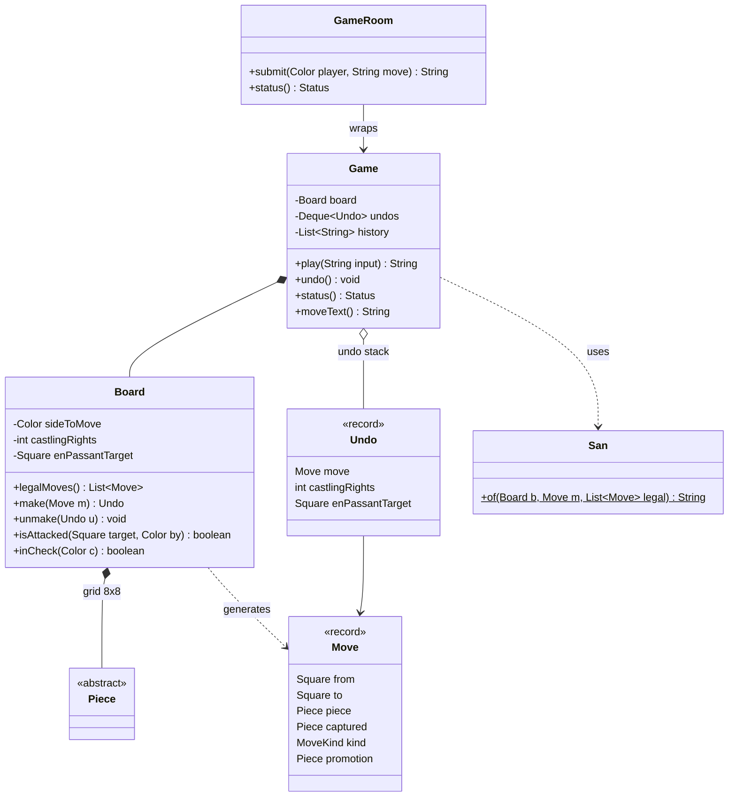
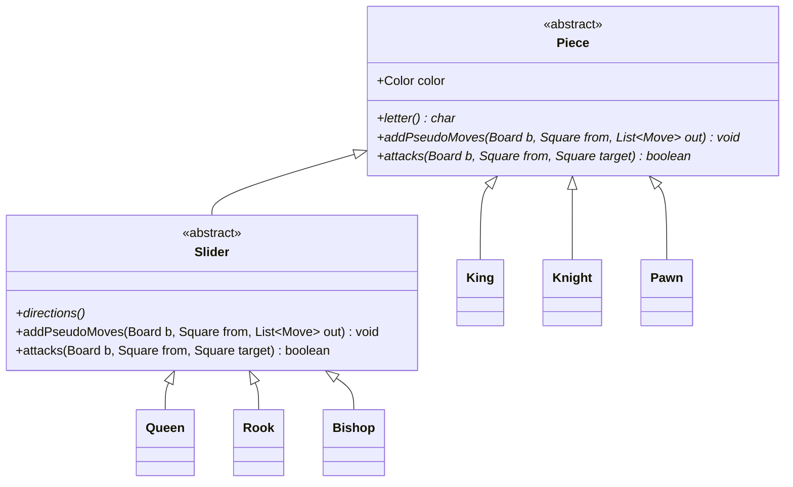
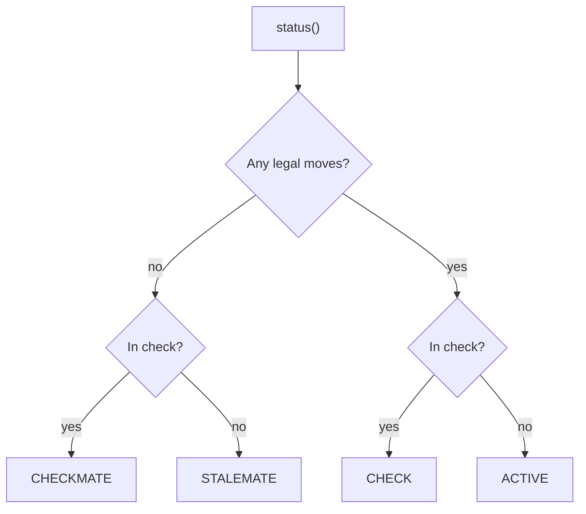

## Definition (interview-ready)

A chess game in a machine-coding round is a two-player engine core: it holds the position, says whose turn it is, accepts a move, rejects it if the rules forbid it, and reports check, checkmate or stalemate. The core entities are a `Board` (8 by 8 grid, side to move, castling rights, en-passant square), an abstract `Piece` with `King`, `Knight`, `Pawn` and a `Slider` base for queen, rook and bishop, an immutable `Move` record, and a `Game` that owns turn order, history and undo. Each piece generates its own moves (polymorphism, with Template Method for sliders). Legality uses **make/unmake**: play the move on the board, see whether your own king is attacked, take it back. Each `Move` plus an `Undo` snapshot is a Command that can be reversed, which gives undo for free.

**One-liner:** Pieces generate pseudo-legal moves polymorphically, the board filters them by making each move and checking whether the mover's king is attacked, and a stack of reversible moves gives check, mate, stalemate, notation and undo.

## Problem statement

> Design and implement a chess game for two human players on one board.
>
> - The game starts from the standard position. White moves first and players alternate.
> - A player submits a move. Reject moves that break the rules, including any move that leaves the player's own king in check.
> - After each move, report whether the side to move is in **check**, **checkmated** or **stalemated**. No moves are allowed once the game is over.
> - Support the special moves: **castling**, **en passant** and **pawn promotion**.
> - Keep the move history in **standard chess notation** (like `Nf3`, `exd5`, `O-O`, `Qh4#`) and allow **undo** of the last move.
> - Write a demo `main` and tests that prove the rules work on known positions.

This is a favourite because the rules are familiar but full of traps: a "valid" knight move that exposes your king, castling through an attacked square, en passant that is only legal for one move. Interviewers want to see where you put each rule. The [Machine Coding Rounds strategy note](/learn/notes/machine-coding-strategy/) covers the time plan; this note gives you a design you can finish in 90 minutes and defend rule by rule.

## Clarifying questions to ask

Write the answers as a comment at the top of your file.

| Question | Assumed answer |
|---|---|
| Is there a UI or network? | No. In-memory engine driven by `main` and tests. One small thread-safe wrapper shows how a server would share a game. |
| How are moves entered? | Standard algebraic notation (`Nf3`, `e8=Q`) or coordinates (`g1f3`, `e7e8q`). Both map to the same `Move`. |
| Must we implement castling, en passant and promotion? | Yes (they are short once make/unmake exists). If time is short, scope them as extensions; the hooks are shown below. |
| Which draws? | Stalemate only. Fifty-move rule, threefold repetition, insufficient material and agreed draws are extensions. |
| Clocks, resignation, AI opponent? | Out of scope; mention as extensions. |
| Can we start from any position? | Yes, from a FEN string (Forsyth–Edwards Notation, the standard one-line text format for a chess position). Tests need this. |
| Undo how far? | Any number of moves, back to the start. |
| Performance target? | Correctness first. A simple 8 by 8 array is fine; bitboards are an optimisation to mention, not build. |

## Requirements

**Functional (in scope)**

1. Standard start position, or any position from FEN.
2. Turn handling: only the side to move can move; turns alternate.
3. Move generation for all six piece types, including castling, en passant and promotion to queen, rook, bishop or knight.
4. Reject illegal moves, including any move that leaves your own king in check (pins, moving into check, ignoring a check).
5. Status after every move: active, check, checkmate, stalemate. No moves after the game ends.
6. History in standard algebraic notation (SAN) with `+` and `#`, and unlimited undo.

**Non-functional**

- Correct on tricky positions: verified by perft (counting all legal move sequences to a fixed depth and comparing with published numbers).
- Extensible: a new piece type or rule touches one class.
- Testable: positions are built from FEN, no randomness, no global state.

**Out of scope:** clocks, draw rules other than stalemate, AI, network play, PGN file import. Each appears in [Extensions](#extensions-interviewers-ask-for).

## Entities and relationships

```text
  Game ───────────────────────────────────────────────┐
   │ board: Board                                      │  play(text) -> SAN, undo(), status(), moveText()
   │ undos: Deque of Board.Undo   (stack of commands)  │
   │ history: List of SAN strings                      │
   └──────────┬────────────────────────────────────────┘
              │ uses                         San (notation, static helper)
              ▼
  Board  grid: Piece[8][8], sideToMove, castlingRights, enPassantTarget
   │  legalMoves()  make(Move) -> Undo  unmake(Undo)  isAttacked(sq, by)  inCheck(color)
   │
   ◆── 0..32 «sealed abstract» Piece (color)
                 ├ King      addStepMoves + castling
                 ├ Knight    addStepMoves
                 ├ Pawn      pushes, captures, en passant, promotion
                 └ «sealed abstract» Slider (directions)   ← Template Method
                        ├ Queen  ├ Rook  └ Bishop

  Move(from, to, piece, captured, kind, promotion)   MoveKind { NORMAL, DOUBLE_PUSH, EN_PASSANT,
  Board.Undo(move, castlingRights, enPassantTarget)             CASTLE_KINGSIDE, CASTLE_QUEENSIDE, PROMOTION }
  Square(file, rank)   Color { WHITE, BLACK }   Status { ACTIVE, CHECK, CHECKMATE, STALEMATE }
  GameRoom ──wraps──► Game   (synchronized: "is it my turn? then play")
```

The game side as a class diagram. `Game` keeps a stack of `Undo` records and asks `Board` for legal moves:



The pieces. `Slider` is the Template Method: `Queen`, `Rook` and `Bishop` only supply their directions:



How `Game.status()` decides the result for the side to move:



- `Board` **has** pieces (composition). A piece does not know its own square; the board passes `from` in. That keeps pieces tiny and makes make/unmake a matter of moving references in the grid.
- `Move` is an immutable record that **refers to** the moving piece, the captured piece and the promotion piece, so it carries everything needed to reverse it.
- `Game` **depends on** `Board` and `San`; `GameRoom` wraps a `Game` for multi-threaded access.

## Design patterns used and why

| Pattern | Where | Why it earns its place |
|---|---|---|
| **Polymorphism (replace conditional)** | `Piece.addPseudoMoves` and `Piece.attacks` | No `switch (pieceType)` in the board. Each piece knows how it moves; adding a fairy piece is one new class. This is the Open/Closed principle from [SOLID](/learn/notes/solid-principles/). |
| **Template Method** | `Slider` implements the ray walk once; `Queen`, `Rook`, `Bishop` only return `directions()` | The three sliders differ only in data. See [Template Method](/learn/notes/behavioral-patterns/). |
| **Command (with undo)** | `Move` + `Board.Undo`, pushed on a stack by `Game` | A move is an object that can be executed (`make`) and reversed (`unmake`). The same mechanism powers legality checks, check/mate detection and the user-facing undo. See [Command](/learn/notes/behavioral-patterns/). |
| **Memento-lite** | `Board.Undo` stores castling rights and the en-passant square | Some state can't be recomputed from the move alone (were castling rights already lost?), so we snapshot just those two fields. |
| **Factory** | `Piece.fromFen(char)` | One place maps a letter to a class; FEN parsing and tests never call piece constructors directly. See [Creational Patterns](/learn/notes/creational-patterns/). |
| **Sealed hierarchy** | `sealed Piece permits King, Knight, Pawn, Slider` | The compiler knows the full set of pieces; a pattern-matching `switch` over pieces would be checked for exhaustiveness. |

**Why not State for the game status?** Status is derived from the position (any legal moves? in check?), so it is computed, not stored. Storing it creates a second source of truth that undo would also need to restore. An enum returned by `status()` is enough.

**How to say it in an interview:** "Pieces generate pseudo-legal moves polymorphically. The board filters them by making each move and asking whether my king is attacked, then unmaking it. Moves are reversible commands, so check, checkmate, stalemate and undo all fall out of make and unmake."

## Solution walkthrough

Build it in this order. After each step you can run something.

### Step 1: squares, moves and colours

```java
/** file 0..7 = a..h, rank 0..7 = 1..8. */
record Square(int file, int rank) {
    Square plus(int df, int dr) {                 // null if off the board
        int f = file + df, r = rank + dr;
        return f >= 0 && f < 8 && r >= 0 && r < 8 ? new Square(f, r) : null;
    }
    @Override public String toString() { return "" + fileChar() + rankChar(); }
}

enum MoveKind { NORMAL, DOUBLE_PUSH, EN_PASSANT, CASTLE_KINGSIDE, CASTLE_QUEENSIDE, PROMOTION }

record Move(Square from, Square to, Piece piece, Piece captured, MoveKind kind, Piece promotion) { ... }
```

`Square.plus` returning `null` off the board keeps every piece's loop short: walk until `null`. The `Move` stores the captured piece and the kind, because `unmake` must put back exactly what was there. For en passant, `captured` is the pawn beside the moving pawn, not a piece on the target square.

### Step 2: pieces generate their own moves

```java
abstract sealed class Piece permits King, Knight, Pawn, Slider {
    final Color color;
    abstract char letter();                                              // K Q R B N P
    abstract void addPseudoMoves(Board b, Square from, List<Move> out);  // may leave own king in check
    abstract boolean attacks(Board b, Square from, Square target);       // for check detection
}
```

Two methods, two jobs. `addPseudoMoves` follows the piece's movement rules but ignores pins and checks ("pseudo-legal"). `attacks` answers "does this piece hit that square?", which is what check detection needs. They differ for the pawn: it moves straight but attacks diagonally, even onto an empty square.

The three sliders share one ray walk (Template Method):

```java
abstract sealed class Slider extends Piece permits Queen, Rook, Bishop {
    abstract int[][] directions();

    @Override void addPseudoMoves(Board b, Square from, List<Move> out) {
        for (int[] d : directions()) {
            for (Square to = from.plus(d[0], d[1]); to != null; to = to.plus(d[0], d[1])) {
                Piece target = b.at(to);
                if (target == null) { out.add(new Move(from, to, this, null)); continue; }
                if (target.color != color) out.add(new Move(from, to, this, target));
                break;                                           // blocked either way
            }
        }
    }
}

final class Rook extends Slider {
    static final int[][] DIRS = {{1, 0}, {-1, 0}, {0, 1}, {0, -1}};
    int[][] directions() { return DIRS; }
}
```

`Knight` and `King` share `addStepMoves(b, from, offsets, out)`: one jump per offset, onto an empty or enemy square.

### Step 3: the pawn, including en passant and promotion

```java
void addPseudoMoves(Board b, Square from, List<Move> out) {
    Square one = from.plus(0, dir());
    if (one != null && b.at(one) == null) {
        addAdvance(from, one, null, out);
        Square two = from.plus(0, 2 * dir());
        boolean onStartRank = from.rank() == (color == Color.WHITE ? 1 : 6);
        if (onStartRank && b.at(two) == null) out.add(new Move(from, two, this, null, MoveKind.DOUBLE_PUSH, null));
    }
    for (int df : new int[]{-1, 1}) {
        Square to = from.plus(df, dir());
        if (to == null) continue;
        Piece target = b.at(to);
        if (target != null && target.color != color) addAdvance(from, to, target, out);
        else if (target == null && to.equals(b.enPassantTarget()))
            out.add(new Move(from, to, this, b.at(new Square(to.file(), from.rank())), MoveKind.EN_PASSANT, null));
    }
}
```

- The double push is only tried when the single step is empty, so a pawn can't jump over a blocker.
- **En passant:** the board remembers the square a pawn just skipped over (`enPassantTarget`). It is set only by a double push and cleared by every other move, which is exactly the rule that the capture must happen on the very next move.
- **Promotion:** `addAdvance` turns a move to the last rank into four moves (queen, rook, bishop, knight). Underpromotion is just another legal move.

### Step 4: make and unmake

```java
Undo make(Move m) {
    Undo undo = new Undo(m, castlingRights, enPassantTarget);
    set(m.from(), null);
    if (m.kind() == MoveKind.EN_PASSANT) set(new Square(m.to().file(), m.from().rank()), null);
    set(m.to(), m.promotion() != null ? m.promotion() : m.piece());
    int r = m.from().rank();
    if (m.kind() == MoveKind.CASTLE_KINGSIDE)  moveRook(new Square(7, r), new Square(5, r));
    if (m.kind() == MoveKind.CASTLE_QUEENSIDE) moveRook(new Square(0, r), new Square(3, r));
    castlingRights &= ~(rightsLostBy(m.from()) | rightsLostBy(m.to()));
    enPassantTarget = m.kind() == MoveKind.DOUBLE_PUSH
            ? new Square(m.from().file(), (m.from().rank() + m.to().rank()) / 2) : null;
    sideToMove = sideToMove.opposite();
    return undo;
}
```

`unmake` reverses each line: put the moving piece back on `from` (this also undoes a promotion, because the pawn object is in the move), put `captured` back (beside the target for en passant), move the rook back after castling, and restore castling rights and the en-passant square from the snapshot.

Castling rights are a 4-bit mask (white kingside, white queenside, black kingside, black queenside). `rightsLostBy` is a neat trick: **moving from or capturing on** `e1`, `a1`, `h1`, `e8`, `a8` or `h8` clears the matching bits. That single line handles "king moved", "rook moved" and "rook was captured on its home square".

### Step 5: legality by make/unmake

```java
List<Move> legalMoves() {
    List<Move> pseudo = ...;                        // every piece of the side to move adds its moves
    List<Move> legal = new ArrayList<>();
    for (Move m : pseudo) {
        Undo u = make(m);
        if (!inCheck(m.piece().color)) legal.add(m);
        unmake(u);
    }
    return legal;
}
```

This one filter catches every "leaves own king in check" case without special code: moving a pinned piece, moving the king onto an attacked square, ignoring a check, and even the rare en-passant capture that removes two pawns from a rank and exposes the king to a rook. `inCheck` finds the king and calls `isAttacked`, which asks every enemy piece `attacks(...)` — polymorphism again.

### Step 6: castling

Castling is generated by `King`, with the rules the make/unmake filter can't see:

```java
if (!from.equals(new Square(4, r)) || b.isAttacked(from, color.opposite())) return; // not out of check
...
private boolean canCastle(Board b, int r, boolean kingside) {
    if (!b.hasCastlingRight(color, kingside)) return false;                 // king or rook has moved
    if (!(b.at(new Square(kingside ? 7 : 0, r)) instanceof Rook rook) || rook.color != color) return false;
    int[] between = kingside ? new int[]{5, 6} : new int[]{1, 2, 3};       // must be empty
    for (int f : between) if (b.at(new Square(f, r)) != null) return false;
    int[] kingPath = kingside ? new int[]{5, 6} : new int[]{3, 2};         // crossed and landing squares
    for (int f : kingPath) if (b.isAttacked(new Square(f, r), color.opposite())) return false;
    return true;
}
```

Per the FIDE Laws of Chess (Article 3.8): the king and rook must not have moved, the squares between them must be empty, and the king may not castle out of check, through an attacked square, or into check. For queenside castling the b-file square must be empty but **may** be attacked, because the king never crosses it. There's no infinite recursion: `isAttacked` calls `King.attacks`, which never looks at castling.

### Step 7: notation (SAN)

`San.of(board, move, legalMoves)` builds standard algebraic notation as defined in the PGN standard (section 8.2.3):

- Piece letter (none for pawns), then `x` for a capture, then the target square. Pawn captures start with the pawn's file: `exd6`.
- **Disambiguation** when two pieces of the same type can reach the same square: add the from-file if that is enough, otherwise the from-rank, otherwise the full square (`Nbd2`, `R1a3`, `Qh4e1`).
- `O-O`, `O-O-O` (capital letter O), promotion as `=Q`.
- Suffix `+` for check, `#` for checkmate. We find out by making the move, checking, and unmaking it.

### Step 8: the game

```java
String play(String input) {
    Status s = status();
    if (s == Status.CHECKMATE || s == Status.STALEMATE) throw new IllegalMoveException("game over: " + s);
    String wanted = input.trim().replace('0', 'O').replaceAll("[+#!?]", "");
    List<Move> legal = board.legalMoves();
    for (Move m : legal) {
        String san = San.of(board, m, legal);
        if (m.uci().equals(input.trim()) || san.replaceAll("[+#]", "").equals(wanted)) {
            undos.push(board.make(m));
            history.add(san);
            return san;
        }
    }
    throw new IllegalMoveException("illegal move for " + turn() + ": " + input);
}
```

**Turn handling** is implicit and therefore impossible to get wrong: the board only generates moves for `sideToMove`, so a black move on white's turn simply isn't in the legal list. **Status** is derived: no legal moves and in check is checkmate; no legal moves and not in check is stalemate (FIDE Articles 5.1 and 5.2). **Undo** pops the stack and unmakes.

## Full solution code

One file, `Main.java`, Java 21. Compile and run with `javac Main.java && java Main`.

```java run
import java.util.*;

// ============================== Basics ==============================

enum Color {
    WHITE, BLACK;
    Color opposite() { return this == WHITE ? BLACK : WHITE; }
}

/** file 0..7 = a..h, rank 0..7 = 1..8. */
record Square(int file, int rank) {
    Square {
        if (file < 0 || file > 7 || rank < 0 || rank > 7) throw new IllegalArgumentException("off board");
    }
    static Square of(String s) {
        if (s.length() != 2) throw new IllegalArgumentException("bad square " + s);
        return new Square(s.charAt(0) - 'a', s.charAt(1) - '1');
    }
    /** The square (df, dr) away, or null if that is off the board. */
    Square plus(int df, int dr) {
        int f = file + df, r = rank + dr;
        return f >= 0 && f < 8 && r >= 0 && r < 8 ? new Square(f, r) : null;
    }
    char fileChar() { return (char) ('a' + file); }
    char rankChar() { return (char) ('1' + rank); }
    @Override public String toString() { return "" + fileChar() + rankChar(); }
}

enum MoveKind { NORMAL, DOUBLE_PUSH, EN_PASSANT, CASTLE_KINGSIDE, CASTLE_QUEENSIDE, PROMOTION }

/** Everything needed to make AND unmake the move. captured is the en-passant pawn for EN_PASSANT. */
record Move(Square from, Square to, Piece piece, Piece captured, MoveKind kind, Piece promotion) {
    Move(Square from, Square to, Piece piece, Piece captured) {
        this(from, to, piece, captured, MoveKind.NORMAL, null);
    }
    String uci() {
        return "" + from + to + (promotion == null ? "" : Character.toLowerCase(promotion.letter()));
    }
}

class IllegalMoveException extends RuntimeException {
    IllegalMoveException(String msg) { super(msg); }
}

// ============================== Pieces (polymorphic move generation) ==============================

abstract sealed class Piece permits King, Knight, Pawn, Slider {
    final Color color;
    Piece(Color color) { this.color = color; }

    /** SAN letter: K Q R B N, and P for pawns (never printed). */
    abstract char letter();
    /** Moves that follow the piece's movement rules; may leave the own king in check. */
    abstract void addPseudoMoves(Board b, Square from, List<Move> out);
    /** Does this piece, standing on from, attack target? Used for check detection. */
    abstract boolean attacks(Board b, Square from, Square target);

    char fenChar() { return color == Color.WHITE ? letter() : Character.toLowerCase(letter()); }

    static Piece fromFen(char c) {
        Color color = Character.isUpperCase(c) ? Color.WHITE : Color.BLACK;
        return switch (Character.toLowerCase(c)) {
            case 'k' -> new King(color);
            case 'q' -> new Queen(color);
            case 'r' -> new Rook(color);
            case 'b' -> new Bishop(color);
            case 'n' -> new Knight(color);
            case 'p' -> new Pawn(color);
            default -> throw new IllegalArgumentException("bad piece " + c);
        };
    }

    /** Shared by King and Knight: one jump per offset. */
    void addStepMoves(Board b, Square from, int[][] offsets, List<Move> out) {
        for (int[] d : offsets) {
            Square to = from.plus(d[0], d[1]);
            if (to == null) continue;
            Piece target = b.at(to);
            if (target == null || target.color != color) out.add(new Move(from, to, this, target));
        }
    }
    static boolean stepAttacks(Square from, Square target, int[][] offsets) {
        for (int[] d : offsets)
            if (target.equals(from.plus(d[0], d[1]))) return true;
        return false;
    }
}

/** Template Method: queen, rook and bishop differ only in their directions. */
abstract sealed class Slider extends Piece permits Queen, Rook, Bishop {
    Slider(Color color) { super(color); }
    abstract int[][] directions();

    @Override void addPseudoMoves(Board b, Square from, List<Move> out) {
        for (int[] d : directions()) {
            for (Square to = from.plus(d[0], d[1]); to != null; to = to.plus(d[0], d[1])) {
                Piece target = b.at(to);
                if (target == null) { out.add(new Move(from, to, this, null)); continue; }
                if (target.color != color) out.add(new Move(from, to, this, target));
                break;                                           // blocked either way
            }
        }
    }
    @Override boolean attacks(Board b, Square from, Square target) {
        for (int[] d : directions())
            for (Square s = from.plus(d[0], d[1]); s != null; s = s.plus(d[0], d[1])) {
                if (s.equals(target)) return true;
                if (b.at(s) != null) break;
            }
        return false;
    }
}

final class Rook extends Slider {
    static final int[][] DIRS = {{1, 0}, {-1, 0}, {0, 1}, {0, -1}};
    Rook(Color c) { super(c); }
    char letter() { return 'R'; }
    int[][] directions() { return DIRS; }
}

final class Bishop extends Slider {
    static final int[][] DIRS = {{1, 1}, {1, -1}, {-1, 1}, {-1, -1}};
    Bishop(Color c) { super(c); }
    char letter() { return 'B'; }
    int[][] directions() { return DIRS; }
}

final class Queen extends Slider {
    static final int[][] DIRS = {{1, 0}, {-1, 0}, {0, 1}, {0, -1}, {1, 1}, {1, -1}, {-1, 1}, {-1, -1}};
    Queen(Color c) { super(c); }
    char letter() { return 'Q'; }
    int[][] directions() { return DIRS; }
}

final class Knight extends Piece {
    static final int[][] JUMPS = {{1, 2}, {2, 1}, {2, -1}, {1, -2}, {-1, -2}, {-2, -1}, {-2, 1}, {-1, 2}};
    Knight(Color c) { super(c); }
    char letter() { return 'N'; }
    void addPseudoMoves(Board b, Square from, List<Move> out) { addStepMoves(b, from, JUMPS, out); }
    boolean attacks(Board b, Square from, Square target) { return stepAttacks(from, target, JUMPS); }
}

final class King extends Piece {
    King(Color c) { super(c); }
    char letter() { return 'K'; }

    void addPseudoMoves(Board b, Square from, List<Move> out) {
        addStepMoves(b, from, Queen.DIRS, out);
        int r = color == Color.WHITE ? 0 : 7;
        if (!from.equals(new Square(4, r)) || b.isAttacked(from, color.opposite())) return; // not out of check
        if (canCastle(b, r, true))  out.add(new Move(from, new Square(6, r), this, null, MoveKind.CASTLE_KINGSIDE, null));
        if (canCastle(b, r, false)) out.add(new Move(from, new Square(2, r), this, null, MoveKind.CASTLE_QUEENSIDE, null));
    }
    private boolean canCastle(Board b, int r, boolean kingside) {
        if (!b.hasCastlingRight(color, kingside)) return false;
        if (!(b.at(new Square(kingside ? 7 : 0, r)) instanceof Rook rook) || rook.color != color) return false;
        int[] between = kingside ? new int[]{5, 6} : new int[]{1, 2, 3};
        for (int f : between) if (b.at(new Square(f, r)) != null) return false;
        int[] kingPath = kingside ? new int[]{5, 6} : new int[]{3, 2};  // crossed and landing squares
        for (int f : kingPath) if (b.isAttacked(new Square(f, r), color.opposite())) return false;
        return true;
    }
    boolean attacks(Board b, Square from, Square target) { return stepAttacks(from, target, Queen.DIRS); }
}

final class Pawn extends Piece {
    Pawn(Color c) { super(c); }
    char letter() { return 'P'; }
    private int dir() { return color == Color.WHITE ? 1 : -1; }

    void addPseudoMoves(Board b, Square from, List<Move> out) {
        Square one = from.plus(0, dir());
        if (one != null && b.at(one) == null) {
            addAdvance(from, one, null, out);
            Square two = from.plus(0, 2 * dir());
            boolean onStartRank = from.rank() == (color == Color.WHITE ? 1 : 6);
            if (onStartRank && b.at(two) == null) out.add(new Move(from, two, this, null, MoveKind.DOUBLE_PUSH, null));
        }
        for (int df : new int[]{-1, 1}) {
            Square to = from.plus(df, dir());
            if (to == null) continue;
            Piece target = b.at(to);
            if (target != null && target.color != color) addAdvance(from, to, target, out);
            else if (target == null && to.equals(b.enPassantTarget()))
                out.add(new Move(from, to, this, b.at(new Square(to.file(), from.rank())), MoveKind.EN_PASSANT, null));
        }
    }
    /** A move to the last rank becomes four moves, one per promotion piece. */
    private void addAdvance(Square from, Square to, Piece captured, List<Move> out) {
        if (to.rank() != 0 && to.rank() != 7) { out.add(new Move(from, to, this, captured)); return; }
        for (Piece p : List.of(new Queen(color), new Rook(color), new Bishop(color), new Knight(color)))
            out.add(new Move(from, to, this, captured, MoveKind.PROMOTION, p));
    }
    boolean attacks(Board b, Square from, Square target) {
        return target.rank() - from.rank() == dir() && Math.abs(target.file() - from.file()) == 1;
    }
}

// ============================== Board: position + make/unmake ==============================

final class Board {
    static final String START_FEN = "rnbqkbnr/pppppppp/8/8/8/8/PPPPPPPP/RNBQKBNR w KQkq - 0 1";
    private static final int WK = 1, WQ = 2, BK = 4, BQ = 8;

    /** Snapshot of what a move destroys, so unmake can restore it exactly. */
    record Undo(Move move, int castlingRights, Square enPassantTarget) {}

    private final Piece[][] grid = new Piece[8][8];        // [file][rank]
    private Color sideToMove = Color.WHITE;
    private int castlingRights;
    private Square enPassantTarget;                        // square skipped by the last double push

    static Board fromFen(String fen) {
        String[] f = fen.trim().split("\\s+");
        Board b = new Board();
        String[] rows = f[0].split("/");
        for (int i = 0; i < 8; i++) {
            int file = 0;
            for (char c : rows[i].toCharArray()) {
                if (Character.isDigit(c)) file += c - '0';
                else b.grid[file++][7 - i] = Piece.fromFen(c);
            }
        }
        b.sideToMove = f[1].equals("w") ? Color.WHITE : Color.BLACK;
        for (char c : f[2].toCharArray())
            b.castlingRights |= switch (c) { case 'K' -> WK; case 'Q' -> WQ; case 'k' -> BK; case 'q' -> BQ; default -> 0; };
        b.enPassantTarget = f[3].equals("-") ? null : Square.of(f[3]);
        return b;
    }

    Piece at(Square s) { return grid[s.file()][s.rank()]; }
    private void set(Square s, Piece p) { grid[s.file()][s.rank()] = p; }
    Color sideToMove() { return sideToMove; }
    Square enPassantTarget() { return enPassantTarget; }
    boolean hasCastlingRight(Color c, boolean kingside) {
        int bit = c == Color.WHITE ? (kingside ? WK : WQ) : (kingside ? BK : BQ);
        return (castlingRights & bit) != 0;
    }

    boolean isAttacked(Square target, Color by) {
        for (int f = 0; f < 8; f++)
            for (int r = 0; r < 8; r++) {
                Piece p = grid[f][r];
                if (p != null && p.color == by && p.attacks(this, new Square(f, r), target)) return true;
            }
        return false;
    }
    boolean inCheck(Color c) {
        for (int f = 0; f < 8; f++)
            for (int r = 0; r < 8; r++)
                if (grid[f][r] instanceof King k && k.color == c) return isAttacked(new Square(f, r), c.opposite());
        throw new IllegalStateException("no " + c + " king");
    }

    /** Generate pseudo-legal moves, then keep those that don't leave our own king in check. */
    List<Move> legalMoves() {
        List<Move> pseudo = new ArrayList<>();
        for (int f = 0; f < 8; f++)
            for (int r = 0; r < 8; r++) {
                Piece p = grid[f][r];
                if (p != null && p.color == sideToMove) p.addPseudoMoves(this, new Square(f, r), pseudo);
            }
        List<Move> legal = new ArrayList<>();
        for (Move m : pseudo) {
            Undo u = make(m);
            if (!inCheck(m.piece().color)) legal.add(m);
            unmake(u);
        }
        return legal;
    }

    Undo make(Move m) {
        Undo undo = new Undo(m, castlingRights, enPassantTarget);
        set(m.from(), null);
        if (m.kind() == MoveKind.EN_PASSANT) set(new Square(m.to().file(), m.from().rank()), null);
        set(m.to(), m.promotion() != null ? m.promotion() : m.piece());
        int r = m.from().rank();
        if (m.kind() == MoveKind.CASTLE_KINGSIDE)  moveRook(new Square(7, r), new Square(5, r));
        if (m.kind() == MoveKind.CASTLE_QUEENSIDE) moveRook(new Square(0, r), new Square(3, r));
        castlingRights &= ~(rightsLostBy(m.from()) | rightsLostBy(m.to()));
        enPassantTarget = m.kind() == MoveKind.DOUBLE_PUSH
                ? new Square(m.from().file(), (m.from().rank() + m.to().rank()) / 2) : null;
        sideToMove = sideToMove.opposite();
        return undo;
    }

    void unmake(Undo u) {
        Move m = u.move();
        sideToMove = sideToMove.opposite();
        castlingRights = u.castlingRights();
        enPassantTarget = u.enPassantTarget();
        set(m.from(), m.piece());                              // also undoes a promotion
        if (m.kind() == MoveKind.EN_PASSANT) {
            set(m.to(), null);
            set(new Square(m.to().file(), m.from().rank()), m.captured());
        } else {
            set(m.to(), m.captured());
        }
        int r = m.from().rank();
        if (m.kind() == MoveKind.CASTLE_KINGSIDE)  moveRook(new Square(5, r), new Square(7, r));
        if (m.kind() == MoveKind.CASTLE_QUEENSIDE) moveRook(new Square(3, r), new Square(0, r));
    }

    private void moveRook(Square from, Square to) { set(to, at(from)); set(from, null); }

    /** Moving from, or capturing on, a king or rook home square loses the matching rights. */
    private static int rightsLostBy(Square s) {
        return switch (s.toString()) {
            case "e1" -> WK | WQ; case "h1" -> WK; case "a1" -> WQ;
            case "e8" -> BK | BQ; case "h8" -> BK; case "a8" -> BQ;
            default -> 0;
        };
    }

    @Override public String toString() {
        StringBuilder sb = new StringBuilder();
        for (int r = 7; r >= 0; r--) {
            sb.append(r + 1).append(' ');
            for (int f = 0; f < 8; f++) sb.append(grid[f][r] == null ? '.' : grid[f][r].fenChar()).append(f < 7 ? " " : "\n");
        }
        return sb.append("  a b c d e f g h").toString();
    }
}

// ============================== Notation ==============================

final class San {
    private San() {}

    static String of(Board b, Move m, List<Move> legal) {
        String s = switch (m.kind()) {
            case CASTLE_KINGSIDE -> "O-O";
            case CASTLE_QUEENSIDE -> "O-O-O";
            default -> body(m, legal);
        };
        Board.Undo u = b.make(m);                               // peek ahead for + or #
        if (b.inCheck(b.sideToMove())) s += b.legalMoves().isEmpty() ? "#" : "+";
        b.unmake(u);
        return s;
    }

    private static String body(Move m, List<Move> legal) {
        StringBuilder sb = new StringBuilder();
        boolean capture = m.captured() != null;
        if (m.piece() instanceof Pawn) {
            if (capture) sb.append(m.from().fileChar());
        } else {
            sb.append(m.piece().letter());
            List<Move> rivals = legal.stream()
                    .filter(o -> o.to().equals(m.to()) && !o.from().equals(m.from())
                            && o.piece().letter() == m.piece().letter())
                    .toList();
            if (!rivals.isEmpty()) {                            // PGN rule: file, else rank, else both
                boolean fileShared = rivals.stream().anyMatch(o -> o.from().file() == m.from().file());
                boolean rankShared = rivals.stream().anyMatch(o -> o.from().rank() == m.from().rank());
                if (!fileShared) sb.append(m.from().fileChar());
                else if (!rankShared) sb.append(m.from().rankChar());
                else sb.append(m.from());
            }
        }
        if (capture) sb.append('x');
        sb.append(m.to());
        if (m.promotion() != null) sb.append('=').append(m.promotion().letter());
        return sb.toString();
    }
}

// ============================== Game: turns, status, history, undo ==============================

enum Status { ACTIVE, CHECK, CHECKMATE, STALEMATE }

final class Game {
    private final Board board;
    private final Color firstToMove;
    private final Deque<Board.Undo> undos = new ArrayDeque<>();
    private final List<String> history = new ArrayList<>();

    Game() { this(Board.START_FEN); }
    Game(String fen) { board = Board.fromFen(fen); firstToMove = board.sideToMove(); }

    Color turn() { return board.sideToMove(); }
    Board board() { return board; }
    List<String> history() { return List.copyOf(history); }

    Status status() {
        boolean check = board.inCheck(turn());
        boolean noMoves = board.legalMoves().isEmpty();
        if (noMoves) return check ? Status.CHECKMATE : Status.STALEMATE;
        return check ? Status.CHECK : Status.ACTIVE;
    }

    /** Accepts SAN ("Nf3", "exd6", "O-O", "e8=Q+") or coordinates ("g1f3", "e7e8q"). Returns the SAN played. */
    String play(String input) {
        Status s = status();
        if (s == Status.CHECKMATE || s == Status.STALEMATE) throw new IllegalMoveException("game over: " + s);
        String wanted = input.trim().replace('0', 'O').replaceAll("[+#!?]", "");
        List<Move> legal = board.legalMoves();
        for (Move m : legal) {
            String san = San.of(board, m, legal);
            if (m.uci().equals(input.trim()) || san.replaceAll("[+#]", "").equals(wanted)) {
                undos.push(board.make(m));
                history.add(san);
                return san;
            }
        }
        throw new IllegalMoveException("illegal move for " + turn() + ": " + input);
    }

    void undo() {
        if (undos.isEmpty()) throw new IllegalStateException("nothing to undo");
        board.unmake(undos.pop());
        history.remove(history.size() - 1);
    }

    /** "1. f3 e5 2. g4 Qh4#" */
    String moveText() {
        StringBuilder sb = new StringBuilder();
        int offset = firstToMove == Color.WHITE ? 0 : 1;
        if (offset == 1 && !history.isEmpty()) sb.append("1... ");
        for (int i = 0; i < history.size(); i++) {
            int ply = i + offset;
            if (ply % 2 == 0) sb.append(ply / 2 + 1).append(". ");
            sb.append(history.get(i)).append(' ');
        }
        return sb.toString().trim();
    }
}

/** One live game shared by two players' request threads. The lock makes "is it my turn? play" atomic. */
final class GameRoom {
    private final Game game;
    GameRoom(Game game) { this.game = game; }

    synchronized String submit(Color player, String move) {
        if (game.turn() != player) throw new IllegalMoveException("not " + player + "'s turn");
        return game.play(move);
    }
    synchronized Status status() { return game.status(); }
    synchronized String moveText() { return game.moveText(); }
}

// ============================== Demo ==============================

public class Main {
    public static void main(String[] args) {
        System.out.println("== Fool's mate ==");
        Game g = new Game();
        for (String m : List.of("f3", "e5", "g4", "Qh4")) {
            System.out.printf("%-5s -> %-5s status=%s%n", m, g.play(m), g.status());
        }
        System.out.println(g.moveText());
        System.out.println(g.board());
        try { g.play("a3"); } catch (IllegalMoveException e) { System.out.println("rejected: " + e.getMessage()); }
        g.undo();
        System.out.println("after undo: " + g.moveText() + ", turn=" + g.turn() + ", status=" + g.status());

        System.out.println("\n== Turn and legality ==");
        Game t = new Game();
        try { t.play("e5"); } catch (IllegalMoveException e) { System.out.println("rejected: " + e.getMessage()); }
        Game pin = new Game("4k3/4r3/8/8/8/8/4B3/4K3 w - - 0 1");
        try { pin.play("Bd3"); } catch (IllegalMoveException e) { System.out.println("pinned bishop: " + e.getMessage()); }

        System.out.println("\n== Castling, en passant, promotion ==");
        Game s = new Game();
        for (String m : List.of("e4", "Nf6", "e5", "d5", "exd6", "e6", "Nf3", "Be7", "Bc4", "O-O", "O-O")) s.play(m);
        System.out.println(s.moveText());
        System.out.println(s.board());
        Game p = new Game("8/P6k/8/8/8/8/8/K7 w - - 0 1");
        System.out.println("promotion options: " + p.board().legalMoves().stream()
                .filter(m -> m.kind() == MoveKind.PROMOTION).map(Move::uci).toList());
        System.out.println("played: " + p.play("a8=N"));

        System.out.println("\n== Stalemate ==");
        Game st = new Game("7k/5Q2/6K1/8/8/8/8/8 b - - 0 1");
        System.out.println("black to move, status=" + st.status());
    }
}
```

Demo output (real run):

```text output
== Fool's mate ==
f3    -> f3    status=ACTIVE
e5    -> e5    status=ACTIVE
g4    -> g4    status=ACTIVE
Qh4   -> Qh4#  status=CHECKMATE
1. f3 e5 2. g4 Qh4#
8 r n b . k b n r
7 p p p p . p p p
6 . . . . . . . .
5 . . . . p . . .
4 . . . . . . P q
3 . . . . . P . .
2 P P P P P . . P
1 R N B Q K B N R
  a b c d e f g h
rejected: game over: CHECKMATE
after undo: 1. f3 e5 2. g4, turn=BLACK, status=ACTIVE

== Turn and legality ==
rejected: illegal move for WHITE: e5
pinned bishop: illegal move for WHITE: Bd3

== Castling, en passant, promotion ==
1. e4 Nf6 2. e5 d5 3. exd6 e6 4. Nf3 Be7 5. Bc4 O-O 6. O-O
8 r n b q . r k .
7 p p p . b p p p
6 . . . P p n . .
5 . . . . . . . .
4 . . B . . . . .
3 . . . . . N . .
2 P P P P . P P P
1 R N B Q . R K .
  a b c d e f g h
promotion options: [a7a8q, a7a8r, a7a8b, a7a8n]
played: a8=N

== Stalemate ==
black to move, status=STALEMATE
```

Reading the output: fool's mate ends in four plies, the last SAN gets `#`, and a move after mate is rejected. Undo takes back `Qh4#` and it is Black's turn again. Black can't move first, and a bishop pinned to its king can't move. In the third game White captures en passant (`exd6`, the d5 pawn disappears) and both sides castle; the board shows rooks on f1 and f8. A pawn on the seventh rank has four promotion choices, and here it underpromotes to a knight. The last position has no legal move for Black and Black is not in check, so it's stalemate.

## Concurrency and edge cases

A chess game is inherently sequential: one move at a time, strictly alternating. So `Game` and `Board` are deliberately **not** thread-safe — make/unmake mutate the board in place, even during `legalMoves()`. That's the right call for an engine core, and it's the same reason `ArrayList` isn't synchronized.

When a server shares one game between two players' request threads, wrap it:

```java
final class GameRoom {
    synchronized String submit(Color player, String move) {
        if (game.turn() != player) throw new IllegalMoveException("not " + player + "'s turn");
        return game.play(move);
    }
}
```

The lock makes "is it my turn?" plus "play" one atomic step (otherwise two threads could both pass the turn check). Every read (`status`, `moveText`) takes the same lock, because a reader running during `legalMoves()` could see a half-made move. One lock per game is plenty: games don't share state, so a server with 10,000 games has 10,000 independent locks. More on locks in [Java Concurrency and Locks](/learn/notes/java-concurrency-locks/).

| Edge case | What could go wrong | How the design handles it |
|---|---|---|
| Moving a pinned piece | Own king left in check | make/unmake filter rejects it |
| King steps next to the enemy king | Kings adjacent | `King.attacks` covers the 8 neighbours, so the square counts as attacked |
| Castling out of, through, or into check | Illegal castle accepted | `King` checks `e`, `f`, `g` (or `e`, `d`, `c`) are not attacked |
| Rook captured on its home square | Castling with a rook that no longer exists | `rightsLostBy(m.to())` clears the right; `canCastle` also checks the rook is there |
| En passant one move late | Stale capture allowed | `enPassantTarget` is cleared by every non-double-push move |
| En passant exposing the king along a rank | Two pawns leave the rank at once | The filter makes the move (removing both) and finds the rook check |
| Promotion then undo | A queen left on the seventh rank | `unmake` puts `m.piece()` (the pawn) back on `from` |
| Moves after mate or stalemate | Game continues | `play` checks `status()` first |
| Double submission from a client retry | Same move applied twice | `GameRoom` rejects it (wrong turn); add an expected ply number to make retries idempotent |
| Unknown or garbled input | Crash | No legal move matches, so `IllegalMoveException` |

## Testing it

The best single test for a move generator is **perft** (performance test): count every legal move sequence to depth N from a position and compare with numbers published on the Chess Programming Wiki. One wrong rule (a missing en passant, a castling through check) changes the count. Kiwipete is a famous position packed with castling, pins and en passant; position 3 targets en-passant pins; position 4 targets promotions and castling.

JUnit 5 style tests (the same checks ran in the plain-Java harness described below):

```java
import static org.junit.jupiter.api.Assertions.*;
import java.util.List;
import org.junit.jupiter.api.Test;

class ChessTest {
    static long perft(Board b, int depth) {
        List<Move> moves = b.legalMoves();
        if (depth == 1) return moves.size();
        long n = 0;
        for (Move m : moves) { Board.Undo u = b.make(m); n += perft(b, depth - 1); b.unmake(u); }
        return n;
    }

    @Test void perftStartPosition() {
        assertEquals(20, perft(Board.fromFen(Board.START_FEN), 1));
        assertEquals(8902, perft(Board.fromFen(Board.START_FEN), 3));
        assertEquals(197281, perft(Board.fromFen(Board.START_FEN), 4));
    }

    @Test void perftKiwipete() {
        String kiwi = "r3k2r/p1ppqpb1/bn2pnp1/3PN3/1p2P3/2N2Q1p/PPPBBPPP/R3K2R w KQkq - 0 1";
        assertEquals(97862, perft(Board.fromFen(kiwi), 3));
    }

    @Test void foolsMate() {
        Game g = new Game();
        for (String m : List.of("f3", "e5", "g4", "Qh4")) g.play(m);
        assertEquals(Status.CHECKMATE, g.status());
        assertEquals("1. f3 e5 2. g4 Qh4#", g.moveText());
        assertThrows(IllegalMoveException.class, () -> g.play("a3"));
    }

    @Test void stalemate() {
        assertEquals(Status.STALEMATE, new Game("7k/5Q2/6K1/8/8/8/8/8 b - - 0 1").status());
    }

    @Test void onlyLegalReplyToCheckIsTheBlock() {
        Game g = new Game();
        for (String m : List.of("e4", "f5", "Qh5")) g.play(m);
        assertEquals(Status.CHECK, g.status());
        assertEquals(List.of("g7g6"), g.board().legalMoves().stream().map(Move::uci).toList());
    }

    @Test void pinnedPieceCannotMove() {
        assertThrows(IllegalMoveException.class,
                () -> new Game("4k3/4r3/8/8/8/8/4B3/4K3 w - - 0 1").play("Bd3"));
    }

    @Test void cannotCastleThroughAttackedSquare() {
        assertThrows(IllegalMoveException.class,
                () -> new Game("4k3/8/8/8/8/8/5r2/4K2R w K - 0 1").play("O-O"));
    }

    @Test void enPassantOnlyImmediatelyAndUndoRestoresPawn() {
        Game g = new Game();
        for (String m : List.of("e4", "a6", "e5", "d5")) g.play(m);
        assertEquals("exd6", g.play("exd6"));
        assertNull(g.board().at(Square.of("d5")));
        g.undo();
        assertInstanceOf(Pawn.class, g.board().at(Square.of("d5")));
        g.play("Nf3"); g.play("h6");
        assertThrows(IllegalMoveException.class, () -> g.play("exd6"));
    }

    @Test void enPassantThatExposesKingIsIllegal() {
        assertThrows(IllegalMoveException.class,
                () -> new Game("8/8/8/K2pP2r/8/8/8/7k w - d6 0 1").play("exd6"));
    }

    @Test void promotionAndNotation() {
        assertEquals("bxa8=Q+", new Game("r3k3/1P6/8/8/8/8/8/4K3 w - - 0 1").play("bxa8=Q"));
        assertEquals("Nbd2", new Game("7k/8/8/8/8/8/8/1N3N1K w - - 0 1").play("b1d2"));
        assertEquals("R1a3", new Game("7k/8/8/R7/8/8/8/R6K w - - 0 1").play("a1a3"));
    }
}
```

The plain-Java harness (`Tests.java`, compiled with `javac Main.java Tests.java` on JDK 21.0.1 and run with `java Tests`) made **116 checks, all passing on five repeated runs**:

- **Perft:** start position depths 1–4 (20, 400, 8902, 197281), Kiwipete depths 1–3 (48, 2039, 97862), position 3 depths 1–4 (14, 191, 2812, 43238), position 4 depths 1–3 (6, 264, 9467) — all matching the Chess Programming Wiki — plus a check that the board is byte-for-byte identical after a full perft (make/unmake is exact).
- **Rules:** fool's mate, scholar's mate, stalemate, check with a single legal reply, black moving first, pinned piece, king into check, castling (normal, `0-0` input, through check, out of check, blocked, queenside with an attacked b1, rights lost after the king moves and returns, right lost when the rook is captured), en passant (normal, too late, exposing the king, undo), promotion (four choices, undo, underpromotion, capture-promotion with check), SAN disambiguation by file, rank and full square, undo back to the start.
- **Concurrency:** 50 rounds of 8 threads racing to submit White's first move to one `GameRoom` (exactly one wins each time); two player threads alternating through scholar's mate on one room; four games running perft in parallel to show there is no shared static state.

## Extensions interviewers ask for

| Ask | Change | What stays untouched |
|---|---|---|
| "Skip castling, en passant and promotion for now" | Leave out `MoveKind`'s special values; `make` and `unmake` only move and capture. The hooks are `King.addPseudoMoves` (castling), `Board.enPassantTarget` plus the pawn's capture loop (en passant), and `Pawn.addAdvance` (promotion) | Legality filter, status, notation, undo |
| Fifty-move rule | Add a `halfmoveClock` to the board, reset on pawn moves and captures, stored in `Undo`; `status()` returns `DRAW_FIFTY` at 100 | Pieces |
| Threefold repetition | Keep a count of position keys (a FEN without the move counters, with the en-passant square only when a capture is really possible, or a Zobrist hash — XOR of random numbers per piece-square, updated incrementally) in a map; increment in `play`, decrement in `undo` | Pieces, notation |
| Insufficient material | A check in `status()`: K v K, K+B v K, K+N v K | Everything else |
| Chess clocks | A `ChessClock` with an injected `java.time.Clock`; `play` switches the running side; flag fall ends the game | Rules |
| Computer opponent | **Strategy**: `interface Player { Move choose(Board b, List of Move legal); }` with `HumanPlayer`, `RandomPlayer`, `MinimaxPlayer`. Minimax reuses make/unmake directly | Board, pieces |
| Online play with spectators | `GameRoom` per game; **Observer** listeners notified after each move | Engine core |
| Chess960 (random back rank) | Generalise castling to "king to g-file or c-file, rook to f or d", with the rook's start file stored per side | Other pieces |
| Speed | Replace the array scan with a cached king square, piece lists or bitboards (one 64-bit `long` per piece type and colour) | Public `Game` API |
| Save and load | `toFen()` for positions; history already holds SAN, so PGN export is `moveText()` plus headers | Rules |

## Common mistakes

1. **A giant `switch (pieceType)` in the board.** Every new rule edits that switch. Put movement on the piece.
2. **Checking only "does this piece move like that".** Without the king-safety filter, pinned pieces move and kings walk into check. Make, test, unmake.
3. **Trying to detect pins directly.** Pin detection is subtle (en passant along a rank, discovered checks). make/unmake handles all of them with one rule.
4. **Copying the whole board for every candidate move.** Works, but allocates heavily and is slow; make/unmake with a small `Undo` snapshot is the standard technique.
5. **Forgetting what can't be recomputed on undo.** Castling rights and the en-passant square must be saved, or undo produces a different position.
6. **Castling checks only "king and rook haven't moved".** Also: squares between are empty, the king is not in check, and the squares it crosses and lands on are not attacked.
7. **En passant that never expires.** The target must be cleared by every move that isn't a double push.
8. **Promotion that only allows a queen.** Underpromotion (especially to a knight) is a legal and sometimes winning move.
9. **Calling every "no legal moves" position a checkmate.** If the king isn't in check, it's stalemate, a draw.
10. **Storing `status` in a field.** It goes stale on undo. Derive it from the position.

## Practice questions

<Practice>

<QA q="Why does each piece generate its own moves instead of the board having one big switch?" level="easy">

It puts each rule next to the data it uses and follows Open/Closed: adding a piece type (or changing how one moves) touches one class, not a switch that every piece shares. The board only knows the `Piece` contract: `addPseudoMoves` and `attacks`. In Java 21 the hierarchy is `sealed`, so the compiler still knows the complete list of pieces.

</QA>

<QA q="What is a pseudo-legal move and why generate those first?" level="easy">

A move that follows the piece's movement rules but may leave your own king in check. Generating these is simple and local to each piece. Then one general filter (make, test king safety, unmake) removes the illegal ones. This separates "how pieces move" from "the king must be safe", which is a rule about the whole position, not about any one piece.

</QA>

<QA q="How do you detect checkmate and stalemate?" level="easy">

Compute the legal moves for the side to move. If there are none, look at whether that side's king is attacked: attacked means checkmate, not attacked means stalemate. If there are legal moves, it's check or an ordinary position. Status is derived from the position every time, never stored, so undo can't make it stale.

</QA>

<QA q="Why does Piece have both addPseudoMoves and attacks? Couldn't attacks reuse move generation?" level="medium">

They differ in two important ways. A pawn moves straight but attacks diagonally, and it attacks a diagonal square even when it's empty, which is what matters for "is that square safe for the king?". And king move generation includes castling, which itself asks whether squares are attacked; if `attacks` reused move generation, king attack checks would recurse into castling checks. A separate, simple `attacks` avoids both problems.

</QA>

<QA q="Walk through what make and unmake must save and restore." level="medium">

The `Move` already holds the moving piece, the captured piece, the kind and the promotion piece, so the board can be put back from it: moving piece back to `from`, captured piece back (beside the target for en passant), rook back for castling. Two things can't be recomputed: the castling rights before the move (were they already gone?) and the en-passant square before the move. Those go in the `Undo` record. The side to move just flips back.

</QA>

<QA q="How does one line handle king moves, rook moves and rook captures for castling rights?" level="medium">

`castlingRights &= ~(rightsLostBy(m.from()) | rightsLostBy(m.to()))`. Any move **from** `e1` (the king leaving) clears both white rights; from `h1` or `a1` clears one. Any move **to** `h1` or `a1` while that right still exists must capture the rook standing there, so that right goes too. Once cleared, rights never come back, which matches the rule that a king that moved and returned can't castle.

</QA>

<QA q="Give an example where the make/unmake filter catches something a simple pin check misses." level="hard">

En passant along a rank. White king on a5, white pawn e5, black pawn d5 that just double-pushed, black rook on h5. `exd6` removes **two** pieces from the fifth rank at once (e5 moves away, d5 is captured), opening the rank so the rook attacks the king. Neither pawn alone is pinned in the usual sense. The filter makes the move, sees the king attacked and rejects it. The test position is `8/8/8/K2pP2r/8/8/8/7k w - d6`.

</QA>

<QA q="What is perft and why is it the best test for a chess move generator?" level="hard">

Perft counts all legal move sequences from a position to a fixed depth. The correct counts for standard positions are published (for the start position: 20, 400, 8902, 197281 for depths 1 to 4). A missing or extra rule changes the count, so matching several test positions (Kiwipete for castling and pins, others for en passant and promotions) gives strong evidence the rules are right. It also tests make/unmake: if unmake isn't exact, later counts drift. Comparing the board before and after a full perft is a cheap extra check.

</QA>

<QA q="The engine is slow when you add a minimax AI. Where does time go and what would you change?" level="hard">

`inCheck` scans the board for the king and `isAttacked` scans all 64 squares asking every enemy piece; `legalMoves` does this for every pseudo-move, and SAN generation calls `legalMoves` again for each candidate. First fixes: track the king squares in the board (update in make/unmake), keep piece lists instead of scanning empty squares, look outward from the king for attackers instead of asking every piece, and skip SAN entirely inside search. Beyond that, bitboards: one 64-bit integer per piece type and colour, with precomputed attack tables. The `Game` API doesn't change.

</QA>

<QA q="How would you add a computer opponent without touching the rules?" level="medium">

Strategy: `interface Player { Move choose(Board board, List of Move legal); }`. A `RandomPlayer` picks any legal move; a `MinimaxPlayer` searches by calling `make`, recursing, and `unmake`, exactly like perft. The game loop asks the current player for a move and calls `play`. The rules stay in `Board` and the pieces; players only choose.

</QA>

<QA q="Interviewer: you have 30 minutes left and haven't done castling, en passant or promotion. What do you do?" level="scenario">

Say so explicitly and show the hooks. `MoveKind` already has `NORMAL`; leave the special values out. Note that castling goes in `King.addPseudoMoves` plus a rook move in `make`/`unmake`, en passant needs an `enPassantTarget` field set by double pushes and saved in `Undo`, and promotion is `Pawn.addAdvance` emitting four moves on the last rank. Then spend the time on tests (fool's mate, stalemate, pinned piece) and undo. A correct core with clearly scoped extensions beats three half-working special moves.

</QA>

<QA q="Interviewer: make it an online game. Two players' requests arrive on different threads. What breaks and how do you fix it?" level="scenario">

`Board` mutates itself even while generating legal moves, so concurrent calls corrupt it, and "check turn then play" is a check-then-act race. Wrap each game in a `GameRoom` whose methods are all `synchronized` on that room, including reads. Locks are per game, so games don't contend. For client retries, include the expected ply number in the request and reject or ignore a move for an old ply, making submission idempotent. For spectators, notify Observer listeners after the move commits, outside the lock if delivery is slow.

</QA>

<QA q="Interviewer: add threefold repetition. What exactly do you key on, and how does undo interact with it?" level="scenario">

The rule compares positions: same pieces on the same squares, same side to move, same castling rights and same en-passant possibilities. So the key is the FEN's first four fields (not the move counters), or a Zobrist hash of the same information, with one catch: include the en-passant square only when an en-passant capture is actually legal. This engine sets `enPassantTarget` after every double push, so keying on it blindly would treat two identical positions as different. Keep a map from key to count: increment after `play`, decrement on `undo` before unmaking. When a count reaches three, a player can claim a draw (FIDE Article 9.2); at five the game is drawn automatically (Article 9.6). Because the count lives in `Game` beside the undo stack, undo keeps it consistent.

</QA>

</Practice>

## Quiz

<Quiz>

<MCQ q="How does the design decide that a move leaves the mover's king in check?" options={["Each piece checks for pins before generating moves", "It makes the move on the board, tests whether the mover's king is attacked, then unmakes it", "It keeps a precomputed table of all illegal moves", "The Game class asks the opponent to reply and checks for a king capture"]} answer={1}>

The make/unmake filter is general: it catches pins, moving into check, ignoring check and the en-passant rank case with one rule. Pin detection inside pieces is error-prone, and a king-capture approach is a different (pseudo-legal) style that doesn't give legal move lists.

</MCQ>

<MCQ q="Black has no legal moves and Black's king is not attacked. What is the result?" options={["Stalemate, a draw", "Checkmate, White wins", "Black must pass", "The last White move is undone"]} answer={0}>

FIDE Article 5.2: when the player to move has no legal move and is not in check, the game is drawn by stalemate. Checkmate needs the king to be in check.

</MCQ>

<MCQ q="Which pattern does Slider use for Queen, Rook and Bishop?" options={["Decorator", "Observer", "Abstract Factory", "Template Method"]} answer={3}>

`Slider` implements the ray-walking algorithm once and leaves one step, `directions()`, to subclasses. That's Template Method. The three sliders differ only in data.

</MCQ>

<MCQ q="Why must Board.Undo store the castling rights from before the move?" options={["Because Move records are mutable", "Because Java records cannot hold integers", "Because a move can remove rights that cannot be recomputed from the move alone when taking it back", "It doesn't need to; unmake can recompute them"]} answer={2}>

After `Ke1-f1` and back, the rights are gone even though the king is home. When unmaking a move, you can't tell from the move whether rights existed before it, so you snapshot them. The same goes for the en-passant square.

</MCQ>

<MCQ q="White's king is on e1 and a black rook attacks b1 only. White has the queenside right and b1, c1, d1 are empty. Can White play O-O-O?" options={["Yes, only the squares the king crosses or lands on (d1, c1) and e1 must be safe", "No, the rook's square b1 is attacked", "No, castling is never allowed when any square on the first rank is attacked", "Only if the rook on a1 has not been attacked"]} answer={0}>

The king goes e1 to c1, crossing d1. The b1 square must be empty for the rook to pass but may be attacked. This exact case is one of the harness tests.

</MCQ>

<MCQ q="Knights on b1 and f1 can both go to d2. What is the SAN for the b1 knight's move?" options={["Nd2", "N1d2", "Nbd2", "Nb1d2"]} answer={2}>

PGN disambiguation adds the from-file if that tells the pieces apart, otherwise the rank, otherwise both. The files (b and f) differ, so `Nbd2`.

</MCQ>

<MCQ q="White plays e4-e5, Black plays d7-d5, White plays Nf3, Black plays h6. Can White now capture exd6?" options={["Yes, en passant is allowed any time later", "Yes, but only if d6 is attacked", "No, en passant only works for Black", "No, en passant is only allowed on the move immediately after the double push"]} answer={3}>

FIDE Article 3.7.3: the capture is only legal on the very next move. In the design, `enPassantTarget` is cleared by every move that isn't a double push, so the chance disappears after `Nf3`.

</MCQ>

<MCQ q="The start-position perft at depth 3 returns 8,900 instead of 8,902. What does this tell you?" options={["Nothing, perft numbers vary by engine", "A rule is missing or wrong somewhere in move generation or make/unmake", "The JVM has a floating-point error", "Depth 3 is too shallow to be meaningful"]} answer={1}>

Perft counts are exact and published. Any difference means a bug: a missing move, an extra illegal move, or an unmake that doesn't restore the position. Split the count by first move to find which branch is wrong.

</MCQ>

</Quiz>

## TL;DR cheat sheet

- **Entities:** `Board` (grid, side to move, castling bits, en-passant square), sealed `Piece` with `King`, `Knight`, `Pawn`, `Slider` (`Queen`, `Rook`, `Bishop`), `Move` record, `Board.Undo`, `Game` (history, undo stack, status), `San`.
- **Patterns:** polymorphic move generation, Template Method for sliders, Command with undo for moves, a small Memento for rights and en passant, Factory for FEN pieces, Strategy for players as an extension.
- **Legality:** pseudo-legal moves per piece, then make → is my king attacked? → unmake.
- **Status:** no legal moves + in check = checkmate; no legal moves + not in check = stalemate. Derived, never stored.
- **Special moves:** castling in `King` (rights, empty between, not out of / through / into check); en passant via a one-move target square; promotion = four moves on the last rank.
- **Notation:** SAN with file-then-rank-then-square disambiguation, `x`, `=Q`, `O-O`, `+`, `#`.
- **Tests:** perft against published counts, fool's mate, stalemate, pins, castling and en-passant edge cases, undo round trips.
- **Concurrency:** engine core is single-threaded by design; `GameRoom` with one lock per game for servers.

## Go deeper

- [FIDE Laws of Chess (castling 3.8, en passant and promotion 3.7, checkmate and stalemate 5.1–5.2, notation Appendix C)](https://handbook.fide.com/chapter/E012023)
- [Chess Programming Wiki: Perft Results](https://www.chessprogramming.org/Perft_Results)
- [Chess Programming Wiki: Forsyth-Edwards Notation](https://www.chessprogramming.org/Forsyth-Edwards_Notation)
- [Java Language Specification 21: sealed classes (8.1.1.2)](https://docs.oracle.com/javase/specs/jls/se21/html/jls-8.html#jls-8.1.1.2)
- Related notes: [Machine Coding Strategy](/learn/notes/machine-coding-strategy/), [SOLID Principles](/learn/notes/solid-principles/), [Behavioral Patterns](/learn/notes/behavioral-patterns/), [Creational Patterns](/learn/notes/creational-patterns/), [Java Concurrency and Locks](/learn/notes/java-concurrency-locks/), [LLD: Parking Lot](/learn/notes/lld-parking-lot/)
