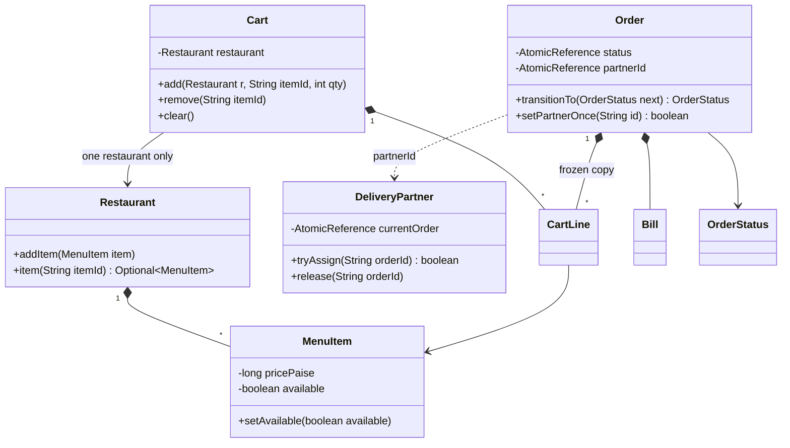
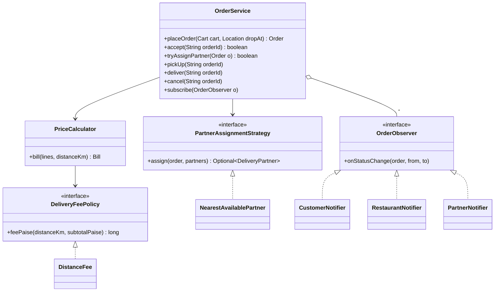
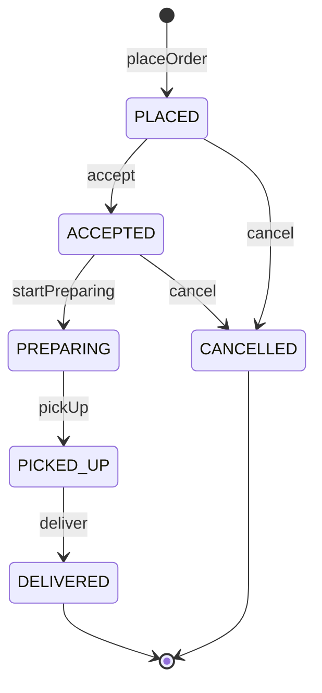

## Definition (interview-ready)

A food ordering app lets a customer fill a cart from one restaurant's menu, place an order, and follow it until a delivery partner hands it over. The core entities are a `Restaurant` with `MenuItem`s that can be switched on and off, a `Cart` that only accepts items from one restaurant, an `Order` that moves through `PLACED`, `ACCEPTED`, `PREPARING`, `PICKED_UP`, `DELIVERED` or `CANCELLED`, `DeliveryPartner`s, and an `OrderService` that runs the flow. The legal moves live in one transition table on the `OrderStatus` enum, and every change goes through a single compare-and-set, so illegal or racing moves are rejected. Partner assignment is a **Strategy** (nearest available partner by default), notifications to customer, restaurant and partner are **Observers**, and the bill (items, tax, delivery fee) comes from a `PriceCalculator` with a pluggable delivery-fee policy. Each partner is claimed with compare-and-set, so two orders can never get the same rider.

**One-liner:** A one-restaurant cart becomes an order whose status follows a transition table, a Strategy claims the nearest free rider with compare-and-set, and Observers tell the customer, restaurant and rider about every change.

## Problem statement

> Design and implement the core of a food ordering app like Swiggy or Zomato.
>
> - There are **restaurants**, each with a **menu**. The restaurant can mark an item as **out of stock** and back again at any time.
> - A customer adds items to a **cart**. A cart may only hold items from **one restaurant** at a time.
> - The customer **places an order** from the cart. The order goes through these stages: **placed, accepted by the restaurant, preparing, picked up, delivered**. It can be **cancelled** only before the food is being prepared. Any other jump (for example delivered straight from placed) must be rejected.
> - When the restaurant accepts, the system assigns a **delivery partner** — by default the **nearest available** one. A partner carries one order at a time. The assignment rule should be easy to change.
> - The **customer, restaurant and delivery partner** are told about each change that matters to them.
> - The bill shows **item total, tax and a delivery fee**. The delivery fee depends on distance and is waived on large orders.
> - Many orders are placed and accepted at the same time. Two orders must **never get the same delivery partner**.
> - Write a demo `main`.

This is the class-level (LLD) version of the problem: in-memory, single process, graded on clean classes and correct behaviour under concurrency. The system-level version — services, databases, location tracking at scale, dispatch across a city — is a different interview; see the [Food Delivery HLD note](/learn/notes/hld-food-delivery/). If the interviewer starts asking about Kafka and geo-indexes, say "that's the HLD; here I'll keep partner locations in memory and show where a geo index would plug in."

## Clarifying questions to ask

Ask these early and write the answers as a comment at the top of your file.

| Question | Assumed answer |
|---|---|
| What happens if the customer adds an item from a second restaurant? | Reject it with a clear message. The UI can then offer "clear cart and add". We never silently mix restaurants. |
| Can an item go out of stock after it is in the cart? | Yes. Check availability when adding **and again at checkout**. |
| Exactly which cancellations are allowed? | Only in `PLACED` and `ACCEPTED`. Once the kitchen starts, no cancel (refunds are out of scope). |
| Who drives the transitions? | Restaurant: accept, start preparing. Partner: pick up, deliver. Customer: cancel. We model them as service methods, not real apps. |
| When is the partner assigned? | When the restaurant accepts. If no partner is free, the order stays `ACCEPTED` and a retry assigns one later. Pick-up needs a partner. |
| How many orders can a partner carry? | One at a time (batching is an extension). |
| How is "nearest" measured? | Straight-line distance from the partner to the restaurant on a flat grid. Road distance is an extension. |
| Tax and fee rules? | Tax is a configurable percentage of the item total (5% in the demo). Delivery fee: a base fee covers the first few km, each extra started km costs more, and it is free above an order value. All configurable. |
| Money type? | Whole paise in a `long`. Never `double`. |
| Payment, coupons, ratings, persistence? | Out of scope. Mention as extensions. |

## Requirements

**Functional (in scope)**

1. Restaurants with menus; each item has a price and an availability flag the restaurant can flip.
2. Cart per customer: add, remove, clear; items from one restaurant only; reject unavailable items.
3. Place order from a non-empty cart: recheck availability, compute the bill, create the order in `PLACED`, clear the cart.
4. Order lifecycle: accept, start preparing, pick up, deliver, cancel — each validated against the transition table.
5. On accept, assign a delivery partner through a pluggable strategy (default: nearest available).
6. Notify customer, restaurant and partner on status changes.
7. Bill = item total + tax + delivery fee.

**Non-functional**

- Thread-safe: concurrent accepts never share a partner; two racing transitions on one order never both win.
- Extensible: new assignment rule, fee rule or notification channel without editing `OrderService`.
- Testable: notifications go to an injected sink; everything is in memory.

**Out of scope:** payments and refunds, coupons, live location tracking, ETAs, ratings, multi-order batching, persistence. Each appears in [Extensions](#extensions-interviewers-ask-for).

## Entities and relationships

```text
  Restaurant ◆── MenuItem 1..*  (price, volatile available)
      ▲
      │ one restaurant only
  Cart ◆── CartLine 1..* (item, qty)              Location(x, y)
      │ placeOrder()
      ▼
 ┌──────────────────────────── OrderService ─────────────────────────────┐
 │ orders:   orderId -> Order            (ConcurrentHashMap)            │
 │ partners: partnerId -> DeliveryPartner (ConcurrentHashMap)           │
 │  ◆── PriceCalculator ◆── DeliveryFeePolicy ◁── DistanceFee           │
 │  ◆── PartnerAssignmentStrategy ◁── NearestAvailablePartner           │
 │  ◆── OrderObserver 0..* ◁── CustomerNotifier, RestaurantNotifier,    │
 │                             PartnerNotifier                          │
 └───────────────────────────────────────────────────────────────────────┘
      │ creates
      ▼
  Order(id, customerId, restaurant, lines, Bill)
      ├── status:    AtomicReference<OrderStatus>   ── validated by the table on OrderStatus
      └── partnerId: AtomicReference<String> ───────► DeliveryPartner(currentOrder: AtomicReference)

  OrderStatus: PLACED → ACCEPTED → PREPARING → PICKED_UP → DELIVERED
                  └────────┴──→ CANCELLED
```

The domain classes from the full solution, with their key methods:



`OrderService` and the abstractions injected into it (Strategy and Observer):



The `OrderStatus.NEXT` table as a state machine, labelled with the service method that makes each move:



- A `Restaurant` **has** menu items; a `Cart` **refers to** one restaurant and its items.
- An `Order` **owns** a frozen copy of the cart lines and its `Bill`, so later menu changes don't alter past orders.
- An `Order` and a `DeliveryPartner` **point at each other by id**: the order records which partner it got, the partner records which order it carries.
- `OrderService` **depends on** three abstractions (pricing policy, assignment strategy, observers), all injected.

## Design patterns used and why

| Pattern | Where | Why it earns its place |
|---|---|---|
| **State machine as a transition table** | `OrderStatus.NEXT` (an `EnumMap` of allowed next states) | Six states and six arrows fit on one screen. One table is easy to read, review and test exhaustively. See the State section of [Behavioral Patterns](/learn/notes/behavioral-patterns/). |
| **Strategy** | `PartnerAssignmentStrategy`, `DeliveryFeePolicy` | "Nearest available" will change (highest rating, fewest trips today, batching). Fee rules change by city and by promotion. Each is a new class plus one line in `main`. See [Strategy](/learn/notes/behavioral-patterns/). |
| **Observer** | `OrderObserver` with three notifiers | The order flow should not know about SMS, push or a restaurant tablet. New channels subscribe without touching `OrderService`. See [Observer](/learn/notes/behavioral-patterns/). |
| **Value objects** | `Location`, `CartLine`, `Bill` as records | Immutable data is safe to share between threads and easy to compare in tests. |

### Transition table or full State pattern?

The classic State pattern gives each state its own class (`PlacedState`, `AcceptedState`, ...) with methods like `accept()` and `cancel()` that either move on or throw. That shines when **behaviour** differs a lot per state. Here, each state differs only in **which next states are allowed**, so a table is less code and shows the whole machine at a glance:

```text
from \ to     ACCEPTED  PREPARING  PICKED_UP  DELIVERED  CANCELLED
PLACED           ✔                                         ✔
ACCEPTED                   ✔                               ✔
PREPARING                             ✔
PICKED_UP                                        ✔
DELIVERED     (terminal: nothing allowed)
CANCELLED     (terminal: nothing allowed)
```

**How to say it in an interview:** "The states only differ in their allowed next states, so I'll keep the machine as one `EnumMap` table and one `transitionTo` method. If states start carrying their own behaviour — say `PREPARING` owns a kitchen timer — I'd move to State classes, and the table becomes the spec I test them against."

## Solution walkthrough

Build it in this order. Each step compiles on its own.

### Step 1: locations, money and menus

```java
record Location(double x, double y) {
    double distanceTo(Location o) { return Math.hypot(x - o.x, y - o.y); }   // km on a flat grid
}

/** Money is whole paise in a long: no floating-point rounding errors. */
final class Money {
    private Money() {}
    static String fmt(long paise) { return String.format("Rs %d.%02d", paise / 100, paise % 100); }
}
final class MenuItem {
    private final String id;
    private final String name;
    private final long pricePaise;
    private volatile boolean available = true;      // flipped by the restaurant, read by many threads

    MenuItem(String id, String name, long pricePaise) {
        if (pricePaise <= 0) throw new IllegalArgumentException("price must be positive");
        this.id = id; this.name = name; this.pricePaise = pricePaise;
    }
    String id() { return id; }
    String name() { return name; }
    long pricePaise() { return pricePaise; }
    boolean isAvailable() { return available; }
    void setAvailable(boolean available) { this.available = available; }
}

final class Restaurant {
    private final String id;
    private final String name;
    private final Location location;
    private final Map<String, MenuItem> menu = new ConcurrentHashMap<>();

    Restaurant(String id, String name, Location location) { this.id = id; this.name = name; this.location = location; }
    String id() { return id; }
    String name() { return name; }
    Location location() { return location; }
    void addItem(MenuItem item) { menu.put(item.id(), item); }
    Optional<MenuItem> item(String itemId) { return Optional.ofNullable(menu.get(itemId)); }
}
```

`Location` is a record with a straight-line distance; good enough for an interview and easy to swap for a road-distance service later. Money is **whole paise in a `long`** — `double` cannot represent 0.10 exactly, and rounding errors in bills are a classic red flag. `MenuItem.available` is `volatile` because the restaurant flips it on one thread while customers read it on others; `volatile` makes the latest write visible to every reader. Price is `final`, so a menu item's price can't change under an order that already copied it.

### Step 2: the single-restaurant cart

```java
record CartLine(MenuItem item, int quantity) {
    long totalPaise() { return item.pricePaise() * quantity; }
}

/** One customer's cart. Holds items from exactly one restaurant at a time. */
final class Cart {
    private final String customerId;
    private Restaurant restaurant;                                   // null while empty
    private final Map<String, CartLine> lines = new LinkedHashMap<>(); // itemId -> line, insertion order

    Cart(String customerId) { this.customerId = customerId; }
    String customerId() { return customerId; }
    synchronized Restaurant restaurant() { return restaurant; }
    synchronized boolean isEmpty() { return lines.isEmpty(); }

    synchronized void add(Restaurant r, String itemId, int qty) {
        if (qty <= 0) throw new IllegalArgumentException("quantity must be positive");
        if (restaurant != null && !restaurant.id().equals(r.id()))
            throw new FoodAppException("Cart has items from " + restaurant.name() + "; clear it first");
        MenuItem item = r.item(itemId).orElseThrow(() -> new FoodAppException("No item " + itemId));
        if (!item.isAvailable()) throw new ItemUnavailableException(item.name());
        restaurant = r;
        lines.merge(itemId, new CartLine(item, qty), (a, b) -> new CartLine(a.item(), a.quantity() + b.quantity()));
    }

    synchronized void remove(String itemId) {
        lines.remove(itemId);
        if (lines.isEmpty()) restaurant = null;          // empty cart can start at any restaurant
    }

    synchronized void clear() { lines.clear(); restaurant = null; }

    synchronized List<CartLine> lines() { return List.copyOf(lines.values()); }
}
```

The one-restaurant rule lives inside `add`: if the cart already belongs to another restaurant, throw. Removing the last item resets `restaurant` to `null`, so an empty cart can start anywhere. Quantities for the same item are merged. The methods are `synchronized` because one customer can tap from two devices at once; contention is per cart, so this lock is cheap. `lines()` returns a copy, so the caller can't mutate the cart through it.

### Step 3: pricing — tax and delivery fee

```java
interface DeliveryFeePolicy { long feePaise(double distanceKm, long subtotalPaise); }

/** Base fee covers the first freeKm; each extra started km costs perKm. Free above a threshold. */
record DistanceFee(long basePaise, double freeKm, long perKmPaise, long freeAbovePaise) implements DeliveryFeePolicy {
    public long feePaise(double km, long subtotal) {
        if (subtotal >= freeAbovePaise) return 0;
        long extraKm = (long) Math.ceil(Math.max(0, km - freeKm));
        return basePaise + extraKm * perKmPaise;
    }
}

record Bill(long subtotalPaise, long taxPaise, long deliveryFeePaise, long totalPaise) {
    @Override public String toString() {
        return "items " + Money.fmt(subtotalPaise) + " + tax " + Money.fmt(taxPaise)
             + " + delivery " + Money.fmt(deliveryFeePaise) + " = " + Money.fmt(totalPaise);
    }
}

final class PriceCalculator {
    private final long taxBasisPoints;              // 500 = 5%
    private final DeliveryFeePolicy deliveryFee;

    PriceCalculator(long taxBasisPoints, DeliveryFeePolicy deliveryFee) {
        this.taxBasisPoints = taxBasisPoints; this.deliveryFee = deliveryFee;
    }

    Bill bill(List<CartLine> lines, double distanceKm) {
        long subtotal = lines.stream().mapToLong(CartLine::totalPaise).sum();
        long tax = (subtotal * taxBasisPoints + 5_000) / 10_000;    // tax on food only, rounded half up
        long fee = deliveryFee.feePaise(distanceKm, subtotal);
        return new Bill(subtotal, tax, fee, subtotal + tax + fee);
    }
}
```

`PriceCalculator` does the arithmetic that every order shares; the part that varies — the delivery fee — is a `DeliveryFeePolicy` strategy. Tax uses **basis points** (1 basis point = 0.01%, so 500 = 5%) and integer maths: `(subtotal * 500 + 5000) / 10000` is "5%, rounded half up to the nearest paisa". For an item total of Rs 50.50, tax is 252.5 paise, rounded to 253. `DistanceFee` charges a base fee for the first `freeKm`, then a fee per **started** extra km (`Math.ceil`), and nothing at all above `freeAbovePaise`. Tax is on the food only here; whether the delivery fee is taxed too is a rule to confirm with the interviewer, not to guess.

### Step 4: the order state machine

```java
enum OrderStatus {
    PLACED, ACCEPTED, PREPARING, PICKED_UP, DELIVERED, CANCELLED;

    /** The whole state machine in one table. Anything not listed is illegal. */
    private static final Map<OrderStatus, Set<OrderStatus>> NEXT = new EnumMap<>(Map.of(
        PLACED,    EnumSet.of(ACCEPTED, CANCELLED),
        ACCEPTED,  EnumSet.of(PREPARING, CANCELLED),
        PREPARING, EnumSet.of(PICKED_UP),
        PICKED_UP, EnumSet.of(DELIVERED),
        DELIVERED, EnumSet.noneOf(OrderStatus.class),
        CANCELLED, EnumSet.noneOf(OrderStatus.class)));

    boolean canMoveTo(OrderStatus next) { return NEXT.get(this).contains(next); }
    boolean isTerminal() { return NEXT.get(this).isEmpty(); }
}

final class Order {
    private final String id;
    private final String customerId;
    private final Restaurant restaurant;
    private final Location dropAt;
    private final List<CartLine> lines;
    private final Bill bill;
    private final AtomicReference<OrderStatus> status = new AtomicReference<>(OrderStatus.PLACED);
    private final AtomicReference<String> partnerId = new AtomicReference<>();   // null until assigned

    Order(String id, String customerId, Restaurant restaurant, Location dropAt, List<CartLine> lines, Bill bill) {
        this.id = id; this.customerId = customerId; this.restaurant = restaurant;
        this.dropAt = dropAt; this.lines = List.copyOf(lines); this.bill = bill;
    }
    String id() { return id; }
    String customerId() { return customerId; }
    Restaurant restaurant() { return restaurant; }
    Location dropAt() { return dropAt; }
    List<CartLine> lines() { return lines; }
    Bill bill() { return bill; }
    OrderStatus status() { return status.get(); }
    String partnerId() { return partnerId.get(); }
    boolean setPartnerOnce(String id) { return partnerId.compareAndSet(null, id); }

    /** Atomic, validated transition. Returns the previous status. */
    OrderStatus transitionTo(OrderStatus next) {
        while (true) {
            OrderStatus current = status.get();
            if (!current.canMoveTo(next)) throw new IllegalTransitionException(id, current, next);
            if (status.compareAndSet(current, next)) return current;   // lost a race? re-read and re-check
        }
    }
}
```

Two things to point at:

- **The table.** `NEXT` lists every allowed move. Anything absent is illegal — that's the safe default: a new state allows nothing until you add arrows. `EnumMap` is backed by an array and `EnumSet` by a bit vector, so both are fast for enum keys.
- **The compare-and-set loop.** `transitionTo` reads the current status, checks the table, then `compareAndSet(current, next)`. If another thread changed the status in between, the CAS fails, we re-read, and **re-check the table against the new status**. So if "start preparing" and "cancel" race on an `ACCEPTED` order, one wins; the loser re-reads (now `PREPARING` or `CANCELLED`) and is rejected by the table. No lock, no lost update, and no state that skips the rules.

`partnerId` is also an `AtomicReference` with `setPartnerOnce`, so an order can't end up with two riders if two threads try to assign it at once.

### Step 5: delivery partners and the assignment strategy

```java
final class DeliveryPartner {
    private final String id;
    private final String name;
    private volatile Location location;
    private final AtomicReference<String> currentOrder = new AtomicReference<>();   // null = available

    DeliveryPartner(String id, String name, Location location) { this.id = id; this.name = name; this.location = location; }
    String id() { return id; }
    String name() { return name; }
    Location location() { return location; }
    void moveTo(Location l) { this.location = l; }
    boolean isAvailable() { return currentOrder.get() == null; }
    String currentOrder() { return currentOrder.get(); }

    /** Exactly one order can win this partner. */
    boolean tryAssign(String orderId) { return currentOrder.compareAndSet(null, orderId); }
    void release(String orderId) { currentOrder.compareAndSet(orderId, null); }
}

interface PartnerAssignmentStrategy {
    /** Must claim (tryAssign) the partner it returns. */
    Optional<DeliveryPartner> assign(Order order, Collection<DeliveryPartner> partners);
}

final class NearestAvailablePartner implements PartnerAssignmentStrategy {
    public Optional<DeliveryPartner> assign(Order order, Collection<DeliveryPartner> partners) {
        Location pickup = order.restaurant().location();
        List<DeliveryPartner> candidates = partners.stream()
                .filter(DeliveryPartner::isAvailable)                // cheap filter; the CAS decides
                .sorted(Comparator.comparingDouble((DeliveryPartner p) -> p.location().distanceTo(pickup))
                                  .thenComparing(DeliveryPartner::id))
                .toList();
        for (DeliveryPartner p : candidates)
            if (p.tryAssign(order.id())) return Optional.of(p);     // lost the race? try the next nearest
        return Optional.empty();
    }
}
```

This is the heart of the concurrency story. A partner is "available" when `currentOrder` is `null`. `tryAssign(orderId)` is a **compare-and-set** from `null` to the order id: if two orders race for the same rider, exactly one CAS succeeds. The strategy sorts available partners by distance to the restaurant and tries to claim them **in order**; if it loses the race for the nearest, it simply tries the next nearest. The `isAvailable()` filter is only a cheap pre-check — the CAS is what decides.

The interface states the contract: a strategy must **claim** the partner it returns. That keeps "find" and "take" one atomic step and avoids the check-then-act race (two threads both see Ravi free and both assign him). `release(orderId)` only frees the partner if they still carry *this* order, so a stale call can't free a rider who has moved on.

### Step 6: observers

```java
interface OrderObserver { void onStatusChange(Order order, OrderStatus from, OrderStatus to); }

final class CustomerNotifier implements OrderObserver {
    private final Consumer<String> out;
    CustomerNotifier(Consumer<String> out) { this.out = out; }
    public void onStatusChange(Order o, OrderStatus from, OrderStatus to) {
        out.accept("[customer " + o.customerId() + "] order " + o.id() + " is now " + to);
    }
}

final class RestaurantNotifier implements OrderObserver {
    private final Consumer<String> out;
    RestaurantNotifier(Consumer<String> out) { this.out = out; }
    public void onStatusChange(Order o, OrderStatus from, OrderStatus to) {
        if (to == OrderStatus.PLACED || to == OrderStatus.CANCELLED || to == OrderStatus.PICKED_UP)
            out.accept("[restaurant " + o.restaurant().id() + "] order " + o.id() + " " + to);
    }
}

final class PartnerNotifier implements OrderObserver {
    private final Consumer<String> out;
    PartnerNotifier(Consumer<String> out) { this.out = out; }
    public void onStatusChange(Order o, OrderStatus from, OrderStatus to) {
        if (o.partnerId() != null && (to == OrderStatus.ACCEPTED || to == OrderStatus.PREPARING || to == OrderStatus.CANCELLED))
            out.accept("[partner " + o.partnerId() + "] order " + o.id() + " " + to);
    }
}
```

Each notifier decides what its audience cares about: the customer hears everything; the restaurant hears about new orders, cancellations and pick-ups; the partner hears about orders assigned to them. They write to an injected `Consumer<String>` — `System.out::println` in the demo, a list in tests, an SMS or push client in real life.

### Step 7: the service

```java
class FoodAppException extends RuntimeException { FoodAppException(String m) { super(m); } }
class ItemUnavailableException extends FoodAppException {
    ItemUnavailableException(String item) { super(item + " is not available right now"); }
}
class IllegalTransitionException extends FoodAppException {
    IllegalTransitionException(String id, OrderStatus from, OrderStatus to) { super("Order " + id + ": cannot go " + from + " -> " + to); }
}
final class OrderService {
    private final Map<String, DeliveryPartner> partners = new ConcurrentHashMap<>();
    private final Map<String, Order> orders = new ConcurrentHashMap<>();
    private final List<OrderObserver> observers = new CopyOnWriteArrayList<>();
    private final PriceCalculator pricing;
    private final PartnerAssignmentStrategy assignment;
    private final AtomicLong seq = new AtomicLong();

    OrderService(PriceCalculator pricing, PartnerAssignmentStrategy assignment) {
        this.pricing = pricing; this.assignment = assignment;
    }

    void addPartner(DeliveryPartner p) { partners.put(p.id(), p); }
    void subscribe(OrderObserver o) { observers.add(o); }
    Order order(String id) {
        Order o = orders.get(id);
        if (o == null) throw new FoodAppException("No order " + id);
        return o;
    }

    Order placeOrder(Cart cart, Location dropAt) {
        Order order;
        synchronized (cart) {                       // one checkout per cart: a double tap can't place two orders
            if (cart.isEmpty()) throw new FoodAppException("Cart is empty");
            List<CartLine> lines = cart.lines();
            for (CartLine l : lines)                                 // availability can change after add-to-cart
                if (!l.item().isAvailable()) throw new ItemUnavailableException(l.item().name());
            Restaurant r = cart.restaurant();
            Bill bill = pricing.bill(lines, r.location().distanceTo(dropAt));
            order = new Order("O" + seq.incrementAndGet(), cart.customerId(), r, dropAt, lines, bill);
            orders.put(order.id(), order);
            cart.clear();
        }
        notifyAll(order, null, OrderStatus.PLACED);  // outside the lock
        return order;
    }

    /** Restaurant accepts; we then try to find a rider. No rider yet is fine: retry later. */
    boolean accept(String orderId) {
        Order o = order(orderId);
        OrderStatus from = o.transitionTo(OrderStatus.ACCEPTED);
        boolean assigned = tryAssignPartner(o);
        notifyAll(o, from, OrderStatus.ACCEPTED);
        return assigned;
    }

    /** Also called later by a retry job for accepted orders that found no free partner. */
    boolean tryAssignPartner(Order o) {
        if (o.partnerId() != null) return true;
        Optional<DeliveryPartner> claimed = assignment.assign(o, partners.values());
        if (claimed.isEmpty()) return false;
        DeliveryPartner p = claimed.get();
        if (!o.setPartnerOnce(p.id())) { p.release(o.id()); return true; }   // another thread assigned first
        if (o.status() == OrderStatus.CANCELLED) { p.release(o.id()); return false; }  // cancelled meanwhile
        return true;
    }

    void startPreparing(String orderId) { move(order(orderId), OrderStatus.PREPARING); }

    void pickUp(String orderId) {
        Order o = order(orderId);
        if (o.partnerId() == null) throw new FoodAppException("Order " + orderId + " has no delivery partner yet");
        move(o, OrderStatus.PICKED_UP);
    }

    void deliver(String orderId) {
        Order o = order(orderId);
        move(o, OrderStatus.DELIVERED);
        releasePartner(o);
    }

    void cancel(String orderId) {
        Order o = order(orderId);
        move(o, OrderStatus.CANCELLED);
        releasePartner(o);
    }

    private void move(Order o, OrderStatus to) {
        OrderStatus from = o.transitionTo(to);       // throws on illegal moves, atomic on races
        notifyAll(o, from, to);
    }

    private void releasePartner(Order o) {
        String pid = o.partnerId();
        if (pid != null) partners.get(pid).release(o.id());
    }

    private void notifyAll(Order o, OrderStatus from, OrderStatus to) {
        for (OrderObserver obs : observers) {
            try { obs.onStatusChange(o, from, to); }
            catch (RuntimeException e) { /* a broken notifier must not break the order flow */ }
        }
    }
}
```

The flows:

- **Place.** Reject an empty cart, **recheck availability** (an item may have gone out of stock since it was added), compute the bill, store the order as `PLACED`, clear the cart, notify. If the recheck fails the cart is kept, so the customer can fix it. The checkout runs while holding the cart's lock (the same lock its `synchronized` methods use), so a double tap on "Place order" from two devices creates one order, and the second tap sees an empty cart. Notification happens after the lock is released.
- **Accept.** Transition to `ACCEPTED` first (so only one accept can succeed), then try to assign a partner, then notify — after assignment, so the partner notifier knows who to tell. No free partner is not an error: the order waits in `ACCEPTED` and a retry job calls `tryAssignPartner` later.
- **Pick up.** Requires a partner. **Deliver** and **cancel** free the partner after the transition succeeds.
- **Notify.** Observers are stored in a `CopyOnWriteArrayList` (its iterator works on a snapshot, so subscribing during a notification is safe), and each call is wrapped in `try/catch`: a broken SMS sender must never block an order.

## Full solution code

One file, `Main.java`, Java 21. Compile and run with `javac Main.java && java Main`.

```java run
import java.util.*;
import java.util.concurrent.ConcurrentHashMap;
import java.util.concurrent.CopyOnWriteArrayList;
import java.util.concurrent.atomic.AtomicLong;
import java.util.concurrent.atomic.AtomicReference;
import java.util.function.Consumer;

// ============================== Value types ==============================

record Location(double x, double y) {
    double distanceTo(Location o) { return Math.hypot(x - o.x, y - o.y); }   // km on a flat grid
}

/** Money is whole paise in a long: no floating-point rounding errors. */
final class Money {
    private Money() {}
    static String fmt(long paise) { return String.format("Rs %d.%02d", paise / 100, paise % 100); }
}

// ============================== Restaurants and menus ==============================

final class MenuItem {
    private final String id;
    private final String name;
    private final long pricePaise;
    private volatile boolean available = true;      // flipped by the restaurant, read by many threads

    MenuItem(String id, String name, long pricePaise) {
        if (pricePaise <= 0) throw new IllegalArgumentException("price must be positive");
        this.id = id; this.name = name; this.pricePaise = pricePaise;
    }
    String id() { return id; }
    String name() { return name; }
    long pricePaise() { return pricePaise; }
    boolean isAvailable() { return available; }
    void setAvailable(boolean available) { this.available = available; }
}

final class Restaurant {
    private final String id;
    private final String name;
    private final Location location;
    private final Map<String, MenuItem> menu = new ConcurrentHashMap<>();

    Restaurant(String id, String name, Location location) { this.id = id; this.name = name; this.location = location; }
    String id() { return id; }
    String name() { return name; }
    Location location() { return location; }
    void addItem(MenuItem item) { menu.put(item.id(), item); }
    Optional<MenuItem> item(String itemId) { return Optional.ofNullable(menu.get(itemId)); }
}

// ============================== Cart ==============================

record CartLine(MenuItem item, int quantity) {
    long totalPaise() { return item.pricePaise() * quantity; }
}

/** One customer's cart. Holds items from exactly one restaurant at a time. */
final class Cart {
    private final String customerId;
    private Restaurant restaurant;                                   // null while empty
    private final Map<String, CartLine> lines = new LinkedHashMap<>(); // itemId -> line, insertion order

    Cart(String customerId) { this.customerId = customerId; }
    String customerId() { return customerId; }
    synchronized Restaurant restaurant() { return restaurant; }
    synchronized boolean isEmpty() { return lines.isEmpty(); }

    synchronized void add(Restaurant r, String itemId, int qty) {
        if (qty <= 0) throw new IllegalArgumentException("quantity must be positive");
        if (restaurant != null && !restaurant.id().equals(r.id()))
            throw new FoodAppException("Cart has items from " + restaurant.name() + "; clear it first");
        MenuItem item = r.item(itemId).orElseThrow(() -> new FoodAppException("No item " + itemId));
        if (!item.isAvailable()) throw new ItemUnavailableException(item.name());
        restaurant = r;
        lines.merge(itemId, new CartLine(item, qty), (a, b) -> new CartLine(a.item(), a.quantity() + b.quantity()));
    }

    synchronized void remove(String itemId) {
        lines.remove(itemId);
        if (lines.isEmpty()) restaurant = null;          // empty cart can start at any restaurant
    }

    synchronized void clear() { lines.clear(); restaurant = null; }

    synchronized List<CartLine> lines() { return List.copyOf(lines.values()); }
}

// ============================== Pricing ==============================

interface DeliveryFeePolicy { long feePaise(double distanceKm, long subtotalPaise); }

/** Base fee covers the first freeKm; each extra started km costs perKm. Free above a threshold. */
record DistanceFee(long basePaise, double freeKm, long perKmPaise, long freeAbovePaise) implements DeliveryFeePolicy {
    public long feePaise(double km, long subtotal) {
        if (subtotal >= freeAbovePaise) return 0;
        long extraKm = (long) Math.ceil(Math.max(0, km - freeKm));
        return basePaise + extraKm * perKmPaise;
    }
}

record Bill(long subtotalPaise, long taxPaise, long deliveryFeePaise, long totalPaise) {
    @Override public String toString() {
        return "items " + Money.fmt(subtotalPaise) + " + tax " + Money.fmt(taxPaise)
             + " + delivery " + Money.fmt(deliveryFeePaise) + " = " + Money.fmt(totalPaise);
    }
}

final class PriceCalculator {
    private final long taxBasisPoints;              // 500 = 5%
    private final DeliveryFeePolicy deliveryFee;

    PriceCalculator(long taxBasisPoints, DeliveryFeePolicy deliveryFee) {
        this.taxBasisPoints = taxBasisPoints; this.deliveryFee = deliveryFee;
    }

    Bill bill(List<CartLine> lines, double distanceKm) {
        long subtotal = lines.stream().mapToLong(CartLine::totalPaise).sum();
        long tax = (subtotal * taxBasisPoints + 5_000) / 10_000;    // tax on food only, rounded half up
        long fee = deliveryFee.feePaise(distanceKm, subtotal);
        return new Bill(subtotal, tax, fee, subtotal + tax + fee);
    }
}

// ============================== Order and its state machine ==============================

enum OrderStatus {
    PLACED, ACCEPTED, PREPARING, PICKED_UP, DELIVERED, CANCELLED;

    /** The whole state machine in one table. Anything not listed is illegal. */
    private static final Map<OrderStatus, Set<OrderStatus>> NEXT = new EnumMap<>(Map.of(
        PLACED,    EnumSet.of(ACCEPTED, CANCELLED),
        ACCEPTED,  EnumSet.of(PREPARING, CANCELLED),
        PREPARING, EnumSet.of(PICKED_UP),
        PICKED_UP, EnumSet.of(DELIVERED),
        DELIVERED, EnumSet.noneOf(OrderStatus.class),
        CANCELLED, EnumSet.noneOf(OrderStatus.class)));

    boolean canMoveTo(OrderStatus next) { return NEXT.get(this).contains(next); }
    boolean isTerminal() { return NEXT.get(this).isEmpty(); }
}

final class Order {
    private final String id;
    private final String customerId;
    private final Restaurant restaurant;
    private final Location dropAt;
    private final List<CartLine> lines;
    private final Bill bill;
    private final AtomicReference<OrderStatus> status = new AtomicReference<>(OrderStatus.PLACED);
    private final AtomicReference<String> partnerId = new AtomicReference<>();   // null until assigned

    Order(String id, String customerId, Restaurant restaurant, Location dropAt, List<CartLine> lines, Bill bill) {
        this.id = id; this.customerId = customerId; this.restaurant = restaurant;
        this.dropAt = dropAt; this.lines = List.copyOf(lines); this.bill = bill;
    }
    String id() { return id; }
    String customerId() { return customerId; }
    Restaurant restaurant() { return restaurant; }
    Location dropAt() { return dropAt; }
    List<CartLine> lines() { return lines; }
    Bill bill() { return bill; }
    OrderStatus status() { return status.get(); }
    String partnerId() { return partnerId.get(); }
    boolean setPartnerOnce(String id) { return partnerId.compareAndSet(null, id); }

    /** Atomic, validated transition. Returns the previous status. */
    OrderStatus transitionTo(OrderStatus next) {
        while (true) {
            OrderStatus current = status.get();
            if (!current.canMoveTo(next)) throw new IllegalTransitionException(id, current, next);
            if (status.compareAndSet(current, next)) return current;   // lost a race? re-read and re-check
        }
    }
}

// ============================== Delivery partners ==============================

final class DeliveryPartner {
    private final String id;
    private final String name;
    private volatile Location location;
    private final AtomicReference<String> currentOrder = new AtomicReference<>();   // null = available

    DeliveryPartner(String id, String name, Location location) { this.id = id; this.name = name; this.location = location; }
    String id() { return id; }
    String name() { return name; }
    Location location() { return location; }
    void moveTo(Location l) { this.location = l; }
    boolean isAvailable() { return currentOrder.get() == null; }
    String currentOrder() { return currentOrder.get(); }

    /** Exactly one order can win this partner. */
    boolean tryAssign(String orderId) { return currentOrder.compareAndSet(null, orderId); }
    void release(String orderId) { currentOrder.compareAndSet(orderId, null); }
}

interface PartnerAssignmentStrategy {
    /** Must claim (tryAssign) the partner it returns. */
    Optional<DeliveryPartner> assign(Order order, Collection<DeliveryPartner> partners);
}

final class NearestAvailablePartner implements PartnerAssignmentStrategy {
    public Optional<DeliveryPartner> assign(Order order, Collection<DeliveryPartner> partners) {
        Location pickup = order.restaurant().location();
        List<DeliveryPartner> candidates = partners.stream()
                .filter(DeliveryPartner::isAvailable)                // cheap filter; the CAS decides
                .sorted(Comparator.comparingDouble((DeliveryPartner p) -> p.location().distanceTo(pickup))
                                  .thenComparing(DeliveryPartner::id))
                .toList();
        for (DeliveryPartner p : candidates)
            if (p.tryAssign(order.id())) return Optional.of(p);     // lost the race? try the next nearest
        return Optional.empty();
    }
}

// ============================== Observers ==============================

interface OrderObserver { void onStatusChange(Order order, OrderStatus from, OrderStatus to); }

final class CustomerNotifier implements OrderObserver {
    private final Consumer<String> out;
    CustomerNotifier(Consumer<String> out) { this.out = out; }
    public void onStatusChange(Order o, OrderStatus from, OrderStatus to) {
        out.accept("[customer " + o.customerId() + "] order " + o.id() + " is now " + to);
    }
}

final class RestaurantNotifier implements OrderObserver {
    private final Consumer<String> out;
    RestaurantNotifier(Consumer<String> out) { this.out = out; }
    public void onStatusChange(Order o, OrderStatus from, OrderStatus to) {
        if (to == OrderStatus.PLACED || to == OrderStatus.CANCELLED || to == OrderStatus.PICKED_UP)
            out.accept("[restaurant " + o.restaurant().id() + "] order " + o.id() + " " + to);
    }
}

final class PartnerNotifier implements OrderObserver {
    private final Consumer<String> out;
    PartnerNotifier(Consumer<String> out) { this.out = out; }
    public void onStatusChange(Order o, OrderStatus from, OrderStatus to) {
        if (o.partnerId() != null && (to == OrderStatus.ACCEPTED || to == OrderStatus.PREPARING || to == OrderStatus.CANCELLED))
            out.accept("[partner " + o.partnerId() + "] order " + o.id() + " " + to);
    }
}

// ============================== Errors ==============================

class FoodAppException extends RuntimeException { FoodAppException(String m) { super(m); } }
class ItemUnavailableException extends FoodAppException {
    ItemUnavailableException(String item) { super(item + " is not available right now"); }
}
class IllegalTransitionException extends FoodAppException {
    IllegalTransitionException(String id, OrderStatus from, OrderStatus to) { super("Order " + id + ": cannot go " + from + " -> " + to); }
}

// ============================== Service ==============================

final class OrderService {
    private final Map<String, DeliveryPartner> partners = new ConcurrentHashMap<>();
    private final Map<String, Order> orders = new ConcurrentHashMap<>();
    private final List<OrderObserver> observers = new CopyOnWriteArrayList<>();
    private final PriceCalculator pricing;
    private final PartnerAssignmentStrategy assignment;
    private final AtomicLong seq = new AtomicLong();

    OrderService(PriceCalculator pricing, PartnerAssignmentStrategy assignment) {
        this.pricing = pricing; this.assignment = assignment;
    }

    void addPartner(DeliveryPartner p) { partners.put(p.id(), p); }
    void subscribe(OrderObserver o) { observers.add(o); }
    Order order(String id) {
        Order o = orders.get(id);
        if (o == null) throw new FoodAppException("No order " + id);
        return o;
    }

    Order placeOrder(Cart cart, Location dropAt) {
        Order order;
        synchronized (cart) {                       // one checkout per cart: a double tap can't place two orders
            if (cart.isEmpty()) throw new FoodAppException("Cart is empty");
            List<CartLine> lines = cart.lines();
            for (CartLine l : lines)                                 // availability can change after add-to-cart
                if (!l.item().isAvailable()) throw new ItemUnavailableException(l.item().name());
            Restaurant r = cart.restaurant();
            Bill bill = pricing.bill(lines, r.location().distanceTo(dropAt));
            order = new Order("O" + seq.incrementAndGet(), cart.customerId(), r, dropAt, lines, bill);
            orders.put(order.id(), order);
            cart.clear();
        }
        notifyAll(order, null, OrderStatus.PLACED);  // outside the lock
        return order;
    }

    /** Restaurant accepts; we then try to find a rider. No rider yet is fine: retry later. */
    boolean accept(String orderId) {
        Order o = order(orderId);
        OrderStatus from = o.transitionTo(OrderStatus.ACCEPTED);
        boolean assigned = tryAssignPartner(o);
        notifyAll(o, from, OrderStatus.ACCEPTED);
        return assigned;
    }

    /** Also called later by a retry job for accepted orders that found no free partner. */
    boolean tryAssignPartner(Order o) {
        if (o.partnerId() != null) return true;
        Optional<DeliveryPartner> claimed = assignment.assign(o, partners.values());
        if (claimed.isEmpty()) return false;
        DeliveryPartner p = claimed.get();
        if (!o.setPartnerOnce(p.id())) { p.release(o.id()); return true; }   // another thread assigned first
        if (o.status() == OrderStatus.CANCELLED) { p.release(o.id()); return false; }  // cancelled meanwhile
        return true;
    }

    void startPreparing(String orderId) { move(order(orderId), OrderStatus.PREPARING); }

    void pickUp(String orderId) {
        Order o = order(orderId);
        if (o.partnerId() == null) throw new FoodAppException("Order " + orderId + " has no delivery partner yet");
        move(o, OrderStatus.PICKED_UP);
    }

    void deliver(String orderId) {
        Order o = order(orderId);
        move(o, OrderStatus.DELIVERED);
        releasePartner(o);
    }

    void cancel(String orderId) {
        Order o = order(orderId);
        move(o, OrderStatus.CANCELLED);
        releasePartner(o);
    }

    private void move(Order o, OrderStatus to) {
        OrderStatus from = o.transitionTo(to);       // throws on illegal moves, atomic on races
        notifyAll(o, from, to);
    }

    private void releasePartner(Order o) {
        String pid = o.partnerId();
        if (pid != null) partners.get(pid).release(o.id());
    }

    private void notifyAll(Order o, OrderStatus from, OrderStatus to) {
        for (OrderObserver obs : observers) {
            try { obs.onStatusChange(o, from, to); }
            catch (RuntimeException e) { /* a broken notifier must not break the order flow */ }
        }
    }
}

// ============================== Demo ==============================

public class Main {
    public static void main(String[] args) {
        Restaurant dosa = new Restaurant("R1", "Dosa Corner", new Location(0, 0));
        dosa.addItem(new MenuItem("masala", "Masala Dosa", 12_000));
        dosa.addItem(new MenuItem("coffee", "Filter Coffee", 4_000));
        Restaurant pizza = new Restaurant("R2", "Pizza Hub", new Location(5, 5));
        pizza.addItem(new MenuItem("marg", "Margherita", 29_900));

        PriceCalculator pricing = new PriceCalculator(500, new DistanceFee(3_000, 3.0, 1_000, 50_000));
        OrderService service = new OrderService(pricing, new NearestAvailablePartner());
        service.addPartner(new DeliveryPartner("P1", "Asha", new Location(4, 0)));
        service.addPartner(new DeliveryPartner("P2", "Ravi", new Location(1, 1)));
        service.subscribe(new CustomerNotifier(System.out::println));
        service.subscribe(new RestaurantNotifier(System.out::println));
        service.subscribe(new PartnerNotifier(System.out::println));

        Cart cart = new Cart("C1");
        cart.add(dosa, "masala", 2);
        cart.add(dosa, "coffee", 1);
        try { cart.add(pizza, "marg", 1); }
        catch (FoodAppException e) { System.out.println("Rejected: " + e.getMessage()); }

        Order o1 = service.placeOrder(cart, new Location(3, 4));
        System.out.println("Bill: " + o1.bill());
        service.accept(o1.id());
        System.out.println("Assigned partner: " + o1.partnerId());
        service.startPreparing(o1.id());
        try { service.cancel(o1.id()); }
        catch (FoodAppException e) { System.out.println("Rejected: " + e.getMessage()); }
        service.pickUp(o1.id());
        service.deliver(o1.id());

        dosa.item("coffee").orElseThrow().setAvailable(false);
        try { new Cart("C2").add(dosa, "coffee", 1); }
        catch (FoodAppException e) { System.out.println("Rejected: " + e.getMessage()); }

        Cart c3 = new Cart("C3");
        c3.add(dosa, "masala", 5);
        Order o2 = service.placeOrder(c3, new Location(0, 1));
        System.out.println("Bill: " + o2.bill());
        service.accept(o2.id());
        System.out.println("Assigned partner: " + o2.partnerId());
        service.cancel(o2.id());
        try { service.deliver(o2.id()); }
        catch (FoodAppException e) { System.out.println("Rejected: " + e.getMessage()); }
    }
}
```

**Demo output** (real output from running the program above):

```text output
Rejected: Cart has items from Dosa Corner; clear it first
[customer C1] order O1 is now PLACED
[restaurant R1] order O1 PLACED
Bill: items Rs 280.00 + tax Rs 14.00 + delivery Rs 50.00 = Rs 344.00
[customer C1] order O1 is now ACCEPTED
[partner P2] order O1 ACCEPTED
Assigned partner: P2
[customer C1] order O1 is now PREPARING
[partner P2] order O1 PREPARING
Rejected: Order O1: cannot go PREPARING -> CANCELLED
[customer C1] order O1 is now PICKED_UP
[restaurant R1] order O1 PICKED_UP
[customer C1] order O1 is now DELIVERED
Rejected: Filter Coffee is not available right now
[customer C3] order O2 is now PLACED
[restaurant R1] order O2 PLACED
Bill: items Rs 600.00 + tax Rs 30.00 + delivery Rs 0.00 = Rs 630.00
[customer C3] order O2 is now ACCEPTED
[partner P2] order O2 ACCEPTED
Assigned partner: P2
[customer C3] order O2 is now CANCELLED
[restaurant R1] order O2 CANCELLED
[partner P2] order O2 CANCELLED
Rejected: Order O2: cannot go CANCELLED -> DELIVERED
```

Reading the output: adding a pizza to a cart that holds dosa is rejected. The first order is 2 × 120 + 40 = Rs 280 of food, 5% tax is Rs 14, and the drop point is 5 km away, so the fee is the Rs 30 base plus 2 extra km × Rs 10 = Rs 50. Ravi (P2) is assigned because he is about 1.4 km from the restaurant against Asha's 4 km. Cancelling while `PREPARING` is rejected by the table. After delivery Ravi is free again. Filter coffee is switched off, so another cart can't add it. The second order is Rs 600, above the Rs 500 threshold, so delivery is free; Ravi gets it, the customer cancels, and all three parties hear about it. Delivering a cancelled order is rejected.

## Concurrency and edge cases

| Race or edge case | What could go wrong | How the design handles it |
|---|---|---|
| Two orders accepted at once, same nearest partner | One rider, two orders | `tryAssign` is a CAS; one order wins, the other's strategy moves to the next nearest partner. |
| "Start preparing" and "cancel" at the same moment | Order both cancelled and cooking | `transitionTo` CAS loop: the loser re-reads the new status and the table rejects its move. |
| Same order accepted twice (double tap) | Two partners assigned | `ACCEPTED -> ACCEPTED` is not in the table, so the second accept throws before assigning. |
| Retry job and accept assign the same order together | Order holds one rider, another rider stuck "busy" forever | `setPartnerOnce` CAS on the order; the loser releases the partner it claimed. |
| Customer cancels while a retry is assigning a rider | Rider stuck on a cancelled order | Cancel writes the status then reads `partnerId`; the assigner writes `partnerId` then reads the status. Both fields are atomics (volatile semantics), so at least one side sees the other and releases the rider. `release` is idempotent. |
| "Place order" tapped twice on the same cart | Two orders from one cart | `placeOrder` holds the cart's lock from the empty check to `cart.clear()`; the second call finds the cart empty and is rejected. |
| Item goes out of stock after it is in the cart | Order for food the kitchen doesn't have | Availability is rechecked in `placeOrder`. |
| Item from a second restaurant | Mixed cart, impossible delivery | `Cart.add` rejects it; an empty cart forgets its restaurant. |
| Rounding | Off-by-one paisa, floating-point drift | `long` paise, basis points, explicit half-up rounding; started-km uses `Math.ceil`. |
| A notifier throws | Order flow aborted halfway | Each observer call is wrapped in `try/catch`. |

Why does the "cancel versus assign" fix work? The Java Memory Model puts all reads and writes of volatile variables (and atomics) in one total order that every thread agrees on. Cancel does "write status, then read partner"; assign does "write partner, then read status". In any total order, one of the two writes comes first, so the other thread's later read must see it — they can't both miss each other. This is the same reasoning behind Dekker's mutual-exclusion algorithm. If that feels too clever in an interview, say so and offer the simple alternative: a `synchronized` block on the order around "check status and set partner" and around "cancel and read partner". It is correct and the lock is per order, so contention is tiny. See [Java Concurrency and Locks](/learn/notes/java-concurrency-locks/).

Why not one big `synchronized` on `OrderService`? It would be correct, but every accept in the city would queue behind one lock even when they want different riders. With CAS, threads only collide on the exact partner or order they are fighting over.

Honest caveats: `NearestAvailablePartner` sorts all partners — O(P log P) per assignment, fine for an interview, not for a city (see Extensions). Notifications for one order run on whichever thread made the change, so they can arrive out of order: if a cancel lands between accept's status change and its notification, the customer hears `CANCELLED` before `ACCEPTED`. A per-order sequence number on each event (or a per-order lock around "change and notify") fixes that. Also, a partner assigned later by the retry job gets no message, because no status changed; a real system would fire a separate "partner assigned" event.

## Testing it

JUnit 5 tests for the key behaviours (compiled and run against the solution with JUnit 5.10.2: 7 of 7 pass):

```java
import static org.junit.jupiter.api.Assertions.*;

import java.util.*;
import java.util.concurrent.*;
import org.junit.jupiter.api.Test;

class OrderServiceTest {
    private final PriceCalculator pricing = new PriceCalculator(500, new DistanceFee(3_000, 3.0, 1_000, 50_000));

    private Restaurant restaurant() {
        Restaurant r = new Restaurant("R1", "Dosa Corner", new Location(0, 0));
        r.addItem(new MenuItem("a", "Item A", 10_000));
        r.addItem(new MenuItem("b", "Item B", 5_050));
        return r;
    }

    private Order place(OrderService s, Restaurant r) {
        Cart c = new Cart("C");
        c.add(r, "a", 1);
        return s.placeOrder(c, new Location(0, 0));
    }

    @Test
    void transitionTableMatchesTheSpec() {
        assertTrue(OrderStatus.PLACED.canMoveTo(OrderStatus.CANCELLED));
        assertTrue(OrderStatus.ACCEPTED.canMoveTo(OrderStatus.CANCELLED));
        assertFalse(OrderStatus.PREPARING.canMoveTo(OrderStatus.CANCELLED));
        assertFalse(OrderStatus.PLACED.canMoveTo(OrderStatus.DELIVERED));
        assertTrue(OrderStatus.DELIVERED.isTerminal());
    }

    @Test
    void cartRejectsSecondRestaurantButEmptyCartCanSwitch() {
        Restaurant r1 = restaurant(), r2 = new Restaurant("R2", "Pizza", new Location(5, 5));
        r2.addItem(new MenuItem("p", "Pizza", 29_900));
        Cart cart = new Cart("C");
        cart.add(r1, "a", 1);
        assertThrows(FoodAppException.class, () -> cart.add(r2, "p", 1));
        cart.remove("a");
        cart.add(r2, "p", 1);
        assertEquals(r2, cart.restaurant());
    }

    @Test
    void taxRoundsHalfUpAndFeeChargesStartedKm() {
        MenuItem b = restaurant().item("b").orElseThrow();            // Rs 50.50
        Bill bill = pricing.bill(List.of(new CartLine(b, 1)), 3.1);
        assertEquals(253, bill.taxPaise());                           // 252.5 -> 253
        assertEquals(4_000, bill.deliveryFeePaise());                 // base + 1 started km
    }

    @Test
    void availabilityIsRecheckedAtCheckout() {
        Restaurant r = restaurant();
        OrderService s = new OrderService(pricing, new NearestAvailablePartner());
        Cart c = new Cart("C");
        c.add(r, "a", 1);
        r.item("a").orElseThrow().setAvailable(false);
        assertThrows(ItemUnavailableException.class, () -> s.placeOrder(c, new Location(0, 0)));
        assertFalse(c.isEmpty());                                     // cart kept so the user can fix it
    }

    @Test
    void illegalTransitionsAreRejected() {
        OrderService s = new OrderService(pricing, new NearestAvailablePartner());
        s.addPartner(new DeliveryPartner("P1", "Asha", new Location(1, 0)));
        Order o = place(s, restaurant());
        assertThrows(IllegalTransitionException.class, () -> s.deliver(o.id()));
        s.accept(o.id());
        s.startPreparing(o.id());
        assertThrows(IllegalTransitionException.class, () -> s.cancel(o.id()));
    }

    @Test
    void nearestBusyPartnerFallsBackToNextNearestAndCancelFreesPartner() {
        OrderService s = new OrderService(pricing, new NearestAvailablePartner());
        s.addPartner(new DeliveryPartner("FAR", "far", new Location(9, 9)));
        s.addPartner(new DeliveryPartner("NEAR", "near", new Location(1, 0)));
        Restaurant r = restaurant();
        Order o1 = place(s, r), o2 = place(s, r), o3 = place(s, r);
        s.accept(o1.id());
        s.accept(o2.id());
        assertEquals("NEAR", o1.partnerId());
        assertEquals("FAR", o2.partnerId());
        assertFalse(s.accept(o3.id()));                               // nobody free: stays ACCEPTED
        s.cancel(o1.id());
        assertTrue(s.tryAssignPartner(o3));                           // retry picks the freed partner
        assertEquals("NEAR", o3.partnerId());
    }

    @Test
    void concurrentAcceptsNeverShareAPartner() throws Exception {
        OrderService s = new OrderService(pricing, new NearestAvailablePartner());
        for (int i = 0; i < 10; i++) s.addPartner(new DeliveryPartner("P" + i, "p", new Location(i * 0.1, 0)));
        Restaurant r = restaurant();
        List<Order> orders = new ArrayList<>();
        for (int i = 0; i < 200; i++) orders.add(place(s, r));

        ExecutorService pool = Executors.newFixedThreadPool(8);
        CountDownLatch start = new CountDownLatch(1);
        List<Future<Boolean>> results = new ArrayList<>();
        for (Order o : orders) results.add(pool.submit(() -> { start.await(); return s.accept(o.id()); }));
        start.countDown();
        int assigned = 0;
        for (Future<Boolean> f : results) if (f.get()) assigned++;
        pool.shutdown();

        Set<String> partners = new HashSet<>();
        for (Order o : orders) if (o.partnerId() != null) partners.add(o.partnerId());
        assertEquals(10, assigned);           // all ten riders used...
        assertEquals(10, partners.size());    // ...each by exactly one order
    }
}
```

The same checks, and more, also ran in a plain-Java harness with no JUnit dependency, covering all 36 cells of the transition table, cart and pricing edge cases (exactly 3 km, just over 3 km, the free-delivery threshold, half-up tax), a broken observer that throws, and these multi-threaded races, each repeated many times: 200 orders racing for 10 partners (20 runs), "start preparing" versus "cancel" on one order (500 runs, exactly one wins), "cancel" versus "assign partner" (2,000 runs, the partner is never left busy), two threads assigning the same order (500 runs, exactly one partner kept), and a double tap on "Place order" for one cart (500 runs, exactly one order). All passed on three consecutive runs.

## Extensions interviewers ask for

| Ask | Change | What stays untouched |
|---|---|---|
| Assign by rating, or fewest trips today | New `PartnerAssignmentStrategy`; keep the "must claim with `tryAssign`" contract | Service, order, pricing |
| Thousands of partners | Keep available partners in a grid or geohash index (cells of a few hundred metres); search the restaurant's cell and its neighbours, widening if empty. Still claim with CAS. In a real system this is a geo index — see the [Food Delivery HLD](/learn/notes/hld-food-delivery/) | `OrderService`, state machine |
| Partner rejects the job | Add an `ASSIGNED`-but-unconfirmed step or a `rejectAssignment` that releases the partner, clears `partnerId` and retries with that partner excluded | Pricing, observers |
| Coupons and surge pricing | `PriceCalculator` takes a list of `PriceAdjustment` rules (or a Decorator around the fee policy); the `Bill` gains a discount line | State machine, assignment |
| Payment before the restaurant sees the order | New state `PAYMENT_PENDING` before `PLACED`, plus arrows in the table; a failed payment goes to `CANCELLED` | Every other class: the table is the only edit |
| Refund on cancel | A `RefundObserver` that reacts to `CANCELLED` | Order flow |
| Batching: one rider, two orders from the same restaurant | Partner holds a small set of order ids with a capacity instead of one slot; `tryAssign` becomes a CAS on an immutable set, or a per-partner lock | State machine, pricing |
| Restaurant closed or busy | `Restaurant.open` flag checked in `Cart.add` and `placeOrder`; auto-reject if not accepted in N minutes (a scheduled job calling `cancel`) | Assignment, observers |
| Persistence | `OrderRepository` interface with an in-memory implementation; the CAS on status becomes an optimistic-lock version column (`UPDATE ... WHERE status = ?`) | Strategies, observers |

## Common mistakes

1. **Transitions scattered as `if` checks.** `if (status == PREPARING) ...` in five methods drifts out of sync. Put every arrow in one table and route every change through one method.
2. **Allowing anything not explicitly forbidden.** Default-allow tables let new states skip rules. Default-deny: missing means illegal.
3. **Check-then-act on the partner.** `if (p.isAvailable()) p.setOrder(id)` from two threads gives one rider two orders. Claim with CAS.
4. **Setting status with a plain setter.** Two threads read `ACCEPTED`, one sets `PREPARING`, the other `CANCELLED`, last write wins. Use CAS and re-check the table on retry.
5. **Not freeing the partner on cancel.** The rider stays "busy" forever and silently vanishes from the pool.
6. **Mixing restaurants in a cart** or checking availability only on add-to-cart.
7. **`double` for money**, or rounding tax at each line and again on the total. Use `long` paise and round once.
8. **The service calling SMS, push and email directly.** Every new channel edits the service. Use observers, and never let one failing observer break the flow.
9. **Holding a lock while notifying.** A slow notifier then blocks unrelated orders. Notify after the state change, outside any lock.
10. **Drifting into HLD.** Kafka, sharding and geo-databases belong to the system-design round. Mention where they plug in, then return to classes.

## Practice questions

<Practice>

<QA q="Why put the order state machine in a table instead of if-else checks in each method?" level="easy">

One table shows every legal move at a glance, so reviewers and interviewers can check it against the spec in seconds. All changes go through one `transitionTo` method, so no path can skip validation. It is also easy to test exhaustively: loop over every pair of states (36 here) and assert allowed or not. With scattered `if`s, adding a state means hunting through every method.

</QA>

<QA q="How does the cart enforce the one-restaurant rule, and when can the customer switch restaurants?" level="easy">

The cart stores the restaurant of its first item. `add` throws if a later item comes from a different restaurant. When the last item is removed or the cart is cleared, the restaurant is reset to `null`, so the next add can come from anywhere. The UI typically catches the error and asks "clear cart and add this?".

</QA>

<QA q="Why is money stored as a long number of paise?" level="easy">

`double` is binary floating point and cannot represent many decimal amounts exactly (0.1 + 0.2 is not exactly 0.3), so totals drift by fractions of a paisa and comparisons fail. A `long` in the smallest currency unit is exact for addition and multiplication; you only round where the business rule says to (tax), and you round once. `BigDecimal` is the other correct choice, with an explicit rounding mode.

</QA>

<QA q="Walk through what happens when two orders are accepted at the same moment and both want the same nearest partner." level="medium">

Both threads sort available partners and try to claim the nearest with `tryAssign`, a compare-and-set of the partner's `currentOrder` from `null` to the order id. CAS is atomic, so one succeeds. The other gets `false` and the strategy moves on to the next nearest partner in its sorted list. No locks are taken, and no partner ever ends up with two orders. The 200-orders-10-partners test confirms exactly 10 successful assignments with 10 distinct partners.

</QA>

<QA q="Start preparing and cancel arrive at the same time for an ACCEPTED order. What happens?" level="medium">

Both call `transitionTo`. Both read `ACCEPTED` and both moves are legal from there. Both try `compareAndSet(ACCEPTED, ...)`; only one succeeds. The loser's CAS fails, it loops, re-reads the new status, and checks the table again: from `PREPARING`, `CANCELLED` is illegal; from `CANCELLED`, `PREPARING` is illegal. So the loser throws `IllegalTransitionException`. The key detail is re-checking the table after a failed CAS instead of blindly retrying the write.

</QA>

<QA q="Why does accept change the status before assigning a partner, and notify after?" level="medium">

Status first: `ACCEPTED -> ACCEPTED` is illegal, so a double tap fails before it can claim a second rider. Notify last: the partner notifier needs `partnerId` set to know whom to tell. If no partner is free, the order still becomes `ACCEPTED` (the kitchen can start) and a retry job assigns one later; pick-up is blocked until then.

</QA>

<QA q="Where would you plug in a rule that prefers partners with higher ratings when distances are close?" level="medium">

Write a new `PartnerAssignmentStrategy`, for example `RatedNearestPartner`, that scores each available partner (say distance minus a rating bonus) and tries to claim them in score order with `tryAssign`. Wire it in `main`. `OrderService`, `Order` and the state machine don't change. That is the Strategy pattern doing its job, and Open/Closed in practice.

</QA>

<QA q="Why use observers for notifications rather than calling the SMS and push services from OrderService?" level="medium">

The order flow's job is state changes, not messaging. With observers, `OrderService` just announces "this order moved from X to Y", and each notifier decides whether its audience cares. Adding WhatsApp or a restaurant tablet is a new class and one `subscribe` call. Tests subscribe a recording observer instead of mocking three services. Each observer call is wrapped in `try/catch`, so a failing channel can't break ordering.

</QA>

<QA q="A cancel and a retry assignment run at the same time. How can the partner get stuck, and how does the design prevent it?" level="hard">

Without care: the retry claims a rider, cancel runs, sees no partner on the order yet, frees nothing, then the retry writes the partner id onto the cancelled order. The rider is busy forever. The fix orders the operations: cancel writes the status and then reads `partnerId`; assignment writes `partnerId` and then reads the status, releasing the rider if it sees `CANCELLED`. Both fields are atomics, which act like volatiles, and the Java Memory Model puts all volatile accesses in one total order. So at least one side sees the other's write, and the rider is released (release is idempotent, so both doing it is fine). A simpler alternative is a per-order lock around both sequences.

</QA>

<QA q="NearestAvailablePartner sorts every partner on every order. How would you scale it to 50,000 partners in a city?" level="hard">

Index partners by location: a grid of cells (or geohash prefixes), each holding the available partners in that cell. To assign, look in the restaurant's cell, then its neighbours, widening the ring until you find candidates; sort only those and claim with CAS as before. When a partner moves or becomes free, update their cell. That turns O(P log P) into roughly the cost of a few nearby cells. Across machines this becomes a geo index in a datastore — that is the [Food Delivery HLD](/learn/notes/hld-food-delivery/) discussion.

</QA>

<QA q="Could you use synchronized methods everywhere instead of CAS? What are the trade-offs?" level="hard">

Yes. `synchronized` on the order for transitions and on the service for assignment is correct and easy to explain, and a perfectly good first version. The cost is contention: a service-wide lock makes every accept in the city wait in one line, even when they want different riders. CAS lets threads proceed in parallel and only collide on the exact partner or order. A middle ground is a lock per order plus CAS per partner. Whatever you pick, never hold a lock while calling a slow external service such as a notifier.

</QA>

<QA q="Interviewer: payment must succeed before the restaurant sees the order. What changes?" level="scenario">

Add a `PAYMENT_PENDING` state before `PLACED` and arrows `PAYMENT_PENDING -> PLACED` and `PAYMENT_PENDING -> CANCELLED` in the table. `placeOrder` creates the order in `PAYMENT_PENDING`; a payment callback moves it to `PLACED` (which notifies the restaurant) or to `CANCELLED`. The restaurant notifier already listens for `PLACED`, so it automatically ignores unpaid orders. The table and one service method are the only edits.

</QA>

<QA q="Interviewer: the assigned partner can reject the job. Design it." level="scenario">

Add `rejectAssignment(orderId, partnerId)` to the service. It checks that the order's partner is that partner, clears it with a CAS (`partnerId` from that id back to `null`), releases the partner, and calls the strategy again with that partner excluded (pass an exclusion set, or let the strategy read a "recently rejected" list). If you want this visible in the lifecycle, add a `PARTNER_ASSIGNED` state between `ACCEPTED` and `PREPARING`. Observers tell the customer "finding another delivery partner".

</QA>

<QA q="A customer complains they were billed Rs 0.01 more than the sum shown on the menu screen. How would you investigate with this design?" level="scenario">

Rebuild the bill from the order's frozen lines: subtotal is exact in paise, so the difference must come from tax rounding or the fee. Check whether the app rounds tax per line while the backend rounds once on the total (or vice versa) — that is the classic source of one-paisa gaps. `PriceCalculator` rounds once, half up, on the subtotal; make the client use the same rule (ideally by showing the server's `Bill`), and add a test for an amount like Rs 50.50 where rounding matters.

</QA>

</Practice>

## Quiz

<Quiz>

<MCQ q="Which transition does this design allow?" options={["PREPARING to CANCELLED", "PLACED to DELIVERED", "ACCEPTED to CANCELLED", "DELIVERED to CANCELLED"]} answer={2}>

Cancellation is allowed only from `PLACED` and `ACCEPTED`. Once the kitchen starts (`PREPARING`) there is no cancel, `PLACED` can't jump to `DELIVERED`, and `DELIVERED` is terminal.

</MCQ>

<MCQ q="Two orders try to claim the same free partner at the same instant. What does tryAssign guarantee?" options={["Both succeed and one is fixed later", "Exactly one compare-and-set succeeds; the other strategy moves to the next nearest partner", "Both threads block on a lock until one finishes", "The second throws ConcurrentModificationException"]} answer={1}>

`compareAndSet(null, orderId)` is atomic. One thread changes `null` to its order id; the other sees `false`, and `NearestAvailablePartner` tries the next partner in its sorted list. No locks are involved.

</MCQ>

<MCQ q="In transitionTo, why is the table checked again after a failed compareAndSet?" options={["To make the loop faster", "Because compareAndSet can fail randomly even with no other thread", "It is not needed; retrying the write is enough", "Because the status changed, and the move may no longer be legal from the new status"]} answer={3}>

A failed CAS means another thread changed the status. The move that was legal from the old status may be illegal from the new one (cancel after `PREPARING`). Blindly retrying the write would bypass the state machine.

</MCQ>

<MCQ q="The item total is Rs 50.50 and tax is 5% rounded half up to the paisa. What is the tax?" options={["Rs 2.52", "Rs 2.53", "Rs 2.50", "Rs 2.525"]} answer={1}>

5050 paise × 5% = 252.5 paise; half up gives 253 paise = Rs 2.53. In code: `(5050 * 500 + 5000) / 10000 = 253`. Rs 2.525 can't be paid — there is no half paisa.

</MCQ>

<MCQ q="Which pattern lets you add a WhatsApp notification without editing OrderService?" options={["Observer", "Strategy", "Factory Method", "Singleton"]} answer={0}>

`OrderService` publishes status changes to a list of `OrderObserver`s. A new channel is a new observer subscribed in `main`. Strategy is for swapping one algorithm (assignment, fee), not for broadcasting events to many listeners.

</MCQ>

<MCQ q="An item goes out of stock after the customer added it to the cart. Where does this design catch it?" options={["Nowhere; the order is placed", "Only when the partner picks up", "In placeOrder, which rechecks availability before creating the order", "In the restaurant observer"]} answer={2}>

Availability is checked on add **and** again in `placeOrder`. The order is not created, and the cart is kept so the customer can remove the item.

</MCQ>

<MCQ q="Why does deliver free the partner only after the DELIVERED transition succeeds?" options={["Releasing first is faster", "Observers require it", "The partner is never freed", "If the transition were illegal, the partner would be freed while still carrying the order"]} answer={3}>

If `transitionTo` throws (say the order is still `PREPARING`), nothing else should change. Releasing the rider first would free someone who is still assigned to an order that hasn't been delivered, and a new order could claim them.

</MCQ>

<MCQ q="The drop point is 5 km away; base fee Rs 30 covers 3 km and each extra started km is Rs 10; free delivery starts at Rs 500. The item total is Rs 280. What is the delivery fee?" options={["Rs 30", "Rs 0", "Rs 50", "Rs 80"]} answer={2}>

The total is below Rs 500, so a fee applies. Extra distance is 5 − 3 = 2 started km, so Rs 30 + 2 × Rs 10 = Rs 50 — exactly what the demo prints.

</MCQ>

</Quiz>

## TL;DR cheat sheet

- **Entities:** `Restaurant` has `MenuItem`s (volatile availability); `Cart` with `CartLine`s from one restaurant; `Order` with frozen lines, `Bill`, atomic status and partner; `DeliveryPartner` with an atomic current order; `OrderService` runs the flow.
- **State machine:** `PLACED → ACCEPTED → PREPARING → PICKED_UP → DELIVERED`; `CANCELLED` only from `PLACED`/`ACCEPTED`. One `EnumMap` table, default deny, one `transitionTo` with a CAS loop that re-checks the table.
- **Patterns:** Strategy (partner assignment, delivery fee), Observer (customer, restaurant, partner notifiers), transition table instead of State classes because states differ only in allowed moves.
- **Concurrency:** partner claim = CAS `null → orderId`; losers try the next nearest; `setPartnerOnce` per order; cancel and assign ordered so a rider is never leaked; observers isolated with `try/catch`.
- **Pricing:** `long` paise; tax in basis points rounded half up once; fee = base + started extra km, free above a threshold.
- **Scope:** this is LLD. Geo indexes, Kafka and live tracking belong to the [HLD](/learn/notes/hld-food-delivery/).

## Go deeper

- [Java SE 21 API: AtomicReference](https://docs.oracle.com/en/java/javase/21/docs/api/java.base/java/util/concurrent/atomic/AtomicReference.html)
- [Java SE 21 API: EnumMap](https://docs.oracle.com/en/java/javase/21/docs/api/java.base/java/util/EnumMap.html)
- [Java SE 21 API: CopyOnWriteArrayList](https://docs.oracle.com/en/java/javase/21/docs/api/java.base/java/util/concurrent/CopyOnWriteArrayList.html)
- [JLS 21, Chapter 17: Threads and Locks (memory model)](https://docs.oracle.com/javase/specs/jls/se21/html/jls-17.html)
- Related notes: [Food Delivery HLD](/learn/notes/hld-food-delivery/), [Machine Coding Strategy](/learn/notes/machine-coding-strategy/), [Behavioral Patterns](/learn/notes/behavioral-patterns/), [SOLID Principles](/learn/notes/solid-principles/), [Java Concurrency and Locks](/learn/notes/java-concurrency-locks/), [Java Collections and HashMap](/learn/notes/java-collections-hashmap/), [LLD: Parking Lot](/learn/notes/lld-parking-lot/)
