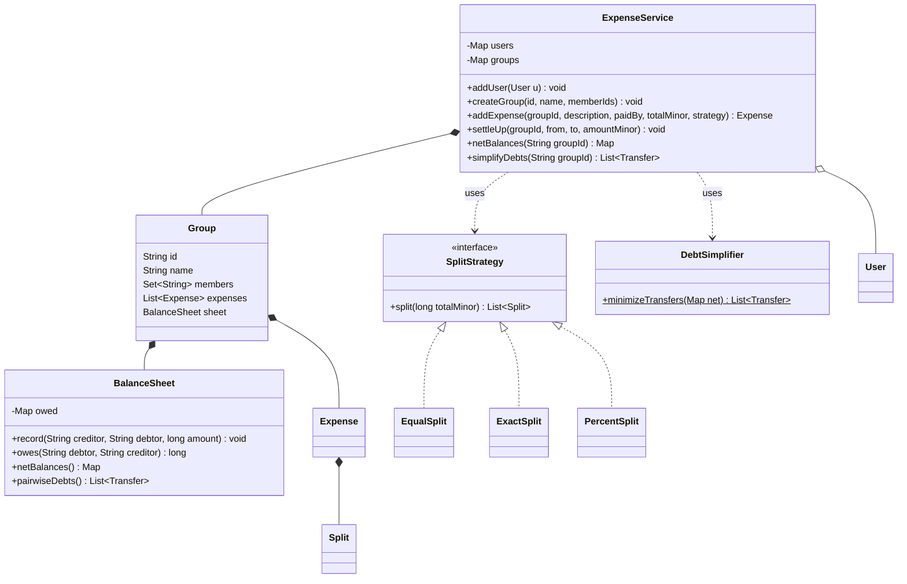
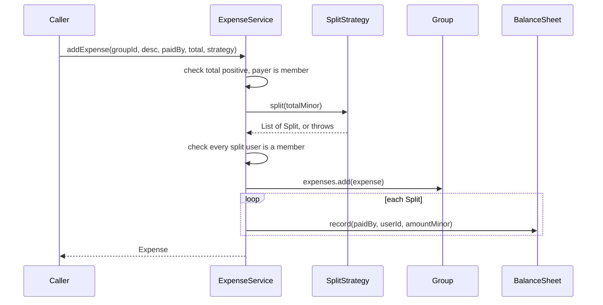

## Definition (interview-ready)

Splitwise is an expense-sharing ledger. Group members record who paid for what and how each bill is divided, and the app works out who owes whom and how to settle up with as few payments as possible. The core entities are `User`, `Group`, `Expense` (one payer, a total, a list of `Split`s), a per-group `BalanceSheet` that stores pairwise debts, and an `ExpenseService` facade that validates input and coordinates everything. Split types (EQUAL, EXACT, PERCENT) use the **Strategy** pattern, so a new type is a new class and existing code stays untouched (Open/Closed). Money is stored as `long` paise, so every split adds up to the total exactly. "Simplify debts" uses a greedy two-heap algorithm on net balances: at most k - 1 payments for k people with a non-zero balance, in O(k log k). It is a heuristic, because finding the true minimum is NP-hard. Concurrency is handled by validating first and then updating under one lock (per service, later per group).

**One-liner:** Splitwise is a ledger of expenses with pluggable split strategies, exact integer money, pairwise balances, and a greedy largest-debtor-pays-largest-creditor algorithm that settles a group in at most k - 1 payments.

## Problem statement

> Design an expense-sharing application like Splitwise. Users can form groups and add expenses. An expense has one payer, a total amount, and a split among some members. Splits can be **EQUAL**, **EXACT** (given amounts) or **PERCENT** (given percentages). Show who owes whom, let users settle up, and offer a "simplify debts" option that reduces the number of payments needed. It should be easy to add new split types.

Intuition: four friends on a trip. Asha pays the hotel, Bala pays the cab, Chen pays dinner. Nobody wants to track every bill; they want one line each at the end: "Dev, pay Bala 266.67". The app is a **ledger** (who paid what for whom) plus a **calculator** (what that means in net terms).

## Clarifying questions to ask

| Question | Sensible assumed answer |
|---|---|
| One payer per expense, or many? | One payer for the core. Multiple payers is an extension. |
| Must the payer be among the people sharing? | No. Payer may or may not have a share. |
| Currency and precision? | One currency, 2 decimal places (rupees and paise). Multi-currency is out of scope. |
| How are amounts that don't divide evenly handled? | Shares must add up to the total **to the last paisa**. Leftover paise go to specific people by a fixed rule. |
| Percent splits with decimals like 33.33? | Allowed; percentages must sum to exactly 100. |
| Expenses outside groups? | Treat a two-person expense as a small group; out of scope otherwise. |
| Can a user settle more than they owe? | No, reject it. |
| Should simplification move debt between people who never shared an expense? | Within a group, yes (that's what simplify means). Across groups, no. |
| Edit/delete expenses, notifications, persistence? | Out of scope; mention as extensions. |

## Requirements

**Functional**

- Add users; create a group with members.
- Add an expense to a group: payer, total, split strategy (EQUAL, EXACT, PERCENT).
- Validate splits: exact shares sum to the total; percentages sum to 100; all participants are group members; amount is positive.
- Show pairwise balances ("Bala owes Asha 333.33") and net balances per person.
- Settle up: record a cash payment from one user to another.
- Simplify debts: a short list of payments that settles everyone.

**Non-functional**

- Money is exact: no floating-point drift, every expense's shares sum exactly to its total.
- Adding a split type should not change existing classes (Open/Closed).
- Safe under concurrent requests: no lost updates to balances.

**Out of scope:** auth, persistence, currency conversion, notifications, editing history, receipts.

## Entities and relationships

```
 User(id, name)                  record
   ^ member of (many-to-many)
 Group(id, name, members)
   |-- 1..* Expense(id, desc, paidBy, totalMinor, List<Split>)     record
   |            '-- Split(userId, amountMinor)                     record
   '-- 1    BalanceSheet  Map<creditor, Map<debtor, long>>

 <<sealed interface>> SplitStrategy  split(totalMinor): List<Split>
        ^ permits
        +-- EqualSplit(List<userId>)
        +-- ExactSplit(Map<userId, long>)
        +-- PercentSplit(Map<userId, BigDecimal>)

 ExpenseService  (entry point: addUser, createGroup, addExpense, settleUp,
                  balances, netBalances, simplifyDebts)
        uses --> DebtSimplifier.minimizeTransfers(net): List<Transfer>
 Money  (parse "1000.50" -> 100050, format back)
```

The same model as a class diagram. All amounts are `long` minor units:



What `addExpense` does, in order. The strategy validates before any state changes:



## Design patterns used and why

- **Strategy** — each split type is a class that turns a total into a list of `Split`s. `ExpenseService.addExpense` takes a `SplitStrategy` and never switches on a type enum. Adding "SHARES" (split 2:1:1) is a new record. See [Behavioral Patterns](/learn/notes/behavioral-patterns/).
- **Sealed interface + records (Java 17+)** — `sealed interface SplitStrategy permits ...` lists the allowed implementations, and records make each strategy an immutable value carrying its own parameters. If you'd rather keep it open for plugins, drop `sealed`.
- **Value objects** — `User`, `Split`, `Expense`, `Transfer` are records: immutable, so safe to share across threads and easy to test.
- **Facade / service layer** — `ExpenseService` is the single entry point that validates input and coordinates entities, as in [Machine-Coding Strategy](/learn/notes/machine-coding-strategy/).
- **Greedy algorithm** (not a GoF pattern) — `DebtSimplifier` with two heaps.

A common alternative is an `enum SplitType` plus a `SplitStrategyFactory` that maps each enum value to a strategy. Fine if input comes from JSON with a "type" field; the factory is the only place that switches. See [Creational Patterns](/learn/notes/creational-patterns/).

## Solution walkthrough

### Step 1: money as long minor units

`double` cannot represent most decimal fractions exactly (0.1 has no exact binary form), so sums drift: `0.1 + 0.2` is `0.30000000000000004`. Money code must never use `float` or `double`.

Two correct options:

| Option | Pros | Cons |
|---|---|---|
| `long` **minor units** (paise, cents): 1000.50 is stored as `100050` | Fast, exact, simple equality, trivially thread-safe | You must fix the scale per currency (2 for INR/USD, 0 for JPY) |
| `BigDecimal` | Arbitrary precision, explicit rounding modes | Slower, verbose; `equals` compares scale too (`2.0` is not equal to `2.00`), so use `compareTo`; never build from a `double` |

We store amounts as `long` minor units and use `BigDecimal` only at the edges (parsing input, percent math). `Money.parse` uses `setScale(2, RoundingMode.UNNECESSARY)`, which **throws** if the input has a third decimal, rather than silently rounding someone's money.

How to say it in an interview: "All amounts are long paise. Every split returns shares that sum exactly to the total; the rounding rule decides who gets the leftover paisa."

### Step 2: split strategies

Each strategy gets the total (in paise) and returns one `Split` per participant. The invariant every strategy must keep: **the shares sum to the total, exactly.**

**EQUAL.** 1000.00 split three ways is 333.333... paise per person, which doesn't exist. Divide with integer division and hand out the remainder one paisa at a time:

```
total = 100000, n = 3  ->  base = 33333, remainder = 1
shares = [33334, 33333, 33333]   (first person in the list gets the extra paisa)
```

**EXACT.** The user supplies each share. Validate: no negative shares and the sum equals the total. Otherwise throw with a useful message ("exact shares add to 590.00, expected 600.00").

**PERCENT.** Validate that percentages sum to exactly 100 using `BigDecimal.compareTo` (because `new BigDecimal("100.0").equals(new BigDecimal("100"))` is false). Then:

1. Exact share = total times percent divided by 100 (a `BigDecimal`; dividing by 100 always terminates).
2. Round each share **down** to whole paise.
3. The floors sum to slightly less than the total. Give the missing paise, one each, to the people with the **largest fractional parts** (the "largest remainder" method).

Example: 0.10 (10 paise) at 33.33 / 33.33 / 33.34 percent gives exact shares 3.333, 3.333, 3.334. Floors are 3, 3, 3 (sum 9). One paisa left; the largest fraction is 0.334, so the third person pays 4.

Why not just round each share half-up? Because three shares rounded independently can sum to one paisa more or less than the total, and then the books don't balance.

### Step 3: the balance sheet

`BalanceSheet` stores **pairwise** debt: `owed[a][b]` is how much b owes a. It is kept **antisymmetric**: whenever we add x to `owed[a][b]` we add minus x to `owed[b][a]`. Then:

- Adding an expense paid by P: for each split (U, amount) with U not P, `record(P, U, amount)`.
- Opposite debts cancel automatically. If Bala owes Asha 100 and later Asha owes Bala 30, the pair nets to "Bala owes Asha 70".
- A person's **net balance** is the sum of their row: positive means the group owes them, negative means they owe the group. All net balances sum to zero; that's a handy invariant to assert.

### Step 4: settle up

A cash payment from `from` to `to` is just a debt in the opposite direction: `record(from, to, amount)`. We check `amount` is positive and not more than what `from` currently owes `to`.

### Step 5: simplify debts (min cash flow, greedy)

Pairwise balances can need many payments. Simplification throws away *who owed whom* and keeps only each person's **net** balance, then finds a short list of payments that brings everyone to zero.

Greedy with two max-heaps (`PriorityQueue`):

```
creditors heap: people with net > 0, largest first
debtors heap:   people with net < 0, largest debt first
while creditors not empty:
    c = pop largest creditor, d = pop largest debtor
    amt = min(c.amount, d.amount)
    record "d pays c amt"
    push back whichever side still has a remainder
```

Each iteration zeroes at least one person, so with k people whose net isn't zero, it makes **at most k - 1 payments**. Each heap operation is O(log k), so the whole thing is O(k log k).

**Is it the minimum? No — and say so.** The true minimum equals k minus the **largest number of disjoint groups whose balances each sum to zero** (each such group of size m settles internally in m - 1 payments). Finding that partition is NP-hard (this is the "debt clearing" problem in the literature; it's closely related to subset-sum). So the greedy is a fast heuristic with a guaranteed upper bound of k - 1, not an optimum. Our test harness found this counterexample with an exact (exponential) solver:

```
net balances:  A=-5  B=-3  C=-5  D=+10  E=-3  F=+6
greedy (5 payments): A->D 5, C->F 5, B->D 3, E->D 2, E->F 1
optimal (4):         A->D 5, C->D 5, B->F 3, E->F 3     (groups {A,C,D} and {B,E,F} each sum to 0)
```

For small groups you can get the exact answer with a DP or backtracking over subsets (exponential, fine for about 10 to 15 people). In an interview: implement the greedy, state the k - 1 bound, then mention the NP-hardness and the exact approach for small groups.

## Full solution code

One file, Java 21. `javac Main.java && java Main`.

```java run
import java.math.BigDecimal;
import java.math.RoundingMode;
import java.util.*;

// ---------- Money: always long minor units (paise / cents) ----------
final class Money {
    private Money() {}

    /** "1000.50" -> 100050. Rejects more than 2 decimals instead of silently rounding. */
    static long parse(String amount) {
        return new BigDecimal(amount).setScale(2, RoundingMode.UNNECESSARY).movePointRight(2).longValueExact();
    }

    static String format(long minor) {
        return BigDecimal.valueOf(minor, 2).toPlainString();
    }
}

record User(String id, String name) {}

record Split(String userId, long amountMinor) {}

record Expense(String id, String description, String paidBy, long totalMinor, List<Split> splits) {}

record Transfer(String from, String to, long amountMinor) {
    @Override public String toString() { return from + " pays " + to + " " + Money.format(amountMinor); }
}

// ---------- Strategy: how one total is divided ----------
sealed interface SplitStrategy permits EqualSplit, ExactSplit, PercentSplit {
    List<Split> split(long totalMinor);
}

/** Equal shares; the leftover paise go one each to the first participants. */
record EqualSplit(List<String> userIds) implements SplitStrategy {
    public List<Split> split(long total) {
        if (userIds.isEmpty()) throw new IllegalArgumentException("no participants");
        int n = userIds.size();
        long base = total / n, remainder = total % n;
        List<Split> out = new ArrayList<>();
        for (int i = 0; i < n; i++) out.add(new Split(userIds.get(i), base + (i < remainder ? 1 : 0)));
        return out;
    }
}

/** Exact amounts; must add up to the total to the last paisa. */
record ExactSplit(Map<String, Long> amounts) implements SplitStrategy {
    public List<Split> split(long total) {
        long sum = 0;
        for (long a : amounts.values()) {
            if (a < 0) throw new IllegalArgumentException("negative share");
            sum += a;
        }
        if (sum != total)
            throw new IllegalArgumentException("exact shares add to " + Money.format(sum) + ", expected " + Money.format(total));
        List<Split> out = new ArrayList<>();
        amounts.forEach((u, a) -> out.add(new Split(u, a)));
        return out;
    }
}

/** Percentages; must sum to exactly 100. Rounds down, then hands out leftover paise by largest remainder. */
record PercentSplit(Map<String, BigDecimal> percents) implements SplitStrategy {
    private static final BigDecimal HUNDRED = BigDecimal.valueOf(100);

    public List<Split> split(long total) {
        BigDecimal sum = percents.values().stream().reduce(BigDecimal.ZERO, BigDecimal::add);
        if (sum.compareTo(HUNDRED) != 0) // compareTo, not equals: 100.0 vs 100 differ in scale
            throw new IllegalArgumentException("percentages add to " + sum + ", expected 100");
        List<String> users = new ArrayList<>(percents.keySet());
        long[] shares = new long[users.size()];
        BigDecimal[] fractions = new BigDecimal[users.size()];
        long assigned = 0;
        for (int i = 0; i < users.size(); i++) {
            BigDecimal pct = percents.get(users.get(i));
            if (pct.signum() < 0) throw new IllegalArgumentException("negative percent");
            BigDecimal exact = BigDecimal.valueOf(total).multiply(pct).divide(HUNDRED); // exact: dividing by 100 terminates
            shares[i] = exact.setScale(0, RoundingMode.FLOOR).longValueExact();
            fractions[i] = exact.subtract(BigDecimal.valueOf(shares[i]));
            assigned += shares[i];
        }
        Integer[] order = new Integer[users.size()];
        for (int i = 0; i < order.length; i++) order[i] = i;
        Arrays.sort(order, (a, b) -> fractions[b].compareTo(fractions[a])); // stable: ties keep input order
        for (int k = 0; k < total - assigned; k++) shares[order[k]]++;
        List<Split> out = new ArrayList<>();
        for (int i = 0; i < users.size(); i++) out.add(new Split(users.get(i), shares[i]));
        return out;
    }
}

// ---------- Balance sheet: who owes whom, pairwise ----------
final class BalanceSheet {
    // owed.get(a).get(b) > 0  means  b owes a that much.  Always kept antisymmetric.
    private final Map<String, Map<String, Long>> owed = new HashMap<>();

    void record(String creditor, String debtor, long amount) {
        if (creditor.equals(debtor) || amount == 0) return;
        owed.computeIfAbsent(creditor, k -> new HashMap<>()).merge(debtor, amount, Long::sum);
        owed.computeIfAbsent(debtor, k -> new HashMap<>()).merge(creditor, -amount, Long::sum);
    }

    long owes(String debtor, String creditor) {
        return owed.getOrDefault(creditor, Map.of()).getOrDefault(debtor, 0L);
    }

    /** Net position: positive = the group owes you, negative = you owe the group. */
    Map<String, Long> netBalances() {
        Map<String, Long> net = new TreeMap<>();
        owed.forEach((user, row) -> net.put(user, row.values().stream().mapToLong(Long::longValue).sum()));
        return net;
    }

    List<Transfer> pairwiseDebts() {
        List<Transfer> out = new ArrayList<>();
        new TreeMap<>(owed).forEach((creditor, row) -> new TreeMap<>(row).forEach((debtor, amt) -> {
            if (amt > 0) out.add(new Transfer(debtor, creditor, amt));
        }));
        return out;
    }
}

final class Group {
    final String id, name;
    final Set<String> members = new LinkedHashSet<>();
    final List<Expense> expenses = new ArrayList<>();
    final BalanceSheet sheet = new BalanceSheet();

    Group(String id, String name, Collection<String> members) {
        this.id = id; this.name = name; this.members.addAll(members);
    }
}

// ---------- Service: the only public entry point ----------
final class ExpenseService {
    private final Map<String, User> users = new HashMap<>();
    private final Map<String, Group> groups = new HashMap<>();
    private int expenseSeq = 0;

    synchronized void addUser(User u) {
        if (users.putIfAbsent(u.id(), u) != null) throw new IllegalArgumentException("duplicate user " + u.id());
    }

    synchronized void createGroup(String id, String name, List<String> memberIds) {
        memberIds.forEach(this::requireUser);
        if (groups.putIfAbsent(id, new Group(id, name, memberIds)) != null)
            throw new IllegalArgumentException("duplicate group " + id);
    }

    synchronized Expense addExpense(String groupId, String description, String paidBy, long totalMinor, SplitStrategy strategy) {
        if (totalMinor <= 0) throw new IllegalArgumentException("amount must be positive");
        Group g = requireGroup(groupId);
        requireMember(g, paidBy);
        List<Split> splits = strategy.split(totalMinor); // validates; throws before any state changes
        splits.forEach(s -> requireMember(g, s.userId()));
        Expense e = new Expense("E" + (++expenseSeq), description, paidBy, totalMinor, List.copyOf(splits));
        g.expenses.add(e);
        for (Split s : splits) g.sheet.record(paidBy, s.userId(), s.amountMinor());
        return e;
    }

    /** `from` pays `to` in cash. Cannot pay more than is owed. */
    synchronized void settleUp(String groupId, String from, String to, long amountMinor) {
        Group g = requireGroup(groupId);
        long owed = g.sheet.owes(from, to);
        if (amountMinor <= 0 || amountMinor > owed)
            throw new IllegalArgumentException(from + " owes " + to + " only " + Money.format(owed));
        g.sheet.record(from, to, amountMinor); // a payment is a debt in the opposite direction
    }

    synchronized List<Transfer> balances(String groupId) { return requireGroup(groupId).sheet.pairwiseDebts(); }

    synchronized Map<String, Long> netBalances(String groupId) { return requireGroup(groupId).sheet.netBalances(); }

    synchronized List<Transfer> simplifyDebts(String groupId) {
        return DebtSimplifier.minimizeTransfers(requireGroup(groupId).sheet.netBalances());
    }

    private User requireUser(String id) {
        User u = users.get(id);
        if (u == null) throw new NoSuchElementException("unknown user " + id);
        return u;
    }

    private Group requireGroup(String id) {
        Group g = groups.get(id);
        if (g == null) throw new NoSuchElementException("unknown group " + id);
        return g;
    }

    private void requireMember(Group g, String userId) {
        if (!g.members.contains(userId)) throw new IllegalArgumentException(userId + " is not in " + g.name);
    }
}

// ---------- Greedy min-cash-flow: largest debtor pays largest creditor ----------
final class DebtSimplifier {
    private DebtSimplifier() {}

    static List<Transfer> minimizeTransfers(Map<String, Long> net) {
        Comparator<Map.Entry<String, Long>> biggestFirst =
            Comparator.comparingLong((Map.Entry<String, Long> e) -> e.getValue()).reversed()
                      .thenComparing(Map.Entry::getKey);
        PriorityQueue<Map.Entry<String, Long>> creditors = new PriorityQueue<>(biggestFirst);
        PriorityQueue<Map.Entry<String, Long>> debtors = new PriorityQueue<>(biggestFirst); // stores amount owed as positive
        long check = 0;
        for (var e : net.entrySet()) {
            check += e.getValue();
            if (e.getValue() > 0) creditors.add(Map.entry(e.getKey(), e.getValue()));
            if (e.getValue() < 0) debtors.add(Map.entry(e.getKey(), -e.getValue()));
        }
        if (check != 0) throw new IllegalStateException("balances do not sum to zero: " + check);

        List<Transfer> transfers = new ArrayList<>();
        while (!creditors.isEmpty()) {
            var c = creditors.poll();
            var d = debtors.poll();
            long amt = Math.min(c.getValue(), d.getValue());
            transfers.add(new Transfer(d.getKey(), c.getKey(), amt));
            if (c.getValue() > amt) creditors.add(Map.entry(c.getKey(), c.getValue() - amt));
            if (d.getValue() > amt) debtors.add(Map.entry(d.getKey(), d.getValue() - amt));
        }
        return transfers; // each step zeroes at least one person -> at most (people with non-zero balance - 1) transfers
    }
}

public class Main {
    public static void main(String[] args) {
        ExpenseService app = new ExpenseService();
        for (String n : List.of("asha", "bala", "chen", "dev")) app.addUser(new User(n, n));
        app.createGroup("goa", "Goa trip", List.of("asha", "bala", "chen", "dev"));

        app.addExpense("goa", "Hotel", "asha", Money.parse("1000.00"),
            new EqualSplit(List.of("asha", "bala", "chen")));                      // 333.34 / 333.33 / 333.33
        app.addExpense("goa", "Cab", "bala", Money.parse("600.00"),
            new ExactSplit(Map.of("chen", Money.parse("200.00"), "dev", Money.parse("400.00"))));
        Map<String, BigDecimal> pct = new LinkedHashMap<>();
        pct.put("asha", new BigDecimal("50")); pct.put("chen", new BigDecimal("25")); pct.put("dev", new BigDecimal("25"));
        app.addExpense("goa", "Dinner", "chen", Money.parse("801.00"), new PercentSplit(pct));

        System.out.println("Pairwise balances:");
        app.balances("goa").forEach(t -> System.out.println("  " + t.from() + " owes " + t.to() + " " + Money.format(t.amountMinor())));
        System.out.println("Net balances (minor units): " + app.netBalances("goa"));
        System.out.println("Simplified:");
        app.simplifyDebts("goa").forEach(t -> System.out.println("  " + t));

        app.settleUp("goa", "dev", "bala", Money.parse("400.00"));
        System.out.println("After dev settles 400.00 with bala: " + app.netBalances("goa"));

        try {
            pct.put("dev", new BigDecimal("20"));
            app.addExpense("goa", "Bad", "asha", Money.parse("100"), new PercentSplit(pct));
        } catch (IllegalArgumentException e) {
            System.out.println("Rejected: " + e.getMessage());
        }
    }
}
```

## Concurrency and edge cases

- **Lost updates.** Two expenses added at once both do read-modify-write on the same balance cells. Our `ExpenseService` methods are `synchronized`: one coarse lock, simple and correct. The test runs 8 threads x 1,000 expenses and checks the final balances are exact.
- **Finer locking.** Groups don't share state, so the next step is one lock per `Group` (lock the group, then update its sheet). Avoid locking two users' rows separately; if you ever must take two locks, take them in a fixed order (for example by id) to avoid deadlock. See [Java Concurrency and Locks](/learn/notes/java-concurrency-locks/).
- **Validate before mutating.** `strategy.split(...)` and membership checks run before anything is written, so a bad expense leaves no partial state.
- **Overflow.** `long` paise goes up to about 9.2 x 10^18, far beyond any realistic amount. Use `Math.addExact` if you want overflow to fail loudly.
- **Payer in their own split.** `record` ignores creditor equal to debtor; the payer's own share costs nothing.
- **Zero or negative totals, empty participant lists, unknown users, non-members, duplicate ids:** all rejected.
- **Rounding fairness.** Our EQUAL rule always gives the extra paisa to the first people in the list. If that matters, rotate the start index per expense or give it to the payer; just make the rule deterministic.
- **Three-decimal input** like "1.005" throws instead of being rounded.

## Testing it

Plain-Java harness with a `check` helper; each line maps to one JUnit assertion.

```java
List<Split> eq = new EqualSplit(List.of("a", "b", "c")).split(10000);
check(eq.get(0).amountMinor() == 3334 && eq.get(1).amountMinor() == 3333, "equal split remainder");

check(throwsEx(() -> new ExactSplit(Map.of("a", 100L, "b", 50L)).split(200)), "exact mismatch rejected");
check(throwsEx(() -> new PercentSplit(pct("a", "50", "b", "49.99")).split(100)), "percent 99.99 rejected");
check(!throwsEx(() -> new PercentSplit(pct("a", "50.0", "b", "50")).split(100)), "percent 100.0 accepted (compareTo)");
List<Split> p = new PercentSplit(pct("a", "33.33", "b", "33.33", "c", "33.34")).split(10);
check(p.get(2).amountMinor() == 4, "percent largest remainder");

app.addExpense("g", "x", "a", 300, new EqualSplit(List.of("a", "b", "c")));
check(app.netBalances("g").equals(Map.of("a", 200L, "b", -100L, "c", -100L)), "net after equal expense");
check(throwsEx(() -> app.settleUp("g", "c", "a", 101)), "overpay rejected");

// Property test: 2,000 random balance sets of 2..8 people
//   - applying the greedy transfers brings everyone to zero
//   - number of transfers is at most (non-zero people - 1)
//   - never fewer than the exact optimum (computed by a subset DP)

// Concurrency: 8 threads x 1,000 expenses of 3.00 split 3 ways, paid by a
check(net.get("a") == 8000L * 200 && net.get("b") == -8000L * 100, "concurrent adds: no lost updates");
```

The harness ran **20 checks (including the 2,000-case property test), all passing** on JDK 21.

Demo output (`java Main`):

```text output
Pairwise balances:
  bala owes asha 333.33
  chen owes bala 200.00
  dev owes bala 400.00
  asha owes chen 67.17
  dev owes chen 200.25
Net balances (minor units): {asha=26616, bala=26667, chen=6742, dev=-60025}
Simplified:
  dev pays bala 266.67
  dev pays asha 266.16
  dev pays chen 67.42
After dev settles 400.00 with bala: {asha=26616, bala=-13333, chen=6742, dev=-20025}
Rejected: percentages add to 95, expected 100
```

Read it back: Asha paid 1000.00 for three people (her own share 333.34), so Bala owes her 333.33. Chen's 801.00 dinner at 50/25/25 makes Asha owe Chen 400.50, which nets against Chen's 333.33 hotel debt to "Asha owes Chen 67.17". Five pairwise debts simplify to three payments, all from Dev. The last expense is rejected because 50 + 25 + 20 is 95.

## Extensions interviewers ask for

| Extension | How the design absorbs it |
|---|---|
| SHARES split (2:1:1) | New `SharesSplit` record implementing `SplitStrategy`, reusing the largest-remainder rounding. |
| Multiple payers | `Expense` gets a list of (payer, paid amount); validate paid amounts sum to total; the sheet records net contribution minus share per person. |
| Edit / delete expense | Keep expenses immutable; record a reversing entry (negate every split) and add the new version. Balances stay auditable. |
| Multi-currency | Store currency with each amount; keep separate balances per currency, or convert at a recorded rate at expense time. |
| Activity feed / notifications | Publish an `ExpenseAdded` event; observers send notifications (Observer). |
| Persistence | Repositories behind interfaces (`ExpenseRepository`), in-memory first; balances can be recomputed from the expense log. |
| Exact minimum payments | Subset DP or backtracking on net balances for small groups; keep greedy as fallback for big ones. |
| Scale to millions of users | Shard by group id; groups are independent, so they are natural units of locking and partitioning. |

## Common mistakes

- Using `double` for money, or `new BigDecimal(0.1)` (constructed from a double, it captures the binary error).
- Comparing `BigDecimal` with `equals` instead of `compareTo`.
- Rounding each share independently so the shares don't add up to the total.
- A `switch` on split type inside `addExpense` instead of Strategy.
- Storing only net balances, so you can't answer "how much do I owe Bala specifically?". Keep pairwise data (or the expense log) and derive net from it.
- Updating balances before validation, leaving partial state on error.
- Claiming the greedy gives the minimum number of transactions.
- No locking, or separate locks per user taken in random order (deadlock risk).

## Practice questions

<Practice>

<QA q="Why not store money as double?" level="easy">

Binary floating point can't represent most decimal fractions exactly, so `0.1 + 0.2` gives `0.30000000000000004` and errors accumulate over many expenses. Use `long` minor units (paise) or `BigDecimal`. With `long` paise, every amount is an exact integer and addition is exact.

</QA>

<QA q="How do you split 100.00 equally among three people?" level="easy">

Work in paise: 10000 divided by 3 is 3333 remainder 1. Everyone gets 3333 and one person gets the extra paisa: 3334, 3333, 3333. The rule for who gets the extra must be deterministic (first in list, payer, or rotating).

</QA>

<QA q="Which design pattern fits split types and why?" level="easy">

Strategy. Each split type is a class implementing `split(totalMinor)` with its own validation. `addExpense` accepts any `SplitStrategy`, so adding a new type is a new class with no edits to existing code (Open/Closed).

</QA>

<QA q="What validations does each split type need?" level="easy">

EQUAL: at least one participant. EXACT: no negative shares and the sum equals the total exactly. PERCENT: no negative percentages and the sum is exactly 100 (compare with `compareTo`). For all: positive total, payer and participants are group members.

</QA>

<QA q="Why does new BigDecimal of 100.0 not equal new BigDecimal of 100 with equals?" level="medium">

`BigDecimal.equals` compares value **and scale**. `100.0` has scale 1, `100` has scale 0, so `equals` returns false. `compareTo` compares numeric value only and returns 0. Validation code that checks 'sum equals 100' must use `compareTo`.

</QA>

<QA q="How do you make percent shares add up exactly to the total?" level="medium">

Compute each exact share as a `BigDecimal`, floor it to whole paise, and sum the floors. The difference from the total is a small number of paise (fewer than the number of people). Give one extra paisa each to the people with the largest fractional parts. This is the largest-remainder method and guarantees an exact total.

</QA>

<QA q="What is the difference between pairwise balances and net balances?" level="medium">

Pairwise balances record how much each specific person owes each other person. Net balance is one number per person: the sum of what everyone owes them minus what they owe. Net balances sum to zero across the group. Pairwise answers 'how much do I owe Bala?'; net is the input to debt simplification.

</QA>

<QA q="Explain the greedy debt simplification and its bound." level="medium">

Put creditors and debtors in two max-heaps by amount. Repeatedly match the largest debtor with the largest creditor, transfer the smaller of the two amounts, and push back the leftover. Each step zeroes at least one person, so with k non-zero people it needs at most k - 1 transfers, in O(k log k) time.

</QA>

<QA q="Does the greedy always give the minimum number of transactions?" level="hard">

No. The minimum is k minus the maximum number of disjoint zero-sum subsets of balances, and finding that is NP-hard. Example: balances A -5, B -3, C -5, D +10, E -3, F +6. Greedy produces 5 payments; the optimum is 4, because A, C, D and B, E, F each sum to zero and settle separately. For small groups an exact subset DP or backtracking works; otherwise greedy is a good heuristic.

</QA>

<QA q="How would you make addExpense thread-safe, and how would you scale the locking?" level="hard">

Simplest: make the service methods `synchronized` so each expense updates the balance sheet atomically. Groups are independent, so the next step is one lock per group. Inside a group, an expense touches many pairs, so one group lock is cleaner than per-user locks; if per-user locks are needed, acquire them in a fixed order (sorted ids) to avoid deadlock.

</QA>

<QA q="Scenario: a user edits an expense from 900 to 600 after others have settled. How do you handle it?" level="scenario">

Don't mutate history. Record a reversal of the old expense (same splits, negated) and add the new expense. Balances adjust by the difference, and anyone who already settled will simply show a new small credit or debt. The expense log stays auditable and balances can always be recomputed from it.

</QA>

<QA q="Scenario: users complain that the same person always pays the extra paisa. What do you change?" level="scenario">

The EQUAL rule gives leftover paise to the first people in the list. Make the rule fairer but still deterministic: give it to the payer (who is already out of pocket), rotate the starting index per expense, or randomise with a seed stored on the expense so it can be replayed. The invariant (shares sum to the total) doesn't change.

</QA>

<QA q="Scenario: a group has 40 members and the exact minimum-payments algorithm times out. What now?" level="scenario">

Exact minimisation is exponential, so 40 people is too many. Use the greedy (at most 39 payments, O(k log k)), optionally first settling exact pairs (a debtor and a creditor with equal amounts) with one payment each, which never makes the result worse. Offer exact optimisation only for small groups.

</QA>

</Practice>

## Quiz

<Quiz>

<MCQ q="Which representation is best for money in this design?" options={["double rupees", "float paise", "long paise (minor units)", "String"]} answer={2}>

Integers in minor units are exact and fast. Floating point accumulates error; String has no arithmetic.

</MCQ>

<MCQ q="10000 paise split equally among 3 people with our rule gives:" options={["3333, 3333, 3333", "3334, 3333, 3333", "3333.33 each", "3334, 3334, 3332"]} answer={1}>

Integer division gives 3333 with remainder 1; the first person gets the extra paisa so the total is exactly 10000.

</MCQ>

<MCQ q="Why is BigDecimal.compareTo used to check that percentages sum to 100?" options={["equals also compares scale, so 100.0 and 100 are not equal", "compareTo is faster", "equals is deprecated", "compareTo rounds automatically"]} answer={0}>

equals is scale-sensitive; compareTo compares numeric value only.

</MCQ>

<MCQ q="What does the largest-remainder method guarantee in a percent split?" options={["Everyone pays the same", "Shares are rounded half-up", "The payer pays nothing", "The rounded shares sum exactly to the total"]} answer={3}>

Floors are summed and the few leftover paise are assigned to the largest fractional parts, so the total always matches.

</MCQ>

<MCQ q="With k people who have a non-zero net balance, the greedy min-cash-flow produces at most how many transfers?" options={["k / 2", "k - 1", "k squared", "2k"]} answer={1}>

Every iteration zeroes at least one person and the last iteration zeroes two, so at most k - 1.

</MCQ>

<MCQ q="Which statement about minimising the number of settlement transactions is correct?" options={["Greedy always finds the minimum", "It is solvable in O(k log k) exactly", "Finding the exact minimum is NP-hard; greedy is a heuristic with a k - 1 upper bound", "The minimum is always k / 2"]} answer={2}>

The exact problem reduces to finding the maximum number of disjoint zero-sum subsets, which is NP-hard.

</MCQ>

<MCQ q="Bala owes Asha 100. Later Bala pays 30 for an expense whose only share is Asha. What does the antisymmetric sheet show?" options={["Bala owes Asha 100 and Asha owes Bala 30", "Asha owes Bala 70", "Nothing; both are cleared", "Bala owes Asha 70"]} answer={3}>

The sheet adds 30 in the opposite direction to the same pair, netting to Bala owes Asha 70.

</MCQ>

<MCQ q="Where should validation of a new expense happen relative to updating balances?" options={["Before any update, so a bad expense leaves no partial state", "After updating, then roll back if invalid", "Only in the UI", "It does not matter with synchronized"]} answer={0}>

Validate fully first; then apply all updates inside the lock. Locks prevent interleaving, not partial updates caused by exceptions mid-way.

</MCQ>

</Quiz>

## TL;DR cheat sheet

- **Entities:** `User`, `Group`, `Expense`, `Split`, `BalanceSheet`, `ExpenseService`, `DebtSimplifier`. Records for values.
- **Money:** `long` paise. `BigDecimal` only for parsing and percent math; compare with `compareTo`; never from a `double`.
- **Strategy:** `SplitStrategy.split(totalMinor)` with `EqualSplit`, `ExactSplit`, `PercentSplit`; each validates its own input.
- **Exact totals:** EQUAL = integer division + spread remainder; PERCENT = floor + largest remainder; EXACT = must match total.
- **Balance sheet:** pairwise `owed[creditor][debtor]`, kept antisymmetric; net = row sum; all nets sum to zero.
- **Settle up:** a payment is a debt in the reverse direction; reject overpayment.
- **Simplify:** two max-heaps, match largest debtor with largest creditor; at most k - 1 transfers, O(k log k). Exact minimum is NP-hard (max disjoint zero-sum subsets).
- **Concurrency:** validate first, then update under one lock (service-wide, then per group).
- Related: [Behavioral Patterns](/learn/notes/behavioral-patterns/), [Machine-Coding Strategy](/learn/notes/machine-coding-strategy/), [Java Concurrency and Locks](/learn/notes/java-concurrency-locks/), [HLD: Payment System](/learn/notes/hld-payment-system/).
