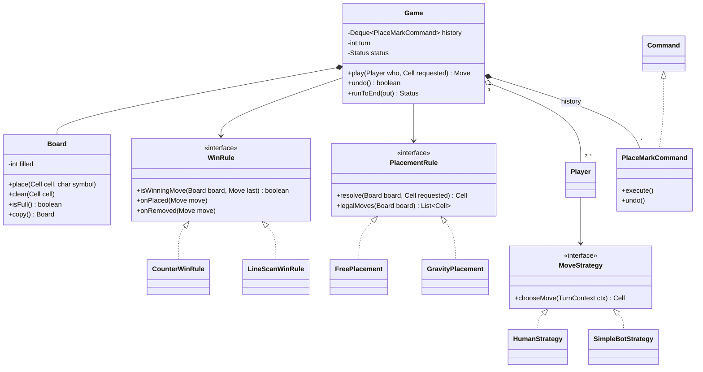
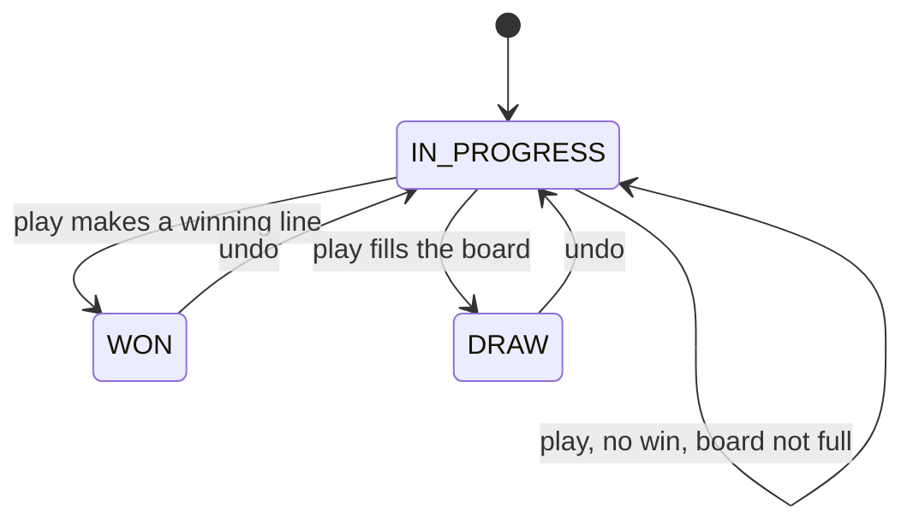

## Definition (interview-ready)

N×N tic-tac-toe is a turn-based game engine: players take turns putting their symbol on a grid, and the first to get K marks in a straight line (row, column or diagonal) wins; a full board with no line is a draw. The core entities are a `Board` (just a grid), `Player` records, `Move` and `Cell` value types, and a `Game` that owns turns, status and history. Three things vary, so each is an interface: **how a move is chosen** (`MoveStrategy`: human input or a bot), **how a win is detected** (`WinRule`: O(1) counters when K equals N, otherwise a local scan around the last move), and **where a mark may go** (`PlacementRule`: any empty cell, or gravity for Connect Four). Every move is a `PlaceMarkCommand`, so undo is "pop and reverse".

**One-liner:** A dumb grid plus a `Game` that validates and applies moves as undoable Commands, with Strategies for players, win detection and placement, so Connect Four is two swapped objects, not a rewrite.

## Problem statement

> Design and implement a tic-tac-toe game that works beyond the classic 3×3.
>
> - The board is **N × N**. A player wins by getting **K of their symbols in a row** — horizontally, vertically or diagonally. For the classic game, N = K = 3.
> - Two players take turns. A player can be a **human** typing a move, or a **computer** player. The computer does not need to be clever, but it should at least take a winning move and block an obvious loss.
> - Reject bad input with a clear message and let the same player try again: a cell off the board, a taken cell, text that isn't a move, playing out of turn, or playing after the game ended.
> - Detect a **win** and a **draw** after every move. Checking the win must be fast even on a large board.
> - Support **undo** of the last move (repeatedly).
> - Write a demo `main`. Afterwards, the interviewer will ask how you would turn this into **Connect Four**.

This problem looks easy, which is exactly why it is used: the grading is about structure, not the game. Interviewers look for a board that knows nothing about winning, win detection that doesn't rescan the whole grid, a clean seam for human versus computer players, and an undo that doesn't copy the board. The general approach (clarify, sketch entities, build in compiling steps) is in [Machine Coding Rounds strategy](/learn/notes/machine-coding-strategy/).

## Clarifying questions to ask

| Question | Assumed answer |
|---|---|
| Can K be smaller than N (for example 5×5, four in a row)? | Yes. K between 1 and N. Classic is K = N = 3. |
| How many players? | Two for the core; design so three or more also work (turn order is a list). |
| Who moves first? | The first player in the list. |
| What does "fast win check" mean? | Don't scan the whole board. O(1) per move when K = N; O(K) per move for general K. |
| How much undo? | Unlimited, back to the empty board. Undoing a winning move reopens the game. |
| In human vs bot, does undo take back both moves? | The engine undoes one move per call; the UI can call it twice. Say this out loud. |
| Is the bot required to play perfectly? | No. Win if possible, else block, else take the centre, else any legal move. Deterministic, so tests are stable. |
| How is a move typed? | `row col`, zero-based, for example `1 2`. |
| UI, network play, persistence? | No. Console-style input simulated in `main`; in memory. |
| Concurrency? | One game is turn-based, but if moves arrive from two network threads, the engine must not accept two moves for the same turn. |

## Requirements

**Functional (in scope)**

1. Create a game for any board size and any valid K, with two or more players with unique symbols.
2. Play a move for the player whose turn it is; validate it fully before changing any state.
3. After each move: win, draw or next player.
4. Undo the last move, any number of times.
5. Human player reading text input, and a simple bot player.
6. Show how Connect Four (6 rows × 7 columns, four in a row, pieces drop to the lowest free row) reuses the same engine.

**Non-functional**

- Win detection must not scan the board: O(1) or O(K) per move.
- Testable: input is injected (a `Supplier` of lines), the bot is deterministic, nothing reads `System.in` directly.
- Extensible: new player type, win rule or placement rule without editing `Game`.
- Safe if two threads call the engine at once.

**Out of scope:** perfect play (minimax), time limits, network protocol, saving games. See [Extensions](#extensions-interviewers-ask-for).

## Entities and relationships

```text
                         ┌───────────────────────── Game ─────────────────────────┐
  Player(name, symbol) ──►│ players: List<Player>      turn: int                   │
     │ has                │ status: IN_PROGRESS | WON | DRAW     winner             │
     ▼                    │ history: Deque<PlaceMarkCommand>  (undo stack)          │
  «interface»             │                                                         │
  MoveStrategy            │  ◆── Board (rows x cols grid of chars, filled count)    │
   ├ HumanStrategy        │  ◆── WinRule        ◁── CounterWinRule (K == N, O(1))  │
   └ SimpleBotStrategy    │                     ◁── LineScanWinRule (any K, O(K))  │
        │ reads           │  ◆── PlacementRule  ◁── FreePlacement   (tic-tac-toe)  │
        ▼                 │                     ◁── GravityPlacement (Connect Four)│
  TurnContext(board copy, └─────────────────────────────────────────────────────────┘
   me, opponents, placement)        │ creates per move
                                    ▼
                    PlaceMarkCommand(board, winRule, Move) : execute() / undo()
  Cell(row, col)   Move(cell, symbol)   WinRules.choose(rows, cols, k)  ← factory
```

The same design as a class diagram, with the methods from the full solution:



The game's `Status` as a small state machine, driven by `play` and `undo`:



- `Game` **has** one board, one win rule, one placement rule and the players. It is the only class that changes the turn or the status.
- `Board` knows cells and nothing about players, turns or winning. That keeps it reusable for Connect Four or Gomoku.
- A `Player` **has** a `MoveStrategy`. The strategy only **suggests** a cell; `Game` decides whether it is legal.
- Each successful move creates a `PlaceMarkCommand` that the game pushes onto its history.

## Design patterns used and why

| Pattern | Where | Why it earns its place |
|---|---|---|
| **Strategy** | `MoveStrategy` (human, bot), `WinRule` (counters, scan), `PlacementRule` (free, gravity) | These are the three axes that change between variants. Human vs bot, small vs large K, tic-tac-toe vs Connect Four are each one swapped object passed into `Game`. See [Strategy](/learn/notes/behavioral-patterns/). |
| **Command** | `PlaceMarkCommand` with `execute()` and `undo()`, kept on a stack | Undo becomes "pop the last command and reverse it". The command reverses the board **and** the win counters, so state never drifts. Redo, replay and move logs come almost for free. See [Command](/learn/notes/behavioral-patterns/). |
| **Factory (static factory method)** | `WinRules.choose(rows, cols, k)` | The O(1) counter rule is only correct for a square board with K = N. One method makes that choice, so callers can't accidentally pair counters with a 5×5 four-in-a-row game. See [Creational Patterns](/learn/notes/creational-patterns/). |

Patterns we deliberately **did not** use: a Singleton game (tests need many games), a State pattern for `IN_PROGRESS`/`WON`/`DRAW` (three values and two `if`s; an enum is enough), and an Observer for board updates (nice for a UI; mention it as an extension). Knowing when not to use a pattern scores as well as using one — see [SOLID Principles](/learn/notes/solid-principles/) for the Open/Closed reasoning behind the three interfaces.

## Solution walkthrough

Build it in this order. Each step compiles, so you always have something to run.

### Step 1: value types and a dumb board

```java
record Cell(int row, int col) {}
record Move(Cell cell, char symbol) {}
record Player(String name, char symbol, MoveStrategy strategy) {}
enum Status { IN_PROGRESS, WON, DRAW }
```

Records give you `equals`, `hashCode` and `toString` for free, which matters later: the bot checks `legal.contains(centre)` and tests compare cells with `equals`.

The `Board` is a `char[][]` plus a `filled` counter. Keeping the count makes "is the board full?" O(1) instead of a scan. It has `place`, `clear`, `inBounds`, `isEmpty`, `copy` and `render` — and no idea what a win is. `place` throws `IllegalStateException` on a taken cell: by the time the board is called, the game has already validated the move, so a taken cell here means a bug, not bad user input.

Make the board `rows × cols`, not just `n × n`. It costs nothing and Connect Four (6 × 7) needs it.

### Step 2: win detection, two ways

This is the heart of the interview. The naive version scans every row, column and diagonal after every move: O(N²) per move. The key insight is that **only lines through the last move can have changed**, so only those need checking.

**Option A — counters, O(1) per move (only when K = N).** For each player keep a count per row, per column, and one each for the main and anti-diagonal. When a player marks `(r, c)`, add 1 to `rows[r]`, `cols[c]`, to `diag` if `r == c`, and to `anti` if `r + c == n - 1`. That player wins exactly when one of those counts reaches `n`.

```java
private void adjust(Move m, int delta) {
    Counts c = counts.computeIfAbsent(m.symbol(), s -> new Counts(n));
    int r = m.cell().row(), col = m.cell().col();
    c.rows[r] += delta;
    c.cols[col] += delta;
    if (r == col) c.diag += delta;
    if (r + col == n - 1) c.anti += delta;
}
```

Why does this only work when K = N? A count tells you *how many* marks a player has in a line, not whether they are *next to each other*. On a 5×5 board with K = 4, marks at columns 0, 1, 3 and 4 of one row give a count of 4 but no four-in-a-row. When K = N, "N marks in a line of length N" can only mean the whole line, so counting is enough. Diagonals other than the two main ones are also ignored, which is again only correct when K = N.

**Option B — local scan, O(K) per move (any K, any shape).** From the last move, walk in each of 4 directions (right, down, down-right, down-left) and their opposites, counting consecutive cells with the same symbol. Stop each walk after K − 1 steps. If `1 + forward + backward` is at least K, it's a win.

```java
private static final int[][] DIRECTIONS = {{0, 1}, {1, 0}, {1, 1}, {1, -1}};

public boolean isWinningMove(Board board, Move last) {
    for (int[] d : DIRECTIONS) {
        int run = 1 + count(board, last, d[0], d[1]) + count(board, last, -d[0], -d[1]);
        if (run >= k) return true;
    }
    return false;
}
```

Counting both ways matters: if X has `(2,0)` and `(2,2)` and then plays `(2,1)`, the run is 1 + 1 left + 1 right = 3. A version that only walks forward from the new mark misses that win — there is a test for it.

| | Counters | Local scan |
|---|---|---|
| Time per move | O(1) | O(K) — at most 4 × 2 × (K − 1) cell reads |
| Extra memory | O(N) per player | none |
| Works for K less than N, non-square boards, Connect Four | No | Yes |
| Needs updating on undo | Yes (decrement) | No (reads the board) |

Both implement one interface. The counter rule needs to hear about every placement and removal, so the interface has two default no-op hooks:

```java
interface WinRule {
    boolean isWinningMove(Board board, Move last);
    default void onPlaced(Move move) {}
    default void onRemoved(Move move) {}
}
```

The factory picks the right one, so the "only when K = N" rule lives in one place:

```java
static WinRule choose(int rows, int cols, int k) {
    if (k < 1 || k > Math.max(rows, cols)) throw new IllegalArgumentException("k=" + k + " cannot fit on the board");
    return (rows == cols && k == rows) ? new CounterWinRule(rows) : new LineScanWinRule(k);
}
```

**How to say it in an interview:** "Only lines through the last move can change, so I never scan the whole board. For classic K = N, I keep per-player row, column and two diagonal counters — O(1). For K less than N, counts can't see gaps, so I walk outwards from the last move in four directions — O(K)."

### Step 3: placement rules

Where a mark may land is the one rule that differs between tic-tac-toe and Connect Four, so it is its own Strategy with two methods: `resolve` (validate the request and return the cell the mark really lands on) and `legalMoves` (used by the bot).

- `FreePlacement.resolve` checks bounds and emptiness and returns the requested cell.
- `GravityPlacement.resolve` looks only at the column, finds the lowest empty row, and throws if the column doesn't exist or is full.

Both throw `InvalidMoveException`, a domain exception meaning "bad input, ask again". That separates **user errors** (recoverable, re-prompt) from **bugs** (`IllegalStateException`, crash loudly).

### Step 4: the Command and the undo stack

```java
final class PlaceMarkCommand implements Command {
    public void execute() { board.place(move.cell(), move.symbol()); winRule.onPlaced(move); }
    public void undo()    { board.clear(move.cell());                 winRule.onRemoved(move); }
}
```

The command stores just the move — not a board snapshot — because placing one mark is perfectly reversible. Undo is O(1) and memory is O(moves). The history is an `ArrayDeque` used as a stack (`push`/`pop`); the Java docs recommend `ArrayDeque` over the legacy `Stack` class and note it is likely faster when used as a stack.

Notice that `undo()` also calls `winRule.onRemoved`. If it didn't, the counters would still say "X has 3 in row 0" after the winning move was taken back, and X's next unrelated move would wrongly be declared a win. There is a test for exactly that.

### Step 5: player strategies

```java
record TurnContext(Board board, char me, List<Character> opponents, PlacementRule placement) {}
interface MoveStrategy { Cell chooseMove(TurnContext ctx); }
```

- `HumanStrategy` reads a line from an injected `Supplier<String>` (in a real console, `scanner::nextLine`; in tests and the demo, a scripted list). It parses `row col`, or a single column for drop games, and throws `InvalidMoveException` for anything else. If the input runs out (`null`), it throws `IllegalStateException` instead: re-prompting a closed input would loop forever. It does **not** check whether the cell is free — that's the game's job, done once for every kind of player.
- `SimpleBotStrategy` asks the placement rule for legal moves, then: (1) a move that wins for me, (2) a move that would win for an opponent (block it), (3) the centre, (4) the first legal move. It tests "would this win?" on a **copy** of the board using its own `LineScanWinRule`, so it never touches game state.

The game hands every strategy a **copy** of the board inside `TurnContext`. A strategy can't cheat or corrupt the board, even by accident.

### Step 6: the Game

`play(who, requested)` is the only way to change state, and it follows a strict order: check status, check turn, resolve and validate the cell (may throw), and only then execute the command, record it, and update status or turn. Because every check happens before any change, a rejected move leaves the game exactly as it was.

```java
synchronized Move play(Player who, Cell requested) {
    if (status != Status.IN_PROGRESS) throw new InvalidMoveException("game is over (" + status + ")");
    if (!who.equals(players.get(turn))) throw new InvalidMoveException("it is not " + who.name() + "'s turn");
    Cell cell = placement.resolve(board, requested);          // throws on a bad move, nothing changed yet
    Move move = new Move(cell, who.symbol());
    PlaceMarkCommand command = new PlaceMarkCommand(board, winRule, move);
    command.execute();
    history.push(command);
    if (winRule.isWinningMove(board, move)) { status = Status.WON; winner = who; }
    else if (board.isFull()) status = Status.DRAW;
    else turn = (turn + 1) % players.size();
    return move;
}
```

Check the win **before** the draw: the last cell on the board can complete a line, and that's a win, not a draw. `undo()` pops a command, reverses it, gives the turn back to whoever made that move, and reopens the game. `runToEnd` is a small loop for the demo: ask the current player's strategy, call `play`, print, and on `InvalidMoveException` print the reason and ask the same player again.

## Full solution code

One file, Java 21, compiles with `javac Main.java` and runs with `java Main`.

```java run
import java.util.*;
import java.util.function.*;

// ---------- value types ----------
record Cell(int row, int col) {
    @Override public String toString() { return "(" + row + "," + col + ")"; }
}

record Move(Cell cell, char symbol) {}

record Player(String name, char symbol, MoveStrategy strategy) {}

enum Status { IN_PROGRESS, WON, DRAW }

class InvalidMoveException extends RuntimeException {
    private static final long serialVersionUID = 1L;
    InvalidMoveException(String message) { super(message); }
}

// ---------- board: a rows x cols grid, no game rules ----------
final class Board {
    static final char EMPTY = '.';
    private final int rows, cols;
    private final char[][] grid;
    private int filled;

    Board(int rows, int cols) {
        if (rows < 1 || cols < 1) throw new IllegalArgumentException("board must be at least 1x1");
        this.rows = rows;
        this.cols = cols;
        this.grid = new char[rows][cols];
        for (char[] row : grid) Arrays.fill(row, EMPTY);
    }

    int rows() { return rows; }
    int cols() { return cols; }
    boolean inBounds(int r, int c) { return r >= 0 && r < rows && c >= 0 && c < cols; }
    boolean isEmpty(int r, int c) { return grid[r][c] == EMPTY; }
    char at(int r, int c) { return grid[r][c]; }
    boolean isFull() { return filled == rows * cols; }

    void place(Cell cell, char symbol) {
        if (!isEmpty(cell.row(), cell.col())) throw new IllegalStateException("cell taken: " + cell);
        grid[cell.row()][cell.col()] = symbol;
        filled++;
    }

    void clear(Cell cell) {
        if (isEmpty(cell.row(), cell.col())) throw new IllegalStateException("cell already empty: " + cell);
        grid[cell.row()][cell.col()] = EMPTY;
        filled--;
    }

    Board copy() {
        Board b = new Board(rows, cols);
        for (int r = 0; r < rows; r++) b.grid[r] = grid[r].clone();
        b.filled = filled;
        return b;
    }

    String render() {
        StringBuilder sb = new StringBuilder();
        for (char[] row : grid) {
            for (int c = 0; c < cols; c++) sb.append(c == 0 ? "" : " ").append(row[c]);
            sb.append('\n');
        }
        return sb.toString().stripTrailing();
    }
}

// ---------- placement rules: where may a mark go? ----------
interface PlacementRule {
    /** Validates the request and returns the cell the mark really lands on. */
    Cell resolve(Board board, Cell requested);
    List<Cell> legalMoves(Board board);
}

/** Tic-tac-toe: any empty cell. */
final class FreePlacement implements PlacementRule {
    public Cell resolve(Board board, Cell req) {
        if (!board.inBounds(req.row(), req.col())) throw new InvalidMoveException("cell " + req + " is off the board");
        if (!board.isEmpty(req.row(), req.col())) throw new InvalidMoveException("cell " + req + " is already taken");
        return req;
    }

    public List<Cell> legalMoves(Board board) {
        List<Cell> moves = new ArrayList<>();
        for (int r = 0; r < board.rows(); r++)
            for (int c = 0; c < board.cols(); c++)
                if (board.isEmpty(r, c)) moves.add(new Cell(r, c));
        return moves;
    }
}

/** Connect Four: you pick a column, the piece falls to the lowest empty row. */
final class GravityPlacement implements PlacementRule {
    public Cell resolve(Board board, Cell req) {
        int c = req.col();
        if (c < 0 || c >= board.cols()) throw new InvalidMoveException("column " + c + " does not exist");
        int r = lowestEmptyRow(board, c);
        if (r < 0) throw new InvalidMoveException("column " + c + " is full");
        return new Cell(r, c);
    }

    public List<Cell> legalMoves(Board board) {
        List<Cell> moves = new ArrayList<>();
        for (int c = 0; c < board.cols(); c++) {
            int r = lowestEmptyRow(board, c);
            if (r >= 0) moves.add(new Cell(r, c));
        }
        return moves;
    }

    private static int lowestEmptyRow(Board board, int c) {
        for (int r = board.rows() - 1; r >= 0; r--) if (board.isEmpty(r, c)) return r;
        return -1;
    }
}

// ---------- win rules: did the last move win? ----------
interface WinRule {
    boolean isWinningMove(Board board, Move last);
    default void onPlaced(Move move) {}    // stateful rules keep counters in sync
    default void onRemoved(Move move) {}   // ...and roll them back on undo
}

/** Any K and any board shape: walk out from the last move in 4 directions. O(K) per move. */
final class LineScanWinRule implements WinRule {
    private static final int[][] DIRECTIONS = {{0, 1}, {1, 0}, {1, 1}, {1, -1}};
    private final int k;

    LineScanWinRule(int k) {
        if (k < 1) throw new IllegalArgumentException("k must be >= 1");
        this.k = k;
    }

    public boolean isWinningMove(Board board, Move last) {
        for (int[] d : DIRECTIONS) {
            int run = 1 + count(board, last, d[0], d[1]) + count(board, last, -d[0], -d[1]);
            if (run >= k) return true;
        }
        return false;
    }

    private int count(Board board, Move m, int dr, int dc) {
        int n = 0, r = m.cell().row() + dr, c = m.cell().col() + dc;
        while (n < k - 1 && board.inBounds(r, c) && board.at(r, c) == m.symbol()) {
            n++; r += dr; c += dc;
        }
        return n;
    }
}

/** Only when the board is N x N and K == N: per-player line counters, O(1) per move. */
final class CounterWinRule implements WinRule {
    private static final class Counts {
        final int[] rows, cols;
        int diag, anti;
        Counts(int n) { rows = new int[n]; cols = new int[n]; }
    }

    private final int n;
    private final Map<Character, Counts> counts = new HashMap<>();

    CounterWinRule(int n) { this.n = n; }

    public void onPlaced(Move m) { adjust(m, +1); }
    public void onRemoved(Move m) { adjust(m, -1); }

    private void adjust(Move m, int delta) {
        Counts c = counts.computeIfAbsent(m.symbol(), s -> new Counts(n));
        int r = m.cell().row(), col = m.cell().col();
        c.rows[r] += delta;
        c.cols[col] += delta;
        if (r == col) c.diag += delta;
        if (r + col == n - 1) c.anti += delta;
    }

    public boolean isWinningMove(Board board, Move m) {
        Counts c = counts.get(m.symbol());
        if (c == null) return false;
        int r = m.cell().row(), col = m.cell().col();
        return c.rows[r] == n || c.cols[col] == n
                || (r == col && c.diag == n) || (r + col == n - 1 && c.anti == n);
    }
}

final class WinRules {
    private WinRules() {}
    /** Factory: the O(1) counter rule only when it is correct, otherwise the general scan. */
    static WinRule choose(int rows, int cols, int k) {
        if (k < 1 || k > Math.max(rows, cols)) throw new IllegalArgumentException("k=" + k + " cannot fit on the board");
        return (rows == cols && k == rows) ? new CounterWinRule(rows) : new LineScanWinRule(k);
    }
}

// ---------- Command: one placed mark, undoable ----------
interface Command { void execute(); void undo(); }

final class PlaceMarkCommand implements Command {
    private final Board board;
    private final WinRule winRule;
    private final Move move;

    PlaceMarkCommand(Board board, WinRule winRule, Move move) {
        this.board = board; this.winRule = winRule; this.move = move;
    }

    public void execute() { board.place(move.cell(), move.symbol()); winRule.onPlaced(move); }
    public void undo()    { board.clear(move.cell());                 winRule.onRemoved(move); }
    Move move() { return move; }
}

// ---------- Strategy: how a player picks a move ----------
record TurnContext(Board board, char me, List<Character> opponents, PlacementRule placement) {}

interface MoveStrategy { Cell chooseMove(TurnContext ctx); }

final class HumanStrategy implements MoveStrategy {
    private final Supplier<String> input;
    private final Consumer<String> out;
    private final boolean columnOnly;

    HumanStrategy(Supplier<String> input, Consumer<String> out, boolean columnOnly) {
        this.input = input; this.out = out; this.columnOnly = columnOnly;
    }

    public Cell chooseMove(TurnContext ctx) {
        String line = input.get();
        if (line == null) throw new IllegalStateException("input closed");   // not re-promptable: stop the game
        out.accept("  " + ctx.me() + " typed: " + line);
        String[] parts = line.trim().split("\\s+");
        try {
            if (columnOnly && parts.length == 1) return new Cell(0, Integer.parseInt(parts[0]));
            if (!columnOnly && parts.length == 2)
                return new Cell(Integer.parseInt(parts[0]), Integer.parseInt(parts[1]));
        } catch (NumberFormatException ignored) { /* reported below */ }
        throw new InvalidMoveException("could not read '" + line + "', expected " + (columnOnly ? "a column" : "'row col'"));
    }
}

/** Win if you can, else block, else centre, else the first legal move. Deterministic. */
final class SimpleBotStrategy implements MoveStrategy {
    private final WinRule scan;

    SimpleBotStrategy(int k) { this.scan = new LineScanWinRule(k); }

    public Cell chooseMove(TurnContext ctx) {
        List<Cell> legal = ctx.placement().legalMoves(ctx.board());
        Cell win = findWinningCell(ctx.board(), legal, ctx.me());
        if (win != null) return win;
        for (char opp : ctx.opponents()) {
            Cell block = findWinningCell(ctx.board(), legal, opp);
            if (block != null) return block;
        }
        Cell centre = new Cell(ctx.board().rows() / 2, ctx.board().cols() / 2);
        if (legal.contains(centre)) return centre;
        return legal.get(0);
    }

    private Cell findWinningCell(Board board, List<Cell> legal, char symbol) {
        for (Cell cell : legal) {
            Board trial = board.copy();
            trial.place(cell, symbol);
            if (scan.isWinningMove(trial, new Move(cell, symbol))) return cell;
        }
        return null;
    }
}

// ---------- Game: turns, status, history ----------
final class Game {
    private final Board board;
    private final List<Player> players;
    private final WinRule winRule;
    private final PlacementRule placement;
    private final Deque<PlaceMarkCommand> history = new ArrayDeque<>();
    private int turn;
    private Status status = Status.IN_PROGRESS;
    private Player winner;

    Game(Board board, List<Player> players, WinRule winRule, PlacementRule placement) {
        if (players.size() < 2) throw new IllegalArgumentException("need at least 2 players");
        Set<Character> symbols = new HashSet<>();
        for (Player p : players) {
            if (p.symbol() == Board.EMPTY || !symbols.add(p.symbol()))
                throw new IllegalArgumentException("symbols must be unique and not '" + Board.EMPTY + "'");
        }
        this.board = board;
        this.players = List.copyOf(players);
        this.winRule = winRule;
        this.placement = placement;
    }

    synchronized Player current() { return players.get(turn); }
    synchronized Status status() { return status; }
    synchronized Optional<Player> winner() { return Optional.ofNullable(winner); }
    synchronized String render() { return board.render(); }

    synchronized Move play(Player who, Cell requested) {
        if (status != Status.IN_PROGRESS) throw new InvalidMoveException("game is over (" + status + ")");
        if (!who.equals(players.get(turn))) throw new InvalidMoveException("it is not " + who.name() + "'s turn");
        Cell cell = placement.resolve(board, requested);          // throws on a bad move, nothing changed yet
        Move move = new Move(cell, who.symbol());
        PlaceMarkCommand command = new PlaceMarkCommand(board, winRule, move);
        command.execute();
        history.push(command);
        if (winRule.isWinningMove(board, move)) { status = Status.WON; winner = who; }
        else if (board.isFull()) status = Status.DRAW;
        else turn = (turn + 1) % players.size();
        return move;
    }

    synchronized boolean undo() {
        if (history.isEmpty()) return false;
        PlaceMarkCommand command = history.pop();
        command.undo();
        turn = indexOf(command.move().symbol());   // the player who made it moves again
        status = Status.IN_PROGRESS;
        winner = null;
        return true;
    }

    private int indexOf(char symbol) {
        for (int i = 0; i < players.size(); i++) if (players.get(i).symbol() == symbol) return i;
        throw new IllegalStateException("unknown symbol " + symbol);
    }

    private synchronized TurnContext contextFor(Player p) {
        List<Character> opponents = new ArrayList<>();
        for (Player other : players) if (other != p) opponents.add(other.symbol());
        return new TurnContext(board.copy(), p.symbol(), opponents, placement);   // a copy: strategies can't cheat
    }

    Status runToEnd(Consumer<String> out) {
        while (status() == Status.IN_PROGRESS) {
            Player p = current();
            try {
                Move m = play(p, p.strategy().chooseMove(contextFor(p)));
                out.accept(p.name() + " (" + p.symbol() + ") -> " + m.cell());
            } catch (InvalidMoveException e) {
                out.accept("  rejected: " + e.getMessage());
            }
        }
        out.accept(render());
        out.accept(winner().map(w -> "Winner: " + w.name()).orElse("Draw"));
        return status();
    }
}

public class Main {
    static Supplier<String> script(String... lines) {
        Iterator<String> it = List.of(lines).iterator();
        return () -> it.hasNext() ? it.next() : null;
    }

    public static void main(String[] args) {
        Consumer<String> out = System.out::println;

        out.accept("=== 1. Classic 3x3: scripted human vs bot (counter win rule) ===");
        Player human = new Player("Asha", 'X', new HumanStrategy(script("hello", "3 3", "1 1", "1 1", "0 2", "1 0", "0 1", "2 2"), out, false));
        Player bot = new Player("Bot", 'O', new SimpleBotStrategy(3));
        Game classic = new Game(new Board(3, 3), List.of(human, bot), WinRules.choose(3, 3, 3), new FreePlacement());
        classic.runToEnd(out);

        out.accept("\n=== 2. Undo with Command ===");
        Player x = new Player("X", 'X', null), o = new Player("O", 'O', null);
        Game g = new Game(new Board(3, 3), List.of(x, o), WinRules.choose(3, 3, 3), new FreePlacement());
        g.play(x, new Cell(0, 0)); g.play(o, new Cell(1, 0));
        g.play(x, new Cell(0, 1)); g.play(o, new Cell(1, 1));
        g.play(x, new Cell(0, 2));
        out.accept(g.render());
        out.accept("status=" + g.status() + " winner=" + g.winner().map(Player::name).orElse("-"));
        g.undo();
        out.accept("after undo: status=" + g.status() + " next=" + g.current().name());
        g.play(x, new Cell(2, 2));
        out.accept("X plays (2,2) instead: status=" + g.status() + " next=" + g.current().name());
        try { g.play(x, new Cell(2, 1)); } catch (InvalidMoveException e) { out.accept("rejected: " + e.getMessage()); }

        out.accept("\n=== 3. 5x5, four in a row: bot vs bot (line-scan win rule) ===");
        Game big = new Game(new Board(5, 5),
                List.of(new Player("Bot-1", 'X', new SimpleBotStrategy(4)), new Player("Bot-2", 'O', new SimpleBotStrategy(4))),
                WinRules.choose(5, 5, 4), new FreePlacement());
        big.runToEnd(out);

        out.accept("\n=== 4. Connect Four: 6x7, gravity, four in a row ===");
        Game c4 = new Game(new Board(6, 7),
                List.of(new Player("Red", 'R', new HumanStrategy(script("3", "3", "3", "9", "3"), out, true)),
                        new Player("Yellow", 'Y', new HumanStrategy(script("4", "4", "4"), out, true))),
                WinRules.choose(6, 7, 4), new GravityPlacement());
        c4.runToEnd(out);
    }
}
```

## Concurrency and edge cases

A single game is turn-based, so most of the time only one thread touches it. But in a real server, two players' requests can arrive on two threads at the same moment, and a double-click can send the same move twice.

| Race or edge case | What could go wrong | How the design handles it |
|---|---|---|
| Two requests for the same turn arrive together | Both pass the "whose turn" check and both marks are placed | `play` and `undo` are `synchronized` on the game, so check-then-act is atomic. Tested: 8 threads × 200 rounds, exactly one move accepted each time. |
| Each player has their own thread | Moves interleave in the wrong order | The turn check rejects out-of-turn moves; tested with two player threads over 100 games — turns always alternate and every game finishes. |
| Bot reads the board while it's being changed | Inconsistent view | Strategies get a copy of the board, built inside a `synchronized` method. |
| Undo after a win | Counters still count the removed mark, next move falsely wins | The command reverses both board and counters; game reopens. |
| Undo with empty history | Exception or negative counts | Returns `false`. |
| Last cell completes a line | Reported as a draw | Win is checked before "board full". |
| Bad text, off-board, taken, out of turn, after game over | Crash or silent corruption | `InvalidMoveException` before any state changes; `runToEnd` re-prompts the same player. |
| Two players with the same symbol, one player, K bigger than the board, 0×0 board | Undetectable winner or impossible game | Rejected up front with `IllegalArgumentException` (by the `Board` and `Game` constructors, and by `WinRules.choose` for K). |

One lock per game is the right granularity: games never share state, so thousands of games can run in parallel, each with its own lock. A finer scheme (CAS on cells) would be overkill: a move must atomically update the cell, the history, the counters and the turn together. For background on `synchronized` and when to reach for something else, see [Java Concurrency and Locks](/learn/notes/java-concurrency-locks/); for running many games on a thread pool, [Executors and Virtual Threads](/learn/notes/java-executors-virtual-threads/).

## Testing it

JUnit 5 style tests for the most important behaviours (the same checks were run through a plain-Java harness, shown below):

```java
import static org.junit.jupiter.api.Assertions.*;
import java.util.*;
import java.util.concurrent.*;
import java.util.concurrent.atomic.AtomicInteger;
import org.junit.jupiter.api.Test;

class TicTacToeTest {
    private final Player x = new Player("X", 'X', null), o = new Player("O", 'O', null);

    private Game game(int rows, int cols, int k, PlacementRule placement) {
        return new Game(new Board(rows, cols), List.of(x, o), WinRules.choose(rows, cols, k), placement);
    }

    private Game playAll(Game g, int... rc) {
        for (int i = 0; i < rc.length; i += 2) g.play(g.current(), new Cell(rc[i], rc[i + 1]));
        return g;
    }

    @Test
    void antiDiagonalWinForSecondPlayer() {
        Game g = playAll(game(3, 3, 3, new FreePlacement()), 0,0, 0,2, 1,0, 1,1, 2,2, 2,0);
        assertEquals(o, g.winner().orElseThrow());
    }

    @Test
    void scanCountsBothDirectionsWhenFillingAGap() {
        Game g = playAll(game(5, 5, 3, new FreePlacement()), 2,0, 0,0, 2,2, 0,4, 2,1);
        assertEquals(Status.WON, g.status());
    }

    @Test
    void threeInARowIsNotAWinWhenKIsFour() {
        Game g = playAll(game(5, 5, 4, new FreePlacement()), 0,0, 4,4, 0,1, 4,3, 0,2);
        assertEquals(Status.IN_PROGRESS, g.status());
    }

    @Test
    void rejectedMoveChangesNothing() {
        Game g = game(3, 3, 3, new FreePlacement());
        g.play(x, new Cell(1, 1));
        assertThrows(InvalidMoveException.class, () -> g.play(o, new Cell(1, 1)));   // taken
        assertThrows(InvalidMoveException.class, () -> g.play(o, new Cell(3, 0)));   // off board
        assertThrows(InvalidMoveException.class, () -> g.play(x, new Cell(0, 0)));   // not X's turn
        assertEquals(o, g.current());
    }

    @Test
    void undoRollsBackCountersSoThereIsNoStaleWin() {
        Game g = playAll(game(3, 3, 3, new FreePlacement()), 0,0, 1,0, 0,1, 1,1, 0,2);  // X wins row 0
        assertTrue(g.undo());
        assertEquals(Status.IN_PROGRESS, g.status());
        assertEquals(x, g.current());
        playAll(g, 2,2, 2,0, 1,2);    // X's column 2 is now (1,2),(2,2): only two marks
        assertEquals(Status.IN_PROGRESS, g.status());   // WON if the undone (0,2) were still counted
    }

    @Test
    void botTakesWinBeforeBlocking() {
        Board b = new Board(3, 3);
        b.place(new Cell(0, 0), 'O'); b.place(new Cell(0, 1), 'O');
        b.place(new Cell(1, 0), 'X'); b.place(new Cell(1, 1), 'X');
        Cell c = new SimpleBotStrategy(3).chooseMove(new TurnContext(b, 'O', List.of('X'), new FreePlacement()));
        assertEquals(new Cell(0, 2), c);
    }

    @Test
    void connectFourPiecesFallAndFullColumnIsRejected() {
        Game g = game(2, 7, 4, new GravityPlacement());
        assertEquals(new Cell(1, 0), g.play(x, new Cell(0, 0)).cell());
        assertEquals(new Cell(0, 0), g.play(o, new Cell(0, 0)).cell());
        assertThrows(InvalidMoveException.class, () -> g.play(x, new Cell(0, 0)));
    }

    @Test
    void concurrentRequestsForOneTurnAcceptExactlyOne() throws Exception {
        Game g = game(3, 3, 3, new FreePlacement());
        ExecutorService pool = Executors.newFixedThreadPool(8);
        CountDownLatch start = new CountDownLatch(1);
        AtomicInteger accepted = new AtomicInteger();
        List<Future<?>> fs = new ArrayList<>();
        for (int t = 0; t < 8; t++) {
            fs.add(pool.submit(() -> {
                start.await();
                try { g.play(x, new Cell(1, 1)); accepted.incrementAndGet(); } catch (InvalidMoveException ignored) {}
                return null;
            }));
        }
        start.countDown();
        for (Future<?> f : fs) f.get();
        pool.shutdown();
        assertEquals(1, accepted.get());
        assertEquals(o, g.current());
    }
}
```

The plain-Java harness ran **49 checks, all passing** on three repeated runs. Besides the cases above it covers: row, column and diagonal wins; draws; off-centre diagonals on 5×5; a 1×7 board; a check that an undone mark no longer counts towards a later line; a **property test** where the counter rule and the scan rule are run side by side on 1,500 random games (N = 1 to 5, with random undo/replay) and must agree on the status after every move; human input parsing (non-numeric, extra spaces); undo of a draw and undo all the way back to an empty board; the bot not mutating its board; bot-vs-bot terminating; a Connect Four diagonal win; three-player turn order; and two multi-threaded tests (8 threads racing for one turn × 200 rounds, and two player threads playing 100 full games).

Demo output (real, from `java Main`):

```text output
=== 1. Classic 3x3: scripted human vs bot (counter win rule) ===
  X typed: hello
  rejected: could not read 'hello', expected 'row col'
  X typed: 3 3
  rejected: cell (3,3) is off the board
  X typed: 1 1
Asha (X) -> (1,1)
Bot (O) -> (0,0)
  X typed: 1 1
  rejected: cell (1,1) is already taken
  X typed: 0 2
Asha (X) -> (0,2)
Bot (O) -> (2,0)
  X typed: 1 0
Asha (X) -> (1,0)
Bot (O) -> (1,2)
  X typed: 0 1
Asha (X) -> (0,1)
Bot (O) -> (2,1)
  X typed: 2 2
Asha (X) -> (2,2)
O X X
X X O
O O X
Draw

=== 2. Undo with Command ===
X X X
O O .
. . .
status=WON winner=X
after undo: status=IN_PROGRESS next=X
X plays (2,2) instead: status=IN_PROGRESS next=O
rejected: it is not X's turn

=== 3. 5x5, four in a row: bot vs bot (line-scan win rule) ===
Bot-1 (X) -> (2,2)
Bot-2 (O) -> (0,0)
Bot-1 (X) -> (0,1)
Bot-2 (O) -> (0,2)
Bot-1 (X) -> (0,3)
Bot-2 (O) -> (0,4)
Bot-1 (X) -> (1,0)
Bot-2 (O) -> (1,1)
Bot-1 (X) -> (1,2)
Bot-2 (O) -> (1,3)
Bot-1 (X) -> (1,4)
Bot-2 (O) -> (2,0)
Bot-1 (X) -> (2,1)
Bot-2 (O) -> (3,0)
Bot-1 (X) -> (2,3)
Bot-2 (O) -> (2,4)
Bot-1 (X) -> (3,4)
O X O X O
X O X O X
O X X X O
O . . . X
. . . . .
Winner: Bot-1

=== 4. Connect Four: 6x7, gravity, four in a row ===
  R typed: 3
Red (R) -> (5,3)
  Y typed: 4
Yellow (Y) -> (5,4)
  R typed: 3
Red (R) -> (4,3)
  Y typed: 4
Yellow (Y) -> (4,4)
  R typed: 3
Red (R) -> (3,3)
  Y typed: 4
Yellow (Y) -> (3,4)
  R typed: 9
  rejected: column 9 does not exist
  R typed: 3
Red (R) -> (2,3)
. . . . . . .
. . . . . . .
. . . R . . .
. . . R Y . .
. . . R Y . .
. . . R Y . .
Winner: Red
```

Two things worth pointing out in an interview. In section 1 the bot blocks every threat and the game is drawn — classic 3×3 tic-tac-toe is a draw when both sides play perfectly. In section 3, Bot-1 created two threats at once (row 2 at `(2,4)` and the diagonal at `(3,4)`); a one-move-lookahead bot can block only one, so it loses. That's the honest limit of a "simple" bot, and the opening for the minimax extension below.

## Extensions interviewers ask for

| Ask | Change | What stays untouched |
|---|---|---|
| **Connect Four** (6 × 7, four in a row, pieces drop) | `new Board(6, 7)`, `WinRules.choose(6, 7, 4)` (gives the scan rule), `new GravityPlacement()`, `HumanStrategy` in column-only mode. Already in the demo. | `Game`, `Board`, both win rules, the bot (it asks the placement rule for legal moves, so it plays Connect Four too) |
| Gomoku (15 × 15, five in a row) | `WinRules.choose(15, 15, 5)` | Everything |
| Smarter bot | New `MinimaxBotStrategy` (with alpha-beta pruning and a depth limit for big boards) | Game, rules, human player |
| Three or more players | Already supported: turn order is a list, counters are keyed by symbol | Everything |
| Redo | Second stack: `undo` pushes the popped command onto it; `redo` pops and re-executes; any new move clears it | Command class unchanged |
| Human vs bot "undo my move" | UI calls `undo()` until it's the human's turn again (two calls) | Engine |
| Replay / save a game | The history is already a list of moves: serialise the `Move`s and replay them through `play` | Board, rules |
| Live UI or spectators | **Observer**: `Game` notifies listeners after each move/undo/game over | Rules, strategies |
| Time limit per move | Wrap a strategy (Decorator) that runs it with a timeout and falls back to a random legal move | Game |
| Early draw detection | A rule that checks whether any line can still be completed by someone | Everything else |
| Network play | One `Game` per match in a `ConcurrentHashMap` keyed by match id; per-game lock already there | Game logic |

## Common mistakes

1. **Scanning the whole board after every move.** O(N²) per move; interviewers specifically ask about this. Only lines through the last move can change.
2. **Using counters when K is less than N.** Counts can't see gaps and ignore off-centre diagonals; they report false wins. Use the factory to pick the rule.
3. **Scanning only forward from the new mark.** Misses wins where the new mark fills a gap in the middle.
4. **Putting win logic in the Board.** The board then can't be reused for a different rule set. Keep the board dumb.
5. **Undo that forgets derived state.** Clearing the cell but not decrementing the counters creates phantom wins.
6. **Undo by snapshotting the whole board every move.** Works, but O(N²) memory per move when one reversible command is enough.
7. **Validating in the human input code only.** The bot and network clients skip that path. Validate once, in `Game.play`, for everyone.
8. **Changing state before validating.** Placing the mark, then discovering it's out of turn, leaves a half-applied move.
9. **Checking draw before win.** The final cell can complete a line.
10. **Reading `System.in` inside the strategy.** Untestable. Inject a `Supplier<String>`.
11. **A random bot without a seed.** Flaky tests. Make the bot deterministic or inject `Random`.

## Practice questions

<Practice>

<QA q="Why does the Board class know nothing about winning?" level="easy">

Single responsibility. The board stores marks; winning is a game rule that changes between variants (K-in-a-row on a square board, four in a row with gravity, five in a row for Gomoku). If the board decided wins, every variant would need a new board class. With a separate `WinRule`, the same board serves tic-tac-toe, Gomoku and Connect Four, and each rule is tested on its own.

</QA>

<QA q="Explain the O(1) win check. What exactly do you store?" level="easy">

For each player: an array of row counts, an array of column counts, and one count each for the main diagonal (`r == c`) and the anti-diagonal (`r + c == n - 1`). When a player marks `(r, c)`, increment the matching counts. They win if any of those counts equals `n`. Each move touches at most four numbers, so it's O(1) time, with O(N) memory per player. A common two-player trick stores +1 for X and −1 for O in a single set of counters and checks for `+n` or `-n`; keying counts by symbol generalises to more players.

</QA>

<QA q="Why is the counter approach wrong when K is less than N?" level="medium">

A count says how many marks a player has in a line, not whether they are consecutive. On a 5×5 board with K = 4, X at columns 0, 1, 3, 4 of a row has a count of 4 but no four-in-a-row, so counters give a false win. Counters also only track the two main diagonals, while with K less than N a win can sit on any shorter diagonal. Counters are correct exactly when K = N, because N marks in a line of length N must fill it.

</QA>

<QA q="Walk through the local scan. Why is it O(K) and why does it look both ways?" level="medium">

From the last move, for each of four directions (horizontal, vertical, two diagonals), count same-symbol neighbours forward and backward, stopping at a different symbol, the edge, or after K − 1 steps. If 1 + forward + backward is at least K, the move wins. Each direction reads at most 2(K − 1) cells, four directions in total: O(K). Looking both ways is essential because the new mark may land in the middle of a line, for example filling the gap between two existing marks.

</QA>

<QA q="How does undo work, and why a Command instead of saving the board each turn?" level="medium">

Every successful move becomes a `PlaceMarkCommand` holding the move, the board and the win rule. `execute` places the mark and updates counters; `undo` clears the mark and decrements counters. The game pushes commands onto a stack and `undo()` pops one, reverses it, gives the turn back to that move's player, and reopens the game. Placing a mark is perfectly reversible, so storing the move is O(1) memory versus O(N²) for a board snapshot, and the same history doubles as a move log for replay or redo.

</QA>

<QA q="What would break if PlaceMarkCommand.undo only cleared the cell?" level="medium">

The counter rule would still believe the removed mark exists. Example: X wins with `(0,2)`, undo, then X plays `(2,2)`, O plays `(2,0)`, and X plays `(1,2)`. On the board X has only two marks in column 2, but the stale counter still includes `(0,2)`, reaches 3, and reports a win that isn't there. (We confirmed this: with the decrement removed, both this test and the random property test fail.) Derived state must be reversed together with primary state; that's why the command calls both `board.clear` and `winRule.onRemoved`.

</QA>

<QA q="Where should input validation live, and what are the different kinds of errors?" level="medium">

Format errors (`hello`, `1 x`) belong in `HumanStrategy`, because only text input has a format. Game-rule errors — off the board, taken cell, full column, wrong turn, game over — belong in `Game.play` and the placement rule, so they apply to every player type, including bots and network clients. Both throw `InvalidMoveException`, which means 'recoverable, ask again'. Programming errors, like the board being asked to place onto a taken cell after validation, throw `IllegalStateException` because they indicate a bug.

</QA>

<QA q="How does the simple bot choose a move, and why is it deterministic?" level="easy">

It gets the legal moves from the placement rule, then picks in order: a move that wins for itself, a move that would let an opponent win (to block), the centre, the first legal move. It checks 'would this win?' by placing the symbol on a copy of the board and running the line-scan rule. Determinism makes tests stable and the demo output repeatable; if you want variety, inject a seeded `Random` rather than calling `Math.random()`.

</QA>

<QA q="Interviewer: now make it Connect Four. What do you change?" level="scenario">

Three constructor arguments, no edits to `Game`. Use a 6 × 7 board, `WinRules.choose(6, 7, 4)` which returns the line-scan rule (counters don't apply: K is less than the board size and it isn't square), and `GravityPlacement`, whose `resolve` takes the column and returns the lowest empty row, throwing if the column is full. The human strategy reads one number (a column). The bot works unchanged because it asks the placement rule for legal moves. Win, draw, undo and validation all carry over; undo even works with gravity because the top piece of a column is always the last one placed there.

</QA>

<QA q="Two players' requests hit the server at the same time for the same game. What can go wrong and how do you prevent it?" level="scenario">

Without coordination, both requests could pass the 'is it your turn?' check before either updates the turn, so two marks land in one turn, or two threads write the same cell. Making `play` and `undo` `synchronized` on the game makes check-and-apply atomic. A lock per game is enough because games share nothing, so different games still run in parallel. Finer-grained locking doesn't help: one move must update the cell, history, counters and turn together. In the tests, 8 threads racing for one turn across 200 rounds always produced exactly one accepted move.

</QA>

<QA q="The interviewer wants a bot that never loses on 3x3. How would you add it?" level="hard">

Add a `MinimaxBotStrategy` implementing `MoveStrategy`. Recursively try each legal move on a board copy, score terminal positions (+1 win, −1 loss, 0 draw), and pick the move that maximises the worst-case result. With alpha-beta pruning, 3×3 is instant. For larger boards, the tree explodes, so you limit depth and use a heuristic score (for example open lines of length K − 1). The engine needs no change; the bot plugs in through the existing interface. It can reuse `LineScanWinRule` for terminal checks.

</QA>

<QA q="Your counter and scan rules should agree for K equals N. How would you test that cheaply?" level="hard">

A property test: generate many random games with a fixed seed, run the same moves through two games — one with `CounterWinRule`, one with `LineScanWinRule` — and assert the status matches after every move. Mix in random undo-and-replay to exercise the counter decrement path. The harness ran 1,500 such games for N = 1 to 5. This catches subtle bugs, like a wrong anti-diagonal condition, that hand-written cases often miss.

</QA>

<QA q="Why does the game give strategies a copy of the board?" level="medium">

Safety and honesty. A strategy is pluggable code; if it got the real board, a buggy bot that experiments by placing marks could corrupt the game, and a cheating one could place two marks. With a copy, the only way to affect the game is to return a cell, which then goes through full validation in `play`. It also means the bot can run while another thread reads the game without sharing mutable state.

</QA>

<QA q="In a human versus bot game, the player presses undo. What should happen?" level="scenario">

From the human's point of view, 'undo' means 'take back my last move', but the last move on the stack is the bot's reply. So the UI layer calls `undo()` until it is the human's turn again — normally twice; once if the game ended on the human's move. Keep this in the UI or a small controller, not inside `Game`: the engine's contract stays simple ('undo one move'), which also suits human vs human and replays.

</QA>

</Practice>

## Quiz

<Quiz>

<MCQ q="On a 3x3 board X holds (0,0) and (0,2) and then plays (0,1). Which win check finds the win?" options={["A scan that walks only forward (right) from the new mark", "A scan that walks in both directions from the new mark", "A check of the main diagonal only", "None, a gap fill is never a win"]} answer={1}>

The new mark is in the middle of the line. Walking right finds one X and walking left finds one X: 1 + 1 + 1 = 3. A forward-only scan sees just 2.

</MCQ>

<MCQ q="On a 5x5 board with K = 4, why can't you use per-row counters alone?" options={["They use too much memory", "They are O(N) per move", "They do not support undo", "A count of 4 can include a gap, so it may report a false win"]} answer={3}>

Counters record how many marks are in a line, not whether they are consecutive. With K equal to N that is the same thing; with K less than N it isn't.

</MCQ>

<MCQ q="What is the time per move of the counter win check for K = N?" options={["O(1)", "O(K)", "O(N)", "O(N squared)"]} answer={0}>

At most four counters change and four are compared: a row, a column and up to two diagonals. That doesn't depend on N.

</MCQ>

<MCQ q="Which pattern lets the game treat a human and a bot the same way?" options={["Command", "Singleton", "Strategy", "Observer"]} answer={2}>

Both implement `MoveStrategy`: given the turn context, return a cell. The game doesn't know or care where the cell came from, and it validates every suggestion the same way.

</MCQ>

<MCQ q="After undoing a winning move, X plays a different, harmless cell and the game says X won. What is the most likely bug?" options={["The undo cleared the cell but did not decrement the win counters", "The board was not copied", "The turn index was not restored", "ArrayDeque is not thread-safe"]} answer={0}>

Stale counters still contain the removed mark. The command must reverse every piece of state that `execute` changed, including derived state in the win rule.

</MCQ>

<MCQ q="To turn the engine into Connect Four, which component must be replaced?" options={["Game", "The placement rule (free placement to gravity)", "Board", "The Command class"]} answer={1}>

Connect Four differs in where a piece lands: the lowest free row of a column. Swap `FreePlacement` for `GravityPlacement`, use a 6 × 7 board and the line-scan rule with K = 4. `Game`, `Board` and the commands stay.

</MCQ>

<MCQ q="The final empty cell is filled and it completes X's line. What should the game report?" options={["Draw, because the board is full", "Invalid move", "It depends on whose turn is next", "Win for X, because win is checked before draw"]} answer={3}>

A full board is only a draw if nobody has a line. Checking the win first gives the right answer.

</MCQ>

<MCQ q="Why is `play` synchronized on the game rather than locking each cell separately?" options={["Per-cell locks are not allowed in Java", "synchronized is faster than any other lock", "A move must update cell, history, counters and turn together, and games share no state, so one lock per game is simplest and still allows parallel games", "So that only one game can run at a time"]} answer={2}>

The turn check and the update must be one atomic step across several fields. A lock per game gives that, and since each game has its own lock, separate games never block each other.

</MCQ>

</Quiz>

## TL;DR cheat sheet

- **Entities:** dumb `Board` (rows × cols chars + filled count), `Cell`/`Move`/`Player` records, `Status` enum, `Game` (turn, status, winner, history).
- **Win check:** only lines through the last move can change. K = N on a square board: per-player row/col/diag/anti counters, O(1). Otherwise: walk both ways in 4 directions, O(K). `WinRules.choose` picks.
- **Patterns:** Strategy ×3 (`MoveStrategy`, `WinRule`, `PlacementRule`), Command for undo (`PlaceMarkCommand` on an `ArrayDeque` stack), static factory for the win rule.
- **Validation:** format in the human strategy; rules in `Game.play` before any state change; `InvalidMoveException` = re-prompt, `IllegalStateException` = bug.
- **Undo:** reverse board **and** counters, restore turn, reopen the game.
- **Order in play:** status → turn → resolve cell → execute → win? → draw? → next turn.
- **Concurrency:** `synchronized` per game; strategies get a board copy.
- **Connect Four:** 6 × 7 board + `GravityPlacement` + scan rule with K = 4. No change to `Game`.

## Go deeper

- [Java SE 21 API: ArrayDeque](https://docs.oracle.com/en/java/javase/21/docs/api/java.base/java/util/ArrayDeque.html)
- [Java SE 21 API: Record classes (java.lang.Record)](https://docs.oracle.com/en/java/javase/21/docs/api/java.base/java/lang/Record.html)
- [Connect Four (Wikipedia)](https://en.wikipedia.org/wiki/Connect_Four)
- Related notes: [Machine Coding Strategy](/learn/notes/machine-coding-strategy/), [Behavioral Patterns](/learn/notes/behavioral-patterns/), [Creational Patterns](/learn/notes/creational-patterns/), [SOLID Principles](/learn/notes/solid-principles/), [Java Concurrency and Locks](/learn/notes/java-concurrency-locks/), [LLD: Parking Lot](/learn/notes/lld-parking-lot/)
