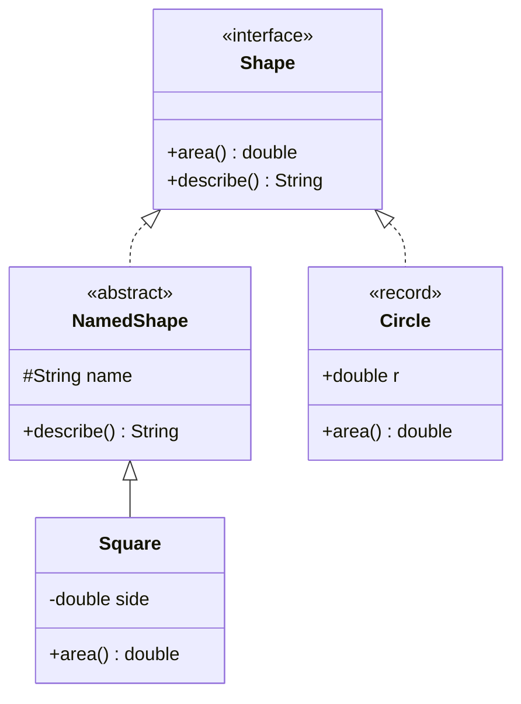
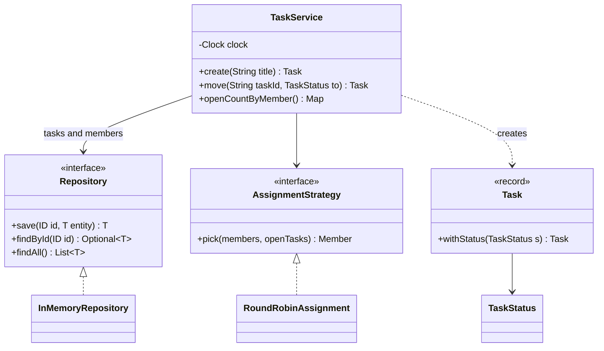
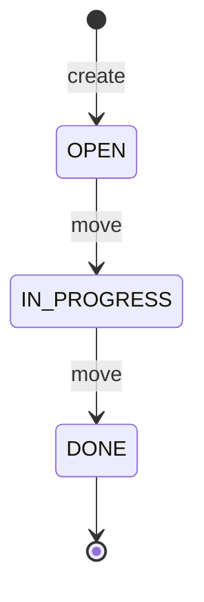

## The short version

This guide is a Python-to-Java translation sheet for machine-coding rounds: same algorithms, different vocabulary.

- **Swap the collections**: `list` → `ArrayList`, `dict` → `HashMap`, `heapq` → `PriorityQueue`, `deque` → `ArrayDeque`, sorted containers and `bisect` → `TreeMap`/`TreeSet`, tuples and dataclasses → records, comprehensions → streams.
- **Remember the structure**: Java is statically typed and everything lives in a class.
- **Compare with `equals`**: `==` compares object references, so use `equals` for value equality.
- **Watch the numbers**: `int` silently overflows, integer division truncates toward zero, and unboxing a `null` throws `NullPointerException`.
- **Start from the template**: a Java 21 starter you can type from memory, with records, enums, unchecked domain exceptions, an in-memory `ConcurrentHashMap` repository, a strategy interface, a service with constructor injection and an injected `Clock`, and a demo `main`.

## Why this note exists

You solve problems comfortably in Python, but the machine-coding round expects **Java** (or the team works in Java, so you want to show it). The ideas transfer one to one. What slows you down is the **vocabulary**: "what is `heapq` called again?", "how do I do `Counter`?", "why did `==` say two equal strings are different?".

This note is a **translation sheet**. Every row says "you write this in Python, you write this in Java", and every Java snippet here was compiled and run on JDK 21. Read it once end to end, then keep it open while you practise two or three machine-coding problems. After that, you won't need it.

Two mindset shifts matter more than any API:

- **Java is statically typed.** Every variable, field, parameter and return value has a type the compiler checks. You pay with more typing; you gain errors at compile time instead of in the demo. `var` (Java 10+) saves keystrokes for local variables only.
- **Everything lives in a class.** There are no top-level functions. Utility functions become `static` methods; "a dict with fixed keys" becomes a **record** or a class.

**How to say it in an interview:** "I'll write this in Java 21 — records for value objects, enums for fixed types, interfaces at the points the requirements say may change, and in-memory repositories backed by `ConcurrentHashMap`."

## Core concepts: the translation tables

### Primitive types and variables

| Python | Java | Note |
|---|---|---|
| `count = 0` | `int count = 0;` | 32-bit. Wraps on overflow (see below). |
| big ints | `long n = 3_000_000_000L;` | 64-bit. Python ints never overflow; Java ints do. |
| `x = 0.75` | `double x = 0.75;` | Same IEEE 754 double as Python `float`. |
| `True` / `False` | `true` / `false` | Type is `boolean`. |
| `'a'` or `"a"` | `'a'` is a `char`, `"a"` is a `String` | Quotes matter in Java. |
| `None` | `null` | Only for objects, never for `int`/`double`. |
| `x = []` (any type) | `var items = new ArrayList<String>();` | `var` infers the type; it is still static. |
| `MAX = 3` (convention) | `final int maxRetries = 3;` | `final` = cannot be reassigned. Class constants: `static final`. |

Java has **primitives** (`int`, `long`, `double`, `boolean`, `char`, plus the rarer `byte`, `short` and `float`) and **wrapper objects** (`Integer`, `Long`, `Double`, `Boolean`, `Character`). Collections can only hold objects, so `List<Integer>` (never `List<int>`). The compiler converts automatically between the two — **autoboxing** (int to Integer) and **unboxing** (Integer to int) — which is convenient and the source of two classic bugs covered later.

```java
int count = 0;                    // 32-bit integer; silently wraps on overflow
long big = 3_000_000_000L;        // 64-bit; note the L suffix and _ separators
double ratio = 0.75;              // 64-bit float, same as Python float
boolean done = false;             // lowercase true/false
char letter = 'a';                // single quotes = one char; double quotes = String
String name = "Asha";
var items = new ArrayList<String>();   // Java 10+: type inferred for locals only
final int maxRetries = 3;         // final = cannot be reassigned
```

### Strings and StringBuilder

Java `String` is immutable, like Python `str`. There are no negative indices and no slicing syntax; you call methods.

```java
String s = "hello world";
int n = s.length();                       // len(s)                    -> 11
char first = s.charAt(0);                 // s[0]                      -> 'h'
char last = s.charAt(s.length() - 1);     // s[-1] (no negative index) -> 'd'
String sub = s.substring(0, 5);           // s[0:5]                    -> "hello"
String[] words = s.split(" ");            // s.split(" ")  (argument is a regex!)
String joined = String.join("-", words);  // "-".join(words)           -> "hello-world"
boolean has = s.contains("lo w");         // "lo w" in s               -> true
int pos = s.indexOf("world");             // s.find("world")           -> 6 (-1 if absent)
String up = s.toUpperCase();              // s.upper()
String clean = "  hi  ".strip();          // "  hi  ".strip()  (Java 11+)
String rev = new StringBuilder(s).reverse().toString();   // s[::-1]
String msg = String.format("%s scored %d", "Asha", 42);   // f"{name} scored {42}"
int digit = '7' - '0';                    // int("7")    -> 7 (char arithmetic gives int)
char next = (char) ('a' + 1);             // chr(ord("a") + 1) -> 'b'
int parsed = Integer.parseInt("123");     // int("123")
String back = String.valueOf(123);        // str(123)
```

`split` takes a **regular expression**, so `"a.b.c".split(".")` returns an empty array (`.` matches every character). Escape it: `split("\\.")`.

Building a string in a loop with `+` creates a new string each time. Use `StringBuilder` — the Java version of "append parts to a list, then join":

```java
StringBuilder sb = new StringBuilder();   // mutable buffer; like collecting parts then "".join
for (int i = 0; i < 5; i++) {
    sb.append(i).append(',');
}
sb.setLength(sb.length() - 1);            // drop the trailing comma
sb.insert(0, '[').append(']');
System.out.println(sb);                   // [0,1,2,3,4]

char[] chars = "listen".toCharArray();    // sorted("listen")
Arrays.sort(chars);
String key = new String(chars);           // "eilnst" -- anagram key
```

### list → ArrayList, and arrays

```java
List<Integer> nums = new ArrayList<>(List.of(3, 1, 2));  // nums = [3, 1, 2]
nums.add(5);                          // nums.append(5)        -> [3, 1, 2, 5]
nums.add(0, 9);                       // nums.insert(0, 9)     -> [9, 3, 1, 2, 5]
int second = nums.get(1);             // nums[1]               -> 3
nums.set(1, 7);                       // nums[1] = 7           -> [9, 7, 1, 2, 5]
int last = nums.get(nums.size() - 1); // nums[-1]              -> 5
nums.remove(Integer.valueOf(9));      // nums.remove(9)  BY VALUE -> [7, 1, 2, 5]
nums.remove(0);                       // del nums[0]     BY INDEX -> [1, 2, 5]
boolean hasTwo = nums.contains(2);    // 2 in nums
Collections.sort(nums);               // nums.sort()
nums.sort(Comparator.reverseOrder()); // nums.sort(reverse=True) -> [5, 2, 1]
List<Integer> copy = new ArrayList<>(nums);   // nums[:]  (a real copy)
List<Integer> view = nums.subList(0, 2);      // nums[0:2] but a VIEW, not a copy
Collections.reverse(copy);            // nums.reverse()        -> copy = [1, 2, 5]

int[] arr = new int[5];               // [0] * 5   (fixed size, primitives, defaults to 0)
Arrays.fill(arr, -1);                 // [-1] * 5
int[][] grid = new int[3][4];         // [[0] * 4 for _ in range(3)] -- rows are independent
System.out.println(Arrays.toString(arr));   // [-1, -1, -1, -1, -1]  (printing arr directly shows [I@1b6d3586-ish)
```

| Python | Java |
|---|---|
| `len(xs)` | `xs.size()` for lists, `arr.length` for arrays (no parentheses), `s.length()` for strings |
| `xs.append(v)` | `xs.add(v)` |
| `xs.pop()` | `xs.remove(xs.size() - 1)` |
| `xs.sort(key=len)` | `xs.sort(Comparator.comparingInt(String::length))` |
| `sorted(xs)` | `xs.stream().sorted().toList()` or copy then `Collections.sort(copy)` |
| `xs.index(v)` | `xs.indexOf(v)` (-1 if absent; Python raises) |
| `[0] * n` | `new int[n]` (zeros) or `new ArrayList<>(Collections.nCopies(n, 0))` |
| `print(xs)` | `System.out.println(xs)` works for lists; arrays need `Arrays.toString(arr)` |

Two traps hide in that block. `nums.remove(0)` removes **index** 0, while `nums.remove(Integer.valueOf(9))` removes the **value** 9 — on a `List<Integer>` the int literal picks the index overload. And `subList` is a **view**: changes show through to the original list.

### dict → HashMap

```java
Map<String, Integer> stock = new HashMap<>();
stock.put("apple", 5);                          // d["apple"] = 5
int apples = stock.get("apple");                // d["apple"]          -> 5
Integer pears = stock.get("pear");              // d.get("pear")       -> null (no KeyError)
int pearsOr0 = stock.getOrDefault("pear", 0);   // d.get("pear", 0)    -> 0
boolean known = stock.containsKey("apple");     // "apple" in d
stock.putIfAbsent("kiwi", 2);                   // d.setdefault("kiwi", 2)
stock.merge("apple", 3, Integer::sum);          // d["apple"] = d.get("apple", 0) + 3 -> 8
stock.computeIfPresent("kiwi", (k, v) -> v - 1);   // update only if present -> 1
stock.remove("kiwi");                           // d.pop("kiwi", None)

for (Map.Entry<String, Integer> e : stock.entrySet()) {   // for k, v in d.items():
    System.out.println(e.getKey() + " -> " + e.getValue());
}
```

| Python | Java | Careful |
|---|---|---|
| `d[k]` | `d.get(k)` | Returns `null` when missing instead of raising `KeyError`. |
| `d.get(k, 0)` | `d.getOrDefault(k, 0)` | |
| `d.setdefault(k, [])` | `d.computeIfAbsent(k, x -> new ArrayList<>())` | Returns the existing or new value, so you can chain `.add(...)`. |
| `d[k] = d.get(k, 0) + 1` | `d.merge(k, 1, Integer::sum)` | One call, no null check. |
| `for k, v in d.items()` | `for (var e : d.entrySet())` then `e.getKey()`, `e.getValue()` | |
| `d.keys()` / `d.values()` | `d.keySet()` / `d.values()` | Live views. |
| insertion-ordered dict (3.7+) | `LinkedHashMap` | Plain `HashMap` has **no** predictable order. |
| sorted dict | `TreeMap` | Keys kept sorted. |

### defaultdict and Counter equivalents

Java has no `defaultdict` or `Counter` class. `computeIfAbsent` and `merge` do the same work in one line each:

```java
// defaultdict(list)
Map<String, List<String>> byFirstLetter = new HashMap<>();
for (String w : List.of("ant", "bee", "asp")) {
    byFirstLetter.computeIfAbsent(w.substring(0, 1), k -> new ArrayList<>()).add(w);
}
// byFirstLetter -> {a=[ant, asp], b=[bee]}

// Counter("banana")
Map<Character, Integer> freq = new HashMap<>();
for (char ch : "banana".toCharArray()) {
    freq.merge(ch, 1, Integer::sum);
}
// freq -> {a=3, b=1, n=2}

// Counter(words) with streams -- note the values are Long, not Integer
Map<String, Long> counts = Stream.of("x", "y", "x")
        .collect(Collectors.groupingBy(w -> w, Collectors.counting()));

// Counter.most_common(1)
Map.Entry<Character, Integer> top = Collections.max(freq.entrySet(), Map.Entry.comparingByValue());
// top -> a=3
```

Note that `Collectors.counting()` produces `Long` values, so the map type is `Map<String, Long>`.

### set → HashSet

```java
Set<Integer> seen = new HashSet<>();
boolean added = seen.add(3);           // true  -- add() tells you if it was new
boolean again = seen.add(3);           // false -- handy for "seen before?" checks
seen.remove(3);

Set<Integer> a = new HashSet<>(List.of(1, 2, 3));
Set<Integer> b = Set.of(2, 3, 4);      // immutable
Set<Integer> union = new HashSet<>(a);  union.addAll(b);      // a | b -> [1, 2, 3, 4]
Set<Integer> common = new HashSet<>(a); common.retainAll(b);  // a & b -> [2, 3]
Set<Integer> onlyA = new HashSet<>(a);  onlyA.removeAll(b);   // a - b -> [1]
```

`TreeSet` keeps elements sorted; `LinkedHashSet` keeps insertion order. Python's set operators become the bulk methods `addAll` (union), `retainAll` (intersection) and `removeAll` (difference) — they **mutate** the receiver, which is why the snippet copies first.

### deque, stack and queue → ArrayDeque

`ArrayDeque` is your Python `deque`, your stack and your BFS queue. Don't use the old `Stack` class — its own Javadoc recommends `Deque` instead.

```java
Deque<Integer> dq = new ArrayDeque<>();   // collections.deque()
dq.offerLast(1);                          // dq.append(1)
dq.offerFirst(0);                         // dq.appendleft(0)   -> [0, 1]
int front = dq.peekFirst();               // dq[0]              -> 0
int left = dq.pollFirst();                // dq.popleft()       -> 0
int right = dq.pollLast();                // dq.pop()           -> 1
Integer none = dq.pollFirst();            // empty -> null (removeFirst() would throw)

Deque<Character> stack = new ArrayDeque<>();   // list used as a stack
stack.push('(');                          // stack.append("(")
stack.push('[');
char top = stack.peek();                  // stack[-1] -> '['
char popped = stack.pop();                // stack.pop() -> '['

Queue<int[]> queue = new ArrayDeque<>();  // BFS queue of (row, col)
queue.offer(new int[] {0, 0});
int[] cell = queue.poll();
```

| Python `deque` | Java `ArrayDeque` (returns null if empty) | Throwing variant (removals throw if empty) |
|---|---|---|
| `append(x)` | `offerLast(x)` / `offer(x)` | `addLast(x)` |
| `appendleft(x)` | `offerFirst(x)` | `addFirst(x)` / `push(x)` |
| `pop()` | `pollLast()` | `removeLast()` |
| `popleft()` | `pollFirst()` / `poll()` | `removeFirst()` / `pop()` |
| `dq[0]` / `dq[-1]` | `peekFirst()` / `peekLast()` | `getFirst()` / `getLast()` |

`ArrayDeque` rejects `null` elements (it uses `null` internally to mean "empty slot").

### heapq → PriorityQueue (with comparators, including max-heap)

`PriorityQueue` is a binary min-heap by default: `peek()`/`poll()` give the **least** element. Unlike `heapq` it owns its storage, and you never have to negate numbers for a max-heap — pass a reversed comparator.

```java
PriorityQueue<Integer> minHeap = new PriorityQueue<>();   // heapq on a list
minHeap.addAll(List.of(5, 1, 3));                       // heapify / heappush
int smallest = minHeap.peek();                          // heap[0]     -> 1
int popped = minHeap.poll();                            // heappop     -> 1

// Max-heap: no more pushing negatives, just reverse the order
PriorityQueue<Integer> maxHeap = new PriorityQueue<>(Comparator.reverseOrder());
maxHeap.addAll(List.of(5, 1, 3));
int largest = maxHeap.poll();                           // -> 5

// heappush(pq, (dist, node)) -- arrays have no natural order, so pass a comparator
PriorityQueue<int[]> pq = new PriorityQueue<>((x, y) -> Integer.compare(x[0], y[0]));
pq.offer(new int[] {7, 2});
pq.offer(new int[] {3, 9});
int[] nearest = pq.poll();                              // -> {3, 9}

// Records + comparator chains read best: priority asc, then name asc
record Job(String name, int priority) {}
PriorityQueue<Job> jobs = new PriorityQueue<>(
        Comparator.comparingInt(Job::priority).thenComparing(Job::name));
jobs.add(new Job("b", 1));
jobs.add(new Job("a", 1));
jobs.add(new Job("z", 0));
String firstJob = jobs.poll().name();                  // -> "z"
```

Rules worth remembering:

- `offer`/`poll` are O(log n), `peek` is O(1), `remove(Object)` and `contains` are O(n).
- **Iterating or printing a `PriorityQueue` is not in sorted order** — the Javadoc says the iterator has no particular order. Poll repeatedly if you need sorted output.
- Write comparators with `Integer.compare(a, b)` or `Comparator.comparingInt(...)`, **not** `a - b`: subtraction overflows for large or negative values and silently breaks the ordering.
- It is not thread-safe; the concurrent version is `PriorityBlockingQueue`.

### Sorted containers and bisect → TreeMap / TreeSet

Python has no sorted map in the standard library (people use `sortedcontainers` or `bisect`). Java has `TreeMap` and `TreeSet` built in — red-black trees with O(log n) insert, delete and **neighbour queries**. They show up constantly in machine coding: "find the nearest free slot", "price for the largest threshold below X", "book a meeting room interval".

```java
TreeMap<Integer, String> slots = new TreeMap<>(Map.of(10, "a", 20, "b", 30, "c"));
Integer floor = slots.floorKey(25);      // largest key <= 25   -> 20
Integer ceil = slots.ceilingKey(25);     // smallest key >= 25  -> 30
Integer lower = slots.lowerKey(20);      // largest key < 20    -> 10
Integer higher = slots.higherKey(30);    // smallest key > 30   -> null
int firstKey = slots.firstKey();         // -> 10
SortedMap<Integer, String> below20 = slots.headMap(20);   // keys < 20   -> {10=a}
SortedMap<Integer, String> from20 = slots.tailMap(20);    // keys >= 20  -> {20=b, 30=c}
Map.Entry<Integer, String> min = slots.pollFirstEntry();  // remove + return 10=a
// below20 is now {} -- headMap/tailMap are live VIEWS of slots, not copies

TreeSet<Integer> scores = new TreeSet<>(List.of(50, 10, 90));
Integer atMost60 = scores.floor(60);     // -> 50
Integer atLeast60 = scores.ceiling(60);  // -> 90

// bisect on a sorted list: Collections.binarySearch
List<Integer> sorted = List.of(10, 20, 30);
int found = Collections.binarySearch(sorted, 20);     // -> 1
int missing = Collections.binarySearch(sorted, 25);   // -> -(insertionPoint) - 1 = -3
int insertAt = -missing - 1;                          // bisect_left -> 2
```

| Need | `TreeMap` | `TreeSet` |
|---|---|---|
| largest at most x | `floorKey(x)` / `floorEntry(x)` | `floor(x)` |
| smallest at least x | `ceilingKey(x)` | `ceiling(x)` |
| strictly below / above | `lowerKey(x)` / `higherKey(x)` | `lower(x)` / `higher(x)` |
| min / max | `firstKey()` / `lastKey()` | `first()` / `last()` |
| pop min / max | `pollFirstEntry()` / `pollLastEntry()` | `pollFirst()` / `pollLast()` |
| range | `headMap`, `tailMap`, `subMap` (views) | `headSet`, `tailSet`, `subSet` |

All neighbour methods return `null` when no such key exists, so store the result in an `Integer`, not an `int`.

### tuples → records

Python tuples are handy for "a pair of values", for dict keys and for returning several values. In Java, define a **record** (Java 16+): a one-line immutable class with constructor, accessors, `equals`, `hashCode` and `toString` generated for you.

```java
record Point(int x, int y) {}            // like a frozen dataclass / namedtuple

Point p = new Point(1, 2);
int x = p.x();                           // accessor is x(), not getX()
Set<Point> visited = new HashSet<>();
visited.add(new Point(1, 2));
boolean seen = visited.contains(new Point(1, 2));   // true: equals/hashCode are generated

Set<int[]> broken = new HashSet<>();
broken.add(new int[] {1, 2});
boolean found = broken.contains(new int[] {1, 2});  // FALSE: arrays use identity equality
```

Records can be declared inside a method (local records), as above. Use them for grid cells, (distance, node) heap entries, return values and any value object in your design. Never use an `int[]` as a `HashMap`/`HashSet` key — arrays compare by identity.

### List comprehensions → streams

Streams (Java 8+) are the closest thing to comprehensions and generator expressions. They are lazy and run once.

```java
List<Integer> nums = List.of(1, 2, 3, 4, 5);
List<Integer> squares = nums.stream().map(n -> n * n).toList();         // [n*n for n in nums]
List<Integer> evens = nums.stream().filter(n -> n % 2 == 0).toList();   // [n for n in nums if n % 2 == 0]
int total = nums.stream().mapToInt(Integer::intValue).sum();            // sum(nums) -> 15
int biggest = Collections.max(nums);                                    // max(nums) -> 5
boolean anyBig = nums.stream().anyMatch(n -> n > 4);                    // any(n > 4 for n in nums)
boolean allPos = nums.stream().allMatch(n -> n > 0);                    // all(n > 0 for n in nums)
List<Integer> firstFive = IntStream.range(0, 5).boxed().toList();       // list(range(5))
String csv = nums.stream().map(String::valueOf).collect(Collectors.joining(","));  // ",".join(map(str, nums))
Map<Integer, List<String>> byLength = Stream.of("hi", "yo", "hey")     // group by len
        .collect(Collectors.groupingBy(String::length));
Set<Integer> uniqueLengths = Stream.of("hi", "yo", "hey")             // {len(w) for w in words}
        .map(String::length).collect(Collectors.toSet());
```

`Stream.toList()` (Java 16+) returns an **unmodifiable** list; use `collect(Collectors.toList())` or `new ArrayList<>(...)` if you need to add to it. In a timed round, a plain `for` loop is always acceptable — use streams where they read more clearly, not to show off. For depth on how stream pipelines execute, see [Core Java](/learn/notes/java-core-language/).

### Lambdas and functional interfaces

A Java lambda is an implementation of a **functional interface** (an interface with exactly one abstract method). The common ones live in `java.util.function`:

```java
Function<Integer, Integer> square = v -> v * v;              // lambda v: v * v
BiFunction<Integer, Integer, Integer> add = (a, b) -> a + b;
Predicate<String> isBlank = String::isBlank;                 // method reference
Supplier<List<String>> newList = ArrayList::new;             // constructor reference
Consumer<String> printer = System.out::println;

int sixteen = square.apply(4);
int five = add.apply(2, 3);
boolean blank = isBlank.test("  ");

// Captured locals must be effectively final. To count inside a lambda, use a holder:
AtomicInteger calls = new AtomicInteger();
List.of("a", "b").forEach(s -> calls.incrementAndGet());
```

| Python | Java type | Call it with |
|---|---|---|
| `f(x)` returning a value | `Function<T, R>` | `apply(x)` |
| `f(x, y)` | `BiFunction<T, U, R>` | `apply(x, y)` |
| `f(x)` returning bool | `Predicate<T>` | `test(x)` |
| `f()` returning a value | `Supplier<T>` | `get()` |
| `f(x)` returning nothing | `Consumer<T>` | `accept(x)` |
| `f()` returning nothing | `Runnable` | `run()` |
| `key=` for sorting | `Comparator<T>` | `compare(a, b)` |

Your own one-method interfaces (a `PricingStrategy`, a `PaymentProcessor`) also accept lambdas, which makes fakes in tests one line long.

### Exceptions

```java
try {
    int v = Integer.parseInt("abc");                    // int("abc")
} catch (NumberFormatException e) {                     // except ValueError as e:
    System.out.println("bad number: " + e.getMessage());
} finally {
    System.out.println("always runs");
}

// with open(...) as f:   ->   try-with-resources closes it for you
try (BufferedReader reader = new BufferedReader(new StringReader("line1\nline2"))) {
    String firstLine = reader.readLine();               // readLine() declares IOException (checked)
    System.out.println(firstLine);
}

// raise InsufficientFundsException("...")   (class defined as: extends RuntimeException)
long balance = 100, withdraw = 150;
try {
    if (withdraw > balance) throw new InsufficientFundsException("balance " + balance + " < " + withdraw);
} catch (InsufficientFundsException e) {
    System.out.println(e.getMessage());
}
```

The one real difference: Java has **checked exceptions** (subclasses of `Exception` but not `RuntimeException`, such as `IOException`). The compiler forces you to catch them or declare `throws`. Domain errors in machine coding should extend **`RuntimeException`** (unchecked), so your service methods stay clean.

| Python | Java |
|---|---|
| `raise ValueError(msg)` | `throw new IllegalArgumentException(msg)` |
| `RuntimeError` for a bad state | `IllegalStateException` |
| `KeyError` | no exception — `map.get` returns `null` |
| `IndexError` | `IndexOutOfBoundsException` (`ArrayIndexOutOfBoundsException` for arrays) |
| `ZeroDivisionError` | `ArithmeticException` for **integer** division only; `1.0 / 0` is `Infinity` |
| `AttributeError` on `None` | `NullPointerException` |
| `NotImplementedError` | `UnsupportedOperationException` |
| `with open(...) as f` | `try (var r = ...) { }` — try-with-resources, for anything `AutoCloseable` |

### Enums

Java enums are full classes: each constant is a single instance, can carry fields and methods, and works in `switch`. Use them for every fixed set in a design — vehicle types, order statuses, directions.

```java
enum Direction {
    NORTH(0, 1), EAST(1, 0), SOUTH(0, -1), WEST(-1, 0);   // constants can carry data

    final int dx, dy;
    Direction(int dx, int dy) { this.dx = dx; this.dy = dy; }

    Direction turnRight() { return values()[(ordinal() + 1) % values().length]; }
}
```

```java
Direction d = Direction.valueOf("NORTH");      // Direction["NORTH"]
Direction r = d.turnRight();                   // EAST
boolean same = (r == Direction.EAST);          // compare enums with == (safe: one instance each)
String axis = switch (r) {                     // switch expression (Java 14+)
    case NORTH, SOUTH -> "vertical";
    case EAST, WEST -> "horizontal";
};
Map<Direction, Integer> steps = new EnumMap<>(Direction.class);   // fast map keyed by enum
steps.merge(r, 1, Integer::sum);
for (Direction each : Direction.values()) { /* iterate all constants in declaration order */ }
```

The `switch` expression above has no `default`: the compiler checks that every constant is covered, so adding a new constant later produces a compile error exactly where you need to handle it.

### Interfaces and abstract classes

| Python | Java |
|---|---|
| `class Shape(ABC)` with `@abstractmethod` | `interface Shape` (no state) or `abstract class` (shared state) |
| duck typing | not available — the class must declare `implements Shape` |
| multiple inheritance | one superclass only, but any number of interfaces |
| `super().__init__(name)` | `super(name);` as the first line of the constructor |

```java
interface Shape {                                   // like a Python ABC / Protocol
    double area();                                  // abstract: implementers must provide it
    default String describe() {                     // default method (Java 8+): shared behaviour
        return getClass().getSimpleName() + " with area " + String.format("%.1f", area());
    }
}

abstract class NamedShape implements Shape {        // abstract class: shared state + partial impl
    protected final String name;
    NamedShape(String name) { this.name = name; }
    @Override public String describe() { return name + ": " + Shape.super.describe(); }
}

final class Square extends NamedShape {
    private final double side;
    Square(String name, double side) { super(name); this.side = side; }
    @Override public double area() { return side * side; }
}

record Circle(double r) implements Shape {          // records can implement interfaces too
    public double area() { return Math.PI * r * r; }
}
```

```java
List<Shape> shapes = List.of(new Square("tile", 2), new Circle(1));
for (Shape s : shapes) {
    System.out.println(s.describe());   // polymorphism: each object picks its own area()
}
// tile: Square with area 4.0
// Circle with area 3.1
```

The same types as a class diagram: one interface, an abstract class that adds shared state, and two concrete shapes:



Rule of thumb: start with an **interface**; add an abstract class only when several implementations really share fields or code. Java 17 added **sealed** types, and Java 21 lets `switch` pattern-match over them — useful when the set of variants is closed:

```java
sealed interface Payment permits Card, Upi {}
record Card(String last4) implements Payment {}
record Upi(String vpa) implements Payment {}

class PaymentLabels {
    static String label(Payment p) {
        return switch (p) {                          // Java 21 pattern matching for switch
            case Card c -> "card ending " + c.last4();
            case Upi u  -> "UPI " + u.vpa();
        };                                           // no default needed: the compiler knows all cases
    }
}
```

### Generics basics

Python type hints are optional and unchecked; Java generics are checked by the compiler and then **erased** at runtime (the JVM only sees `Box`, not `Box<String>`).

```java
class Box<T> {                                       // generic class
    private final T value;
    Box(T value) { this.value = value; }
    T get() { return value; }
    <R> Box<R> map(Function<T, R> f) { return new Box<>(f.apply(value)); }
}

class GenericUtils {
    // bounded type parameter: T must be comparable to itself
    static <T extends Comparable<T>> T maxOf(List<T> items) {
        T best = items.get(0);
        for (T item : items) if (item.compareTo(best) > 0) best = item;
        return best;
    }
}
```

```java
Box<String> name = new Box<>("asha");
Box<Integer> len = name.map(String::length);           // Box<Integer> holding 4
String longest = GenericUtils.maxOf(List.of("kiwi", "fig", "banana"));   // "kiwi" (alphabetical max)
// List<int> nope;  -> compile error: generics need reference types, use List<Integer>
```

Because of erasure you cannot write `new T()` or `new T[n]`, and you cannot test an arbitrary `Object` with `obj instanceof List<String>` (the runtime can only check `instanceof List`). Generics only take reference types, so it's `List<Integer>`, `Map<Character, Integer>`.

### equals and hashCode

Python's `==` calls `__eq__`; Java's `==` on objects compares **references**. To compare by value, override `equals`, and whenever you override `equals` you **must** override `hashCode` consistently (equal objects must have equal hash codes), or `HashMap`/`HashSet` will lose your objects.

```java
final class Money {
    private final String currency;
    private final long amountMinor;   // paise/cents: never store money in double

    Money(String currency, long amountMinor) { this.currency = currency; this.amountMinor = amountMinor; }

    @Override public boolean equals(Object o) {                  // Python __eq__
        if (this == o) return true;
        if (!(o instanceof Money m)) return false;               // pattern matching instanceof (Java 16+)
        return amountMinor == m.amountMinor && currency.equals(m.currency);
    }
    @Override public int hashCode() { return Objects.hash(currency, amountMinor); }   // Python __hash__
    @Override public String toString() { return currency + " " + amountMinor; }       // Python __repr__
}
```

Records do all of this for you, which is the main reason to prefer them for value objects. Never put an object in a `HashSet` and then mutate a field used by `hashCode` — it ends up in the wrong bucket and `contains` returns false. More on the contract in [Java Collections and HashMap internals](/learn/notes/java-collections-hashmap/).

### Iteration patterns

```java
for (int i = 0; i < n; i++) { }                  // for i in range(n)
for (int i = n - 1; i >= 0; i--) { }             // for i in reversed(range(n))
for (int i = 0; i < n; i += 2) { }               // for i in range(0, n, 2)
for (String w : words) { }                       // for w in words
for (int i = 0; i < words.size(); i++) {         // for i, w in enumerate(words)
    String w = words.get(i);
}
for (var e : map.entrySet()) { }                 // for k, v in d.items()
for (int i = 0; i < Math.min(a.size(), b.size()); i++) {   // for x, y in zip(a, b)
    log.append(a.get(i)).append(b.get(i));
}
for (int lo = 0, hi = n - 1; lo < hi; lo++, hi--) { }      // two pointers

// [w for w in words if w]  -- remove while iterating: use removeIf, never list.remove in a for-each
words.removeIf(String::isEmpty);
```

Calling `list.remove(...)` inside a for-each over that list throws `ConcurrentModificationException` (Java iterators are **fail-fast**). Use `removeIf`, an explicit `Iterator` and `it.remove()`, or build a new list.

### Integer overflow and division differences

This is where Python habits produce wrong answers silently.

```java
int max = Integer.MAX_VALUE;              // 2147483647
int wrapped = max + 1;                    // -2147483648  (Python would give 2147483648)
long widened = (long) max + 1;            // 2147483648  -- widen BEFORE the math
int product = 100_000 * 100_000;          // 1410065408  silently wrong!
long okProduct = 100_000L * 100_000;      // 10000000000
// Math.addExact(max, 1) throws ArithmeticException instead of wrapping

int q1 = 7 / 2;                           // 3    (Python 7 / 2 == 3.5, 7 // 2 == 3)
double q2 = 7 / 2.0;                      // 3.5
int q3 = -7 / 2;                          // -3   truncates toward zero (Python -7 // 2 == -4)
int r1 = -7 % 2;                          // -1   sign follows the dividend (Python -7 % 2 == 1)
int q4 = Math.floorDiv(-7, 2);            // -4   Python-style //
int r2 = Math.floorMod(-7, 2);            // 1    Python-style %
int mid = 0 + (max - 0) / 2;              // lo + (hi - lo) / 2 never overflows

long rounded = Math.round(2.5);           // 3   (Python round(2.5) == 2, banker's rounding)
int truncated = (int) 3.99;               // 3   casting drops the fraction
BigInteger huge = BigInteger.valueOf(2).pow(100);   // when you truly need Python-sized ints
```

| Expression | Python | Java (int) |
|---|---|---|
| `7 / 2` | `3.5` | `3` |
| `-7 // 2` vs `-7 / 2` | `-4` | `-3` (truncates toward zero) |
| `-7 % 2` | `1` | `-1` (sign of the dividend) |
| Python-style floor | `//`, `%` | `Math.floorDiv`, `Math.floorMod` |
| `2 ** 31` | `2147483648` | `1 << 31` is `Integer.MIN_VALUE`; use `1L << 31` |
| `round(2.5)` | `2` (round half to even) | `Math.round(2.5)` is `3` |

Habits that prevent bugs: compute midpoints as `lo + (hi - lo) / 2`; make one operand `long` **before** multiplying (`100_000L * 100_000`); use `Math.addExact`/`multiplyExact` when overflow should be an error; keep money in `long` minor units (paise, cents) or `BigDecimal`, never `double`.

### `==` vs `equals`

```java
String s1 = "hi";
String s2 = new String("hi");
boolean sameObject = (s1 == s2);          // false -- == compares references (Python: is)
boolean sameText = s1.equals(s2);         // true  -- equals compares content (Python: ==)

Integer a = 127, b = 127;
Integer c = 128, d = 128;
boolean small = (a == b);                 // true  -- boxing -128..127 is guaranteed to reuse objects
boolean large = (c == d);                 // false on a default JVM -- no guarantee above 127
boolean safe = c.equals(d);               // true  -- always use equals for boxed types
```

The `Integer` case is nasty because tests with small numbers pass. The JLS (section 5.1.7) only guarantees that boxing the same constant in the range -128 to 127 yields the same object; for anything else, `==` may or may not be true. Code like `list.get(i) == list.get(j)` on a `List<Integer>` therefore works in your quick test and fails on real data. **Rule: `==` for primitives and enums; `equals` for everything else.**

### null handling and Optional

```java
Map<String, Integer> scores = new HashMap<>();
Integer missing = scores.get("ravi");      // null -- no KeyError
// int boom = scores.get("ravi");          // NullPointerException: unboxing null

List<String> names = List.of("Ravi", "Asha", "Arun");
Optional<String> firstA = names.stream().filter(s -> s.startsWith("A")).findFirst();
String shown = firstA.orElse("nobody");                       // "Asha"
int len = firstA.map(String::length).orElse(0);               // 4
firstA.ifPresent(s -> System.out.println("found " + s));
String must = firstA.orElseThrow();                           // throws if empty (Java 10+)

String name = Objects.requireNonNullElse(null, "guest");      // x if x is not None else "guest"
```

- `Optional` is meant for **return types** where "no result" is normal (`findById`, `findFirst`). The Javadoc says exactly that. Don't use it for fields or parameters, and never return a `null` `Optional`.
- Prefer `orElse`, `orElseThrow`, `map`, `ifPresent` over `isPresent()` + `get()`.
- `Objects.requireNonNull(x, "x")` at constructor entry turns a later mysterious `NullPointerException` into an immediate clear one.
- `List.of`, `Set.of` and `Map.of` (Java 9+) are immutable **and** reject `null`. `ConcurrentHashMap`, `ArrayDeque` and `TreeMap` (with natural ordering) also reject `null`; `HashMap` allows one `null` key.

## OOP and SOLID quick recap (in Java)

Machine-coding evaluators grade **modularity** and **extensibility**, which is SOLID in practice. The four OOP ideas first, mapped from Python:

- **Encapsulation** — `private` fields plus methods that enforce rules. Python's `_name` is a convention; Java's `private` is enforced by the compiler.
- **Abstraction** — callers depend on an interface (`PricingStrategy`), not the concrete class.
- **Inheritance** — `extends` (one parent) and `implements` (many interfaces). Prefer **composition** (hold a reference to a collaborator) over deep inheritance trees.
- **Polymorphism** — one call, different behaviour per runtime type (the `describe()` loop above).

Now one tiny example per SOLID principle. For the reasoning, smells and interview questions, read [SOLID Principles with Real Examples](/learn/notes/solid-principles/).

**S — Single Responsibility:** one class, one reason to change.

```java
// Before: Invoice computes totals AND prints AND saves. After: one reason to change each.
record Invoice(String id, long amount) {}
class InvoicePrinter { String print(Invoice i) { return "Invoice " + i.id() + ": " + i.amount(); } }
class InvoiceRepository { private final Map<String, Invoice> store = new HashMap<>();
    void save(Invoice i) { store.put(i.id(), i); } }
```

**O — Open/Closed:** add behaviour by adding a class, not by editing an `if` chain.

```java
interface DiscountRule { long apply(long amount); }
class NoDiscount implements DiscountRule { public long apply(long a) { return a; } }
class FestiveDiscount implements DiscountRule { public long apply(long a) { return a * 90 / 100; } }
// New rule = new class. Checkout never changes.
class Checkout {
    private final DiscountRule rule;
    Checkout(DiscountRule rule) { this.rule = rule; }
    long total(long amount) { return rule.apply(amount); }
}
```

**L — Liskov Substitution:** a subtype must be usable anywhere its parent is expected.

```java
// A subtype must keep the parent's promises. Here every Bird can fly, so Penguin
// would break callers. Fix: split the abstraction instead of throwing in the subclass.
interface Bird { String name(); }
interface FlyingBird extends Bird { default String fly() { return name() + " flies"; } }
record Sparrow(String name) implements FlyingBird {}
record Penguin(String name) implements Bird {}          // never asked to fly
```

**I — Interface Segregation:** many small interfaces beat one fat one.

```java
// Small, focused interfaces: a basic printer isn't forced to implement scan().
interface Printer { String print(String doc); }
interface Scanner2 { String scan(); }
class BasicPrinter implements Printer { public String print(String d) { return "printed " + d; } }
class OfficeMachine implements Printer, Scanner2 {
    public String print(String d) { return "printed " + d; }
    public String scan() { return "scanned page"; }
}
```

**D — Dependency Inversion:** depend on abstractions and receive them through the constructor.

```java
interface Notifier { void send(String to, String msg); }
class EmailNotifier implements Notifier {
    public void send(String to, String msg) { System.out.println("email to " + to + ": " + msg); }
}
class OrderService {
    private final Notifier notifier;                    // depends on the abstraction...
    OrderService(Notifier notifier) { this.notifier = notifier; }   // ...injected from outside
    void place(String user) { notifier.send(user, "order placed"); }
}
```

```java
System.out.println(new InvoicePrinter().print(new Invoice("I-1", 900)));    // SRP
System.out.println(new Checkout(new FestiveDiscount()).total(1000));         // OCP -> 900
System.out.println(new Sparrow("sparrow").fly());                            // LSP
System.out.println(new OfficeMachine().scan());                              // ISP
new OrderService(new EmailNotifier()).place("asha@example.com");             // DIP
// A test can pass a fake: new OrderService((to, msg) -> sent.add(msg))
```

## How it works: a machine-coding Java starter template

Type this skeleton from memory in the first 15 minutes of a round and fill in the domain. It shows every piece evaluators look for: requirements written down, records for value objects, enums with rules, custom unchecked exceptions, a generic repository interface with an in-memory `ConcurrentHashMap` implementation, a strategy interface at the axis of change, a service with constructor injection and an injectable `Clock`, and a runnable demo. One file with a single `public class Main` and package-private classes compiles with `javac Main.java`.

```java
import java.time.Clock;
import java.time.Instant;
import java.util.*;
import java.util.concurrent.ConcurrentHashMap;
import java.util.concurrent.atomic.AtomicLong;

/*
 * Requirements (agreed with the interviewer):
 *  - Create tasks, assign them to members, move them through OPEN -> IN_PROGRESS -> DONE.
 *  - Assignment rule is pluggable (round-robin now, least-loaded later).
 *  - In-memory only; safe if several threads call the service.
 */

// ---------- model ----------
enum TaskStatus {
    OPEN, IN_PROGRESS, DONE;

    boolean canMoveTo(TaskStatus next) {
        return next.ordinal() == this.ordinal() + 1;      // only forward, one step at a time
    }
}

record Member(String id, String name) {}

record Task(String id, String title, TaskStatus status, String assigneeId, Instant createdAt) {
    Task {                                                 // compact constructor = validation
        Objects.requireNonNull(id);
        if (title == null || title.isBlank()) throw new IllegalArgumentException("title required");
    }
    Task withStatus(TaskStatus s) { return new Task(id, title, s, assigneeId, createdAt); }
}

// ---------- exceptions ----------
class NotFoundException extends RuntimeException {
    NotFoundException(String what, String id) { super(what + " not found: " + id); }
}
class InvalidTransitionException extends RuntimeException {
    InvalidTransitionException(TaskStatus from, TaskStatus to) { super(from + " -> " + to + " not allowed"); }
}

// ---------- repository ----------
interface Repository<ID, T> {
    T save(ID id, T entity);
    Optional<T> findById(ID id);
    List<T> findAll();
}

class InMemoryRepository<ID, T> implements Repository<ID, T> {
    private final Map<ID, T> store = new ConcurrentHashMap<>();
    public T save(ID id, T entity) { store.put(id, entity); return entity; }
    public Optional<T> findById(ID id) { return Optional.ofNullable(store.get(id)); }
    public List<T> findAll() { return List.copyOf(store.values()); }
}

// ---------- strategy ----------
interface AssignmentStrategy {
    Member pick(List<Member> members, List<Task> openTasks);
}

class RoundRobinAssignment implements AssignmentStrategy {
    private final AtomicLong next = new AtomicLong();
    public Member pick(List<Member> members, List<Task> openTasks) {
        if (members.isEmpty()) throw new IllegalStateException("no members");
        return members.get((int) (next.getAndIncrement() % members.size()));
    }
}

// ---------- service ----------
class TaskService {
    private final Repository<String, Task> tasks;
    private final Repository<String, Member> members;
    private final AssignmentStrategy assignment;
    private final Clock clock;
    private final AtomicLong seq = new AtomicLong();

    TaskService(Repository<String, Task> tasks, Repository<String, Member> members,
                AssignmentStrategy assignment, Clock clock) {
        this.tasks = tasks; this.members = members; this.assignment = assignment; this.clock = clock;
    }

    Task create(String title) {
        List<Member> team = members.findAll().stream()
                .sorted(Comparator.comparing(Member::id)).toList();
        Member who = assignment.pick(team, tasks.findAll());
        String id = "T-" + seq.incrementAndGet();
        return tasks.save(id, new Task(id, title, TaskStatus.OPEN, who.id(), clock.instant()));
    }

    // synchronized keeps read-check-write atomic; fine for an interview, mention per-key locks to scale
    synchronized Task move(String taskId, TaskStatus to) {
        Task t = tasks.findById(taskId).orElseThrow(() -> new NotFoundException("task", taskId));
        if (!t.status().canMoveTo(to)) throw new InvalidTransitionException(t.status(), to);
        return tasks.save(taskId, t.withStatus(to));
    }

    Map<String, Long> openCountByMember() {
        Map<String, Long> out = new TreeMap<>();
        for (Task t : tasks.findAll())
            if (t.status() != TaskStatus.DONE) out.merge(t.assigneeId(), 1L, Long::sum);
        return out;
    }
}

// ---------- demo ----------
public class Main {
    public static void main(String[] args) {
        Repository<String, Member> members = new InMemoryRepository<>();
        members.save("m1", new Member("m1", "Asha"));
        members.save("m2", new Member("m2", "Ravi"));

        TaskService service = new TaskService(new InMemoryRepository<>(), members,
                new RoundRobinAssignment(), Clock.systemUTC());

        Task a = service.create("Design schema");
        Task b = service.create("Write API");
        service.create("Add tests");
        System.out.println(a.id() + " -> " + a.assigneeId() + ", " + b.id() + " -> " + b.assigneeId());

        service.move(a.id(), TaskStatus.IN_PROGRESS);
        service.move(a.id(), TaskStatus.DONE);
        try {
            service.move(b.id(), TaskStatus.DONE);              // skips IN_PROGRESS
        } catch (InvalidTransitionException e) {
            System.out.println("Rejected: " + e.getMessage());
        }
        System.out.println("Open per member: " + service.openCountByMember());
    }
}
```

Output:

```text
T-1 -> m1, T-2 -> m2
Rejected: OPEN -> DONE not allowed
Open per member: {m1=1, m2=1}
```

The template's classes at a glance (`Repository` and `InMemoryRepository` are generic in `ID` and `T`):



`TaskStatus.canMoveTo` only allows one step forward, so the lifecycle is:



Design notes on the template:

- **Records are immutable**, so a status change creates a new `Task` (`withStatus`) and saves it. That makes the read-check-write in `move` a race if two threads move the same task, which is why `move` is `synchronized`. For a bigger system, say you'd lock per task id or use `ConcurrentHashMap.compute` on the task's key. See [Java concurrency and locks](/learn/notes/java-concurrency-locks/).
- `ConcurrentHashMap` makes individual `put`/`get` calls thread-safe; it does **not** make a sequence of calls atomic.
- `AtomicLong` gives unique ids across threads without locking.
- `Clock` is injected so tests can control time. Never call `Instant.now()` inside business logic.
- In an IDE with time to spare, split into packages (`model`, `repository`, `strategy`, `service`, `exception`) as described in [Machine Coding Rounds: A 60-Minute Strategy](/learn/notes/machine-coding-strategy/). A worked full-size problem is [LLD: Parking Lot](/learn/notes/lld-parking-lot/).

## Common pitfalls (Java gotchas for Python people)

1. **`==` on strings or boxed numbers.** Use `equals`. `==` is for primitives and enums.
2. **Integer overflow and truncating division.** `int` wraps; `-7 / 2` is `-3`; `-7 % 2` is `-1`. Widen to `long` before multiplying.
3. **Unboxing `null`.** `int n = map.get(k);` throws `NullPointerException` when the key is missing. Use `getOrDefault`.
4. **`remove(int)` vs `remove(Object)` on `List<Integer>`.** `list.remove(1)` removes index 1.
5. **Modifying a collection during for-each** → `ConcurrentModificationException`. Use `removeIf` or an iterator.
6. **Assuming `HashMap` keeps insertion order.** It doesn't; use `LinkedHashMap` (or `TreeMap` for sorted).
7. **Immutable factory collections.** `List.of`, `Map.of`, `Stream.toList()` throw `UnsupportedOperationException` on `add`; `Arrays.asList` is fixed-size. Wrap in `new ArrayList<>(...)` when you need to mutate.
8. **Comparator by subtraction.** `(a, b) -> a - b` overflows; use `Integer.compare` or `Comparator.comparingInt`.
9. **`char` arithmetic gives `int`.** `'a' + 'b'` is `195`, not `"ab"`. Cast with `(char)` or start from a `String`.
10. **Printing arrays.** `System.out.println(arr)` prints something like `[I@1b6d3586`; use `Arrays.toString` / `Arrays.deepToString`.
11. **Arrays and mutable objects as map keys.** Arrays use identity; mutating a key's fields after insertion loses it. Use records.
12. **`split` takes a regex.** Escape `.`, `|`, `$` and friends.
13. **Forgetting `hashCode` when overriding `equals`.** Your objects vanish from `HashSet`/`HashMap`.
14. **Catching `Exception` everywhere.** Catch the specific domain exception; let programming errors surface.
15. **Mutable statics and singletons as hidden globals.** They make tests share state. Pass dependencies through constructors.
16. **Old-style `switch` fall-through.** The `case X:` form falls through without `break`; the arrow form `case X ->` (Java 14+) does not.

## Practice questions

<Practice>

<QA q="What is the Java equivalent of Python heapq, and how do you make a max-heap?" level="easy">

`PriorityQueue<E>`. By default it is a **min-heap** ordered by natural order: `peek()` and `poll()` return the smallest element; `offer`/`poll` are O(log n).

For a max-heap pass a reversed comparator: `new PriorityQueue<>(Comparator.reverseOrder())`. No negation trick needed. For tuples like (distance, node), use an `int[]` with `(a, b) -> Integer.compare(a[0], b[0])`, or better a record with `Comparator.comparingInt(Entry::dist)`.

</QA>

<QA q="How do you write Counter and defaultdict(list) in Java?" level="easy">

- Counter: `freq.merge(key, 1, Integer::sum)` on a `HashMap`, or with streams `Collectors.groupingBy(x -> x, Collectors.counting())` (values are `Long`).
- defaultdict(list): `map.computeIfAbsent(key, k -> new ArrayList<>()).add(value)` — it returns the existing list or creates, stores and returns a new one.

</QA>

<QA q="Why can s1 == s2 be false when both strings contain hello?" level="easy">

On objects, `==` compares **references** (is it the same object?), like Python's `is`. Two `String` objects with the same characters can be different objects, for example when one is built at runtime or with `new String(...)`. Use `s1.equals(s2)` to compare content. String literals with the same text are always the same interned (pooled) object, which is why `==` "works" in small tests with literals and then fails on strings read from input or built at runtime — never rely on it.

</QA>

<QA q="What do -7 / 2 and -7 % 2 return in Java, and how do you get Python's behaviour?" level="medium">

Java integer division truncates toward zero, so `-7 / 2` is `-3`, and the remainder takes the sign of the dividend, so `-7 % 2` is `-1`. Python floors: `-7 // 2` is `-4` and `-7 % 2` is `1`. Use `Math.floorDiv(-7, 2)` and `Math.floorMod(-7, 2)` for Python semantics — common when wrapping indices in a circular buffer.

</QA>

<QA q="Integer a = 1000, b = 1000; why is a == b risky even though a == b is true for 100?" level="medium">

`Integer` is an object, so `==` compares references. The JLS only guarantees that boxing a constant between -128 and 127 reuses the same object; outside that range a default JVM creates separate objects and `==` is false. Code that compares `List<Integer>` elements or map values with `==` passes small tests and breaks on real data. Compare boxed values with `equals`, or unbox to `int` first.

</QA>

<QA q="Which Java class replaces sortedcontainers or bisect, and which methods matter?" level="medium">

`TreeMap` (sorted map) and `TreeSet` (sorted set), both red-black trees with O(log n) operations. The neighbour queries are the reason to use them: `floorKey`/`floor` (largest at most x), `ceilingKey`/`ceiling` (smallest at least x), `lowerKey`, `higherKey`, `firstKey`, `lastKey`, `pollFirstEntry`, plus range views `headMap`, `tailMap`, `subMap`. They return `null` when nothing qualifies. For a plain sorted list, `Collections.binarySearch` returns the index, or `-(insertionPoint) - 1` when missing.

</QA>

<QA q="When should you use a record instead of a class?" level="medium">

When the type is a **value**: its identity is just its data, and it shouldn't change after creation — grid points, money amounts, tickets, events, DTOs, heap entries, multiple return values. Records give you a canonical constructor, accessors, `equals`, `hashCode` and `toString` for free, and a compact constructor for validation. Use a regular class when the object has a lifecycle and mutable state guarded by rules (a parking spot that gets occupied and released, an account balance).

</QA>

<QA q="Why should domain exceptions extend RuntimeException in a machine-coding round?" level="medium">

Checked exceptions (subclasses of `Exception` but not `RuntimeException`) must be caught or declared with `throws` on every method they pass through, and they don't work with standard functional interfaces in lambdas. For business rule failures like `ParkingFullException` or `InsufficientFundsException`, unchecked exceptions keep signatures clean, still carry a clear name and message, and can be caught where it matters (the demo or the API layer). Checked exceptions remain right for recoverable I/O in library code.

</QA>

<QA q="What is the difference between List.of, Arrays.asList and new ArrayList?" level="medium">

- `List.of(...)` (Java 9+): fully **immutable**; any add, remove or set throws `UnsupportedOperationException`; `null` elements are rejected.
- `Arrays.asList(...)`: **fixed-size** view over an array; `set` works, `add` and `remove` throw; allows `null`.
- `new ArrayList<>(anyCollection)`: a mutable copy; use it whenever you need to add or remove.

`Stream.toList()` (Java 16+) also returns an unmodifiable list.

</QA>

<QA q="Your BFS stores visited cells as int arrays in a HashSet and loops forever. Why?" level="scenario">

Arrays don't override `equals`/`hashCode`, so `visited.contains(new int[]{r, c})` compares object identity and is always false for a freshly created array. Every cell looks unvisited. Fix: use a `record Cell(int r, int c)` as the key, encode the cell as `r * cols + c` in a `Set<Integer>`, or use a `boolean[][] visited` grid (fastest).

</QA>

<QA q="A teammate's comparator (a, b) -> a.score - b.score sorts some players in the wrong order. Explain and fix." level="scenario">

Subtraction can overflow. If one score is a large positive and the other a large negative, `a - b` wraps around and the sign flips, so the comparator reports the wrong order (and can violate the comparator contract, causing `IllegalArgumentException` in some sorts). Fix: `Integer.compare(a.score(), b.score())` or `Comparator.comparingInt(Player::score)`, then chain `.thenComparing(Player::name)` for ties and `.reversed()` for descending.

</QA>

<QA q="In a machine-coding round you need a thread-safe in-memory repository. What do you write, and what does it not protect?" level="scenario">

An interface `Repository` with `save`, `findById` (returning `Optional`) and `findAll`, implemented by a class wrapping a `ConcurrentHashMap`. Each single operation is thread-safe and lock-free for reads.

It does **not** make a sequence like find, check, then save atomic: two threads can both read the same state and both write. Fix that in the service with a lock (`synchronized` or a per-key lock), with an atomic map operation (`putIfAbsent`, `compute`, `merge`, `remove(key, value)`), or with a CAS on an `AtomicReference` field inside the entity.

</QA>

</Practice>

## Quiz

<Quiz>

<MCQ q="In Java, what are the values of -7 / 2 and -7 % 2 (both int)?" options={["-4 1", "-3 -1", "-3 1", "-4 -1"]} answer={1}>

Java truncates integer division toward zero (`-3`), and the remainder takes the sign of the dividend (`-1`). Python would print `-4 1`. Use `Math.floorDiv` and `Math.floorMod` for floor semantics.

</MCQ>

<MCQ q="Which line creates a max-heap of integers?" options={["new PriorityQueue<Integer>()", "new TreeSet<Integer>(Comparator.reverseOrder())", "new PriorityQueue<Integer>(Comparator.reverseOrder())", "new ArrayDeque<Integer>()"]} answer={2}>

`PriorityQueue` is a min-heap by default; passing `Comparator.reverseOrder()` flips it into a max-heap. A reversed `TreeSet` is sorted descending but drops duplicates, so it is not a heap replacement. `ArrayDeque` has no ordering at all.

</MCQ>

<MCQ q="map is an empty HashMap of String to Integer. What happens when you assign map.get of a missing key to an int variable?" options={["n is 0", "KeyError-like NoSuchElementException", "NullPointerException", "Compile error"]} answer={2}>

`get` returns `null` for a missing key, and assigning `null` to an `int` triggers unboxing, which throws `NullPointerException`. It compiles fine. Use `getOrDefault("x", 0)`.

</MCQ>

<MCQ q="list is an ArrayList of Integer containing 10, 20, 30. What is list after list.remove(1)?" options={["[20, 30]", "[10, 30]", "[10, 20, 30]", "It throws"]} answer={1}>

The int literal `1` selects the `remove(int index)` overload, so index 1 (the value 20) is removed. To remove the value 1 you would write `list.remove(Integer.valueOf(1))`.

</MCQ>

<MCQ q="Which is the closest Java equivalent of counts[w] = counts.get(w, 0) + 1?" options={["counts.put(w, counts.get(w) + 1)", "counts.merge(w, 1, Integer::sum)", "counts.computeIfAbsent(w, k -> 1)", "counts.putIfAbsent(w, 1)"]} answer={1}>

`merge` inserts 1 when the key is absent and otherwise combines old and new with `Integer::sum`. Option A throws `NullPointerException` for a new key. `computeIfAbsent` and `putIfAbsent` only set a value once and never increment.

</MCQ>

<MCQ q="A TreeMap has keys 10, 20, 30. What does floorKey(25) return, and ceilingKey(35)?" options={["20 and null", "30 and 30", "20 and 30", "10 and null"]} answer={0}>

`floorKey(25)` is the largest key at most 25, which is 20. `ceilingKey(35)` is the smallest key at least 35; none exists, so it returns `null`.

</MCQ>

<MCQ q="Why does a HashSet of int arrays never find a newly built array with the same contents?" options={["HashSet does not accept arrays", "Arrays use identity-based equals and hashCode", "Arrays are sorted before hashing", "Primitive arrays are always null"]} answer={1}>

Arrays inherit `equals` and `hashCode` from `Object`, which compare identity. A new array with identical contents is a different object. Use a record such as `Cell(int r, int c)` as the key.

</MCQ>

<MCQ q="You override equals in a Money class but not hashCode. What breaks?" options={["Nothing, equals is enough", "Sorting a list of Money", "HashMap and HashSet lookups for equal Money objects", "The class no longer compiles"]} answer={2}>

Hash-based collections use `hashCode` to choose a bucket before calling `equals`. Equal objects with different hash codes land in different buckets, so `contains` and `get` miss them. The contract requires equal objects to have equal hash codes. Records generate both consistently.

</MCQ>

</Quiz>

## TL;DR cheat sheet

| Python | Java 21 |
|---|---|
| `list` | `ArrayList` (`add`, `get`, `set`, `remove`, `size`) |
| `dict` / ordered dict / sorted dict | `HashMap` / `LinkedHashMap` / `TreeMap` |
| `d.get(k, 0)` / `setdefault` / `+= 1` | `getOrDefault` / `computeIfAbsent` / `merge(k, 1, Integer::sum)` |
| `set` | `HashSet` (`add` returns false if present) |
| `deque`, stack, queue | `ArrayDeque` (`offerLast`, `offerFirst`, `pollFirst`, `pollLast`, `push`, `pop`, `peek`) |
| `heapq` / max-heap | `PriorityQueue` / `new PriorityQueue<>(Comparator.reverseOrder())` |
| `bisect`, sortedcontainers | `TreeMap`/`TreeSet`: `floor`, `ceiling`, `lower`, `higher`, `first`, `pollFirst` |
| tuple / dataclass | `record` |
| comprehension | `stream().filter(...).map(...).toList()` |
| `lambda` | `Function`, `Predicate`, `Supplier`, `Consumer`, `Comparator` |
| `raise ValueError` | `throw new IllegalArgumentException` (domain errors extend `RuntimeException`) |
| `==` | `equals` for objects; `==` only for primitives and enums |
| `//`, `%` | `Math.floorDiv`, `Math.floorMod` (plain `/` truncates) |
| unlimited ints | `long`, `Math.addExact`, `BigInteger` |
| `None` checks | `Optional` for return values, `getOrDefault`, `Objects.requireNonNull` |
| starter | records + enums + interfaces + `ConcurrentHashMap` repo + strategy + service + `Clock` + demo `main` |

## Go deeper

- [Java SE 21 API: java.util package](https://docs.oracle.com/en/java/javase/21/docs/api/java.base/java/util/package-summary.html)
- [Java Language Specification SE 21, chapter 5 (conversions, boxing)](https://docs.oracle.com/javase/specs/jls/se21/html/jls-5.html)
- [Java Language Specification SE 21, section 8.10 (records)](https://docs.oracle.com/javase/specs/jls/se21/html/jls-8.html#jls-8.10)
- [Dev.java: Java language learning path](https://dev.java/learn/)
- Related notes: [Core Java](/learn/notes/java-core-language/), [Java Collections and HashMap](/learn/notes/java-collections-hashmap/), [SOLID Principles](/learn/notes/solid-principles/), [Machine Coding Strategy](/learn/notes/machine-coding-strategy/)
