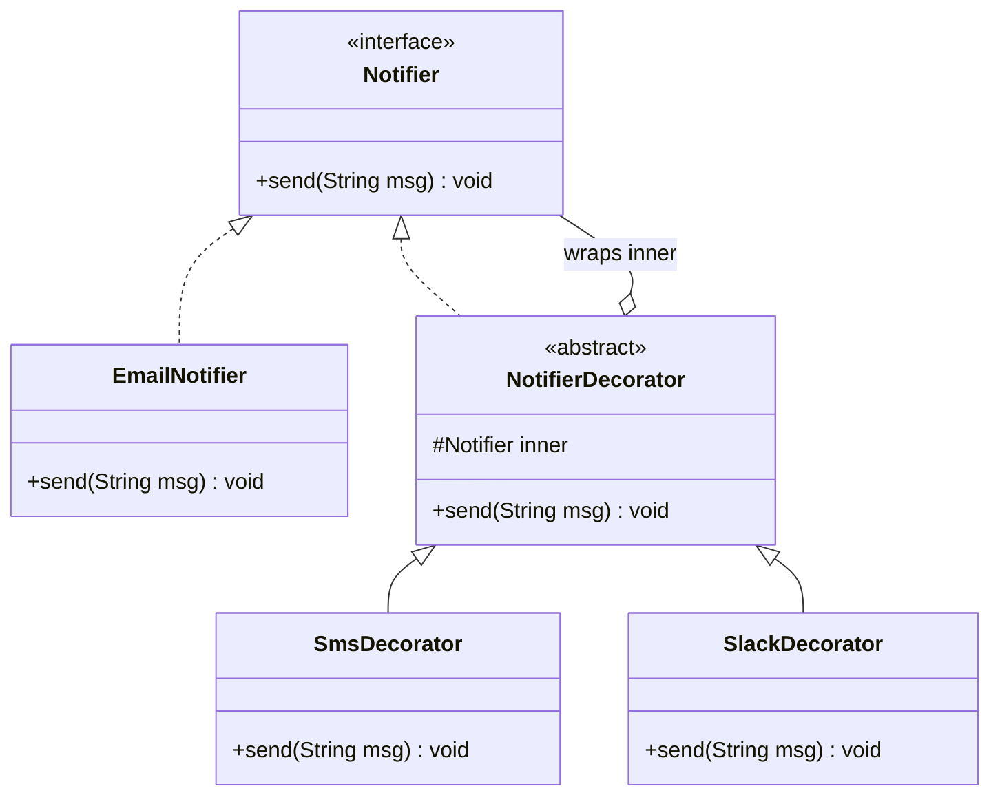
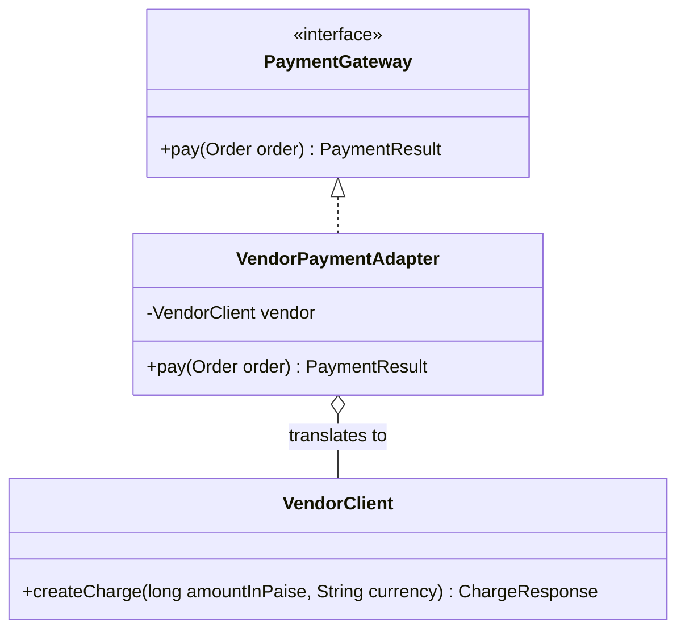
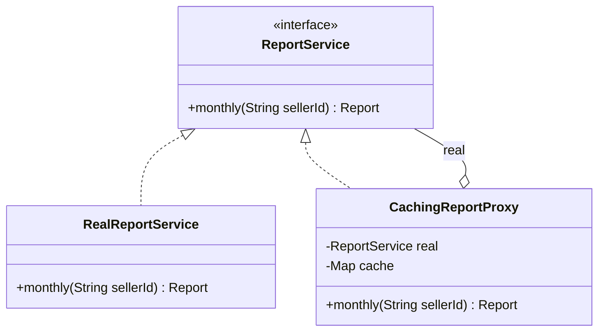
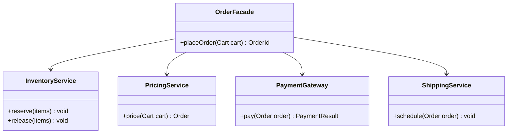
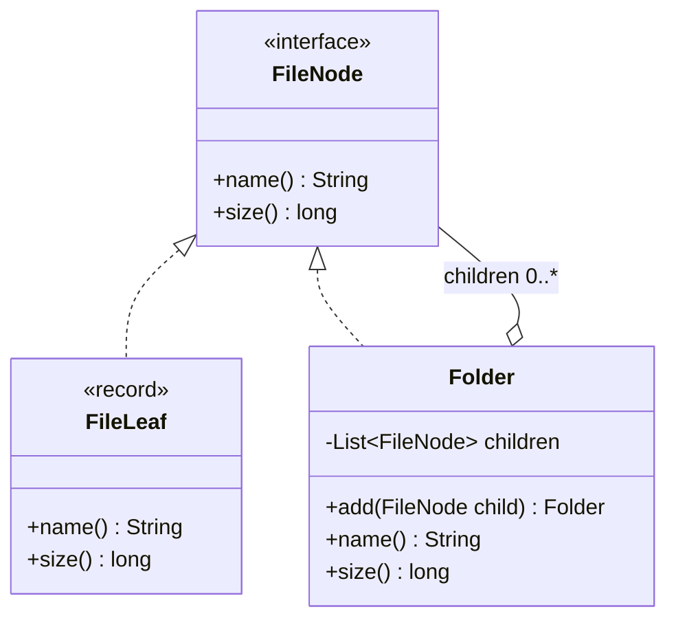
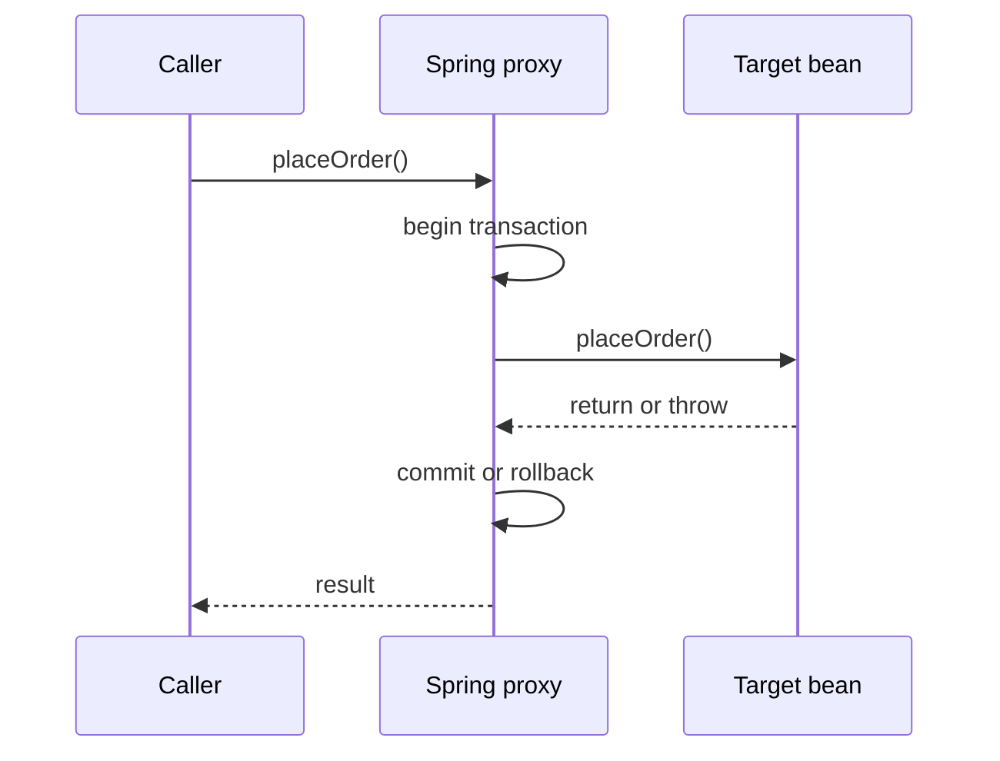

## Definition (interview-ready)

**Structural patterns** are about *how classes and objects are put together* to form bigger structures. They mostly work by **wrapping** one object in another or by **composing** objects into a tree, so you get new behaviour without editing existing classes.

The five you will be asked about:

| Pattern | One-line intent |
|---|---|
| **Decorator** | Wrap an object to **add** behaviour, keeping the **same interface**. Wrappers can be stacked. |
| **Adapter** | Wrap an object to **convert** its interface into the one a client expects. |
| **Proxy** | Wrap an object to **control access** to it (lazy load, security, caching, remote call, transactions), keeping the same interface. |
| **Facade** | Put **one simple entry point** in front of a complicated subsystem. |
| **Composite** | Make **leaves and groups share one interface**, so a client can treat a single item and a tree of items the same way. |

These come from the 1994 "Gang of Four" (GoF) book *Design Patterns: Elements of Reusable Object-Oriented Software*, which lists seven structural patterns (the other two are Bridge and Flyweight, covered briefly below).

**One-liner:** Structural patterns compose objects, mostly by wrapping: Adapter changes the interface, Decorator keeps it and adds behaviour, Proxy keeps it and controls access, Facade puts one simple entry point over a subsystem, and Composite lets one interface cover both single items and trees.

## Why it matters

- **LLD and machine-coding rounds** reward extensible designs. "Add a new topping without touching the Pizza class" is a Decorator question in disguise. "Integrate a third-party payment SDK" is an Adapter question.
- **You already use them daily.** `new BufferedReader(new InputStreamReader(System.in))` is an Adapter inside a Decorator. Every `@Transactional` Spring bean is a Proxy. Knowing this lets you explain framework behaviour, such as why `@Transactional` is ignored on a self-call.
- **The three wrappers (Decorator, Proxy, Adapter) look identical in code**, so interviewers love asking how they differ. The difference is *intent*, and you need a crisp answer.

## Core concepts

A quick vocabulary note first:

- **Composition** — an object holds a reference to another object and delegates work to it ("has-a"). Structural patterns prefer this over inheritance ("is-a") because you can change what you hold at runtime.
- **Delegation** — forwarding a method call to the wrapped object, possibly doing extra work before or after.
- **Wrapper** — informal name for an object that holds another and delegates to it. Decorator, Adapter and Proxy are all wrappers.

### Decorator

**Intent:** attach extra responsibilities to an object dynamically, as a flexible alternative to subclassing.

**Problem it solves:** a `Notifier` sends email. Some users also want SMS, some Slack, some SMS + Slack. With subclasses you get `EmailSmsNotifier`, `EmailSlackNotifier`, `EmailSmsSlackNotifier`... a **class explosion** (every combination is a new class). With Decorator, each extra channel is one small wrapper, and you stack the ones you need at runtime.

```
        «interface»
         Notifier
       + send(msg)
        ▲        ▲
        │        │ implements
 EmailNotifier   NotifierDecorator  ◆──── wraps ────► Notifier
                 (abstract)
                  ▲          ▲
          SmsDecorator   SlackDecorator
```

The key detail: the decorator **implements the same interface** it wraps. That is what makes stacking possible.

```java
interface Notifier { void send(String msg); }

class EmailNotifier implements Notifier {
    public void send(String msg) { System.out.println("email: " + msg); }
}

abstract class NotifierDecorator implements Notifier {
    protected final Notifier inner;
    NotifierDecorator(Notifier inner) { this.inner = inner; }
    public void send(String msg) { inner.send(msg); }   // default: just delegate
}

class SmsDecorator extends NotifierDecorator {
    SmsDecorator(Notifier inner) { super(inner); }
    @Override public void send(String msg) {
        super.send(msg);                                  // keep existing behaviour
        System.out.println("sms: " + msg);                // add new behaviour
    }
}

class SlackDecorator extends NotifierDecorator {
    SlackDecorator(Notifier inner) { super(inner); }
    @Override public void send(String msg) {
        super.send(msg);
        System.out.println("slack: " + msg);
    }
}

// Client picks the combination at runtime
Notifier n = new SlackDecorator(new SmsDecorator(new EmailNotifier()));
n.send("Order shipped");   // email, then sms, then slack
```

The classes from the code: each decorator is a `Notifier` and also holds the `inner` one it wraps.



Head First Design Patterns uses the same idea with coffee: a `Beverage` wrapped in `Mocha` and `Whip` decorators, each adding to `cost()`.

**Trade-offs:** many small objects, the order of wrapping can matter, and code that checks the concrete type (`instanceof EmailNotifier`) breaks because it now sees a wrapper.

### Adapter

**Intent:** convert the interface of a class into another interface clients expect, so classes with incompatible interfaces can work together.

**Problem it solves:** your checkout code depends on `PaymentGateway.pay(Order)`. You must add a vendor SDK whose class is `VendorClient` with `createCharge(long paise, String currency)`. You cannot (and should not) edit the SDK, and you don't want vendor types leaking all over your code. An adapter implements *your* interface and translates calls into the vendor's.

```
  Client ──► «interface» PaymentGateway        (Target)
                 + pay(Order)
                   ▲
                   │ implements
          VendorPaymentAdapter ◆────► VendorClient  (Adaptee, can't change)
           pay(order) {                 + createCharge(paise, currency)
             vendor.createCharge(...)
           }
```

```java
interface PaymentGateway { PaymentResult pay(Order order); }

// Third-party class: different method name, units and return type
class VendorClient {
    ChargeResponse createCharge(long amountInPaise, String currency) { /* ... */ return null; }
}

class VendorPaymentAdapter implements PaymentGateway {
    private final VendorClient vendor;
    VendorPaymentAdapter(VendorClient vendor) { this.vendor = vendor; }

    @Override public PaymentResult pay(Order order) {
        long paise = order.totalRupees().movePointRight(2).longValueExact();
        ChargeResponse r = vendor.createCharge(paise, "INR");
        return r.isCaptured() ? PaymentResult.success(r.id())
                              : PaymentResult.failed(r.errorCode());
    }
}
```

The classes from the code: the adapter implements your interface and holds the vendor class it translates to.



**Object adapter vs class adapter.** The GoF book describes two forms. An **object adapter** (above) holds the adaptee by composition. A **class adapter** inherits from the adaptee and implements the target. Java has single class inheritance, so the object adapter is the normal choice.

### Proxy

**Intent:** provide a surrogate or placeholder for another object to control access to it.

The proxy has the **same interface** as the real object, so the client cannot tell the difference. What the proxy adds is a *gate* in front of the real object. Common kinds:

| Kind | What the proxy does |
|---|---|
| **Virtual proxy** | Delays creating an expensive object until first use (lazy loading). |
| **Protection proxy** | Checks permissions before forwarding the call. |
| **Remote proxy** | Looks like a local object but sends the call over the network (RPC stubs, Java RMI). |
| **Caching proxy** | Returns a cached result instead of calling the real object again. |
| **Smart reference / logging** | Counts references, logs, measures time, starts and commits transactions. |

```
  Client ──► «interface» ReportService
                ▲                ▲
                │                │
     CachingReportProxy ◆──► RealReportService
     (same interface, controls     (does the expensive work)
      when the real one is called)
```

```java
interface ReportService { Report monthly(String sellerId); }

class RealReportService implements ReportService {
    public Report monthly(String sellerId) { /* slow SQL aggregation */ return null; }
}

class CachingReportProxy implements ReportService {
    private final ReportService real;
    private final Map<String, Report> cache = new ConcurrentHashMap<>();
    CachingReportProxy(ReportService real) { this.real = real; }

    @Override public Report monthly(String sellerId) {
        return cache.computeIfAbsent(sellerId, real::monthly);
    }
}
```

The classes from the code: proxy and real service share one interface, so the client can't tell them apart.



**Dynamic proxies.** Writing a proxy class per interface is tedious, so Java can generate them at runtime. `java.lang.reflect.Proxy.newProxyInstance(...)` creates an object that implements given interfaces and routes every call to an `InvocationHandler` you write. Libraries such as CGLIB/ByteBuddy go further and generate a **subclass** of a concrete class.

### Facade

**Intent:** provide a unified, higher-level interface to a set of interfaces in a subsystem, making the subsystem easier to use.

**Problem it solves:** placing an order touches inventory, pricing, payment, shipping and notifications. If every controller calls all five in the right order, that ordering logic is copied everywhere and every caller is coupled to five services. A facade gives callers one method.

```
   Controller ──► OrderFacade.placeOrder(cart)
                      │
         ┌────────────┼─────────────┬──────────────┐
         ▼            ▼             ▼              ▼
   InventoryService PricingService PaymentGateway ShippingService
```

```java
class OrderFacade {
    private final InventoryService inventory;
    private final PricingService pricing;
    private final PaymentGateway payments;
    private final ShippingService shipping;

    OrderFacade(InventoryService i, PricingService p, PaymentGateway g, ShippingService s) {
        this.inventory = i; this.pricing = p; this.payments = g; this.shipping = s;
    }

    public OrderId placeOrder(Cart cart) {
        inventory.reserve(cart.items());
        Order order = pricing.price(cart);
        PaymentResult r = payments.pay(order);
        if (!r.ok()) { inventory.release(cart.items()); throw new PaymentFailedException(r); }
        shipping.schedule(order);
        return order.id();
    }
}
```

The classes from the code: one facade method in front of four subsystem services.



A facade **does not hide** the subsystem: advanced callers can still use the parts directly. It just offers a simple path for the common case. The danger is the facade slowly absorbing business logic until it becomes a "god object".

### Composite

**Intent:** compose objects into tree structures to represent part-whole hierarchies, and let clients treat individual objects and compositions uniformly.

**Problem it solves:** a file system has files and folders; folders contain files and other folders. You want `size()` on anything. Without Composite, the client writes `if (x instanceof Folder) ... else ...` everywhere. With Composite, both implement `Node.size()`, and a folder's `size()` simply sums its children's.

```
           «interface» FileNode
            + size(): long
             ▲            ▲
             │            │
          FileLeaf     Folder ◆──── children: 0..* FileNode
          (leaf)       (composite: size() = sum of children)
```

```java
interface FileNode { String name(); long size(); }

record FileLeaf(String name, long size) implements FileNode {}

class Folder implements FileNode {
    private final String name;
    private final List<FileNode> children = new ArrayList<>();
    Folder(String name) { this.name = name; }

    public Folder add(FileNode child) { children.add(child); return this; }
    public String name() { return name; }
    public long size() {
        return children.stream().mapToLong(FileNode::size).sum();   // recursion through the tree
    }
}

FileNode root = new Folder("root")
        .add(new FileLeaf("a.txt", 120))
        .add(new Folder("img").add(new FileLeaf("logo.png", 4_000)));
root.size();   // 4120 — client never checks leaf vs folder
```

The classes from the code: a `Folder` holds child `FileNode`s, which can be files or more folders.



**Design choice: where do `add`/`remove` live?** If they are on the shared interface, clients get full uniformity but can call `add` on a leaf (which must throw). If they are only on the composite, it is type-safe but clients must know what they hold. The GoF book discusses this exact transparency-vs-safety trade-off; much modern Java code picks safety.

Other natural composites: UI widget trees, org charts, menu and sub-menu, expression trees (`(a + b) * c`), and bundles of products priced as one.

### The other two: Bridge and Flyweight (briefly)

- **Bridge** splits one class hierarchy into two independent ones (an *abstraction* and an *implementation*) connected by composition, so they can vary separately. Example: `Shape` × `Renderer` instead of `VectorCircle`, `RasterCircle`, `VectorSquare`... JDBC is often described this way: your code talks to the `java.sql` API while each vendor's driver supplies the implementation.
- **Flyweight** shares immutable state across many objects to save memory. `Integer.valueOf` caching small values (at least -128 to 127, per the Javadoc) is the classic JDK example.

## How it works

### Telling the three wrappers apart

All three hold a reference to another object and forward calls. You tell them apart by asking **what is the wrapper for?**

| | Decorator | Proxy | Adapter |
|---|---|---|---|
| Interface it exposes | **Same** as the wrapped object | **Same** as the wrapped object | **Different** (the one the client wants) |
| Purpose | **Add** behaviour/responsibilities | **Control access** to the real object | **Translate** one interface into another |
| Who creates/chooses the wrapped object | Usually the **client** stacks decorators explicitly | Often the **proxy or framework** creates and manages the real object (client may not know it exists) | Client passes in or wiring code supplies the adaptee |
| Stacking | Designed to be stacked many deep | Usually one layer | Usually one layer |
| Does the real call always happen? | Yes (plus extras) | **Not necessarily** — may be cached, denied, or delayed | Yes (translated) |
| Classic JDK example | `BufferedInputStream` wrapping `FileInputStream` | `java.lang.reflect.Proxy`, Spring AOP proxies | `InputStreamReader` (bytes → chars), `Arrays.asList` |

And the two non-wrapper patterns:

| | Facade | Composite |
|---|---|---|
| Wraps | A **whole subsystem** (many objects) | **Children** of the same type |
| Interface | New, simpler | Same for leaf and group |
| Goal | Ease of use, less coupling | Uniform treatment of trees |

**How to say it in an interview:** "Decorator, Proxy and Adapter are all wrappers. Adapter changes the interface. Decorator keeps the interface and adds behaviour, and you can stack it. Proxy keeps the interface and controls access — lazy loading, security, caching, transactions — and the client usually doesn't even know it's there."

### How Spring uses Proxy for `@Transactional`

When a bean has `@Transactional`, `@Async`, `@Cacheable` or an aspect on it, Spring puts a **proxy** in the application context instead of the raw object. Other beans get the proxy injected. Each call goes:

```
caller ──► proxy.placeOrder()
             ├─ begin transaction
             ├─ target.placeOrder()   ← your real code
             └─ commit / rollback
```

The same call as a sequence:



Per the Spring Framework reference:

- If the target implements at least one interface, Spring Framework uses a **JDK dynamic proxy**; otherwise it uses **CGLIB**, which generates a subclass at runtime. Spring Boot's auto-configuration defaults to CGLIB (set `spring.aop.proxy-target-class=false` to switch to JDK proxies).
- **Self-invocation bypasses the proxy.** If `placeOrder()` calls `this.audit()` inside the same class, that call goes straight to the target, so any `@Transactional` on `audit()` is ignored.
- With CGLIB, **`final` methods and `final` classes cannot be advised**, because they can't be overridden or extended. Private methods can't be advised either.

## Real-world examples

All verified against the JDK/Spring docs and refactoring.guru's usage lists.

- **Decorator**
  - `java.io`: `BufferedInputStream`, `DataInputStream`, `GZIPInputStream` all take an `InputStream` in their constructor and are themselves `InputStream`s. `new DataInputStream(new BufferedInputStream(new FileInputStream(f)))` is a three-layer stack.
  - `Collections.unmodifiableList`, `Collections.synchronizedList`, `Collections.checkedList` return a wrapper with the same `List` interface that adds read-only, locking, or type-checking behaviour.
  - Servlet API: `HttpServletRequestWrapper` / `HttpServletResponseWrapper` let a filter wrap the request and override just a few methods.
- **Adapter**
  - `InputStreamReader` adapts a byte `InputStream` to a character `Reader`; `OutputStreamWriter` does the reverse for output.
  - `Arrays.asList(array)` presents an array as a `List`. `Collections.list(enumeration)` and `Collections.enumeration(collection)` bridge the old `Enumeration` API and collections.
  - Spring MVC's `HandlerAdapter` lets the `DispatcherServlet` invoke very different handler types through one interface.
- **Proxy**
  - `java.lang.reflect.Proxy` (JDK dynamic proxies) and Java RMI stubs (remote proxy).
  - Spring AOP proxies behind `@Transactional`, `@Async`, `@Cacheable`.
  - JPA/Hibernate lazy-loaded associations: the entity you get may be a generated proxy that runs the SQL only when you touch a field (a virtual proxy). This is why you can hit a `LazyInitializationException` outside a session.
- **Facade**
  - SLF4J — literally the "Simple Logging Facade for Java" — one API in front of Logback, Log4j 2 or `java.util.logging`.
  - A service-layer class (like `OrderFacade` above) in front of several lower-level services; an API gateway or BFF does a similar job across services (see [API Gateway & BFF](/learn/notes/api-gateway-bff/)).
- **Composite**
  - AWT/Swing: `java.awt.Container` is a `Component` that holds other `Component`s via `add(Component)`, so a panel can contain buttons and other panels.
  - DOM trees (`org.w3c.dom.Node` has child nodes of the same type).

## When to use which

| Situation | Reach for |
|---|---|
| Optional, combinable features on an object (logging, compression, encryption, retries) | **Decorator** |
| You must use a class whose interface you can't change and doesn't match yours (legacy code, vendor SDK) | **Adapter** |
| You need lazy loading, access checks, caching, remote access, or cross-cutting concerns without the client knowing | **Proxy** |
| Callers repeat a multi-step sequence across several subsystems | **Facade** |
| Data is naturally a tree and clients shouldn't care if a node is a leaf or a group | **Composite** |
| Two dimensions vary independently and subclasses multiply (shape × renderer) | **Bridge** |
| Millions of similar objects with shared immutable state | **Flyweight** |

## Common pitfalls

- **Calling a Proxy a Decorator (or the reverse) without explaining intent.** The code shape is the same; interviewers want the purpose.
- **Decorator order bugs.** `Encrypt(Compress(stream))` and `Compress(Encrypt(stream))` behave very differently (encrypted data barely compresses). Make the order explicit, often with a builder.
- **Identity and type checks break with wrappers.** `instanceof`, `equals` and `getClass()` see the wrapper. Spring beans that are proxies are not instances of the concrete class when JDK proxies are used — inject by interface.
- **Spring self-invocation.** `this.method()` skips the proxy, so `@Transactional`, `@Async` and `@Cacheable` silently do nothing. Move the method to another bean or restructure.
- **Leaky adapters.** If vendor exceptions or DTOs escape the adapter, you have not really isolated the vendor. Translate errors too.
- **God facade.** Facades should orchestrate, not own business rules. If it grows to hundreds of lines, split by use case.
- **Composite without cycle protection.** If a folder can be added to its own descendant, `size()` recurses forever. Validate on `add`.
- **Caching proxy without invalidation or bounds.** An unbounded `ConcurrentHashMap` cache is a memory leak with extra steps. Use TTL/size limits (see [Cache Patterns](/learn/notes/cache-patterns/)).

## Practice questions

<Practice>

<QA q="What do structural design patterns have in common?" level="easy">

They describe how to **compose** classes and objects into larger structures. Most use composition and delegation (an object holds another and forwards calls) rather than inheritance, so you can add behaviour, change interfaces, or build trees **without modifying existing classes** — which supports the Open/Closed Principle. The GoF structural patterns are Adapter, Bridge, Composite, Decorator, Facade, Flyweight and Proxy.

</QA>

<QA q="Explain the Decorator pattern with a real Java example." level="easy">

Decorator wraps an object in another object that **implements the same interface**, forwards calls to it, and adds behaviour before or after. Because the wrapper has the same type, wrappers can be stacked.

Java I/O is the textbook case: `new BufferedInputStream(new FileInputStream(file))`. Both are `InputStream`s; the buffered one adds buffering on top of the file stream. You can add `DataInputStream` on top for reading primitives, or `GZIPInputStream` for decompression, choosing the combination at runtime instead of writing a subclass per combination.

</QA>

<QA q="Why is Decorator preferred over subclassing for optional features?" level="easy">

With subclassing, every **combination** of features needs its own class (Email+SMS, Email+Slack, Email+SMS+Slack...), so the number of classes grows quickly, and the combination is fixed at compile time. With Decorator, each feature is one class and you combine them at runtime by wrapping. It follows Open/Closed (new feature = new decorator, no edits) and Single Responsibility (each decorator does one thing).

</QA>

<QA q="What is the difference between an object adapter and a class adapter?" level="medium">

- **Object adapter**: implements the target interface and **holds** an instance of the adaptee (composition). Works with any subclass of the adaptee and is the normal choice in Java.
- **Class adapter**: **extends** the adaptee and implements the target interface (inheritance). It can override adaptee behaviour, but needs multiple inheritance of classes, which Java doesn't have, so it only works when the target is an interface and you can subclass the adaptee.

</QA>

<QA q="Name four kinds of Proxy and give a use for each." level="medium">

- **Virtual proxy**: lazy creation/loading — Hibernate lazy associations load data only when accessed.
- **Protection proxy**: permission check before forwarding — e.g. only admins may call `delete()`.
- **Remote proxy**: a local stand-in that sends calls over the network — Java RMI stubs, gRPC client stubs.
- **Caching proxy**: returns stored results for repeated calls.

Also smart-reference/logging proxies, which is what Spring AOP uses for transactions, metrics and security.

</QA>

<QA q="Decorator vs Proxy: both keep the same interface and delegate. What is the difference?" level="medium">

**Intent and control.**

- Decorator **adds** responsibilities, is usually composed by the client, and is designed to be **stacked**. The real call always happens.
- Proxy **controls access** to the real object. It often creates or manages the real object itself and may **not** forward the call at all (cache hit, access denied, not loaded yet). The client usually doesn't know a proxy is there.

One-liner: decorator = "do more", proxy = "decide whether, when and how the real thing runs".

</QA>

<QA q="How is Adapter different from Facade?" level="medium">

Adapter makes an **existing interface fit** an interface the client already expects, usually for one class. Facade **defines a new, simpler interface** over a whole subsystem of many classes. Adapter is about compatibility; Facade is about simplicity and reducing coupling. A facade might use adapters internally.

</QA>

<QA q="Why does @Transactional not work when a method calls another @Transactional method in the same class?" level="medium">

Spring implements `@Transactional` with a **proxy** around the bean. Only calls that go **through the proxy** get transaction handling. When code inside the bean calls `this.otherMethod()`, it calls the target directly, so the proxy (and its transaction logic) is bypassed. The Spring reference documents this as self-invocation. Fixes: move the method into another bean, restructure so the outer call is the transactional one, or (less preferred) inject the bean's own proxy. AspectJ weaving avoids the issue because it changes the bytecode instead of using a proxy.

</QA>

<QA q="When does Spring use a JDK dynamic proxy and when CGLIB? What can't CGLIB proxy?" level="hard">

Spring Framework uses a **JDK dynamic proxy** if the target implements at least one interface (the proxy implements those interfaces), and **CGLIB** (a runtime subclass of the target class) otherwise; you can force CGLIB with `proxyTargetClass`. Spring Boot's auto-configuration defaults to CGLIB; `spring.aop.proxy-target-class=false` switches to JDK proxies.

CGLIB works by overriding, so **`final` methods** can't be advised and **`final` classes** can't be proxied; private methods aren't advised either. With JDK proxies, injecting by the concrete class fails because the proxy only implements the interfaces.

</QA>

<QA q="In the Composite pattern, should add and remove be on the component interface or only on the composite class?" level="hard">

It's a trade-off the GoF book calls out:

- **On the interface (transparency)**: clients treat everything uniformly, but leaves must implement `add` by throwing, so misuse is caught only at runtime.
- **Only on the composite (safety)**: misuse is a compile error, but clients must know whether they hold a leaf or a composite to build the tree.

Most modern code chooses safety: the shared interface has the operations that make sense for both (`size()`, `render()`, `price()`), and tree-building happens where the concrete type is known.

</QA>

<QA q="Design a pricing system where a product can be sold alone or in bundles, and bundles can contain bundles." level="hard">

Composite. `interface Sellable { Money price(); String sku(); }`. `Product` is a leaf returning its own price. `Bundle` holds a list of `Sellable` and returns the sum of children's prices, optionally minus a bundle discount. The cart only deals with `Sellable`, so it never checks types. Guard against cycles on `add`. If discounts vary by campaign, combine with Strategy for the discount rule, or a Decorator like `DiscountedSellable` that wraps any `Sellable` and adjusts `price()`.

</QA>

<QA q="You must integrate three SMS vendors with different SDKs and switch between them at runtime. Which patterns?" level="scenario">

- **Adapter** per vendor: each implements your `SmsSender.send(phone, text)` and translates to that SDK, including mapping vendor errors to your own exception types.
- **Strategy/factory** to choose the active adapter from config.
- Optionally a **Proxy or Decorator** around the chosen sender for retries, metrics, rate limiting, or a fallback chain (try vendor A, then B).

Business code depends only on `SmsSender`, so adding a fourth vendor is one new adapter class and a config change.

</QA>

<QA q="A report endpoint is slow. A teammate proposes a caching layer without changing ReportService callers. How would you do it and what can go wrong?" level="scenario">

Wrap the real service in a **caching proxy** with the same `ReportService` interface and inject the proxy instead (in Spring, `@Cacheable` generates exactly this proxy). Callers don't change.

Watch out for: stale data (define TTL or invalidate on writes), unbounded memory (use a size-bounded cache), cache stampede when many requests miss at once, per-user data cached under a shared key (security bug), and — in Spring — self-invocation bypassing `@Cacheable`.

</QA>

<QA q="Your logging must write to file, optionally compressed, optionally encrypted, optionally with async buffering. Design it." level="scenario">

Decorator. Define `LogSink.write(byte[])`. Concrete sink: `FileSink`. Decorators: `CompressingSink`, `EncryptingSink`, `AsyncBufferedSink`, each wrapping a `LogSink`. Build the stack from config with a builder so the **order is fixed and correct**: compress before encrypt (encrypted bytes don't compress), and put async buffering outermost so callers don't block on I/O. Each decorator is small and unit-testable with a fake inner sink.

</QA>

</Practice>

## Quiz

<Quiz>

<MCQ q="Which pattern changes the interface a client sees?" options={["Decorator", "Proxy", "Adapter", "Composite"]} answer={2}>

Adapter converts one interface into another the client expects. Decorator and Proxy keep the same interface as the wrapped object, and Composite gives leaves and groups one shared interface.

</MCQ>

<MCQ q="new BufferedReader(new InputStreamReader(System.in)) contains which two patterns, from inside out?" options={["Proxy then Facade", "Adapter then Decorator", "Decorator then Adapter", "Composite then Proxy"]} answer={1}>

InputStreamReader adapts a byte InputStream to a character Reader (Adapter). BufferedReader wraps a Reader and is a Reader, adding buffering and readLine (Decorator).

</MCQ>

<MCQ q="What most clearly distinguishes Proxy from Decorator?" options={["Proxy uses inheritance, Decorator uses composition", "Proxy controls whether and when the real object is used; Decorator adds behaviour and is meant to be stacked", "Proxy changes the interface", "Decorator can only be used with streams"]} answer={1}>

Both usually use composition and keep the interface. The difference is intent: access control (lazy, cache, security, remote) versus adding responsibilities.

</MCQ>

<MCQ q="A @Transactional method in a Spring bean is called from another method of the same bean. What happens?" options={["A new transaction always starts", "Spring throws an exception at startup", "The call bypasses the proxy, so the annotation on the called method has no effect", "The transaction is upgraded to SERIALIZABLE"]} answer={2}>

Spring's transaction support lives in the proxy. A self-call via this goes straight to the target, so the advice is skipped.

</MCQ>

<MCQ q="Which JDK class is a Composite?" options={["java.awt.Container", "java.io.InputStreamReader", "java.lang.reflect.Proxy", "java.util.Arrays"]} answer={0}>

Container is a Component that holds child Components, so panels can nest. InputStreamReader is an Adapter, reflect.Proxy builds proxies, and Arrays.asList is an Adapter.

</MCQ>

<MCQ q="Which statement about Facade is correct?" options={["It forbids direct access to the subsystem", "It must implement the same interface as each subsystem class", "It offers a simpler entry point while the subsystem stays usable directly", "It is a kind of Proxy"]} answer={2}>

A facade simplifies the common path but does not hide or lock the subsystem. It defines its own new interface, unlike Proxy.

</MCQ>

<MCQ q="Spring Framework (without Boot defaults) proxies a bean that implements no interfaces. Which mechanism is used?" options={["JDK dynamic proxy", "No proxy is possible", "AspectJ load-time weaving automatically", "CGLIB subclass"]} answer={3}>

JDK dynamic proxies need interfaces, so Spring falls back to a runtime-generated CGLIB subclass. This is also why final methods cannot be advised.

</MCQ>

<MCQ q="Why is Collections.unmodifiableList usually classified as a Decorator rather than an Adapter?" options={["It returns the same List interface and adds a read-only restriction on top of the wrapped list", "It returns an array", "It copies the list", "It changes List into Collection"]} answer={0}>

The wrapper is still a List and delegates reads to the original, adding behaviour (rejecting writes). No interface conversion happens, and it is a view, not a copy.

</MCQ>

<MCQ q="Adding a folder to one of its own subfolders in a Composite file tree causes what problem in size()?" options={["Integer overflow only", "Infinite recursion", "Nothing, sizes are cached", "A ClassCastException"]} answer={1}>

size() sums children recursively; a cycle means it never reaches a leaf-only bottom, so it recurses until a StackOverflowError. Validate on add.

</MCQ>

</Quiz>

## TL;DR cheat sheet

- **Structural** = how objects are composed. Mostly wrapping (composition + delegation) instead of inheritance.
- **Decorator**: same interface, **adds** behaviour, **stackable**. `BufferedInputStream`, `Collections.unmodifiableList`.
- **Adapter**: **different** interface, **translates**. `InputStreamReader`, `Arrays.asList`, vendor-SDK wrappers. Prefer object adapter in Java.
- **Proxy**: same interface, **controls access** (lazy, protection, remote, caching, transactions). `java.lang.reflect.Proxy`, Spring AOP, Hibernate lazy proxies.
- **Facade**: one simple method over many subsystem calls. SLF4J. Don't let it become a god class.
- **Composite**: leaf and group share an interface; group delegates to children recursively. AWT `Container`, file trees, bundles.
- Spring proxies: JDK proxy if interfaces, else CGLIB (Boot defaults to CGLIB). **Self-invocation and `final` methods skip the advice.**
- Interview line: "Adapter changes the interface; Decorator keeps it and adds; Proxy keeps it and controls."

## Go deeper

- **Book**: Gamma, Helm, Johnson, Vlissides — *Design Patterns: Elements of Reusable Object-Oriented Software* (1994), chapter 4 (Structural Patterns).
- **Book**: Freeman & Robson — *Head First Design Patterns*, 2nd ed. (Decorator, Adapter/Facade, Proxy, Composite chapters).
- **refactoring.guru**: [Structural patterns catalog](https://refactoring.guru/design-patterns/structural-patterns) — [Decorator](https://refactoring.guru/design-patterns/decorator), [Adapter](https://refactoring.guru/design-patterns/adapter), [Proxy](https://refactoring.guru/design-patterns/proxy), [Facade](https://refactoring.guru/design-patterns/facade), [Composite](https://refactoring.guru/design-patterns/composite).
- **Spring Framework reference**: [Proxying Mechanisms](https://docs.spring.io/spring-framework/reference/core/aop/proxying.html) (JDK vs CGLIB, self-invocation).
- **JDK API**: [java.lang.reflect.Proxy](https://docs.oracle.com/en/java/javase/21/docs/api/java.base/java/lang/reflect/Proxy.html).
- Related notes: [SOLID Principles](/learn/notes/solid-principles/), [Creational Patterns](/learn/notes/creational-patterns/), [Behavioral Patterns](/learn/notes/behavioral-patterns/).
