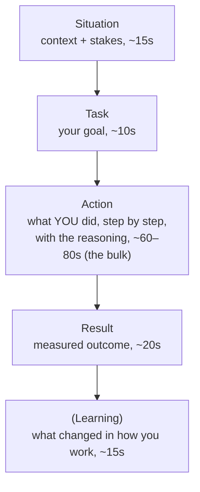
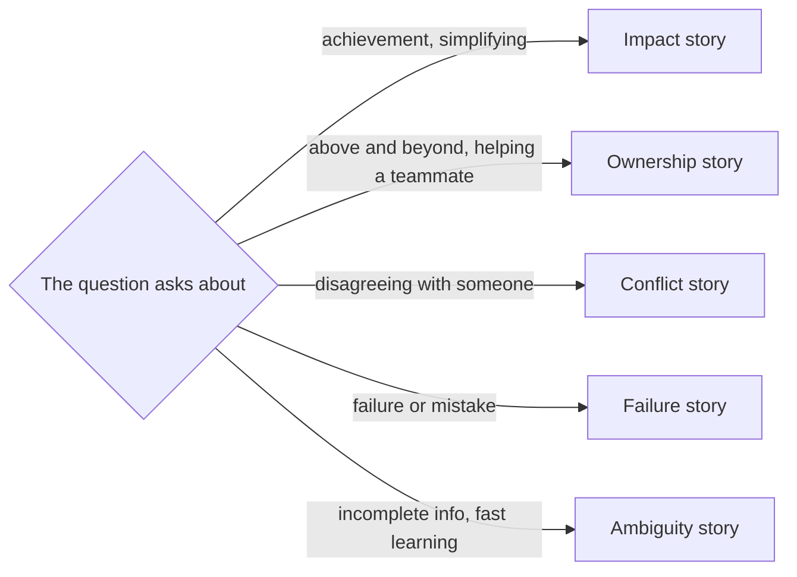

## The short version

This guide gives you a way to answer "Tell me about a time..." questions, where the interviewer scores evidence (one real event, what *you* decided and did, and the measurable result), not your opinions or personality.

- **Tell one specific past event**: the best available predictor of how you will behave in a similar situation.
- **Order it as STAR-L**: Situation and Task short, most of the time on Action with the reasoning behind each step, a numeric Result, then the Learning (how your behaviour changed afterwards).
- **Keep it to about two minutes**, using "I" for your actions and "we" for context.
- **Build a five-story bank**: one recent, real story each for impact, conflict, failure, ownership and ambiguity.
- **Rehearse bullets, not a script**, and angle each story to answer several questions and survive follow-up probing.

## What interviewers are really asking

A behavioral question is any question that starts with "Tell me about a time...". The idea behind it is simple: **how you behaved in a real past situation is the best available predictor of how you will behave in a similar one.** So the interviewer does not want your opinion ("I believe in clear communication"). They want one specific event, what *you* did in it, and what happened.

Think of it like a production incident review. Nobody accepts "the system is usually reliable". They want the timeline, the decision points, who did what, and the measured impact. A behavioral round is an incident review of your career.

Behind every behavioral question there are a few hidden checks:

- **Is it real?** Specific names of systems, numbers, dates and trade-offs make a story believable. Vague stories sound made up, even when they are true.
- **What did *you* do?** Not the team, not your manager. Your decisions.
- **What is your scope?** The size of the problem you handled tells them your level. A story about fixing one flaky test signals a different level than a story about redesigning a team's retry strategy.
- **Do you learn?** Especially in failure and conflict stories, they check whether your behaviour changed afterwards.

Many large companies make this explicit. Amazon says its interviews are behavioral, built around its 16 Leadership Principles, and recommends the STAR format with data to back up your examples ([Amazon interview guide](https://www.aboutamazon.com/news/workplace/amazon-interview-guide)). Google's careers site says every candidate is assessed with **structured interviews and the same clear rubrics** for a given role ([Google: how we hire](https://www.google.com/about/careers/applications/how-we-hire/)). Indian product companies usually have a "hiring manager" or "culture fit" round that works the same way, even if they don't publish a rubric.

> **How to say it in an interview (to yourself):** "They are not grading my personality. They are grading evidence. My job is to hand them clear evidence in two minutes."

## The framework

### STAR in one picture

**STAR** stands for **S**ituation, **T**ask, **A**ction, **R**esult. It is just an ordering rule that makes your story easy to follow and easy to score.

The five parts in order, with a rough time budget for each:



| Part | What to say | Common mistake |
|---|---|---|
| **Situation** | Team, system, what was at stake. One or two sentences. | A two-minute history lesson. |
| **Task** | The specific thing *you* owned or were asked to fix. | Describing the team's goal, not yours. |
| **Action** | Your steps in order, and *why* you chose each one. This is 50–60% of the answer. | "We built it" with no decisions or reasoning. |
| **Result** | What changed, in numbers where possible. Plus any second-order effect (team adopted it, on-call got quieter). | "It went well." |

A good spoken STAR answer is usually **about two minutes**, and rarely more than three. Shorter than a minute usually means it has no detail; longer than three usually means the interviewer has lost the thread.

### Variants: STAR-L and CARL

Two popular variants add the step that senior interviewers almost always ask about anyway:

- **STAR-L** (STAR + **L**earning): finish with what you learned *and how your behaviour changed*. "I learned to communicate better" is weak. "I now write a one-page rollback plan before every schema migration" is strong.
- **CARL** (**C**ontext, **A**ction, **R**esult, **L**earning): merges Situation and Task into "Context". Useful when the task is obvious from the context.

They are the same idea. Pick STAR-L as your default: it keeps the "Task" step, which forces you to say what *you* owned.

### "I" versus "we"

Backend work is team work, so it feels natural to say "we". But the interviewer can't hire "we". Amazon's guide explicitly tells candidates to use "I" statements for their own contributions.

- Situation and Result: "we" is fine. ("Our team owned the order-events pipeline." "We cut consumer lag alerts to near zero.")
- Task and Action: use "I". ("I proposed...", "I wrote the design doc...", "I paired with the SRE on...")
- When something was truly shared, say so precisely: "I designed the retry logic; my teammate built the dashboard." Giving exact credit is a positive signal, not a weakness.

### The five-story bank

You do not need 30 stories. You need **five strong, flexible stories**, each of which can answer several questions. Pick one story per theme:

| # | Theme | What it proves | Good raw material for a backend engineer |
|---|---|---|---|
| 1 | **Impact** | You deliver measurable results. | A latency, cost or reliability win you drove. A migration you led. |
| 2 | **Conflict** | You disagree well and still ship. | A design disagreement (sync vs async, schema choice), pushback on a deadline, a cross-team API contract dispute. |
| 3 | **Failure** | You own mistakes and change behaviour. | An incident you caused or missed, a bad estimate, a rollout without a rollback plan. |
| 4 | **Ownership / leadership** | You act beyond your job description. | Fixing a problem nobody owned (flaky alerts, missing runbooks), mentoring, leading an initiative without the title. |
| 5 | **Ambiguity / learning** | You make progress when the problem is unclear or new to you. | A vague requirement you had to shape, a new technology you ramped up on fast, an investigation with no obvious root cause. |

**Rules for choosing:**

1. **Recent beats impressive.** Prefer the last two or three years. Details fade, and old stories get weaker under follow-up.
2. **You must have made real decisions.** If your role was "I implemented what the lead designed", it is not a strong ownership story.
3. **Each story should have tension.** Something hard: a trade-off, a deadline, a person who disagreed, a bug nobody could find. No tension, no story.
4. **Prefer stories with numbers.** Even rough ones ("p99 went from about 800 ms to about 200 ms").
5. **Use different projects.** If all five stories are about the same migration, the interviewer will think you have done one thing.

### One story, many questions

The trick is that each story has several "angles". Write them down so you can reuse the story without it sounding rehearsed.

| Question you hear | Story to reach for | Angle to emphasise |
|---|---|---|
| Tell me about your biggest achievement. | Impact | Scale, numbers, your decisions. |
| Tell me about a time you went above and beyond. | Ownership | The gap nobody owned; why you stepped in. |
| Tell me about a time you disagreed with your manager or a senior engineer. | Conflict | How you disagreed with data; how it resolved; disagree-and-commit if you lost. |
| Tell me about a time you failed / made a mistake. | Failure | Your part, the cost, what you changed afterwards. |
| Tell me about a time you had to work with incomplete information. | Ambiguity | How you reduced uncertainty: questions, prototypes, small experiments. |
| Tell me about a tight deadline. | Impact or Failure | What you cut, what you refused to cut, and why. |
| Tell me about a time you learned something quickly. | Ambiguity | Your learning method, not just "I read the docs". |
| Tell me about a time you helped a teammate grow. | Ownership | What you did for the person, and what they did next. |
| Tell me about a time you simplified something. | Impact | What you removed, and the measured effect. |
| Tell me about a time you made a decision with data. | Impact or Ambiguity | The metric, the experiment, how the data changed your mind. |

The clear-cut rows of the table as a quick lookup (questions with two possible stories are left out):



### Story template (fill this in for each of your five)

```text
STORY NAME:  (a short label you'll remember, e.g. "consumer-lag fix")
THEME:       impact | conflict | failure | ownership | ambiguity
ONE-LINE PUNCHLINE: "I ___ which led to ___."

SITUATION (2 sentences): team, system, scale, what was at stake
TASK (1 sentence):       what I specifically owned
ACTION (4–6 bullets, each with a WHY):
  - I noticed / measured ...      because ...
  - I proposed ...                because ...
  - I convinced / aligned ...     by ...
  - I built / changed ...         trade-off I accepted: ...
RESULT (numbers):        before → after, plus second-order effect
LEARNING:                behaviour I changed, and one later example of it

FOLLOW-UP PREP:
  - What would you do differently?
  - What was the hardest part?
  - Who disagreed and why?
  - How did you measure the result?
  - What did you personally do vs the team?

ALSO ANSWERS: (list 3–4 questions from the mapping table)
```

### Quantifying impact

Numbers make a story credible and help the interviewer judge scope. Google's resume advice gives a handy shape for this: **"accomplished [X] as measured by [Y], by doing [Z]"** ([Google: how we hire](https://www.google.com/about/careers/applications/how-we-hire/)). The same shape works out loud.

Metrics a backend engineer usually has access to:

| Category | Examples |
|---|---|
| Latency | p50 / p99 / p999 of an API, end-to-end event delay, consumer lag |
| Reliability | error rate, incident count per quarter, availability, MTTR (mean time to recovery) |
| Throughput / scale | requests per second, events per day, rows migrated, number of downstream teams |
| Cost | instance count, storage size, cloud bill, licence cost |
| Developer productivity | build time, deploy frequency, time-to-first-PR for new joiners, alert noise |
| Business | conversion, failed payments, support tickets, refund errors |

If you don't have an exact number:

- Use an honest approximation and say so: "roughly", "about a third".
- Use a before/after count: "from three or four pages a week to about one a month".
- Use a proxy: "the support team stopped escalating this class of ticket".
- Never invent a number. A follow-up like "how did you measure that?" will expose it immediately.

### Surviving follow-up probing

The first telling of a story is the easy part. Good interviewers dig. Expect a few rounds of questions like these:

- **"What exactly did you do?"** They are separating your work from the team's.
- **"Why that approach and not X?"** They want to see the alternatives you considered.
- **"What would you do differently?"** A good answer names a specific change. "Nothing" is a red flag.
- **"How did you know it worked?"** They want the metric and the dashboard, not a feeling.
- **"What did your manager / the other person think?"** They are checking how you see other people.
- **"What happened next?"** They want to know if the result lasted.

How to prepare: for each story, have someone (a friend, a colleague, even a voice recorder) ask "why?" and "what exactly did you do?" five times in a row. If the story falls apart by the third "why", pick a different story or recall more detail before the interview.

### Amazon Leadership Principles: mapping your stories

Amazon publishes 16 Leadership Principles (LPs) ([official list](https://www.amazon.jobs/content/en/our-workplace/leadership-principles)). Each interviewer in a loop typically covers a few of them, so it pays to know which of your stories fits which LP. Even if you never interview at Amazon, these are a good checklist of what behavioral rounds probe in general.

| Leadership Principle | Typical question shape | Best story from your bank |
|---|---|---|
| Customer Obsession | A time you went out of your way for a customer (internal or external). | Impact / Ownership |
| Ownership | A time you took on something outside your area. | Ownership |
| Invent and Simplify | A time you found a simpler way to do something. | Impact |
| Are Right, A Lot | A time you made a call with incomplete data and were right (or wrong). | Ambiguity |
| Learn and Be Curious | A time you learned something new to solve a problem. | Ambiguity |
| Hire and Develop the Best | A time you mentored someone or raised the bar on hiring. | Ownership |
| Insist on the Highest Standards | A time you refused to ship something not good enough. | Conflict / Impact |
| Think Big | A time you proposed something bigger than asked. | Impact / Ownership |
| Bias for Action | A time you acted quickly with a calculated risk. | Ambiguity / Failure |
| Frugality | A time you achieved more with less. | Impact (cost) |
| Earn Trust | A time you received hard feedback, or admitted a mistake. | Failure |
| Dive Deep | A time you dug into data or logs to find a root cause. | Impact / Ambiguity |
| Have Backbone; Disagree and Commit | A time you disagreed and then committed. | Conflict |
| Deliver Results | A time you delivered despite obstacles. | Impact |
| Strive to be Earth's Best Employer | A time you improved your team's working environment. | Ownership |
| Success and Scale Bring Broad Responsibility | A time you considered the wider effects of a decision. | Ownership / Ambiguity |

Amazon's interview guide asks for specific, detailed STAR examples that show how you match the Leadership Principles, so prepare them ahead of time. With five rich stories, each with two or three angles, you can cover all 16 without repeating the same angle twice in one loop.

### What about Google's "Googleyness"?

Google's public careers pages focus on structured, rubric-based interviews rather than publishing a behavioral rubric. The well-known description comes from Laszlo Bock's book *Work Rules!* (2015), written when he led Google's people function: it names four hiring attributes — general cognitive ability, leadership (especially stepping up and then stepping back), role-related knowledge, and **"Googleyness"**, a loose label for things like comfort with ambiguity, humility, collaboration and conscientiousness. Treat this as background rather than a current spec. The practical takeaway is the same: your ownership, conflict and ambiguity stories carry this round.

## Worked examples

These are **templates**, not real events. Replace every bracketed part with your own facts. Don't borrow numbers.

### Impact story template: reducing consumer lag

> **Situation.** "On my current team we own the [order-events] pipeline: services publish to Kafka, and about [N] consumers process those events for [payments, notifications, search]. During sale events, consumer lag would build up to [X minutes], which delayed [order confirmation messages]."
>
> **Task.** "I owned the consumer service for [notifications], so the lag problem was mine to fix before the next sale, which was [six weeks] away."
>
> **Action.** "First I measured instead of guessing. I added per-partition lag and per-stage processing-time metrics, and found that [most of the time went into a synchronous call to the template service per message]. I considered three options: add more consumers, cache templates, or batch the downstream calls. More consumers wouldn't help beyond the partition count, so I proposed caching templates with a short TTL plus batching the downstream calls. My lead was worried about stale templates, so I added cache invalidation on the template-update event. I load-tested at [2x] last sale's peak before rolling out behind a flag."
>
> **Result.** "During the next sale, peak lag stayed under [Y seconds] instead of [X minutes], and we didn't need the extra instances we'd budgeted. [Two other teams] reused the batching approach."
>
> **Learning.** "I now start every performance problem by adding stage-level metrics before changing any code. It saved me a wrong fix on a later project too."

Why it works: a clear before/after, three options considered, a concern from someone else handled, and a learning that shows changed behaviour.

### Conflict story template: sync versus async

> **Situation.** "We were adding [refund status updates] to the [order service]. A senior engineer on a partner team wanted a synchronous REST call from their service to ours on every status change."
>
> **Task.** "I owned our side of the integration and had to agree the contract with them."
>
> **Action.** "I disagreed because [our service had a lower availability target than theirs], so a synchronous call would couple their uptime to ours. Instead of arguing in a meeting, I wrote a one-page comparison: sync call versus publishing an event, with failure modes, latency and who owns retries. I asked to walk them through it one-on-one first, so it didn't feel like a public challenge. They raised a fair point: they needed read-your-write behaviour for one screen. We agreed on events for everything else and a synchronous read endpoint for that single screen."
>
> **Result.** "We shipped on the original date. [During a later incident in our service, their flow kept working because it was decoupled.]"
>
> **Learning.** "Disagreements go better when I put the options in writing and talk to the person privately before the group meeting. I've used that pattern for every cross-team contract since."

What makes it strong: you disagreed with **data and a document**, you listened and **changed part of your position**, and the outcome was good for both teams. If your real story is one where you *lost* the argument, that is fine. Show that you committed fully once the decision was made ("disagree and commit").

### Failure story template: a migration without a rollback

> **Situation.** "I was migrating [a table] from [MySQL to a new sharded store] for the [ledger] service."
>
> **Task.** "I owned the cut-over plan."
>
> **Action.** "To hit a date I had committed to, I shortened the dual-write verification period from [two weeks] to [four days]. I checked the main write path but not [a rare correction path]. After switching reads, reconciliation mismatches started showing up within [an hour]."
>
> **Result.** "I rolled back the read switch within [the hour], so there was no customer impact, but the launch slipped [three weeks] while we cleaned up. I told my manager directly that the shortened verification was my call."
>
> **Learning.** "Two changes stuck. I now list every low-frequency write path before a migration and make sure the verification period exercises each one. And I push back on dates that squeeze verification. On the next migration I held a full verification window and it caught [two] bugs before cut-over."

The **learning is almost as long as the action**. That is what a strong failure story looks like.

## Common mistakes

- **No story at all.** Answering "Tell me about a time..." with "I generally..." is the most common failure. Always give one specific event.
- **Too much Situation, too little Action.** If you are 60 seconds in and haven't said "I", you are losing the room.
- **"We" all the way through.** The interviewer cannot tell what you did.
- **Fake or humble-brag failures.** "I work too hard" or "I care too much" reads as dodging. Pick a real mistake with real cost.
- **Blaming others.** Even if a vendor or another team contributed, focus on your part and your fix.
- **No result, or a result without numbers.** "It went well" is not a result.
- **Stories that contradict your resume.** Team size, dates and technologies must match. Interviewers check.
- **Over-rehearsed delivery.** Memorise the *bullets*, not the sentences. Word-perfect scripts sound robotic and break when interrupted.
- **Red-flag content.** Badmouthing a former manager, breaking a rule without telling anyone, ignoring a customer impact, taking credit for someone else's work, or a conflict story where you were simply right and the other person was simply wrong.
- **The same story for every question.** Interviewers in one loop compare notes. Spread your five stories.

## Practice questions

<Practice>

<QA q="Walk me through what STAR stands for and how long each part should take." level="easy">

**Situation** (context and stakes, about 15 seconds), **Task** (what you owned, about 10 seconds), **Action** (your steps and reasoning, the bulk — about a minute or more), **Result** (measured outcome, about 20 seconds). Add a short **Learning** at the end. Whole answer: roughly two minutes, three at most.

</QA>

<QA q="Tell me about yourself in one sentence, then tell me about a time you had a big impact." level="easy">

Model outline:
- One sentence: role + domain + one signature result.
- Then your **Impact** story: system and scale (S), what you owned (T), 3–4 decisions with reasons (A), before → after numbers (R), one behaviour you kept (L).
- Keep the transition clean: "The project I'm proudest of is...".

</QA>

<QA q="Tell me about a time you disagreed with a senior engineer or your manager." level="easy">

Model outline:
- S/T: the decision being made and your role in it.
- A: why you disagreed (data, not taste); how you raised it (privately first, in writing); what you learned from their side.
- R: the decision and the outcome. If you lost, show you committed fully.
- L: how you handle disagreements now.
Avoid: making the other person look foolish.

</QA>

<QA q="Tell me about a time you failed." level="medium">

Model outline:
- Pick a real failure with a cost (an incident, a missed date, a wrong design), where *your* decision was a cause.
- A: what you did, including the mistake, stated plainly.
- R: the cost, and how you contained it.
- L: the **specific** process or habit you changed, plus one later example showing it held.
Spend roughly as long on the learning as on the action.

</QA>

<QA q="Tell me about a time you took ownership of something that was not your job." level="medium">

Model outline:
- S: a gap nobody owned (noisy alerts, missing runbook, broken onboarding, an orphaned service).
- A: why you chose to act instead of only escalating; the smallest first step you took; how you got others on board.
- R: the metric (pages per week, onboarding time) **and** the people outcome (others adopted it, someone else now owns it).
- L: what you learned about driving work without authority.

</QA>

<QA q="Tell me about a time you worked with incomplete or ambiguous requirements." level="medium">

Model outline:
- S/T: a vague ask ("make checkout more reliable", "support a new partner").
- A: how you reduced ambiguity — listed assumptions, asked targeted questions, defined a measurable goal, built a small prototype or spike, agreed scope in writing.
- R: what shipped and how close it was to what was actually needed.
- L: the habit (for example, writing a one-page problem statement before designing).

</QA>

<QA q="Tell me about a time you had to deliver under a very tight deadline." level="medium">

Model outline:
- A: what you **cut** (scope, nice-to-haves), what you refused to cut (tests on the money path, a rollback plan), how you communicated the trade-off to stakeholders.
- R: delivered date and quality outcome.
- L: how you estimate or negotiate scope now.
Interviewers listen for judgement about which corners are safe to cut.

</QA>

<QA q="Tell me about a time you received critical feedback." level="medium">

Model outline:
- S: the feedback, quoted plainly (for example, "your design docs are hard to follow").
- A: how you reacted (asked for examples, didn't argue), what you changed concretely.
- R: evidence the change worked (later feedback, review speed).
Maps to Earn Trust. Red flag: feedback you dismiss as unfair.

</QA>

<QA q="Tell me about a time you mentored or helped a teammate grow." level="medium">

Model outline:
- S: who (role, not name), what they struggled with.
- A: what you did — pairing, giving them a piece they could own, reviewing their design, introducing them to the right people.
- R: what **they** achieved afterwards (owned a component, got promoted, led an on-call rotation).
- L: what you learned about teaching.

</QA>

<QA q="Tell me about a time you used data to change a decision." level="hard">

Model outline:
- S: the decision and the default opinion in the room.
- A: what you measured (load test, query plan, production metrics, A/B result), how you made the data easy to read, how you presented it.
- R: the decision changed, with the measured effect.
- Follow-up prep: how reliable was the data, and what would have changed your mind.

</QA>

<QA q="The interviewer asks: What exactly did YOU do, as opposed to your team? How do you answer?" level="hard">

Separate the parts precisely: "The team built X. My part was A and B: I wrote the design, chose the partitioning key, and ran the load test. My teammate did C." Specific credit to others makes your own claims more believable. If your honest part was small, the story is probably the wrong choice for an ownership question.

</QA>

<QA q="How would you answer: What would you do differently? for a project that went well?" level="hard">

Never say "nothing". Name a specific improvement with a reason: "I'd add the stage-level metrics in week one, not week three — we lost time guessing" or "I'd involve the partner team in the design review earlier." It shows you review your own work, which interviewers treat as a sign of seniority.

</QA>

<QA q="Scenario: You only have one big project in the last two years. How do you build five stories?" level="scenario">

Mine the project from different angles, each a separate story: the technical win (impact), a design argument (conflict), a bug or bad estimate (failure), something you picked up that nobody owned — docs, alerts, onboarding (ownership), and the early phase when requirements were unclear (ambiguity). Add one story from outside the project — on-call, mentoring, an internal tool — so you don't sound like a one-project engineer.

</QA>

<QA q="Scenario: Mid-story, the interviewer interrupts and asks a question about a detail. What do you do?" level="scenario">

Answer the question directly and briefly, then either continue from where you were ("so, coming back to the fix...") or ask whether they want you to continue. Interruptions often mean they have heard enough of one part. Don't restart from the beginning, and don't defend the original plan of your answer.

</QA>

<QA q="Scenario: Your honest conflict story is one where you were wrong. Should you use it?" level="scenario">

Usually yes. A story where you argued, saw new data, and changed your mind shows good judgement and humility — the opposite of a red flag. Structure it as: your position and reasons, what the other person showed you, how you updated, and what you do differently now. Just make sure you disagreed respectfully, and that being wrong did not cause harm you are glossing over.

</QA>

</Practice>

## Quiz

<Quiz>

<MCQ q="In a two-minute STAR answer, which part should take the most time?" options={["Situation", "Task", "Action", "Result"]} answer={2}>

Action carries the evidence: your decisions and your reasoning. Situation and Task are short setup. Result should be crisp and numeric but brief.

</MCQ>

<MCQ q="What does the L in STAR-L and CARL add?" options={["Leadership", "Learning — what you changed afterwards", "Logistics", "Length limit"]} answer={1}>

Both variants add a Learning step. The strong version is a specific behaviour change, ideally with a later example where it paid off.

</MCQ>

<MCQ q="Which is the strongest Learning statement in a failure story?" options={["I learned to be more careful", "I learned that deadlines are important", "I now list every rare write path and verify each one before a migration", "I learned that the other team should test better"]} answer={2}>

A concrete, repeatable behaviour change is credible and checkable. The others are vague or shift blame.

</MCQ>

<MCQ q="How many Leadership Principles does Amazon currently publish?" options={["10", "14", "16", "20"]} answer={2}>

Amazon's official page lists 16, including the two added most recently: Strive to be Earth's Best Employer, and Success and Scale Bring Broad Responsibility.

</MCQ>

<MCQ q="Which Amazon Leadership Principle most directly covers disagreeing and then fully supporting the final decision?" options={["Earn Trust", "Have Backbone; Disagree and Commit", "Bias for Action", "Are Right, A Lot"]} answer={1}>

Have Backbone; Disagree and Commit is about challenging decisions respectfully and then committing once the decision is made.

</MCQ>

<MCQ q="You have no exact number for your result. What is the best move?" options={["Invent a plausible percentage", "Skip the result", "Give an honest approximation or a before/after count and say it is approximate", "Say the result was confidential"]} answer={2}>

Honest approximations and proxies are fine. Invented numbers collapse under follow-up questions like how did you measure that.

</MCQ>

<MCQ q="Why build a bank of about five flexible stories instead of 20 narrow ones?" options={["Interviewers only ask five questions", "Five deeply-recalled stories survive follow-up probing, and each can be angled to fit many questions", "Amazon requires exactly five", "Longer lists are not allowed"]} answer={1}>

Depth beats breadth: follow-up questions punish thin stories. A rich story can be retold from several angles.

</MCQ>

<MCQ q="Which of these is a red flag in a conflict story?" options={["You wrote down the options before the meeting", "You changed part of your position after hearing the other side", "The other person was simply wrong and you were simply right", "You committed to the final decision even though you disagreed"]} answer={2}>

Black-and-white stories suggest low empathy and poor collaboration. The other options are positive signals.

</MCQ>

<MCQ q="According to Google's careers site, how are candidates for a given role assessed?" options={["By a single interviewer's overall impression", "With structured interviews using the same clear rubrics for everyone", "Mainly by brain-teaser puzzles", "Only by a take-home project"]} answer={1}>

Google says it uses structured interviewing with the same rubrics for every candidate for that role.

</MCQ>

</Quiz>

## TL;DR cheat sheet

- **Behavioral = evidence.** One specific past event, your actions, measured result.
- **STAR-L**: Situation (short) → Task (yours) → Action (most of the time, with reasons) → Result (numbers) → Learning (behaviour change).
- **About two minutes** per answer. Memorise bullets, not sentences.
- **"I" for actions, "we" for context.** Give precise credit to others.
- **Five-story bank**: impact, conflict, failure, ownership, ambiguity. Recent, real decisions, real tension, different projects.
- **Map each story to 3–4 questions** and to a few Amazon Leadership Principles.
- **Quantify honestly**: latency, errors, incidents, cost, throughput, developer time. Approximate if needed; never invent.
- **Prep for follow-ups**: what exactly did you do, why that approach, what would you change, how did you measure it.
- **Red flags**: no specific story, blame, fake failures, badmouthing, resume mismatch, same story everywhere.

## Go deeper

- **Amazon**: [Leadership Principles (official list)](https://www.amazon.jobs/content/en/our-workplace/leadership-principles).
- **Amazon**: [Amazon interview guide](https://www.aboutamazon.com/news/workplace/amazon-interview-guide) — STAR, "I" statements, Bar Raiser.
- **Google Careers**: [How we hire](https://www.google.com/about/careers/applications/how-we-hire/) — structured interviews and the X-Y-Z impact formula.
- **Book**: Laszlo Bock, *Work Rules!* (2015) — the chapters on hiring describe Google's attributes, including "Googleyness".
